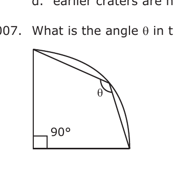
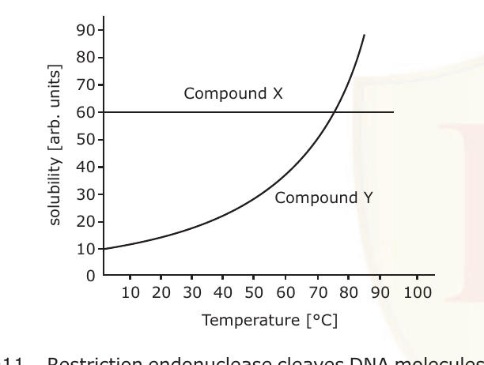
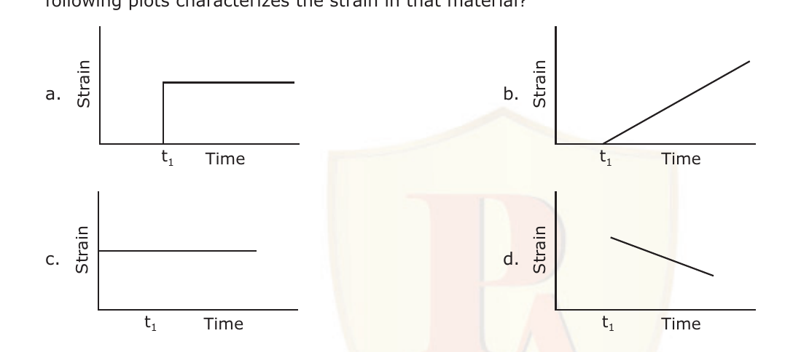
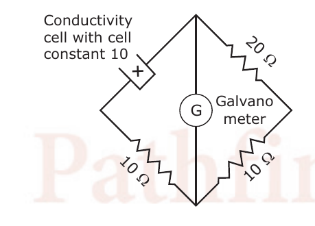
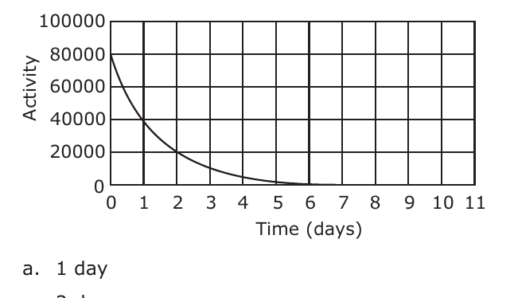

# CSIR NET Life Sciences — December 2011 — Part A

Part – A (General Aptitude / reasoning; 20 questions). Questions transcribed verbatim from the Pathfinder Academy reproduction of the December 2011 paper, cross-checked against the IFAS (Jodhpur) solved-paper reproduction. Answers taken from the answer key printed in the same Pathfinder source (p.27). Option letters a/b/c/d are mapped to 1/2/3/4.

---

### Question 1

Magnesium powder, placed in an air-tight glass container at 1.0 bar, is burnt by focusing sunlight. Part of the magnesium burns off, and some is left behind. The pressure of the air in the container after it has returned to room temperature is approximately

1. 1.0 bar
2. 0.2 bar
3. 1.2 bar
4. 0.8 bar

**Answer: 4 (0.8 bar)**

> **Explanation:** Burning Mg consumes the O₂ in the fixed volume of air (2 Mg + O₂ → 2 MgO). Air is ~20% O₂, so removing the oxygen lowers the pressure by about one-fifth, from 1.0 bar to roughly 0.8 bar.

---

### Question 2

Living beings get energy from food through the process of aerobic respiration. One of the reactants is

1. carbon dioxide
2. water vapour
3. oxygen
4. phosphorus

**Answer: 3 (oxygen)**

> **Explanation:** In aerobic respiration glucose is oxidised using O₂; oxygen is a reactant (C₆H₁₂O₆ + 6O₂ → 6CO₂ + 6H₂O + energy). CO₂ and water are products, not reactants.

---

### Question 3

In ΔABC, angle A is larger than angle C and smaller than angle B by the same amount. If angle B is 67°, angle C is

1. 67°
2. 53°
3. 60°
4. 57°

**Answer: 2 (53°)**

> **Explanation:** "A larger than C and smaller than B by the same amount" gives A − C = B − A, so 2A = B + C. With B = 67°, 2A = 67° + C. Also A + B + C = 180°, so A = 180° − (67° + C). Substituting: 2[180° − (67° + C)] = 67° + C → 360° − 134° − 2C = 67° + C → 3C = 159° → C = 53°.

---

### Question 4

Which of the following statements about the concentration of CO₂ in the Earth's atmosphere is *true?*

1. It was the highest in the very early atmosphere of the Earth.
2. It has steadily decreased since the formation of the Earth's atmosphere.
3. It has steadily increased since the formation of the Earth's atmosphere.
4. Its levels today are the highest in the Earth's history.

**Answer: 1 (It was the highest in the very early atmosphere of the Earth.)**

> **Explanation:** The early atmosphere was rich in CO₂; photosynthetic organisms progressively drew it down into carbonates and biomass, so the highest CO₂ levels were in the very early atmosphere.

---

### Question 5

See the following mathematical manipulations.

1. Let x = 5
2. then x² − 25 = x − 5
3. (x − 5) (x + 5) = x − 5
4. x + 5 = 1 [cancelling (x − 5) from both sides]
5. 10 = 1 [Putting x = 5]

Which of the above is the *wrong* step?

1. 1 to 2
2. 2 to 3
3. 3 to 4
4. 4 to 5

**Answer: 4 (4 to 5)**

> **Explanation:** Step 3→4 divides both sides by (x − 5); since x = 5, that factor is zero, so the cancellation is invalid. The first clearly false numerical result ("10 = 1") appears in moving from step 4 to step 5, which the key marks as the wrong step.

---

### Question 6

The number of craters observed due to meteoritic impacts during the early stages of formation, is less on the Earth than that on the Moon because,

1. formation of craters on the Earth was difficult due to the presence of hard rocks.
2. impacting bodies on the Earth were smaller in size.
3. craters on the earth are now covered by ocean water.
4. earlier craters are not preserved due to continuous modification of Earth's surface by geological processes.

**Answer: 4 (earlier craters are not preserved due to continuous modification of Earth's surface by geological processes.)**

> **Explanation:** Earth's active geology (erosion, weathering, plate tectonics, volcanism) continuously resurfaces the planet and destroys ancient craters, whereas the airless, geologically quiet Moon preserves them.

---

### Question 7

What is the angle θ in the quadrant of a circle shown below?

1. 135°
2. 90°
3. 120°
4. may have any value between 90° and 120°

**Answer: 1 (135°)**

> **Explanation:** P is the mid-point of arc AB; radius OP bisects both ∠θ and APB. Triangles OPA and OPB are isosceles, so the four base angles are equal (say x). In quadrilateral OAPB, 4x = 360° − 90° = 270°, giving x = 67.5°, and ∠θ = 2x = 135°.

---

### Question 8

During a total solar eclipse occurring at noon, it becomes dark enough for a few minutes for stars to become visible. The stars that are seen are those which will be seen from the same location

1. on the following night only
2. on the night one month later
3. on the night three months later
4. on the night six months later

**Answer: 1 (on the following night only)**

> **Explanation:** At a noon eclipse the Sun is on the meridian; the stars momentarily visible near the eclipsed Sun lie along the same line of sight, i.e. the stars that will be on the meridian at midnight on the following night — the Sun having moved ~1°/day, the same star field returns roughly 4 minutes earlier each night and is seen that night.

---

### Question 9

A cupboard is filled with a large number of balls of 6 different colours. You already have one ball of each colour. If you are blind-folded, how many balls do you need to draw to be sure of having 3 colour matched pairs of balls?

1. 3
2. 4
3. 5
4. 6

**Answer: 4 (6)**

> **Explanation:** You already hold one ball of each of the 6 colours. Each drawn ball matches (pairs with) one of the colours you hold. To be *sure* of 3 matched pairs you must draw enough that, even in the worst case where early draws repeat colours, 3 distinct colours are matched — 6 draws guarantee 3 matched pairs by the pigeonhole principle.

---

### Question 10

The variation of solubilities of two compounds X and Y in water with temperature is depicted below. Which of the following statements is *true?*

1. Solubility of Y is less than that of X.
2. Solubility of X varies with temperature.
3. Solubilities of X and Y are the same at 75°C.
4. Solubilities of X and Y are independent of temperature.

**Answer: 3 (Solubilities of X and Y are the same at 75°C.)**

> **Explanation:** X is temperature-independent (flat line at ~60). Y increases with temperature and intersects the X line at about 75°C, so their solubilities are equal at that temperature.

---

### Question 11

Restriction endonuclease cleaves DNA molecules at specific 'recognition sites'. One such enzyme has four recognition sites on a circular DNA molecule. After complete digestion how many fragments would be produced upon reaction with the enzyme?

1. 4
2. 5
3. 3
4. 6

**Answer: 1 (4)**

> **Explanation:** On a circular molecule, each cut opens the circle; n cuts in a circle yield n fragments. Four recognition sites → 4 cuts → 4 fragments.

---

### Question 12

A solid cube of side L floats on water with 20% of its volume under water. Cubes identical to it are piled one-by-one on it. Assume that the cubes do not slip or topple, and the contact between their surfaces is perfect. How many cubes are required to submerge one cube completely?

1. 4
2. 5
3. 6
4. Infinite

**Answer: 1 (4)**

> **Explanation:** One cube alone displaces 0.2 of its volume, so its weight = 0.2·(weight of full displacement). To just submerge the bottom cube, the total weight must equal the weight of one full cube-volume of water = 1.0. With N identical cubes, total weight = 0.2N = 1.0 → N = 5 cubes total, i.e. 4 cubes piled on the original.

---

### Question 13

Inner planets of the solar system are rocky, whereas outer planets are gaseous. One of the reasons for this is that

1. solar heat drove away the gases to the outer region of the solar system.
2. gravitational pull of the sun pulled all rocky material to the inner solar system.
3. outer planets are larger than the inner planets.
4. comets delivered the gaseous materials to the outer planets.

**Answer: 1 (solar heat drove away the gases to the outer region of the solar system.)**

> **Explanation:** Near the young Sun, temperatures were high enough that light volatile gases escaped outward (and were swept by solar radiation/wind), leaving refractory rocky material to condense in the inner region; ices and gases condensed only in the colder outer region.

---

### Question 14

On exposure to desiccation, which of the following bacteria are least likely to experience rapid water loss?

1. Isolated rods
2. Rods in chain
3. Cocci in chain
4. Cocci in clusters

**Answer: 4 (Cocci in clusters)**

> **Explanation:** Water loss scales with surface-area-to-volume ratio. Cocci have the lowest surface-to-volume ratio of the shapes, and clustering further reduces the exposed surface per cell, so cocci in clusters lose water slowest.

---

### Question 15

A bell is rung before giving food to a dog. After doing this continuously for 10 days, which of the following is most likely to happen?

1. The dog learns to ignore the bell.
2. The dog salivates on hearing the bell.
3. The dog ignores food and runs towards the bell.
4. The dog will not eat food without hearing the bell.

**Answer: 2 (The dog salivates on hearing the bell.)**

> **Explanation:** This is classical (Pavlovian) conditioning: repeatedly pairing the neutral bell with food turns the bell into a conditioned stimulus that elicits salivation.

---

### Question 16

When a magnet is made to fall free in air, it falls with an acceleration of 9.8 ms⁻². But when it is made to fall through a long aluminium cylinder, its acceleration decreases, because

1. a part of the gravitational potential energy is lost in heating the magnet.
2. a part of the gravitational potential energy is lost in heating the cylinder.
3. the said experiment was done in the magnetic northern hemisphere.
4. the cylinder shields the gravitational force.

**Answer: 1 (a part of the gravitational potential energy is lost in heating the magnet.)**

> **Explanation:** The falling magnet induces eddy currents in the conducting aluminium cylinder; by Lenz's law these produce a drag force, and the lost gravitational potential energy is dissipated as heat (Joule heating). The key attributes this energy loss to heating of the magnet.

---

### Question 17

For an elastic material, strain is proportional to stress. A constant stress is applied at time t₁. Which of the following plots characterizes the strain in that material?

1. a
2. b
3. c
4. d

**Answer: 1 (a)**

> **Explanation:** For a perfectly elastic material, applying a constant stress produces an instantaneous strain that then stays constant (Hookean response), which is the step-and-hold curve (a).

---

### Question 18

The conductance of a potassium chloride solution is measured using the arrangement depicted below. The specific conductivity of the solution in Sm⁻¹, when there is no deflection in the galvanometer, is

1. 1.0
2. 0.5
3. 2.0
4. 1.5

**Answer: 2 (0.5)**

> **Explanation:** At balance, the unknown cell resistance R satisfies R/20 = 10/10, so R = 20 Ω... using the bridge arms shown the balanced cell resistance works out to 20 Ω. Conductance G = 1/R = 0.05 S; specific conductivity = G × cell constant = 0.05 × 10 = 0.5 S m⁻¹.

---

### Question 19

An overweight person runs 4 km everyday as an exercise. After losing 20% of his body weight, if he has to run the same distance in the same time, the energy expenditure would be

1. 20% more
2. the same as earlier
3. 20% less
4. 40% less

**Answer: 3 (20% less)**

> **Explanation:** Energy expenditure E = ½mv²; with the same speed (same distance in same time) E is proportional to mass. A 20% loss of body weight (mass) makes the ratio E₂:E₁ = W₂:W₁ = 0.8:1, i.e. 20% less.

---

### Question 20

What is the half-life of the radioisotope whose activity profile is shown below?

1. 1 day
2. 3 days
3. 2 days
4. 4 days

**Answer: 1 (1 day)**

> **Explanation:** The activity starts at 80000 and drops to 40000 (one half) at 1 day, to 20000 at 2 days, and so on — each halving takes 1 day, so the half-life is 1 day.
