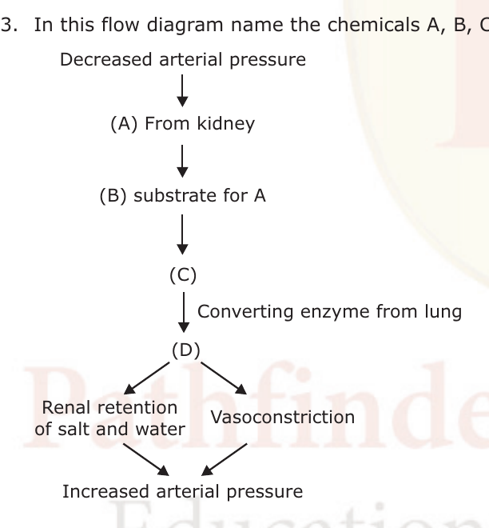

# CSIR NET Life Sciences — December 2011 — Part B

Every question printed under a "Part – B" heading, in the units as printed (Unit 1 through Unit 12 and 13). Question numbers are the **printed** numbers from the paper (021–134 subset). Transcribed verbatim from the Pathfinder Academy reproduction, cross-checked against the IFAS (Jodhpur) solved-paper reproduction. Answers from the answer key printed in the Pathfinder source (p.27); option letters a/b/c/d mapped to 1/2/3/4.

---

### Question 21

In which form of DNA, the number of base pairs per helical turn is 10.5?

1. A
2. B
3. X
4. Z

**Answer: 2 (B)**

> **Explanation:** B-DNA is the physiological form with about 10.5 base pairs per turn (A-form ~11, Z-form ~12).

---

### Question 22

On the molar scale which of the following interactions in a nonpolar environment provides highest contribution to the biomolecule?

1. van der Waals interaction
2. Hydrogen bonding
3. Salt bridge
4. Hydrophobic interaction

**Answer: 3 (Salt bridge)**

> **Explanation:** In a nonpolar (low-dielectric) environment electrostatic interactions are strengthened because there is little screening; a salt bridge therefore contributes the most on a molar basis.

---

### Question 23

Michaelis and Menten derived their equation using which of the following assumption?

1. Rate limiting step in the reaction is the breakdown of ES complex to product and free enzyme.
2. Rate limiting step in the reaction is the formation of ES complex.
3. Concentration of the substrate can be ignored.
4. Non-enzymatic degradation of the substrate is the major step.

**Answer: 1 (Rate limiting step in the reaction is the breakdown of ES complex to product and free enzyme.)**

> **Explanation:** The Michaelis–Menten derivation assumes the conversion of ES → E + P (k₂) is rate-limiting and that ES is in a steady state; substrate concentration cannot be ignored.

---

### Question 30

In contrast with plant cells, the most distinctive feature of cell division in animal cells is

1. control of cell cycle transitions by protein kinases.
2. enzymes responsible for DNA replication.
3. ubiquitin-dependent pathway for protein degradation.
4. pattern of chromosome movement.

**Answer: 4 (pattern of chromosome movement.)**

> **Explanation:** Animal cells divide using an astral spindle in which chromosomes are moved by pulling from poleward microtubule forces (and an actin contractile ring cleaves the cell), a pattern distinct from the anastral spindle of most plant cells.

---

### Question 31

The membrane lipid molecules assemble spontaneously into bilayers when placed in water and form a closed spherical structure known as

1. lysosome
2. peroxisome
3. liposome
4. endosome

**Answer: 3 (liposome)**

> **Explanation:** A closed spherical phospholipid bilayer formed spontaneously in water is a liposome (an artificial vesicle); lysosomes, peroxisomes and endosomes are membrane-bounded organelles with proteins, not simple lipid assemblies.

---

### Question 32

Most common type of phospholipid in the cell membrane of nerve cells is

1. phosphatidylcholine
2. phosphatidylinositol
3. phosphatidylserine
4. sphingomyelin

**Answer: 4 (sphingomyelin)**

> **Explanation:** Nerve (neural) membranes, especially myelin, are unusually rich in sphingolipids; sphingomyelin is the characteristic/most relevant phospholipid here.

---

### Question 36

A single-strand nick in the parental DNA helix just ahead of a replication fork causes the replication fork to break. Recovery from this calamity requires

1. DNA ligase
2. DNA primase
3. site-specific recombination
4. homologous recombination

**Answer: 4 (homologous recombination)**

> **Explanation:** A broken replication fork is restored by recombinational repair using the sister duplex as a template — homologous recombination (e.g. RecA/Ruvsom pathway) re-forms a continuous fork.

---

### Question 37

α-amanitin inhibits

1. only RNA polymerase I
2. only RNA polymerase II
3. only RNA polymerase III
4. all RNA polymerases

**Answer: 2 (only RNA polymerase II)**

> **Explanation:** In eukaryotic cells RNA polymerase II is rapidly inhibited by low concentrations of α-amanitin; Pol I is not inhibited and Pol III is only inhibited at high levels in some cells. The key marks Pol II.

---

### Question 38

Reverse transcriptase has both ribonuclease and polymerase activities. Ribonuclease activity is required for

1. the synthesis of new RNA strand
2. the degradation of RNA strand
3. the synthesis of new DNA strand
4. the degradation of DNA strand

**Answer: 2 (the degradation of RNA strand)**

> **Explanation:** The RNase H activity of reverse transcriptase degrades the RNA strand of the RNA–DNA hybrid so that the second (DNA) strand can be made; the ribonuclease function is the degradation of the RNA strand.

---

### Question 39

In gene regulation, open reading frame (ORF) implies

1. intervening nucleotide sequence in between two genes.
2. a series of triplet codons not interrupted by a stop codon.
3. a series of triplet codons that begins with a start codon and ends with a stop codon.
4. the exonic sequence of a gene that corresponds to the 5'UTR of the mRNA and thus does not code for the protein.

**Answer: 2 (a series of triplet codons not interrupted by a stop codon.)**

> **Explanation:** An ORF is a stretch of codons in one reading frame that is not interrupted by a stop codon — the defining feature being the absence of an in-frame stop signal.

---

### Question 40

While replicating DNA, the rate of misincorporation by DNA polymerase is 1 in 10⁵ nucleotides. However, the actual error rate in the replicated DNA is 1 in 10⁹ nucleotides incorporated. This is achieved mainly due to

1. spontaneous excision of misincorporated nucleotides.
2. 3′ → 5′ proofreading activity of DNA polymerase.
3. termination of DNA polymerase at misincorporated sites.
4. 5′ → 3′ proofreading activity.

**Answer: 2 (3′ → 5′ proofreading activity of DNA polymerase.)**

> **Explanation:** The intrinsic 3′→5′ exonuclease (proofreading) of replicative DNA polymerases removes mismatched nucleotides, improving fidelity from ~10⁻⁵ to ~10⁻⁷–10⁻⁸ (further helped by mismatch repair).

---

### Question 41

Amino acid selenocysteine (Sec) is incorporated into polypeptide chain during translation by

1. charging of Sec into tRNA^Ser followed by incorporation through serine codon.
2. charging of serine into tRNA^Ser followed by modification of serine into selenocysteine and then incorporation through serine codon.
3. charging of Sec into tRNA^Ser and then incorporation through selenocysteine codon.
4. charging of serine into tRNA^Sec, modification of serine into selenocysteine and then incorporation through a specially placed stop codon.

**Answer: 4 (charging of serine into tRNA^Sec, modification of serine into selenocysteine and then incorporation through a specially placed stop codon.)**

> **Explanation:** Sec is made on its own tRNA: Ser is charged onto tRNA^[Ser]Sec and then enzymatically converted to Sec, which is inserted at a specific in-frame UGA codon (a "stop" codon recoded by a SECIS element).

---

### Question 48

Graft rejection does not involve

1. erythrocytes
2. T-cells
3. macrophages
4. polymorphonuclear leukocytes

**Answer: 1 (erythrocytes)**

> **Explanation:** Graft rejection is an immune response driven by T-cells, macrophages and other leukocytes; red blood cells (erythrocytes) do not participate in the immunological rejection response.

---

### Question 49

Toxic shock is caused by

1. toxins produced by some bacteria
2. excessive stimulation of a large proportion of T-cells by bacterial superantigens
3. abnormal cytokine production by B-cells
4. excessive production of immunoglobulins

**Answer: 2 (excessive stimulation of a large proportion of T-cells by bacterial superantigens)**

> **Explanation:** Toxic-shock syndrome results from superantigens (e.g. TSST-1) that cross-link MHC II and TCR outside the normal antigen groove, activating a large fraction of T-cells and triggering a cytokine storm.

---

### Question 50

Indirect immunofluorescence involves fluorescently labelled

1. immunoglobulin-specific antibodies
2. antigen-specific antibodies
3. hapten-specific antibodies
4. carrier-specific antibodies

**Answer: 1 (immunoglobulin-specific antibodies)**

> **Explanation:** In indirect immunofluorescence the primary (antigen-specific) antibody is unlabeled and is detected by a fluorescent secondary antibody directed against immunoglobulin — i.e. an immunoglobulin-specific antibody.

---

### Question 60

The blastopore region of amphibian embryo that secretes BMP inhibitors and dorsalizes the surrounding tissue is known as

1. Brachet's cleft
2. Nieuwkoop center
3. Spemann's organizer
4. Hensen's node

**Answer: 3 (Spemann's organizer)**

> **Explanation:** The dorsal lip of the blastopore — Spemann's organizer — secretes BMP antagonists (chordin, noggin, follistatin) that dorsalize neighbouring tissue. (Hensen's node is its amniote equivalent; Nieuwkoop center is the inducing dorsal vegetal region.)

---

### Question 61

Which of the floral whorls is affected in *agamous (ag)* mutants?

1. Sepals and petals
2. Petals and stamens
3. Stamens and carpels
4. Sepals and carpels

**Answer: 3 (Stamens and carpels)**

> **Explanation:** *AGAMOUS* is the class C gene; loss of C function converts stamens and carpels (whorls 3 and 4) into petals and sepals respectively, so the affected whorls are stamens and carpels.

---

### Question 62

Which of the following maternal effect gene products regulate production of anterior structures in *Drosophila* embryo?

1. Bicoid and Nanos
2. Bicoid and Hunchback
3. Bicoid and Caudal
4. Nanos and Caudal

**Answer: 2 (Bicoid and Hunchback)**

> **Explanation:** Anterior patterning depends on the Bicoid gradient, which activates the maternal gap gene *hunchback*; Bicoid and Hunchback together specify anterior structures (Nanos and Caudal are posterior determinants).

---

### Question 69

Which of the following is *not* a prosthetic group of nitrate reductase?

1. FAD
2. Heme
3. Mo
4. Pterin

**Answer: 4 (Pterin)**

> **Explanation:** Eukaryotic (assimilatory) nitrate reductase carries FAD, haem (cytochrome b) and a molybdenum cofactor as prosthetic groups; pterin is not a prosthetic group of this enzyme.

---

### Question 70

Which of the following acts as a branch point for the biosynthesis of sesquiterpenes and triterpenes?

1. Farnesyl pyrophosphate
2. Geranyl pyrophosphate
3. Isopentyl pyrophosphate
4. Hydroxymethylglutaryl–CoA

**Answer: 1 (Farnesyl pyrophosphate)**

> **Explanation:** Farnesyl pyrophosphate (FPP, C15) is the precursor of sesquiterpenes and, by dimerisation, of triterpenes (via squalene), so it is the branch point between these two classes.

---

### Question 71

Which of the following set of cell organelles are involved in the biosynthesis of jasmonic acid through octadecanoid signalling pathway?

1. Chloroplast and peroxisomes
2. Chloroplast and mitochondria
3. Mitochondria and peroxisomes
4. Golgi bodies and mitochondria

**Answer: 1 (Chloroplast and peroxisomes)**

> **Explanation:** The octadecanoid pathway starts in the chloroplast (lipase/oxygenase releasing and modifying the C18 fatty acid) and continues through the peroxisome where β-oxidation steps shorten the chain to JA.

---

### Question 72

During development of embryos in plants, PIN proteins are involved in

1. establishment of auxin gradients
2. regulation of gene expression
3. induction of programmed cell death
4. induction of cell division

**Answer: 1 (establishment of auxin gradients)**

> **Explanation:** PIN proteins are the polarly-localised auxin efflux carriers whose asymmetric distribution generates directional auxin fluxes and thus the auxin concentration gradients that pattern the embryo.

---

### Question 73

Chloroplast distribution in a photosynthesizing cell is governed by blue light sensing phototropin 2 (PHOT2). When the cells are irradiated with high intensity blue light, the chloroplasts

1. move to the side walls
2. aggregate in the middle of the cell
3. are sparsely distributed
4. aggregate in small clusters

**Answer: 1 (move to the side walls)**

> **Explanation:** Under high-intensity blue light, PHOT2 mediates the chloroplast avoidance (escape) response, moving chloroplasts to the cell side walls to minimise photodamage.

---

### Question 74

Ethylene binding to its receptor, *does not* lead to

1. dimerization of the receptor
2. phosphorylation of the receptor
3. activation of CTR Raf kinase
4. endocytosis of ethylene-receptor complex

**Answer: 2 (phosphorylation of the receptor)**

> **Explanation:** Ethylene binding inactivates the receptor, which stops the CTR1 Raf-like kinase; the receptor is not itself phosphorylated as a consequence of hormone binding. (Ethylene binding does promote receptor clustering/endocytosis.)

---

### Question 75

Which of the following features is *not* shown by glyphosate, a broad spectrum herbicide?

1. Little residual soil activity.
2. Ready translocation in phloem.
3. Inhibition of a chloroplast enzyme catalyzing the synthesis of aromatic amino acids.
4. Inhibition of early steps in the biosynthesis of branched chain amino acids.

**Answer: 4 (Inhibition of early steps in the biosynthesis of branched chain amino acids.)**

> **Explanation:** Glyphosate inhibits EPSP synthase in the chloroplast shikimate pathway (aromatic amino acids); it is readily phloem-translocated with little soil residual activity. It does not act on branched-chain amino acid biosynthesis (that is the target of other herbicides such as the sulfonylureas/illegitimate sites).

---

### Question 81

In a normal human eye, for sharp image formation on the retina, maximum dioptric power is provided by the

1. retina
2. cornea
3. anterior surface of the lens
4. posterior surface of the lens

**Answer: 2 (cornea)**

> **Explanation:** Most of the eye's refractive (dioptric) power comes from the cornea, where the air–cornea interface has the largest change in refractive index; the lens provides accommodation but less total power.

---

### Question 82

Which of the following waves is likely to be absent in a normal frog EGG?

1. P
2. Q
3. T
4. R

**Answer: 2 (Q)**

> **Explanation:** The amphibian (frog) electrogram recorded from the heart lacks the characteristic Q deflection seen in the mammalian ECG; P, R and T equivalents are present.

---

### Question 83

In this flow diagram name the chemicals A, B, C and D in proper sequence.

1. Renin, Angiotensin II, Angiotensin I, Angioten-sinogen.
2. Angiotensin I, Angiotensinogen, Angiotensin II, Renin.
3. Renin, Angiotensin I, Angiotensin II, Angioten- sinogen.
4. Renin, Angiotensinogen, Angiotensin I, Angioten-sin II.

**Answer: 4 (Renin, Angiotensinogen, Angiotensin I, Angioten-sin II.)**

> **Explanation:** The kidney releases renin (A), which acts on its substrate angiotensinogen (B) to form angiotensin I (C); ACE from the lung converts this to angiotensin II (D), causing salt/water retention and vasoconstriction.

---

### Question 91

A plant of the genotype AaBb is selfed. The two genes are linked and are 50 map units apart. What proportion of the progeny will have the genotype aabb?

1. 1/2
2. 1/4
3. 1/8
4. 1/16

**Answer: 4 (1/16)**

> **Explanation:** 50 map units means the loci behave as if unlinked (recombination frequency 0.5), so AaBb selfed gives gametes AB, Ab, aB, ab each at 1/4. The aabb progeny require ab × ab = 1/4 × 1/4 = 1/16.

---

### Question 92

The base analog 2-aminopurine pairs with thymine, and can occasionally pair with cytosine. The type of mutation induced by 2-aminopurine is

1. transversion
2. transition
3. deletion
4. nonsense

**Answer: 2 (transition)**

> **Explanation:** Base analogs like 2-aminopurine mispair between purine-like and pyrimidine-like partners, producing purine↔purine / pyrimidine↔pyrimidine changes — i.e. transitions.

---

### Question 93

What kind of aneuploid gametes will be generated if meiotic non-disjunction occurs at first division? ('n' represents the haploid number of chromosomes)

1. only n + 1 and n
2. only n – 1 and n
3. both n + 1 and n – 1
4. either n + 1 or n – 1

**Answer: 3 (both n + 1 and n – 1)**

> **Explanation:** Non-disjunction at meiosis I (homologs failing to separate) yields gametes that are all unbalanced — half n+1 and half n−1 — so both n+1 and n−1 aneuploid gametes are produced.

---

### Question 100

Aquatic primary production was measured using Light-and-Dark Bottle technique. If the initial oxygen concentration was I and the final oxygen concentration in the light bottle was L and that in the dark bottle D, the gross productivity (in terms of oxygen released) is given as

1. L – I
2. I – D
3. I – L
4. L – D

**Answer: 4 (L – D)**

> **Explanation:** Gross primary production = net production + respiration = (L − I) + (I − D) = L − D. The light–dark difference gives total oxygen produced.

---

### Question 101

Which of the following processes interferes in sequence-based phylogeny?

1. Horizontal gene transfer
2. Adaptive mutations
3. DNA repair
4. Reverse transcription

**Answer: 1 (Horizontal gene transfer)**

> **Explanation:** Horizontal (lateral) gene transfer moves sequences between unrelated lineages, violating the assumption of vertical descent that sequence-based phylogenies rely on.

---

### Question 102

Which of the following groups of species are typical of grassland habitats in India?

1. Black buck, wolf, great Indian bustard, lesser florican.
2. Spotted deer, dhole, peacock, finch-lark.
3. Sambar, tiger, paradise fly catcher.
4. Otter, cormorant, darter, pelican.

**Answer: 1 (Black buck, wolf, great Indian bustard, lesser florican.)**

> **Explanation:** Black buck, wolf, great Indian bustard and lesser florican are characteristic open-grassland/grassland species of India; the others are forest (sambar, tiger, dhole) or wetland (otter, cormorant, darter, pelican) species.

---

### Question 103

The atmosphere in a sealed space craft contains

1. pure oxygen
2. a mix of oxygen and nitrogen
3. a mix of oxygen and carbon dioxide
4. pressurised atmospheric air available normally on earth

**Answer: 2 (a mix of oxygen and nitrogen)**

> **Explanation:** A crewed sealed spacecraft maintains an oxygen–nitrogen atmosphere (nitrogen as a diluent) rather than pure O₂, to allow safe long-duration habitation.

---

### Question 104

The Hutchinsonian concept of ecological niche is based on

1. microhabitat occupied.
2. multidimensional hypervolume.
3. role played in the ecosystem.
4. a combination of role played and microhabitat occupied.

**Answer: 2 (multidimensional hypervolume.)**

> **Explanation:** Hutchinson defined the niche as an n-dimensional hypervolume bounded by the environmental conditions and resources within which a species can persist.

---

### Question 105

A specialist species has a

1. wider niche and high efficiency of niche utilization.
2. narrower niche and high efficiency of niche utilization.
3. wider niche and low efficiency of niche utilization.
4. narrower niche and low efficiency of niche utilization.

**Answer: 2 (narrower niche and high efficiency of niche utilization.)**

> **Explanation:** A specialist occupies a narrow (small) niche but uses the resources within it very efficiently, in contrast to a generalist with a broad niche used less efficiently.

---

### Question 106

The rattans and canes that we use in furniture belong to

1. bamboos
2. palms
3. arborescent lilies
4. legumes

**Answer: 2 (palms)**

> **Explanation:** Rattans and canes are climbing palms of the subfamily Calamoideae (e.g. *Calamus*), not bamboos (grasses).

---

### Question 107

Horse shoe crabs belong to the group

1. Onychophora
2. Chelicerata
3. Uniramia
4. Crustacea

**Answer: 2 (Chelicerata)**

> **Explanation:** Horseshoe crabs (Xiphosura) are chelicerate arthropods, related to arachnids, possessing chelicerae and lacking antennae.

---

### Question 108

The presence of *Salmonella* in tap water is indicative of contamination with

1. industrial effluents
2. human excreta
3. agriculture waste
4. kitchen waste

**Answer: 2 (human excreta)**

> **Explanation:** *Salmonella* is an enteric pathogen shed in faeces; its presence in water indicates faecal (human excreta) contamination.

---

### Question 109

Which of the following is not a physiological characteristic of early successional plants?

1. High respiration rate
2. Inhibition by far-red light
3. High transpiration rate
4. Low photosynthetic rate

**Answer: 4 (Low photosynthetic rate)**

> **Explanation:** Early-successional (ruderal/pioneer) species are fast-growing with high photosynthetic and respiration rates and high transpiration; a low photosynthetic rate is not characteristic of them.

---

### Question 110

In transverse sections of a young stem, if vallecular canals and carinal canals are present, then the plant belongs to

1. lycopodiales
2. isoetales
3. selaginellales
4. equisetales

**Answer: 4 (equisetales)**

> **Explanation:** Vallecular (below-node) and carinal (above-node) canals are the characteristic air-canal system of the stem anatomy of *Equisetum* (Equisetales).

---

### Question 111

*Batrachochytrium dendrobatidis*, a fungus, has been implicated in the decline of populations of

1. fish
2. frogs
3. pelicans
4. bats

**Answer: 2 (frogs)**

> **Explanation:** *Batrachochytrium dendrobatidis* causes chytridiomycosis, a disease responsible for massive declines and extinctions of amphibian (frog) populations worldwide.

---

### Question 112

Wetlands are conserved internationally through an effort called as

1. Basel convention
2. Rio convention
3. Montreal convention
4. Ramsar convention

**Answer: 4 (Ramsar convention)**

> **Explanation:** The Ramsar Convention (1971, on Wetlands of International Importance) is the treaty for the conservation and sustainable use of wetlands.

---

### Question 123

The first living beings on earth were anaerobic because

1. there was no oxygen in air
2. oxygen damages proteins
3. oxygen interferes with the action of ribozymes
4. they evolved in deep sea

**Answer: 1 (there was no oxygen in air)**

> **Explanation:** The early atmosphere was essentially anoxic (before oxygenic photosynthesis), so the first organisms could only have been anaerobes.

---

### Question 124

The peacock's tail is an example of

1. natural selection
2. diversifying selection
3. sexual selection
4. group selection

**Answer: 3 (sexual selection)**

> **Explanation:** The peacock's elaborate tail is the classic result of sexual selection (female choice / male–male competition), a trait favoured for mating success rather than survival.

---

### Question 131

To keep them in a totipotent state, embryonic stem cells need to be maintained in a medium supplemented with

1. growth hormone
2. leukemia inhibiting factor
3. nestin
4. insulin

**Answer: 2 (leukemia inhibiting factor)**

> **Explanation:** Mouse embryonic stem cells are maintained undifferentiated (totipotent/pluripotent state) in medium supplemented with leukaemia inhibitory factor (LIF).

---

### Question 132

One of the methods for finding common regulatory motifs present in a set of coregulated genes is

1. Prosite
2. MEME
3. MatInspector
4. PSSM

**Answer: 2 (MEME)**

> **Explanation:** MEME (Multiple EM for Motif Elicitation) is a de novo motif-discovery tool that finds common regulatory sequence motifs in a set of co-regulated genes. (Prosite finds protein motifs; MatInspector/PSSM scan known motifs.)

---

### Question 133

Measurement and mapping with spatial resolution the membrane potential of a cell, which is too small for microelectrode impalement, is done using

1. radioisotope
2. voltage-sensitive dye
3. pH sensitive chemical
4. vital dyes

**Answer: 2 (voltage-sensitive dye)**

> **Explanation:** Voltage-sensitive (potentiometric) dyes report changes in membrane potential optically with spatial resolution, allowing mapping in cells too small for microelectrode impalement.

---

### Question 134

A sample counted for one minute shows a count rate of 752 cpm. For how many minutes should it be counted to have 1% probable error?

1. 13
2. 5
3. 2
4. 75

**Answer: — (This question is marked DROPPED in the answer key; no official answer.)**

> **Explanation:** The Pathfinder answer key lists "–" for Q134, i.e. the question was dropped; no official correct option is given. (Reasoning for reference: probable error = 0.6745/√N; for 1% one needs N ≈ 4516 counts, i.e. ≈ 6 min at 752 cpm — none of the options matches cleanly, consistent with the drop.)
