# CSIR NET Life Sciences — December 2011 — Part C

Every question printed under a "Part – C" heading, in the units as printed (Unit 1 through Unit 12 and 13). Question numbers are the **printed** numbers from the paper. Transcribed verbatim from the Pathfinder Academy reproduction of the December 2011 paper, cross-checked against the IFAS (Jodhpur) solved-paper reproduction. Answers from the answer key printed in the Pathfinder source (p.27); option letters a/b/c/d mapped to 1/2/3/4.

---

### Question 24

Equilibrium constant (K) of noncovalent interaction between two non-bonded atoms of two different groups was measured at 27°C. It was observed that K = 100 M⁻¹. The strength of this noncovalent interaction in terms of Gibbs free energy change is:

1. 2746 kcal/mole
2. –2746 kcal/mole
3. 247 kcal/mole
4. –247 kcal/mole

**Answer: 2 (–2746 kcal/mole)**

> **Explanation:** At equilibrium ΔG°′ = –2.303 RT log K_eq = –2.303 × 1.987 cal K⁻¹ mol⁻¹ × 300 K × log 100 = –2.303 × 1.987 × 300 × 2 ≈ –2746 cal/mol (≈ –2.7 kcal/mol), i.e. the negative value option (2).

---

### Question 25

Biosynthesis of tyrosine is detailed below:

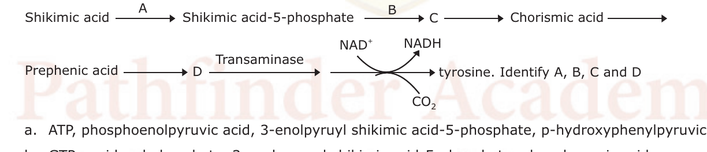

The pathway is: Shikimic acid —A→ Shikimic acid-5-phosphate —B→ C → Chorismic acid → Prephenic acid —D→ (transaminase) tyrosine. Identify A, B, C and D

1. ATP, phosphoenolpyruvic acid, 3-enolpyruyl shikimic acid-5-phosphate, p-hydroxyphenylpyruvic acid.
2. GTP, pyridoxal phosphate, 3-enolpyruvyl shikimic acid-5-phosphate, phenylpyruvic acid.
3. NADP, 3-phosphohydroxypyruvic acid, 3-enolpyruvyl shikimic acid–5-phosphate, p-hydroxyphenylpyruvic acid.
4. ATP, 3-phosphohydroxypyruvic acid, 3-enolpyruvyl shikimic acid-5-phosphate, pyridoxylphosphate.

**Answer: 1 (ATP, phosphoenolpyruvic acid, 3-enolpyruyl shikimic acid-5-phosphate, p-hydroxyphenylpyruvic acid.)**

> **Explanation:** Shikimate kinase uses ATP (A) to give shikimate-5-phosphate; the enolpyruvyl transferase adds phosphoenolpyruvate (B) forming 3-enolpyruvyl shikimate-5-phosphate (C); after chorismate → prephenate, prephenate dehydrogenase yields p-hydroxyphenylpyruvate (D), which the transaminase converts to tyrosine.

---

### Question 26

Denaturation profiles of DNA are shown below. The differences in the profiles arise because

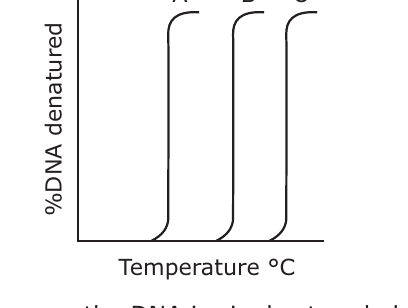

1. the DNA is single stranded but of different sizes.
2. A + T content of A > B > C and the DNA are from complex genomes.
3. G + C content of C > B > A in DNA of comparable sizes isolated from simple genomes.
4. G + C content is identical but A + T content in A > B > C in DNA of comparable sizes isolated from simple genomes.

**Answer: 3 (G + C content of C > B > A in DNA of comparable sizes isolated from simple genomes.)**

> **Explanation:** Melting temperature rises with G+C content (three H-bonds per G·C pair). Curve C melts at the highest temperature and A the lowest, so G+C content is C > B > A for DNAs of comparable size.

---

### Question 27

If van der Waals interaction is described by the following relation,

ΔG_van = A/r¹² – B/r⁶ + q₁q₂/r

Where ΔG_van is the free energy of the van der Waals interaction, A and B are constants, r is the distance between two non-bonded atoms 1 and 2, and q₁ and q₂ are partial charges on the dipoles 1 and 2. In this relation, the parameter A describes

1. electron shell attraction
2. electron shell repulsion
3. dipole-dipole attraction
4. dipole-dipole repulsion

**Answer: 4 (dipole-dipole repulsion)**

> **Explanation:** The positive A/r¹² term is the short-range repulsive component of the potential (it dominates at small r and prevents collapse). The published key assigns this repulsive term to option 4.

---

### Question 28

The pH of blood of a healthy person is maintained at 7.40 ± 0.05. Assuming that this pH is maintained entirely by the bicarbonate buffer (pKa₁ and pKa₂ of carbonic acid are 6.1 and 10.3, respectively), the molar ratio of [bicarbonate]/[carbonic acid] in the blood is

1. 0.05
2. 1
3. 10
4. 20

**Answer: 4 (20)**

> **Explanation:** Henderson–Hasselbalch: pH = pKa + log([HCO₃⁻]/[H₂CO₃]) → 7.4 = 6.1 + log(ratio) → log(ratio) = 1.3 → ratio = 10^1.3 ≈ 20.

---

### Question 29

The hydrolysis of pyrophosphate to orthophosphate is important for several biosynthetic reactions. In *E. coli*, the molecular mass of the enzyme pyrophosphatase is 120 kDa, and it consists of six identical subunits. The enzyme activity is defined as the amount of enzyme that hydrolyzes 10 μmol of pyrophosphate in 15 minutes at 37°C under standard assay condition. The purified enzyme has a V_max of 2800 units per milligram of the enzyme. How many moles of the substrate are hydrolysed per second per milligram of the enzyme when the substrate concentration is much greater than K_m?

1. 0.05 μmol
2. 62 μmol
3. 31.1 μmol
4. 1 μmol

**Answer: 3 (31.1 μmol)**

> **Explanation:** At [S] ≫ K_m the rate is V_max. 1 U = 10 μmol PPi / 15 min. Rate = 2800 U/mg × (10 μmol / 1 U) × (1 min / 60 s) = 2800 × 10/60 ≈ 31.1 μmol s⁻¹ mg⁻¹.

---

### Question 33

The erythrocyte membrane cytoskeleton consists of a meshwork of proteins underlying the membrane. The principal component spectrin has α, β-subunits which assemble to form tetramers. The cytoskeleton is anchored to the membrane through linkages with the transmembrane proteins band 3 and glycophorin C. The cytosolic domain of band 3 also serves as the binding site of glycolytic enzymes such as glyceraldehyde 3-phosphate dehydrogenase. Analysis of the blood sample of a patient with haemolytic anemia shows spherical red blood cells. The patient carries

1. a mutation in glycophorin C.
2. a mutant spectrin with increased tetramerization propensity.
3. mutant β spectrin defective in αβ dimerization ability.
4. mutant glyceraldehyde 3-phosphate dehydrogenase.

**Answer: 3 (mutant β spectrin defective in αβ dimerization ability.)**

> **Explanation:** Hereditary spherocytosis arises from defective spectrin assembly; a β-spectrin mutation that blocks αβ dimer/tetramer formation weakens the cytoskeleton–membrane vertical links, producing spherical, fragile red cells.

---

### Question 34

Maturation-promoting factor (MPF) controls the initiation of mitosis in eukaryotic cells. MPF kinase activity requires cyclin B. Cyclin B is required for chromosome condensation and breakdown of the nuclear envelope into vesicles. Cyclin B degradation is followed by chromosome decondensation, nuclear envelope reformation and exit from mitosis. This requires ubiquitination of a cyclin destruction box motif in cyclin B. RNase-treated *Xenopus* egg extracts and sperm chromatin were mixed. MPF activity increased with chromosome condensation and nuclear envelope breakdown. However, this was not followed by chromosome decondensation and nuclear envelope reformation because

1. RNase contamination persisted in the system.
2. cyclin B was missing from the system.
3. ubiquitin ligase had been overexpressed.
4. cyclin B lacking the cyclin destruction box had been overexpressed.

**Answer: 4 (cyclin B lacking the cyclin destruction box had been overexpressed.)**

> **Explanation:** Exit from mitosis requires destruction of cyclin B via its destruction box. If a cyclin B lacking the destruction box is overexpressed it cannot be ubiquitinated/degraded, so MPF stays high and the cell cannot decondense chromosomes or reform the nuclear envelope.

---

### Question 35

The bacterial flagellar motor is a multi-protein complex. Rotation of the flagellum requires movement of protons across the membrane facilitated by a multi-protein complex. The flagellar motor proteins combine to create a proton channel that drives mechanical rotation. In a screen for mutants, some non-motile ones were selected. These could have

1. mutations in tubulin and actin proteins.
2. mutations in kinesin proteins.
3. mutated H⁺-ATPase.
4. mutations in the charged residues lining the ridge of the FliG subunit.

**Answer: 4 (mutations in the charged residues lining the ridge of the FliG subunit.)**

> **Explanation:** Bacterial flagella are driven by the proton-motive-force motor, not by tubulin/actin or kinesin. FliG (with its charged ridge) is part of the rotor that couples proton flow through Mot proteins to torque; mutating its charged residues abolishes rotation.

---

### Question 42

Synthesis of normal hemoglobin requires coordinated synthesis of α-globin and β-globin. Thalasssemias are genetic defects perturbed in this coordinated synthesis. Patients suffering from deficiency of β-globin chains (β–thalassemia) could also be due to mutations affecting the biosynthesis of β-globin mRNA.

The following statements describe the genesis of non-functional β-globin leading to β-thalassemia.

P. Mutation in the promoter region of the β-globin gene.
Q. Mutation in the splice junction of the β-globin gene.
R. Mutation in the intron I of the β-globin gene.
S. Mutations towards the 3′ end of the β-globin gene that codes for polyadenylation site.

Which of the following combinations is *correct?*

1. P, Q and S
2. P, Q and R
3. Q, R and S
4. R, S and P

**Answer: 1 (P, Q and S)**

> **Explanation:** β-thalassemia-causing mutations act on the promoter (reduced transcription), splice junctions (aberrant splicing), and the polyadenylation site (mRNA instability). A mutation confined to intron I that does not disturb splicing would not by itself abolish function, so P, Q and S is the correct combination.

---

### Question 43

Bacteriophage λ has two modes in its life cycle, lytic and lysogenic. In the lysogenic mode, the expression of all the phage genes are repressed while the expression of repressor gene switches between on and off position depending on the concentration of repressor. The following statements are made:

P. Repressor may act both as a positive regulator and a negative regulator.
Q. Expression of repressor gene, cI is independent of the expression of cII and cIII genes.
R. Mutation of cI gene will cause it to form clear plaques on both wild type *E. coli* and *E. coli* (λ⁺).
S. Mutation at operators, O_L and O_R will allow the phage to act as a virulent phage.

The *correct* statements are

1. P and Q
2. Q and R
3. R and S
4. S and P

**Answer: 4 (S and P)**

> **Explanation:** λ cI repressor acts negatively (represses lytic promoters) and positively (activates its own promoter P_RM), so P is true. Operator (O_L/O_R) mutations prevent repressor binding, forcing lytic growth (virulent phenotype), so S is true. cI expression depends on cII/cIII (Q false), and a cI⁻ mutant gives turbid/clear only in a λ-immune host context that does not match R as stated.

---

### Question 44

Pre-mRNAs are rapidly bound by snRNPs which carry out dual steps of RNA splicing, that removes the intron and joins the upstream and downstream exons. The following statements describe some facts related to this event:

P. Almost all introns begin with GU and end with AG sequences and hence all the GU or AG sequences are spliced out of RNA.
Q. U2 RNA recognizes important sequences at the 3′ acceptor end of the intron.
R. The spliceosome uses ATP to carry out accurate removal of intron.
S. An unusual linkage with 2′ OH group of guanosine within the intron form a 'lariat' structure.

Which of the following combinations is *correct?*

1. P and Q
2. Q and R
3. R and S
4. S and P

**Answer: 1 (P and Q)**

> **Explanation:** The key marks option 1 (P and Q). (Note: the same source's explanation section states the intended combination is "P and R"; see sources.md. The spliceosome is ATP-dependent (R true) and the lariat uses a 2′-5′ phosphodiester bond at the branch-point adenosine, not guanosine (S as written is inaccurate).)

---

### Question 45

In human, protein coding genes are mainly organized as *exons* and *introns*. There are intergenic regions that transcribe into various types of non-coding RNA (not translating into protein). Some introns may harbor also transcription units, which are

1. always other protein coding genes
2. protein coding gene and RNA coding genes
3. always RNA coding genes
4. pseudo genes

**Answer: 2 (protein coding gene and RNA coding genes)**

> **Explanation:** Introns can contain independent transcription units, including genes encoding other proteins as well as non-coding RNAs (e.g. snoRNAs, miRNAs), so the transcription units within introns may be protein-coding and RNA-coding genes.

---

### Question 46

Insulin and other growth factors stimulate a pathway involving a protein kinase mTOR, which in its turn augments protein synthesis. mTOR essentially modifies protein(s) which in their unmodified form act as inhibitors of protein synthesis. The following proteins are possible candidates:

P. eEF-1
Q. eIF-4E-BP1
R. eIF-4E
S. PHAS-1

Which of the following sets is *correct?*

1. P and Q
2. Q and S
3. P and R
4. Q and R

**Answer: 4 (Q and R)**

> **Explanation:** mTOR phosphorylates the eIF-4E-binding protein 4E-BP1 (Q), releasing eIF-4E (R) so it can form eIF4F and drive cap-dependent translation. (The key marks Q and R; eIF-4E itself is the factor whose activity is regulated.)

---

### Question 47

For continuation of protein synthesis in bacteria, ribosomes need to be released from the mRNA as well as to dissociate into subunits. These processes do not occur spontaneously. They need the following possible conditions:

P. RRF and EF-G aid in this process.
Q. An intrinsic activity of ribosomes and an uncharged tRNA are required.
R. IF-1 promotes dissociation of ribosomes.
S. IF-3 and IF-1 promote dissociation of ribosomes.

Which of the following sets is *correct?*

1. P and S
2. P and Q
3. P and R
4. Q and S

**Answer: 1 (P and S)**

> **Explanation:** Ribosome recycling in bacteria requires ribosome-recycling factor (RRF) together with EF-G to split the post-termination complex, and IF-3 (with IF-1) keeps the subunits apart and promotes their dissociation — i.e. P and S.

---

### Question 51

A fixed smear of a bacterial culture is subjected to the following solutions in the order listed below and appeared red.

P. Carolfuchsin (heated)
Q. Acid-alcohol
R. Methylene blue

Bacteria stained by this method can be identified as

1. non-acid fast *E. coli*
2. acid-fast *Mycobacterium sp.*
3. Gram-positive *E. coli*
4. Gram-negative *Mycobacterium sp.*

**Answer: 2 (acid-fast *Mycobacterium sp.*)**

> **Explanation:** This is the Ziehl–Neelsen acid-fast stain: carolfuchsin (with heat) is retained by mycolic-acid-rich cells and resists acid-alcohol decolourisation, so they appear red against the methylene-blue counterstain — acid-fast *Mycobacterium*.

---

### Question 52

Survival of intracellular pathogens depends on the levels of pro-inflammatory and anti-inflammatory cytokines in macrophages. In an experimental condition, *Mycobacteria* infected macrophages were treated with IL-6 or IL-12 for 4 hours at 37°C. Untreated cells were used as control. Cells were lysed and number of bacteria in each experimental set was counted by measuring colony forming unit (CFU). Which of the following observations is *true?*

1. IL-12 treated cells contain more intracellular bacteria than control.
2. IL-12 treated cells contain less intracellular bacteria than control.
3. IL-6 treated cells contain more intracellular bacteria than control.
4. IL-6 treated cell contain less intracellular bacteria than control.

**Answer: 3 (IL-6 treated cells contain more intracellular bacteria than control.)**

> **Explanation:** IL-12 is pro-inflammatory and activates macrophages to kill intracellular mycobacteria (fewer CFU), whereas IL-6 is largely anti-inflammatory and dampens microbicidal activity, so IL-6-treated macrophages harbour more intracellular bacteria than control.

---

### Question 53

Many cancers carry mutant p53 genes, while some cancers have normal p53 genes. p53 activates p21 (Waf-1) which inhibits G1/S-Cdks and phosphorylation of the retinoblastoma protein (Rb). Cancers with normal p53 genes could

1. express non-phosphorylatable form of Rb.
2. express high levels of p53-deubiquitinases.
3. express inactive forms of G1/S-cdks.
4. express inactive forms of G1/S cyclins.

**Answer: — (This question is marked DROPPED in the answer key; no official answer.)**

> **Explanation:** The answer key lists "–" for Q53, i.e. the question was dropped and no correct option is assigned. (For reference, p53 exerts its checkpoint effect largely through functional Rb; the logic of the listed options is internally inconsistent, consistent with the drop.)

---

### Question 54

A nerve impulse or action potential is generated from transient changes in the permeability of the axon membrane to Na⁺ and K ions. The depolarization of the membrane beyond the threshold level leads to Na⁺ flowing into the cell and a change in membrane potential to a positive value. The K⁺ channel then opens allowing K⁺ to flow outwards ultimately restoring membrane potential to the resting value. The Na⁺ and K⁺ channels operate in opposite directions because

1. there is an electrochemical gradient growth generated by proton transport.
2. there is a difference in Na⁺ and K concentrations on either side of the membrane.
3. Na⁺ is a voltage-gated channel, whereas K⁺ is ligand gated.
4. Na⁺ is dependent on ATP whereas K⁺ is not.

**Answer: 2 (there is a difference in Na⁺ and K⁺ concentrations on either side of the membrane.)**

> **Explanation:** The Na⁺ and K⁺ electrochemical gradients (high Na⁺ outside, high K⁺ inside, set up by the Na⁺/K⁺-ATPase) drive Na⁺ influx and K⁺ efflux during the action potential, so the two ionic currents flow in opposite directions.

---

### Question 55

A bacterial response regulator turns on gene A in its phosphorylated form. The amount of "A" shows a sharp and steep rise at a threshold concentration of the signal sensed by the cognate sensor. This is most likely due to

1. increased phosphatase activity of the sensor at the threshold concentration.
2. decreased phosphorylation of the response regulator by the sensor.
3. cooperativity in binding of the response regulator to the target gene A.
4. negative feedback in gene A expression.

**Answer: 3 (cooperativity in binding of the response regulator to the target gene A.)**

> **Explanation:** A sharp, switch-like (sigmoidal) response at a threshold signal is the hallmark of cooperative binding of the phosphorylated response regulator to its target promoter.

---

### Question 56

You are given a group of four mice. Each mouse is immunized with keyhole limpet hemocyanin or azobenzene arsonate or lipopolysaccharide or dextran. Four weeks later, sera were collected from these mice and antigen-specific IgG1 and IgG2a ELISA were performed. Only one of the mice showed positive response. It was

1. keyhole limpet hemocyanin-primed mouse.
2. azobenzene arsonate-primed mouse.
3. lipopolysaccharide-primed mouse.
4. dextran-primed mouse.

**Answer: 1 (keyhole limpet hemocyanin-primed mouse.)**

> **Explanation:** A strong IgG1/IgG2a class-switched, memory-type serum response requires a T-dependent protein antigen. KLH is an immunogenic protein (T-dependent); the hapten azobenzene arsonate and the polysaccharides LPS/dextran are T-independent or non-immunogenic alone, so only the KLH-primed mouse gives the positive isotype response.

---

### Question 57

T-cell proliferation *in vivo* is to be analyzed. The cells are labelled with CFSE (a fluorescent probe) and injected in CD86-deficient mice and BALB/c mice along with the required antigens. Three days later, the cells are recovered and analyzed by flow cytometry. Which one of the following is logically *correct?*

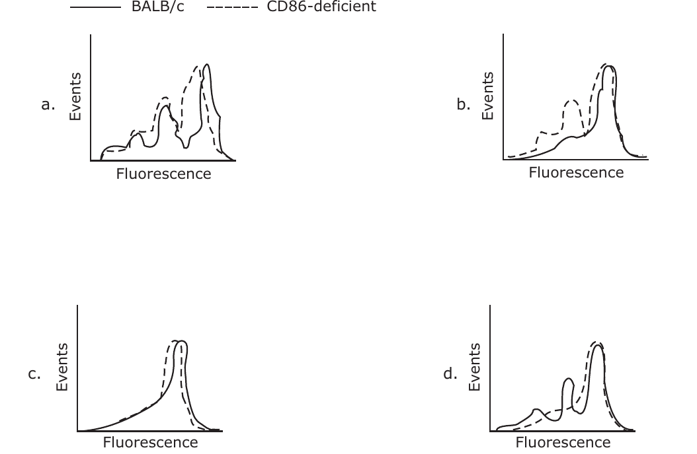

1. a
2. b
3. c
4. d

**Answer: 4 (d)**

> **Explanation:** CFSE fluorescence halves with each division, so proliferating cells shift to lower fluorescence. CD86 (B7-2) supplies the co-stimulation T cells need in order to divide, so in CD86-deficient mice little proliferation occurs and the dashed curve stays a single high-fluorescence peak while the BALB/c curve breaks into lower-fluorescence division peaks. Panel (d) is drawn that way; in panel (b) the two curves are interchanged.

---

### Question 58

Intracellular transport and cytoskeletal organization of a cell is regulated by nucleotide exchange of different small molecular weight GTPases of Ras super family. Overexpression of which of the following GTPase modulates the actin-cytoskeleton of HeLa cells?

1. Ran is GDP bound form
2. Ran in GTP bound form
3. Rho in GTP bound form
4. Rho in GDP bound form

**Answer: 3 (Rho in GTP bound form)**

> **Explanation:** Rho-family GTPases control the actin cytoskeleton; the active, GTP-bound form of Rho (overexpressed) drives actin stress-fibre/contractile-cytoskeleton remodelling in HeLa cells. Ran governs nuclear transport, not actin.

---

### Question 59

Tumor cells were isolated from a breast cancer patient. These cells were injected into nude mice and they were divided into four groups. Group 1 received EGF receptor-conjugated with methotrexate; Group 2 received transferrin receptor-conjugated with methotrexate; Group 3 received mannose receptor-conjugated with methotrexate; Group 4 received same amount of the free drug. In which of the following cases tumorigenic index would be minimum?

1. Free drug
2. EGF receptor-conjugated drug
3. Transferrin receptor-conjugated drug
4. Mannose receptor-conjugated drug

**Answer: 2 (EGF receptor-conjugated drug)**

> **Explanation:** Breast-cancer cells characteristically overexpress the EGF receptor (HER/EGFR); drug targeted to that receptor is preferentially delivered into the tumour cells, giving the lowest tumorigenic index compared with transferrin/mannose-receptor conjugates or free drug.

---

### Question 63

AP1 (APETALA 1) is one of the floral meristem identifying genes. In wild-type *Arabidopsis thaliana* plants transformed with API :: GUS, β glucuronidase (GUS) activity is seen in floral meristem, only after the commitment to flowering. Ectopic expression of API :: GUS in the *Embryonic flower (emf)* mutant background result in GUS activity throughout the shoots in four day old seedlings. These observations suggest that AP1 is

1. not involved in flowering.
2. involved in repression of flowering.
3. involved in promoting flowering.
4. stimulation of flowering in the *emf* background.

**Answer: 4 (stimulation of flowering in the emf background.)**

> **Explanation:** *emf* mutants are late-flowering; expressing AP1 in the *emf* background causes GUS (and flowering) activity ectopically throughout the shoot at four days, indicating AP1 acts to stimulate/override the flowering block in the *emf* background.

---

### Question 64

When the prospective neurons from an early gastrula of a frog were transplanted into the prospective epidermis region, the donor cells differentiated into epidermis. However, when a similar experiment was done with the late gastrula of frog, the prospective neurons developed into neurons only. These observations could possibly be explained by the following phenomena.

P. The early gastrula show conditional development whereas the late gastrula shows autonomous development.
Q. The early gastrula show autonomous development whereas the late gastrula shows conditional development.
R. The prospective neurons from the early gastrula are only specified whereas those from the late gastrula are determined.
S. The prospective neurons from the early gastrula are determined whereas those from the late gastrula are specified.

Which of the conclusions drawn above are *correct?*

1. P and Q
2. P and R
3. P and S
4. Q and R

**Answer: 2 (P and R)**

> **Explanation:** Early-gastrula cells are only *specified* (their fate can be respecified by the new environment — conditional/regulative development), whereas late-gastrula cells are *determined* (autonomous, fate fixed). This matches P (conditional → autonomous) and R (specified → determined).

---

### Question 65

The figure below represents a late zebrafish gastrula. The following concepts may be proposed during further development of the embryo.

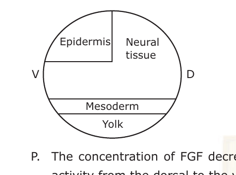

P. The concentration of FGF decreases from the yolk towards the epidermis, along with the increase of BMP activity from the dorsal to the ventral axis.
Q. Increase in FGF activity in the epidermis with concomitant decrease in BMP activity towards the ventral axis.
R. Neural induction in zebrafish is independent of the organizer and depends on activation of BMP signalling.
S. In comparison, both *Xenopus* and chick embryos require activation FGF for neural induction to occur in addition to BMP inhibition.

Which of the above statements are *true?*

1. P and R
2. Q and R
3. P and S
4. R and S

**Answer: 3 (P and S)**

> **Explanation:** Neural tissue forms where BMP activity is lowest (dorsal) and rises ventrally, with an FGF gradient; and in *Xenopus*/chick neural induction requires FGF signalling in addition to BMP inhibition (P and S). R is false because neural induction depends on BMP *inhibition*, not activation.

---

### Question 66

In case of morphallactic regeneration:

1. there is repatterning of the existing tissues with little new growth.
2. there is repatterning of the existing tissues after the stem cell division has taken place.
3. there is cell division of the differentiated cells which maintain their differentiated state to finally form a complete organism.
4. there is dedifferentiation of the cells at the cut surface which become undifferentiated. These undifferentiated cells then divide to redifferentiate to form the complete structure.

**Answer: 1 (there is repatterning of the existing tissues with little new growth.)**

> **Explanation:** Morphallaxis (e.g. in *Hydra*) re-establishes the body pattern by remodelling/repatterning already-present tissue with little or no new cell proliferation — in contrast to epimorphosis, which needs dedifferentiation and blastema growth.

---

### Question 67

With respect to the extraembryonic structures formed in the mammals, the possible functional attributes have been designated:

P. Allantoin stores urinary waste and helps mediate gas exchange. It is derived from splanchnopleure at the caudal end of the primitive streak.
Q. Amnion is a water sac and protects the embryo and its surrounding amniotic fluid. This epithelium is derived from somatopleure.
R. Chorion is essential for gas exchange in amniote embryos. It is generated from the splanchnopleure.
S. Yolk sac is the last embryonic membrane to form and is derived from somatopleure.

Which of the above statements are *correct?*

1. P and Q
2. P and R
3. Q and R
4. P and S

**Answer: 1 (P and Q)**

> **Explanation:** The allantois (splanchnopleure, caudal) stores nitrogenous waste and aids gas exchange, and the amnion (somatopleure) is the protective fluid sac — P and Q are correct. The chorion is a somatopleure (not splanchnopleure) membrane, and the yolk sac is splanchnopleure-derived and forms early, so R and S are wrong.

---

### Question 68

The decision to become either a trophoblast or inner cell mass blastomere is one of the first decisions taken by any mammalian embryo. Below is a diagrammatic representation of the different cells formed during development from the morula with the help of different molecules. Identify the molecules 1-4, sequentially.

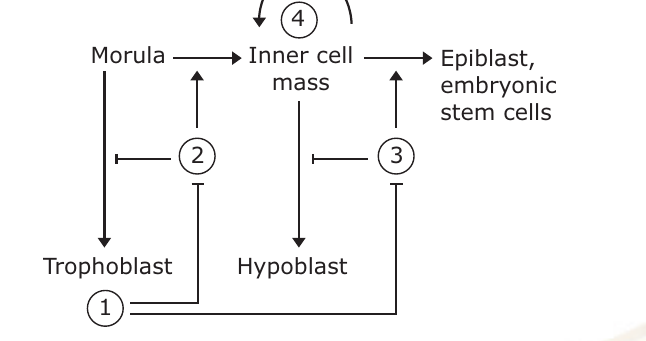

1. cdx 2, Oct 4, Nanog, Stat 3
2. cdx 2, Nanog, Stat 3, Oct 4
3. cdx 2, Nanog, Oct 4, Stat 3
4. cdx 2, Oct 4, Stat 3, Nanog

**Answer: 1 (cdx 2, Oct 4, Nanog, Stat 3)**

> **Explanation:** In the early lineage circuit, Cdx2 specifies trophoblast (1), Oct4 supports the inner-cell-mass/epiblast (2), Nanog maintains epiblast pluripotency (3), and Stat3 acts in the hypoblast/primitive-endoderm branch (4) — matching option 1.

---

### Question 76

Following are some statements regarding plant growth hormones.

1. Ethylene regulates abscission.
2. Gibberellins do not play any role in flowering.
3. Auxin and cytokinin promote cell division.
4. Over expression of cytokinin oxidase would promote root growth.
5. ABA inhibits root growth and promotes shoot growth at low water potential.
6. ABA promotes leaf senescence independent of ethylene.

Which one of the following combination of above statements is *correct?*

1. 1, 3 and 6
2. 2, 3 and 4
3. 4, 5 and 6
4. 2, 4 and 5

**Answer: 1 (1, 3 and 6)**

> **Explanation:** Ethylene promotes abscission (1), auxin–cytokinin balance drives cell division (3), and ABA promotes senescence (6). Gibberellins *do* promote flowering (2 false), so the correct combination is 1, 3 and 6.

---

### Question 77

Following are some statements about low temperature stress in plants.

P. Fatty acid composition of mitochondria from chilling resistant and chilling sensitive plants differs significantly.
Q. Ratio of unsaturated fatty acids to saturated fatty acids is lower in chilling resistant species
R. The cellular water does not freeze even at –40°C, because of the presence of solutes and other antifreeze proteins.
S. Heat shock proteins do not play any role during low temperature stress.

Which one of the following combination of above statement is *correct?*

1. P and Q
2. P and R
3. Q and R
4. Q and S

**Answer: 2 (P and R)**

> **Explanation:** Chilling resistance is associated with a *higher* (not lower) unsaturated:saturated fatty-acid ratio maintaining membrane fluidity, so Q is false; mitochondrial lipid composition does differ between resistant and sensitive plants (P true), and solutes/antifreeze proteins depress the freezing point (R true). Hence P and R.

---

### Question 78

Following are some of the statements regarding the effect of CO₂ concentration on photosynthesis in plants.

P. With elevated CO₂ levels, C₃ plants are much more responsive than C₄ plants under well watered conditions.
Q. In C₃ plants, increasing intracellular CO₂ partial pressure can stimulate photosynthesis only over a narrow range.
R. In C₄ plants, CO₂ compensation point is nearly zero.

Which one of the following combination of above statements is/are *correct?*

1. P and Q
2. Q and R
3. P and R
4. R only

**Answer: 3 (P and R)**

> **Explanation:** C₃ plants respond strongly to elevated CO₂ (photorespiration is suppressed) whereas C₄ plants, already CO₂-saturated at the bundle-sheath, respond little (P true); C₄ plants have a near-zero CO₂ compensation point (R true). Q understates the C₃ response range, so P and R.

---

### Question 79

The quantum yield of photosynthetic carbon fixation in a C₃ plant and C₄ plant is studied as a function of leaf temperature. Following are some statements based on this study:

P. At lower temperature the quantum yield of C₃ plant is lower than C₄ plant.
Q. In C₄ plant quantum yield does not show a temperature dependence.
R. Since the photorespiration is low in C₄ plants because of CO₂ concentrating mechanism, quantum yield is not affected.
S. At higher temperature the quantum yield of C₃ plant is lower than C₄ plant.

Which one of the following combination of above statements is correct?

1. P, Q and S
2. Q, R and S
3. P, Q and R
4. P, R and S

**Answer: 2 (Q, R and S)**

> **Explanation:** The C₄ CO₂-concentrating mechanism suppresses photorespiration, so C₄ quantum yield is largely temperature-independent (Q, R true), and at higher temperature the C₃ plant (rising photorespiration) has a lower quantum yield than the C₄ plant (S true). At low temperature C₃ quantum yield is not lower than C₄ (P false), so Q, R and S.

---

### Question 80

Following are some statements for synthesis of jasmonic acid in plants:

1. 12-oxo-phytodienoic acid is produced in chloroplast and transported peroxisome.
2. Action of lipoxygenase, allene oxide synthase and allene oxide cyclase takes place in peroxisome.
3. 12-oxo-phytodienoic acid is first reduced and then converted to jasmonic acid by β-oxidation.
4. Final production of jasmonic acid takes place in chloroplast.
5. Action of allene oxide synthase and allene oxide cyclase takes place in chloroplast.

Which one of the following combination of above statements is *correct?*

1. 1, 2 and 3
2. 2, 4 and 4
3. 3, 4 and 5
4. 1, 3 and 5

**Answer: 4 (1, 3 and 5)**

> **Explanation:** OPDA is made in the chloroplast and moved to the peroxisome (1); in the chloroplast the lipoxygenase/allene-oxide-synthase/allene-oxide-cyclase steps act (5); OPDA is reduced and shortened by three rounds of β-oxidation to give JA (3). The early oxygenase steps are chloroplastic, not peroxisomal (2 false), and JA is completed in the peroxisome, not chloroplast (4 false).

---

### Question 84

An isolated carotid sinus was prepared so that the pressure may be regulated by a pump and the resulting discharge in single carotid sinus nerve fibre could be recorded. The following are the possible observations.

P. No discharge when carotid sinus perfusion pressure was below 30 mm Hg.
Q. Linear increase in discharge frequency when carotid sinus perfusion pressure was gradually increased from 70 to 110 Hg.
R. Increase in discharge frequency was more prominent in greater pulsatile changes of carotid sinus pressure keeping the mean pressure identical in all cases.
S. Increase in discharge was more prominent in the falling phase of pulsatile change of carotid sinus pressure than in the rising phase.

Which one of the following is *correct?*

1. P, Q and R
2. P and R
3. Q and S
4. S only

**Answer: 1 (P, Q and R)**

> **Explanation:** Carotid-baroreceptor afferents have a threshold (~below which, e.g. <30 mmHg, no discharge, P), fire more with rising pressure in the operating range (Q), and are especially sensitive to the pulsatile (rate-of-change) component of pressure at a given mean (R). Discharge tracks the *rising* phase, not the falling phase (S false).

---

### Question 85

A 1 meter tall object was placed 10 meter in front of a normal eye. The size of the image on the retina will be (consider distance between lens and retina = 1.7 cm)

1. 0.17 mm
2. 1.7 mm
3. 3.4 mm
4. 170 μm

**Answer: 2 (1.7 mm)**

> **Explanation:** Magnification = image distance/object distance = 1.7 cm / 10 m = 0.017/10. Image height = 1 m × 0.0017 = 1.7 mm on the retina.

---

### Question 86

For a normal heart, the time taken for atrial systole and diastole are A_s and A_d seconds, respectively, while the same for ventricular systole and diastole are V_s and V_d. Which one of the following equations is *correct?*

1. A_s + A_d = V_s + V_d
2. A_s + A_d < V_s + V_d
3. A_s + A_d – V_s + V_d = 0
4. A_s + A_d > V_s + V_d

**Answer: 1 (A_s + A_d = V_s + V_d)**

> **Explanation:** Atrial and ventricular cycles share the same cardiac period: the sum of atrial systole + diastole equals the sum of ventricular systole + diastole (both equal one heartbeat interval), so A_s + A_d = V_s + V_d.

---

### Question 87

A monkey undergoes cerebellectomy. After the post-operative recovery, the monkey was given a task to press a bar. The possible observations are:

P. Its hand would overshoot the target while reaching the bar.
Q. It would be unable to move forelimbs.
R. It would show intention tremor while trying to press the bar.
S. It would press the bar with mouth instead of hand.

Which one of the following is *correct?*

1. P and R
2. Q only
3. S only
4. Q and S

**Answer: 1 (P and R)**

> **Explanation:** Cerebellar damage causes dysmetria (overshoot/undershoot, P) and intention tremor (R) — movement is still possible (not paralysis, so Q false) and not replaced by mouth use (S false). Hence P and R.

---

### Question 88

During the Spanish conquest of the Inca Empire at the high altitude in Peru, many soldiers fell sick. It was found that the sickness was due to low partial pressure of O₂ in the atmosphere at that altitude. To determine the reason, blood was collected from those patients. The circulating erythropoietin (EPO) level were estimated and the O₂-dissociation curve of haemoglobin were drawn and compared with the same in native people as depicted below.

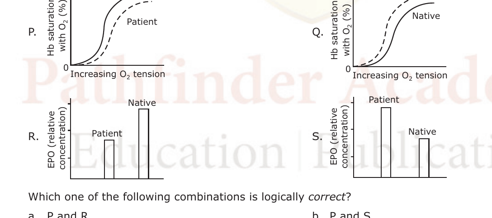

Which one of the following combinations is logically *correct?*

1. P and R
2. P and S
3. Q and R
4. Q and S

**Answer: 1 (P and R)**

> **Explanation:** Acclimatised lowlanders (patients) compared with altitude natives show a right-shifted/less-adequately-loaded O₂ dissociation curve (P) together with elevated EPO driving extra red-cell production (R) — the combination that reflects the hypoxic sickness and its compensatory response.

---

### Question 89

In an animal experiment:

P. Electrical stimulation of an area in the brain (A) increased a function (F) which was prevented by systemic injection of adrenergic antagonistic, prazosin.
Q. Injection of carbachol (cholinergic agonist) into A also increased function F which was, however, not prevented by systemic injection of adrenergic antagonistic, prazosin.

The results are likely to be due to the stimulation of

1. nonadrenergic and cholinoceptive neurons.
2. cholinergic and non-adrenoceptive neurons.
3. adrenergic terminals in 'A'.
4. both neurons and fibres passing through 'A'.

**Answer: 2 (cholinergic and non-adrenoceptive neurons.)**

> **Explanation:** Electrical stimulation of A releases transmitter that acts on adrenoceptors (blocked by prazosin), whereas carbachol applied locally acts directly on muscarinic/cholinergic receptors of the target and is unaffected by an adrenergic antagonist — indicating the response is generated by cholinergic, non-adrenoceptive neurons in A.

---

### Question 90

The graph represents relative plasma concentration of hormones (A and B) during reproductive cycle in a normal female. Which one of the following combinations is *correct?*

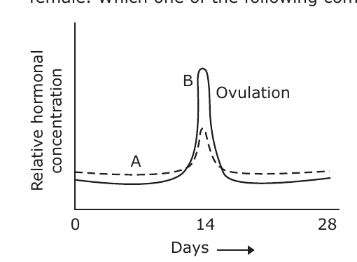

1. (A) is FSH and (B) is estrogen
2. (A) is estrogen and (B) is LH
3. (A) is FSH and (B) is LH
4. (A) is LH and (B) is FSH

**Answer: 3 ((A) is FSH and (B) is LH)**

> **Explanation:** Both gonadotropins surge at mid-cycle, but the sharp, dominant pre-ovulatory spike (B) is the LH surge, while the smaller coincident rise (A) is FSH — so A = FSH and B = LH.

---

### Question 94

Assuming a 1 : 1 sex ratio, what is the probability that three children from the same parents will consist of two daughters and one son?

1. 0.375
2. 0.125
3. 0.675
4. 0.75

**Answer: 1 (0.375)**

> **Explanation:** The birth orders with two daughters and one son are DDS, DSD, SDD — each with probability (½)³ = 1/8. Total = 3/8 = 0.375.

---

### Question 95

Consider the following crosses involving grey (wild-type) and yellow body colour true breeding *Drosophila*:

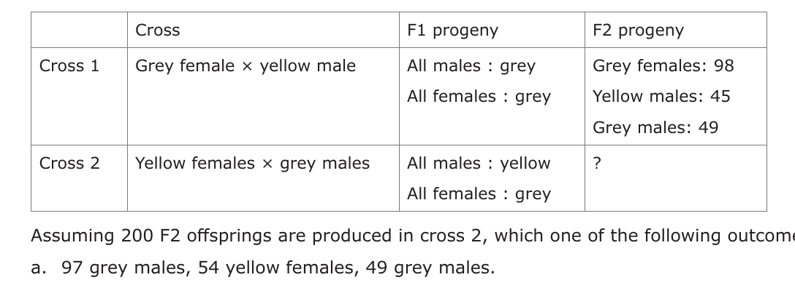

Assuming 200 F2 offsprings are produced in cross 2, which one of the following outcome is expected?

1. 97 grey males, 54 yellow females, 49 grey males.
2. 102 yellow males, 46 yellow females, 52 grey females.
3. 52 grey males, 49 yellow males, 48 yellow females, 51 grey females.
4. 98 grey males, 94 yellow females, 2 yellow males, 6 grey females.

**Answer: 3 (52 grey males, 49 yellow males, 48 yellow females, 51 grey females.)**

> **Explanation:** Yellow body is X-linked recessive. Cross 2 (yellow female XʸXʸ × grey male X⁺Y) gives F1 grey females (X⁺Xʸ) and yellow males (XʸY); the F1 intercross yields an approximately 1:1:1:1 ratio of grey/yellow × male/female in the F2, matching option 3 (~50 each).

---

### Question 96

The ABO blood type in human is under the control of autosomal multiple alleles. Colour blindness is recessive X-linked trait. A male with a blood type A and normal vision marries a female who also has blood type A and normal vision. The couple's first child is a male who is colour blind and has O blood group. What is the probability that their next female child has normal vision and O blood group?

1. 1/4
2. 3/4
3. 1/8
4. 1

**Answer: 3 (1/8)**

> **Explanation:** Colour-blind first son ⇒ mother is a carrier (XᴄX); a *female* child receives the father's normal X, so she is phenotypically normal-vision with probability 1. Both parents are type A but produced an O child ⇒ both are Iᴬi; P(O child) = 1/4. Being female = 1/2. P(female, normal vision, O) = 1/2 × 1 × 1/4 = 1/8.

---

### Question 97

The following is a schematic representation of region (showing six bands) of the polytene chromosome of *Drosophila*, along with the extent of five deletions (Del1 to Del5):

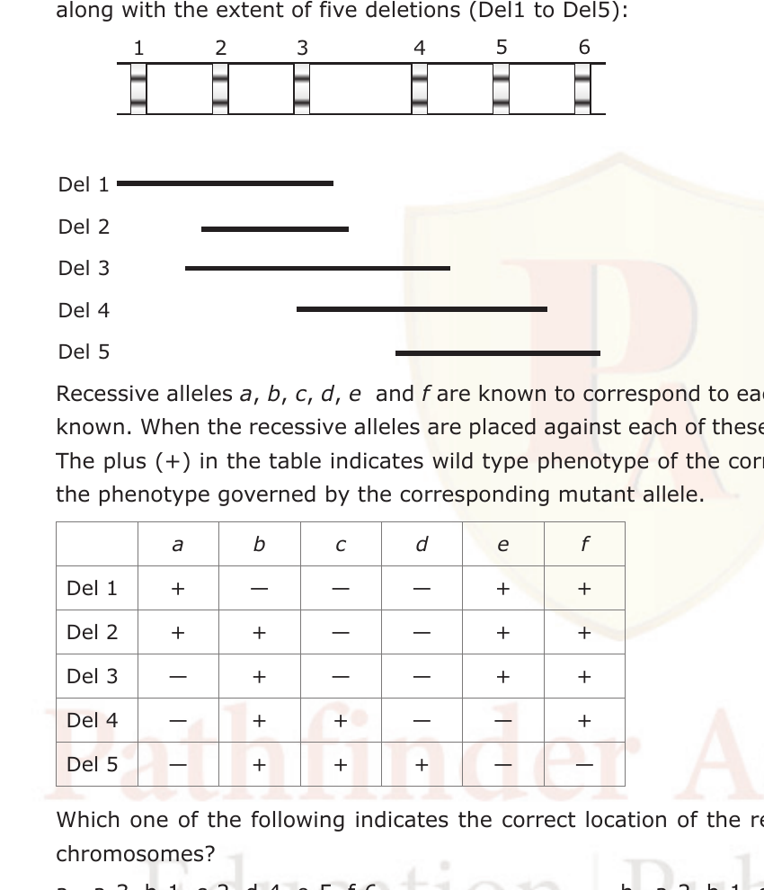

Recessive alleles *a, b, c, d, e* and *f* are known to correspond to each of the bands (1 to 6), but their order is not known. When the recessive alleles are placed against each of these deletions, the following results are obtained. The plus (+) in the table indicates wild type phenotype of the corresponding allele, while a minus (–) indicates the phenotype governed by the corresponding mutant allele.

Which one of the following indicates the correct location of the recessive alleles on the bands of the polytene chromosomes?

1. a-3, b-1, c-2, d-4, e-5, f-6
2. a-2, b-1, c-3, d-4, e-5, f-6
3. a-4, b-1, c-2, d-3, e-5, f-6
4. a-6, b-2, c-3, d-4, e-1, f-5

**Answer: 3 (a-4, b-1, c-2, d-3, e-5, f-6)**

> **Explanation:** A recessive allele shows the mutant (–) phenotype only when its band is deleted. Reading the deletion/phenotype table, the alleles that uncover with each deletion map to bands a-4, b-1, c-2, d-3, e-5, f-6 — option 3.

---

### Question 98

The following figure depicts the relationship between a genetic map for four genes (A, B, C and D) and their corresponding physical map:

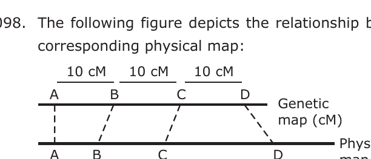

The following statements are made to explain this relationship:

1. More number of recombination events occur between A and B as compared to B and C.
2. Lesser number of recombination events occur between C and D as compared to B and C.
3. Although the physical distance between A and B is less than that between C and D, the region between A and B is more recombinogenic.
4. The physical distance between A and B is less than that between C and D, and thus the region between A and B is less recombinogenic.
5. Although the physical distance between C and D is more than that between B and C, the region between C and D is less recombinogenic.
6. Although the physical distance between C and D is more than B and C, the region between C and D is more recombinogenic.

Which statements are *correct?*

1. 1 and 2
2. 3 and 5
3. 4 and 6
4. 1, 3 and 5

**Answer: 2 (3 and 5)**

> **Explanation:** The genetic map shows equal 10 cM intervals while the physical map is unequal, so recombination per kb varies. Region A–B is physically short yet genetically equal ⇒ highly recombinogenic (3), and C–D is physically long yet only 10 cM ⇒ relatively less recombinogenic per kb (5). Hence 3 and 5.

---

### Question 99

In *E. coli* four Hfr strains donate the following genetic markers in the order shown below:

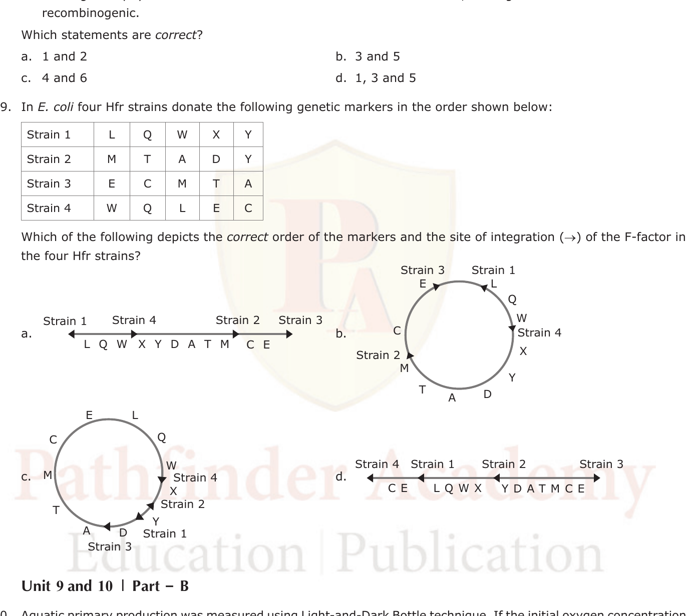

Which of the following depicts the *correct* order of the markers and the site of integration (→) of the F-factor in the four Hfr strains?

1. (linear map a)
2. (circular map b)
3. (circular map c)
4. (linear map d)

**Answer: 2 (circular map b)**

> **Explanation:** The four Hfr transfer orders are overlapping segments of a single circular chromosome. Reading the strain orders (L-Q-W-X-Y; Y-D-A-T-M; M-T-C-E; C-E-L-Q-W) around a circle gives one consistent gene order with F-factor integrated at different sites/orientations in each strain — the circular map in option 2.

---

### Question 113

Chlorophyll pigment composition and carbohydrate food reserves of some algal groups are given below:

Pigments: (i) Chlorophyll a and b; (ii) Chlorophyll a and c
Carbohydrate food reserve; (a) Paramylon; (b) Starch; (c) Laminarin; (d) Leucosin.

Identify the *correct* combination of the characters for the given groups.

1. Euglenophyta–(i and a); Bacillariophyta–(ii and d); Phaeophyta–(ii and c); Chlorophyta–(i and b).
2. Euglenophyta–(ii and a); Bacillariophyta–(ii and d); Phaeophyta–(i and c); Chlorophyta–(i and b).
3. Euglenophyta–(i and a); Bacillariophyta–(ii and b); Phaeophyta–(i and c); Chlorophyta–(ii and d).
4. Euglenophyta–(i and d); Bacillariophyta–(ii and a); Phaeophyta–(ii and c); Chlorophyta–(i and b).

**Answer: 1 (Euglenophyta–(i and a); Bacillariophyta–(ii and d); Phaeophyta–(ii and c); Chlorophyta–(i and b).)**

> **Explanation:** Euglenophytes have Chl a+b and store paramylon (i,a); diatoms (Bacillariophyta) have Chl a+c and store leucosin (ii,d); brown algae (Phaeophyta) have Chl a+c and store laminarin (ii,c); green algae (Chlorophyta) have Chl a+b and store starch (i,b).

---

### Question 114

Identify the synapomorphies in the following cladogram:

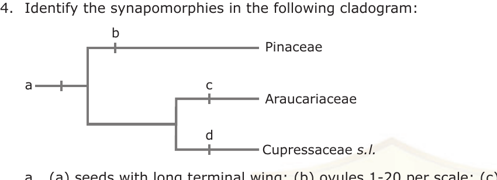

1. (a) seeds with long terminal wing; (b) ovules 1-20 per scale; (c) resin canals; (d) 1 ovule per scale.
2. (a) resin canals; (b) seeds with long terminal wing; (c) 1 ovule per scale; (d) ovules 1-20 per scale
3. (a) resin canals; (b) ovules 1-20 per scale; (c) seeds with long terminal wing; (d) 1 ovule per scale.
4. (a) seeds with long terminal wing; (b) ovules 1-20 per scale; (c) 1 ovule per scale; (d) resin canals.

**Answer: 2 ((a) resin canals; (b) seeds with long terminal wing; (c) 1 ovule per scale; (d) ovules 1-20 per scale)**

> **Explanation:** The basal node (a) unites all three conifer families on the shared resin-canals synapomorphy; node (b) (Pinaceae) is defined by winged seeds; and within the remaining two families (c) 1 ovule per scale and (d) 1–20 ovules per scale distinguish the Cupressaceae/Araucariaceae branches — matching option 2.

---

### Question 115

During a field study, three insects with the following characteristics were observed:

P. elongate, membranous wings with net-like venation, long and slender abdomen, large compound eyes.
Q. small bodied, sucking mouth parts, narrow wings fringed with setae.
R. sclerotized forewings, membranous hindwings, chewing mouth parts.

They can be identified to their respective orders as

1. P-Orthoptera; Q-Hemiptera; R-Coleoptera.
2. P-Odonata; Q-Coleoptera; R-Hemiptera.
3. P-Orthoptera; Q-Odonata; R-Coleoptera.
4. P-Odonata; Q-Thysanoptera; R-Coleoptera.

**Answer: 4 (P-Odonata; Q-Thysanoptera; R-Coleoptera.)**

> **Explanation:** P (net-veined membranous wings, slender abdomen, huge eyes) = Odonata (dragonflies); Q (tiny, fringed narrow wings, sucking parts) = Thysanoptera (thrips); R (hardened elytra over membranous hindwings, chewing mouthparts) = Coleoptera (beetles).

---

### Question 116

From among the five animals listed below, match the two attributes–amniotic egg, and endothermy, with the correct animal(s):

1. Fish
2. Frog
3. Crocodile
4. Pigeon
5. Zebra

1. amniotic egg: 2, 3, 4; endothermy: 4, 5
2. amniotic egg: 3, 4, 5; endothermy: 4, 5
3. amniotic egg: 1, 2, 3, 4; endothermy: 3, 4, 5
4. amniotic egg: 2, 3, 4; endothermy: 3, 4, 5

**Answer: 2 (amniotic egg: 3, 4, 5; endothermy: 4, 5)**

> **Explanation:** Amniotic eggs are produced by reptiles, birds and mammals — crocodile (3), pigeon (4), zebra (5). Among these, only the bird (pigeon) and mammal (zebra) are endothermic; the crocodile is ectothermic.

---

### Question 117

Which of the following is *not* true for a critically endangered species?

1. Reduction of population breeding ability due to increased relatedness through the action of incompatibility mechanisms in plants or behavioural difficulties in animals.
2. The individuals of the species which have declined to low numbers are still a genetically open system.
3. Loss of some alleles from the species causing loss of genetic diversity with consequent inability to respond rapidly to selection.
4. Expression of deleterious alleles and increased homozygosity increases mortality of young, and inbreeding depression leads to reduced offspring fitness.

**Answer: 2 (The individuals of the species which have declined to low numbers are still a genetically open system.)**

> **Explanation:** A critically endangered, bottlenecked population is a genetically *closed*, inbred system with lost diversity (options 1, 3, 4 are true consequences). Statement 2 — that it is still a genetically open system — is the one that is NOT true.

---

### Question 118

In the global nitrogen cycle, the following microbial organisms are involved in three important process–denitrification, nitrification and nitrogen fixation.

1. *Rhizobium*
2. *Nitrosomonas*
3. *Nitrobacter*
4. *Pseudomonas*
5. *Azotobacter*

Which of the following is the *correctly* matched pair of process and its causative species?

1. Denitrification - (2); nitrogen fixation - (3) and (4); nitrification - (4)
2. Denitrification - (4); nitrogen fixation - (1) and (5); nitrification - (3)
3. Denitrification - (5); nitrogen fixation - (1) and (4); nitrification - (4)
4. Denitrification - (2); nitrogen fixation - (1) and (4); nitrification - (3)

**Answer: 2 (Denitrification - (4); nitrogen fixation - (1) and (5); nitrification - (3))**

> **Explanation:** *Pseudomonas* (4) carries out denitrification; *Rhizobium* (1) and *Azotobacter* (5) fix N₂; nitrification is done by *Nitrosomonas*/*Nitrobacter* (2, 3), so option 2's pairing (denitrification-4, fixation-1&5, nitrification-3) is the correct match.

---

### Question 119

Which of the following graphs illustrates the current consensus on the role of *disturbance* on the species richness of a community?

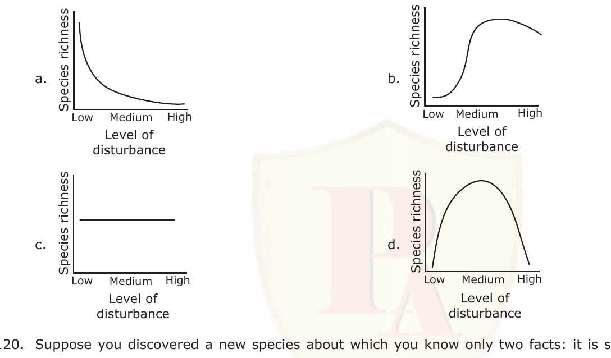

1. a
2. b
3. c
4. d

**Answer: 4 (d)**

> **Explanation:** The intermediate-disturbance hypothesis predicts peak species richness at intermediate disturbance (too little → competitive exclusion; too much → only tolerant species), which is the unimodal curve d.

---

### Question 120

Suppose you discovered a new species about which you know only two facts: it is small-sized (<10 cm) and short-lived (<20 days). Which of the following reproductive strategies is most likely to be *true* for this species?

1. Breeds early and more than once in life and produces large number of small-sized offspring.
2. Breeds late and only once in life and produces large number of small-sized offspring.
3. Breeds early and only once in life and produces large number of small-sized offspring.
4. Breeds early and only once in life and produces a small number of large-sized offspring.

**Answer: 3 (Breeds early and only once in life and produces large number of small-sized offspring.)**

> **Explanation:** A small, very short-lived organism is an r-strategist: it must reproduce early, semelparously (once), and produce many small offspring to maximise fitness before death.

---

### Question 121

Autotrophs in the aquatic ecosystem, unlike their counterparts in the terrestrial ecosystem, are mostly microscopic and very low in indigestible (to the herbivores) matter. This explains the fact that compared to the terrestrial ecosystem, in the aquatic ecosystem

1. Productivity/Biomass ratios are higher and energy transfer rates to higher trophic levels are faster.
2. Productivity/Biomass ratios are lower and the energy transfer rates to higher trophic levels are slower.
3. Productivity/Biomass ratios are lower and the energy transfer rate to higher trophic levels are faster.
4. Productivity/Biomass ratios are higher and the energy transfer rate to higher trophic levels are slower.

**Answer: 1 (Productivity/Biomass ratios are higher and energy transfer rates to higher trophic levels are faster.)**

> **Explanation:** Aquatic phytoplankton are tiny, fast-turning-over, and highly digestible, so their standing biomass is small relative to production (high P/B) and energy moves up the food web rapidly.

---

### Question 122

Ecological compression differs from character displacement in that it operates on a

1. shorter timescale and does not involve heritable change.
2. longer timescale and does not involve heritable change.
3. shorter timescale and involves heritable change.
4. longer timescale and involves heritable change.

**Answer: 1 (shorter timescale and does not involve heritable change.)**

> **Explanation:** Ecological compression is a plastic, within-generation shift in resource use when competitors co-occur (no genetic change, short timescale), whereas character displacement is an evolved, heritable divergence produced over longer (evolutionary) timescales.

---

### Question 125

Number of trials required for rats to learn a task when they were exposed to various conditions were as follows:

Experimental conditions
P. Light: light dark cycle – 12h: 12h — N-trials
Q. Bright light – 24h — Significantly more trials than 'N'
R. Bright Light – 24h + continuous physical disturbance — Significantly more trials than 'N'
S. Dark light – 24h + continuous physical disturbance — Significantly more trials than 'N'

Which of the following inferences is most appropriate?

1. Continuous light enhanced learning.
2. Continuous darkness inhibited learning.
3. Physical activity inhibited learning.
4. Learning was reduced by sleep loss.

**Answer: 4 (Learning was reduced by sleep loss.)**

> **Explanation:** Every condition that disrupts normal rest (constant bright light, and light or dark plus continuous disturbance) needs more trials than the 12h:12h control, indicating that loss of sleep/rest — not activity or darkness per se — impairs learning.

---

### Question 126

Assume a male sparrow (species X) is hatched and reared in isolation and allowed a critical imprinting period to hear the song of a male of another sparrow (species Y). Now after the isolation, what kind of behaviour will species X show?

1. It will sing the song of species Y that it had heard in the critical period.
2. It will sing the song of its own species X.
3. It will not sing at all.
4. It will sing a song not sung by either X or Y.

**Answer: 1 (It will sing the song of species Y that it had heard in the critical period.)**

> **Explanation:** Song learning in many passerines is culturally transmitted during a sensitive/critical period; a bird isolated but exposed to species Y's song during that window imprints and later sings the Y song.

---

### Question 127

The genetic relatedness (r) of an individual to his nephew is 0.25. The alleles that cause uncles to care for nephews will spread, according to Hamilton's Rule, only if the fitness benefit is

1. equal to the cost of care
2. more than the cost of care by 25%
3. double the cost of care
4. four times the cost of care

**Answer: 4 (four times the cost of care)**

> **Explanation:** Hamilton's rule: rB > C. With r = 0.25, B > C/0.25 = 4C, so the benefit must exceed four times the cost for the altruistic allele to spread.

---

### Question 128

Several distinct time periods and different routes might explain the entrance of marsupials into Australia.

P. Late Jurassic–early therians arrived in Antarctica–Australia where the marsupials subsequently evolved.
Q. Early to middle Cretaceous–early marsupials arrived in Australia from northern regions and then radiated in isolation.
R. Paleocene–marsupials entered Australia from South-East Asia.
S. Eocene–chance dispersal of marsupials into Australia.

Which of the following is the *correct* combination?

1. P, Q, R
2. P, R, S
3. Q, R, S
4. P, Q, S

**Answer: 1 (P, Q, R)**

> **Explanation:** The accepted palaeobiogeographic scenarios involve a Late Jurassic–early therian origin in Antarctica–Australia (P), a Cretaceous northern arrival and subsequent isolation-radiation (Q), and a Paleocene entry from SE Asia (R); the Eocene "chance dispersal" (S) is not part of the supported combination.

---

### Question 129

The frequencies of two alleles *p* and *q* for a gene locus in a population at Hardy-Weinberg equilibrium are 0.3 and 0.7, respectively. After a few generations of inbreeding, the heterozygote frequency was found to be 0.28. The inbreeding coefficient in this case is

1. 0.42
2. 0.28
3. 0.33
4. 0.67

**Answer: 3 (0.33)**

> **Explanation:** F = (2pq − H_obs)/2pq. Expected 2pq = 2 × 0.3 × 0.7 = 0.42; observed H = 0.28. F = (0.42 − 0.28)/0.42 = 0.14/0.42 = 0.33.

---

### Question 130

Which of the following behavioural changes are expected in a rat when its nucleus accumbens is experimentally ablated?

1. Aggressive behaviour increases
2. Exploratory behaviour decreases
3. Nest-building activity increases
4. Level of parental care drops

**Answer: 2 (Exploratory behaviour decreases)**

> **Explanation:** The nucleus accumbens is central to the mesolimbic reward/motivation circuit; its ablation reduces motivated exploration and reward-seeking, so exploratory behaviour decreases.

---

### Question 135

Genomic DNA of transgenic plants (P1, P2 and P3) obtained by transforming with binary vector A whose map is depicted below, was digested with BamH I and Sal I and hybridized with a labelled fragment X

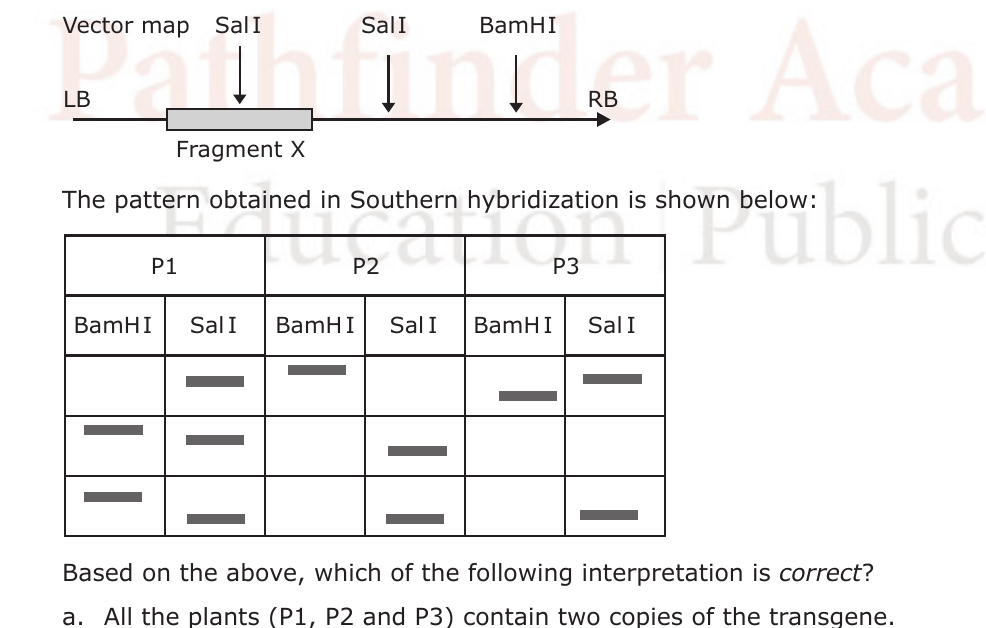

The pattern obtained in Southern hybridization is shown below:

Based on the above, which of the following interpretation is *correct?*

1. All the plants (P1, P2 and P3) contain two copies of the transgene.
2. P1, P3 contain one and P2 contains two copies of the transgene.
3. P1 contains two, whereas P2 and P3 contain one copy of transgene each.
4. P1 and P2 contain two and P3 contains one copy of the transgene.

**Answer: 3 (P1 contains two, whereas P2 and P3 contain one copy of transgene each.)**

> **Explanation:** Fragment X lies between the two SalI sites and one BamHI site. P1 gives two X-hybridising bands in both digests (two integrated copies), whereas P2 and P3 each give a single copy-specific pattern, indicating one copy — matching option 3.

---

### Question 136

Cre/loxP system is used by phage P1 to remove terminally redundant sequences that arise during packaging of the phage DNA. Cre-lox system can be used to create targeted deletions, insertions and inversion in genomes of transgenic animals and plants. Consider a series of genetic markers A to K. How should the Lox P sites be positioned in order that Cre recombinase can create an inversion in the EFG segment relative to ABCD and HIJK?

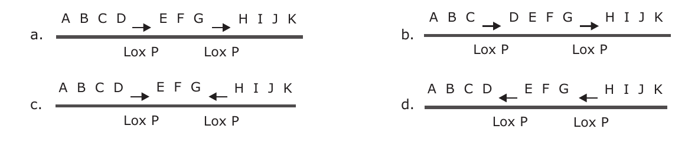

1. (a)
2. (b)
3. (c)
4. (d)

**Answer: 3 (c)**

> **Explanation:** Cre inverts the DNA between two loxP sites only when they are in *opposite* (inverted) orientation. To invert the EFG segment relative to ABCD and HIJK, the two loxP sites flanking EFG must point toward each other/inverted — the arrangement shown in option (c).

---

### Question 137

The following are statements about molecular markers in the context of plant breeding

P. Molecular markers can be used for elimination of undesirable traits.
Q. Molecular markers cannot be used for estimation of the genetic contribution of each individual parent in a segregating population.
R. Molecular markers are used for mapping of QTLs, which is also possible by conventional techniques.
S. Molecular markers can be used for selection of individuals from a population that are homozygous for the recurrent parent genotype at loci flanking the target locus.

Which of the above statements are *true?*

1. P and Q
2. P and R
3. P and S
4. Q and R

**Answer: 3 (P and S)**

> **Explanation:** Markers enable background selection to remove linked undesirable traits (P) and foreground/backcross selection for homozygosity of the recurrent-parent genotype flanking the target (S). Q is false (markers *can* estimate parental contributions), so P and S.

---

### Question 138

Enzymes are nowadays used extensively in bio-processing industries.
Enzyme 1 is used for treatment of hides to provide a finer texture, in leather processing and manufacture of glue.
Enzyme 2 is used for clarification of fruit juices.

Identify enzymes 1 and 2

1. Amylase; Pectinase
2. Protease; Amylase
3. Protease; Pectinase
4. Pectinase; Amylase

**Answer: 3 (Protease; Pectinase)**

> **Explanation:** Hide de-liming/bating and glue manufacture use proteases (break down proteins/collagen) — enzyme 1 is a protease. Fruit-juice clarification removes pectin haze with pectinase — enzyme 2 is pectinase.

---

### Question 139

Stem cell therapies are being used in regenerative medicine like forming new adult bone, which usually does not regrow to bridge wide gaps. Successful attempts have now been made in this area because the same paracrine and endocrine factors were found to be involved in both endochondral ossification and fracture repair. Few methods to achieve the above are given below:

P. Develop a collagen gel containing plasmids carrying the human parathyroid hormone gene and place in the gap between the ends of the broken leg.
Q. Develop a gel matrix disc containing genetically modified stem cells to secrete BMP4 and VEGF-A and implant it at the site of the wound
R. Make scaffolds of material that resemble normal extracellular matrix that could be molded to form the shape of a bone needed and seed them with bone marrow stem cell
S. Develop a collagen gel containing plasmids carrying the human bone marrow cells and place them between the ends of the bones.

Which of the above methods would you employ to develop a new functional bone in patients with severely fractured bones?

1. P and Q
2. P, Q and R
3. P and R
4. R and S

**Answer: 2 (P, Q and R)**

> **Explanation:** Functional bone regeneration combines an osteoinductive signal (parathyroid-hormone gene, P), stem cells secreting BMP4/VEGF-A to drive endochondral ossification and vascularisation (Q), and an ECM-like scaffold seeded with bone-marrow stem cells (R). S (plasmids "carrying bone marrow cells") is not a coherent strategy.

---

### Question 140

In order to prevent tetanus in neonates, one of the following treatments can be adopted.

A. Treatment of the infant with anti-toxin and the toxoid.
B. Immunize the mother with the toxoid.

In case of A, the treatment can be given

1. immediately after birth.
2. after the onset on the condition.

In case of B, the immunization has to be done

3. before pregnancy.
4. late in the pregnancy.

The *correct* combination is

1. A/a
2. A/b
3. B/c
4. B/d

**Answer: 4 (B/d)**

> **Explanation:** Maternal tetanus toxoid immunization given late in pregnancy boosts maternal IgG that passively protects the neonate (B/d). Passive anti-toxin plus toxoid to the infant (A) is a treatment for an exposed/onset case rather than the routine preventive combination the key endorses.

---

### Question 141

In the following statement taken from a research paper, what does p in the parenthesis stand for?
"The mean temperature of this region now is significantly higher than the one 50 years ago (p < 0.05, t-test)"

1. ratio of the mean temperatures of the time periods tested.
2. probability of the error of rejecting a true null hypothesis.
3. probability of the error of accepting a false null hypothesis.
4. probability of the t-test being effective in detecting significant differences in the mean annual temperatures of the two time periods.

**Answer: 2 (probability of the error of rejecting a true null hypothesis.)**

> **Explanation:** The p-value is the probability of obtaining the observed result (or more extreme) if the null hypothesis is true — i.e. the probability of wrongly rejecting a true null (Type I error).

---

### Question 142

In an *in vitro* experiment using radiolabelled nucleotides, a researcher is trying to analyze the possible products of DNA replication by resolving the products using urea-polyacrylamide gel electrophoresis. In one experimental set up RNase H was added (Set 1), while in another set no RNase H was added (Set 2).

The possible observations of this experiment could be

P. There is no difference in the mobility of labelled DNA fragments between the Set 1 and Set 2.
Q. There is distinct difference in the mobility of the newly synthesized labelled DNA fragments between Set 1 and Set 2.
R. The mobility of the newly synthesized labelled DNA fragments in case of Set 1 is faster as compared to the Set 2.
S. The mobility of the newly synthesized labelled DNA fragments in case of Set 1 is slower as compared to the Set 2.

Which of the following combinations represent *correct* observations?

1. P and Q
2. Q and R
3. P and S
4. Q and S

**Answer: 2 (Q and R)**

> **Explanation:** Okazaki fragments retain an RNA primer. RNase H removes the RNA primers (Set 1), converting the RNA–DNA hybrids to pure DNA of altered length, so there is a distinct mobility difference (Q) and the primer-processed Set-1 fragments migrate faster (R) than the bulkier RNA-DNA Set-2 products.

---

### Question 143

In 'TaqMan' assay for detection of base substitutions (DNA variant), probes (oligonucleotides) with fluorescent dyes at the 5′-end and a quencher at 3′-end are used. While the probe is intact, the proximity of the quencher reduces the fluorescence emitted by reporter dye. If the target sequences (wild type or the variant) are present, the probe anneals to the target sequence, downstream to one of the primers used for amplifying the DNA sequence flanking the position of the variants. For an assay two flanking PCR primers, two probes corresponding to the wild type and variant allele and labelled with two different reporter dyes and quencher were used. During extension the probe may be cleaved by the Taq-polymerase separating the reporter dye and the quencher. Three individuals were genotyped using this assay. Sample for individual I shows maximum fluorescence for the dye attached to the wild type probe, sample for individual II shows maximum fluorescence for the dye attached to variant probe and sample for individual III exhibits equal fluorescence for both the dyes. Which of the following statement is *correct?*

1. Individual I is homozygous for the variant allele.
2. Individual II is homozygous for variant allele.
3. Individual II is homozygous for wild type allele.
4. Individual III is homozygous for wild type allele.

**Answer: 2 (Individual II is homozygous for variant allele.)**

> **Explanation:** In a TaqMan SNP genotyping assay, fluorescence from only one probe's dye means homozygosity for that allele, and both dyes equally means heterozygous. Individual II fluoresces only with the variant probe ⇒ homozygous variant (option 2). (I is wild-type homozygous; III is heterozygous.)

---

### Question 144

Figures A and B respectively represent the dideoxy sequencing gels obtained for partial sequences from 5′-ends of a bacterial gene and its mutant (with a point mutation)

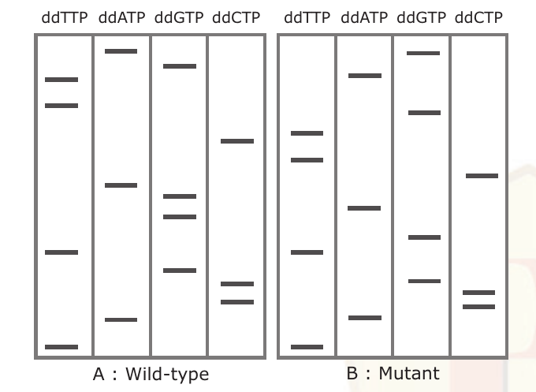

What type of mutation has occurred in the gene?

1. Nonsense
2. Missense
3. Frameshift
4. Transversion

**Answer: 3 (Frameshift)**

> **Explanation:** Reading the gels bottom-to-top (5′→3′), the wild-type and mutant sequences agree up to a point and then the whole downstream ladder is shifted, which is the signature of an insertion/deletion causing a frameshift (not a single-base substitution).

---

### Question 145

The most important property of any microscope is its power of resolution, which is numerically equivalent to D, the minimum distance between two distinguishable objects. D depends on three parameters namely, the angular aperture, α, the refractive index, N, and wavelength, λ, of the incident light. Below are given few possible options to increase the resolution of the microscope.

P. Decrease the value of λ or increase either N or α to improve resolution.
Q. Moving the objective lens closer to the specimen will decrease sin α and improve the resolution.
R. Using a medium with high refraction index between the specimen and the objective lens to improve the resolution.
S. Increase the wavelength of the incident light to improve the resolution.

Which of the following combination of above statements *correct?*

1. P and R
2. Q and R
3. P and S
4. R and S

**Answer: 1 (P and R)**

> **Explanation:** Abbe's equation D = 0.61λ/(N sin α): smaller D means better resolution, so resolution improves by decreasing λ or increasing N or α. P (decrease λ / increase N or α) and R (high-index immersion medium raises N) are correct; increasing λ (S) worsens resolution.
