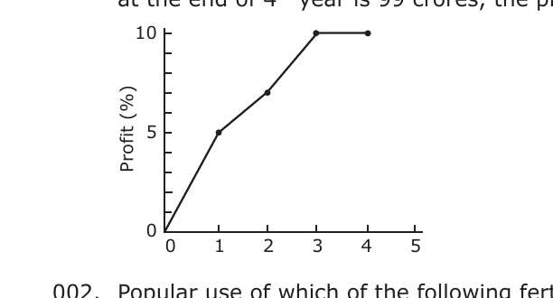
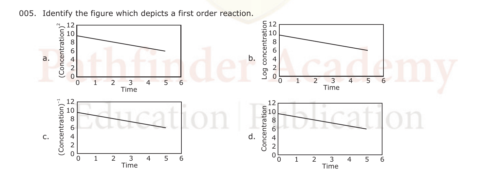
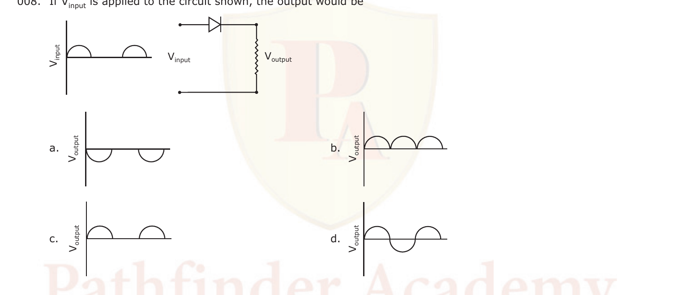
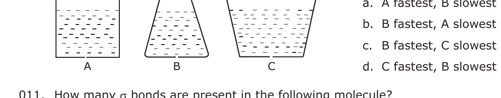
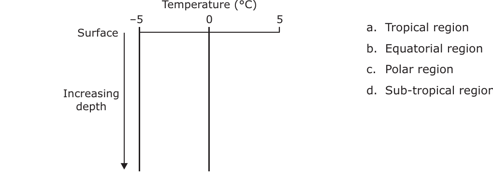
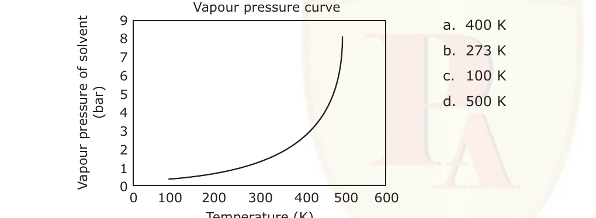
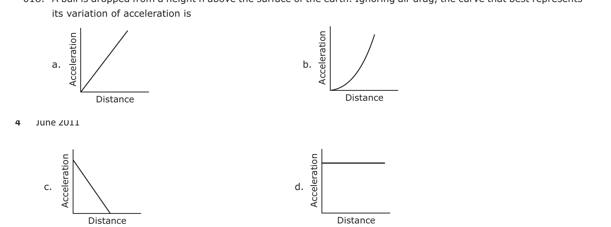

# CSIR NET Life Sciences — June 2011 — Part A

*Printed as "Part – A", questions 001–020. Options printed a/b/c/d; here renumbered 1/2/3/4 (a→1, b→2, c→3, d→4). Answers follow the published Pathfinder answer key.*

---

### Question 1

The cumulative profits of a company since its inception are shown in the diagram. If the net worth of the company at the end of 4th year is 99 crores, the principal it had started with was

1. 9.9 crores
2. 91 crores
3. 90 crores
4. 9.0 crores

**Answer: 3 (90 crores)**

> **Explanation:** The graph shows cumulative profit reaching 10% by the end of the 4th year. If the principal is *y*, then net worth = *y* + 10% of *y* = 1.1*y* = 99 crores, so *y* = 90 crores.

---

### Question 2

Popular use of which of the following fertilizers increases the acidity of soil?

1. Potassium nitrate
2. Ammonium sulphate
3. Urea
4. Superphosphate of lime

**Answer: 2 (Ammonium sulphate)**

> **Explanation:** Ammonium sulphate releases NH₄⁺ which is nitrified to NO₃⁻ in the soil, liberating H⁺ ions and thereby increasing soil acidity.

---

### Question 3

Exposing an organism to a certain chemical can change nucleotide bases in a gene, causing mutation. In one such mutated organism if a protein had only 70% of the primary amino acid sequence, which of the following is likely?

1. Mutation broke the protein.
2. The organism could not make amino acids.
3. Mutation created a terminator codon.
4. The gene was not transcribed.

**Answer: 3 (Mutation created a terminator codon)**

> **Explanation:** A truncated protein retaining only 70% of the normal sequence is best explained by a nonsense (terminator) codon arising within the coding region, causing premature termination of translation.

---

### Question 4

A reference material is required to be prepared with 4 ppm calcium. The amount of CaCO₃ (molecular weight = 100) required to prepare 1000 g of such a reference material is

1. 10 μg
2. 4 μg
3. 4 mg
4. 10 mg

**Answer: 4 (10 mg)**

> **Explanation:** 4 ppm Ca in 1000 g means 4 mg of Ca (atomic weight 40). CaCO₃ supplies one Ca per formula unit, so moles of CaCO₃ = 4/40 = 0.1 mmol; mass = 0.1 mmol × 100 g/mol = 10 mg.

---

### Question 5

Identify the figure which depicts a first order reaction.

1. (a)
2. (b)
3. (c)
4. (d)

**Answer: 2 (b)**

> **Explanation:** For a first order reaction, log[C] versus time is a straight line with a negative slope (ln[C] = ln[C]₀ − kt). Only graph (b), Log concentration vs Time, is linear and decreasing.

---

### Question 6

If the atmospheric concentration of carbon dioxide is doubled and there are favourable conditions of water, nutrients, light and temperature, what would happen to water requirement of plants?

1. It decreases initially for a short time and then returns to the original value.
2. It increases.
3. It decreases.
4. It increases initially for a short time and then returns to the original value.

**Answer: 3 (It decreases)**

> **Explanation:** Elevated CO₂ causes partial stomatal closure and higher water-use efficiency, so transpirational water loss (and hence water requirement) decreases.

---

### Question 7

The speed of a car increases every minute as shown in the following table. The speed at the end of the 19th minute would be

| Time (minutes) | Speed (m/sec) |
|:---:|:---:|
| 1 | 1.5 |
| 2 | 3.0 |
| 3 | 4.5 |
| … | … |
| 24 | 36.0 |
| 25 | 37.5 |

1. 26.5
2. 28.0
3. 27.0
4. 28.5

**Answer: 4 (28.5)**

> **Explanation:** Speed increases by 1.5 m/s per minute (speed = 1.5 × time). At the 19th minute, speed = 1.5 × 19 = 28.5 m/s.

---

### Question 8

If V_input is applied to the circuit shown, the output would be

1. (a)
2. (b)
3. (c)
4. (d)

**Answer: 3 (c)**

> **Explanation:** The single diode passes only one half of the input cycle, so the output across the resistor is a half-wave rectified signal — the positive half cycles only, matching waveform (c).

---

### Question 9

A physiological disorder X always leads to the disorder Y. However, disorder Y may occur by itself. A population shows 4% incidence of disorder Y. Which of the following inferences is valid?

1. 4% of the population suffers from both X and Y.
2. Less than 4% of the population suffers from X.
3. At least 4% of the population suffers from X.
4. There is no incidence of X in the given population.

**Answer: 2 (Less than 4% of the population suffers from X)**

> **Explanation:** Every X case is also a Y case, but Y can occur without X. Since Y affects 4% of the population and some of those Y cases arise independently of X, the X subset must be smaller than 4%.

---

### Question 10

Water is dripping out of a tiny hole at the bottom of three flasks whose base diameter is the same, and are initially filled to the same height, as shown. Which is the correct comparison of the rate of fall of the volume of water in the three flasks?

1. A fastest, B slowest
2. B fastest, A slowest
3. B fastest, C slowest
4. C fastest, B slowest

**Answer: 4 (C fastest, B slowest)**

> **Explanation:** The outflow rate through the hole depends on the head (water height). Flask C widens upward, so it holds the greatest volume at the same height and its water level falls fastest; B narrows upward and holds the least, so its level falls slowest.

---

### Question 11

How many σ bonds are present in the following molecule?

HC≡CCH=CHCH₃

1. 4
2. 10
3. 6
4. 13

**Answer: 2 (10)**

> **Explanation:** In H–C≡C–CH=CH–CH₃ each bond (single, double or triple) contributes exactly one σ bond. Count: 6 C–H σ bonds (1 on C1, 1 on C3, 1 on C4, 3 on the CH₃) + 4 C–C σ bonds (C1–C2, C2–C3, C3–C4, C4–C5) = 10 σ bonds.

---

### Question 12

The graph represents the depth profile of temperature in the open ocean; in which region this is likely to be prevalent?

1. Tropical region
2. Equatorial region
3. Polar region
4. Sub-tropical region

**Answer: 3 (Polar region)**

> **Explanation:** The surface water is at about 0°C and stays near 0°C with depth, which is characteristic of polar oceans where surface water is at/near the freezing point.

---

### Question 13

The normal boiling point of a solvent (whose vapour pressure curve is shown in the figure) on a planet whose normal atmospheric pressure is 3 bar, is about

1. 400 K
2. 273 K
3. 100 K
4. 500 K

**Answer: 1 (400 K)**

> **Explanation:** A liquid boils when its vapour pressure equals the external pressure. On a planet with 3 bar atmosphere, the curve reaches 3 bar at about 400 K, so the boiling point is ~400 K.

---

### Question 14

Diabetic patients are advised a low glycaemic index diet. The reason for this is

1. they require less carbohydrate than healthy individuals.
2. they cannot assimilate ordinary carbohydrates.
3. they need to have slow, but sustained release of glucose in their blood stream.
4. they can tolerate lower, but not higher than normal blood sugar levels.

**Answer: 3 (they need to have slow, but sustained release of glucose in their blood stream)**

> **Explanation:** A low glycaemic-index diet releases glucose slowly and steadily, avoiding sharp post-meal blood-sugar spikes that diabetic patients cannot control well.

---

### Question 15

Glucose molecules diffuse across a cell of diameter *d* in time τ. If the cell diameter is tripled, the diffusion time would

1. increase to 9τ
2. decrease to τ/3
3. increase to 3τ
4. decrease to τ/9

**Answer: 4 (decrease to τ/9)**

> **Explanation:** The published answer key marks option (d). *Note:* by the diffusion relation t ∝ x², tripling the distance should give 9τ (option a); the key's (d) is at odds with the standard treatment. The answer line follows the key; the conflict is logged in `sources.md`.

---

### Question 16

The reason for the hardness of diamond is

1. extended covalent bonding
2. layered structure
3. formation of cage structures
4. formation of tubular structures

**Answer: 1 (extended covalent bonding)**

> **Explanation:** Diamond is a giant three-dimensional network in which every carbon is tetrahedrally linked by strong covalent bonds; this extended covalent bonding accounts for its extreme hardness.

---

### Question 17

Which of the following particles has the largest range in a given medium if their initial energies are the same?

1. Alpha
2. Gamma
3. Positron
4. Electron

**Answer: 2 (Gamma)**

> **Explanation:** Gamma rays are uncharged photons that interact only weakly with matter, so for the same initial energy they penetrate farthest and have the greatest range; alpha particles have the shortest range.

---

### Question 18

A ball is dropped from a height h above the surface of the earth. Ignoring air drag, the curve that best represents its variation of acceleration is

1. (a)
2. (b)
3. (c)
4. (d)

**Answer: 4 (d)**

> **Explanation:** Neglecting air drag, the only force is gravity, so the acceleration is constant (= g) throughout the fall. The correct graph is the horizontal line (d).

---

### Question 19

Standing on a polished stone floor one feels colder than on a rough floor of the same stone. This is because

1. thermal conductivity of the stone depends on the surface smoothness.
2. specific heat of the stone changes by polishing it.
3. the temperature of the polished floor is lower than that of the rough floor.
4. there is greater heat loss from the soles of the feet when in contact with the polished floor than with the rough floor.

**Answer: 4 (there is greater heat loss from the soles of the feet when in contact with the polished floor than with the rough floor)**

> **Explanation:** A polished surface makes better contact with the skin, so more heat flows from the foot into the stone by conduction, producing a colder sensation. The stone's temperature and properties are the same.

---

### Question 20

The acidity of normal rainwater is due to

1. SO₂
2. CO₂
3. NO₂
4. NO

**Answer: 2 (CO₂)**

> **Explanation:** Normal rainwater is slightly acidic (pH ≈ 5.6) because atmospheric CO₂ dissolves to form weak carbonic acid (H₂CO₃). SO₂/NOₓ cause *acid* rain, not the normal mild acidity.
