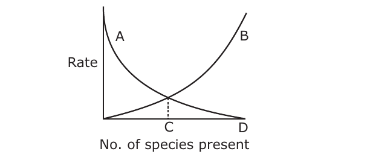

# CSIR NET Life Sciences — June 2011 — Part B

*Printed unit-by-unit under "Part – B" headings (Units 1–13). Every question printed under a "Part – B" heading is collected here, keeping its printed number (021–132, non-contiguous because Part C questions are interleaved). Options printed a/b/c/d; renumbered 1/2/3/4 (a→1, b→2, c→3, d→4). Answers follow the published Pathfinder answer key.*

---

### Question 21

The area of allowed regions in the Ramachandran map will be least for

1. Gly
2. L-Ala
3. L-Pro
4. α-methyl L-valine

**Answer: 3 (L-Pro)**

> **Explanation:** Proline's side chain is cyclised back onto the backbone nitrogen, forming a pyrrolidine ring that severely restricts the φ angle, giving the smallest allowed region of the standard amino acids. (α-methyl L-valine is not a proteinogenic residue and is not what the map is drawn for.)

---

### Question 22

Small RNAs with internally complementary sequences that form hairpin-like structure, synthesized as precursor RNAs and cleaved by endonucleases to form short duplexes are called

1. snRNA
2. mRNA
3. tRNA
4. miRNA

**Answer: 4 (miRNA)**

> **Explanation:** microRNAs are transcribed as hairpin-containing precursors (pri-/pre-miRNA) that are cleaved by Drosha/Dicer endonucleases into short duplexes guiding gene silencing.

---

### Question 23

The free energy ΔG of a dissolved solute

1. increases with solute concentration
2. decreases with solute concentration
3. is independent of solute concentration
4. depends only on temperature

**Answer: 2 (decreases with solute concentration)**

> **Explanation:** The published answer key marks option (b). *Note:* for an ideal solute the chemical potential μ = μ° + RT ln C rises with concentration, so standard thermodynamics points to (a); the key's (b) conflicts with that. The answer line follows the key; logged in `sources.md`.

---

### Question 29

Transport of water across aquaporins is regulated by the presence of which of the following sequence of three highly conserved amino acids?

1. Ala-Asn-Pro
2. Pro-Asn-Ala
3. Asn-Pro-Ala
4. Pro-Ala-Asn

**Answer: 3 (Asn-Pro-Ala)**

> **Explanation:** The water-selectivity filter of aquaporins is formed by the conserved NPA (Asn-Pro-Ala) motifs.

---

### Question 30

Polar bears maintain their body temperature because they have more of

1. transducin protein
2. uncoupling protein
3. myoglobin protein
4. F₀F₁ ATPase

**Answer: 2 (uncoupling protein)**

> **Explanation:** Uncoupling protein (thermogenin) in brown-adipose-tissue mitochondria dissipates the proton gradient as heat rather than ATP, generating warmth to maintain body temperature.

---

### Question 31

Which of the cyclins have/has essential functions in S-phase of cell cycle?

1. A-type
2. B-type
3. D-type
4. Both B- and D-type

**Answer: 1 (A-type)**

> **Explanation:** S-cyclins (cyclin A, with cyclin E) drive S-phase entry and DNA replication; cyclin B acts in M-phase and cyclin D in G1.

---

### Question 32

Na⁺ - K⁺ ATPase is a tetramer of 2α and 2β subunits. On which of the following subunits are the Na⁺ and K⁺ binding sites present?

1. Both on α
2. Both on β
3. Na⁺ on α and K⁺ on β
4. Na⁺ on β and K⁺ on α

**Answer: 1 (Both on α)**

> **Explanation:** The catalytic α-subunit carries both the Na⁺ and K⁺ binding sites and the ATPase/phosphorylation site; the β-subunit is a glycoprotein needed for maturation/trafficking.

---

### Question 33

Both halophytes and glycophytes compartmentalize cytotoxic ions into the intracellular compartment or actively pump them out of the cell to the apoplasts with the help of membrane transport proteins. Among these, the Na⁺ - H⁺ antiporter, NHX1, is localized in the

1. plasma membrane
2. chloroplast (inner envelope)
3. mitochondria (outer membrane)
4. tonoplast

**Answer: 4 (tonoplast)**

> **Explanation:** NHX1 is a vacuolar (tonoplast-localised) Na⁺/H⁺ antiporter that sequesters Na⁺ into the vacuole, aiding salt tolerance.

---

### Question 39

The 5' cap of RNA is required for the

1. stability of RNA only
2. stability and transport of RNA
3. transport of RNA only
4. methylation of RNA

**Answer: 2 (stability and transport of RNA)**

> **Explanation:** The 5' m⁷G cap protects mRNA from exonucleases (stability) and is recognised by the export machinery (nuclear transport) and by translation initiation factors.

---

### Question 40

A culture of an E. coli strain that is lysogenic for phage lambda is grown at 32°C. Induction of the prophage from the host chromosome will occur when the culture is exposed to

1. 40°C
2. ultraviolet radiation
3. infrared radiation
4. wild type E. coli culture

**Answer: 2 (ultraviolet radiation)**

> **Explanation:** UV irradiation triggers the SOS response, activating RecA-mediated cleavage of the λ CI repressor, which induces the prophage to enter the lytic cycle.

---

### Question 41

The fidelity of replicative base selection can be reduced by a factor of 10² when the repair of DNA synthesis involves

1. AP endonuclease
2. ABC excinuclease
3. DNA photolyase
4. TLS DNA polymerase

**Answer: 4 (TLS DNA polymerase)**

> **Explanation:** Translesion synthesis (TLS) polymerases bypass damaged templates but lack 3'→5' proofreading, so they insert bases with much lower fidelity (~100-fold).

---

### Question 42

What is the minimum number of NTPs required for the formation of one peptide bond during protein synthesis?

1. One
2. Two
3. Four
4. Six

**Answer: 3 (Four)**

> **Explanation:** Amino-acid activation consumes 2 high-energy phosphate equivalents (ATP→AMP), and each elongation step uses 2 GTP (EF-Tu delivery + EF-G translocation), so the energy equivalent of four NTPs is consumed per peptide bond.

---

### Question 49

During generation of an action potential, depolarization is due to

1. K⁺ efflux
2. Na⁺ efflux
3. Na⁺ influx
4. K⁺ influx

**Answer: 3 (Na⁺ influx)**

> **Explanation:** The rising phase (depolarization) of the action potential is produced by the opening of voltage-gated Na⁺ channels and rapid Na⁺ influx into the axon.

---

### Question 50

G protein-linked receptors are transmembrane proteins of

1. single-pass
2. three-pass
3. five-pass
4. seven-pass

**Answer: 4 (seven-pass)**

> **Explanation:** G-protein-coupled receptors (GPCRs) share the characteristic seven-transmembrane α-helix bundle topology.

---

### Question 51

T_H2 response is generated and maintained mainly by which of the following pair of cytokines?

1. IL - 4 and IL - 10
2. IL - 12 and IFN - γ
3. IFN - γ and TNF - α
4. IL - 2 and IL - 12

**Answer: 1 (IL - 4 and IL - 10)**

> **Explanation:** IL-4 drives the Th2 differentiation/humoral response, and IL-10 is an anti-inflammatory Th2-type cytokine; IL-12 and IFN-γ are instead associated with the Th1 response.

---

### Question 52

Which of the following molecules is involved in Ca²⁺-dependent cell-cell adhesion?

1. Calmodulin
2. Cadherin
3. N-CAM
4. Calpain

**Answer: 2 (Cadherin)**

> **Explanation:** Cadherins are calcium-dependent cell-adhesion molecules; their extracellular domains require Ca²⁺ for homophilic binding. N-CAM mediates Ca²⁺-independent adhesion.

---

### Question 53

With which protein of Yersinia would integrin proteins of mammalian cells interact for internalization?

1. Pilin
2. Fimbrin
3. Invasin
4. Adherin

**Answer: 3 (Invasin)**

> **Explanation:** Yersinia invasin (Inv) binds β1-integrins on host cells to trigger uptake (the "zipper" mechanism of invasion).

---

### Question 63

Cytoplasmic determinants coding for anterior structure of Drosophila embryo, if injected elsewhere in the recipient embryo, would lead to

1. normal development
2. formation of additional ectopic head
3. degeneration
4. a phenotype with two heads and two tails

**Answer: 2 (formation of additional ectopic head)**

> **Explanation:** Anterior determinants (e.g. bicillus mRNA) specify head/thoracic fate; misplaced anterior determinants induce an additional anterior (ectopic head) structure.

---

### Question 64

In amphibian oocyte, the germplasm which gets segregated during cleavage to give rise to primordial germ cells (PGCs) is normally

1. distributed evenly throughout the oocyte
2. localized at animal pole
3. localized at vegetal pole
4. aggregated in central part of oocyte

**Answer: 3 (localized at vegetal pole)**

> **Explanation:** In amphibians the germ plasm (containing determinants such as oskar/Vg1-related factors) is localized at the vegetal pole and is partitioned into the cells that become PGCs.

---

### Question 65

In mature Arabidopsis embryo, root apical meristem consists of cells derived from

1. embryo and apical suspensor cell
2. embryo only
3. suspensor only
4. hypophysis only

**Answer: 1 (embryo and apical suspensor cell)**

> **Explanation:** The root meristem's quiescent centre/hypophysis arises from the embryo, and in Arabidopsis the suspensor (apical suspensor cell) also contributes to the hypophysis/root pole, so the RAM derives from embryo and the apical suspensor cell.

---

### Question 71

The transition to flowering in plants requires

1. growth of plants under long-day conditions.
2. growth of plants under short-day conditions.
3. reprogramming of the shoot apical meristem.
4. synthesis of the flowering hormone florigen.

**Answer: 3 (reprogramming of the shoot apical meristem)**

> **Explanation:** Flowering is the transition in which the vegetative shoot apical meristem is reprogrammed into a floral meristem; the photoperiodic requirement differs between species, so it is the reprogramming that is universal.

---

### Question 72

The dwarf pea mutant (le) used by Mendel was defective in which of the following enzyme involved in gibberellin biosynthesis?

1. ent-Kaurene synthase
2. GA 3β-hydroxylase
3. GA 20-oxidase
4. ent-Kaurenoic acid hydroxylase

**Answer: 2 (GA 3β-hydroxylase)**

> **Explanation:** The Mendelian *le* (le) pea dwarf is a mutation in GA 3β-hydroxylase, the enzyme catalysing the final step to the bioactive GA₁.

---

### Question 73

Which of the following statements with respect to alternate oxidase activity in cyanide-resistant respiration in plants, is not correct?

1. Alternate oxidase accepts electrons directly from cytochrome C.
2. Some plants exhibit thermogenesis during inflorescence development.
3. Transcription of alternate oxidase gene is often induced by various abiotic stresses.
4. When electrons pass to alternate oxidase, two sites of protein pumping are bypassed.

**Answer: 1 (Alternate oxidase accepts electrons directly from cytochrome C.)**

> **Explanation:** The alternative oxidase accepts electrons from ubiquinone (Complex II side), not from cytochrome c, and it pumps no protons — so statement (a) is the incorrect one.

---

### Question 80

During urine formation, the filtration of blood at the glomerulus is

1. an active process
2. an osmotic process
3. a pressure-dependent physical process
4. a non energy-mediated transport process

**Answer: 3 (a pressure-dependent physical process)**

> **Explanation:** Glomerular filtration is a passive, physical process driven by the hydrostatic blood pressure, not by direct metabolic energy or osmosis.

---

### Question 81

If the core body temperature of a human rises above normal, which of the following processes would be initiated sequentially for thermo-regulation?

1. Peripheral vasodilation, increased rate of respiration, tachycardia.
2. Peripheral vasoconstriction, increased rate of respiration, bradycardia.
3. Peripheral vasodilation, decreased rate of respiration, tachycardia.
4. Peripheral vasodilation, decreased rate of respiration, bradycardia.

**Answer: 1 (Peripheral vasodilation, increased rate of respiration, tachycardia.)**

> **Explanation:** To lose heat the body dilates peripheral vessels (radiation), increases respiratory rate (evaporative loss) and raises heart rate (tachycardia) to move blood to the surface.

---

### Question 82

Graves disease is associated with

1. insufficiency of thyroid hormones
2. excess of thyroid hormones
3. insufficiency of corticosteroids
4. excess of growth hormones

**Answer: 2 (excess of thyroid hormones)**

> **Explanation:** Graves' disease is an autoimmune hyperthyroidism in which thyroid-stimulating immunoglobulins drive overproduction of thyroid hormones.

---

### Question 88

The following is the biochemical pathway for purple pigment production in flowers of sweet pea:

Recessive mutation of either gene A or B leads to the formation of white flowers. A cross is made between two parents with the genotype: AaBb × aabb. Considering that the two genes are not linked, the phenotypes of the expected progenies are

1. 9 purple : 7 white
2. 3 white : 1 purple
3. 1 purple : 1 white
4. 9 purple : 6 light purple : 1 white

**Answer: 2 (3 white : 1 purple)**

> **Explanation:** Purple requires both dominant alleles (A_B_). AaBb × aabb yields 1 AaBb (purple) : 1 Aabb : 1 aaBb : 1 aabb (all white), i.e. 1 purple : 3 white.

---

### Question 89

Aneuploid females with only one X-chromosome is a characteristic of individuals with

1. cri du chat syndrome
2. Klinefelter syndrome
3. Down syndrome
4. Turner syndrome

**Answer: 4 (Turner syndrome)**

> **Explanation:** Turner syndrome is the 45,X condition — females with a single X chromosome. Klinefelter is 47,XXY (males), Down is trisomy 21, cri-du-chat is a deletion.

---

### Question 90

A mechanism that can cause a gene to move from one linkage group to another is

1. crossing over
2. inversion
3. translocation
4. duplication

**Answer: 3 (translocation)**

> **Explanation:** A translocation moves a chromosome segment to a different (non-homologous) chromosome, relocating a gene to a new linkage group. Crossing over only shuffles alleles within a linkage group.

---

### Question 91

A mother of blood group O has a group O child. The father could be of blood type

1. A or B or O
2. O only
3. A or B
4. AB only

**Answer: 1 (A or B or O)**

> **Explanation:** The mother is ii and the child is ii, so the father need only contribute one i allele. Fathers of type A (I^A i), B (I^B i) or O (ii) can each supply an i; only AB (I^A I^B) cannot.

---

### Question 98

Imperfect fungi is a group represented by fungal species which have

1. simple mycelia
2. unknown mechanisms of sexual reproduction
3. unknown phylogenetic relationship
4. lost its survival mechanism against harsh environments

**Answer: 2 (unknown mechanisms of sexual reproduction)**

> **Explanation:** "Deuteromycetes / Fungi imperfecti" are fungi in which no sexual (perfect) stage has been observed; they are known only by their asexual reproduction.

---

### Question 99

Which of the following is not a characteristic of phylum chordata?

1. Pharyngeal slits
2. Amniotic egg
3. Postanal tail
4. Notochord

**Answer: 2 (Amniotic egg)**

> **Explanation:** The defining chordate features are the notochord, dorsal hollow nerve cord, pharyngeal slits and post-anal tail. The amniotic egg is a derived feature of only one vertebrate subgroup (amniotes), not a phylum-level character.

---

### Question 100

The most commonly used method of estimating primary productivity of a pond involves measurement of the amount of

1. CO₂ utilized
2. autotroph biomass
3. oxygen released
4. organic carbon

**Answer: 3 (oxygen released)**

> **Explanation:** The light-and-dark bottle method estimates aquatic primary productivity from dissolved oxygen changes (O₂ released by photosynthesis minus respiration).

---

### Question 101

A much greater proportion of energy fixed by autotrophs is transferred to the herbivore level in the open ocean ecosystem than in a forest ecosystem because

1. aquatic autotrophs are small.
2. aquatic herbivores are more efficient feeders.
3. terrestrial autotrophs are less efficient feeders.
4. terrestrial autotrophs have more indigestible tissues.

**Answer: 4 (terrestrial autotrophs have more indigestible tissues.)**

> **Explanation:** A large share of terrestrial (forest) plant production is structural, lignin/cellulose-rich tissue that herbivores cannot digest, so less energy passes up. Ocean phytoplankton are largely digestible, so more energy reaches herbivores.

---

### Question 102

Following figure shows McArthur and Wilson's equilibrium model of biota on a single island. In this figure, terms A, B, C and D in order are

1. extinction, immigration, equilibrium number of species, size of species pool.
2. immigration, extinction, equilibrium number of species, size of species pool.
3. extinction, immigration, size of species pool, equilibrium number of species.
4. immigration, extinction, size of species pool, equilibrium number of species.

**Answer: 2 (immigration, extinction, equilibrium number of species, size of species pool.)**

> **Explanation:** In the equilibrium model the falling curve (A) is immigration rate, the rising curve (B) is extinction rate, their intersection (C) gives the equilibrium number of species, and D marks the size of the species pool on the axis.

---

### Question 103

Name the ectothermic animal that can thermoregulate by behavioural means rather than by physiological means.

1. Bumble bee in an orchard
2. Tuna fish in the ocean
3. Lizard in a desert
4. Flatworm in a pond

**Answer: 3 (Lizard in a desert)**

> **Explanation:** A lizard is a behavioural (ectothermic) thermoregulator — it moves between sun and shade to control body temperature — whereas bumble bees and tunas use physiological/endothermic mechanisms.

---

### Question 104

Which of the following is a characteristic of an early seral community?

1. Narrow niche specialization
2. High species diversity
3. Low community production
4. Open mineral cycling

**Answer: 4 (Open mineral cycling)**

> **Explanation:** Early seral (pioneer) stages have broad niches, low diversity, high gross production relative to respiration, and leaky/"open" nutrient (mineral) cycling; tight, closed cycling develops in later stages.

---

### Question 105

In India, brown antlered deer (sangai) is found only in the floating landmasses of

1. Wular lake
2. Sasthamkotta lake
3. Dal lake
4. Lok Tak lake

**Answer: 4 (Lok Tak lake)**

> **Explanation:** The sangai (Rucervus eldii eldii), the endemic brow-antlered deer, survives in the wild only on the floating phumdi landmasses of Loktak Lake, Manipur.

---

### Question 116

Recent studies on Archaea suggest that life could have originated

1. extraterrestrially and seeded through meteorite impacts.
2. in shallow coastal areas.
3. in deep hydrothermal vents.
4. in hot, terrestrial habitats.

**Answer: 3 (in deep hydrothermal vents.)**

> **Explanation:** Phylogenetic studies placing the deepest branches among thermophilic/archaeal lineages support an origin of life at deep-sea hydrothermal vents.

---

### Question 117

If the ratio of the number of non-synonymous to synonymous substitutions per site in protein coding gene is greater than one, it is an evidence of selection that is

1. positive
2. negative
3. neutral
4. random

**Answer: 1 (positive)**

> **Explanation:** A dN/dS (ω) ratio greater than 1 means amino-acid-changing substitutions are fixed faster than silent ones — the signature of positive (Darwinian) selection.

---

### Question 118

The frequencies of alleles 'A' and 'a' in a population at Hardy-Weinberg equilibrium are 0.7 and 0.3 respectively. In a random sample of 250 individuals taken from the population, how many are expected to be heterozygous?

1. 112
2. 81
3. 105
4. 145

**Answer: 3 (105)**

> **Explanation:** Heterozygote frequency = 2pq = 2(0.7)(0.3) = 0.42; expected number = 0.42 × 250 = 105.

---

### Question 119

In an altruistic act, if a donor sacrifices 'C' offspring which helps the recipient to gain 'B' offspring and the donor is related to the recipient by a coefficient γ, under which condition would kin selection favour this altruistic trait?

1. B > C
2. B > γC
3. γB – C = 0
4. γB – C > 0

**Answer: 4 (γB – C > 0)**

> **Explanation:** Hamilton's rule states altruism is favoured when rb > c, i.e. γ·B > C, or equivalently γB – C > 0.

---

### Question 120

The photoreceptor commonly involved in light entrainment of the biological clock in flies, moulds and plants is

1. phytochrome
2. rhodopsin
3. carotenoid
4. cryptochrome

**Answer: 4 (cryptochrome)**

> **Explanation:** Cryptochromes are the blue-light photoreceptors that mediate circadian entrainment across animals (flies, moulds) and plants.

---

### Question 126

Which of the following food crops has recently been genetically engineered to obtain edible vaccine to develop immunity against hepatitis B?

1. Banana
2. Maize
3. Potato
4. Tomato

**Answer: 3 (Potato)**

> **Explanation:** The first widely cited edible vaccine against hepatitis B was produced in transgenic potato expressing the HBsAg antigen.

---

### Question 127

Release of nutrients, oxidants or electron donors into the environment to stimulate naturally occurring microorganisms to degrade a contaminant, is referred to as

1. biostimulation
2. phytoremediation
3. bioaugmentation
4. bioremediation

**Answer: 1 (biostimulation)**

> **Explanation:** Biostimulation adds nutrients/electron donors to encourage the indigenous microbes already present; bioaugmentation instead adds cultured microbes.

---

### Question 128

ELISA assay uses

1. an enzyme which can react with secondary antibody.
2. an enzyme which can react with the antigen.
3. a substrate which gets converted into a colored product.
4. a radiolabelled secondary antibody.

**Answer: 3 (a substrate which gets converted into a colored product.)**

> **Explanation:** In ELISA the enzyme (conjugated to an antibody) acts on a chromogenic substrate to produce a coloured product that is measured; it is the substrate→colour reaction that generates the signal.

---

### Question 129

Routinely used glucose biosensor estimates blood glucose level by sensing the concentration of

1. glucose
2. oxygen
3. δ-gluconolactone
4. H₂O₂

**Answer: 2 (oxygen)**

> **Explanation:** The published answer-key table marks option (b) oxygen. *Note:* Pathfinder's own explanation for this question concludes that the glucose-oxidase biosensor senses H₂O₂ (option d), so the key table and the book's explanation contradict each other. The answer line follows the key table; logged in `sources.md`.

---

### Question 130

Which of the following methods of plant transformation can be used to introduce a gene into chloroplast genome?

1. Agrobacterium-mediated transformation
2. Particle delivery system
3. Permeabilization
4. Electroporation

**Answer: 2 (Particle delivery system)**

> **Explanation:** Chloroplast (plastid) transformation is achieved by the biolistic/particle-delivery (gene gun) method, since Agrobacterium does not efficiently transform plastid DNA.

---

### Question 131

Yeast artificial chromosome (YAC) vectors contain selectable markers. Loss of which marker at the cloning site distinguishes the re-ligated YACs from the original vector marker?

1. TRP1
2. SUP4
3. URA3
4. CEN

**Answer: 2 (SUP4)**

> **Explanation:** In YAC vectors foreign DNA is cloned into the suppressor tRNA gene SUP4; insertional inactivation (loss) of SUP4 distinguishes recombinant from non-recombinant vectors.

---

### Question 132

The μ and σ of wing length (a normally distributed parameter) in a population of fruitflies are 4 and 0.2 mm, respectively. In a random sample of 400 fruitflies, how many individuals are expected to have wing lengths greater than 4.4 mm?

1. 20
2. 64
3. 10
4. 336

**Answer: 3 (10)**

> **Explanation:** 4.4 mm is 2σ above the mean (z = 2). About 2.5% of a normal distribution lies above +2σ, so 0.025 × 400 = 10 individuals.
