# CSIR NET Life Sciences — June 2011 — Part C

*Printed unit-by-unit under "Part – C" headings (Units 1–13). Every question printed under a "Part – C" heading is collected here, keeping its printed number (024–145, non-contiguous because Part B questions are interleaved). Options printed a/b/c/d; renumbered 1/2/3/4 (a→1, b→2, c→3, d→4). Answers follow the published Pathfinder answer key.*

---

### Question 24

A protein in 100 mM KCl solution was heated and the observed T_m (midpoint of unfolding) was 60°C. When the same protein solution in 500 mM KCl was heated, the observed T_m was 65°C. What is the most probable reason for this increase in T_m?

1. Hydrogen-bonding is increased.
2. Hydrophobic interaction is decreased and electrostatic repulsion is increased.
3. Hydrophobic interaction is increased and electrostatic repulsion is decreased.
4. van der Waals interaction is increased.

**Answer: 2 (Hydrophobic interaction is decreased and electrostatic repulsion is increased)**

> **Explanation:** The published answer key marks option (b). *Note:* raising salt concentration normally *increases* hydrophobic interaction and *decreases* electrostatic repulsion (option c), which is what raises T_m; the key's (b) is at odds with that. The answer line follows the key; logged in `sources.md`.

---

### Question 25

An amino acid contains no ionizable group in its side chain (R). It is titrated from pH 0 to 14. Which of the following ionizable state is *not* observed during the entire titration in the pH range 0–14?

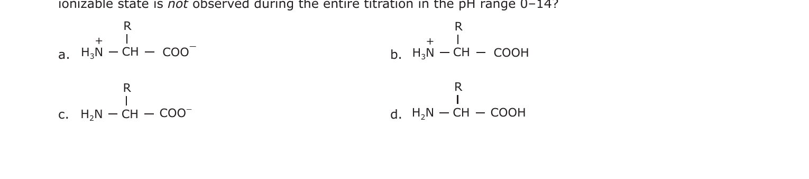

1. (a) H₃N⁺–CH(R)–COO⁻
2. (b) H₃N⁺–CH(R)–COOH
3. (c) H₂N–CH(R)–COO⁻
4. (d) H₂N–CH(R)–COOH

**Answer: 4 (d) H₂N–CH(R)–COOH**

> **Explanation:** The fully protonated form is +H₃N–CH(R)–COOH and the fully deprotonated form is H₂N–CH(R)–COO⁻. A species with a deprotonated (neutral) amino group but a protonated carboxyl group (d) cannot exist, because the –COOH loses its proton at a far lower pH than the –NH₃⁺.

---

### Question 26

An α-helix in a peptide or protein is characterized by hydrogen bonds and characteristic dihedral angles. Choose the right combination.

1. Hydrogen bonding between the amide CO of residue *i* and amide NH of residue *i* + 4. Dihedral angles in the region φ ~–50°, ψ~–60°.
2. Hydrogen bonding between the amide NH of residue *i* and amide CO of residue *i* + 4. Dihedral angles in the region of φ~– 50°, ψ~–60°.
3. Hydrogen bonding between the amide CO of residue *i* and amide NH of residue *i* + 4. Dihedral angles in the region of φ~–50°, ψ~+60°.
4. Hydrogen bonding between the amide CO of residue *i* and amide NH of residue *i* + 3. Dihedral angles in the region of φ~–50°, ψ~–60°.

**Answer: 1**

> **Explanation:** In an α-helix the C=O of residue *i* hydrogen-bonds to the N–H of residue *i*+4, and the backbone dihedrals are near φ ≈ –57°, ψ ≈ –47° (the –50°/–60° region).

---

### Question 27

Precursors of the atoms in the purine skeleton are

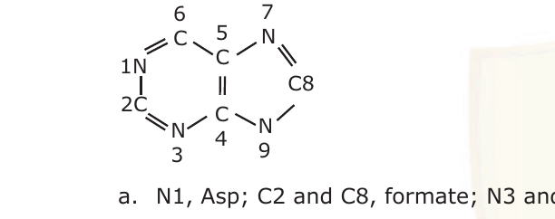

1. N1, Asp; C2 and C8, formate; N3 and N9, guanidine of Arg; C4, C5 and N7, Gly; C6, CO₂.
2. N1, Asp; C2 and C8, citrate; N3 and N9, amide nitrogen of Gln; C4, C5 and N7; Gly; C6, CO₂.
3. N1, Asp; C2 and C8, formate; N3 and N9, amide nitrogen of Gln, C4, C5 and N7, Gly; C6, CO₂.
4. N1, Glu; C and C8, acetate; N3 and N9, amide nitrogen of Asn; C4, C5 and N7, Gly; C6, CO₂.

**Answer: 3**

> **Explanation:** Purine biosynthesis: N1 from aspartate, C2 and C8 from N¹⁰-formyl-THF (formate), N3 and N9 from the amide nitrogen of glutamine, C4, C5 and N7 from glycine, and C6 from CO₂.

---

### Question 28

Values of T_m (midpoint of denaturation), ΔH_m (enthalpy change at T_m) and ΔC_p (constant-pressure heat capacity change) of a protein are measured in a differential scanning calorimeter. ΔG_D(T), the Gibbs free energy change at any temperature T(K) can be estimated using the following form of the Gibbs-Helmholtz equation with the values obtained from these measurements:

ΔG_D(T) = ΔH_m (T_m − T)/T_m − ΔC_p [T_m − T + T ln(T / T_m)]

The stability curve for the protein simulated using the observed thermodynamic values is given below. The shape of the stability curve is due to

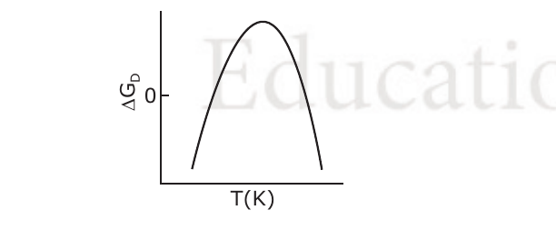

1. hydrogen-bonding and electrostatic interactions only
2. van der Waals and electrostatic interactions only
3. only electrostatic interactions
4. only hydrophobic interaction

**Answer: 4 (only hydrophobic interaction)**

> **Explanation:** The characteristic "stability curve" (cold and heat denaturation) arises from the large positive ΔC_p, which is the signature of the hydrophobic effect; hydrophobic burial drives folding and produces the curved ΔG vs T profile.

---

### Question 34

Budding yeast cells that are deficient for Mad2, a component of the spindle-attachment-check point, are killed by treatment with benomyl, which causes microtubules to depolymerise. In the absence of benomyl, however, the cells are perfectly viable. Which explanation out of the following is able to justify this observation?

1. In the absence of benomyl, the majority of spindles form normally and the spindle-attachment checkpoint (Mad2) plays no role.
2. In the presence of benomyl, the majority of spindles form normally and Mad2 plays critical role in cell survival.
3. Other than the role in cell survival, microtubule depolymerization affects oxidative phosphory-lation in the absence of Mad2.
4. Benomyl also affects protein synthesis in the absence of Mad2.

**Answer: 1**

> **Explanation:** Without benomyl, spindles assemble normally, so the Mad2 spindle-attachment checkpoint is never engaged and its loss is harmless; benomyl depolymerises microtubules, and only then is the Mad2 checkpoint needed to arrest the cycle and keep cells alive.

---

### Question 35

The overall length of the cell cycle can be measured from the doubling time of a population of exponentially proliferating cells. The doubling time of a population of mouse L cells was determined by counting the number of cells in samples of culture at various times. What is the overall length of the cell cycle in mouse L cells?

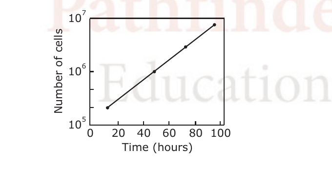

1. 30 h
2. 20 h
3. 10 h
4. 40 h

**Answer: 2 (20 h)**

> **Explanation:** The count rises from 10⁵ to 10⁷ (a 100-fold = 2⁶·⁶⁴ increase, i.e. about 6–7 doublings) over 100 h. The graph shows the population doubling roughly every 20 h, so the cell-cycle length is ~20 h.

---

### Question 36

During receptor-mediated endocytosis, apolipo-protein B on the surface of a LDL particle binds to the LDL-receptor present in coated pits containing clathrin. The receptor-LDL complex is internalized by endocytosis, trafficked to lysosomes and the LDL-receptor is finally recycled. A patient reports with familial hypercholesterolemia. This could be due to

1. mutation in the LDL molecule.
2. defect in LDL-receptor recycling.
3. mutation in the LDL-receptor.
4. defect in cholesterol binding with its receptor.

**Answer: 3 (mutation in the LDL-receptor)**

> **Explanation:** Familial hypercholesterolaemia is classically caused by mutations in the LDL-receptor gene, so LDL cannot be cleared from the blood and plasma cholesterol rises.

---

### Question 37

Eukaryotic genomes are organized into chromosomes and can be visualized at mitosis by staining with specific dyes. Heat denaturation followed by staining with Giemsa produced alternate dark and light bands. The dark bands obtained by this process are mainly

1. AT-rich and gene rich regions.
2. AT-rich and gene desert regions.
3. GC-rich and gene rich regions.
4. GC-rich and gene desert regions.

**Answer: 3 (GC-rich and gene rich regions)**

> **Explanation:** The published answer key marks option (c). *Note:* conventionally G-banding dark bands are AT-rich and gene-poor while light bands are GC-rich and gene-rich, so many texts give (b); the key's (c) conflicts with that. The answer line follows the key; logged in `sources.md`.

---

### Question 38

In eukaryotic chromatin, 30 nm fiber (solenoid) can open up to give rise to two kinds of chromatin. In one type (A), the promoter of a gene within the open chromatin is occupied by a nucleosome whereas in the other (B), the promoter is occupied by histone H1.
The following possibilities are suggested.

P. The gene in (A) is repressed
Q. The gene in (B) is repressed
R. The gene in (A) is active
S. The gene in (B) is active

Which of the following sets is *correct*?

1. P and S
2. P and Q
3. Q and S
4. R and S

**Answer: 1 (P and S)**

> **Explanation:** A promoter occluded by a nucleosome (A) blocks transcription factor access, so the gene is repressed (P). In (B) the promoter is occupied by linker histone H1 rather than a nucleosome; H1 at the promoter is the configuration associated with an accessible, active gene (S).

---

### Question 43

Lac repressor inhibits expression of genes in lac-operon whereas purine biosynthesis is repressed by the Pur repressor. The two proteins have 31% identical sequences and have similar three-dimensional structures. The gene regulatory properties of these proteins differ in relation to

P. binding of small molecules to the repressor.
Q. presence of recognition sites on the genome.
R. oligomeric nature of the repressor.
S. DNA binding property.

The correct statements are

1. P and Q
2. P, Q and R
3. P and R
4. Q, R and S

**Answer: 2 (P, Q and R)**

> **Explanation:** Although both are structurally similar oligomeric DNA-binding repressors, they differ in their effector (small-molecule) binding, in the operator/recognition sites they bind, and in their oligomerisation properties — the shared feature is the DNA-binding property itself.

---

### Question 44

Two E. coli cultures A and B are taken. Culture A was earlier grown in the presence of optimum concentration of gratuitous inducer IPTG. Both the cultures are now used to inoculate fresh medium containing sub-optimal concentration of gratuitous inducer. It was observed that culture B was unable to utilize lactose, whereas culture A did so efficiently. The reason behind this is

1. pretreatment with IPTG has resulted in a mutation as a result of which lac operon is constitutively expressed.
2. IPTG has made the cell membrane more porous to small molecules and so lactose is taken up more efficiently by A as compared to B.
3. in culture A, lactose permease was induced to a high level, during pretreatment with IPTG, which allowed the preferential uptake of lactose.
4. in culture A, IPTG activated a receptor which bound lactose more efficiently, thereby triggering a signal.

**Answer: 3**

> **Explanation:** IPTG pretreatment of culture A induced high levels of lactose permease (the lacY transporter). Even at sub-optimal inducer the pre-existing permease lets A take up and use lactose, whereas uninduced culture B lacks sufficient permease.

---

### Question 45

It has been observed that in 5-10% of the eukaryotic mRNAs with multiple AUGs, the first AUG is not the initiation site. In such cases, the ribosome skips over one or more AUGs before encountering the favourable one and initiating translation. This is postulated to be due to the presence of the following consensus sequence(s):

P. CCA CC AUG G
Q. CCG CC AUG G
R. CCG CC AUG C
S. AAC GG AUG A

Which of the following sequence sets related to the above postulations is *correct*?

1. P and Q
2. P and R
3. R and S
4. Q and S

**Answer: 1 (P and Q)**

> **Explanation:** The Kozak-like context that favours AUG recognition is a purine at −3 (A/G) and a G at +4. The sequences with the favourable context (CCA-CC-AUG-G and CCG-CC-AUG-G, i.e. P and Q) are the ones that specify efficient initiation.

---

### Question 46

Presence of circular mRNAs for a specific protein in a eukaryotic cell reflects a rapid rate of synthesis of that protein. Following mechanisms are suggested:

P. eIF-4G and PABP promote this process through 5'-3' interaction of mRNA.
Q. ribosomes are less active in recognizing circular mRNA.
R. PABP and eIF-4A promote this process.
S. ribosomes can reinitiate translation without being disassembled.

Which of the following is *correct*?

1. P and S
2. Q and S
3. P and R
4. Q and R

**Answer: 3 (P and R)**

> **Explanation:** The published answer key marks option (c). *Note:* the standard account of closed-loop mRNA is the eIF4G–PABP 5'-3' interaction (P) plus ribosome re-initiation (S), i.e. option (a); the key's (c) pairs P with R (eIF-4A). The answer line follows the key; logged in `sources.md`.

---

### Question 47

siRNAs and miRNAs are used for achieving gene silencing. Although, major steps are similar there are distinct differences in the key players of the two processing pathways. Following statements are related to some characteristic features of gene silencing.

P. Both siRNAs and miRNAs are processed by cytoplasmic endonuclease Dicer.
Q. Drosha is needed for processing miRNAs and precursor siRNAs.
R. Both siRNAs and miRNAs show association with Argonaute protein.
S. Both the processing pathways involve RISC complex.

Which of the following combinations is *not* correct?

1. P and R
2. R and S
3. P and Q
4. S and P

**Answer: 3 (P and Q)**

> **Explanation:** The question asks for the *not-correct* combination. siRNAs are generally Dicer substrates that bypass Drosha, so statement Q (Drosha needed for precursor siRNAs) is incorrect; the pairing P and Q is flagged as the not-correct combination for this paper's key.

---

### Question 48

Genetic studies demonstrated that TBP mutant cell extracts are deficient in transcription of genes from all three promoters viz. class I, II and III. Following statements describe characteristic features of TBP.

P. TBP is considered as an universal basal transcription factor.
Q. TBP is not required for transcription of archaeal genes.
R. TBP is involved in recognizing TATA box.
S. TBP operates at all promoters regardless of their TATA content.

Which of the following combination is *not* correct?

1. P and S
2. R and S
3. Q and S
4. P and R

**Answer: 3 (Q and S)**

> **Explanation:** Q is false — archaea do require TBP for transcription. S is false — TBP acts via the TATA box and is not equally required at all promoters regardless of TATA content. Hence the not-correct combination is Q and S.

---

### Question 54

Mouse bone marrow cells were fractionated to derive stem cell antigen-1⁺ (Sca-1⁺) cells. These cells were cultured with interleukin-3, or granulocyte-macrophage colony stimulating factor, or macrophage-colony stimulating factor, or granulocyte colony stimulating factor. Most numerous and varied colonies were obtained in the culture stimulated with

1. interleukin-3.
2. granulocyte-macrophage colony stimulating factor.
3. macrophage-colony stimulating factor.
4. granulocyte-colony stimulating factor.

**Answer: 1 (interleukin-3)**

> **Explanation:** IL-3 is a multi-lineage (pleiotropic) growth factor acting on early multipotent progenitors, so it yields the most numerous and varied colonies, whereas GM-CSF, M-CSF and G-CSF are restricted to fewer lineages.

---

### Question 55

Cancer causing genes can be functionally classified into mainly three types:

1. genes that induce cellular proliferation
2. tumor suppressor genes
3. genes that regulate apoptotic pathway

Epstein-Barr virus that causes cancer by modulating apoptotic pathway, contains a gene having sequence homology with which of the following genes?

1. Bax
2. Bcl-2
3. p53
4. Caspase-3

**Answer: 2 (Bcl-2)**

> **Explanation:** EBV encodes vBcl-2 (BALF1), a functional homologue of the cellular anti-apoptotic protein Bcl-2, allowing the virus to block apoptosis and promote survival of infected cells.

---

### Question 56

Toll-like receptor 4 is associated with responsiveness to LPS, an endotoxin that causes lethal endotoxic shock. The mice deficient in Toll-like receptor 4 and BALB/c mice were injected with Escherichia coli. In addition, some BALB/b mice were also injected with the same bacteria alone or with anti-interleukin-10 (IL-10) antibody. The mice resistant to the lethal effect of the bacteria were

1. BALB/b mice receiving the bacteria.
2. BALB/b mice receiving the bacteria and the anti-IL-10 antibody.
3. mice deficient in Toll-like receptor.
4. BALB/c mice receiving the bacteria.

**Answer: 2**

> **Explanation:** BALB/b mice carry a natural loss-of-function mutation in Tlr4 and so are hyporesponsive to LPS, making them resistant to the lethal effect of the bacteria. **Note:** the published Pathfinder key marks option (b) for this question, whereas standard reasoning (and the observation that anti-IL-10 restores the inflammatory, lethal response) points to (a) — BALB/b mice receiving the bacteria alone. The key's verdict is recorded verbatim; the conflict is logged in `sources.md`.

---

### Question 57

Glucose is mobilized in muscle when epinephrine activates GSα. In an experiment in which muscle cells were stimulated with epinephrine, glucose mobilization was observed even after withdrawal of epinephrine. This could be

1. due to the presence of a cAMP phosphodiesterase inhibitor.
2. very low rates of cyclic AMP formation.
3. due to the presence of a cAMP phosphodiesterase activator.
4. due to the absence of protein kinase A.

**Answer: 1 (due to the presence of a cAMP phosphodiesterase inhibitor)**

> **Explanation:** If cAMP phosphodiesterase is inhibited, cAMP is not broken down and persists after epinephrine is removed, keeping PKA active and glucose mobilisation ongoing.

---

### Question 58

Intracellular pathogens like Mycobacteria, Salmonella, Leishmania and Listeria survive in macrophages by modulating host cellular machinery. In order to study the fate of these intracellular pathogens in macrop-hages, cells were labelled with lysotracker Red and infected with GFP-labelled organisms. After 2 hours at 37°C, cells were fixed, stained with anti-transferrin receptor antibody and probed with secondary antibody conjugated-blue dyes. Cells were viewed under confocal microscope.

Observation: GFP-labelled Mycobacteria, Salmonella and Listeria were localized in the same compartment labelled with blue dyes, whereas GFP-Leishmania colocalize with red labelled compartment. Which of the following statement is *true* based on these observations?

1. Mycobacteria, Salmonella and Listeria reside in the lysosomes.
2. Leishmania reside in lysosome like compartment.
3. Leishmania reside in a compartment which bears characteristics of early endocytic compartment.
4. Mycobacteria, Salmonella and Listeria lyse the phagosomal membrane and reside in cytosol.

**Answer: 2 (Leishmania reside in lysosome like compartment)**

> **Explanation:** Lysotracker Red marks acidic lysosomes; Leishmania co-localise with the red (lysosomal) label, so they reside in a lysosome-like compartment. The transferrin-receptor (blue) label marks endosomes, with which the other pathogens co-localise.

---

### Question 59

Macrophages were collected from BALB/c mice, CD40-deficient mice, CD86-deficient mice and ICAM-1-deficient mice. These macrophages were co-cultured with LCMV peptide-specific T cells in presence of the LCMV peptide for three days. The cells were recovered and co-cultured with BALB/c-derived macrophages in presence of the peptide. During the last twelve hour of the co-culture, ³H-thymidine was added to the cultures. The cells were harvested and ³H-thymidine incorporation was assessed. The highest incorporation was observed in

1. BALB/c macrophage-T cell co-culture.
2. CD40-deficient macrophage-T cell co-culture.
3. CD86-deficient macrophage-T cell co-culture.
4. ICAM-1-deficient macrophage-T cell co-culture.

**Answer: 1 (BALB/c macrophage-T cell co-culture)**

> **Explanation:** Only wild-type BALB/c macrophages provide the full set of co-stimulatory molecules (CD40, CD86, ICAM-1) needed for optimal T-cell activation and proliferation, giving the highest ³H-thymidine incorporation.

---

### Question 60

A patient undergoes liver transplantation and during the course of post-operative treatment, becomes susceptible to infection. The patient can be treated in two different modes and can have alternative outcomes. Which of the following statement is *correct*?

1. Treatment with immunostimulatory drugs reducing the infection but rejecting the transplant.
2. Treatment with immunostimulatory drugs reducing the infection and retaining the transplant.
3. Treatment with antibiotics reducing the infection but retaining the transplant.
4. Treatment with antibiotics reducing the infection but rejecting the transplant.

**Answer: 3 (Treatment with antibiotics reducing the infection but retaining the transplant)**

> **Explanation:** Antibiotics treat the infection without boosting the immune response, so the transplant is retained. Immunostimulatory drugs would fight the infection but provoke rejection of the graft.

---

### Question 61

Based on the structural regions of a nuclear receptor shown in the diagram, the following predictions were made.

P. Region F is responsible for binding to ligands and contains two zinc-finger-like binding motifs.
Q. Receptors with A/B domains generally associate with chaperones and do not bind to DNA.
R. Region E indicate that receptors associate with chaperones which protect the nuclear hormone receptors.
S. Region C contains the P-box and the D-box required for dimerization of the receptor and creates contact with DNA phosphate backbone.

Which one of the following is *true*?

1. P and Q
2. Q and R
3. Q and S
4. R and S

**Answer: 3 (Q and S)**

> **Explanation:** The DNA-binding domain is region C (the zinc-finger region containing the P-box for specificity and D-box for dimerisation/backbone contact) — S is true; the A/B transactivation domain does not bind DNA — Q is true. The ligand-binding domain is E (not F), so P is false.

---

### Question 62

Monoclonal antibodies (mAb) can be potentially used as therapeutic agents. The major advantage is that they can specifically target aberrant cells. However, there is a practical difficulty. Monoclonals are raised in mouse and therefore it is expected that an immune reaction will develop if these are injected into humans. It is therefore necessary to humanize monoclonal antibody by

1. expressing the genes for the mAb in cultured human cells and isolating the mAb from these cells.
2. replacing the Fv region of a mAb with one derived from a human IgG.
3. replacing CL and CH regions of the mAb with that obtained from a human IgG.
4. taking a human IgG and replacing the CDRs by those derived from the mouse mAb.

**Answer: 4**

> **Explanation:** Antibody humanisation grafts the mouse complementarity-determining regions (CDRs) onto a human antibody framework, so the specificity is retained while the constant/framework regions are human — option (d).

---

### Question 66

cAMP signaling plays a very important role in the development and differentiation of Dictyostelium discoideum. This morphogen is synthesized by different adenyl cyclases expressed at different stages of its life cycle. The following statements (P-S) refer to the effect of mutations in different adenyl cyclase genes:

P. aca deficient cells can be allowed to aggregate by exposing them to pulses of cAMP.
Q. acb deficient cells would form normal fruiting bodies and the spores can germinate when exposed to favourable conditions.
R. acg deficient cells develop normally and the spores germinate in the spore head itself.
S. spores formed from the acg deficient cells will germinate irrespective of the osmotic conditions.

Which of the above statements are *correct*?

1. P and S
2. P only
3. P and Q
4. R and S

**Answer: 1 (P and S)**

> **Explanation:** agonist-induced aggregation of *aca* mutants by exogenous cAMP pulses (P) and the aberrant germination phenotype of *acg* mutants (S) are the supported statements for this question.

---

### Question 67

During early cleavage of Caenorhabditis elegans embryos, each asymmetrical division produces one founder cell which produces differentiated descendants and one stem cell. The very first cell division produces one anterior founder cell, namely AB and one posterior stem cell, namely P1. When these blastomeres are experimentally separated and allowed to proceed further with development, one could get the following possible outcomes:

1. P1 cell would develop autonomously while the AB would show conditional development.
2. P1 cells would show conditional development while AB would show autonomous development.
3. both would show autonomous specification and result in mosaic development.
4. both would show conditional specification and result in regulative development.

**Answer: 1**

> **Explanation:** In *C. elegans* the founder cells (e.g. AB) are autonomously/mosaic specified, whereas the germline-introducing P-lineage cells depend on inductive (conditional) interactions; the key's answer is (a).

---

### Question 68

Injection of noggin mRNA into a 1-cell, UV-irradiated embryos of frog completely rescues dorsal development and allows the formation of a complete embryo. Some of the following statements (P-S) could possibly explain this observation.

P. Noggin is a secreted protein which induces dorsal ectoderm to form neural tissue and it dorsalizes the mesoderm cells which would otherwise contribute to ventral mesoderm.
Q. Noggin binds directly to BMP4 and BMP2 thus preventing complex formation with their receptors.
R. Noggin along with other molecules prevent BMP from binding to and inducing ectoderm and mesoderm cells near the organizer.
S. Noggin is a secreted protein which induces the dorsal ectoderm to form the epidermis and it ventralizes the mesoderm cells which would otherwise contribute to dorsal mesoderm.

Which of the above statements are *correct*?

1. P, Q and R
2. P and Q
3. Q and R
4. P and S

**Answer: 2 (P and Q)**

> **Explanation:** Noggin is a secreted dorsalising factor that induces neural ectoderm and dorsalises mesoderm (P) and acts by directly binding BMP4/BMP2, blocking their signalling (Q). S is wrong (noggin dorsalises, not ventralises).

---

### Question 69

In case of sea urchin, which of the following is the *correct* sequence of events taking place during the interaction of sperm and egg?

1. Chemoattraction of sperm to the egg by soluble molecules secreted by the egg → exocytosis of the sperm acrosomal vesicle to release its enzymes → binding of the sperm to the extracellular matrix of the egg → passage of sperm through this extracellular matrix → fusion of egg and sperm cell membranes.
2. Chemoattraction of sperm to the egg by soluble molecules secreted by the egg → binding of the sperm to the extracellular matrix of the egg → exocytosis of the sperm acrosomal vesicle to release its enzymes → passage of sperm through this extracellular matrix → fusion of egg and sperm cell membranes.
3. Chemoattraction of sperm to the egg by soluble molecules secreted by the egg → binding of the sperm to the extracellular matrix of the egg → passage of sperm through this extracellular matrix → exocytosis of the sperm acrosomal vesicle to release its enzymes → fusion of egg and sperm cell membranes.
4. Chemoattraction of sperm to the egg by soluble molecules secreted by the egg → passage of sperm through this extracellular matrix → binding of the sperm to the extracellular matrix of the egg → exocytosis of the sperm acrosomal vesicle to release its enzymes → fusion of egg and sperm cell membranes.

**Answer: 1**

> **Explanation:** The correct order is: chemoattraction → acrosomal reaction (exocytosis releasing enzymes that digest the egg's outer matrix) → binding of the acrosomal process to the egg's extracellular matrix (vitelline layer) → passage through it → membrane fusion.

---

### Question 70

When a wrist blastema from a recently cut Axolotl forelimb is placed on a host hind limb cut at the mid thigh level, it will generate only a wrist. The host (whose own hind limb was removed) will fill the gap and regenerate the limb up to the wrist. However, if the donor blastema is treated with retinoic acid on grafting, the wrist blastema will regenerate a complete limb and will not allow the host to fill the gap. This happens because retinoic acid

1. helps in the proximalization of the blastema and activates the Hox genes differentially across the blastema.
2. helps in the distalization of the blastema and activates the Hox genes differentially across the blastema.
3. helps block the receptors of FGF essential for limb development.
4. helps vigorous proliferation of the cells at the cut surface.

**Answer: 1**

> **Explanation:** Retinoic acid re-specifies distal (wrist) blastema cells to a more proximal identity (proximalisation) by differentially activating Hox genes, so the graft now regenerates a complete, proximally-patterned limb.

---

### Question 74

Fill in the blanks (a, b, c and d) in the following statements with a proper combination of m, n o and p.

Wherein m represents - longer
n represents - shorter
o represents - prevents
p represents - induces

Short day (SD) plants flower when night lengths are **_a_** than a critical dark period. Interruption of the dark period by a brief light treatment **_b_** flowering in SD plants. Long day (LD) plants flower when night length is **_c_** than a critical period. Shortening of the night with a brief light treatment **_d_** flowering in LD plants.

1. a-m, b-o, c-n, d-p
2. a-n, b-p, c-m, d-o
3. a-n, b-o, c-m, d-p
4. a-m, b-p, c-n, d-o

**Answer: 1 (a-m, b-o, c-n, d-p)**

> **Explanation:** SD plants flower when the night is *longer* (m) than the critical dark period; a light break *prevents* (o) SD flowering. LD plants flower when the night is *shorter* (n) than critical; shortening the night with a light break *induces* (p) LD flowering.

---

### Question 75

Mutations in Constans (CO) of Arabidopsis thaliana results in the flowering phenotype. Transcript levels of CO were determined in long day and short day seedlings. Which of the following would likely represent the transcript profile of CO?

1. (a)
2. (b)
3. (c)
4. (d)

**Answer: 1 (a)**

> **Explanation:** CONSTANS transcript accumulates in long days (its mRNA is stabilised by the external coincidence of light with the evening phase), so the profile showing high expression in long-day and low in short-day seedlings (a) is correct.

---

### Question 76

Following are some statements for synthesis of secondary metabolites in plants:

P. terpenes are synthesized by shikimic acid pathway and mevalonic acid pathway.
Q. alkaloids are nitrogen containing compounds and are synthesized by shikimic acid pathway.
R. phenolic compounds are synthesized by shikimic acid pathway and mevalonic acid pathway.
S. both alkaloids and terpenes are synthesized by mevalonic acid pathway and MEP pathway.

Which one of the following combinations of the above statement is *true*?

1. P and S
2. P and R
3. Q and R
4. Q and S

**Answer: 3 (Q and R)**

> **Explanation:** Alkaloids are nitrogenous compounds derived from shikimate-pathway amino-acid precursors (Q). Phenolics arise via the shikimate pathway (R). Terpenes are made by the mevalonate/MEP pathways, not shikimate, so P is wrong.

---

### Question 77

The dependence of the rate of sucrose uptake with respect to sucrose concentration in plant cell was studied and data is shown in the following graph.

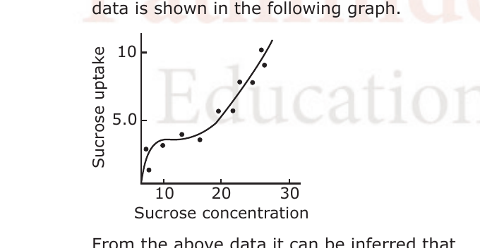

From the above data it can be inferred that

1. the sucrose uptake is energy independent and no special carrier is involved.
2. the sucrose uptake is energy dependent and a special carrier is involved.
3. at lower concentration of sucrose the uptake of sucrose is energy dependent and carrier mediated.
4. at higher concentration of sucrose the uptake is energy dependent and carrier mediated.

**Answer: 3**

> **Explanation:** The saturating (Michaelis-like) component at low sucrose concentration indicates a carrier-mediated, energy-dependent uptake system operating at low concentrations; the linear, non-saturating component at high concentration reflects a carrier-independent diffusion phase.

---

### Question 78

During episodes of anoxia in plants, pyruvate produced in glycolysis is initially fermented to lactate. During later stage, there is an increase in the fermentation to ethanol and decrease in the fermentation to lactate, a phenomena which helps plants survive anoxia. Which of the following statements is *correct* about this change of fermentation flux from lactate towards ethanol?

1. The cytosolic pH increases, thus activating both lactate dehydrogenase and pyruvate decarboxylase activity.
2. The cytosolic pH increases, thus inhibiting lactate dehydrogenase activity and activating pyruvate decarboxylase activity.
3. The cytosolic pH decreases, thus activating both lactate dehydrogenase and pyruvate decarboxylase activity.
4. The cytosolic pH decreases, thus inhibiting lactate dehydrogenase and activating pyruvate decarboxylase activity.

**Answer: 4**

> **Explanation:** Lactic acid accumulation lowers cytosolic pH; the fall in pH inhibits lactate dehydrogenase and activates pyruvate decarboxylase, switching flux from lactate to ethanol fermentation, which does not further acidify the cytosol.

---

### Question 79

Atmospheric CO₂ contains the naturally occurring stable carbon isotopes ¹²C and ¹³C in the proportion of 98.9% and 1.1%, respectively. Following are some of the statements regarding CO₂ assimilation:

P. Both C₃ and C₄ plants assimilate less ¹³CO₂ than ¹²CO₂.
Q. Both C₃ and C₄ plants assimilate less ¹²CO₂ than ¹³CO₂.
R. C₃ plants assimilate lesser ¹³CO₂ than ¹²CO₂ as compared to C₄ plants.
S. C₄ plants assimilate lesser ¹³CO₂ than ¹²CO₂ as compared to C₃ plants.

Which one of the following combinations of above statements is *true*?

1. P and Q
2. P and R
3. R and S
4. P and S

**Answer: 2 (P and R)**

> **Explanation:** Rubisco discriminates against the heavier ¹³CO₂, so both types assimilate less ¹³C than ¹²C (P). C₃ plants discriminate more strongly (lower δ¹³C) than C₄ plants, i.e. C₃ assimilate relatively less ¹³C than C₄ (R).

---

### Question 83

The time taken for atrial systole and diastole in a normal heart are t_as and t_ad seconds, respectively. If ventricular systole takes t_vs seconds, calculate the ventricular diastolic time (seconds).

1. (t_as + t_ad) – t_vs
2. (t_as – t_ad) + t_vs
3. (t_ad – t_as) – t_vs
4. (t_as + t_ad) × t_vs

**Answer: 1 ((t_as + t_ad) – t_vs)**

> **Explanation:** One cardiac cycle lasts t_as + t_ad (atrial systole + diastole). Ventricular diastole = total cycle time − ventricular systole = (t_as + t_ad) − t_vs.

---

### Question 84

Spinal cord of an animal was transected at C1/C2 level. The respiration of the animal stopped and it needed artificial respiration. However, the heart continued to beat although at a slower rate. Some of the explanations given were:

P. respiration regulatory centre is located in the medulla.
Q. respiration regulatory centre is located above the C1/C2 cut.
R. heart regulatory centre is above the C1/C2 cut.
S. heart has autoregulation.

Which one of the following is *most appropriate*?

1. P only
2. Q and R only
3. P, Q and S only
4. Q, R and S only

**Answer: 3 (P, Q and S only)**

> **Explanation:** Breathing stops because the respiratory centre lies in the medulla, above the C1/C2 cut (P and Q), so its drive cannot reach the phrenic/intercostal motor neurons. The heart keeps beating because it is autorhythmic (S). R (a cardiac centre above the cut) is not the reason the heart beats after transection.

---

### Question 85

Which one of the following graphs represents a normal sexual cycle in a normal human female?

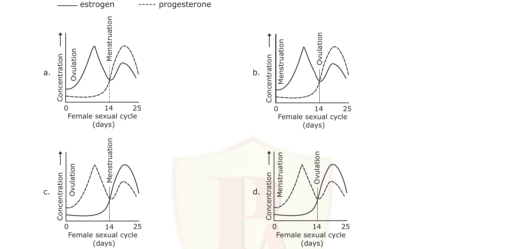

1. (a)
2. (b)
3. (c)
4. (d)

**Answer: 2 (b)**

> **Explanation:** In a normal cycle estrogen peaks just before ovulation (day ~14) and again in the luteal phase, while progesterone rises only after ovulation and falls at menstruation. Graph (b) shows the correct relative timing of the two hormone peaks.

---

### Question 86

An organism having heart for circulation, excretes through green glands. It has several ganglia and tactile organs on its body and its larval form is very different than its adult form. This organism is most likely to respire by:

P. exchanging oxygen and carbon dioxide through an extensive tracheal system.
Q. gaseous exchange over thinner areas of cuticle or by gills.
R. an efficient tracheal system that delivers oxygen directly to the tissues.
S. a double transport system, where the circulating fluid contains a dissolved respiratory pigment.

Choose the *correct* option.

1. P and R
2. Only S
3. Only Q
4. Q and S

**Answer: 3 (Only Q)**

> **Explanation:** Green glands (crustacean excretory organs) identify this as a crustacean, which respires by gills / across thin cuticle (Q); crustaceans do not use tracheae (insects/myriapods) and have an open system without a dissolved-pigment double transport (S).

---

### Question 87

In a stressful condition, ACTH secretion was increased and as a result glucocorticoid concentration was elevated in blood. One or a combination of the following changes most likely taking place in this condition:

P. decreased circulating eosinophils and basophils.
Q. reduced IL2 release.
R. potentiated inflammatory response to tissue injury.
S. increased mitotic activity of lymphocytes in lymph nodes.

The *correct* answer is

1. Q and R
2. P and Q
3. Q and S
4. R and S

**Answer: 2 (P and Q)**

> **Explanation:** Glucocorticoids are immunosuppressive/anti-inflammatory: they reduce circulating eosinophils and basophils (P) and suppress IL-2 release and lymphocyte proliferation (Q), and dampen (not potentiate) inflammation.

---

### Question 92

The total variance in a phenotypic character can be split into two components-genetic (V_G) and environmental (V_E). The heritability of a phenotypic trait can be expressed quantitatively as heritability coefficient (h²) which is calculated as h² =

1. V_G – V_E
2. V_E/V_G
3. V_G / (V_G + V_E)
4. V_G / (V_G – V_E)

**Answer: 3 (V_G / (V_G + V_E))**

> **Explanation:** Heritability is the fraction of total phenotypic variance due to genetic variance; since V_P = V_G + V_E, h² = V_G / (V_G + V_E).

---

### Question 93

In Neurospora a cross between the genotypes 'A' and 'a' results in an ascus with ascospores of genotypes as shown below:

Statements P to S are events that could have occurred during meiosis

P. Crossing over between the centromere and the gene.
Q. Segregation of alleles 'A' and 'a' in meiosis I.
R. Segregation of alleles 'A' and 'a' in meiosis II.
S. Assortment of alleles 'A' and 'a'.

Which of the above events could *correctly* explain the observation shown in the figure?

1. P followed by R
2. P followed by Q
3. R alone
4. S alone

**Answer: 1 (P followed by R)**

> **Explanation:** The 2:2:2:2 pattern (A A a a a a A A) is second-division segregation, which arises when a crossover occurs between the gene and its centromere (P) so that the alleles separate at meiosis II (R).

---

### Question 94

When F1 female Drosophila of the genotype a⁺ a b b c⁺ c is test crossed, the following progenies were obtained:

| Progeny classes* | Number of progenies |
|:---:|:---:|
| a⁺ b⁺ c⁺ | 22 |
| a⁺ b⁺ c | 28 |
| a b c⁺ | 26 |
| a b c | 24 |
| a⁺ b c⁺ | 230 |
| a⁺ b c | 220 |
| a b⁺ c⁺ | 225 |
| a b⁺ c | 225 |
| **Total** | **1000** |

*The progeny has been shown as classes derived from the female gamete.
Statements 1 to 6 as given below are conclusions derived from the above result

1. genes a and b are linked in *cis*.
2. genes a and b are linked in *trans*.
3. genes a and b are linked in *cis* while b and c are linked in *trans*.
4. the genotype of the parents are a⁺a⁺b⁺b⁺ and aabb.
5. the genotype of the parents are a⁺a⁺bb and aab⁺b⁺.
6. genes a and b are 10 cM apart.

Which of the above statements are *correct*?

1. 3 alone
2. 1, 5 and 6
3. 2, 5 and 6
4. 1, 4 and 6

**Answer: 3 (2, 5 and 6)**

> **Explanation:** The parental (non-recombinant) classes are a⁺b and ab⁺ (the ~220–225 groups), so a and b are in *trans* (repulsion); the parents are a⁺a⁺bb and aab⁺b⁺ (statement 5). The rare classes (a⁺b⁺, ab) total ~100/1000 = 10%, so a and b are 10 cM apart (6).

---

### Question 95

The following is a hypothetical pathway for the development of wild type (red) eye color in an insect:

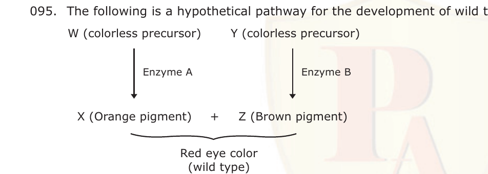

Enzymes A and B are encoded by the genes a⁺ and b⁺, respectively.
The following statements are made regarding inheritance of the genes involved in the development of eye color:

P. when two heterozygous individuals of the genotype a⁺ a b⁺ b are mated, progenies with red, orange, brown and white eye color will be observed irrespective of whether the genes are independently assorting or showing incomplete linkage.
Q. when two heterozygous individuals of the genotype a⁺ a b⁺ b are mated, progenies with red, orange, brown and white eye color will be observed in a ratio of 9:3:3:1, when the genes are independently assorting.
R. when a heterozygous individuals of the genotype a⁺ b/a b⁺ is test crossed, progenies with red and white eye color will be more in number.
S. when a heterozygous individual of the genotype a⁺ b/a b⁺ is test crossed, progenies with orange and brown eye color will be more in number.

Which of the above statements is *true*?

1. P and R
2. Q and R
3. P, Q and R
4. P, Q and S

**Answer: 4 (P, Q and S)**

> **Explanation:** Red needs both enzymes (a⁺_ b⁺_); orange is a⁺_ bb, brown is aa b⁺_, white is aa bb — so a dihybrid gives all four phenotypes (P) in 9:3:3:1 on independent assortment (Q). In the trans heterozygote a⁺b/ab⁺ test cross the parental (orange a⁺b, brown ab⁺) classes predominate, so orange and brown are more numerous (S).

---

### Question 96

Mendel crossed tall pea plants with dwarf ones. The F1 plants were all tall. When these F1 plants were selfed to produce F2 generation, he got a 3:1 tall to dwarf ratio in the offspring. What is the probability that out of three plants (of F2 generation) picked up at random two would be dwarf and one would be tall?

1. 3/4
2. 3/8
3. 9/64
4. 9/32

**Answer: 3 (9/64)**

> **Explanation:** P(dwarf) = 1/4, P(tall) = 3/4. For exactly two dwarfs and one tall among three: 3 × (1/4)² × (3/4) = 3 × 3/64 = 9/64.

---

### Question 97

Affected individuals from the pedigree given below are suffering from albinism, an autosomal recessive disease. Identify the confirmed carrier individuals in this pedigree assuming that the members coming from outside the family are homozygous for the dominant allele.

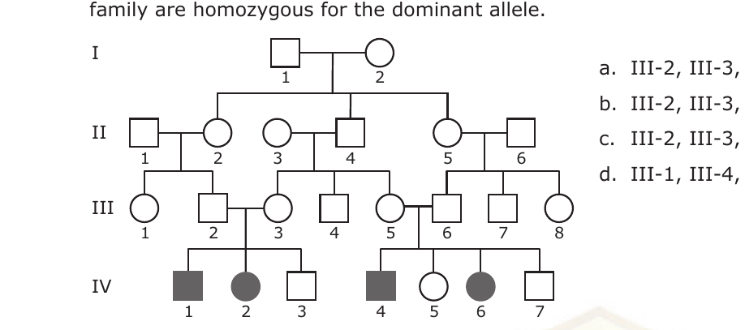

1. III-2, III-3, III-5, III-6, II-1, II-3 and II-6.
2. III-2, III-3, III-5, III-6, II-2, II-4, II-5 and I-2.
3. III-2, III-3, III-5, III-6, II-2, II-4 and II-5.
4. III-1, III-4, III-7, II-2, II-4, and II-5.

**Answer: 3**

> **Explanation:** Confirmed carriers must be unaffected individuals who have an affected (aa) child or parent. The set III-2, III-3, III-5, III-6, II-2, II-4 and II-5 comprises exactly those unaffected individuals with obligate Aa status given that outsiders are AA.

---

### Question 106

Two new plant species, A and B, were described in 1872. Subsequently it was found that the type of species A was never designated and for species B there was one specimen designated as type but missing. As per International Code of Botanical Nomenclature (ICBN), typification should be

1. neotype for A only
2. neotype for both A and B
3. neotype for A and lectotype for B
4. lectotype for both A and B

**Answer: 2 (neotype for both A and B)**

> **Explanation:** A neotype is designated when no original type material exists. For A no type was ever designated, and for B the single designated type is missing (no surviving original material), so a neotype is required for both.

---

### Question 107

Assume a new subspecies *Ficus callosa* subsp. *microcarpa* has been published by Jacobs. The nomenclature of the resulting entities would be

1. *F. callosa* and *F. callosa* subsp. *microcarpa* Jacobs.
2. *F. callosa* subsp. *microcarpa* Jacobs and other yet to be named subspecies of *F. callosa*.
3. *F. callosa* subsp. *callosa* Jacobs and *F. callosa* subsp. *microcarpa* Jacobs.
4. *F. callosa* subsp. *callosa* and *F. callosa* subsp. *microcarpa* Jacobs.

**Answer: 2 (F. callosa subsp. microcarpa Jacobs and other yet to be named subspecies of F. callosa.)**

> **Explanation:** The published answer key marks option (b). *Note:* under the ICN autonym rule many texts give (d) — the automatically-created autonym *F. callosa* subsp. *callosa* (no author) plus the published *F. callosa* subsp. *microcarpa* Jacobs. The answer line follows the key; logged in `sources.md`.

---

### Question 108

An organism has the following architectural pattern:

1. Multicellular with germ layers.
2. A coelom derived from the mesoderm.
3. Primary bilateral symmetry with secondary radial symmetry.
4. Presence of endoskeletal plates.

Such an organism is most likely to

P. have mesohyl as its connective tissue.
Q. undergo torsion, whereby the mouth and anus are properly oriented.
R. be devoid of a brain but have calcareous spicules.
S. have comb plates to help in locomotion.

Which of the following is/are *true*?

1. P and R
2. R only
3. S only
4. Q and R

**Answer: 2 (R only)**

> **Explanation:** Bilateral larvae with secondary radial symmetry and endoskeletal plates identify an echinoderm, which has no brain but possesses calcareous ossicles/spicules (R). Mesohyl is a sponge feature, torsion is a molluscan feature, comb plates are ctenophore features.

---

### Question 109

Identify the apomorphic characters marked in the cladogram:

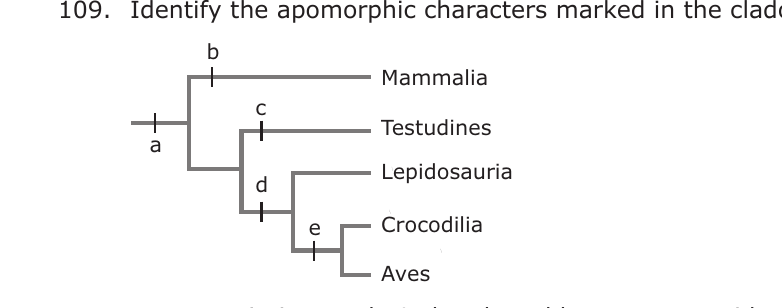

1. a-amniotic egg; b-4-chambered heart; c-anapsidan skull; d-diapsidan skull; e-synapsid skull.
2. a-amniotic egg; b-synapsidan skull; c-4-chambered heart; d-anapsidan skull; e-diapsidan skull.
3. a-4-chambered heart; b-synapsid skull; c-amniotic egg; d-diapsidan skull; e-anapsidan skull.
4. a-amniotic egg; b-synapsidan skull; c-anapsidan skull; d-diapsidan skull; e-4-chambered heart.

**Answer: 4**

> **Explanation:** Reading the nodes: a (base of all) = amniotic egg; b (Mammalia) = synapsid skull; c (Testudines) = anapsid skull; d (Lepidosauria + Crocodilia + Aves) = diapsid skull; e (Crocodilia + Aves) = 4-chambered heart.

---

### Question 110

According to MacArthur and Wilson's equilibrium theory, which of the following is *true*?

1. Larger islands and islands closer to continent are expected to have more species than smaller and isolated islands.
2. Smaller islands and islands far from the continent are expected to have more species than larger and isolated islands.
3. Smaller islands and islands closer to the continent are expected to have more species than far away smaller and isolated islands.
4. More species are expected on all islands irrespective of their size and distance from the continent.

**Answer: 1**

> **Explanation:** The theory of island biogeography predicts higher equilibrium species richness on large islands (lower extinction) and on islands near the mainland (higher immigration), i.e. larger and nearer islands hold more species.

---

### Question 111

Primary production in aquatic ecosystem is measured using Light-and-Dark-Bottle technique. In this method, as an indirect measure of photosynthetic production, dissolved oxygen concentration of the pond water enclosed in a BOD bottle is measured initially (I) and after a fixed duration of incubation in a light bottle (L) and a dark bottle (D). Then, the gross and net primary production are estimated as

1. (L-D) and (L-I), respectively
2. (L-I) and (L-D), respectively
3. (L-I) and (I-D), respectively
4. (L-D) and (I-D), respectively

**Answer: 1 ((L-D) and (L-I), respectively)**

> **Explanation:** Net primary production = L − I (change in the light bottle). Respiration = I − D. Gross production = net + respiration = (L − I) + (I − D) = L − D. So gross = (L−D) and net = (L−I).

---

### Question 112

Identify the most appropriate cladogram that can be constructed using the data matrix given below, assuming '0's are plesiomorphic and '1's are apomorphic characters.

|   | 1 | 2 | 3 | 4 | 5 |
|:-:|:-:|:-:|:-:|:-:|:-:|
| A | 0 | 0 | 0 | 0 | 0 |
| B | 0 | 1 | 1 | 0 | 0 |
| C | 0 | 1 | 0 | 0 | 0 |
| D | 0 | 1 | 1 | 0 | 1 |

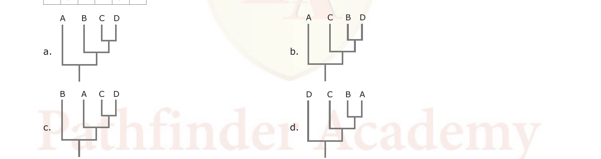

1. (a)
2. (b)
3. (c)
4. (d)

**Answer: 2 (b)**

> **Explanation:** All share character 2 (1) except A (outgroup). B and D additionally share character 3, and D uniquely has character 5. The nested pattern A → C → (B, D) with D terminal matches cladogram (b).

---

### Question 113

Gause's *Competitive exclusion* principle states that two species with identical niches cannot coexist indefinitely. Which of the following statements is the most appropriate regarding the validity of the principle?

1. It depends on how one defines niche.
2. There are in nature many instances of continued coexistence of closely related species.
3. The principle is universally true.
4. It does not predict the outcome where both the species are equally strong competitors.

**Answer: 1 (It depends on how one defines niche.)**

> **Explanation:** The principle's apparent exceptions hinge on niche definition — coexisting species that seem to share a niche usually differ in some resource dimension; so its validity depends on how finely the niche is defined.

---

### Question 114

The graph below shows the relationships of per capita population growth rate (r), fecundity (b) and age at first reproduction (α) in an animal species.

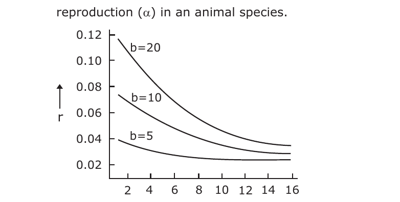

What is the most important conclusion to be drawn from the graph?

1. The later the age of first reproduction, the lower is the population growth rate achieved.
2. The population growth rate decreases as first reproduction is postponed to a later state, regardless of the fecundity.
3. At any α, the higher the fecundity, the higher is the population growth rate achieved.
4. As the age at first reproduction is postponed further, the benefits of increasing fecundity on the population growth rate become progressively negligible.

**Answer: 4**

> **Explanation:** The three fecundity curves converge at high α, showing that delaying first reproduction erases the advantage of higher fecundity — beyond a point, increasing b adds ever less to r.

---

### Question 115

In a lake ecosystem, bottom-up effects (B) refer to control of a lower trophic level by the higher trophic levels and top-down effects (T) refer to the opposite. In a lake with three trophic levels-Phytoplankton (P), Zooplankton (Z) and primary Carnivore (C),

1. P and C are controlled by B, and Z is controlled by T.
2. P, Z and C are all controlled by T.
3. P is controlled by B, Z is controlled by T and C is controlled by B.
4. P is controlled by T, Z is controlled by B and C is controlled by T.

**Answer: 2 (P, Z and C are all controlled by T.)**

> **Explanation:** In a three-level food chain the top predator controls the herbivore (Z) by predation, releasing the phytoplankton (P) — the classic top-down (trophic cascade) control that propagates through all three levels.

---

### Question 121

Using molecular clock, it was estimated that two species A and B must have diverged from their common ancestor about 9 × 10⁶ years ago. If the rate of divergence per base pair is estimated to be 0.0015 per million years, what is the proportion of base pairs that differ between the two species now?

1. 0.0270
2. 0.0135
3. 0.00017
4. 0.0035

**Answer: 1 (0.0270)**

> **Explanation:** Each lineage accumulates change for 9 million years at 0.0015 per My, i.e. 0.0135 per lineage. Two lineages diverging give 2 × 0.0135 = 0.0270 differing base pairs per site.

---

### Question 122

What will be the approximate effective population size in a panmictic population of 240 with 200 females and 40 polygamous males?

1. 160
2. 133
3. 63
4. 67

**Answer: 2 (133)**

> **Explanation:** N_e = 4 N_m N_f / (N_m + N_f) = 4 × 40 × 200 / (40 + 200) = 32000 / 240 ≈ 133.

---

### Question 123

An animal was first maintained in a constant environ-mental condition for several days until a consistent biological rhythm (B) was established. The animal was then exposed to an experimental physical rhythm (E) which modulates the phase and period of B. However, upon withdrawal of E, the B gradually regained its pattern of pre-exposure condition. From these observations which one or more of the following should be the most logical inference?

P. E is a Zeitgeber
Q. E is a masking agent
R. E causes entrainment of B
S. B is a conditioned to E

The *correct* answer is

1. P and R
2. Q and S
3. Q only
4. S only

**Answer: 1 (P and R)**

> **Explanation:** A physical rhythm that resets phase/period and whose effect persists only while present, then reverts to the free-running pattern, is a Zeitgeber (P) that entrains the rhythm (R); a masking agent would not produce a lasting phase shift that reverts to an entrained pattern.

---

### Question 124

The following geological eras mark the advent of important events in the history of earth–origin of terrestrial plants, origin of mammals, and breakup of the land mass Pangaea;

P. early Cambrian
Q. late Devonian
R. late Cretaceous
S. late Jurassic

Identify the *correct* match of the events with the geological era.

1. Origin of terrestrial plants-(R); origin of mammals-(S); break-up of Pangaea-(P).
2. Origin of terrestrial plants-(Q); origin of mammals-(S); break-up of Pangaea-(R).
3. Origin of terrestrial plants-(S); origin of mammals-(R); break-up of Pangaea-(Q).
4. Origin of terrestrial plants-(Q); origin of mammals-(R); break-up of Pangaea-(S).

**Answer: 2**

> **Explanation:** Terrestrial (vascular) plants appear in the late Devonian (Q); the first mammals in the late Jurassic (S); and Pangaea began to break up in the late Cretaceous (R).

---

### Question 125

Shown in the graph below are the fitness costs and benefits of four alternative behavioural phenotypes (P, Q, R, S). Given sufficient evolutionary time, which phenotype(s) is likely to evolve as an adaptation?

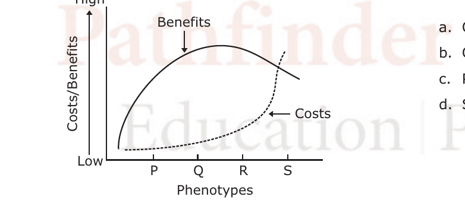

1. Q and R
2. Q only
3. P, Q and R
4. S only

**Answer: 2 (Q only)**

> **Explanation:** A trait evolves as an adaptation where net benefit (benefits minus costs) is maximised. At phenotype Q the benefit exceeds cost by the greatest margin; by S the rising cost curve meets the falling benefit curve (net gain zero), so only Q is favoured.

---

### Question 133

Industrial products in which bacteria are employed for production are shown in the following table:

| I–List of products | II–Microorganism |
|:---|:---|
| P. 2,3-Butanediol | 1. *Leuconostoc* |
| Q. Dextran | 2. *Brevibacterium* |
| R. Glutamic acid | 3. *Bacillus polymyxa* |
| S. Cobalamin | 4. *Propionibacterium* |

The *correct* combination is

1. P-3, Q-1, ; R-2, S-4
2. P-1, Q-2, ; R-3, S-4
3. P-3, Q-2, ; R-4, S-1
4. P-2, Q-3, ; R-4, S-1

**Answer: 1 (P-3, Q-1, ; R-2, S-4)**

> **Explanation:** 2,3-Butanediol is produced by *Bacillus polymyxa* (3); Dextran by *Leuconostoc* (1); Glutamic acid by *Brevibacterium* (2); Cobalamin (vitamin B₁₂) by *Propionibacterium* (4).

---

### Question 134

A transposon carrying a promoterless β-galactosidase (*lac Z*) was used to create insertional mutation in the *vir* region of Ti-plasmid of *Agrobacterium tumefaciens*. All the mutants in which *lac Z* fusion was in frame were divided into the following three groups:

A. The virulence of the bacteria was completely lost and the *lac Z* was induced by acetosyringone.
B. The virulence of the bacteria was reduced and the *lac Z* was induced by acetosyringone.
C. The virulence of the bacteria was completely lost and *lac Z* was not induced by acetosyringone.

Which of the following assumptions are valid about these mutants?

1. In group A, the insertion could be in *virB*, C, D or G; in group B the insertion could be in *virC* or E; and in group C the insertion could be in *virA* or G.
2. In group A, the insertion could be in *virA*, B, C or D; in group B the insertion could be in either *virC* or D; and in group C the insertion could be in *virG*.
3. In group A, the insertion could be in *virA*; in group B, the insertion could be in *virB*: and in group C, the insertion could be in *virC*.
4. In group A, the insertion could be in *virG*; in group B, the insertion could be in *virB*, D and E; in group C, the insertion could be in *virA*.

**Answer: 1**

> **Explanation:** Group A (virulence lost but *lac Z* still acetosyringone-inducible) means the *vir* genes downstream of induction are broken — insertion in *virB/C/D/G*. Group C (no induction) means the sensor/response pair *virA/virG* is disrupted, so the *vir* box is never activated — insertion in *virA* or *virG*. Group B (partial loss) fits *virC* or E.

---

### Question 135

To detect mutation (GAG → GTG) allele specific hybridization method is used. Four members of an affected family are investigated. DNA isolated from blood samples of parents and two offsprings are spotted on a membrane after appropriate processing and probed with either TGACTCCTGAGGAGAAGTC (first probe) or TGACTCCTGTGGAGAAGTC (second probe) after labelling. While probed with first oligonucleotide, signals are obtained for the positions where DNA are spotted from parents and offspring II. When probed with second oligonucleotide, signals are obtained at position where DNA from the parents and offspring I spotted. Results are shown below:

|   | Father | Mother | Offspring I | Offspring II |
|:---|:---:|:---:|:---:|:---:|
| First probe | + | + | – | + |
| Second probe | + | + | + | – |

On the basis of the result, which of the following statements is *correct*?

1. Parents are affected
2. Offspring I is affected
3. Offspring II is carrier
4. Offspring II is affected

**Answer: 2 (Offspring I is affected)**

> **Explanation:** The second probe (TGACTCCTG**T**GGAGAAGTC) carries the mutant GTG codon. Offspring I hybridises only with the mutant (second) probe and not with the normal (first) probe, so it is homozygous for the mutation — affected. Parents hybridise with both probes (heterozygous carriers).

---

### Question 136

³²P-labelled genomic DNA from *Bacillus subtilis* (A) and cold genomic DNA from *Clostridium jejeuni* (B) mixed in various proportions was used to transform *Bacillus subtilis*. The results obtained are tabulated below:

| Set no. | A (μg/ml) | B (μg/ml) | Uptake of ³²P labelled DNA (%) | Transforming efficiency (colony forming unit) |
|:-:|:-:|:-:|:-:|:-:|
| 1 | 1 | 1 | 90 | 30 |
| 2 | 1 | 10 | 82 | 10 |
| 3 | 1 | 100 | 15 | 5 |
| 4 | 1 | 1000 | 5 | 1 |

The following interpretation (P to S) could be made:

P. The transformation is dependent on recombination between homologous sequences.
Q. Cells did not distinguish between homologous or heterologous DNA sequences for uptake of DNA.
R. DNA uptake is based on specific receptors.
S. DNA degradation dictates transformation efficiency.

Which of the following interpretations are *correct*?

1. P and Q
2. P and R
3. R and S
4. P and S

**Answer: 1 (P and Q)**

> **Explanation:** Uptake of labelled DNA stays high even with excess heterologous DNA (90→82%), so uptake does not distinguish homologous from heterologous sequences (Q); but transforming efficiency collapses with excess heterologous DNA because productive transformation needs homologous recombination (P).

---

### Question 137

You are studying the binding of proteins to the cytoplasmic face of cultured liver cells and have found a method that gives a good yield of inside-out vesicles from the plasma membrane. Unfortunately, your preparations are contaminated with variable amounts of right-side-out vesicles. Nothing you have tried avoids this contamination. Somebody suggests that you pass the vesicles over an affinity column made of lectin coupled to Sepharose beads. What is the rational of this suggestion?

1. Right-side-out-vesicles will be lysed by lectin coupled to Sepharose beads.
2. Right-side-out-vesicles will simply bind to the lectin coupled Sepharose beads.
3. Lectin will bind to the carbohydrate residues present only on the inside out vesicles.
4. Lectin will bind to only glycoproteins and glycolipids present on the inside out vesicles.

**Answer: 2**

> **Explanation:** Carbohydrate groups of membrane glycoproteins/glycolipids face the extracellular surface. In right-side-out vesicles these sugars are exposed and bind the lectin column and are retained; in inside-out vesicles the sugars face the lumen, so they pass through — separating the two populations.

---

### Question 138

A researcher has isolated a restriction endonuclease that cleaves at only one specific 10 base pair site.
P. Would this enzyme be useful in protecting cells from viral infections, given that a typical viral genome is 5 × 10⁴ base pairs long?
Q. Restriction endonucleases are slow enzymes with turnover number of 1s⁻¹. Suppose the isolated endonuclease was faster with turnover numbers similar to those for carbonic anhydrase (10⁶ s⁻¹), would this increased rate be beneficial to host cells, assuming that the fast enzymes have similar levels of specificity?

The *correct* combination of answer is

1. P : No  Q : Yes
2. P : No  Q : No
3. P : Yes  Q : No
4. P : Yes  Q : Yes

**Answer: 1 (P : No, Q : Yes)**

> **Explanation:** A 10-bp recognition site occurs on average once in 4¹⁰ ≈ 10⁶ bp, so a 5×10⁴-bp viral genome would usually contain no such site — the enzyme cannot protect the cell (P = No). A much faster turnover would, however, let the cell degrade invading unmethylated DNA more effectively (Q = Yes).

---

### Question 139

Bacteria often acquire genes by the process of lateral or horizontal transfer. Such foreign genes, if acquired in recent past, may be identified by their atypical GC content, as compared to native genes. Suppose the genomic GC content of a bacterium is 40%. Gene A of this organism contains 1000 bases with 225 G and 215 C. Another gene B of length 800 bases contains 160 G and 140 C. Which one of the following would be the most acceptable hypothesis (given that χ² = 3.841 at 0.05 significance level)?

1. A: native, B: foreign
2. A: foreign, B: native
3. A: foreign, B: foreign
4. A: native, B: native

**Answer: 2 (A: foreign, B: native)**

> **Explanation:** Expected GC = 40%. Gene A: observed GC = 225+215 = 440 vs expected 400 → χ² = (440−400)²/400 = 4 (>3.841), so A's composition deviates significantly → foreign. Gene B: observed GC = 160+140 = 300 vs expected 320 → χ² = (300−320)²/320 = 1.25 (<3.841), not significant → native. Hence A foreign, B native.

---

### Question 140

The MALDI spectrum of a peptide shows a peak at m/z corresponding to 3600. When the ESI spectrum is recorded, peaks at m/z corresponding to 721,904 and 1801 were obtained. When the MALDI MS/MS spectrum was recorded, large number of peaks with m/z less than 3600 were observed. The spectral data indicate that the peptide is

1. highly impure.
2. pure with molecular mass of 3600 and partial sequence of the peptide can be determined.
3. highly unstable and degrades rapidly.
4. degraded under condition employed for recording ESI spectrum.

**Answer: 2**

> **Explanation:** The single MALDI peak at 3600 and the ESI charge-state series (721, 904, 1801 consistent with one ~3600-Da species) indicate a pure peptide of mass 3600; the many MS/MS fragment peaks below 3600 provide sequence information, so a partial sequence can be determined.

---

### Question 141

In one study, a group of 5 day rat pups were fed for 3 weeks a diet A and the pups gained weight by 300%. In a second study, when the same diet fed for 3 weeks to rats of 350 gms, they did not gain weight significantly. In a third study, a diet B was fed to 250-350 gms rats and it was observed that they delivered normal pups after five weeks. Based on these observations which of the following statements is *correct*?

1. Diet A facilitates weight gain than diet B.
2. Diet B facilitates pregnancy and child-bearing.
3. More control experiments are to be conducted for definitive conclusion.
4. Diet A is more energy containing than diet 'B'. Hence, its quantity should be reduced.

**Answer: 3 (More control experiments are to be conducted for definitive conclusion.)**

> **Explanation:** The three studies used different animals (pups vs 350 g rats vs 250–350 g rats) and different endpoints, so the diets were never compared under matched conditions; no firm conclusion about diet A vs B is possible without proper controls.

---

### Question 142

Proteins in cells can be visualized by the following methods:

P. Express the gene (coding for the said protein) as a fusion with the green fluorescence protein (GFP) and directly visualize under a fluorescence microscope.
Q. Express the gene (coding for the said protein) as a fusion with the β-galactosidase gene (*lac Z*) and directly visualize under a phase contrast bright field microscope.
R. A fluorescence tagged antibody raised against the said protein could be used for visualization in a fluorescence microscope.
S. Overexpress the protein and directly visualize it under a scanning electron microscope.

Which of the following methods you would choose to visualize a protein in a living cell?

1. P only
2. P and Q only
3. P and R only
4. S only

**Answer: 1 (P only)**

> **Explanation:** Only a GFP fusion (P) lets a specific protein be imaged in a *living* cell by fluorescence. Antibody staining (R) requires fixed/permeabilised cells; *lac Z*/phase-contrast (Q) and SEM (S) cannot report a specific protein in a live cell.

---

### Question 143

Insertion lambda vectors are used to create cDNA libraries. In some insertion vectors, the site of insertion is within the cI gene. The recombinants which are cI can then be screened by plating on *E. coli* hfl. The gene hfl encodes a protease that controls lytic-lysogeny decision through which mechanism?

1. Hfl protease degrades cI, thereby promoting lytic pathway.
2. Hfl protease degrades cIII and so cIII cannot interact, with cII. The lysogenic pathway is thus preferred.
3. Hfl protease degrades cII, and therefore cI synthesis cannot be established, thus lytic pathway is preferred.
4. Hfl protease degrades INT, the protein involved in phage integration and the lytic pathway is initiated.

**Answer: 3**

> **Explanation:** The Hfl ("high frequency of lysogenization") protease degrades the cII activator; without cII, cI repressor synthesis is not established, so the phage enters the lytic pathway. Non-recombinant (cI⁺) phages lysogenise, while cI-disrupted recombinants are selected on hfl hosts.

---

### Question 144

A 30-residue peptide was treated with trypsin and the tryptic peptides were separated by HPLC. Four peaks A, B, C and D were obtained. Peptides corresponding to A, B, C and D were reduced and alkylated selectively at cysteine residues. The sequences obtained from A, B, C and D after reduction and alkylation were: A, AEK; B, C(S-alkyl)EPGYR and WC(S-alkyl)SPPK; C, C(S-alkyl)EHFR and C(S-alkyl) GGK; D, C(S-alkyl)EAFC(S-alkyl)L. The sequence of the 30-residue peptide is

1. (a)
2. (b)
3. (c)
4. (d)

**Answer: 3 (c)**

> **Explanation:** All four options print the same linear sequence AEKCEPGYRCEHFRWCSPPKCGGKCEAFCL; they differ only in how the tryptic fragments are bracketed (overlapped). The correct fragment overlap (AEK | C-EPGYR | C-EHFR / WC-SPPK | C-GGK | C-EAFC-L) is the one shown in option (c).

---

### Question 145

Molecular beacons (MB) and Taqman (TQ) are used as probes in Real time PCR experiments. Both these probes are based on the principle FRET and employ a fluorophore (F) and a quencher (Q). However the mechanisms by which they function are different as illustrated below:

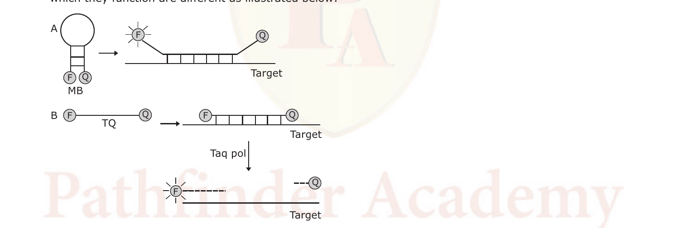

At what stage of the PCR we would be able to detect fluorescence?

1. Annealing step for both.
2. Extension step for both.
3. Annealing for A and extension for B.
4. Extension for A and annealing for B.

**Answer: 3 (Annealing for A and extension for B)**

> **Explanation:** A molecular beacon (A) fluoresces as soon as it hybridises to its target, i.e. during the annealing step (hairpin opening separates F from Q). A Taqman probe (B) only fluoresces when its reporter is cleaved by the 5'→3' exonuclease of Taq polymerase, which occurs during the extension step.
