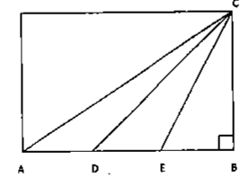
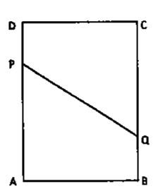
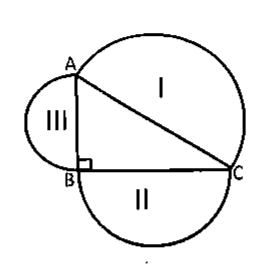
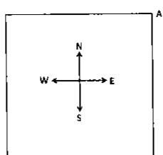
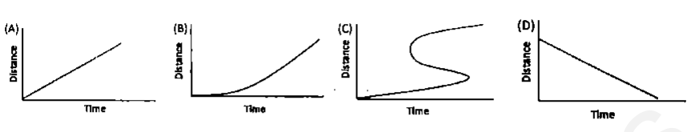
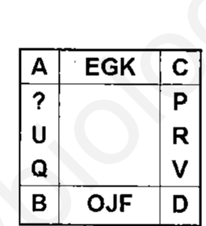
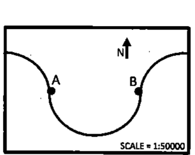

# CSIR UGC NET Life Sciences — December 2012 (2012 II), Booklet Code A — Part A

Part A contains 20 questions (Q1–Q20), 2 marks each. Answer 15.

---

### Question 1

A granite block of 2 m × 5 m × 3 m size is cut into 5 cm thick slabs of 2 m × 5 m size. These slabs are laid over a 2 m wide pavement. What is the length of the pavement that can be covered with these slabs?

1. 100 मी./m
2. 200 मी./m
3. 300 मी./m
4. 500 मी./m

**Answer: 3 (300 मी./m)**

> **Explanation:** Block volume = 2 × 5 × 3 = 30 m³. Each slab = 2 × 5 × 0.05 = 0.5 m³, so 30 / 0.5 = 60 slabs. Their total covered area = 60 × (2 × 5) = 600 m². Over a 2 m wide pavement the length is 600 / 2 = **300 m**.

---

### Question 2

Which is the least among the following?

0.33^0.33, 0.44^0.44, π^(−1/π), e^(−1/e)

1. 0.33^0.33
2. 0.44^0.44
3. π^(−1/π)
4. e^(−1/e)

**Answer: 4 (e^(−1/e))**

> **Explanation:** For 0 < x < 1 the function x^(1/x) is increasing, so 0.33^0.33 < 0.44^0.44 (both ≈ 0.69 and 0.73). Now π^(−1/π) = e^(−ln π/π) with ln π/π ≈ 1.1447/3.1416 ≈ 0.364, giving ≈ 0.695; while e^(−1/e) = e^(−0.3679) ≈ 0.6922. Since 1/e = 0.3679 > ln π/π = 0.3644, e^(−1/e) is the **smallest**.

---

### Question 3

What is the next number in this "see and tell" sequence?

1 11 21 1211 111221 ______

1. 312211
2. 1112221
3. 1112222
4. 1112131

**Answer: 1 (312211)**

> **Explanation:** Each term verbally describes the previous one. 111221 reads as "three 1s, one 2, two 1s" → **312211**.

---

### Question 4

A vertical pole of length *a* stands at the centre of a horizontal regular hexagonal ground of side *a*. A rope that is fixed taut in between a vertex on the ground and the tip of the pole has a length

1. *a*
2. √(2*a*)
3. √(3*a*)
4. √(6*a*)

**Answer: 2 (√2a)**

> **Explanation:** In a regular hexagon of side *a* the distance from the centre to a vertex equals *a*. The rope, the pole (height *a*) and that ground distance (*a*) form a right triangle, so rope = √(a² + a²) = √(2a²) = **√2·a** (printed as √2a).

---

### Question 5

A peacock perched on the top of a 12 m high tree spots a snake moving towards its hole at the base of the tree from a distance equal to thrice the height of the tree. The peacock flies towards the snake in a straight line and they both move at the same speed. At what distance from the base of the tree will the peacock catch the snake?

1. 16 मी./m
2. 18 मी./m
3. 14 मी./m
4. 12 मी./m

**Answer: 1 (16 मी./m)**

> **Explanation:** Snake starts 3 × 12 = 36 m from the base. Let it be caught *x* m from the base; the snake travelled 36 − *x*, and the peacock flew the hypotenuse √(12² + *x*²). Equal speeds mean equal distances: √(144 + x²) = 36 − x → 144 + x² = 1296 − 72x + x² → 72x = 1152 → **x = 16 m**.

---

### Question 6

The cities of a country are connected by intercity roads. If a city is directly connected to an odd number of other cities, it is called an odd city. If a city is directly connected to an even number of other cities, it is called an even city. Then which of the following is impossible?

1. विषम नगरों की संख्या सम है। / There are an even number of odd cities
2. विषम नगरों की संख्या विषम है। / There are an odd number of odd cities
3. सम नगरों की संख्या सम है। / There are an even number of even cities
4. सम नगरों की संख्या विषम है। / There are an odd number of even cities

**Answer: 2 (There are an odd number of odd cities)**

> **Explanation:** By the handshaking lemma the sum of all vertex degrees is even (twice the number of edges). The sum of the odd degrees alone must therefore also be even, which is only possible if there is an **even** number of odd cities. An odd number of odd cities is impossible. (The count of even cities is unconstrained.)

---

### Question 7

In the figure ∠ABC = π/2, *AD = DE = EB*. What is the ratio of the area of triangle ADC to that of triangle CDB?

1. 1:1
2. 1:2
3. 1:3
4. 1:4

**Answer: 2 (1:2)**

> **Explanation:** Let AD = DE = EB = *x*, so AD = *x* and DB = DE + EB = 2*x*. Triangles ADC and CDB share the same altitude from C to line AB, so their areas are in the ratio of their bases: *x* : 2*x* = **1:2**.

---

### Question 8

A rectangular sheet ABCD is folded in such a way that vertex A meets vertex C, thereby forming a line PQ. Assuming AB = 3 and BC = 4, find PQ. Note that AP = PC and AQ = QC.

1. 13/4
2. 15/4
3. 17/4
4. 19/4

**Answer: 2 (15/4)**

> **Explanation:** PQ is the perpendicular bisector of the diagonal AC. With A = (0,0), B = (3,0), C = (3,4), D = (0,4): AC = 5 and its midpoint is (1.5, 2). PQ has slope −3/4 and meets AD (x = 0) at P = (0, 3.5) and BC (x = 3) at Q = (3, 0.5). Hence PQ = √(3² + 3²·(3/4)²) = √(9 + 81/16) = √(225/16) = **15/4**.

---

### Question 9

A string of diameter 1mm is kept on a table in the shape of a close flat spiral i.e. a spiral with no gap between the turns. The area of the table occupied by the spiral is 1 m². Then the length of the string is

1. 10 मी./m
2. 10² मी./m
3. 10³ मी./m
4. 10⁶ मी./m

**Answer: 3 (10³ मी./m)**

> **Explanation:** A tight spiral of wire of diameter *d* and length *L* covers area A = *L·d*. With A = 1 m² and d = 1 mm = 10⁻³ m, L = 1 / 10⁻³ = **10³ m**.

---

### Question 10

25% of 25% of a quantity is *x*% of the quantity where *x* is

1. 6.25%
2. 12.5%
3. 25%
4. 50%

**Answer: 1 (6.25%)**

> **Explanation:** 0.25 × 0.25 = 0.0625 = **6.25%** of the quantity.

---

### Question 11

In sequence {*aₙ*} every term is equal to the sum of all its previous terms. If *a*₀ = 3, then limₙ→∞ *a*ₙ₊₁ / *aₙ* is

1. 3
2. 2
3. 1
4. e

**Answer: 2 (2)**

> **Explanation:** Since aₙ₊₁ = a₀ + a₁ + … + aₙ = Sₙ and aₙ = Sₙ₋₁, we get aₙ₊₁ = aₙ + Sₙ₋₁ = 2aₙ for n ≥ 1. The sequence therefore doubles at each step from that point, so the ratio → **2**. (a₀ = 3 only sets the scale.)

---

### Question 12

In the figure below, angle ABC = π/2. I, II, III are the areas of semicircles on the sides opposite angles B, A, and C, respectively. Which of the following is always true?

1. II² + III² = I²
2. II + III = I
3. II² + III² > I²
4. II + III < I

**Answer: 2 (II + III = I)**

> **Explanation:** Semicircle area on a side is proportional to the square of that side: II + III = (π/8)(BC² + AB²). By Pythagoras BC² + AB² = AC², so II + III = (π/8)AC² = **I**.

---

### Question 13

What is the minimum number of days between one Friday the 13ᵗʰ and the next Friday the 13ᵗʰ (Assume that the year is a leap year).

1. 28
2. 56
3. 91
4. 84

**Answer: 3 (91)**

> **Explanation:** For the 13ᵗʰ to fall on Friday again, the number of days between must be a multiple of 7. Month lengths mod 7 are 3 (28 days), 0 (29), 1 (30), 2 (31). The shortest run of consecutive months whose offsets sum to a multiple of 7 is 2 + 1 + 3 + 1 = 7 weeks, i.e. 31 + 30 + 28 + 31 = **91 days** (the classic February–May gap in a leap year).

---

### Question 14

Suppose a person A is at the North-East corner of a square (see the figure below). From that point he moves along the diagonal and after covering 1/3ʳᵈ portion of the diagonal, he goes to his left and after sometime he stops, rotates 90° clockwise and moves straight. After a few minutes he stops, rotates 180° anticlockwise. Towards which direction he is facing now?

1. उत्तर–पूर्व / North-East
2. उत्तर–पश्चिम / North-West
3. दक्षिण–पूर्व / South-East
4. दक्षिण–पश्चिम / South-West

**Answer: 1 (North-East)**

> **Explanation:** Facing South-West along the diagonal, a turn to his left gives South-East; a 90° clockwise rotation gives South-West; a 180° rotation (either way) gives **North-East**.

---

### Question 15

Cucumber contains 99% water. Ramesh buys 100 kg of cucumbers. After 30 days of storing, the cucumbers lose some water. They now contain 98% water. What is the total weight of cucumbers now?

1. 99 कि. ग्रा./kg
2. 50 कि. ग्रा./kg
3. 75 कि. ग्रा./kg
4. 2 कि. ग्रा./kg

**Answer: 2 (50 कि. ग्रा./kg)**

> **Explanation:** The dry mass is invariant: 1% of 100 kg = 1 kg. After drying it is 2% of the new weight, so new weight = 1 / 0.02 = **50 kg**.

---

### Question 16

In a museum there were old coins with their respective years engraved on them, as follows.

(A) 1837 AD  (B) 1907 AD  (C) 1947 AD  (D) 200 BC

Identify the fake coin(s)

1. सिक्का /coin A
2. सिक्का /coin D
3. सबके A व B /coins A and B
4. सिक्का /coin C

**Answer: 2 (सिक्का /coin D)**

> **Explanation:** A coin dated "200 BC" could not have been minted knowing it was 200 years before the birth of Christ — that era notation did not exist at the time. So **coin D** is the fake.

---

### Question 17

A student observes the movement of four snails and plots the graphs of distance moved as a function of time as given in figures (A), (B) (C) and (D).

Which of the following is **not** correct?

1. आलेख (A) / Graph (A)
2. आलेख (B) / Graph (B)
3. आलेख (C) / Graph (C)
4. आलेख (D) / Graph (D)

**Answer: 3 (आलेख (C) / Graph (C))**

> **Explanation:** Graph (C) doubles back, giving more than one distance value for a single instant of time — a body cannot be at two positions at once, so that distance–time plot is impossible. (Graph (D) is a decreasing distance, i.e. return towards the origin, which is legitimate.)

---

### Question 18

Find the missing letter:

1. H
2. L
3. Z
4. Y

**Answer: 3 (Z)**

> **Explanation:** Reading the outer letters as alphabet positions, the pairs opposite each other sum to 27 (A–Z, C–D style complement pairs); the missing entry is the complement of A, i.e. position 26 = **Z**.

---

### Question 19

Consider the following equation

*x*² + 4*y*² + 9*z*² = 14*x* + 28*y* + 42*z* + 147

where *x*, *y* and *z* are real numbers. Then the value of *x*+2*y*+3*z* is

1. 7
2. 14
3. 21
4. अन्य नहीं /not unique

**Answer: 3 (21)**

> **Explanation:** Rearranging and completing squares: (x − 7)² + 4(y − 3.5)² + 9(z − 7/3)² = 0 is obtained by writing x² − 14x + 4y² − 28y + 9z² − 42z + 147 = 0, i.e. (x−7)² − 49 + 4(y−3.5)² − 49 + 9(z−7/3)² − 49 + 147 = 0, which reduces to a sum of three squares equal to zero. Hence x = 7, y = 3.5, z = 7/3 and x + 2y + 3z = 7 + 7 + 7 = **21**.

---

### Question 20

The map given below shows a meandering river following a semi-circular path, along which two villages are located at A and B, The distance between A and B along the east-west direction in the map is 7 cm. What is the length of the river between A and B in the ground?

1. 1.1 कि. मी./km
2. 3.5 कि. मी./km
3. 5.5 कि. मी./km
4. 11.0 कि. मी./km

**Answer: 3 (5.5 कि. मी./km)**

> **Explanation:** A and B are the ends of the diameter, so 7 cm on the map is the diameter. River length = semi-circumference = (π/2) × 7 ≈ 11 cm on the map. At 1:50000, 11 cm = 11 × 50000 cm = 550000 cm = **5.5 km**.
