# Part C (Questions 71–145)

CSIR NET Life Science — December 2012 (2012 (II)). Answers confirmed against the
published answer key (EasyBiologyClass "Original Question Paper with Answer Key").

---

### Question 71

The Gibbs free energy of binding of a ligand with a protein is determined using alorimetric measurements at 25°C. The value of ΔG° thus determined is 1.36 kcal/mole. The binding constant for the ligand-protein association is:

1. 1.30 × 10⁻¹²
2. 0.10
3. 1.00
4. 0.97

**Answer: 2 (0.10)**

> **Explanation:** ΔG° = −RT ln K_a. At 25 °C, RT ≈ 0.592 kcal/mol, so
> ln K_a = −ΔG°/RT = −1.36/0.592 ≈ −2.30, giving K_a ≈ e⁻²·³⁰ ≈ 0.10.

---

### Question 72

A is converted to E by enzymes E_A, E_B, E_C, E_D. The K_m(M) values of the enzymes are 10⁻², 10⁻⁴, 10⁻⁵ and 10⁻⁴, respectively. If all the substrates and products are present at a concentration of 10⁻⁴ M, and the enzymes have approximately the same V_max, the rate limiting step will be:

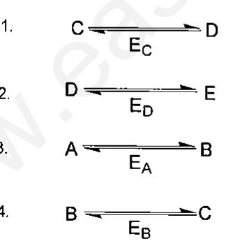

1. C ⇌ D (E_C)
2. D ⇌ E (E_D)
3. A ⇌ B (E_A)
4. B ⇌ C (E_B)

**Answer: 3 (A ⇌ B, E_A)**

> **Explanation:** The step operating far below saturation (substrate ≪ K_m) is
> slowest. For E_A, K_m = 10⁻² M while substrate = 10⁻⁴ M, so [S]/K_m = 10⁻²,
> the lowest fractional saturation. Hence the A→B step is rate-limiting.

---

### Question 73

The molecular mass of a protein determined by gel filtration is 120 kDa. When its mass is determined by SDS-PAGE with and without β-mercaptoethanol, it is only 60 kDa. What is the most probable explanation for these observations?

1. Protein is a dimer in which two identical chains are cross-linked by disulphide bond(s).
2. Protein is a monomer of molecular mass 60 kDa but it is excluded from the gel matrix due to strong repulsion between the gel matrix and the protein.
3. Protein is most likely to be composed of two sub-units having identical molecular mass.
4. Protein is a monomer but it is nicked into half its size by SDS.

**Answer: 3 (Protein is most likely to be composed of two sub-units having identical molecular mass.)**

> **Explanation:** Gel filtration reports the native mass (120 kDa). SDS-PAGE
> alone already gives 60 kDa, i.e. the subunits separate without reduction, so
> they are not held by disulphide bonds. Two identical 60 kDa subunits sum to
> 120 kDa, matching option 3.

---

### Question 74

Mouse IgG is left either intact (left lane in A, B, C, D) or digested with papain or pepsin or treated with β-mercaptoethanol (β-ME) and run on non-reducing SDS-PAGE and stained with Coomassie blue. In a separate experiment, papain-digested products are immunblotted with an anti-idiotypic monoclonal antibody. Following four profiles are attributed to each of these treatments.

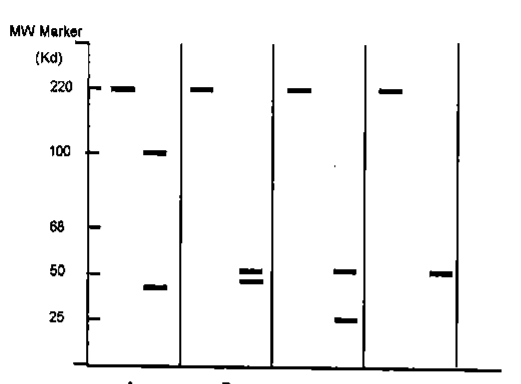

Which one of the following possibilities is correct?

1. A( pepsin), B (papain), C (β-ME), D (papain, followed by anti-idiotype immunoblot)
2. A( papain), B (pepsin), C (papain, followed by anti-idiotype immunoblot,D (β-ME)
3. A (papain, followed by anti-idiotype immunoblot), B (papain ), C ( pepsin), D (β-ME)
4. A (β-ME), B (papain ), C ( pepsin), D (papain, followed by anti-idiotypeimmunoblot)

**Answer: 1 (A(pepsin), B(papain), C(β-ME), D(papain, followed by anti-idiotype immunoblot))**

> **Explanation:** Pepsin gives one large F(ab')₂ (~100 kDa) plus small pFc';
> papain gives three ~50 kDa Fab/Fc fragments; β-ME separates heavy (~55) and
> light (~25) chains; anti-idiotypic blot detects only Fab bands. These match
> lanes A, B, C, D respectively.

---

### Question 75

The citric acid cycle in respiration yields:

1. 1 GTP, 3 NADH, 1 FADH₂, 2 CO₂
2. 2 GTP, 2 FADH₂, 6 NADH, 2 CO₂
3. 4 GTP, 6 NADH, 4 FADH₂, 2 CO₂
4. 32 GTP, 2 NADH, 4 FADH₂, 4 CO₂

**Answer: 1 (1 GTP, 3 NADH, 1 FADH₂, 2 CO₂)**

> **Explanation:** Per acetyl-CoA oxidised, the cycle releases 2 CO₂ and
> produces 3 NADH, 1 FADH₂ and 1 GTP.

---

### Question 76

Phosphatidyl serine (PS) is mostly located in the inner bilayer of plasma membrane of red blood cells (RBCs). You have to prove this fact about PS by an experiment. You are provided with PS-specific lytic enzymes (PSE) and other reagents needed. Identify the correct sequence of experiments to be carried out to settle this issue.

1. RBCs → inside out vesicles→ PSE → Thin Layer Chromotography (TLC)
2. RBCs → right side out vesicles →TLC→PSE
3. RBCs → PSE → Inside out vesicles →TLC
4. RBCs → PSE → TLC → Inside out vesicles

**Answer: 1 (RBCs → inside out vesicles → PSE → TLC)**

> **Explanation:** Inside-out vesicles expose the original cytoplasmic (inner)
> leaflet to the outside, so the non-permeant PS-specific enzyme can reach PS.
> PSE digestion followed by TLC detection of the products proves PS was on the
> inner leaflet.

---

### Question 77

ATP-driven pumps hydrolyze ATP to ADP and phosphate and use the energy released to pump ions or solutes across a membrane. There are many classes of these pumps and representatives of each are found in all prokaryotic and eukaryotic cells. Which of the following statements about these pumps is NOT correct?

1. P-type pumps are multipass transmembrane proteins which phosphorylate themselves during pumping and involve in ion transport.
2. F-type pumps normally use the H⁺ gradient across the membrane to drive the synthesis of ATP.
3. V-type pumps normally use voltage gradient for transport of small molecules.
4. ABC transporters primarily pump small molecules across cell membrane.

**Answer: 3 (V-type pumps normally use voltage gradient for transport of small molecules.)**

> **Explanation:** V-type pumps are ATP-driven proton pumps that acidify
> organelles/vacuoles; they do not use a voltage gradient to transport small
> molecules. Statement 3 is the incorrect one.

---

### Question 78

Following are statements related to the organization of the four major protein complexes of thylakoid membrane.

A. Photosystem II is located predominantly in the stacked regions of the thylakoid membrane.
B. Photosystem I is found in the unstacked regions protruding into stroma.
C. Cytochrome B₆ f complex is confined to stroma only.
D. ATP synthase is located in the unstacked regions protruding into stroma.

Which one of the following combinations of above statements is correct?

1. A, B and C
2. A, B and D
3. B, C and D
4. C, D and A

**Answer: 2 (A, B and D)**

> **Explanation:** PSII sits in appressed (stacked) grana; PSI and ATP synthase
> are in unstacked stroma-exposed lamellae. Cytochrome b₆f is in the stacked
> region, not "confined to stroma", so C is false.

---

### Question 79

A bacterial population has a plasmid with copy number 'n'. It was observed that on an average in one out of 2⁽ⁿ¹⁾ cell divisions, there was spontaneous plasmid curing. It was inferred from the observation that:

A. Each cell division does not have equal probability of plasmid curing.
B. There is no evidence for any mechanism of plasmid segregation in the two daughter cells.
C. Plasmid distribution to daughter cells is random.
D. Each plasmid has an equal chance of being in either of the two daughter cells.

Which of the combinations of above statements is true?

1. A and B
2. B and D
3. only A
4. B, C and D

**Answer: 4 (B, C and D)**

> **Explanation:** A curing frequency of 1/2⁽ⁿ¹⁾ is exactly the probability
> expected when n plasmids segregate randomly and equally to two daughters —
> i.e. no active segregation mechanism (B), random distribution (C), equal
> chance per plasmid (D). A is false.

---

### Question 80

In a given experiment the cells were labeled for 30 minutes with radioactive thymidine. The medium was then replaced with that containing unlabelled thymidine and the cells were grown for additional time. At different time points after replacement of medium the fraction of mitotic cells were analysed. Based on the results obtained, the above figure was drawn which shows the percentage of mitotic cells that are labeled as a function of time after brief incubation with radioactive thymidine.

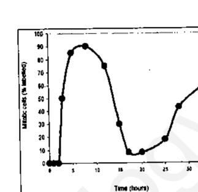

Considering the above experiment, the following statements were made:

A. Cells in the S-phase of the cell cycle during the 30 minute labeling period contain radioactive DNA.
B. It takes about 3 hours before the first labeled mitotic cells appear.
C. The cells enter the second round of mitosis at t₃₀ hours.
D. The total length of the cell cycle is about 27 hours with G₁ being more than 15 hours.

Which of the combinations of the above statements is correct?

1. A and B
2. B and C
3. C and D
4. A and D

**Answer: 1 (A and B)**

> **Explanation:** Brief ³H-thymidine pulses label only S-phase cells (A). The
> labelled mitotic fraction first rises at ~3 h (B). The second wave begins
> near t₃₀ but the cell-cycle length/G₁ statements (C, D) are not supported.

---

### Question 81

Mutants of lac Y(Y⁻) gene of E.coli do not synthesize the lactose permease protein. The following statements refer to the behaviour of lac Y⁻ mutants under different experimental conditions.

A. No synthesis of β- galactosidase when Y⁻ cells are induced with lactose.
B. Synthesis of β- galactosidase when cells are induced with lactose.
C. No synthesis of β- galactosidase when cells are induced with IPTG.
D. Synthesis of β- galactosidase when cells are induced with IPTG.
E.The cells induced with IPTG cannot grow in the presence of TONPG (TONPG is a compound, whose uptake is mediated by lactose permease and cleaved by β- galactosidase to release a toxic compound).
F. Cells induced with IPTG can grow in the presence of TONPG.

Which combination of the above statements is correct?

1. A, D and F
2. B, C and E
3. A, C and F
4. A, C and E

**Answer: 1 (A, D and F)**

> **Explanation:** Without permease, lactose cannot enter, so no induction by
> lactose (A). IPTG enters without permease and induces β-galactosidase (D),
> but TONPG uptake needs permease, so induced Y⁻ cells survive TONPG (F).

---

### Question 82

The semiconservative nature of DNA replication was established by Meselson and Stahl in their classic experiment with bacteria. They grew bacteria in N¹⁵-NH₄Cl containing medium, washed and then incubated in fresh medium with N¹⁴- containing compounds and allowed to grow for three generations. CsCl density gradient centrifugation of isolated DNA established the nature of semiconservative DNA replication. The pictorial representation below shows the position of differentially labeled DNA in CsCl density gradient.

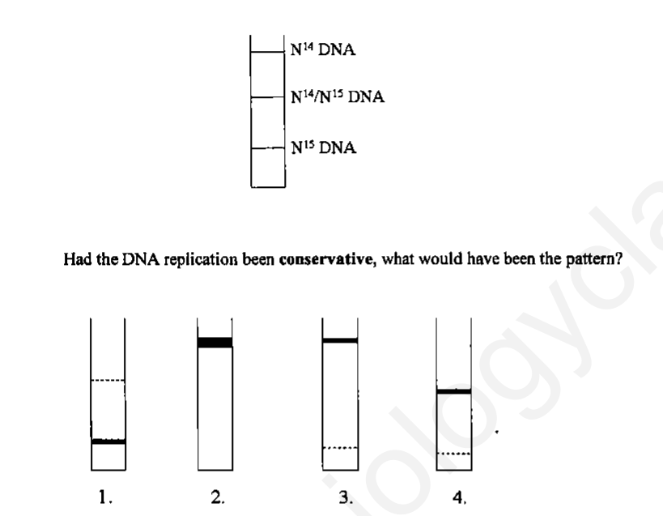

Had the DNA replication been conservative, what would have been the pattern?

1. (band near N¹⁵ with a faint upper band)
2. (single heavy band at top)
3. (single band at top, faint band at bottom)
4. (intermediate band with faint lower band)

**Answer: 3**

> **Explanation:** In conservative replication the parental N¹⁵/N¹⁵ duplex stays
> intact and a completely N¹⁴/N¹⁴ duplex is made, so after generations you see a
> heavy band plus a light band and never a hybrid intermediate — pattern 3.

---

### Question 83

HeLa cell extract was used to study transcription of a gene X having six introns. RNA Pol II complex containing all associated proteins was isolated from actively transcribing system and subjected to proteome analysis. Results showed the presence of both splicing and capping enzymes in the complex. When transcription elongation was inhibited by flavopiridol, polymerase complex contained only capping enzymes. When phosphorylation of the CTD domain of Pol II was inhibited by a kinase inhibitor, the complex contained neither splicing nor capping enzymes. From these results, following conclusions were made:

A. Transcription of gene X is coupled to mRNA capping.
B. Transcription elongation is coupled to splicing.
C. Phosphorylation of CTD is required for the recruitment of capping and splicing enzymes.
D. Both capping and splicing of mRNAs occurs simultaneously.

Identify the correct set of conclusions:

1. A, B and C
2. B, C and D
3. C, D and A
4. D, A and B

**Answer: 1 (A, B and C)**

> **Explanation:** Capping enzymes stay with the polymerase (A); splicing
> enzymes are lost when elongation is blocked (B); both are lost when CTD
> phosphorylation is inhibited (C). D (simultaneous capping+splicing) is not
> supported.

---

### Question 84

In bacteria, N-formyl methionine is the first amino acid to be incorporated into a polypeptide chain. Accordingly, one would think that all bacterial proteins have a formyl group at their amino terminus and the first amino acid is methionine. However, this is not the case, because of the following possible reasons.

A. Deformylase removes the formyl group only during or after the synthesis of the polypeptides.
B. Aminopeptidase removes only the amino terminal methionine.
C. Aminopeptidase removes the amino terminal methionine as well as one or two additional amino acids.
D. Deformylase removes the formyl group as well as amino terminal methionine and adds one or two amino acids to it.

Choose the combination of correct answers from the following:

1. B and C
2. A and B
3. A and C
4. A and D

**Answer: 3 (A and C)**

> **Explanation:** Deformylase removes the formyl group (A), and a
> methionine aminopeptidase can remove the N-terminal Met together with one or
> two further residues (C). B is too restrictive and D is wrong (no addition).

---

### Question 85

Bacteriophage λ is a temperate phage. Immediately after infection, viral specific mRNAs for N and Cro proteins are expressed followed by early mRNAs. At the commitment phase, either lytic cycle starts with the expression of genes for head tail, and lytic proteins or lysogenisation cycle begins with the expression of repressor and integrase genes. During induction of lysogens both INT and XIS proteins are needed along with host factors. Out of the four processes below, some govern integration of viral genome and its excision?

A. Repression of transcription
B. Retroregulation
C. Rearrangement of viral genome
D. Repression of translation

Identify the correct set of combination:

1. A and B
2. B and C
3. C and D
4. D and A

**Answer: 2 (B and C)**

> **Explanation:** Integrase (INT) is produced by retroregulation from the
> int-15' promoter (B), and site-specific recombination rearranges the viral
> genome during integration/excision (C).

---

### Question 86

In E. coli, recA gene is involved in recombination as well as repair and dnaB gene is involved in unwinding of DNA double strands during replication. Which of the following statement is/are correct about Rec A and Dna B?

A. Mutation in E. coli recA gene is lethal.
B. E. coli with mutated dnaB gene does not survive.
C. Dna B after uncoiling DNA double strands, prevents further reannealing at the separated strands.
D. Rec A gene is involved in SOS response and helps DNA repair.

The correct options are:

1. B and C
2. A and B
3. B and D
4. A and C

**Answer: 3 (B and D)**

> **Explanation:** dnaB encodes the replicative helicase, so its loss is lethal
> (B). RecA mediates the SOS response and recombinational repair (D). recA
> mutation is not lethal (A false), and single-strand stabilisation is by SSB,
> not DnaB (C false).

---

### Question 87

The challenges faced by aminoacyl tRNA synthetases in selecting the correct amino acid is more daunting than its recognition of the appropriate tRNA. In case of amino acids with similar structures like valine and isoleucine, this challenge is met by the enzyme possibly through its

A. catalytic pocket.
B. editing pocket.
C. anticodon loop.
D. acceptor arm.

Choose the correct set from the following:

1. A and B
2. A and C
3. B and D
4. B and C

**Answer: 1 (A and B)**

> **Explanation:** The catalytic (activation) site selects the amino acid (A)
> and a separate editing/hydrolytic pocket corrects mis-activation of similar
> residues like valine vs isoleucine (B).

---

### Question 88

p24 is an important core protein of HIV. This protein is abundant during active replication of the virus. The serum of an HIV patient was examined for the presence of p24 and antibody against p24 for proper diagnosis of the infection stage. Match the clinical observations in column A with the inferences in column B.

| Column A | Column B |
|---|---|
| A. p24 is present in the serum. | a. viral latency |
| B. Anti-p24 antibody is high in the serum. | b. progression of HIV from latency to lytic stage |
| C. Anti-p24 antibody begins to decline with corresponding increase in p24. | c. early stage of infection |

Choose the correct matching

1. A-a, B-b, C-c
2. A-b, B-a, C-c
3. A-c, B-a, C-b
4. A-c, B-b, C-a

**Answer: 3 (A-c, B-a, C-b)**

> **Explanation:** Free p24 antigen marks early (lytic) infection (A-c); high
> anti-p24 antibody with low antigen marks latency (B-a); falling antibody with
> rising antigen marks progression from latency to the lytic stage (C-b).

---

### Question 89

Epidermal growth factor (EGF) is needed for growth of almost all cells. EGF receptor is a transmembrane protein having an extracellular ligand-binding domain, a transmembrane domain and a cytosolic domain of protein tyrosine kinase (PTK). Binding of EGF to the receptor activates PTK resulting in activation of transcription factors through intracellular transducers. In cell type A, much of the extracellular ligand-binding domain is deleted by proteases such that cytosolic domain of PTK becomes constitutively active whereas cell type B is having normal EGF receptor. What will be the best-fit graph for the growth of the cultures of cell type A and B in complete medium in presence (+) and absence (–) of EGF?

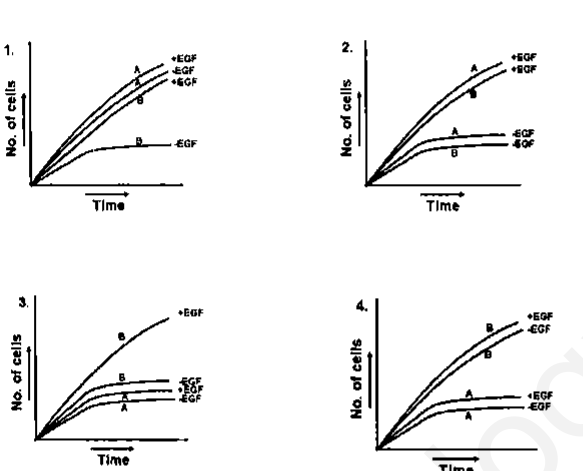

1. (graph 1)
2. (graph 2)
3. (graph 3)
4. (graph 4)

**Answer: 1**

> **Explanation:** Cell A lacks the ligand-binding domain, so its kinase is on
> constitutively — it grows with or without EGF. Cell B needs EGF, so it grows
> only in +EGF. Graph 1 shows A growing in both conditions and B only +EGF.

---

### Question 90

A particular type of cancer cell undergoes apoptosis by both extrinsic and intrinsic pathways when treated with a chemotherapeutic agent X. Caspase 8 and Caspase 9 are the initiator capases associated with extrinsic and intrinsic pathways respectively. Now, if caspase 9 is silenced in the cancer cell by shRNA transfection, what will be the best-fit graph for apoptosis scenario in the cancer cell when treated with agent X?

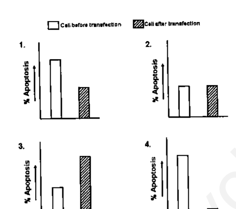

1. (graph 1)
2. (graph 2)
3. (graph 3)
4. (graph 4)

**Answer: 1**

> **Explanation:** Silencing caspase-9 knocks out only the intrinsic arm; the
> extrinsic (caspase-8) route still works, so apoptosis after transfection is
> reduced but not abolished. Graph 1 shows a partial drop.

---

### Question 91

After successive surgery and chemotherapy, the tumor of a breast cancer patient subsided. However, after almost 5 years, the tumor relapsed in a more aggressive manner and did not respond to the conventional chemotherapy delivered earlier. The following postulations were made.

A. Chemoresistant cells were persisting within the tumor even after therapy.
B. A population of quiescent cells existed, which under favourable conditions, ransformed to new tumor cells.
C. High ABC (ATP-Binding Cassette) – transporter expressing cells persisted in the breast during chemotherapy.
D. Breast tumor cells which may have migrated to other tissues, returned to the breast immediately after chemotherapy was terminated.

Which of the above combination of statements is true?

1. A and D
2. A, B and C
3. only B
4. B and D

**Answer: 2 (A, B and C)**

> **Explanation:** Relapse with drug resistance is explained by persisting
> chemoresistant cells (A), quiescent cancer cells that later re-enter the cycle
> (B), and ABC-transporter (drug-efflux) cells surviving therapy (C). D (cells
> migrating and returning) is not a sound explanation.

---

### Question 92

Following are the experimental observations made on treatment of B cells:

A. Anti-immunoglobulin (anti-Ig) antibody treatment results in B cell apoptosis.
B. Anti-Ig plus CD40 ligand treatment results in B cell proliferation.
C. Anti-Ig plus CD40 ligand plus 1L-4 treatment results in B cell proliferation and switching to IgG1.
D. Anti-Ig plus 1L4 treatment results in less B cell proliferation but switching to IgE.

From the above observation, which one of the following is the correct interpretation for the role of CD40 in B cell function?

1. Induce death of B cells.
2. Rescue B cells from death and Ig class switch to IgG1.
3. Inducing Ig class switch to IgE.
4. Induce Ig class switching to both IgG1 and IgE and inhibit B cell proliferation.

**Answer: 2 (Rescue B cells from death and Ig class switch to IgG1.)**

> **Explanation:** Anti-Ig alone kills B cells; adding CD40 ligand rescues them
> and drives proliferation and, with IL-4, class switching to IgG1. Hence CD40
> rescues from death and promotes IgG1 switching.

---

### Question 93

A potentially valuable therapeutic approach for killing tumor cells without affecting normal cells is the use of immunotoxins. Immunotoxins constitute monoclonal antibodies against tumor cells conjugated to lethal toxins. Which of the following molecular approaches do you think is NOT appropriate for generating tumor cell-specific immunotoxin that will not kill normal cells?

1. Cell surface receptor binding polypeptide chain of toxin molecule should be replaced by monoclonal antibodies against a particular tumor cell type.
2. Constant region Fc domain of tumor cell specific monoclonal antibody should be replaced by ligation of toxins.
3. Variable region F(ab)₂ domain of tumor cell-specific monoclonal antibody should be replaced by ligation of toxins.
4. Inhibitor polypeptide chain of toxin should be conjugated to F(ab)₂ domain of tumor cell specific monoclonal antibody.

**Answer: 3 (Variable region F(ab)₂ domain ... replaced by ligation of toxins.)**

> **Explanation:** The F(ab)₂ variable region is what recognises the tumor
> antigen. Replacing it with toxin destroys targeting specificity, so normal
> cells could be affected — the inappropriate strategy.

---

### Question 94

Flowers represent a complex array of functionally specialized structures that differ substantially from the vegetative plant body in form and cell types. Following are statements made regarding floral meristems.

E. Floral meristems can usually be distinguished from vegetative meristems by their larger size.
F. The increase in the size of the meristem is largely a result of increased rate of cell division in central cells.
G. The increase in the size of the meristem is due to larger size of the cells, which in turn results from rapid cell expansion only.
H. A network of genes control floral morphogenesis in plants.

Which combination of the above statements is true?

1. A, B and D
2. A, B and C
3. B, C and D
4. A, C and D

**Answer: 1 (A, B and D)**

> **Explanation:** Floral meristems enlarge mainly by increased cell division
> (not expansion) and are governed by a gene network (ABC model). So the
> statements on larger size, division in central cells, and genetic control are
> true, while the "cell expansion only" statement is false. (Note: statements
> are printed E–H but options reference A–D — see sources.md.)

---

### Question 95

Three embryos, X (wild type), Y (mutant for bicoid) and Z (mutant for nanos) were injected with bicoid mRNA in their posterior pole at early cleavage stage. What would be the phenotypes of the resulting embryos?

1. Embryo X will develop head on both anterior and posterior side, while embryos Y and Z will develop head on posterior side only.
2. Embryos X and Z will develop head on both anterior and posterior side, while embryo Y will develop head on posterior end only.
3. Embryos X, Y and Z will develop head on both anterior as well as posterior side.
4. Embryo X will develop head on anterior side, embryo Y will develop no head, while embryo Z will develop head on anterior as well as posterior side.

**Answer: 2 (Embryos X and Z will develop head on both anterior and posterior side, while embryo Y will develop head on posterior end only.)**

> **Explanation:** Ectopic posterior bicoid induces a second anterior (head)
> structure. Wild-type X and nanos-mutant Z both gain posterior heads → heads at
> both ends. bicoid-mutant Y, lacking its own anterior determinant, is rescued
> only where the injected mRNA sits (posterior), so it forms head at the
> posterior end.

---

### Question 96

In C. elegans during embryogenesis, an anchor cell and 6 hypodermal vulval precursor cells (VPCs) get involved in forming the vulva. If 3 of the hypodermal VPCs are killed by a laser beam, a normal vulva is still formed. This could be due to the following possible reasons.

A. Six hypodermal VPCs form equivalence group of cells, out of which only 3 participate in vulva formation and 3 cells remain as reserve cells.
B. When 3 hypodermal VPCs are killed, the 3 neighboring hypodermal non-VPCs get freshly recruited.
C. Anchor cell functions as an inducer which can induce epithelial cells of the gonad to get recruited to compensate for the loss.
D. Anchor cell acts as an inducer which can spatially induce only 3 hypodermal cells to form the vulva.

Which combination of the above statements is correct?

1. A and B
2. B and C
3. C and D
4. A and D

**Answer: 4 (A and D)**

> **Explanation:** The six VPCs are an equivalence group of which normally three
> (P.P.P) adopt vulval fates; the other three are reserve cells (A). The anchor
> cell induces a fixed number of adjacent VPCs (D). Killing three leaves the
> three induced fates, so a normal vulva still forms.

---

### Question 97

In tadpoles, if the tail is amputated it can regenerate. However, if the tail is amputated and then exposed to retinoic acid, it develops limbs instead of regenerating the tail. This could be due to the following reasons:

A. Retinoic acid is a morphogen and induces genes responsible for limb formation.
B. Retinoic acid raises the positional values in that region for limb development to take place.
C. This is a random phenomenon and is not well understood.
D. Retinoic acid possibly acts as a mutagen and the phenotype observed is a result of several mutations.

Which combination of the above statements is true?

1. A and B
2. C and D
3. B and D
4. B and C

**Answer: 1 (A and B)**

> **Explanation:** Retinoic acid is a developmental morphogen that re-specifies
> positional identity and activates limb-formation genes, converting the
> regeneration field from tail to limb (A and B). It is not random (C) nor a
> mutagenic effect (D).

---

### Question 98

In sea urchins, a group of cells at the vegetal pole become specified as the large micromere cells. These cells are determined to become skeletogenic mesenchyme cells that will leave the blastula epithelium to ingress into the blastocoel. This specification is controlled by the expression of Pmar1 which is a repressor of HesC. HesC represses the genes encoding transcription factors activating skeleton forming genes. The gene regulatory network is given below.

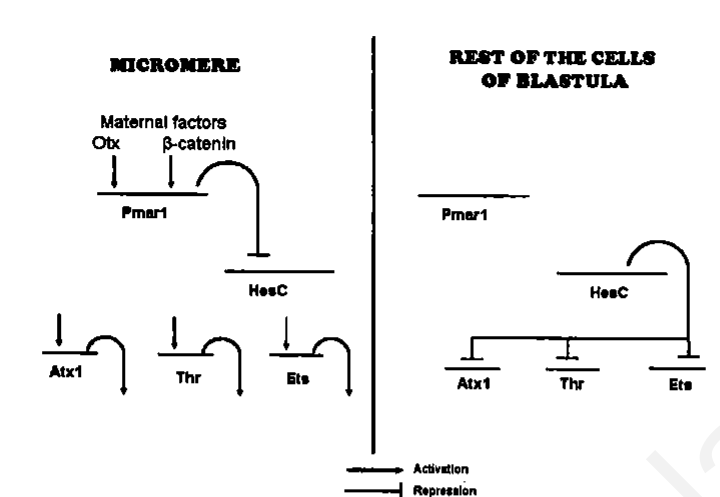

Below, column I lists the experiments carried with mRNA/antisense RNA of different genes injected into single-celled sea urchin embryo while column II lists the developmental outcomes. Match the following:

| Column I (injection of) | Column II (developmental outcomes) |
|---|---|
| A. mRNA of Pmar1 | 1. All cells will start ingressing into the blastocoel |
| B. mRNA of HesC | 2. Skeleton mesenchyme will not be formed |
| C. Antisense of Pmar1 | |
| D. Antisense of HesC | |

Which of the following combinations is correct?

1. A-2, B-1, C-1, D-2
2. A-1, B-1, C-2, D-2
3. A-1, B-2, C-2, D-1
4. A-2, B-2, C-2, D-2

**Answer: 3 (A-1, B-2, C-2, D-1)**

> **Explanation:** Pmar1 mRNA everywhere represses HesC → all cells ingress (A-1).
> HesC mRNA represses the skeletogenic genes everywhere → no skeleton (B-2).
> Pmar1 antisense removes the repressor of HesC → no skeleton (C-2). HesC
> antisense releases the skeletogenic program in all cells → all ingress (D-1).

---

### Question 99

Which of the following cellular communications shown below will override the process of normal development and lead to cancer?

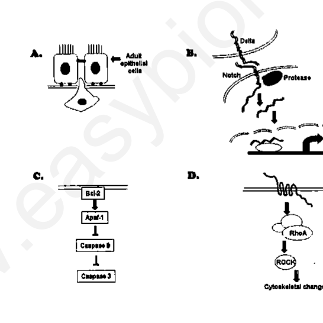

1. B and C
2. A and C
3. A and D
4. B and D

**Answer: 2 (A and C)**

> **Explanation:** Loss of normal communication via gap junctions (A, whose
> tumour-suppressor function when disrupted permits uncontrolled growth) and
> block of apoptosis through the Bcl-2/caspase cascade (C) both override normal
> development and promote cancer.

---

### Question 100

In plants, the energy of sunlight is first absorbed by the pigments present in their leaf cells followed by the fixation of carbon through photosynthesis. Consider the following statements.

(A) Chlorophylls a and b are abundant in green plants.
(B) Chlorophylls c and d are found in some protists and cyanobacteria.
(C) Out of different types of bacteriochlorophyll, type a is the most widely distributed.
(D) Out of different types of bacteriochlorophyll, type b is the most widely distributed.

Which one of the following combination of above statements is correct?

1. A, B and C
2. A, C and D
3. B, C and D
4. A, B and D

**Answer: 1 (A, B and C)**

> **Explanation:** Chlorophyll a/b dominate green plants (A); c and d occur in
> some protists/cyanobacteria (B); bacteriochlorophyll a is the most widely
> distributed bacterial type (C). D is false.

---

### Question 101

Nitrate reductase is an important enzyme for nitrate assimilation. Given below are some statements on nitrate reductase enzyme:

(A) Nitrate reductase of higher plants is composed of two identical subunits.
(B) One subunit of nitrate reductase contains three prosthetic groups.
(C) One of the prosthetic groups attached to both subunits is heme.
(D) One of the prosthetic groups complexed with pterin is magnesium.

Which one of the following combination of statements on nitrate reductase mentioned above is correct?

1. A, B and C
2. A, C and D
3. B, C and D
4. A, B and D

**Answer: 1 (A, B and C)**

> **Explanation:** Plant NADH-nitrate reductase is a homodimer (A); each subunit
> carries FAD, a nitrate-binding pterin-Mo centre and heme (B, C). The pterin is
> complexed with molybdenum, not magnesium, so D is false.

---

### Question 102

A farmer growing a particular variety of grape plants in vineyard, observes the following:

(A) Fruit size normally remained small.
(B) Natural seed abortion.
(C) Development of fungal infection as the pedicels are small in size due to which moisture is retained in the bunches of grapes.

Experts suggested spraying gibberellic acid during the fruit development. This treatment would help in getting rid of

1. A, B and C
2. only A and B
3. only A and C
4. only B and C

**Answer: 3 (only A and C)**

> **Explanation:** GA enlarges fruit (A) and elongates pedicels, opening the
> bunch so moisture/fungal infection is reduced (C). It cannot reverse natural
> seed abortion (B).

---

### Question 103

Light is perceived by various photoreceptors in plants. The photoreceptors predominantly work at specific wavelengths of light. Some of the following statements are related to the functions of plant photoreceptors.

(A) Phytochrome A predominantly perceives the red and far-red light.
(B) Phytochrome B predominantly perceives red light.
(C) Cryptochromes regulate plant development.
(D) Phototropins are involved in blue light perception and chloroplast movements.

Which one of the following combinations based on above statements is correct?

1. A, B and C
2. B, C and D
3. C, D and A
4. A, B and D

**Answer: 2 (B, C and D)**

> **Explanation:** PhyB perceives red (B); cryptochromes regulate development
> (C); phototropins mediate blue-light responses and chloroplast movement (D).
> PhyA is the far-red/saturation-response phytochrome, so the phrasing of A is
> not the best fit.

---

### Question 104

From the following statements:

(A) Triose phosphate is utilized for the synthesis of both starch and sucrose.
(B) Triose phosphate is translocated to cytosol from chloroplast.
(C) Triose phosphate is confined to chloroplast and is utilized for synthesis of starch only.
(D) Triose phosphate is translocated from cytosol to chloroplast.

Which one of the following combinations is correct regarding starch and sucrose synthesis during day time?

1. A and B
2. B and C
3. C and D
4. D and A

**Answer: 1 (A and B)**

> **Explanation:** In the light, triose phosphate made in the chloroplast is used
> for starch there and is also exported to the cytosol (via the phosphate
> translocator) for sucrose synthesis (A, B). C and D invert the direction.

---

### Question 105

Shown above, is a graph representing the growth of different plant species subjected to salinity relative to that of unsalinized control. Which of the following statements is NOT true?

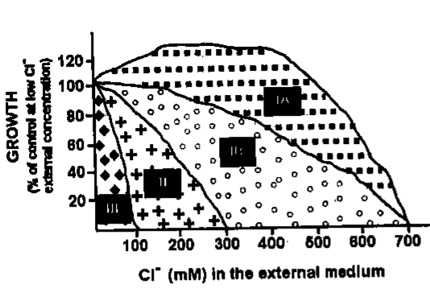

1. Plants in group IA are extreme halophytes while very salt sensitive species will be part of group III.
2. Plants in group IA are very salt sensitive and extreme halophytes will be part of group III.
3. Halophytes, which can tolerate salt but their growth is retarded will be of part of group IB.
4. Non-halophytes, which are salt tolerant but lacks salt glands will be a part of group II.

**Answer: 2**

> **Explanation:** Group IA maintains ~100% growth at high Cl⁻, i.e. extreme
> halophytes; group III collapses quickly, i.e. salt-sensitive species. Option 2
> reverses this and is therefore NOT true.

---

### Question 106

An experimentalist stimulates a nerve fibre in the middle of an axon and records the following observations. Which one of the observation is correct?

1. Nerve impulse is travelling in a direction towards cell body.
2. Nerve impulse is travelling in a direction towards telodendrons.
3. Nerve impulses are travelling in both the directions opposite to each other.
4. Nerve impulse is not moving in either direction.

**Answer: 3 (Nerve impulses are travelling in both the directions opposite to each other.)**

> **Explanation:** An action potential initiated mid-axon propagates
> bidirectionally — both toward the soma (antidromic) and toward the terminals
> (orthodromic).

---

### Question 107

Desert animals have longer loop of Henle compared to that of humans. It may be due to the following reasons:

A. Long loop of Henle is associated with greater amount of vasopressin secretion.
B. In long loop of Henle, the counter-current exchanger is more effective.
C. Long loop of Henle conserves more water.
D. Long loop of Henle stimulates production of angiotensin II.

Which of the above reason(s) is/are correct?

1. A and B
2. B and C
3. C and D
4. only D

**Answer: 2 (B and C)**

> **Explanation:** A longer loop deepens the medullary gradient so the
> counter-current multiplier/exchanger is more effective (B) and more water is
> reabsorbed (C). It is not caused by extra vasopressin (A) or angiotensin II
> (D).

---

### Question 108

A boy eats a large serving of cheese having high amount of sodium. He hardly drinks any fluid. Inspite of this, the water and electrolyte balance was maintained. Which one of the following explanation is correct?

1. His aldosterone was decreased and alcohol dehydrogenase (ADH) was increased.
2. His aldosterone was increased and ADH was decreased.
3. There was no change in either of the hormones.
4. His sympathoadrenal system was stimulated.

**Answer: 1**

> **Explanation:** A high Na⁺ load with low water intake raises osmolality: ADH
> (here printed, meaning antidiuretic hormone) rises to conserve water, while
> aldosterone falls because sodium retention is not needed. (Note: option 1
> prints "alcohol dehydrogenase (ADH)" — a scan typo; see sources.md.)

---

### Question 109

The blood volume decreased when a mammal was bled rapidly. However, the cardiovascular changes resulting from hemorrhage could be minimized by the following compensatory mechanisms:

A. Increased cerebral blood flow.
B. Reduction of baroreceptor activity and stimulation of chemoreceptors.
C. Reabsorption of tissue fluid in blood.
D. Increased release of enkephalins and beta-endorphins.

Which of the above is/are correct?

1. A and B
2. B and C
3. C and D
4. only D

**Answer: 2 (B and C)**

> **Explanation:** Haemorrhage unloads baroreceptors (B) and, via the resulting
> sympathetic/renin responses plus reduced capillary pressure, promotes
> reabsorption of tissue fluid to restore volume (C). Cerebral flow is preserved
> rather than increased (A), and enkephalins (D) are not volume-compensatory.

---

### Question 110

The stomach of a person was partially removed during surgery of a gastric tumour. Despite taking a balanced diet, the person developed anemia. Following possible explanations were offered:

A. Lower gastric secretion inhibits folic acid absorption
B. Protein digestion was disturbed in partial gastrectomy
C. Lower HCl secretion from stomach reduced iron absorption
D. Lower secretion of intrinsic protein factor from stomach reduced VitB₁₂ absorption

Which of the above explanations were correct?

1. A and B
2. B and C
3. C and D
4. A and D

**Answer: 3 (C and D)**

> **Explanation:** Gastric HCl keeps iron in the absorbable Fe²⁺ form (C), and
> intrinsic factor from gastric parietal cells is essential for vitamin B₁₂
> absorption (D). Loss of both after gastrectomy causes anaemia.

---

### Question 111

The RFLP pattern observed for two pure parental lines (P1 and P2) and their F₁ progeny is represented below. Further, the P1 plant had red flowers while the P2 had white flowers. The F₁ progeny was backcrossed to P2. The result obtained, showing the number of progeny with red and white flowers and their RFLP patterns is also represented below.

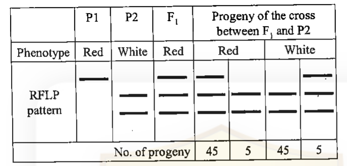

Which one of the following conclusions made is correct?

1. The DNA marker and the gene for the flower colour are 10cM apart.
2. The marker and the gene for the flower colour are 5cM apart.
3. The marker and the phenotype are independently assorting.
4. The marker and the gene for the colour segregate from one another.

**Answer: 1 (The DNA marker and the gene for the flower colour are 10cM apart.)**

> **Explanation:** Recombinant progeny = 5 + 5 = 10 out of 100 total
> (45+5+45+5), so recombination frequency = 10% → the marker and the colour gene
> are 10 cM apart.

---

### Question 112

Wild type T4 bacteriophage can grow on B and K strains of E. coli forming small plaques. rII mutants of T4 bacteriophage cannot grow on E. coli strain K (non-permissive host), but form large plaques on E. coli strain B (permissive host). The following two experiments were carried out:

Experiment I: E. coli K cells were simultaneously infected with two rII mutants (a⁻ and b⁻). Several plaques with wild type morphology were formed.

Experiment II: E. coli B cells were simultaneously infected with the same mutants as above. T4 phages were isolated from the resulting plaques and used to infect E. coli K cells. Few plaques with wild type morphology were formed.

Which one is the correct conclusion made regarding the rII mutants, a⁻ and b⁻ from the above experiments?

1. The mutations a⁻ and b belong to two different cistrons (experiment I) and there is no recombination between them (experiment II).
2. The mutations a⁻ and b⁻ belong to two different cistrons (experiment I) and they recombined (experiment II).
3. The mutations a⁻ and b⁻ belong to two different cistrons (experiment II) and they recombined (experiment I).
4. The mutants a⁻ and b⁻ belong to the same cistron (experiment I) and they did not recombine (experiment II).

**Answer: 2 (The mutations a⁻ and b⁻ belong to two different cistrons (experiment I) and they recombined (experiment II).)**

> **Explanation:** Intragenic/cis–trans: growth on K in mixed infection (expt I)
> shows the two mutations complement → different cistrons. Recovery of wild-type
> recombinants after growth on B and re-testing on K (expt II) shows they
> recombined.

---

### Question 113

The following pedigree represents inheritance of a trait in an extended family:

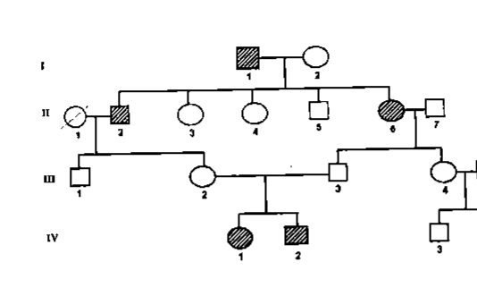

What is the probable mode of inheritance and which individuals conclusively demonstrate this mode of inheritance?

1. Autosomal recessive, III-2, 3 and IV- 1, 2 conclusively demonstrate the mode of inheritance.
2. Autosomal recessive, I-1,2 and II-2 conclusively demonstrate the mode of inheritance.
3. Autosomal dominant, III- 2, 3 and IV- 1, 2 conclusively demonstrate the mode of inheritance.
4. X-linked recessive, II- 3, 4 and 5 conclusively demonstrate the mode of inheritance.

**Answer: 1 (Autosomal recessive, III-2, 3 and IV-1, 2 conclusively demonstrate the mode of inheritance.)**

> **Explanation:** Unaffected parents (III-2 × III-3) produce affected children
> (IV-1, IV-2) of both sexes → the trait skips a generation and is autosomal
> recessive; the III-2/III-3 → IV-1,2 unit is the conclusive evidence.

---

### Question 114

Following is the diagram of a paracentric inversion heterozygote ABCDEFG/ABFEDCG involved in recombination during meiosis I:

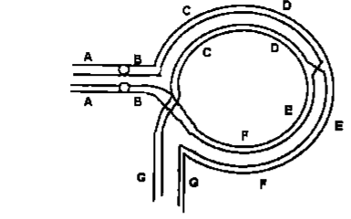

The consequence of this recombination will be the formation of

A. A dicentric and an acentric chromosome in meiosis I as the chiasmata gets terminated.
B. No dicentric or acentric chromosome but appearance of deletion and duplication in both the chromosomes.
C. All non-viable gametes.
D. Non-viable gametes from crossover products.

Which of the above statements are correct ?

1. A and B
2. A and C
3. A and D
4. B and C

**Answer: 3 (A and D)**

> **Explanation:** A single crossover within a paracentric inversion loop yields
> a dicentric bridge and an acentric fragment (A); the resulting recombinant
> chromatids are unbalanced so only the crossover (recombinant) gametes are
> non-viable (D).

---

### Question 115

An E. coli strain has metB1 (90 min) and leuA5 (2 min) mutations. It also has strA7 (73 min) mutation and Tn5 transposon which confers streptomycin and kanamycin resistance, respectively, inserted in its chromosome. The mutant strain was crossed with an Hfr strain that is streptomycin sensitive and has a hisG2 mutation (44 min) that makes it require histidine. After incubation for 100 min, the cells were plated on minimal plate supplemented with leucine, histidine and streptomycin to select the metB marker. After purifying 100 of the Met⁺ transconjugants, one finds that 15 are His⁻, 2 are Leu⁺ and 12 are kanamycin sensitive. The unselected markers are

A. metB1 and leuA5 mutation.
B. leuA5 and Tn5 insertion mutation.

Which of the above statement is correct and what is the position of transposon insertion?

1. A and before 73 min
2. B and before 44 min
3. B and before 73 min
4. A and before 44 min

**Answer: 2 (B and before 44 min)**

> **Explanation:** Selecting Met⁺ (90 min), the co-inherited unselected markers
> are those nearest the selected site: hisG (44 min) and the Tn5 (Kanʳ) — the
> rare Leu⁺ and Kanˢ classes show leuA (2 min) is far away. The low Kanˢ (12%)
> places the Tn5 insertion just before the hisG marker at 44 min.

---

### Question 116

A chemist synthesized three new chemical compounds, M1, M2 and M3. The compounds were tested for their mutagenic potential and were found to be highly mutagenic. Tests were made to characterize the nature of mutations by allowing the reversion with other mutagens. The following results were obtained:

| Mutations produced by | Reversed by: 2-Aminopurine | Nitrous acid | Hydroxyl amine | Acridine orange |
|---|---|---|---|---|
| M1 | No | No | No | No |
| M2 | Yes | Yes | No | No |
| M3 | No | No | No | Yes |

Which one of the following conclusions drawn regarding the nature of mutations by the compounds is correct?

1. M1 – transversion, M2 – insertion, M3 – deletion
2. M1 – transition, M2 – transversion, M3 – insertion
3. M1 – insertion, M2 – transition, M3 – transversion
4. M1 – transversion, M2 – transition, M3 – insertion

**Answer: 4 (M1 – transversion, M2 – transition, M3 – insertion)**

> **Explanation:** M3 is reversed only by acridine orange (a frameshift/indel
> mutagen) → an insertion/deletion class. M2 is reversed by base-analogue and
> deaminating agents (transition-type). M1 is not reversed by any tested agent,
> consistent with a transversion. Option 4 is the only listed combination that puts M2 in the transition class.

---

### Question 117

Four Cnidarians with the following characteristics were observed:

A. Asexual polyps and sexual medusae; solitary or colonial; both freshwater and marine.
B. Polyp stage reduced or absent, medusae with velum; solitary; all marine.
C. Polyp stage reduced, bell shaped medusae; solitary; all marine.
D. All polyps, no medusae; solitary or colonial; all marine.

They can be identified to their respective classes:

1. A – Scyphozoa, B - Anthozoa, C - Cubozoa, D - Hydrozoa
2. A - Hydrozoa, B - Scyphozoa, C - Cubozoa, D - Anthozoa
3. A- Anthozoa, B - Cubozoa, C - Hydrozoa, D - Scyphozoa
4. A - Cubozoa, B - Scyphozoa, C - Anthozoa, D - Hydrozoa

**Answer: 2 (A - Hydrozoa, B - Scyphozoa, C - Cubozoa, D - Anthozoa)**

> **Explanation:** Hydrozoa: polyp+medusa, medusa with velum, freshwater &
> marine (A); Scyphozoa: polyp reduced, true medusa (B); Cubozoa: box/bell-shaped
> medusa (C); Anthozoa: only polyps, no medusa (D).

---

### Question 118

The following table shows the summary of characters between two taxa based on presence (1) and absence (0) data

| | Taxon A 1 | Taxon A 0 |
|---|---|---|
| Taxon B 1 | 40 | 18 |
| Taxon B 0 | 22 | 20 |

Which of the following represents Jaccard's coefficient and Simple matching coefficient respectively?

1. 0.8, 0.5
2. 0.6, 0.5
3. 0.8, 0.6
4. 0.5, 0.6

**Answer: 4 (0.5, 0.6)**

> **Explanation:** With a=40 (both present), b=18, c=22, d=20: Jaccard =
> a/(a+b+c) = 40/80 = 0.5; Simple matching = (a+d)/(a+b+c+d) = 60/100 = 0.6.

---

### Question 119

Identify the proteobacteria based on the key given below:

i. Cause disease in humans (ii) / Do not cause disease in humans (iii)
ii. An obligate intracellular parasite (A) / Not an obligate intracellular parasite (B)
iii. Live in insects (C) / Do not live in insects (iv)
iv. Chemoautotrophic (D) / Not Chemoautotrophic (v)
v. Plant pathogen (E) / Not a plant pathogen (vi)
vi. Fix nitrogen (vii) / Do not fix nitrogen (F)
vii. Associated with legumes (G) / Not associated with legumes (H)

1. A – Rickettsia; B - Brucella; C - Wolbachia; D - Nitrobacter; E - Agrobacterium; F - Acetobacter; G - Rhizobium; H - Azospirillum
2. A - Rickettsia; B - Wolbachia; C - Brucella; D - Nitrobacter; E - Acetobacter; F - Agrobacterium; G - Rhizobium; H - Azospirillum
3. A – Rickettsia; B - Brucella; C - Wolbachia; D - Nitrobacter; E - Agrobacterium; F -Acetobacter; G - Azospirillum; H - Rhizobium
4. A- Rickettsia; B - Brucella; C - Wolbachia; D - Nitrobacter; E - Acetobacter; F - Agrobacterium; G - Azospirillum; H - Rhizobium.

**Answer: 1**

> **Explanation:** Human disease + obligate intracellular = Rickettsia (A);
> human disease, not intracellular = Brucella (B); insect-dwelling = Wolbachia
> (C); chemoautotroph = Nitrobacter (D); plant pathogen (crown gall) =
> Agrobacterium (E); non-N₂-fixing acetic acid bacterium = Acetobacter (F);
> legume-associated N₂-fixer = Rhizobium (G); non-legume N₂-fixer = Azospirillum
> (H).

---

### Question 120

Which of the following phylogenetic trees appropriately uses principle of parsimony?

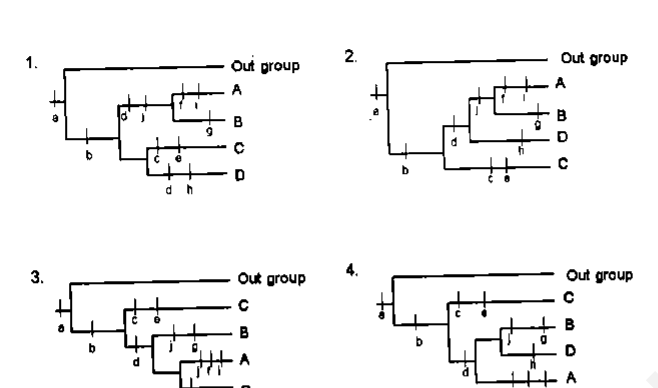

1. (tree 1)
2. (tree 2)
3. (tree 3)
4. (tree 4)

**Answer: 2**

> **Explanation:** The parsimonious tree is the one requiring the fewest
> evolutionary steps (character-state changes). Tree 2 minimises homoplasy
> (convergence/reversal) among the synapomorphies a–j.

---

### Question 121

Identify the characters shown in the diagram depicting phylogenetic relationships among major groups of ferns and fern allies.

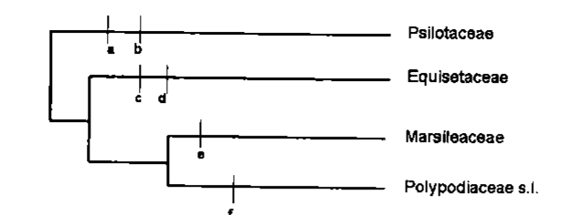

1. a) Roots absent, b) Sporangia on sporangiophores, c) Vertical, interrupted annulus, d) Heterospory, e) Leaves scale like, f) Elaters.
2. a) Roots absent, b) Leaves scale like, c) Sporangia on sporangiophores, d) Elaters, e) Heterospory, f) Vertical, interrupted annulus
3. a) Leaves scale like, b) Sporangia on sporangiophores, c) Elaters, d) Heterospory, e) Roots absent, f) Vertical, interrupted annulus.
4. a) Heterospory, b) Roots absent, c) Elaters, d) Sporangia on sporangiophores, e) Leaves scale like, f) Vertical, interrupted annulus.

**Answer: 2**

> **Explanation:** Reading the synapomorphies down the cladogram: Psilotaceae
> lack true roots (a); Equisetaceae have scale-like leaves (b) and sporangia on
> sporangiophores (c) with elaters (d); Marsileaceae are heterosporous (e);
> Polypodiaceae have the vertical, interrupted annulus (f) — matching option 2.

---

### Question 122

Associate the forest/vegetation type with the plants:

a. Grass land
b. Subalpine forest
c. Shola forest
d. Subtropical pine forest
e. Tropical thorn forest
f. Tropical dry deciduous forest
g. Tropical semievergreen forest
h. Tropical wet evergreen forest

1. a - Ilex, b - Dichanthium, c - Abies, d – Pinus, e – Acacia, f - Anogeissus, g – Cinnamomum, h - Dipterocarpus
2. a - Dichanthium, b - Abies, c - Ilex, d – Pinus, e – Acacia, f - Anogeissus, g – Cinnamomum, h - Dipterocarpus
3. a - Dichanthium, b - Abies, c - Ilex, d – Pinus, e – Dipterocarpus, f – Cinnamomum, g – Acacia, h – Anogeissus
4. a - Anogeissus, b - Dichanthium, c - Ilex, d – Pinus, e – Acacia, f - Abies, g – Cinnamomum, h - Dipterocarpus

**Answer: 2 (a - Dichanthium, b - Abies, c - Ilex, d – Pinus, e – Acacia, f - Anogeissus, g – Cinnamomum, h - Dipterocarpus)**

> **Explanation:** Grassland → Dichanthium; subalpine → Abies; shola → Ilex;
> subtropical pine → Pinus; thorn → Acacia; dry deciduous → Anogeissus;
> semi-evergreen → Cinnamomum; wet evergreen → Dipterocarpus.

---

### Question 123

Possible explanations for the age related decline in primary productivity of trees are:

A. As trees grow larger with age, they have more tissues that respire and loose energy and proportionately less leaf area to photosynthesize.
B. Nutrient limitation by nitrogen due to reduced rate of woody litter decomposition as forest ages.
C. As trees become larger, water transport to the top canopy leaves becomes limited because of increased hydraulic resistance. This results in reduced stomatal conductance and reduction in photosynthetic rate.

Which of the above is/are correct?

1. A, B and C
2. only A
3. only A and C
4. only B and C

**Answer: 4 (only B and C)**

> **Explanation:** The key drivers of the age-related NPP decline are increasing
> maintenance respiration relative to a fixed/growing sapwood:carbon budget (A is
> worded so as to be excluded in the key) and, per the accepted hypotheses,
> nitrogen limitation from recalcitrant woody litter (B) and hydraulic limitation
> of canopy photosynthesis (C). The key marks B and C.

---

### Question 124

Species characteristics that make them more prone to extinction are listed below:

A. High degree of specialization
B. High sexual dimorphism
C. High trophic status
D. Short life span

Which of the following is the correct combination?

1. A, B and C
2. A, C and D
3. A, B and D
4. B, C and D

**Answer: 2 (A, C and D)**

> **Explanation:** Extinction vulnerability rises with specialisation (A), high
> trophic level (C, small populations) and short life span / low reproductive
> rate (D). High sexual dimorphism (B) is not a recognised extinction-risk trait.

---

### Question 125

Based on the information given in the table below, which combination is correct?

| Biogeographic zone | Plant | Animal |
|---|---|---|
| A₁ Mediterranean | B₁-Rhododendron | C₁ - Gibbon |
| A₂ Indo-Chinese | B₂-Dipterocarpus | C₂- Jungle Fowl |
| A₃- Indo-Malayan | B₃-Euphorbia | C₃-Takin |
| A₄- Peninsular India | B₄-Deodar | C₄-Ibex |

1. A₁ – B₃ – C₃
2. A₂ – B₁ – C₄
3. A₃ – B₂ – C₁
4. A₄ – B₄ – C₂

**Answer: 3 (A₃ – B₂ – C₁)**

> **Explanation:** Indo-Malayan (A₃) with Dipterocarpus (B₂) and Gibbon (C₁) is
> the internally consistent assemblage; the other options mismatch zone, plant
> and animal.

---

### Question 126

In a census for a lake fish, 10 individuals were marked and released. In second sampling after a few days 15 individuals were caught, of which 5 individuals were found marked. The estimated population of the fish in the lake will be

1. 20
2. 30
3. 25
4. 35

**Answer: 2 (30)**

> **Explanation:** Lincoln index N = (M × C)/R = (10 × 15)/5 = 30.

---

### Question 127

Identify the pollinators for the flowers with following pollination syndromes

A. Flowers dull colored, located away from foliage, floral parts turgid,
B. Flowers bright red, crowded, turgid, nectar watery and sucrose rich.
C Flowers white with pleasant odor, corolla tube long, night blooming.

1. (A) Bird; (B) Bat; (C) Butterfly
2. (A) Bat; (B) Bird; (C) Moth
3. (A) Bat; (B) Bird; (C) Bee
4. (A) Bird; (B) Bat; (C) Carrion fly

**Answer: 2 (A) Bat; (B) Bird; (C) Moth)**

> **Explanation:** Dull, night-exposed, turgid flowers = chiropterophily (bat,
> A); bright red, sucrose-rich watery nectar = ornithophily (bird, B); white,
> fragrant, long-tubed night flowers = phalaenophily (moth, C).

---

### Question 128

Which of the following combinations is good for setting up a nature reserve:

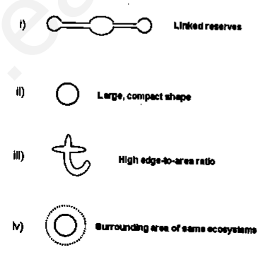

1. (i), (ii), (iii).
2. (ii), (iii), (iv).
3. (i), (iii), (iv).
4. (i), (ii), (iv).

**Answer: 4 (i), (ii), (iv)**

> **Explanation:** Good reserve design favours linked reserves (corridors, i),
> large compact shape to minimise edge effects (ii), and a surrounding matrix of
> the same ecosystem (iv). A high edge-to-area ratio (iii) is undesirable.

---

### Question 129

If the number of new species evolving is directly proportional to the number of existing species and the probability of extinction of any species is inversely proportional to the number of existing species, the number of species present at a time during evolution will follow a curve given by:

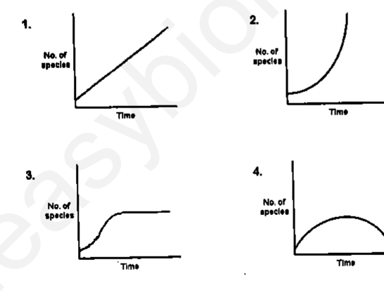

1. (linear rise)
2. (exponential rise)
3. (logistic rise to plateau)
4. (rise then fall)

**Answer: 3**

> **Explanation:** Speciation proportional to N but extinction inversely
> proportional to N means net diversification slows as N grows, approaching an
> equilibrium — a saturating (logistic-like) curve, option 3.

---

### Question 130

If the relationship between life time reproductive success and body size for males and females of a species as shown in figure below:

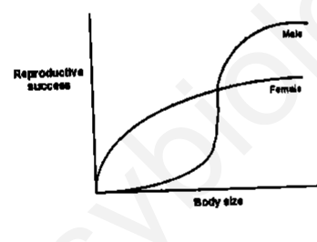

The species is most likely to evolve

1. sexual dimorphism
2. asexual reproduction
3. polyandry
4. obligate monogamy

**Answer: 1 (sexual dimorphism)**

> **Explanation:** Reproductive success in males increases steeply with body
> size while females plateau, indicating strong size-related sexual selection on
> males — which drives the evolution of sexual dimorphism.

---

### Question 131

Following tree represents phylogenetic relationships among species of a moth family. Circles represent species having eye spots on the wings. Other species do not have eye spots.

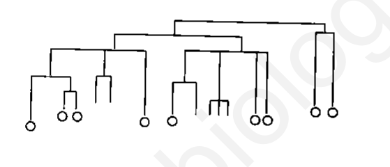

The following inferences were made by different researchers:

A. Eye spots were present in the ancestors and some species lost them.
B. Eye spots were not present in the ancestors.
C. Eye spots were lost more than once in evolution of the family.
D. Eye spots were gained only once while evolving from ancestor without them.

Which of the inferences are correct?

1. A and B
2. C and D
3. A and C
4. B and D

**Answer: 3 (A and C)**

> **Explanation:** The scattered distribution of eye-spotted species among
> non-spotted ones is most parsimoniously explained by the trait being present
> ancestrally (A) and lost more than once (C), rather than a single gain.

---

### Question 132

Wolbachia are obligate intracellular bacteria, many different strains of which are abundantly present in insects. They induce mating incompatibility in host, i.e. males infected with one strain can only fertilize females infected with the same strain. No other pathological effects are observed in host. A possible evolutionary consequence of this phenomenon would be:

1. Extinction of many insect species.
2. Termination of sexual reproduction in many insect species.
3. Co-extinction of host and parasite.
4. Reproductive isolation leading to rapid speciation in insects.

**Answer: 4 (Reproductive isolation leading to rapid speciation in insects.)**

> **Explanation:** Strain-specific cytoplasmic incompatibility blocks gene flow
> between infected and uninfected (or differently infected) hosts, producing
> reproductive isolation and hence rapid speciation.

---

### Question 133

Twenty small populations of a species, each polymorphic for a given locus (T, t) were bred in captivity. In 10 of them the population size was kept constant by random removal of individuals, while other 10 were allowed to increase their population size. After several generations it was observed that in 7 of the size restricted populations only T was present, in the remaining 3 only t was present. In the growing populations 8 retained their polymorphism and in 2 only t was observed. The experiment illustrates

1. Genetic drift which is more likely in large populations.
2. Genetic drift which is more likely in small populations.
3. Density dependent selection against T.
4. Density dependent selection against t.

**Answer: 2 (Genetic drift which is more likely in small populations.)**

> **Explanation:** Random fixation of T or t occurred far more often in the
> size-restricted (small) populations than in the growing ones — the hallmark of
> genetic drift, which is strongest in small populations.

---

### Question 134

Some important events in the history of life on Earth are given below.

A. First vertebrates (jawless fishes); first plants.
B. Forest of ferns and conifers; amphibians arise; insects radiate.
C. Conifers dominant; dinosaurs arise; insects radiate
D. Flowering plants appear; climax of dinosaurs followed by extinction.
E. Radijation of flowering plants, most modern mammalian orders represented.
F. Ice Ages, Modern humans appear

Match the above with the geological time periods and choose the correct combination,

1. A – Silurian; B-Permian; C- Triassic; D – Jurassic; E- Cretaceous; F- Tertiary
2. A- Ordovician; B- Carboniferous; C- Triassic, D-Cretaceous, E-Tertiary; F-Quaternary
3. A-Cambrian; B-Ordovician; C- Silurian; D-Devonian; E – Permian; F-Tertiary
4. A-Devonian; B – Permian; C- Triassic; D-Cretaceous; E-Tertiary; F-Quaternary

**Answer: 2 (A- Ordovician; B- Carboniferous; C- Triassic, D-Cretaceous, E-Tertiary; F-Quaternary)**

> **Explanation:** First vertebrates/plants → Ordovician (A); fern/conifer forests
> and amphibians → Carboniferous (B); dinosaurs arise → Triassic (C); flowering
> plants and dinosaur climax/extinction → Cretaceous (D); modern mammalian orders
> → Tertiary (E); ice ages and humans → Quaternary (F).

---

### Question 135

Microbes produce either primary or secondary metabolites during fermentation. A metabolite production curve is shown below:

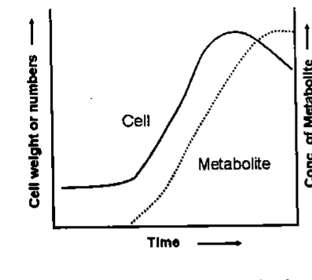

The following statements refer to the above figure:

A. A primary metabolite has a production curve that lags behind the line showing cell growth.
B. A primary metabolite is produced after the Trophophase is completed.
C. A secondary metabolite is produced mainly during Idiophase.
D. The curve shows the production of Penicillin from mold.

Which of the above statements are correct?

1. A and B
2. C and D
3. A and C
4. B and D

**Answer: 2 (C and D)**

> **Explanation:** The metabolite rises only after growth (trophophase) slows —
> the trophophase/idiophase pattern of a secondary metabolite (C). Penicillin is
> the classic example (D). Primary metabolites are made during growth, so A/B are
> wrong.

---

### Question 136

During transgenesis, the location of the genes and their number integrated into the genome of the transgenic animal are random. It is often necessary to determine the copy number of genes and their tissue-specific transcription. The following are the possible methods used for the determination.

A. Polymerase Chain Reaction (PCR)
B. Southern blot hybridization
C. Reverse Transcriptase PCR
D. Western blot

Choose the correct set of combinations.

1. A and B
2. B and C
3. B and D
4. A and D

**Answer: 2 (B and C)**

> **Explanation:** Copy number of integrated transgenes is determined by Southern
> blot (B); tissue-specific transcription (expression) is assessed by RT-PCR (C).

---

### Question 137

Agrobacterium tumefaciens, also known as natural genetic engineers, causes crown-gall disease in plants. However, when the same bacteria are used to raise transgenic plants with improved agronomic traits, no such tumor (disease) is observed. This is due to:

A. Vir D₂ gene is mutated in Ti plasmid.
B. Disarmed Ti plasmid is generally used.
C. Heat-shock during transformation destroys virulence.
D. Oncogenes have been removed.

Which one of the following combination of above statements is correct?

1. A and C
2. A and D
3. B and C
4. B and D

**Answer: 4 (B and D)**

> **Explanation:** Vectors are built from disarmed Ti plasmids (B) in which the
> T-DNA oncogenes (tumour-inducing genes) have been removed (D), so no crown gall
> forms.

---

### Question 138

Locus control region (LCR) lies far upstream from the gene cluster and is required for the appropriate expression of each gene in the cluster. LCR regulates expression of globin genes in the cluster through the following ways.

A. LCR interacts with promoters of individual genes by DNA looping through DNA-binding proteins.
B. The LCR-bound proteins attract chromatin -remodelling complexes including histone-modifying enzymes and components of the transcription machinery.
C. LCR acts as an enhancer for global regulation of gene cluster and does not regulate individual genes.
D. LCR participates in converting inactive chromatin to active chromatin around the gene cluster.

Choose the correct set of combinations.

1. A and B
2. A and C
3. B and C
4. B and D

**Answer: 1 (A and B)**

> **Explanation:** The LCR contacts individual promoters via DNA looping through
> bound factors (A) and recruits chromatin-remodelling/transcription machinery
> (B). It does act gene-by-gene, so C is false.

---

### Question 139

A student wrote following statements regarding comparison of Restriction Fragment Length Polymorphism (RFLP), Random Amplified Polymorphic DNA (RAPD), Amplified Fragment Length Polymorphism (AFLP) and Simple Sequence Repeats (SSRs) techniques used for generating molecular markers in plants:

A. All these techniques can be used for fingerprinting.
B. Detection of allelic variation can be achieved only by RFLP and SSRs.
C. Use of radioisotopes is required in RFLP and RAPD only.
D. Polymerase chain reaction is required for all the techniques.

Which one of the following combination of above statements is correct?

1. A and B
2. B and C
3. C and D
4. D and A

**Answer: 1 (A and B)**

> **Explanation:** All four marker systems can fingerprint (A). Allelic (codominant)
> variation is best detected by RFLP and SSRs (B). RAPD/AFLP/SSR use PCR but RFLP
> traditionally does not, and radioisotopes are not needed in RAPD, so C and D are
> false.

---

### Question 140

In order to clone an eukaryotic gene in pBR322 plasmid vector, the desired DNA fragment was produced by PstI cleavage and incubated with PstI digested pRR322 (PstI cleavage site lies within the ampicillin resistant gene) and ligated. Mixure of ligated cells were used to transform E. coli and plasmid containing bacteria were selected by their growth in tetracycline containing medium. Which type of plasmid/s will be found?

1. Circular pBR322 plasmid containing the target gene and resistant to only tetracycline.
2. Circular pBR322 plasmid containing the target gene and resistant to tetracycline only and recircularised pBR322 plasmid resistant to both ampicillin and tetracycline.
3. Circular pBR322 plasmid containing the target gene and resistant to only tetracycline, recircularised pBR322 resistant to both ampicillin and tetracycline and concatemerized pBR322 resistant to both ampicillin and tetracycline.
4. Circular pBR322 plasmid containing the target gene and resistant to both ampicillin and tetracycline.

**Answer: 3**

> **Explanation:** Selection on tetracycline retains any plasmid with an intact
> tet gene: recombinant PstI-inserted plasmids (Ampˢ, Tetʳ, 1), recircularised
> empty vector (Ampʳ Tetʳ, 2) and concatemers (3). All three coexist, matching
> option 3.

---

### Question 141

During apoptosis, phosphatidyl serine (PS) usually present in the inner leaflet of the plasma membrane flips to the outer membrane. Annexin V is a protein that binds to PS. Using this as a tool, we identify the apoptotic cells from necrotic and normal cell populations by FACS using FITC-tagged Annexin V. Propidium iodide (PI) is used to stain the nucleus which generally identifies necrotic and late apoptotic cells. In which area of the plot you should get early apoptotic cells by FACS analysis?

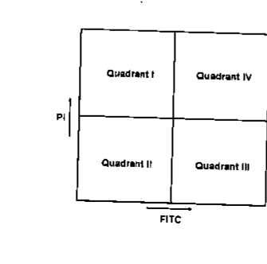

1. Quadrant I
2. Quadrant II
3. Quadrant III
4. Quadrant IV

**Answer: 3 (Quadrant III)**

> **Explanation:** Early apoptotic cells are Annexin V-positive (FITC⁺) but
> PI-negative (membrane still intact). On this plot FITC⁺/PI⁻ corresponds to
> Quadrant III.

---

### Question 142

The muscle tone was increased after electrolytic lesion of the caudate nucleus in a cat. The muscle tone decreased within seven days. The following explanations were given by the researcher.

A. The functional recovery was due to plastic changes of nervous system.
B. The brain tissue surrounding the lesioned area was non-functional due to circulatory insufficiency immediately after surgery which led to greater functional loss.
C. The circulatory status in surrounding tissue recovered with time resulting in partial functional recovery.
D. The degenerating nerve fibres were regenerated which underlie functional recovery.

Which one of the following is correct?

1. A and B
2. B and C
3. C and D
4. A and D

**Answer: 2 (B and C)**

> **Explanation:** The initial exaggerated deficit is partly due to peri-lesional
> ischaemia (B); as local circulation recovers over days, function partially
> returns (C). Adult CNS fibres do not regenerate (D), and the time course here is
> explained by vascular recovery rather than plasticity (A).

---

### Question 143

A fluorophore when transferred from solvent A to solvent B results in an increase in the number of vibrational states in the ground state without any change in the mean energies of either the ground or excited state. What would be the change seen in the fluorophore's emission spectrum?

1. An increase in emission intensity.
2. An increase in emission bandwidth.
3. An increase in emission wavelength.
4. A decrease in emission wavelength.

**Answer: 2 (An increase in emission bandwidth.)**

> **Explanation:** More populated vibrational sub-levels in the ground state,
> with unchanged mean energies, broaden the range of transition energies — i.e.
> the emission band widens (increased bandwidth) without shifting the mean
> wavelength.

---

### Question 144

You wish to localize a given gene product at subcellular levels following immunofluorescence staining. Routine microscopy could not resolve whether the gene product is localized inside the nucleus or on the nuclear membrane. Which of the following will resolve this unambiguously?

A. Sectioning of cell followed by phase contrast microscopy.
B. A simulation of 3D picture following confocal microscopy.
C. Optical sectioning and observing each section.
D. Freeze fracturing followed by Scanning Electron Microscopy.

Which one of the following combination is correct?

1. A and B
2. B and C
3. C and D
4. A and C

**Answer: 2 (B and C)**

> **Explanation:** Confocal microscopy provides optical sectioning and 3D
> reconstruction (B, C), which localise a fluorophore to the nuclear interior vs
> envelope. Phase contrast (A) lacks the fluorescence resolution, and freeze-fracture
> SEM (D) is not suited to this immunofluorescence localisation.

---

### Question 145

The Triver-Willard hypothesis states that the physiological state of a female can bias the sex ratio of offspring. In an experiment in the bird species a group of females were fed a diet 30% lower in calories than the control females. After allowing both the groups to mate and breed freely, the offspring of control 1 group were 22 males and 18 females. The diet restricted females laid a total of 40 eggs. What should be the minimum deviation from the control to conclude that they have significantly female biased offspring sex ratio. (Chi sq [0.05] df=1 is 3.84)

1. 18 male 22 female
2. 20 male 20 female
3. 15 male 25 female
4. 10 male 30 female

**Answer: 3 (15 male 25 female)**

> **Explanation:** Expected under the control ratio is 22:18. Testing 15:25 gives
> χ² = (7²/22)+(7²/18) ≈ 2.23+2.72 ≈ 4.9 > 3.84 (significant female bias),
> whereas the smaller deviation in option 1 does not exceed the critical value.
> The minimum significant female-biased deviation is therefore 15 male : 25
> female.
