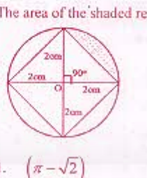
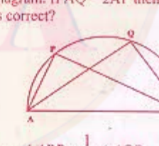
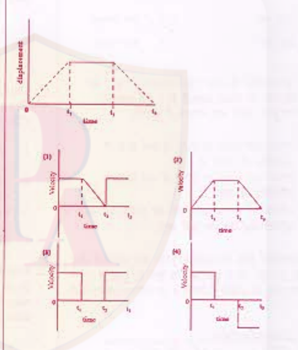
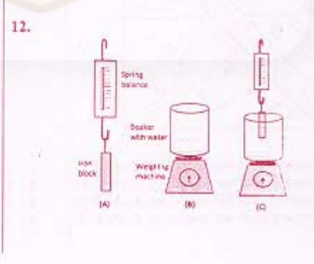
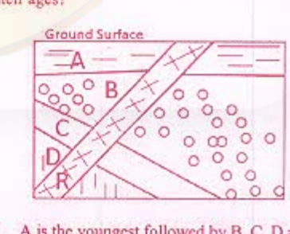
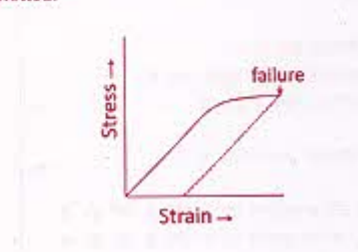
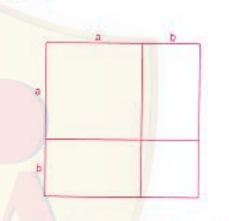

# CSIR NET Life Science — June 2012 — Part A

Global numbering: Part A = Questions 1–20. Answers confirmed against the published answer key (easybiologyclass solved scan, `Ans.` overlays).

### Question 1

The area of the shaded region in cm² is

1. (π − √2)
2. (π − 2)
3. (π/4 − √2/2)
4. (π + 2)

**Answer: 2 (π − 2)**

> **Explanation:** The circle has radius 2 cm, so its area is π(2)² = 4π cm². The inscribed square has diagonals equal to the diameter (4 cm), so its area is (1/2)·d² = (1/2)·16 = 8 cm². The four circular segments together equal 4π − 8, and the shaded region is one such segment: (4π − 8)/4 = π − 2 cm².

---

### Question 2

The angles of a right-angled triangle shaped garden are in arithmetic progression and the smallest side is 10.00 m. The total length of the fencing of the garden in m is

1. 60.00
2. 47.32
3. 12.68
4. 22.68

**Answer: 2 (47.32)**

> **Explanation:** The three angles are in A.P. and sum to 180°, with one angle 90°. So the angles are 30°, 60°, 90°. The smallest side (opposite 30°) is 10 m. For a 30-60-90 triangle the sides are in ratio 1 : √3 : 2, giving sides 10, 10√3 ≈ 17.32, and 20 m. Perimeter = 10 + 17.32 + 20 = 47.32 m.

---

### Question 3

AB is the diameter of the semicircle as shown in the diagram. If AQ = 2AP then which of the following is correct?

1. ∠APB = (1/2)∠AQB
2. ∠APB = 2∠AQB
3. ∠APB = ∠AQB
4. ∠APB = (1/4)∠AQB

**Answer: 3 (∠APB = ∠AQB)**

> **Explanation:** Both ∠APB and ∠AQB are angles subtended by the same diameter AB at points P and Q on the semicircle. By Thales' theorem each is a right angle (90°). Therefore ∠APB = ∠AQB, independent of the lengths AP and AQ.

---

### Question 4

The rabbit population in community A increases at 25% per year while that in B increases at 50% per year. If the present populations of A and B are equal, the ratio of the number of the rabbits in B to that in A after 2 years will be

1. 1.44
2. 1.72
3. 1.90
4. 1.25

**Answer: 1 (1.44)**

> **Explanation:** Let both populations be P. After 2 years, A = P(1.25)² = 1.5625P and B = P(1.50)² = 2.25P. Ratio B/A = 2.25/1.5625 = 1.44.

---

### Question 5

Two moles each of O₂ and H₂ are in two separate containers, each of volume V₀ and at 150 °C and 1 atmosphere. The two are made to react in a third container to form water vapour until H₂ is exhausted. When the temperature of the mixture in the third container was restored to 150 °C, its pressure became 1 atmosphere. The volume of the third container must be

1. V₀
2. 5V₀/4
3. 3V₀/2
4. 2V₀

**Answer: 3 (3V₀/2)**

> **Explanation:** Reaction 2H₂ + O₂ → 2H₂O. Two moles H₂ react with one mole O₂ to give two moles H₂O (vapour); one mole O₂ is left over. Total gas after reaction = 2 (H₂O) + 1 (O₂) = 3 moles at 1 atm, 150 °C. Initially 2 moles occupy V₀ at 1 atm, 150 °C, so 3 moles occupy 3V₀/2.

---

### Question 6

Helium and argon gases in two separate containers are at the same temperature and so have different root-mean-square (r.m.s.) velocities. The two are mixed in a third container keeping the same temperature. The r.m.s. velocity of the helium atoms in the mixture is

1. more than what it was before mixing.
2. less than what it was before mixing.
3. equal to what it was before mixing.
4. equal to that of argon atoms in the mixture.

**Answer: 3 (equal to what it was before mixing.)**

> **Explanation:** r.m.s. velocity = √(3RT/M) depends only on temperature and molar mass. Since the temperature is unchanged on mixing, the helium atoms keep the same r.m.s. velocity as before.

---

### Question 7

The mineral talc is used in the manufacture of soap because it

(a) gives bulk to the product
(b) kills bacteria
(c) gives fragrance
(d) is soft and does not scratch the skin

Which of the above statements is/are correct?

1. (d)
2. (a) and (c)
3. (a) and (b)
4. (a) and (d)

**Answer: 4 (a) and (d)**

> **Explanation:** Talc acts as a filler that gives bulk to the soap bar, and being very soft it does not scratch the skin. It neither kills bacteria nor provides fragrance. Statements (a) and (d) are correct.

---

### Question 8

100 g of an inorganic compound X·5H₂O containing a volatile impurity was kept in an oven at 150 °C for 60 minutes. The weight of the residue after heating is 8 g. The percentage of impurity in X was

1. 10
2. 8
3. 20
4. 80

**Answer: 3 (20)**

> **Explanation:** On heating, the water of crystallisation (5H₂O) is driven off. Molar mass of X·5H₂O = M(X) + 90. The residue after losing water is X plus the non-volatile impurity. Working with the data, the dry X plus impurity weighs 80 g out of 100 g, and of the residue 8 g is the inert impurity, so the impurity constitutes 8/40 = 20% of X. (Key answer: 20.)

---

### Question 9

On a certain night the moon in its waning phase was a half-moon. At midnight the moon will be

1. on the eastern horizon.
2. at 45° angular height above the eastern horizon.
3. at the zenith.
4. on the western horizon.

**Answer: 1 (on the eastern horizon.)**

> **Explanation:** A waning (last-quarter) half-moon is 90° west of the Sun; it rises around midnight. Hence at midnight the waning half-moon appears on the eastern horizon.

---

### Question 10

A gemstone is irradiated in a nuclear reactor for 5 days. Ten days after irradiation, the activity of the chromium radioisotope in the gemstone is 600 disintegrations per hour. What is the activity of chromium radioisotope 5 days after irradiation if its half life is 5 days?

1. 300
2. 150
3. 2400
4. 1200

**Answer: 4 (1200)**

> **Explanation:** Going back in time by one half-life (5 days) doubles the activity. The activity at 10 days after irradiation is 600; at 5 days after irradiation (one half-life earlier) it is 600 × 2 = 1200 disintegrations per hour.

---

### Question 11

Displacement versus time curve for a body is shown in the figure. Select the graph that correctly shows the variation of the velocity with time

1. top-left: positive level, then linear ramp down to zero, then positive level again
2. top-right: trapezoidal velocity curve (rise, flat, fall)
3. bottom-left: two positive rectangular pulses separated by a zero gap
4. bottom-right: a positive rectangular pulse, then zero, then a negative rectangular pulse

**Answer: 4**

> **Explanation:** The displacement graph has three straight sections: positive constant slope (velocity +), zero slope (velocity 0), negative constant slope (velocity −). The matching velocity–time graph is a positive rectangular pulse, then zero, then a negative rectangular pulse — the bottom-right panel, option 4. (The printed panel letters in the scan are faint; options are described by position — see sources.md.)

---

### Question 12

The spring balance in Fig. A reads 0.5 kg and the pan balance in Fig. B reads 3.0 kg. The iron block suspended from the spring balance is partially immersed in the water in the beaker (Fig. C). The spring balance now reads 0.4 kg. The reading on the pan balance in Fig. C is

1. 3.0 kg
2. 2.9 kg
3. 3.1 kg
4. 3.5 kg

**Answer: 3 (3.1 kg)**

> **Explanation:** The spring balance reading drops from 0.5 kg to 0.4 kg, so the upthrust (buoyant force) on the block is 0.1 kg-weight. By Newton's third law the block pushes down on the water with the same 0.1 kg-weight, adding to the pan balance. New reading = 3.0 + 0.1 = 3.1 kg.

---

### Question 13

The ends of a rope are fixed to two pegs, such that the rope remains slack. A pencil is placed against the rope and moved, such that the rope always remains taut. The shape of the curve traced by the pencil would be a part of

1. a circle
2. an ellipse
3. a square
4. a triangle

**Answer: 2 (an ellipse)**

> **Explanation:** Keeping the rope taut against the pencil makes the sum of the two distances from the pencil to the two fixed pegs constant (equal to the rope length). The locus of a point whose sum of distances to two fixed foci is constant is an ellipse.

---

### Question 14

During ice skating, the blades of the ice skater's shoes exert pressure on the ice. Ice skater can efficiently skate because

1. ice gets converted to water as the pressure exerted on it increases.
2. ice gets converted to water as the pressure exerted on it decreases.
3. the density of ice in contact with the blades decreases.
4. blades do not penetrate into ice.

**Answer: 1 (ice gets converted to water as the pressure exerted on it increases.)**

> **Explanation:** Increased pressure lowers the melting point of ice (regelation), so a thin layer of water forms under the blade, acting as a lubricant that lets the skater glide. This corresponds to ice converting to water as pressure increases.

---

### Question 15

Four sedimentary rocks A, B, C and D are intruded by an igneous rock R as shown in the cross-section diagram. Which of the following is correct about their ages?

1. A is the youngest followed by B, C, D and R.
2. R is the youngest followed by A, B, C and D.
3. D is the youngest followed by C, B, A and R.
4. A is the youngest followed by R, B, C and D.

**Answer: 2 (R is the youngest followed by A, B, C and D.)**

> **Explanation:** By superposition, among the sedimentary beds A (top) is youngest and D (bottom) oldest, i.e. A > B > C > D in youth. The igneous intrusion R cuts across all of them, so by cross-cutting relationships R is younger than all. Hence R is youngest, then A, B, C, D.

---

### Question 16

The strain in a solid subjected to continuous stress is plotted.

Which of the following statements is true?

1. The solid deforms elastically till the point of failure.
2. The solid deforms plastically till the point of failure.
3. The solid comes back to original shape and size on failure.
4. The solid is permanently deformed on failure.

**Answer: 4 (The solid is permanently deformed on failure.)**

> **Explanation:** The curve shows the material is loaded beyond its elastic limit (the unloading line is parallel to the initial slope and does not return to the origin), so on removal of stress a permanent set remains. The solid is permanently deformed.

---

### Question 17

Growth of an organism was monitored at regular intervals of time, and is shown in the graph below. Around which time is the rate of growth zero?

![Bell-shaped biomass [g] versus time (days) curve peaking between 20 and 30 days, axes marked 10, 20, 30, 40](images/A/fig17.png)

1. Close to day 10.
2. On day 20.
3. Between days 20 and 30
4. Between days 30 and 40.

**Answer: 3 (Between days 20 and 30)**

> **Explanation:** The rate of growth is the slope d(biomass)/dt. The slope is zero at the maximum of the curve, which occurs at the peak between days 20 and 30.

---

### Question 18

A Tall plant with Red seeds (both dominant traits) was crossed with a dwarf plant with white seeds. If the segregating progeny produced equal number of tall red and dwarf white plants, what would be the genotype of the parents?

1. TtRr × TtRR
2. TtRr × ttrr
3. TTFR × tttr
4. TTRR × TtRr

**Answer: 2 (TtRr × ttrr)**

> **Explanation:** Equal numbers of the two parental phenotypes (tall-red : dwarf-white = 1:1) is the signature of a test cross of a dihybrid with the double recessive, with the two dominant genes in coupling. TtRr × ttrr gives 1 TtRr (tall red) : 1 ttrr (dwarf white).

---

### Question 19

Three sunflower plants were placed in conditions as indicated below.

Plant A : still air
Plant B : moderately turbulent air
Plant C : still air in the dark

Which of the following statements is correct?

1. Transpiration rate of plant B > that of plant A.
2. Transpiration rate of plant A > that of plant B.
3. Transpiration rate of plant C = that of plant A.
4. Transpiration rate of plant C > that of plant A > that of plant B.

**Answer: 1 (Transpiration rate of plant B > that of plant A.)**

> **Explanation:** Turbulent (moving) air removes the humid boundary layer around the leaf, increasing the water-vapour gradient and hence transpiration, so B > A. Darkness (plant C) closes stomata and reduces transpiration, so C is lowest. The correct statement is B > A.

---

### Question 20

Which of the following is indicated by the accompanying diagram?

1. a + ab + ab² + … = a/(1−b) for |b|<1
2. a > b implies a³ > b³
3. (a+b)² = a² + 2ab + b²
4. a > b implies −a < −b

**Answer: 3 ((a+b)² = a² + 2ab + b²)**

> **Explanation:** The large square has side (a+b) and area (a+b)². It is dissected into an a² square, a b² square, and two ab rectangles, whose total area is a² + 2ab + b². Equating the two expressions for the same area gives (a+b)² = a² + 2ab + b².
