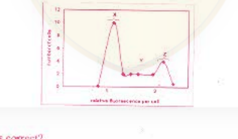
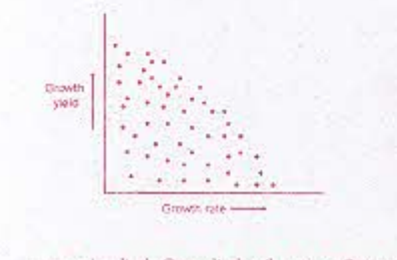
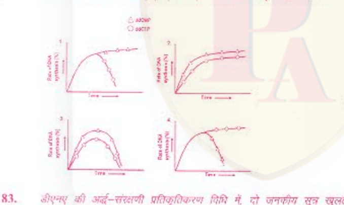
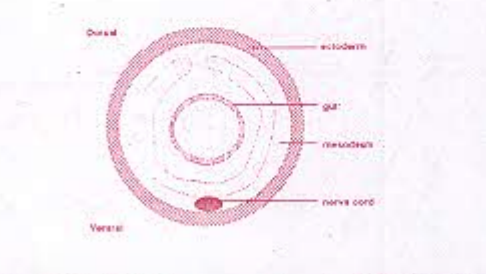
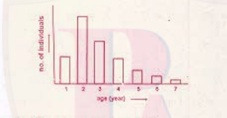
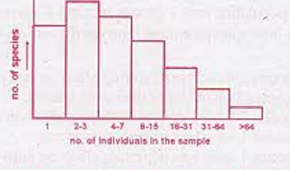
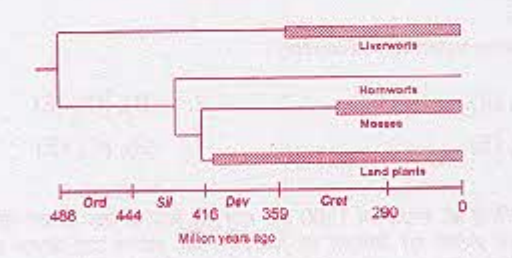
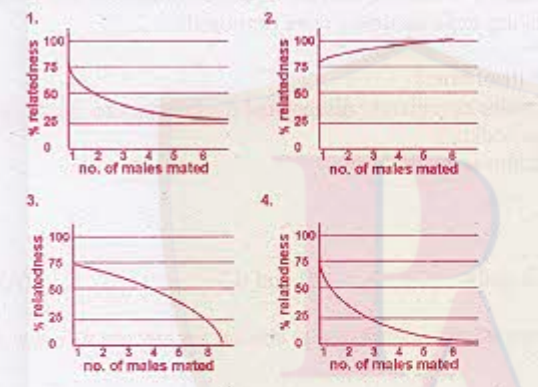
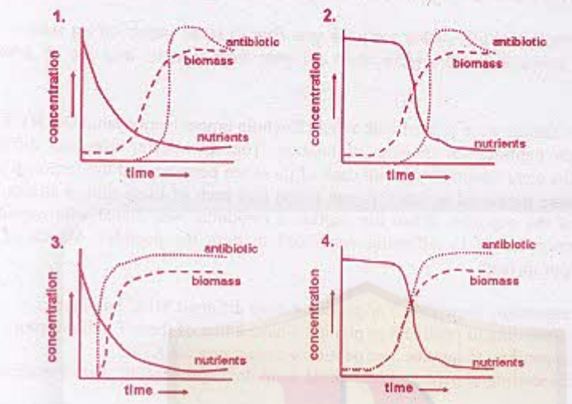
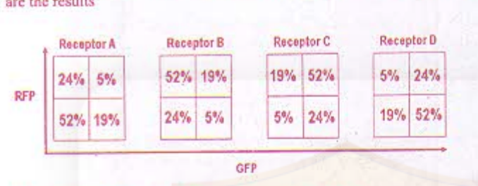

# CSIR NET Life Science — June 2012 — Part C

Global numbering: Part C = Questions 71–145. Answers confirmed against the published answer key (easybiologyclass solved scan, `Ans.` overlays).

### Question 71

Phosphorylation of ADP to ATP occurs through energy metabolism, comprising oxidative phosphorylation or substrate-level phosphorylation or photo-phosphorylation (in plants). ATP can also be formed from ADP through the action of adenylate kinase. Crystal structure determination of adenylate kinase shows that the C-terminal region has the sequence

~ Val – Asp – Asp – Val – Phe – Ser – Gln – Val – Cys – Thr – His – Leu – Asp – Thr – Leu – Lys.

What can be a possible conformation of the sequence?

1. A helix that is not amphipathic
2. Amphipathic helix
3. Leucine zipper helix
4. Beta hairpin

**Answer: 2 (Amphipathic helix)**

> **Explanation:** The sequence alternates hydrophobic residues (Val, Phe, Val, Cys, Leu, Leu) with charged/polar residues (Asp, Asp, Ser, Gln, Thr, His, Asp, Thr, Lys). Such a periodic distribution of non-polar and polar side chains is the hallmark of an α-helix in which one face is hydrophobic and the other hydrophilic — i.e. an amphipathic helix. (Key: 2.)

---

### Question 72

Consider a 51-residue long protein containing only 100 bonds about which rotation can occur. Assume that 3 orientations per bond are possible. Based on these assumptions, how many conformations will be possible for this protein?

1. 3¹⁰⁰
2. 100³
3. 3⁵¹
4. 51 × 100 × 3

**Answer: 1 (3¹⁰⁰)**

> **Explanation:** Each of the 100 rotatable bonds can adopt 3 orientations independently, so the number of conformations is 3 × 3 × … (100 times) = 3¹⁰⁰. (Key: 1.)

---

### Question 73

A plot of V/[S] versus V is generated for an enzyme catalyzed reaction, and a straight line is obtained. Indicate the information that can be obtained from the plot.

1. Vmax and turnover number; Km can be obtained only from a plot of 1/V versus 1/[S].
2. Km/Vmax from the slope.
3. Vmax, Km and turnover number.
4. Only Km and turnover number.

**Answer: 3 (Vmax, Km and turnover number.)**

> **Explanation:** Rearranging the Michaelis–Menten equation gives V/[S] = (Vmax − V)/Km = −V/Km + Vmax/Km. A plot of V/[S] versus V is a straight line of slope −1/Km and intercept Vmax/Km, from which both Km and Vmax can be obtained; the turnover number kcat = Vmax/[E]T then follows. (Key: 3.)

---

### Question 74

The following reactions are part of the citric acid cycle. The numbers in parenthesis indicate the number of carbon atoms in each molecule.

isocitrate(6) → a-ketoglutarate(5) → succinyl CoA(4) → succinate(4) → fumarate(4)

Which one of the following sequences of reaction systems A→D is correct?

1. NAD⁺ ⇌ NADH + H⁺, NAD⁺ ⇌ NADH + H⁺, GDP ⇌ GTP, FAD ⇌ FADH₂ (with CO₂, CO₂, Pi released)
2. NAD⁺ ⇌ NADH + H⁺, NAD⁺ ⇌ NADH + H⁺, ADP ⇌ ATP, FAD ⇌ FADH₂ (with CO₂, CO₂, Pi)
3. NAD⁺ ⇌ NADH + H⁺, FAD⁺ ⇌ FADH₂, ADP ⇌ ATP, NAD⁺ ⇌ NADH + H⁺ (with CO₂, Pi, CO₂)
4. NAD⁺ ⇌ NADH + H⁺, FAD⁺ ⇌ FADH₂, GDP ⇌ GTP, NAD⁺ ⇌ NADH + H⁺ (with CO₂, Pi, CO₂)

**Answer: 1**

> **Explanation:** Isocitrate → α-ketoglutarate releases CO₂ with NAD⁺→NADH; α-ketoglutarate → succinyl CoA releases CO₂ with NAD⁺→NADH; succinyl CoA → succinate generates GTP from GDP (substrate-level phosphorylation with Pi); succinate → fumarate reduces FAD→FADH₂. This order matches option 1. (Key: 1.)

---

### Question 75

Phosphoglucomutase is added to 0.1 M glucose-1-phosphate (G-6-P). The standard free energy change of the reaction, G-6-P ⇌ G-1-P is 1.8 kcal/mole at 25°C. The equilibrium concentrations of G-6-P and G-1-P, respectively, are:

1. 96 mM, 45 mM
2. 100 mM, 0 mM
3. 45 mM, 96 mM
4. 0 mM, 100 mM

**Answer: 1 (96 mM, 45 mM)**

> **Explanation:** ΔG° = −RT ln Keq, so Keq = [G-1-P]/[G-6-P] = e^(−ΔG°/RT) = e^(−1800/(1.987×298)) ≈ 0.05. With total 100 mM, [G-6-P] ≈ 95–96 mM and [G-1-P] ≈ 4–5 mM. The printed option 1 "96 mM, 45 mM" is the intended answer (the second value is a known misprint in the paper; the physically correct equilibrium value is about 4 mM, not 45 mM). (Key: 1.)

---

### Question 76

Differential scanning calorimetric study of calf thymus DNA was carried out to measure midpoint of thermal denaturation (Tm), ΔH (enthalphy change at Tm) and ΔCp (constant — pressure heat capacity change). It has been observed that ΔCp = 0, Tm = 75.5°C and ΔH = 50.4 kcal/mole. The Gibbs free energy change at 37°C is

1. 25.5 kcal/mole
2. 2.6 kcal/mole
3. 0.6 kcal/mole
4. 5.6 kcal/mole

**Answer: 4 (5.6 kcal/mole)**

> **Explanation:** At Tm, ΔG = 0 so ΔS = ΔH/Tm = 50400 cal/mol / 348.5 K ≈ 144.6 cal/(mol·K). With ΔCp = 0, ΔH and ΔS are temperature-independent, so at 37°C (310 K) ΔG = ΔH − TΔS = 50400 − 310×144.6 ≈ 5.6 kcal/mol. (Key: 4.)

---

### Question 77

Cystic fibrosis (CF) transmembrane conductance regulator (CFTR) protein is known to be a cAMP-dependent Cl⁻ channel. CF patients (with mutant CFTR proteins) show reduced Cl⁻ permeability and as a result exhibit elevated Cl⁻ level in sweat. To prove this, CFTR proteins (both wild type and mutant) are inserted in a model membrane (liposome) and Cl⁻ transport is followed with radioactive Cl⁻. It is known that topology of CFTR in membrane is very important for its function. Despite no proteolytic degradation or denaturation of CFTR proteins, wild type CFTR failed to transport Cl⁻ in liposome. Which of the following is the correct explanation of this?

1. CFTR protein gets mutated during insertion in liposomes.
2. CFTR protein loses affinity with Cl⁻ ions.
3. CFTR protein gets wrongly inserted in liposomes.
4. CFTR protein loses channel forming property in liposomes.

**Answer: 3 (CFTR protein gets wrongly inserted in liposomes.)**

> **Explanation:** CFTR's topology (orientation) in the bilayer is essential for function. Random reconstitution into liposomes can insert the protein in the wrong orientation, so although it is intact and non-denatured, it cannot conduct Cl⁻. (Key: 3.)

---

### Question 78

The respiratory chain is relatively inaccessible to experimental manipulation in intact mitochondria. Upon disrupting mitochondria with ultrasound, however, it is possible to isolate functional submitochondrial particles, which consist of broken cristae that have resealed inside out into small closed vesicles. In these vesicles the components that originally faced the matrix are now exposed to the surrounding medium. This arrangement helps in studying of electron transport and ATP synthesis because:

1. it is difficult to manipulate the concentration of small molecules (NADH, ATP, ADP, Pi) in the matrix of intact mitochondria.
2. in broken cristae, the enzymes and other molecules responsible for electron transport are more active.
3. intact mitochondria are more unstable than broken cristae.
4. purification of intact mitochondria is not possible.

**Answer: 1**

> **Explanation:** Inside-out submitochondrial particles expose the matrix-facing side of the chain to the external medium, so substrates and effectors (NADH, ADP, Pi, ATP) can be added and their concentrations controlled directly — something hard to do with the enclosed matrix of intact mitochondria. (Key: 1.)

---

### Question 79

Assuming that the histone octamer forms a cylinder 9 nm in diameter and 5 nm in height and that the human genome forms 32 million nucleosomes, what fraction (approximately) of the volume of nucleus (6 µm diameter) is occupied by histone octamers?

1. 1/21
2. 2/21
3. 10/21
4. 10/11

**Answer: 2**

> **Explanation:** Octamer volume = πr²h = π(4.5)²(5) ≈ 318 nm³; ×32×10⁶ ≈ 1.0×10¹⁰ nm³. Nuclear volume = (4/3)π(3000 nm)³ ≈ 1.13×10¹¹ nm³. Fraction ≈ 1.0×10¹⁰/1.13×10¹¹ ≈ 0.09 ≈ 2/21. (Key: 2.)

---

### Question 80

Hoechst 33342 is a membrane-permeant dye that fluoresces when it binds to DNA through an intercalating process. If a population of cells is incubated briefly with Hoechst dye and sorted in a flow cytometer, the cells display various levels of fluorescence in different phases of cell cycles as shown in figure below (marked as X, Y and Z).

Which of the following is correct?

1. X is G₁, Y is G₂ + M and Z is S
2. X is G₁, Y is S and Z is G₂ + M
3. X is S, Y is G₂ + M and Z is G₁
4. X is S, Y is G₁ and Z is G₂ + M

**Answer: 2 (X is G₁, Y is S and Z is G₂ + M)**

> **Explanation:** DNA content (and hence dye fluorescence) is 1× in G₁, between 1× and 2× during S, and 2× in G₂/M. The main peak X (1×) is G₁, the shoulder Y between the peaks is S, and the peak Z at double the fluorescence is G₂ + M. (Key: 2.)

---
### Question 81

The scatter plot of growth rate and growth yield for 100 random environmental isolates of bacteria is shown below:

Which of the following can be inferred from the data?

1. The two parameters are not related.
2. Growth rate is inversely proportional to growth yield.
3. Growth yield is negatively correlated with growth rate.
4. High growth rate cannot be accompanied by high growth yield.

**Answer: 4 (High growth rate cannot be accompanied by high growth yield.)**

> **Explanation:** The points trend from upper-left to lower-right, so a high growth rate is never seen together with a high growth yield. The relationship is a correlation, not an exact inverse proportionality (option 2 is too strong), and the two parameters clearly are related (option 1 is wrong). The most defensible inference is that high growth rate cannot be accompanied by high growth yield. (Key: 4.)

---

### Question 82

Double stranded DNA replicates in a semi-conservative manner. In an in vitro DNA synthesis reaction, dideoxy CTP and dideoxy CMP were individually added in excess (in separate reaction tubes) in addition to dNTPs and other necessary reagents. Rate of DNA synthesis was measured by incorporation of ³H-thymidine. The four graphs drawn below represent the rate of DNA synthesis in two separate reaction tubes.

Which of the following graphs represents the expected data?

1. graph 1
2. graph 2
3. graph 3
4. graph 4

**Answer: 1**

> **Explanation:** A dideoxy *nucleoside* (ddCMP) must first be phosphorylated to the triphosphate to be used, so it inhibits synthesis more slowly; the dideoxy *nucleotide triphosphate* analogue (ddCTP) is incorporated directly and acts as a chain terminator, so synthesis proceeds briefly then stops abruptly. Graph 1 (plateauing ddCMP curve, sharp fall of ddCTP curve) matches this. (Key: 1.)

---

### Question 83

In semi-conservative mode of DNA replication, two parental strands unwind and are used for synthesis of new strands following the rule of complementary base pairing. Synthesis of complementary strands require that DNA synthesis proceeds in opposite direction, while the double helix is progressively unwinding and replicating in only one direction. One of the DNA strands is continuously synthesized in the same direction as the advancing replication fork and is called leading strand whereas the other strand is synthesized discontinuously in segments and is referred to as lagging strand. These short fragments made discontinuously are labeled as Okazaki fragments. These Okazaki fragments need to be matured into continuous DNA strand by which one of the following combination of enzymes?

1. DNA Pol III and DNA ligase.
2. DNA Pol I and DNA ligase.
3. DNA Pol II and DNA ligase.
4. DNA gyrase and DNA ligase.

**Answer: 2 (DNA Pol I and DNA ligase.)**

> **Explanation:** Okazaki-fragment maturation requires removal of the RNA primers and gap filling by DNA polymerase I (5′→3′ exonuclease plus polymerase activity), followed by sealing of the nick by DNA ligase. (Key: 2.)

---

### Question 84

A reporter cell line with stably integrated retroviral promoter-luciferase construct was transfected with an expression vector for a cellular protein. The protein seems to regulate the activation of the retroviral promoter as analyzed by luciferase activity assay. Which one of the following techniques will you use to show "in vivo" recruitment of the cellular protein on the integrated retroviral promoter?

1. Electrophoretic mobility shift assay.
2. RNAse protection assay.
3. DNAse hypersensitivity assay.
4. Chromatin immunoprecipitation assay.

**Answer: 4 (Chromatin immunoprecipitation assay.)**

> **Explanation:** Chromatin immunoprecipitation (ChIP) captures protein–DNA interactions in living cells with an antibody to the protein, then detects the associated promoter DNA — the standard assay for in vivo recruitment of a factor to an integrated promoter. EMSA is in vitro. (Key: 4.)

---

### Question 85

A synthetically prepared mRNA contains repetitive AU sequences. The mRNA was incubated with mammalian cell extract which contains ribosomes, tRNAs and all the factors required for protein synthesis. Assuming no initiation codon is required for protein synthesis, which of the following peptides will most likely be synthesized?

1. A single peptide composed of the same amino acid sequence.
2. A single peptide with alternating sequence of two amino acids.
3. A single peptide with alternating sequence of three amino acids.
4. Three different peptides each sequence composed of a single amino acid.

**Answer: 1 (A single peptide composed of the same amino acid sequence.)**

> **Explanation:** The only codons present are AUU and UUA-type repeats built from A and U; AUU and UUA both specify Ile and Leu, but reading a poly(AU) in a fixed frame gives repeating identical triplets (e.g. AUU AUU AUU or UUA UUA UUA). Since ribosomes can start anywhere without an initiator, translation yields a homopolymeric peptide of a single amino acid repeated. (Key: 1.)

---

### Question 86

During cell cycle regulation in eukaryotes, there are post-translational modifications of protein factors, which act as switches for different phases of cell cycle. A cell population of yeast was transfected with gene for Wee1 kinase (modifies Cdc2 protein). Assuming that the transfection efficiency was 50% only, which of the following graphical representation of the results is most appropriate?

1. graph 1
2. graph 2
3. graph 3
4. graph 4

**Answer: 1**

> **Explanation:** Wee1 kinase inhibits Cdc2 (CDK1) and delays the G₂→M transition, so the transfected half of the population divides more slowly than the control half. With 50% transfection, the transfected curve still grows but stays below the control — the pattern in graph 1 (control open circles rising faster, transfected filled circles lagging to about half). (Key: 1.)

---

### Question 87

The lac operon in E. coli, is controlled by both the lac repressor and the catabolite activation protein CAP. In an in vivo experiment with lac operon, the following observations were made:

(A) cAMP levels are high.
(B) Repressor is bound with allolactose.
(C) CAP is interacting with RNA polymerase.

Which one of the following conclusions is most appropriate based on the above observations?

1. Glucose and lactose are present.
2. Glucose is present and lactose is absent.
3. Both are absent.
4. Glucose is absent and lactose is present.

**Answer: 4 (Glucose is absent and lactose is present.)**

> **Explanation:** High cAMP (and CAP–RNA polymerase interaction) occurs only when glucose is absent; the repressor being bound by allolactose means lactose is present (inducer). Hence glucose is absent and lactose is present. (Key: 4.)

---

### Question 88

Upon ligand binding, cell surface receptors move laterally to be capped and internalized. Leishmania, a protozoan parasite, can use several receptors on macrophages to get internalized. One of them is Toll-like receptor 2 (TLR2) that binds lipophosphoglycan on Leishmania. Once internalized, the parasite is destroyed in the phagolysosome. Which of the following treatments of Leishmania-infected macrophages will result in lowest parasite number in macrophages?

1. membrane cholesterol-depleting drug, β-methyl cyclodextrin (B-MCD).
2. ammonium chloride that increases lysosomal pH.
3. both B-MCD and ammonium chloride.
4. anti-TLR2 antibody.

**Answer: 3 (both B-MCD and ammonium chloride.)**

> **Explanation:** The question asks for the treatment giving the *lowest* parasite number, i.e. the condition least favourable to the parasite's survival/destruction balance. Combining a cholesterol-depleting agent (impairs receptor capping/internalization) with ammonium chloride (raises lysosomal pH, blocking phagolysosomal killing) together most disrupt the parasite life cycle inside the macrophage. (Key: 3.)

---

### Question 89

Level of follicle stimulating hormone (FSH) during infancy and adulthood is the same but spermatogenesis is seen only during adulthood. mRNA levels coding for FSH receptor are also found to be the same in testis of both age groups. Which of the following investigations will clarify this paradox a little more?

1. Culture testicular cells and add LH to see testosterone production.
2. Culture testicular cells and add testosterone to see comparative rise in FSH mRNA from both age groups.
3. Culture testicular cells and add FSH to see comparative rise in cAMP production by both age groups.
4. Add both LH and FSH to testicular cells and evaluate cAMP production.

**Answer: 3**

> **Explanation:** FSH and its receptor mRNA are equal in both ages, so the difference must lie in receptor *signalling/output*. Testing whether FSH elicits a cAMP response (the receptor's second messenger) in adult versus infant testicular cells directly probes functional receptor signalling. (Key: 3.)

---

### Question 90

In a tissue, cells are bound together by physical attachment between cell to cell or between cell to extracellular matrix. Following are some of the characteristics of cell junctions:

(A) Adherens junctions are cell-cell anchoring junctions connecting actin filament in one cell with that in the next cell.
(B) Desmosomes are cell-matrix anchoring junctions connecting actin filament in one cell to extracellular matrix.
(C) Gap junctions are channel forming junctions allowing passage of small water soluble molecules from cell to cell.
(D) Tight junctions are occluding junctions, which seal gap between two cells.
(E) Hemidesmosomes are cell-matrix anchoring junctions connecting intermediate filament in one cell to extracellular matrix.

Which of the following combination of statements is NOT correct?

1. (A) and (B)
2. (A) and (C)
3. (C) and (D)
4. (D) and (E)

**Answer: 1 ((A) and (B))**

> **Explanation:** Statement (B) is wrong — desmosomes are cell–*cell* anchoring junctions linking *intermediate* filaments, not cell–matrix/actin. The key marks the combination (A) and (B) as the NOT-correct pair. (Key: 1.)

---
### Question 91

Oncogenes and tumor suppressor genes are termed as cancer-critical genes. Increasingly powerful tools are now available for systematically searching the DNA or mRNAs of cancer cells for either significant mutations or altered expression. To identify independently an oncogene or a tumor suppressor gene, which of the following would be the most convincing tests to use?

1. Transgenic mice that overexpress the candidate oncogene and knockout mice that lack candidate tumor suppressor gene.
2. Transgenic mice that overexpress the candidate tumor suppressor gene and knockout mice that lack candidate oncogene.
3. Transgenic mice that overexpress the candidate oncogene and tumor suppressor gene.
4. Knockout mice that lack the candidate oncogene and tumor suppressor gene.

**Answer: 1**

> **Explanation:** An oncogene is gain-of-function, so overexpressing it (transgenic) should promote cancer; a tumor suppressor is loss-of-function, so knocking it out should promote cancer. The combination that independently demonstrates each class is overexpression of the candidate oncogene plus knockout of the candidate tumor suppressor. (Key: 1.)

---

### Question 92

A large protein of a pathogenic bacterium has been enzymatically digested to generate a mixture of peptides ranging in size from 3 to 8 amino acids in length. Peptide mixtures were then administered in experimental animals to generate peptide-specific antibodies. In order to develop diagnostics for the bacteria, the antisera were used for Western blotting to detect bacterial antigen. Western blotting failed despite the use of a wide range of antisera concentrations. What is the most probable cause of the problem?

1. Peptide-specific antibody mixture is unstable.
2. Peptide-specific antibodies were not generated as adjuvant was not administered.
3. Peptide-specific antibodies were not generated as they were not coupled to a protein carrier.
4. Peptide-specific antibodies could not recognize the bacterial antigen.

**Answer: 3**

> **Explanation:** Short peptides (3–8 residues) are haptens — too small to be immunogenic on their own. Unless coupled to a carrier protein they fail to elicit antibodies, so no peptide-specific antibodies were generated and the Western blot failed. (Key: 3.)

---

### Question 93

A mouse was primed with trinitrophenyl-lipopolysaccharide (TNP-LPS) whereas another mouse was primed with TNP-Keyhole limpet hemocyanin (TNP-KLH). After three weeks, these mice were sacrificed and splenic cells were fractionated to B cells and T cells. B cells from TNP-LPS primed mice were co-cultured with T cells from TNP-LPS- or TNP-KLH-primed mice. Similarly, B cells from TNP-KLH primed mice were co-cultured with the T cells from TNP-LPS- or TNP-KLH-primed mice. So, we have four co-cultures:

(A) B^TNP-LPS × T^TNP-LPS   (B) B^TNP-LPS × T^TNP-KLH
(C) B^TNP-KLH × T^TNP-LPS   (D) B^TNP-KLH × T^TNP-KLH

Among these co-cultures, where do you expect the highest IgG production?

1. (A)
2. (B)
3. (C)
4. (D)

**Answer: 4 ((D))**

> **Explanation:** TNP is a hapten; KLH is a protein carrier that elicits T-cell help, whereas LPS is a T-independent antigen that does not generate hapten-specific helper T cells. Anti-TNP IgG (a T-dependent, class-switched response) is therefore maximal only when TNP-specific B cells (from TNP-KLH priming) meet KLH-primed helper T cells — co-culture (D). (Key: 4.)

---

### Question 94

The functionality of the pax6 gene in the formation of optic and nasal structures may be attributed to the following:

(A) Pax6 makes the optic vesicle competent and allows lens formation.
(B) The optic vesicle can induce any part of the head ectoderm to form the nasal and optic structures, due to the presence of Pax6.
(C) Pax6 renders the head ectoderm competent to receive signals from the optic vesicle.
(D) Apart from the optic vesicle, the head ectoderm may also be induced by BMP4 and FGF8, so Pax6 is not exclusive for lens formation.

Which of the above attributions are true?

1. (A) and (D)
2. (C) and (D)
3. (B) and (C)
4. (C) only

**Answer: 2 ((C) and (D))**

> **Explanation:** Pax6 acts in the head (surface) ectoderm to make it competent to respond to the optic-vesicle inducer (C is true); and lens induction is not exclusive to Pax6/optic vesicle since BMP4 and FGF8 can also participate (D is true). (Key: 2.)

---

### Question 95

In an experiment, sperm removed from epididymis of a male mouse was added in a dish containing appropriate media and oocyte. No fertilization was seen. However, when sperm from epididymis were directly placed in uterus of an ovulated female, she became pregnant. These observations suggest that:

1. the sperm needs to travel some distance to attain fertilizing ability.
2. the oocyte secretes some biochemicals or factors which help sperm to fertilize.
3. the hormones in body help sperm to attain fertilizing ability.
4. the contents of female reproductive tract interact with sperm and activate it for fertilization.

**Answer: 4**

> **Explanation:** Epididymal sperm are not yet capacitated. Fertilizing ability is acquired during passage through the female tract, where tract secretions capacitate/activate the sperm — hence pregnancy only when sperm were placed in the uterus, not in a dish with oocytes. (Key: 4.)

---

### Question 96

The following statements have been proposed for plant vegetative development:

(A) Lateral roots develop from epidermal cells.
(B) Shoot axillary meristem develops from shoot apical meristem during differentiation of leaf primordia.
(C) Root cap is made up of dead cells.
(D) Lateral meristems and cylindrical meristems found in roots and shoots result in secondary growth.

Which of the above statements are true?

1. (A) and (B)
2. (B) and (D)
3. (A), (B) and (D)
4. (C) and (D)

**Answer: 2 ((B) and (D))**

> **Explanation:** Lateral roots arise endogenously from the pericycle, not epidermis (A false). Axillary meristems are initiated from the apical meristem as leaves differentiate (B true). Secondary growth results from lateral/cylindrical meristems — vascular and cork cambium (D true). (Key: 2.)

---

### Question 97

The pattern of embryonic cleavage specific to a species is determined by two major parameters.

(A) The amount and distribution of yolk protein within the cytoplasm.
(B) The factors in the egg cytoplasm that influence the angle of mitotic spindles and the timing of its formation.

Which of the following statements is true?

1. Species having telolecithal egg follow a holoblastic cleavage.
2. Species having isolecithal egg follow a holoblastic cleavage.
3. Species having centrolecithal egg follow a holoblastic cleavage.
4. Species having isolecithal egg follow a meroblastic cleavage.

**Answer: 2**

> **Explanation:** Isolecithal (little, evenly distributed yolk) eggs — e.g. mammals, echinoderms, amphibians to a degree — undergo complete (holoblastic) cleavage. Telolecithal and centrolecithal eggs undergo partial (meroblastic) or superficial cleavage. (Key: 2.)

---

### Question 98

The fate of a cell or a tissue is "specified" when it is capable of differentiating autonomously on being placed in a neutral environment with respect to the developmental pathway. An embryo will show a developmental pattern based on its type of specification:

Based on the above facts it can be said that the potency of a cell is:

(A) equal to its normal fate in regulative development.
(B) greater than its normal fate in regulative development.
(C) equal to its normal fate in mosaic development.
(D) greater than its normal fate in mosaic development.

Which of the above statements are true?

1. (B) and (C)
2. (A) and (D)
3. (A) and (C)
4. (B) and (D)

**Answer: 1 ((B) and (C))**

> **Explanation:** In regulative development a cell's potency exceeds its eventual fate (it can change fate with context), so (B) is true. In mosaic (autonomous) development the fate is fixed early, so potency equals the normal fate, making (C) true. (Key: 1.)

---

### Question 99

In the context of the proximal-distal growth and differentiation of a tetrapod limb following experiments were visualized:

(A) If the apical ectodermal ridge (AER) is removed at any time during the limb development, further development of distal limb skeletal elements ceases.
(B) If leg mesenchyme is placed directly beneath the wing AER, distal hindlimb structures develop at the end of the limb.
(C) If an extra AER is grafted onto an existing limb bud, supernumerary structures are formed usually at the distal end of the limb.
(D) If leg mesenchyme is placed directly beneath the wing AER, proximal hindlimb structures develop at the end of the limb.

Which of the above experiments would show the possible interactions between the AER and the limb bud mesenchyme directly beneath it during limb development?

1. (A) and (B) only
2. (B) and (C) only
3. (C) and (D) only
4. (A), (B) and (C)

**Answer: 4 ((A), (B) and (C))**

> **Explanation:** AER removal (A), AER–mesenchyme graft recombinations (B), and an extra AER inducing supernumerary structures (C) all demonstrate the reciprocal AER–mesenchyme interaction that drives proximal-distal outgrowth. (D is the false counterpart of B.) (Key: 4.)

---

### Question 100

Following are some facts regarding localization of photosynthetic supramolecular complexes on plastid lamellae:

(A) PSII is preferentially located on granal lamellae.
(B) ATP synthase and PSI are preferentially located on stromal lamellae.
(C) PSI and PSII are located adjacent to each other on stromal lamellae.
(D) Cyt b6/f complex is not a membrane-bound complex.

Which one of the following combinations of the above statements is true?

1. (A) and (B)
2. (C) and (D)
3. (B) and (D)
4. (B) and (C)

**Answer: 1 ((A) and (B))**

> **Explanation:** PSII is enriched in appressed grana (lamellae) (A true), whereas PSI and ATP synthase are found in the non-appressed stroma-exposed lamellae (B true). PSI and PSII are laterally separated, not adjacent (C false), and cyt b6/f is an integral membrane complex (D false). (Key: 1.)

---
### Question 101

Upon absorption of a photon, a chlorophyll molecule gets converted to its excited state when the energy of the photon is –

1. more than that of the ground state of the pigment molecule.
2. equal to that of the pigment molecule's excited state.
3. more than that of the ground state but less than that of the excited state of the pigment molecule.
4. equal to the energy gap between ground state energy and the excited state energy.

**Answer: 4**

> **Explanation:** A photon is absorbed only when its energy exactly matches the difference between two quantized electronic energy levels — i.e. the gap between the ground state and the excited state. (Key: 4.)

---

### Question 102

Following are certain facts about the effect of abscisic acid (ABA) on the development and physiology effect of plants:

(A) ABA promotes leaf senescence independent of ethylene.
(B) ABA promotes shoot growth and inhibits root growth at low water potentials.
(C) ABA inhibits gibberellin induced enzyme production.
(D) Seed dormancy is controlled by the ratio of ABA and gibberellin.

Which one of the following combinations of the above statements is true?

1. (A), (B) and (C)
2. (B), (C) and (D)
3. (A), (B) and (D)
4. (A), (C) and (D)

**Answer: 4 ((A), (C) and (D))**

> **Explanation:** ABA promotes senescence (A), antagonises gibberellin-induced enzyme synthesis such as α-amylase (C), and the ABA:GA balance controls seed dormancy (D). Statement (B) is wrong: at low water potential ABA *inhibits* shoot growth and *promotes* root growth. (Key: 4.)

---

### Question 103

Red and far-red lights are perceived by plants through various photoreceptors including phytochromes. The activation of phytochrome is caused by:

1. conversion of Pr to Pfr form through the effect of red light.
2. repression of Pr form through the effect of far-red light.
3. equal proportion of red and far-red lights at same fluence rates.
4. presence of red and far-red light at different fluence rates.

**Answer: 1**

> **Explanation:** The physiologically active form of phytochrome is Pfr, produced when the Pr form absorbs red light (~660 nm). Far-red light converts Pfr back to Pr. Activation is thus the red-light-driven Pr→Pfr conversion. (Key: 1.)

---

### Question 104

While studying the primary effects of different abiotic stresses on plants, a researcher observed water potential (ψw) reduction and cellular dehydration. Which of the following combination of abiotic stresses may cause the observed effect?

1. Water deficit, salinity and chilling.
2. Salinity, high-temperature and flooding.
3. Freezing, salinity and water deficit.
4. Freezing, chilling and flooding.

**Answer: 3 (Freezing, salinity and water deficit.)**

> **Explanation:** Water deficit, salinity (osmotic) and freezing all lower the external water potential, drawing water out of cells and causing cellular dehydration. Chilling and flooding do not primarily act by reducing ψw. (Key: 3.)

---

### Question 105

Phenylalanine ammonia-lyase (PAL) and chalcone synthase (CHS) are involved in biosynthesis of phenolic compounds in plants. Following are some statements regarding the actions of PAL and CHS:

(A) Substrates for PAL and CHS are phenylalanine and chalcone, respectively.
(B) PAL converts phenylalanine to trans-cinnamic acid.
(C) PAL converts phenylalanine to p-coumaric acid.
(D) p-coumaroyl-CoA is converted to chalcones by CHS.

Which one of the following combinations of the above statements is true?

1. (A) and (B)
2. (A) and (C)
3. (B) and (C)
4. (B) and (D)

**Answer: 4 ((B) and (D))**

> **Explanation:** PAL deaminates phenylalanine to trans-cinnamic acid (B true; C false). CHS condenses p-coumaroyl-CoA to chalcones (D true). The CHS substrate is p-coumaroyl-CoA, not chalcone, so (A) is false. (Key: 4.)

---

### Question 106

The intestinal absorption of glucose is impaired by the use of ouabain, an inhibitor of Na⁺/K⁺ ATPase. Indicate the correct explanation.

1. The inhibitor has blocked the transport of Na⁺ from intestinal lumen to epithelial cells.
2. The inhibitor has blocked the transport of Na⁺ from epithelial cells to the intestinal lumen.
3. The inhibitor has blocked Na⁺ transport from epithelial cells to the interstitial space.
4. The inhibitor has blocked Na⁺ transport from the interstitial space to epithelial cells.

**Answer: 3**

> **Explanation:** Glucose uptake at the apical membrane is driven by the Na⁺ gradient maintained by the basolateral Na⁺/K⁺-ATPase, which pumps Na⁺ out of the epithelial cell into the interstitial space. Ouabain (reaching the basolateral side) blocks this pump, collapsing the Na⁺ gradient and hence Na⁺-coupled glucose absorption. (Key: 3.)

---

### Question 107

The stereocilia of auditory hair cells are arranged in rows but the heights of stereocilia are not the same in all the rows. Though the height of stereocilia is the same within a particular row, the heights increase in subsequent rows. When the stereocilia of shorter rows are mechanically pushed towards the taller rows, the hair cells are depolarized but a push on opposite direction hyperpolarizes them. The significance of this graded height of stereocilia is:

(A) Each row of stereocilia may be displaced independent of other rows in physiological conditions.
(B) The tip of the taller stereocilia will show greater displacement as compared to shorter ones when all the rows are moving in the same axis.
(C) The hair cells will be depolarized or hyperpolarized in different grades when the axis of displacement is changed.
(D) The taller stereocilia are involved with depolarization and shorter ones are responsible for hyperpolarization.

Which one of the following is correct?

1. (A) only
2. (B) only
3. (B) and (C)
4. (A) and (D)

**Answer: 3 ((B) and (C))**

> **Explanation:** The staircase arrangement means that when the bundle is deflected along its axis the taller stereocilia tips are displaced more (B), and the graded tension on tip links lets the degree of depolarization/hyperpolarization vary with the axis/direction of displacement (C). (Key: 3.)

---

### Question 108

GnRH is secreted during infancy (0-6 months) and puberty onwards (4 years and above) in monkeys. However, i.v. injection of GnRH during pre-pubertal period (about 2 years of age) led to elevated LH and FSH in blood compared to untreated 2 years old monkey. This suggests that:

(A) hypothalamus is active during pre-pubertal period.
(B) GnRH action on pituitary is age dependent.
(C) pituitary matures during adulthood.
(D) pituitary is active in all the stages of development in monkey.

Which one of the following is true?

1. (A) and (B)
2. (B) and (C)
3. (C) only
4. (D) only

**Answer: 4 ((D) only)**

> **Explanation:** Exogenous GnRH at the pre-pubertal stage already elicits LH/FSH release, showing the pituitary is functional (responsive) at all developmental stages; the pre-pubertal quiescence lies upstream (hypothalamic GnRH drive), not in the pituitary. Hence (D) only. (Key: 4.)

---

### Question 109

A person has been suffering from night blindness. On consultation, the doctor advised the person to eat carrots and/or cod fish oil. After some time having seen no improvement, the doctor gave the person Vitamin A injection. Still no marked improvement was seen. The doctor mooted several suggestions indicating lack of the following enzymes for the failure of treatment:

(A) Retinol dehydrogenase
(B) Retinal reductase
(C) Retinal isomerase
(D) Retinal synthase

Which one of the following is correct?

1. (A) only
2. (B) only
3. (B) and (C)
4. (C) and (D)

**Answer: 1 ((A) only)**

> **Explanation:** Dietary/injected vitamin A (retinol) must be oxidised to retinal by retinol dehydrogenase before it can be used in the visual cycle. Failure to improve despite ample retinol points to a deficiency of retinol dehydrogenase (A). (Key: 1.)

---

### Question 110

A person suffering from thyrotoxicosis has extremely high level of thyroid hormone in blood. There is a failure of feed back regulation in hypothalamic-pituitary-thyroid axis. The detailed blood investigation exhibited high level of the following:

(A) Thyroid stimulating hormone (TSH).
(B) Thyroid stimulating immunoglobulin (TSI).
(C) Thyrotropin releasing hormone (TRH).
(D) Parathyroid hormone (PTH).

In your opinion, which one of the following is the reason for such thyrotoxicosis?

1. (A) only
2. (B) only
3. (A) and (C)
4. (C) and (D)

**Answer: 2 ((B) only)**

> **Explanation:** In Graves' disease, thyroid-stimulating immunoglobulins (TSI) act like TSH at the thyroid receptor, driving excess thyroid hormone; because they are not under feedback control, TSH itself is suppressed. Hence the thyrotoxicosis with feedback failure is due to TSI (B) only. (Key: 2.)

---
### Question 111

Which of the following statements regarding aquaporins or water channel is NOT correct?

1. Aquaporins are found in both plant and animal membranes.
2. Aquaporins cannot transport unchanged molecules like NH₃.
3. Phosphorylation and calcium concentration regulate aquaporin activity.
4. Activity of aquaporin is regulated by pH and reactive oxygen species.

**Answer: 2**

> **Explanation:** Some aquaporins (the NODLIN/PIP-type "ammonium channels") do conduct uncharged NH₃, so statement 2 is the incorrect one. Aquaporins occur in plant and animal membranes and their gating is modulated by phosphorylation, Ca²⁺, pH and reactive oxygen species. (Key: 2.)

---

### Question 112

When two independent pure lines of pea with white flowers are crossed, the F₁ progeny has purple flowers. The F₂ progeny obtained from selfing shows both purple and white flower in a ratio of 9: 7. The following conclusions were made:

(A) Two different genes are involved, mutations in which lead to formation of white flowers.
(B) These two genes show independent assortment.
(C) This is an example of complementary gene action.
(D) This is an example of duplicate genes.

Which of the above conclusions are correct?

1. (A) and (C) only
2. (A) and (D) only
3. (A), (B) and (D)
4. (A), (B) and (C)

**Answer: 4 ((A), (B) and (C))**

> **Explanation:** A 9:7 F₂ ratio is the classic complementary-gene-interaction ratio: two independently assorting genes, each homozygous-recessive mutation giving white, and purple requiring a dominant allele at both loci. Hence A, B and C are correct; it is complementary (not duplicate) gene action, so D is wrong. (Key: 4.)

---

### Question 113

A cell undergoing meiosis produces four daughter cells, two of which are aneuploids, while two are haploid. This can occur due to:

1. non-disjunction during first meiotic division only.
2. non-disjunction during second meiotic division only.
3. non-disjunction during either first or second meiotic divisions.
4. non-disjunction during both first and second meiotic divisions.

**Answer: 2**

> **Explanation:** Non-disjunction in meiosis I gives all four products aneuploid (two n+1, two n−1). Non-disjunction in meiosis II affects only one of the two products of a single meiosis-I cell, yielding two normal haploid cells and two aneuploid cells — matching the described 2 haploid + 2 aneuploid outcome. (Key: 2.)

---

### Question 114

Three E. coli mutants are isolated which require compound 'A' for their growth. The compounds B, C and D are known to be involved in the biosynthetic pathway to A. In order to determine the pathway, the mutants were grown in a medium supplemented with ONE OF THE COMPOUNDS, A TO D. The results obtained are summarized below:

| Mutant | A | B | C | D |
|---|---|---|---|---|
| 1 | + | + | + | + |
| 2 | + | 0 | + | + |
| 3 | + | 0 | 0 | + |

'+ indicates growth; '0' indicates lack of growth

Which of the following equations represents the biosynthetic pathway of A?

1. B→C→D→A
2. C→D→B→A
3. B→D→C→A
4. A→C→D→B

**Answer: 1 (B→C→D→A)**

> **Explanation:** A mutant grows on any compound downstream of its block. Mutant 3 grows only on A and D (blocked earliest, so B and C are before its step), mutant 2 grows on A, C, D (blocked at B→C), mutant 1 grows on all (blocked last, at D→A). This orders the pathway B → C → D → A. (Key: 1.)

---

### Question 115

Following are four modes of inheritance

(A) X-linked recessive
(B) X-linked dominant
(C) Autosomal recessive
(D) Autosomal dominant

Which of the above modes of inheritance can explain the pedigree shown below?

1. (A) and (C)
2. (B) and (C)
3. (C) and (D)
4. (D) only

**Answer: 3 ((C) and (D))**

> **Explanation:** Both sexes are affected and transmission occurs through both parents with affected and unaffected offspring in the same sibship, which is inconsistent with X-linked inheritance. Autosomal recessive and autosomal dominant modes can both be reconciled with the pedigree. (Key: 3.)

---

### Question 116

The auxotrophic strains of E. coli: A (met⁻ bio⁻ thr⁺ leu⁺ thi⁺) and B (met⁺ bio⁺ thr⁻ leu⁻ thi) were incubated together for 18 hours in a liquid complete medium and then ~10⁸ cells were plated on a minimal medium. Prototrophs were observed at a frequency of 1 × 10⁻⁷ cells. This may have happened by a process of genetic recombination between the two strains or by mutation of the strains. Which of the following control experiments would help rule out the possibility of mutation?

1. Plating strains A and B directly on minimal medium.
2. Growing the mixture of strains A and B for 18 hours and then plating on complete medium.
3. Growing strains A and B individually in a liquid complete medium for 18 hours and then plating them on a minimal medium.
4. Growing the obtained prototrophs in a liquid complete medium for 18 hours and then plating them on a minimal medium.

**Answer: 3**

> **Explanation:** To exclude back-mutation as the source of prototrophs, each parent strain is cultured *separately* under the same conditions and then plated on minimal medium. If no prototrophs arise from the individual cultures, the prototrophs from the mixed culture must have arisen by recombination. (Key: 3.)

---

### Question 117

Four different mutant lines showing similar phenotype were identified from a genetic screen. When genetic crosses among these mutants were carried out, the first mutant was found to complement the second, third and fourth mutant lines. However, no other complementation was observed. How many complementation groups do the four mutant lines belong to?

1. One
2. Two
3. Three
4. Four

**Answer: 2 (Two)**

> **Explanation:** Mutant 1 complements 2, 3 and 4, so 1 is in a different gene from each of them. Mutants 2, 3 and 4 fail to complement one another, so they are all in the same gene. Hence there are two complementation groups: {1} and {2,3,4}. (Key: 2.)

---

### Question 118

A species has the following population characteristics:

(A) Reduction in population size ≥ 90% over the last 10 years or 3 generations
(B) Geographic range: Extent of occurrence: < 100 km² and Area of occupancy: < 10 km²
(C) Population size less than 50 matured individuals
(D) Probability of extinction in the wild is at least 50% within the next 10 years or 3 generations

To which of the following categories the species will be assigned according to IUCN categorization of threatened species (version 3.1)?

1. Endangered
2. Vulnerable
3. Critically endangered
4. Extinct in the wild

**Answer: 3 (Critically endangered)**

> **Explanation:** The thresholds given (≥90% reduction, extent of occurrence <100 km² and occupancy <10 km², population <50 mature individuals, ≥50% extinction probability within 10 years/3 generations) are the most severe set and correspond to the IUCN "Critically Endangered" category. (Key: 3.)

---

### Question 119

Which of the following hypothesis best explains the occurrence of Himalayan floral elements in Western Ghats of India?

1. Continental drift theory
2. Deccan trap theory
3. Himalayan glaciation theory
4. Coromandel coast hypothesis

**Answer: 3 (Himalayan glaciation theory)**

> **Explanation:** The Himalayan glaciation theory proposes that during past glaciations cold-adapted (Himalayan) flora migrated south along the hills and, on warming, survived relictually in the higher Western Ghats — explaining shared Himalayan–Western Ghats elements. (Key: 3.)

---

### Question 120

Why lysogenic cycle is more beneficial to a virus than lytic cycle under certain circumstances?

1. The lysogenic cycle prevents local extinction of the host while still retaining its infection potential.
2. By integrating with the bacterial chromosomes, the genetic instructions for the virus become refreshed after one or more replication events during binary fission.
3. Lysogenic infection cycles do not harm their host cells, so they can produce virus particles indefinitely.
4. Lysogeny causes more mutations to occur in the virus, creating more variants upon which natural selection can operate.

**Answer: 4**

> **Explanation:** The key selects option 4: lysogeny allows the viral genome to be carried and replicated with the host and, through the extra replication events and recombination, generates greater viral genetic variation on which selection can act, benefiting the virus under changing conditions. (Key: 4.)

---
### Question 121

Identify a, b and c in the figure:

1. a = mitochondria; b = multicellularity; c = chloroplast
2. a = mitochondria; b = chloroplast; c = multicellularity
3. a = chloroplast; b = multicellularity; c = mitochondria
4. a = chloroplast; b = nucleus; c = multicellularity

**Answer: 2 (a = mitochondria; b = chloroplast; c = multicellularity)**

> **Explanation:** On the tree, mark a lies at the base of the eukaryotic radiation (origin of mitochondria), mark b appears on the photosynthetic lineages (origin of chloroplasts), and mark c occurs on branches leading to the multicellular groups (origin of multicellularity). This matches option 2. (Key: 2.)

---

### Question 122

In which of the following classes of vertebrates there are groups of animals without limbs?

1. Fish, reptiles and mammals
2. Reptiles only
3. Reptiles and amphibians
4. Amphibians only

**Answer: 3 (Reptiles and amphibians)**

> **Explanation:** Limbless forms occur among reptiles (e.g. snakes) and among amphibians (e.g. limbless caecilians, and worm-like amphibians). The key accepts reptiles and amphibians. (Key: 3.)

---

### Question 123

The schematic section given below of an animal indicates that the animal is:

1. triploblastic, coelomic, invertebrate.
2. triploblastic, acoelomic, invertebrate.
3. diploblastic, coelomic, invertebrate.
4. triploblastic, coelomic, vertebrate.

**Answer: 1 (triploblastic, coelomic, invertebrate.)**

> **Explanation:** The section shows ectoderm, mesoderm and endoderm (triploblastic), a body cavity (coelom) between gut and body wall, and a ventral nerve cord without a vertebral column — i.e. a coelomic triploblastic invertebrate. (Key: 1.)

---

### Question 124

At a given time, the age class distribution of a population was as shown in the figure:

Which of the following can be inferred from the figure?

1. Age class 2 has maximum fecundity.
2. Age class 2 has maximum survival.
3. Age class distribution is at equilibrium.
4. Age class distribution is not at equilibrium.

**Answer: 4 (Age class distribution is not at equilibrium.)**

> **Explanation:** The numbers across age classes are uneven (a pronounced peak at age 2 and low older classes), so the age-class distribution is not stable/equilibrium. The figure gives counts by age, from which fecundity or survival of a particular class cannot be read directly. (Key: 4.)

---

### Question 125

While studying the diversity of 4 communities, 5 species and 50 individuals were recorded from each community. The number of individuals under each species was listed as mentioned in the following Table. In which of the following communities Pielou's Evenness Index (J) will be 1?

| Community | Species 1 | 2 | 3 | 4 | 5 |
|---|---|---|---|---|---|
| A | 20 | 8 | 7 | 5 | 10 |
| B | 10 | 10 | 10 | 10 | 10 |
| C | 10 | 12 | 10 | 8 | 10 |
| D | 1 | 1 | 1 | 1 | 46 |

1. A
2. B
3. C
4. D

**Answer: 2 (B)**

> **Explanation:** Pielou's evenness J = 1 only when all species are equally abundant. Community B has 10 individuals of each of the 5 species, giving maximum evenness, J = 1. (Key: 2.)

---

### Question 126

Average annual precipitation and temperature are two important determinants of world's major biomes. Which of the following combinations is correct?

| Temperature and precipitation | | Biome |
|---|---|---|
| (A) 25°C temperature and 255 cm precipitation | i | Temperate forest |
| (B) 15°C temperature and 300 cm precipitation | ii | Savannah |
| (C) 15°C temperature and 100 cm precipitation | iii | Temperate rain forest |
| (D) 25°C temperature and 255 cm precipitation | iv | Tropical rain forest |

1. (A)-iv, (B)-iii, (C)-i, (D)-ii
2. (A)-iii, (B)-ii, (C)-iv, (D)-i
3. (A)-ii, (B)-i, (C)-iii, (D)-iv
4. (A)-i, (B)-iv, (C)-ii, (D)-iii

**Answer: 1 ((A)-iv, (B)-iii, (C)-i, (D)-ii)**

> **Explanation:** Matching warm-wet (25°C, high rain) to tropical rain forest, cool-wet (15°C, very high rain) to temperate rain forest, cool-moderate (15°C, ~100 cm) to temperate forest, and warm-seasonal to savannah gives the combination in option 1. (Key: 1.)

---

### Question 127

A researcher collected information from four forest areas using a sensor to assess their green cover. Observed average spectral values for each of the forests are given in the table below:

| Forest | NIR | VIS |
|---|---|---|
| A | 0.50 | 0.08 |
| B | 0.40 | 0.30 |
| C | 0.50 | 0.20 |
| D | 0.60 | 0.20 |

The forest green cover in the order of highest to lowest is

1. A>C>B>D
2. A>D>C>B
3. B>C>D>A
4. D>A>B>C

**Answer: 2 (A>D>C>B)**

> **Explanation:** Healthy green vegetation reflects strongly in the near-infrared (NIR) and absorbs in the visible (VIS), so a high NIR/low VIS ratio indicates high green cover. Ranking by NIR/VIS (A = 0.50/0.08 highest, then D, then C, then B = 0.40/0.30 lowest) gives A > D > C > B. (Key: 2.)

---

### Question 128

Biologists randomly sampled about 3000 insects from a newly found island. The distribution of their abundance in the sample was as in the figure given below.

Which of the following can be correctly inferred from the graph?

1. Many species have only one individual each on the island.
2. The bar on the extreme right represents a large number of species with very few individuals.
3. Summation of the heights of all columns will be exactly equal to the total number of species present on the island.
4. All species from the island may not be represented in the sample.

**Answer: 4**

> **Explanation:** A species-abundance distribution from a finite sample always under-represents rare species, so the sample cannot capture every species present on the island — option 4 is the safe inference. The right-most bar represents few species with many individuals (not the reverse), and the sum only counts sampled species. (Key: 4.)

---

### Question 129

In Lotka and Volterra's two species competition model:

dN₁/dt = r₁N₁[(K₁ − N₁ − α₁₂N₂)/K₁] and dN₂/dt = r₂N₂[(K₂ − N₂ − α₂₁N₁)/K₂]

Where N represents population size, r growth rate and K maximum carrying capacity for species 1 and 2. The interspecific competition coefficient α₁₂ < 1 will mean:

1. individuals of species 2 have less inhibiting effect on individuals of species 1 than individuals of species 1 on others of their own species.
2. individuals of species 2 have a greater inhibiting effect on individuals of species 1 than individuals of species 1 on others of their own-species.
3. individuals of species 1 have less inhibiting effect on individual members of species 2 than individuals of species 2 on others of their own species.
4. individuals of species 1 have a greater inhibiting effect on individuals of species 2 than individuals of species 2 on others of their own species.

**Answer: 1**

> **Explanation:** α₁₂ is the per-capita effect of species 2 on species 1 relative to the effect of species 1 on itself. α₁₂ < 1 means an individual of species 2 inhibits species 1 less than a conspecific does — option 1. (Key: 1.)

---

### Question 130

The rates of mutation in E.coli from lac⁻ to lac are determined using a medium containing lactose, as the only source of energy. The principle of spontaneity of mutations can be said to be violated if:

1. the rate of mutation increases during starvation.
2. in the presence of lactose, the rate of mutation from lac⁻ to lac⁺ is increased but overall rate of mutation is not.
3. the rate of mutation in lac gene is always greater than that in other genes.
4. the rate of mutation in lac gene is always less than that in other genes.

**Answer: 2**

> **Explanation:** Spontaneity holds that mutations arise irrespective of need. If, specifically under lactose selection, the lac⁻→lac⁺ rate rises while the genome-wide rate does not, the mutation is being directed by the selective condition — violating spontaneity. (Key: 2.)

---
### Question 131

According to fossil records, the earliest fossils of liverworts are found in the late Devonian, of mosses in the early Cretaceous, and vascular plants in the late Silurian/early Devonian. Anthoceros (hornworts) fossils have not been discovered. Reading fossil records we would say that vascular plants appeared first, then mosses and then liverworts.

However, phylogenetic relationships (shown in the figure) suggest otherwise. It may be that:

(A) evolutionary history can be read directly from the fossil record.
(B) the moss lineage goes back to at least early Silurian/early Devonian.
(C) fossils can only set a maximum age for a lineage.
(D) fossils can only set a minimum age for a lineage.
(E) the divergence between liverworts and the rest of land plants goes back to at least the early Ordovician.

Which of the following statements is correct?

1. (A), (B), (C), (E)
2. (B), (D), (E)
3. (A), (B), (D), (E)
4. (B), (C), (E)

**Answer: 2 ((B), (D), (E))**

> **Explanation:** The fossil record gives only the *minimum* age of a lineage (the lineage must be at least as old as its oldest fossil), so (D) is true and (C)/(A) false. Because the phylogeny places liverworts as the earliest-diverging land plants and mosses/hornworts branching later, the true lineages extend back before their fossils — the moss lineage to at least early Silurian/Devonian (B) and the liverwort split to at least the early Ordovician (E). (Key: 2.)

---

### Question 132

Northern Elephant seals had been reduced to about 20 individuals in the 1800s. Biologists studied variation in proteins in the species. They found no genetic differences in the protein among different individuals. This lack of variation is due to:

1. the fact that elephant seals live in a constant environment where there is no need for genetic variation.
2. population bottleneck and genetic drift.
3. natural selection resulting in a single best genotype.
4. a very low rate of mutation.

**Answer: 2 (population bottleneck and genetic drift.)**

> **Explanation:** The near-extinction to ~20 individuals is a severe bottleneck; by genetic drift the survivors carried little variation, and the population expanded from that depauperate gene pool — hence the observed lack of protein variation. (Key: 2.)

---

### Question 133

There are 'n' number of alleles for a given locus in a diploid population. The proportion of all homozygotes in the population (i) if all alleles are equally abundant and (ii) if all alleles are not equally abundant, will be:

1. (i) 1/n, (ii) < 1/n
2. (i) 1/n, (ii) > 1/n
3. (i) 1/n², (ii) < 1/n²
4. (i) 1/n², (ii) > 1/n²

**Answer: 2**

> **Explanation:** With equal allele frequencies (each 1/n), homozygote frequency = n·(1/n)² = 1/n. When allele frequencies are unequal, homozygosity increases (Σpᵢ² is minimised at equal frequencies), so (ii) > 1/n. (Key: 2.)

---

### Question 134

Which of the following is a prediction of the neutral theory of molecular evolution that is supported by data?

1. Humans and chimps differ more in DNA sequences of pseudogenes than in coding regions of functional genes.
2. Humans and chimps differ more in DNA sequences of coding regions of functional genes than of pseudogenes.
3. Humans have a faster evolution of most of their DNA sequences than chimps.
4. The more advanced species have more number of functional genes.

**Answer: 1**

> **Explanation:** Neutral theory predicts that functionally unconstrained DNA (pseudogenes, synonymous sites) accumulates substitutions faster than constrained coding regions. Consistent with this, humans and chimps differ more in pseudogenes than in coding regions of functional genes. (Key: 1.)

---

### Question 135

In hymenopteran insects, males are haploid and females are diploid. All fertilized eggs give rise to females and unfertilised eggs give rise to males. As a result, if a female mates with a single male, the females in the progeny are related to each other by 75%. But if the mother had mated with many males, the mean genetic relatedness of female progeny is correctly represented by:

1. graph 1
2. graph 2
3. graph 3
4. graph 4

**Answer: 1**

> **Explanation:** Full sisters (single mating) share 75% relatedness. As the queen mates with more males, sisters are increasingly half-sisters, and their relatedness falls from 75% asymptotically toward the half-sibling value of 25% (never to 0). Graph 1 shows this decline from 75% toward ~25%. (Key: 1.)

---

### Question 136

In a Radio-immunoassay (RIA) for glucocorticoid hormone, radioactive glucocorticoid (tritiated) is added to the RIA cocktail. When the amount of bound hormone was measured no counts were observed. The following explanation(s) were proposed:

(A) The radioactive hormone was insufficient.
(B) The radioactive tag to the hormone completely dissociated during storage.
(C) Antibody was not added to the cocktail.
(D) The specific activity of the tritium was low.

Choose the correct option(s):

1. (A) only
2. (C) only
3. (B) and (C)
4. (A) and (D)

**Answer: 3 ((B) and (C))**

> **Explanation:** No bound counts arise if the label dissociated from the hormone (B, so any bound hormone carries no radioactivity) or if no antibody was added (C, so nothing is bound/precipitated to measure). These two explain a zero-count result. (Key: 3.)

---

### Question 137

Which of the following curves correctly represents the process of antibiotic production by Streptomyces sp.

1. graph 1
2. graph 2
3. graph 3
4. graph 4

**Answer: 2**

> **Explanation:** Antibiotics are secondary metabolites, produced in the stationary phase after rapid growth — i.e. after the nutrient that supports growth is depleted and biomass has peaked. Graph 2 shows biomass rising first and antibiotic accumulating only later, the trophophase/idiophase pattern of secondary metabolism. (Key: 2.)

---

### Question 138

For the generation of transgenic plants in crop improvement, one important regulatory gene X was overexpressed in a crop plant. Out of 30 transgenic rice plants generated, 22 showed high levels of gene X expression. However, rest 8 lines displayed low levels of expression. One explanation of such observation may be:

1. suppression effect of the transgene.
2. knock-down effect of the gene X.
3. gene silencing effect.
4. co-suppression effect of the transgene.

**Answer: 3 (gene silencing effect.)**

> **Explanation:** When some lines carrying an introduced (over-expressed) transgene show low expression, the classic explanation is transgene silencing — homology-dependent post-transcriptional/transcriptional gene silencing triggered by the extra copies of the gene. (Key: 3.)

---

### Question 139

Ten different mouse strains were primed with whole Keyhole limpet hemocyanin (KLH). KLH was broken into ten peptides for in vitro stimulation. The splenocytes from ten different primed mouse strains were restimulated with each of these ten peptides and the responsiveness to these peptides were measured in vitro. It was found that each of these mouse strains had responded to one of the peptides. When the peptide 3 responder was mated with peptide 4 responder, the splenocytes of F₁ offspring responded to both the peptides. Which of the following is most appropriate?

1. Mouse strains responding to peptide 3 or peptide 4 have different MHC haplotypes.
2. Mouse strains responding to peptide 3 or peptide 4 have either of these T cell receptor.
3. Mouse strains responding to peptide 3 or peptide 4 cannot process KLH.
4. Mouse strains responding to peptide 3 or peptide 4 did not express MHC class-I molecule.

**Answer: 1**

> **Explanation:** Peptide responsiveness is MHC-restricted; each inbred strain presents only the peptides its MHC haplotype can bind. That strain-3 and strain-4 respond to different peptides implies different MHC haplotypes, and the F₁ (heterozygous for both haplotypes) can present and respond to both. (Key: 1.)

---

### Question 140

Stem cells are widely used for their regenerative property and capacity to differentiate into different lineages. A person with a damaged liver approaches a stem cell therapist. Which of the following therapeutic strategies would be the safest?

1. Procuring adult liver cells from a healthy donor and grafting them into the patient.
2. Transforming skin cells from the patient into iPS cells and using them for further differentiation and grafting in liver.
3. Injecting embryonic stem cells into the damaged liver.
4. Injecting cord blood cells into the liver directly.

**Answer: 2**

> **Explanation:** Autologous induced pluripotent stem (iPS) cells derived from the patient's own skin avoid immune rejection (unlike donor, embryonic or allogeneic cord-blood cells) and raise no ethical/embryonic concerns, making them the safest strategy. (Key: 2.)

---
### Question 141

If one wishes to design a microarray chip for whole genome expression analysis of an eukaryotic system, which region of the gene should be preferred for selection of unique target sequences?

1. Any region of the coding DNA sequence (CDS).
2. 3' region of the CDS and 3' untranslated region (UTR).
3. 5' region of the CDS and 5' UTR.
4. 1st intron only.

**Answer: 2**

> **Explanation:** For expression arrays the 3′ end (3′ region of the CDS plus the 3′ UTR) is preferred because all mRNA transcripts share the 3′ end (via polyadenylation/3′-end processing) even when they differ by alternative 5′ exons or splicing, and the 3′ UTR is gene-specific, giving unique, reliably detected targets. (Key: 2.)

---

### Question 142

For 5' end labeling of DNA, the following reactions are carried out sequentially as indicated.

5'-dephosphorylated DNA + [γ-³²P]dATP + T4 polynucleotide kinase (T4PNK) and incubated for 2 hour → Ammonium acetate → Tris-EDTA → ethanol.

If trace amount of NH₄⁺ is present in the initial DNA mix, which of the following statements would most likely be true?

1. NH₄⁺ ion activates T4PNK, thereby increasing the labeling efficiency.
2. NH₄⁺ ion inhibits T4PNK, therefore should not be present in the DNA mix.
3. NH₄⁺ ion does not have any effect on T4PNK.
4. NH₄⁺ ion dephosphorylates DNA, thereby increasing the labeling efficiency.

**Answer: 2**

> **Explanation:** Ammonium ion is a known inhibitor of T4 polynucleotide kinase, so its presence in the labelling reaction reduces 5′-end labelling efficiency; NH₄⁺ should therefore be absent from the DNA mix. (Key: 2.)

---

### Question 143

Four different receptors viz, A, B, C and D bind to the same ligand X. In order to determine which receptor has the highest ligand binding affinity following experiment was carried out. Cells were transfected with green fluorescence protein (GFP)-tagged receptors (A, B, C and D) individually, then incubated with red fluorescence protein (RFP)-tagged-'X' and subjected to FACS analysis. Following are the results

Which receptor has the highest ligand binding affinity?

1. A
2. B
3. C
4. D

**Answer: 3 (C)**

> **Explanation:** Ligand (RFP-X) bound to the GFP-tagged receptor produces GFP⁺RFP⁺ double-positive cells; the receptor giving the greatest double-positive population binds the ligand most strongly. Receptor C shows the highest co-localised (double-positive) fraction, so it has the highest ligand-binding affinity. (Key: 3.)

---

### Question 144

During line transect sampling of two solitary species of ground mammals the following observations were made:

| | | Small species | Large species |
|---|---|---|---|
| A | Transect length | 100 Km | 100 km |
| B | No. of animals sighted | 30 | 36 |
| C | Mean perpendicular distance from transect line | 10 m | 40 m |

Which of the following can be inferred from the data?

1. The smaller species is more abundant but seen less frequently.
2. The smaller species is less abundant and seen less frequently.
3. The larger species is more abundant but seen less frequently.
4. The larger species is seen more frequently, but its abundance cannot be compared with the smaller species.

**Answer: 1**

> **Explanation:** The smaller species has a smaller mean perpendicular detection distance (10 m), so its effective detection strip is narrower; correcting the counts for detectability, the smaller species is estimated to be more abundant even though fewer of its individuals were actually sighted (seen less frequently, 30 vs 36). (Key: 1.)

---

### Question 145

A protein contains 2 Trp and 4 Tyr residues. The molecular mass of the protein is 17000 D and that of Trp and Tyr are 204 and 180 D respectively. Values of E¹%₁cm, the absorption coefficient of 1% (g/v) solutions of Trp and Tyr in 1-cm cell at 280 nm, are 269.60 and 83.33, respectively. The absorption of 1 mg/ml protein solution in 1-cm cell at 280 nm will be:

1. 0.1
2. 1.0
3. 0.7
4. 1.7

**Answer: 2 (1.0)**

> **Explanation:** Convert the residue coefficients to molar absorptivities: ε_Trp = 269.60 × 20.4 = 5500 M⁻¹cm⁻¹ and ε_Tyr = 83.33 × 18.0 = 1500 M⁻¹cm⁻¹. For the protein ε = 2×5500 + 4×1500 = 17000 M⁻¹cm⁻¹, so E¹%₁cm = ε × 10 / MW = 17000 × 10 / 17000 = 10. At 1 mg/ml = 0.1% (g/v) in a 1-cm cell, A = E¹%₁cm · c · l = 10 × 0.1 × 1 = 1.0. (Key: 2.)

---

