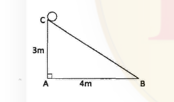
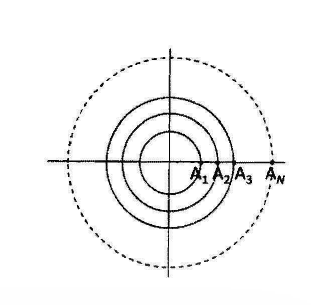
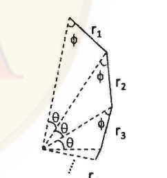
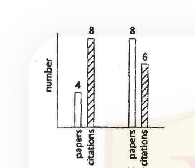
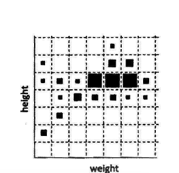

# CSIR NET Life Sciences — December 2013 (2013(II)) — PART 'A'

Booklet Code **A**, Subject Code **3** (Life Sciences), English. Time: 3:00 Hours. Maximum Marks: 200.
Part A contains Q1–Q20 (2 marks each; 15 to be attempted). Answers are taken from the CSIR answer key for **Booklet A (English)**.

---

### Question 1

A cart wheel rolls along a straight line. If the distance covered is equal to the diameter of the wheel, what is the angle through which the wheel has turned?

1. 90°
2. between 90° and 120°
3. between 120° and 150°
4. between 150° and 180°

**Answer: 2 (between 90° and 120°)**

> **Explanation:** Rolling without slipping means the arc turned through equals the distance rolled. If the wheel radius is *r*, the distance covered is the diameter, 2*r*. The angle in radians is θ = arc/radius = 2*r*/*r* = 2 rad. Converting, 2 × 180°/π ≈ **114.6°**, which lies between 90° and 120°.

---

### Question 2

In a class of 10 students, 3 failed in History, 6 failed in Geography and 2 failed in both. How many passed in both the subjects?

1. 1
2. 2
3. 3
4. 0

**Answer: 3 (3)**

> **Explanation:** By inclusion–exclusion, the number who failed at least one subject is 3 + 6 − 2 = 7. Students who passed in both = 10 − 7 = **3**.

---

### Question 3

As shown in the diagram above, a sphere is placed on the top of an incline. It rolls down the incline without slipping in exactly 50 turns. The radius of the sphere is

1. (5/π) cm
2. (5/π) m
3. (10/π) cm
4. 10 cm

**Answer: 1 ((5/π) cm)**

> **Explanation:** The incline is the hypotenuse of a 3 m–4 m right triangle, so its length is √(3² + 4²) = 5 m. Rolling without slipping for 50 turns means 50 circumferences = 5 m, so 50 × 2π*r* = 5 m, giving *r* = 5/(100π) = 1/(20π) m. Converting to centimetres, *r* = 100/(20π) = **(5/π) cm**. (Note the unit trap: option 2 has the same numerator but metres.)

---

### Question 4

A set of concentric circles of integer radii 1, 2, … *N* is shown in the figure above. An ant starts at point A₁, goes round the first circle, returns to A₁, moves to A₂, goes round the second circle, returns to A₂, moves to A₃ and repeats this until it reaches A_N. The distance covered by the ant is

1. *N*(*N* + 1)π
2. 2*N*π + *N*
3. π(*N* + 1)*N* + *N* − 1
4. π(*N* − 1)*N* + *N* − 1

**Answer: 4 (π(N − 1)N + N − 1)**

> **Explanation:** The ant completes full laps of circles 1, 2, …, *N* − 1 (it stops when it first *reaches* A_N, so circle *N* is never traversed). Lap distances: Σ 2π*k* for *k* = 1 to *N* − 1 = 2π · (*N* − 1)*N*/2 = π(*N* − 1)*N*. The radial hops A₁→A₂, A₂→A₃, …, A_{N−1}→A_N are *N* − 1 hops of 1 unit each = *N* − 1. Total = **π(*N* − 1)*N* + *N* − 1**.

---

### Question 5

The figure above shows an infinite series of triangles, in which *r*₁ > *r*₂ > *r*₃… What is the total length of the solid line segments in the figure?

1. *r*₁/*r*₂ + *r*₂/*r*₃ + …
2. *r*₁²/(*r*₁ − *r*₂)
3. *r*₂²/(*r*₁ + *r*₂)
4. (*r*₁ − *r*₂)/*r*₁²

**Answer: 2 (r1²/(r1 − r2))**

> **Explanation:** The solid segments form a geometric series *r*₁ + *r*₂ + *r*₃ + … with common ratio *k* = *r*₂/*r*₁ (< 1), so the sum is *r*₁/(1 − *k*) = *r*₁/(1 − *r*₂/*r*₁) = *r*₁ · *r*₁/(*r*₁ − *r*₂) = ***r*₁²/(*r*₁ − *r*₂)**.

---

### Question 6

If *aᵢ*, *bᵢ* and *cᵢ* are distinct, how many terms will the expansion of the product (*a*₁ + *a*₂ + *a*₃)(*b*₁ + *b*₂ + *b*₃ + *b*₄)(*c*₁ + *c*₂ + *c*₃ + *c*₄ + *c*₅) contain?

1. 12
2. 30
3. 23
4. 60

**Answer: 4 (60)**

> **Explanation:** Because all the *a*, *b* and *c* symbols are distinct, no like terms can combine. Every term of the expansion is formed by choosing one factor from each bracket, so the number of terms is 3 × 4 × 5 = **60**.

---

### Question 7

The above plot depicts the number of research publications of a scientist along with the number of citations.

Which of the following statements is **not** correct?

1. In the year 2012, 50% more papers were published but citations decreased by 25%.
2. In the year 2012, 100% more papers were published but citations were 75% of the number of papers in that year.
3. The papers published in year 2011 is only 33.33% of the total number of papers in both years.
4. The total number of citations for both years is 16.66% more than the total number of papers.

**Answer: 1 (In the year 2012, 50% more papers were published but citations decreased by 25%.)**

> **Explanation:** From the plot: papers 2011 = 4, 2012 = 8; citations 2011 = 8, 2012 = 6. Option 1 fails immediately — papers rose from 4 to 8, i.e. **100%** more, not 50% (the citation part, 8 → 6, is indeed a 25% decrease). Checking the others: option 2, 100% more papers and citations 6 = 75% of 8 ✓; option 3, 4/12 = 33.33% ✓; option 4, total citations 14 vs total papers 12, and (14 − 12)/12 = 16.66% ✓. So only statement 1 is not correct.

---

### Question 8

The next number of the sequence 1, 5, 14, 30, 55, … is

1. 85
2. 90
3. 91
4. 95

**Answer: 3 (91)**

> **Explanation:** The terms are cumulative sums of squares: 1, 1+4, 1+4+9, 1+4+9+16, 1+4+9+16+25 = 1, 5, 14, 30, 55. The next term adds 6² = 36, giving 55 + 36 = **91**. (Equivalently the differences are 4, 9, 16, 25, 36.)

---

### Question 9

The distribution of heights and weights in a population is shown above in a 2-parameter scatter plot. The size of the square is proportional to the number of persons having a particular combination of weight and height. Which statement best describes the trend in the population?

1. Height and weight are strongly correlated.
2. Height and weight are anticorrelated.
3. Large heights do not imply proportionately large weights.
4. Height and weight are independent characteristics.

**Answer: 3 (Large heights do not imply proportionately large weights.)**

> **Explanation:** The largest squares (most people) form a diagonal band running from lower-left to upper-right, so tall people do tend to be heavier — this rules out options 2 (anticorrelated) and 4 (independent). However the band is broad and the very tallest columns carry only small squares, so weight does not rise in step with height. The distribution is therefore only loosely associated, which is exactly what "strongly correlated" (option 1) would deny. The statement that best fits is **3**.

---

### Question 10

What is the maximum sum of the numbers of Saturdays and Sundays in a leap year?

1. 104
2. 105
3. 106
4. 107

**Answer: 3 (106)**

> **Explanation:** A leap year has 366 days = 52 full weeks (364 days) + 2 extra days. Those 52 weeks contribute 52 Saturdays and 52 Sundays = 104. To maximise the total, both leftover days must fall on Saturday and Sunday, which happens when 1 January is a Saturday (the 365th and 366th days are then Saturday and Sunday). Maximum = 104 + 2 = **106**.

---

### Question 11

Two trains of lengths 150 m and 250 m pass each other with constant speeds on parallel tracks in opposite directions. The drivers and guards are at the extremities of the trains. The time gap between the drivers passing each other and first driver-guard pair passing each other is 30 s. How much later will the other driver-guard pair pass by?

1. 10 s
2. 20 s
3. 30 s
4. 50 s

**Answer: 2 (20 s)**

> **Explanation:** Let the relative speed be *v*. Take *t* = 0 when the two drivers meet. Driver 1 then meets guard 2 after train 2's length has gone by (250/*v*), and guard 1 meets driver 2 after train 1's length (150/*v*). The **first** driver–guard pair to meet is therefore the 150 m event: 150/*v* = 30 s, so *v* = 5 m/s. The other pair meets at 250/5 = 50 s from *t* = 0, i.e. 50 − 30 = **20 s later**.

---

### Question 12

In a room, we have one grandfather, two fathers, two sons, and a grandson. The age of one father is seven times the age of his son. The age of the other father is twice his son's age. Assuming that there are only 3 people in the room and the grandfather is 70 years old, how old is the grandson?

1. 1
2. 2
3. 5
4. Cannot be determined

**Answer: 3 (5)**

> **Explanation:** Three people — grandfather G, father F, son S — satisfy the description because F is simultaneously a son (to G) and a father (to S), and S is the grandson: that gives one grandfather, two fathers (G, F), two sons (F, S) and one grandson (S). G is the father whose age is seven times his son's: 70 = 7 × F, so F = 10. F is the other father, twice his son's age: 10 = 2 × S, so S = **5**.

---

### Question 13

A hemispherical bowl is being filled with water at a constant volumetric rate. The level of water in the bowl increases

1. in direct proportion to time,
2. in inverse proportion to time,
3. faster than direct proportion to time,
4. slower than direct proportion to time.

**Answer: 4 (slower than direct proportion to time.)**

> **Explanation:** A hemispherical bowl is narrow at the bottom and widens upward, so the horizontal surface area *A*(*h*) increases with height *h*. With volume supplied at a constant rate, d*V*/d*t* = const and d*V* = *A*(*h*) d*h*, hence d*h*/d*t* = (d*V*/d*t*)/*A*(*h*), which **decreases** as the water rises. The level therefore climbs more and more slowly — sub-linear in time, i.e. slower than direct proportion.

---

### Question 14

Equal masses of two liquids of densities 6 kg/m³ and 4 kg/m³ are mixed thoroughly. The density of the mixture is

1. 4.8 kg/m³.
2. 5.0 kg/m³.
3. 5.2 kg/m³.
4. 5.4 kg/m³.

**Answer: 1 (4.8 kg/m³.)**

> **Explanation:** Take mass *m* of each liquid. Volumes are *m*/6 and *m*/4, so total volume = *m*(1/6 + 1/4) = *m* · 5/12 and total mass = 2*m*. Density = 2*m*/(*m* · 5/12) = 24/5 = **4.8 kg/m³** — the harmonic mean of the two densities, which applies for equal *masses* (an equal-*volume* mix would give the arithmetic mean 5.0).

---

### Question 15

Two points A and B on the surface of the Earth have the following latitude and longitude co-ordinates.
**A:** 30° N, 45° E
**B:** 30° N, 135° W
If *R* is the radius of the Earth, the length of the shortest path from A to B is

1. (√3/2)πR
2. πR/3
3. πR/6
4. 2πR/3

**Answer: 4 (2πR/3)**

> **Explanation:** The longitudes 45° E and 135° W differ by exactly 180°, so A and B lie on the same great circle through the poles (the meridian pair formed by 45° E and its opposite 135° W). Going over the nearer pole, the arc is (90° − 30°) + (90° − 30°) = 120° = 2π/3 radians. Shortest path = *R* × 2π/3 = **2πR/3**. (Travelling along the 30° N parallel would be longer, since a small circle is not a geodesic.)

---

### Question 16

Amoebae are known to double in 3 min. Two identical vessels A & B, respectively contain one and two amoebae to start with. The vessel B gets filled in 3 hours. When will A get filled?

1. 3 hours
2. 2 hours 57 min
3. 3 hours 3 min
4. 6 hours

**Answer: 3 (3 hours 3 min)**

> **Explanation:** Doubling every 3 min, vessel B starting from 2 amoebae fills in 3 h = 180 min = 60 doublings, i.e. the full vessel holds 2 × 2⁶⁰ amoebae. Vessel A starts with 1 amoeba, so it needs one extra doubling to reach the same number. One doubling period is 3 min, hence A fills in 180 + 3 = **3 hours 3 min**.

---

### Question 17

Students of a school are divided into 4 groups. What is the probability that three friends get into the same group?

1. 3/4
2. 1/64
3. 1/16
4. 1/3

**Answer: 3 (1/16)**

> **Explanation:** Fix the first friend's group — whichever it is, it is arbitrary. For all three friends to land together, the second and third must each independently fall into that *same* group, each with probability 1/4. So P = 1 × 1/4 × 1/4 = **1/16**. (Option 2, 1/64 = (1/4)³, would be the answer only if a particular pre-specified group were required.)

---

### Question 18

A fruit vendor buys 120 Shimla apples at 4 for Rs. 100, and 120 Golden apples at 6 for Rs. 100. She decides to mix them and sell at 10 for Rs. 200. She will make

1. no profit, no loss
2. a loss of 4%
3. a gain of 4%
4. a loss of 10 %

**Answer: 2 (a loss of 4%)**

> **Explanation:** Cost: 120/4 × 100 = Rs 3000 for Shimla, 120/6 × 100 = Rs 2000 for Golden; total cost = Rs 5000 for 240 apples. Revenue: selling the mix at 10 for Rs 200 gives 240/10 × 200 = Rs 4800. Loss = Rs 200 on Rs 5000 = 200/5000 = **4% loss**.

---

### Question 19

4⁰ + 4² + 4⁻² + 4^(1/2) + 4^(−1/2) =

1. 4⁰
2. 4^(2½) + 4^(−2½)
3. 19 9/16
4. 22 9/16

**Answer: 3 (19 9/16)**

> **Explanation:** Evaluate term by term: 4⁰ = 1, 4² = 16, 4⁻² = 1/16, 4^(1/2) = 2, 4^(−1/2) = 1/2. Sum of integers = 1 + 16 + 2 = 19; sum of fractions = 1/16 + 1/2 = 1/16 + 8/16 = 9/16. Total = **19 9/16**.

---

### Question 20

In an enclosure there were both crows and cows. If there were 30 heads and 100 legs, what fraction of them are crows?

1. 1/3
2. 1/4
3. 1/10
4. 3/10

**Answer: 1 (1/3)**

> **Explanation:** Let *c* be crows (2 legs) and *w* be cows (4 legs). Heads: *c* + *w* = 30. Legs: 2*c* + 4*w* = 100, i.e. *c* + 2*w* = 50. Subtracting gives *w* = 20 and hence *c* = 10. Fraction of crows = 10/30 = **1/3**.
