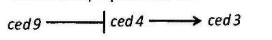
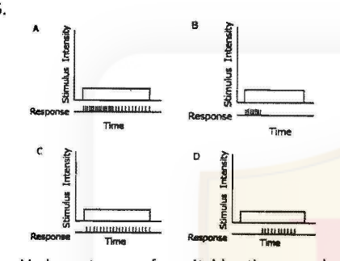
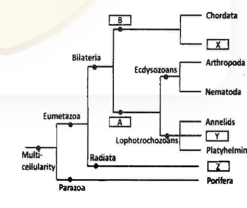
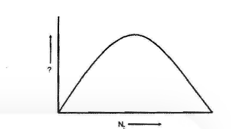

# CSIR NET Life Sciences — December 2013 (2013(II)) — PART 'B'

Part B contains Q21–Q70 (2 marks each; 35 to be attempted). Answers are from the CSIR answer key for **Booklet A (English)**.

---

### Question 21

The interaction energy between atom A and B is ~ 400 kJmol⁻¹. The type of interaction between them is

1. pi - pi.
2. covalent.
3. ion-dipole.
4. hydrogen bond.

**Answer: 2 (covalent.)**

> **Explanation:** ~400 kJ/mol is far too strong for non-covalent interactions (hydrogen bonds ~10–40 kJ/mol, ion-dipole and π–π weaker still). Only a covalent bond has bond energies of this order.

---

### Question 22

Which one of the following bases has the largest hydrogen bonding possibility?

1. Adenine
2. Guanine
3. Cytosine
4. Uracil

**Answer: 2 (Guanine)**

> **Explanation:** Guanine carries the most hydrogen-bonding donors/acceptors on its edge — it forms three H-bonds with cytosine (G≡C), the maximum of the standard bases. Adenine–thymine/uracil pair with only two.

---

### Question 23

Enzymes help to lower the activation energies of reactions by

1. covalent interaction with substrates.
2. binding only with the solvent molecules.
3. changing reaction equilibria.
4. forming weak interactions with substrates.

**Answer: 4 (forming weak interactions with substrates.)**

> **Explanation:** Enzymes stabilise the transition state through many weak, non-covalent interactions (H-bonds, ionic, van der Waals) with the substrate, lowering ΔG‡. They do not change the equilibrium (option 3) and generally act without permanent covalent catalysis.

---

### Question 24

Glucose residues in amylose are linked by

1. β1→4
2. α1→4
3. α1→6
4. β1→6

**Answer: 2 (α1→4)**

> **Explanation:** Amylose is the unbranched component of starch; its glucose units are joined by α-1,4-glycosidic bonds. α-1,6 bonds occur at the branch points of amylopectin/glycogen, and β-1,4 defines cellulose.

---

### Question 25

When a membrane is depolarized to a voltage value more positive than the threshold voltage, it leads to the generation of

1. Donnan potential.
2. action potential.
3. resting potential.
4. electrochemical potential.

**Answer: 2 (action potential.)**

> **Explanation:** Depolarisation beyond threshold opens voltage-gated Na⁺ channels regeneratively, producing the all-or-none spike — the action potential. Resting and Donnan potentials are steady-state, not triggered events.

---

### Question 26

*E. coli* proliferates faster on 'glucose' than it does on 'lactose' because lactose is

1. taken up more slowly than glucose
2. not hydrolyzed by *E. coli*.
3. taken up faster than glucose.
4. toxic to the cells.

**Answer: 1 (taken up more slowly than glucose)**

> **Explanation:** Glucose is used preferentially (catabolite repression); lactose must first be transported (lacY permease) and hydrolysed, and its uptake/utilisation is slower, giving a longer lag and slower growth than on glucose. Lactose is neither toxic nor unhydrolysable by induced *E. coli*.

---

### Question 27

Out of the list given below, which is the correct order of increasing lipid bilayer permeability?

1. N₂ > Ethanol > H₂O > Glucose > Ca⁺² > RNA
2. H₂O > Glucose > Ethanol > N₂ > Ca⁺² > RNA
3. Ca⁺² > RNA > N₂ > Ethanol > H₂O > Glucose
4. Ethanol > RNA > Ca⁺² > H₂O > Glucose > N₂

**Answer: 1 (N₂ > Ethanol > H₂O > Glucose > Ca⁺² > RNA)**

> **Explanation:** Bilayer permeability falls as size and charge increase: small nonpolar gases (N₂) cross most readily, then small uncharged polar (ethanol, water), then larger uncharged polar (glucose), while ions (Ca²⁺) and large polar/charged molecules (RNA) barely cross. Option 1 is the only list in this descending-permeability order.

---

### Question 28

In the lysogenic state of λ phage

1. both CI and Cro are on.
2. both CI and Cro are off.
3. CI is on while Cro is off.
4. CI is off while Cro is on.

**Answer: 3 (CI is on while Cro is off.)**

> **Explanation:** Lysogeny is maintained by the CI repressor, which blocks the lytic (Cro/late) genes. CI is expressed (from P_RM) and Cro is repressed — "CI on, Cro off".

---

### Question 29

In bacteria chromosomal DNA replication starts at

1. one specific locus.
2. several specific loci.
3. a single locus, randomly.
4. from several loci, randomly.

**Answer: 1 (one specific locus.)**

> **Explanation:** The bacterial chromosome has a single origin of replication, *oriC*, at a defined position, where DnaA initiates bidirectional replication. (Multiple origins are a eukaryotic feature.)

---

### Question 30

The 'Uvr ABC' repair mechanism is involved in repairing

1. missing bases.
2. strand break.
3. cross linked strands.
4. DNA damage caused by "bulky" chemical adducts.

**Answer: 4 (DNA damage caused by "bulky" chemical adducts.)**

> **Explanation:** UvrA/UvrB/UvrC carry out bacterial nucleotide-excision repair, which recognises and excists bulky helix-distorting lesions such as pyrimidine dimers and large chemical adducts.

---

### Question 31

Which of the following phenomena is observed in compatible plant-pathogen interactions?

1. Virulence in pathogen
2. Hypersensitive response in host.
3. Resistance in host.
4. Avirulence in pathogen.

**Answer: 1 (Virulence in pathogen)**

> **Explanation:** A "compatible" interaction means the host is susceptible and the pathogen succeeds — the pathogen is virulent and no hypersensitive response or resistance is mounted. Incompatible interactions are the ones showing HR/resistance and avirulence.

---

### Question 32

Which one of the following is NOT an extracellular matrix protein?

1. Fibronectin
2. Vitronectin
3. Laminin
4. Cyclin

**Answer: 4 (Cyclin)**

> **Explanation:** Fibronectin, vitronectin and laminin are all ECM/adhesive glycoproteins. Cyclin is an intracellular cell-cycle regulatory protein, not part of the extracellular matrix.

---

### Question 33

The cylindrical channels in gap junctions are made of

1. connexin
2. collagen.
3. fibronectin.
4. N-CAM.

**Answer: 1 (connexin)**

> **Explanation:** Each gap-junction channel (connexon) is a hexamer of the transmembrane protein connexin, allowing direct cytoplasmic exchange between adjacent cells.

---

### Question 34

A tumour suppressor protein

1. is one whose function brings about regression of a tumour
2. is one where mutations are shown to cause or are associated with tumours.
3. is inactivated by oncogenes.
4. inhibits the progression of the cell cycle by phosphorylating cyclins.

**Answer: 2 (is one where mutations are shown to cause or are associated with tumours.)**

> **Explanation:** Tumour suppressors (e.g. Rb, p53) normally restrain proliferation; loss-of-function mutations in them cause or are associated with cancer (the two-hit criterion). Oncogenes are activated, not inactivators of suppressors.

---

### Question 35

Immediate hypersensitivity reactions are associated with

1. IgG
2. IgE
3. IgM
4. IgA

**Answer: 2 (IgE)**

> **Explanation:** Type I (immediate) hypersensitivity is mediated by IgE bound to mast cells/basophils; antigen cross-linking triggers degranulation and histamine release.

---

### Question 36

The change in the state of specification of imaginal disc of *Drosophila* to that of a different disc type is known as

1. transdetermination.
2. transdifferentiation.
3. transformation.
4. transduction.

**Answer: 1 (transdetermination.)**

> **Explanation:** When one imaginal disc (e.g. leg) heritably switches to another fate (e.g. wing), the change in determination state is called transdetermination.

---

### Question 37

During double fertilization in plants, one sperm fuses with the egg cell and the other sperm fuses with

1. synergid cell.
2. central cell.
3. antipodal cell.
4. nucellar cell.

**Answer: 2 (central cell.)**

> **Explanation:** In double fertilisation one sperm forms the zygote with the egg, the other fuses with the two polar nuclei of the central cell to form the triploid endosperm.

---

### Question 38

Over-expression of a dominant negative FGF receptor during amphibian development would prevent formation of

1. trunk and tail.
2. head and trunks.
3. trunk and fore limbs.
4. head and forelimbs.

**Answer: 1 (trunk and tail.)**

> **Explanation:** FGF signalling is required ventrally/posteriorly for trunk and tail formation; blocking it with a dominant-negative FGF receptor (the classic "SPRY/XD-FGF" blockade) converts the posterior mesoderm to a head-only fate, so **trunk and tail** fail to form. Head and forelimb structures are the ones that *remain*.

---

### Question 39

The cell death pathway in *C. elegans* can be schematically represented as:

Based on the above, which one of the following statements is TRUE?

1. A loss-of-function allele of *ced9* would lead to survival of cells that normally die.
2. A loss of function allele of *ced9* would lead to excessive cell death.
3. A gain-of-function allele of *ced9* would lead to excessive cell death.
4. Neither loss or gain-of-function of *ced9* would make any change to the cell death pathway.

**Answer: 2 (A loss of function allele of ced9 would lead to excessive cell death.)**

> **Explanation:** ced-9 normally *inhibits* ced-4, which activates the death protease ced-3. Losing ced-9 removes the brake, so ced-4/ced-3 run unchecked → excessive apoptosis. (Gain of ced-9 would instead block death.)

---

### Question 40

Which of the following mechanisms is NOT involved in providing photoprotection to plants?

1. Degradation of D1 protein.
2. Zeaxanthin formation.
3. Photolysis of water.
4. Thermal dissipation.

**Answer: 3 (Photolysis of water.)**

> **Explanation:** Photoprotection includes D1 repair/degradation, the xanthophyll (zeaxanthin) cycle and non-photochemical thermal dissipation. Photolysis of water is the normal light-reaction electron source of PSII, not a protective mechanism.

---

### Question 41

Which of the following plant hormones can mimic the *det1* mutation, causing de-etiolation and chloroplast development in dark?

1. Cytokinin
2. Gibberellin
3. Auxin
4. Ethylene

**Answer: 1 (Cytokinin)**

> **Explanation:** *det1* mutants develop chloroplast-like structures and de-etiolate even in darkness; exogenous cytokinin can similarly trigger de-etiolation and chloroplast development in the dark.

---

### Question 42

Under which conditions do members of the family *Gramineae* synthesize and release phytosiderophores?

1. Iron deficiency.
2. Phosphorus deficiency.
3. Availability of iron complexes in rhizosphere.
4. Availability of phosphorus complexes in rhizosphere.

**Answer: 1 (Iron deficiency.)**

> **Explanation:** Strategy II (graminaceous) plants release phytosiderophores (e.g. deoxymugineic acid) specifically under iron deficiency to chelate and take up Fe³⁺.

---

### Question 43

The membranes of chilling–sensitive plants are characterized by

1. higher proportion of saturated fatty acids
2. lower transition temperature
3. lower proportion of saturated fatty acids
4. lower transition temperature and higher proportion of unsaturated fatty acids

**Answer: 1 (higher proportion of saturated fatty acids)**

> **Explanation:** Chilling-sensitive species have membranes with a higher saturated/unsaturated fatty-acid ratio, giving a higher (not lower) lipid-transition temperature; on chilling their lipids solidify, causing injury. Chilling-tolerant plants keep more unsaturated fatty acids and a lower transition temperature.

---

### Question 44

The only bone marrow cell that never appears in peripheral blood is

1. myeloblast.
2. myelocyte.
3. lymphoblast.
4. megaloblast.

**Answer: 4 (megaloblast.)**

> **Explanation:** The key gives option 4. A megaloblast is the abnormal, arrested precursor seen in the marrow in megaloblastic (B₁₂/folate-deficiency) anaemia; the question's intent is that this pathological precursor is not a normal circulating cell. Note that the alternative reading of the question — that myeloblasts, myelocytes and lymphoblasts all appear in the blood in leukaemia — makes this a contested item; the CSIR key answer is recorded here. See `sources.md`.

---

### Question 45

Various types of excitable tissues when stimulated showed response as shown in the above figures. Which one of them is an example of fast adapting tissue?

1. A.
2. B.
3. C.
4. D.

**Answer: 2 (B.)**

> **Explanation:** A fast (phasic) adapting receptor fires only at the onset of the stimulus and then falls silent even while the stimulus continues — the response spike-train is confined to the leading edge, which is the pattern shown in panel B.

---

### Question 46

After gull nestlings hatch, the parents remove the egg-shells from the nest. This behaviour is to

1. clean the area.
2. reduce infection.
3. make more space in the nest.
4. minimise nest detection by predators

**Answer: 4 (minimise nest detection by predators)**

> **Explanation:** The white inner surfaces of broken shells are conspicuous and guide visual predators to the nest; removing them (a fixed-action-pattern component of Tinbergen's gull studies) reduces nest predation.

---

### Question 47

Thyroxin releasing hormone (TRH) receptor belongs to

1. nuclear receptor family.
2. receptor tyrosin kinase family.
3. G-protein – coupled receptor family.
4. guanylate cyclase receptor family.

**Answer: 3 (G-protein – coupled receptor family.)**

> **Explanation:** The TRH receptor is a Gq-coupled GPCR that activates phospholipase C → IP₃/DAG. (Thyroxine itself acts via a nuclear receptor, but the question asks about the TRH receptor.)

---

### Question 48

A cross is made between a pure breeding plant having red coloured flowers with a pure breeding plant having white coloured flowers. Such a cross is called as

1. test cross.
2. monohybrid cross.
3. dihybrid cross.
4. back cross.

**Answer: 2 (monohybrid cross.)**

> **Explanation:** A cross differing in a single character (flower colour) between two pure-breeding parents is a monohybrid cross. A test cross uses a homozygous recessive; a back cross mates an F₁ to a parent.

---

### Question 49

A *cis-trans* complementation test is carried out to identify

1. if two mutations are allelic in nature.
2. if two genes interact with one another
3. the number of genes influencing a phenotype.
4. to understand the dominance/recessive relationships between alleles.

**Answer: 1 (if two mutations are allelic in nature.)**

> **Explanation:** The cis/trans (complementation) test asks whether two recessive mutations lie in the same gene (fail to complement, allelic) or in different genes (complement). It is used to define cistrons.

---

### Question 50

The following is the inheritance pattern of a trait under observation:
(i) The trait often skips a generation
(ii) The number of affected males and females is almost equal
(iii) The trait is often found in pedigrees with consanguineous marriages.

The trait is likely to be

1. autosomal recessive
2. autosomal dominant.
3. sex-linked recessive.
4. sex-linked dominant.

**Answer: 1 (autosomal recessive)**

> **Explanation:** Skipping generations, equal male:female ratio, and enrichment by consanguinity are the hallmarks of an autosomal recessive trait. X-linked recessive would show far more affected males.

---

### Question 51

Given below is an evolutionary tree.

Based on the above, which one of the following combinations is correct?

1. A – Protostome; B – Deuterostome; X – Mollusca; Y – Cnidaria; Z – Protozoa
2. A – Protostome; B – Deuterostome; X – Echinodermata; Y – Mollusca; Z – Cnidaria
3. A – Deuterostome; B – Protostome; X – Crustacea; Y – Mollusca; Z – Cnidaria
4. A – Deuterostome; B – Protostome; X – Echinodermata; Y – Roundworm; Z – Ctenophora

**Answer: 2 (A – Protostome; B – Deuterostome; X – Echinodermata; Y – Mollusca; Z – Cnidaria)**

> **Explanation:** In the bilaterian tree, the branch grouping with Chordata (box B) is Deuterostomia — its sister phylum X is Echinodermata. The Lophotrochozoan node Y includes Mollusca, and the box Z placed below Bilateria near Radiata corresponds to Cnidaria. This matches option 2.

---

### Question 52

The fungal group presently classified under protists is

1. Zygomycetes.
2. Oomycetes.
3. Deuteromycetes.
4. Discomycetes.

**Answer: 2 (Oomycetes.)**

> **Explanation:** Oomycetes (water moulds) were long treated as fungi but are now placed with the stramenopile protists (Chromista), not the true fungi.

---

### Question 53

Name the common Indian bird that is generally seen in groups (aggregation)

1. Bulbul
2. Warbler
3. Babbler
4. Sun bird

**Answer: 3 (Babbler)**

> **Explanation:** Babblers (e.g. jungle/skull-capped babblers) are strongly gregarious and are typically seen in noisy co-operative groups; bulbuls, warblers and sunbirds are less consistently group-forming.

---

### Question 54

The fungus associated with human oral or vaginal infection is

1. *Fusarium*.
2. *Aspergillus*.
3. *Candida*.
4. *Pneumocytis*.

**Answer: 3 (Candida.)**

> **Explanation:** *Candida albicans* is the yeast responsible for oral thrush and vaginal candidiasis. *Pneumocystis* causes pneumonia, *Aspergillus* and *Fusarium* cause respiratory/opportunistic and eye/skin infections respectively.

---

### Question 55

The most common vegetation in the Western Ghats of India is tropical moist deciduous forest but that in Deccan plateau is depleted thorn forest. The possible reason is

1. richer soil of Western Ghats compared to Deccan plateau.
2. extensive deforestation in Deccan plateau compared to Western Ghats.
3. higher rainfall in Western Ghats compared to Deccan plateau.
4. higher temperature in Deccan plateau compared to Western Ghats.

**Answer: 3 (higher rainfall in Western Ghats compared to Deccan plateau.)**

> **Explanation:** The Western Ghats receive heavy orographic monsoon rainfall, supporting moist deciduous forest, whereas the rain-shadow Deccan plateau is dry, favouring thorn/scrub forest. Precipitation, not soil or temperature, is the dominant driver.

---

### Question 56

The following graph is for a logistically growing population, with Nₜ plotted on the X-axis. What is the parameter plotted on the Y-axis?

1. dN/dt
2. Nₜ₊₁
3. dN/dt · (1/N)
4. K

**Answer: 1 (dN/dt)**

> **Explanation:** For logistic growth, dN/dt = rN(1 − N/K) is a quadratic in N, giving the symmetric hump-shaped curve shown (zero at N = 0 and N = K, maximum at N = K/2). Per-capita rate (option 3) would decline linearly, not as a hump.

---

### Question 57

Annual weeds of arable lands are classified as

1. phanerophytes.
2. therophytes.
3. chamaephytes.
4. geophytes.

**Answer: 2 (therophytes.)**

> **Explanation:** In Raunkiaer's system, therophytes are annuals that survive unfavourable seasons only as seeds — the typical life form of arable-land weeds. Phanerophytes are tall woody plants, chamaephytes low shrubs, geophytes have underground perennating organs.

---

### Question 58

Which one of the following advancements in animal classification is correct?

1. Protostomes → Pseudocoelomates → Deuterostomes → Eucoelomates
2. Acoelomates → Protostomes → Eucoelomates → Deuterostomes
3. Pseudocoelomates → Encocelomates → Protostomes → Deuterostomes
4. Protostomes → Deuterostomes → Acoelomates → Eucoelomates

**Answer: 3 (Pseudocoelomates → Encocelomates → Protostomes → Deuterostomes)**

> **Explanation:** The key records option 3. The sequence traces the classical progression of body-plan complexity — pseudocoelomate forms, then true coelomates ("Encocelomates", i.e. eucoelomates), and the eucoelomates then splitting into the two great branches Protostomia and Deuterostomia. The other options mis-order the coelom grades or place Acoelomates after the coelomates.

---

### Question 59

Which of the following is the most appropriate spectral bands for vegetation analysis using remote sensing platforms?

1. Red, Near Infrared
2. Infrared, Visible
3. Red, Microwave
4. Visible, Microwave

**Answer: 1 (Red, Near Infrared)**

> **Explanation:** Vegetation indices such as NDVI use the red band (strong chlorophyll absorption) and the near-infrared band (high leaf reflectance). This red–NIR contrast is the basis of remote-sensing vegetation analysis.

---

### Question 60

Which of the following diseases does not leave any paleontological evidence?

1. Tuberculosis
2. Arthritis
3. Rickets
4. Cholera

**Answer: 4 (Cholera)**

> **Explanation:** Tuberculosis, arthritis and rickets all leave characteristic skeletal/bone lesions recoverable in the fossil record. Cholera is a soft-tissue intestinal infection that leaves no skeletal trace.

---

### Question 61

Greater male investment in the care of offspring is most likely to lead to

1. a lek system.
2. stronger female choice.
3. reverse sexual dimorphism.
4. run-away selection.

**Answer: 3 (reverse sexual dimorphism.)**

> **Explanation:** When males invest heavily in offspring they become the limiting, choosier sex, and females compete for them — producing reverse sexual dimorphism (larger, brighter females; sex-role reversal, as in phalaropes).

---

### Question 62

A neuron that fires when an individual is eating by hand, also fires when he sees someone else eating with hand. Such neurons are called

1. mirror neurons.
2. mimicry neurons.
3. motor neurons.
4. reward neurons.

**Answer: 1 (mirror neurons.)**

> **Explanation:** Mirror neurons discharge both during execution of an action and while observing the same action performed by another — exactly the described property.

---

### Question 63

Which of the following microbial fermentations are anaerobic?

1. Ethanol and acetone-butanol.
2. Citric acid and propionic acid.
3. Penicillin and vitamin B₁₂.
4. Streptomycin and rifampicin.

**Answer: 1 (Ethanol and acetone-butanol.)**

> **Explanation:** Alcoholic fermentation and the acetone–butanol (Weizmann) fermentation are classic anaerobic fermentations. Citric-acid and most antibiotic productions are aerobic submerged fermentations.

---

### Question 64

Encasing of which of the following plant cells in a gelatinous matrix is referred as artificial seed?

1. Microcalli
2. Somatic embryos
3. Root tips
4. Shoot tips

**Answer: 2 (Somatic embryos)**

> **Explanation:** Artificial (synthetic) seeds are produced by encapsulating somatic (somatic-embryogenesis-derived) embryos in a gel such as sodium alginate.

---

### Question 65

Which of the following transgenic crop(s) have been approved for commercial cultivation in India?

1. Cotton
2. Brinjal
3. Cotton and brinjal
4. Cotton, *Brassica*, brinjal

**Answer: 1 (Cotton)**

> **Explanation:** Bt cotton is the transgenic crop approved for commercial cultivation in India. Bt brinjal has not been approved, and *Brassica* (dhara mustard) is a herbicide-tolerant non-transgenic line.

---

### Question 66

Chinese Brake fern (*Pteris vittata*) is a hyperaccumulator of :

1. Cadmium.
2. Arsenic.
3. Lead.
4. Chromium.

**Answer: 2 (Arsenic.)**

> **Explanation:** *Pteris vittata* is the well-known arsenic hyperaccumulator used in phyto-remediation of arsenic-contaminated soils.

---

### Question 67

Which of the following is NOT a post-translational modification in a mammalian system?

1. Palmitoylation
2. glycosylation
3. peptidylation
4. phosphorylation

**Answer: 3 (peptidylation)**

> **Explanation:** Palmitoylation, glycosylation and phosphorylation are all established post-translational modifications. "Peptidylation" is not a recognised PTM.

---

### Question 68

Haemoglobin has characteristic circular dichroism (CD) peaks C in the far-UV, near UV and Soret regions. Contribution to near-UV CD comes entirely from

1. aromatic amino acid residues.
2. heme group.
3. heme and aromatic amino acid residues.
4. peptide bonds and aromatic amino acid residues.

**Answer: 3 (heme and aromatic amino acid residues.)**

> **Explanation:** The near-UV CD region (roughly 250–320 nm) reports on the environments of the aromatic side chains (Trp, Tyr, Phe) **and** of the porphyrin (heme) chromophore, both of which absorb there; the far-UV signal comes from the peptide backbone and the Soret signal from the heme. Hence the near-UV contribution is from heme together with the aromatic residues.

---

### Question 69

A weed is assumed to be dispersed randomly in a meadow. What statistical distribution will describe the dispersion correctly?

1. Binomial
2. Negative Binomial
3. Poisson
4. Normal

**Answer: 3 (Poisson)**

> **Explanation:** A truly random spatial dispersion (variance ≈ mean) is described by the Poisson distribution. Clumped/over-dispersed patterns fit the negative binomial.

---

### Question 70

Co-localization of two fluorescently labelled proteins in an organelle in cells is usually visualised by

1. interference-contrast microscopy.
2. scanning electron microscopy.
3. confocal microscopy.
4. atomic force microscopy.

**Answer: 3 (confocal microscopy.)**

> **Explanation:** Fluorescence co-localisation of two labelled proteins is standardly imaged by confocal laser-scanning microscopy, which gives optical sectioning and separates the two emission channels. Interference contrast, SEM and AFM do not image specific fluorescence labels.
