# CSIR NET Life Sciences — December 2013 (2013(II)) — PART 'C'

Part C contains Q71–Q145 (4 marks each; 25 to be attempted). Answers are from the CSIR answer key for **Booklet A (English)**.

---

### Question 71

Tryptic digest of a heptapeptide (built from 3 lysine (K), 2 alanine (A), 1 tyrosine (Y) and 1 phenylalanine (F)) yielded tri and tetrapeptide. Which of the following is the correct sequence of the heptapeptide?

1. KAYAKFK
2. YKAAFKK
3. KYKAAKF
4. KYAAKFK

**Answer: 3 (KYKAAKF)**

> **Explanation:** Trypsin cleaves peptide bonds on the carboxyl side of lysine, so a heptapeptide containing three lysines can yield a tripeptide plus a tetrapeptide (a single cleavage) only if two of the lysines occupy the C-terminal region where no cleavage follows. The key selects KYKAAKF, whose composition (3 K, 2 A, 1 Y, 1 F) and lysine placement are the closest fit to the reported digest. Strictly, cleaving KYKAAKF after K1, K3 and K6 gives four fragments (K, YK, AAK, F), so the printed stem's "tri and tetrapeptide" cannot be reproduced exactly by any of the four sequences — this item was listed among the doubtful questions when the key was published, and the key's answer is recorded here. See `sources.md`.

---

### Question 72

100 ml of 0.1 M sodium acetate solution has a pH of 8.90. To this solution 1000 µl of 1M acetic acid (pKa = 4.76) of pH 2.80 is added. The pH of this mixture will be:

1. 8.90
2. 4.76
3. 2.80
4. 5.76

**Answer: 4 (5.76)**

> **Explanation:** 100 mL of 0.1 M acetate = 10 mmol of base. Added acetic acid = 1 mL × 1 M = 1 mmol. The acid converts 1 mmol acetate → acetic acid, leaving 9 mmol acetate and 1 mmol acetic acid. Henderson–Hasselbalch: pH = pKa + log(9/1) = 4.76 + 0.95 ≈ **5.76**.

---

### Question 73

What are A, B and C in the following reactions?

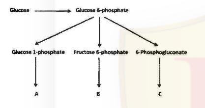

1. Pyruvate, ribose 5-phosphate, glycogen.
2. Ribose 5-phosphate, glycogen, pyruvate.
3. Glycogen, pyruvate, ribose 5-phosphate.
4. Glycogen, citrate, ribose 5-phosphate.

**Answer: 3 (Glycogen, pyruvate, ribose 5-phosphate.)**

> **Explanation:** Glucose 6-phosphate feeds three branches. The Glucose 1-phosphate branch leads to **A = glycogen** (G1P is the direct substrate of glycogen synthesis), the Fructose 6-phosphate branch continues through glycolysis to **B = pyruvate**, and the 6-Phosphogluconate branch is the oxidative pentose-phosphate-pathway route that yields **C = ribose 5-phosphate**.

---

### Question 74

Michaelis-Menten enzyme kinetics for a simple reaction involving an enzyme (E) and substrate (S) is given by the scheme:

E + S ⇌(Km) E S →(kcat) E + P.

The description of Km, kcat and their relationship is provided in the following statements.

A. Km represents association constant of the ES complex.
B. Km represents the dissociation constant of the ES complex.
C. kcat is the rate constant for the chemical conversion of the ES complex to substrate bound enzyme and product.
D. kcat/Km is a rate constant that refers to the properties and reactions of the free enzyme and free substrate.

Which of the combinations of above statements is true?

1. A and C
2. B and D
3. A and D
4. B and C

**Answer: 2 (B and D)**

> **Explanation:** Km is (in the simple rapid-equilibrium view) the dissociation constant of the ES complex (B, not A). kcat is the turnover number for ES → E + P. The specificity constant kcat/Km describes the reaction of free enzyme with free substrate (D). Hence B and D.

---

### Question 75

A 26-residue peptide composed of alanine and leucine shows a circular dichroism (CD) spectrum characteristic of α-helix at 50°C in 5 mM phosphate buffer at pH 7.4. Deconvolution of the spectrum indicates 60% α-helical and 40% random conformation. When the peptide solution is cooled gradually to 25°C, and the CD spectra are recorded at different temperatures, the most likely observation will be that

1. the % helical content will decrease and % random conformation will increase.
2. the % helical content will increase and % random conformation will decrease.
3. there will be transition from α-helix to β-sheet.
4. there will be transition from α-helix to β-hairpin.

**Answer: 2 (the % helical content will increase and % random conformation will decrease.)**

> **Explanation:** Alanine and leucine are strong helix formers and the peptide is a simple helix/coil two-state system. Lowering the temperature favours the enthalpically stabilised intrachain H-bonds, so helix fraction rises and random coil falls on cooling.

---

### Question 76

It has been observed that for the DNA double helix melting, the value of ΔH (enthalpy change of denaturation) are 80 and 90 kcal/mole at 70° and 80°C, respectively. Assuming that ΔCp (constant-pressure heat capacity change) is independent of temperature, estimate ΔH associated with the denaturation of DNA at 37°C. This estimated value of ΔH (kcal/mole) is

1. 27.
2. 37.
3. 47.
4. 57.

**Answer: 3 (47.)**

> **Explanation:** With constant ΔCp, ΔH varies linearly with T: ΔCp = (90 − 80)/(80 − 70) = 1 kcal mol⁻¹ °C⁻¹. Extrapolating back to 37°C: ΔH(37) = 80 − 1 × (70 − 37) = 80 − 33 = **47 kcal/mol**.

---

### Question 77

Using FRAP (Fluorescence Recovery After Photo-bleaching) techniques, diffusion coefficient of three integral membranes proteins M₁, M₂ and M₃ in a kidney cell is calculated as 1µm/s, 0.05 µm/s and 0.005 µm/s, receptively. Considering fluid-mosaic nature of biological membrane and relationship of structural organization of integral membrane protein with diffusion coefficient, which protein(s) will have highest number of integral membrane domain?

1. M₂ and M₃
2. M₂ only
3. M₃ only
4. M₁ and M₃

**Answer: 3 (M₃ only)**

> **Explanation:** The more transmembrane domains a protein has (and the more it is anchored/interacts with the cytoskeleton or other proteins), the slower it diffuses. The lowest diffusion coefficient (M₃, 0.005 µm/s) corresponds to the protein with the greatest number of membrane-spanning domains / strongest immobilisation.

---

### Question 78

One highly pathogenic DNA virus enters into the host cells by endocytosis replicates in the nucleus followed by cell lysis. You have drugs at your disposal that block

A. acidification of vesicles.
B. mitochondrial transport.
C. nuclear export.
D. exocytosis.

Identify the right combination to prevent its infection.

1. A and B
2. B and D
3. A and C
4. A and D

**Answer: 3 (A and C)**

> **Explanation:** The virus enters by endocytosis, so blocking vesicle acidification (A) prevents endosomal escape/uncoating and stops the infection at entry. It then replicates in the nucleus, so newly replicated genomes and proteins must reach the cytoplasm via nuclear export; blocking nuclear export (C) halts the cycle. Exocytosis (D) is not the release route for a virus that exits by cell lysis, and mitochondrial transport (B) is not an essential step in this pathway.

---

### Question 79

When cells enter mitosis, their existing array of cytoplasmic microtubules has to be rapidly broken down and replaced with the mitotic spindle, which pulls the chromosomes into the daughter cells. The enzyme Katanin is activated during the onset of mitosis and chops microtubules into short pieces. The possible fate of the microtubule fragments created by Katapin will be

1. depolymerization.
2. aggregation.
3. degradation.
4. translocation.

**Answer: 1 (depolymerization.)**

> **Explanation:** Katanin severs microtubules into fragments, which then depolymerise (lose tubulin subunits from their newly created ends), supplying the free tubulin pool used to build the mitotic spindle.

---

### Question 80

A bacterial strain can use carbohydrates and hydrocarbons as growth substrates. The strain uses glucose following a minimal lag period after inoculation, regardless of the other carbohydrates and hydrocarbons in the growth medium. The following observations were also made.

A. In the absence of glucose, lactose is used after a lag period of about three times as long as the lag period for glucose utilization.
B. The presence of hydrocarbons does not affect the lag period for the utilization of lactose.
C. The utilization pattern for all hydrocarbons is similar to that of lactose.
D. Branched hydrocarbons are not immediately utilized if straight chain hydrocarbons are initially present.

Which one of the following specific regulatory mechanisms is consistent with the above observations related to carbohydrate and hydrocarbon utilization?

1. Diauxie
2. End point repression
3. Catabolite repression
4. Transcription attenuation

**Answer: 3 (Catabolite repression)**

> **Explanation:** Glucose being used first, with a short lag regardless of other substrates, and the other carbon sources being used only after glucose with a prolonged lag, is the signature of catabolite repression (glucose represses the inducible systems for the alternative substrates). Diauxie is the resulting two-phase growth, but the *regulatory mechanism* asked for is catabolite repression.

---

### Question 81

Cell cycle is regulated by various cyclins and cyclin dependent kinases (CDK). On receiving mitotic stimuli, cyclin D, the first cyclin expressed, binds with existing CDK4 to form the active cyclin D-CDK4 complex. This in turn phosphorylates retinoblastoma protein (Rb) which activates E2f to further activate the transcription of various downstream cyclins. In a particular cell type there is a mutation in Rb such that it cannot be phosphorylated. What will be the correct expression pattern of cyclin E in these cells after mitotic stimulation?

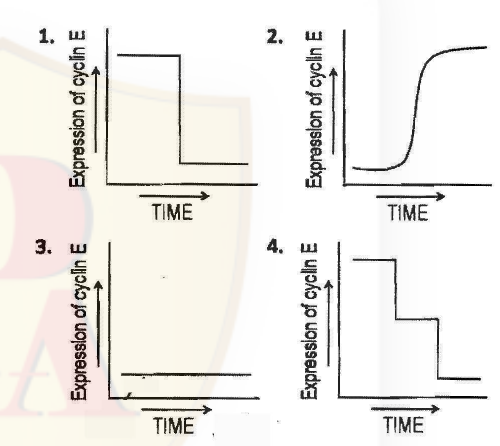

1. 1
2. 2
3. 3
4. 4

**Answer: 3 (3)**

> **Explanation:** Unphosphorylatable Rb permanently sequesters E2F, so the E2F-driven downstream cyclins — including cyclin E — are never transcribed. Cyclin E therefore stays flat at a low, basal level after mitotic stimulation, which is the profile drawn in graph 3.

---

### Question 82

A bacterial culture was in log phase in the following figure. At time x, an antibacterial compound was added to the culture.

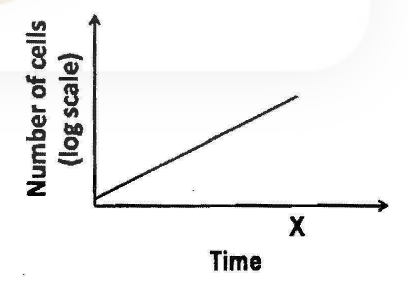

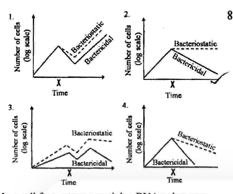

Which of the following lines in the growth curve represents the antibacterial activities of the compound?

1. (panel 1)
2. (panel 2)
3. (panel 3)
4. (panel 4)

**Answer: 2 (panel 2)**

> **Explanation:** A bacteriostatic agent halts growth so the log-scale count plateaus, while a bactericidal agent kills cells so the count declines. After point X the correct pair is therefore a flat (static) line together with a falling (cidal) line — the combination drawn in panel 2.

---

### Question 83

In a cell free extract containing DNA polymerase I, Mg²⁺, dATP, dGTP, dCTP and dTTP (³H), the following DNA molecules were added:

a. Single stranded closed circular DNA molecule containing 824 nucleotides.
b. Single stranded closed circular DNA molecule having 1578 nucleotides base paired with a linear single standard DNA molecule of 824 nucleotides having a free-3′-OH group.
c. Double stranded linear DNA molecule containing 1578 nucleotides having free-3′-OH group at both ends.
d. Double stranded closed circular DNA molecule having 824 nucleotides.

The rate of DNA synthesis was measured by incorporation of ³H thymidine in the DNA molecule and expressed as the percentage of DNA synthesis relative to total DNA input.

Which one of the following graphs represents the correct result?

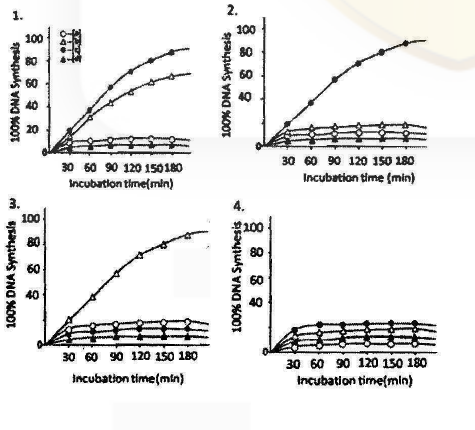

1. (panel 1)
2. (panel 2)
3. (panel 3)
4. (panel 4)

**Answer: 3 (panel 3)**

> **Explanation:** DNA polymerase I needs a primer with a free 3′-OH and a template. The nicked/primed single-stranded circular template (b) and the linear duplex with free 3′-OH ends (c) support synthesis; the pure single-stranded circle (a) and the intact closed circular duplex (d, no free ends/nicks) support little or none. The graph in which b and c rise strongly while a and d stay near baseline is panel 3.

---

### Question 84

The complex responses to different types of DNA damage in both prokaryotes and eukaryotes fall into three main categories:
(i) damage bypass
(ii) damage reversal
(iii) damage removal

Many repair proteins are isolated like
(a) DNA methyltransferase
(b) DNA glycosylase
(c) DNA polymerase IV

Which one of the following represents the correct combination?

1. (i) – (a), (ii) – (b), (iii) – (c)
2. (i) – (b), (ii) – (c), (iii) – (a)
3. (i) – (c), (ii) – (a), (iii) – (b)
4. (i) – (c), (ii) – (b), (iii) – (a)

**Answer: 3 ((i) – (c), (ii) – (a), (iii) – (b))**

> **Explanation:** DNA polymerase IV carries out translesion synthesis = damage *bypass* (i–c). DNA methyltransferase directly reverses alkylation damage = damage *reversal* (ii–a). DNA glycosylase initiates base-excision removal of damaged bases = damage *removal* (iii–b).

---

### Question 85

In recent years, genome-wide transcription study using high throughput sequence analysis has revealed some novel results that include:
(i) presence of RNA polymerase in both intra- and intergenic regions of the genome
(ii) existence of non-coding RNAs generated from mRNA coding genes.
(iii) existence of sense and antisense transcripts generated from the promoter and untranslated region of many annotated genes.

Possible interpretation of the above results are:
A. RNA polymerase can loosely bind to any part of the genome but its affinity becomes strong only when it reaches the promoter.
B. Binding of RNA polymerase to non-promoter regions of the genome leads to the generation of various non-coding regulatory RNAs.
C. Non-coding RNAs are generated from mRNA coding genes due to aberrant transcription initiation and termination.
D. Sense and antisense transcripts are generated from the promoter and untranslated regions of protein coding genes by a novel mechanism of bidirectional transcription.

Identify the correct combination of the above interpretations:

1. A and B
2. B and D
3. A and D
4. B and C

**Answer: 2 (B and D)**

> **Explanation:** The observed pervasive transcription is explained by RNA polymerase binding to non-promoter regions producing non-coding regulatory RNAs (B), and by bidirectional transcription from promoters/UTRs giving sense and antisense transcripts (D). Interpretations A and C invoke aberrant/loose binding that does not match the reported phenomena.

---

### Question 86

Aminoacyl tRNA synthetases face two important challenges:
i) they must recognize the correct set of tRNAs for a particular amino acid.
ii) they must charge all of these isoaccepting tRNAs with the correct amino acid.

Both of these processes are carried out with high fidelity by the following possible mechanisms:

A. The discrimination ability resides predominantly at the acceptor stem of the tRNAs.
B. The specificity is contributed by the anticodon loop in tRNAs.
C. The specificity is embedded in the amino acyl synthetase at the 'N' terminus
D. The specificity is contributed by the variable loop of the tRNA.

Which of the following is correct?

1. A and B
2. A and C
3. B and C
4. A and D

**Answer: 1 (A and B)**

> **Explanation:** Synthetases read identity determinants located mainly in the tRNA acceptor stem (A) and the anticodon loop (B); these two elements together give both discrimination among tRNAs and correct charging of isoaccepting species.

---

### Question 87

During heat shock, mammalian cells shut down global protein synthesis while inducing heat shock proteins (Hsps). The possible molecular regulation(s) that could explain the phenomenon are:

A. mRNA of all proteins, except those of Hsps, undergoes degradation during heat shock.
B. Cap-dependent translation of most mRNAs is affected during heat shock due to denaturation of cap binding protein, eIF-4E.
C. Translation initiation of Hsp mRNAs takes place through their internal ribosome entry sites (IRES)
D. Hsp mRNAs are abundant during heat shock and thus they compete out other mRNAs for ribosome binding and translation.

Which of the following sets is correct?

1. A and D
2. B and C
3. C and D
4. A and D

**Answer: 2 (B and C)**

> **Explanation:** Heat shock blocks cap-dependent translation (the cap-binding machinery/eIF-4E is compromised), shutting down most cellular mRNAs (B), while Hsp mRNAs are translated by a cap-independent mechanism using IRES elements (C). Global mRNA degradation (A) and simple competition (D) are not the explanation.

---

### Question 88

Bacteriophage λ is a temperate bacteriophage and has two modes in its life cycle, lysogenic and lytic. Several genes are involved in these two processes like *N*, *cI*, *cII*, *cIII*, *Q*, *int*, *xis*, etc.

Which one of the following diagrams represents the control mechanism correctly?

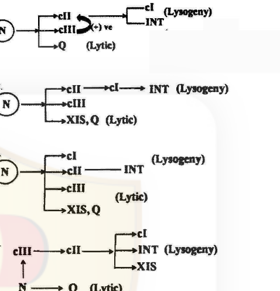

1. (diagram 1)
2. (diagram 2)
3. (diagram 3)
4. (diagram 4)

**Answer: 1 (diagram 1)**

> **Explanation:** In λ the N and Q antiterminators drive the lytic cascade, cII/cIII promote establishment of lysogeny (activating cI), and cI maintains lysogeny while INT mediates integration. The network that correctly wires N→(lytic via Q) and cII/cIII→cI→INT(lysogeny) is diagram 1.

---

### Question 89

Clearance of phagocytosed intracellular parasite like *Leishmania* requires the involvement of reactive oxygen species (ROS) and reactive nitrogen species (RNS). Administration of IFN-γ to macrophages harbouring an intracellular pathogen leads to the production of ROS and RNS by JAK/STAT pathway. A macrophage cell line J774 infected with *Leishmania* is given the following treatments.

A. IFN-γ.
B. IFN-γ + AMT, a potent iNOS inhibitor.
C. IFN-γ + apocyanin, a NADPH oxidase inhibitor.
D. IFN-γ + NMMA (N-monomethyl arginine), an arginine analogue.

What will be the most appropriate graph showing the survival of parasites after these treatments?

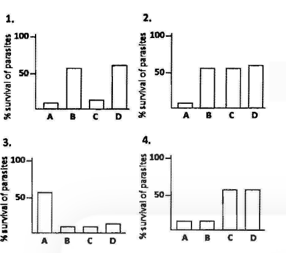

1. (panel 1)
2. (panel 2)
3. (panel 3)
4. (panel 4)

**Answer: 2 (panel 2)**

> **Explanation:** IFN-γ alone (A) activates both the ROS and the RNS arm, so parasite survival is lowest. Blocking iNOS (B, AMT) or adding the arginine analogue (D, NMMA) removes the RNS arm, and blocking NADPH oxidase (C, apocyanin) removes the ROS arm; each single block raises survival, but killing is not completely lost because the other arm still operates. The profile with A low and B, C, D elevated is panel 2.

---

### Question 90

A ligand recognizes two different cell surface receptors, A and B, on the same cell type. Receptor A, after binding with the ligand is internalized along with the ligand whereas receptor B, after binding with the ligand, initiates tyrosine kinase activity of the intracellular domain. One particular disease is associated with the loss of receptor-mediated signal transduction of the ligand. Different observers inferred that the disease may be resulted due to

A. loss of binding affinity of receptor A due to mutation in the extracellular domain.
B. loss of binding affinity of receptor B due to mutation in the extracellular domain.
C. mutation in the tyrosine kinase domain rendering it inactive.
D. mutation in the intracellular domain rendering it incapable of endocytosis.

Which combination of the above inferences do you think is appropriate for the cause of the disease?

1. A and B
2. B and C
3. C and D
4. A and D

**Answer: 2 (B and C)**

> **Explanation:** Signal transduction here is carried by receptor B's tyrosine-kinase domain. Loss of that signal is explained by either failing to bind ligand through B (B) or by an inactive kinase domain (C). Receptor A's endocytosis (A, D) is not the signalling route.

---

### Question 91

Vascular endothelial (VE)-cadherin is an important cell adhesion molecule for endothelial cells. Endothelial cells that are unable to express VE-cadherin still can adhere to one another via N-cadherin (neural cadherin), but these cells do not survive. Which of the following is the most appropriate reason for this?

1. N-cadherin uses VE-cadherin as coreceptor for adhesion.
2. VE-cadherin acts as coreceptor for VEGF (vascular endothelial growth factor) – mediated signal transduction in endothelial cells.
3. VE-cadherin is important for desmosome formation and interaction of intermediate filaments.
4. Loss of VE-cadherin impairs Ca²⁺- homeostasis of vascular endothelial cells leading to their death.

**Answer: 2 (VE-cadherin acts as coreceptor for VEGF (vascular endothelial growth factor) – mediated signal transduction in endothelial cells.)**

> **Explanation:** Adhesion is rescued by N-cadherin, but survival signalling is not: VE-cadherin acts as a co-receptor for VEGF-receptor signalling in endothelial cells, so without it the cells adhere yet fail to receive the survival signal and die.

---

### Question 92

An important role of Fas and Fas ligand is to mediate elimination of tumor cells by killer lymphocytes. In a study of 35 primary lung and colon tumors, half the tumors were found to have amplified and overexpressed a gene for a "secreted protein" that binds to Fas ligand. The main reason for survival of these tumor cells by this "secreted Fas- ligand binding protein" may be attributed to its

1. decoy receptor activity.
2. anti-proliferative activity.
3. cellular defense activity against immuno-cytotoxic killing.
4. anti-contact inhibition activity.

**Answer: 1 (decoy receptor activity.)**

> **Explanation:** A secreted protein that binds Fas ligand acts as a decoy receptor, soaking up FasL before it can engage Fas on the tumour cell, thereby blocking Fas/FasL-mediated killing and allowing the tumour to survive.

---

### Question 93

A BALB/c mouse was thymectomized on the first day after birth (mouse 1) whereas another was thymectomized on day 7 after birth (mouse 2). A third mouse underwent the same operation on day 21 after birth. After 56 days, sera were prepared from these mice and also from control mice, which had sham operation. The sera were checked for anti-DNA antibodies. Which one of the following observations is the most plausible?

1. Both mouse 1 and mouse 2 had anti-DNA antibodies but mouse 3 did not have anti-DNA antibodies.
2. Only mouse 1 had anti-DNA antibodies.
3. Only mouse 3 had anti-DNA antibodies.
4. Only the control mice had anti-DNA antibodies.

**Answer: 2 (Only mouse 1 had anti-DNA antibodies.)**

> **Explanation:** Thymectomy on day 1 removes the thymus before any T cells have emigrated, so central self-tolerance is never established and anti-DNA autoantibodies develop (mouse 1). By day 7 (and certainly by day 21) a sufficient wave of thymocytes — including regulatory T cells — has already been exported, so mice 2 and 3 retain tolerance and do not make the antibodies. Only mouse 1 is affected.

---

### Question 94

A potentially valuable therapeutic approach for killing tumour cells without affecting normal cells is the use of immunotoxins. Immunotoxins consist of particular cell-specific monoclonal antibodies coupled to lethal toxins. Which of the following molecular approaches is NOT appropriate for killing tumor-cells?

1. Cell surface receptor binding polypeptide chain of toxin molecules should be replaced by monoclonal antibodies which are specific for a particular tumor cell.
2. Constant region Fc domain of tumor cell-specific monoclonal antibody should be replaced by toxin molecules.
3. Variable region F(ab) domain of tumor cell-specific monoclonal antibody should be replaced by toxin molecules.
4. Inhibitor polypeptide chain of toxin molecules should be conjugated to the F(ab) domain of tumor-specific monoclonal antibody.

**Answer: 3 (Variable region F(ab) domain of tumor cell-specific monoclonal antibody should be replaced by toxin molecules.)**

> **Explanation:** The F(ab)/variable region is what provides tumour specificity; replacing it with toxin destroys targeting. The correct designs keep the variable region for recognition and attach the toxin via the constant/Fc side, so option 3 is the inappropriate approach.

---

### Question 95

A set of experiments that were carried out to demonstrate the effect of Apical Ectodermal Ridge (AER) of the chick limb bud on the underlying mesenchyme are enlisted below, along with their expected outcomes:

A. Removal of the AER of forelimb leads to cessation of limb development.
B. If an extra AER is placed in the forelimb bud, duplication of the distal region of the wing takes place.
C. If an extra AER is placed in the forelimb bud, a leg develops instead of a wing.
D. If AER of forelimb bud is replaced with beads soaked in FGF2, a normal wing develops.
E. If a nonlimb mesenchyme is placed below an AER, the AER directs the mesenchyme to form a normal wing.

Which of the above statements are correct?

1. A, C and E
2. C, D and E
3. B, D and E
4. A, B and D

**Answer: 4 (A, B and D)**

> **Explanation:** The AER maintains the progress zone and drives distal outgrowth: removing it halts development (A), an extra AER duplicates distal structures (B), and FGF2 beads substitute for the AER's signal (D). An AER does not respecify forelimb→hindlimb (C is wrong) and cannot convert non-limb mesenchyme into a wing (E is wrong).

---

### Question 96

Hensen's node is established as the avian equivalent of the amphibian dorsal blastopore lip. The following observations are presumed to be in support of the same.

A. It is the region whose cells can both induce and pattern a second embryonic axis when transplanted into other locations of the gastrula.
B. It is equivalent in terms of tissue structure.
C. It expresses the same marker genes as the Spemann's organizer in amphibians.
D. The same micro RNA can interfere with the formation of pre-chordal plate in both Hensen's node and Spemann's organizer.

Choose the correct set among the following:

1. A and D
2. A and C
3. B and C
4. A and B

**Answer: 2 (A and C)**

> **Explanation:** Functional equivalence to the Spemann organizer is established by the ability to induce and pattern a second axis when transplanted (A) and by sharing organizer marker genes (C). Mere tissue similarity (B) or a shared miRNA effect (D) is not the defining evidence.

---

### Question 97

In amphibians, when due to some injury, the eye lens is damaged, the fully differentiated iris cells can regenerate the lens. It is achieved through the following possible processes:

A. Iris cells through some signaling undergo dedifferentiation and transdifferentiation into lens cells to regenerate the lens.
B. Iris cells transform into lens cells spontaneously.
C. Iris cells induce in a stepwise manner, specific genes responsible for their dedifferentiation and then conversion to lens cells.
D. Stem cells present in iris tissue differentiate into lens cells.

Which of the following is correct?

1. A and B
2. A and C
3. B and D
4. B and C

**Answer: 2 (A and C)**

> **Explanation:** Newt lens regeneration proceeds by differentiated iris cells dedifferentiating and then transdifferentiating into lens cells (A), a stepwise process driven by sequential gene activation (C). It is neither spontaneous (B) nor dependent on resident stem cells (D).

---

### Question 98

The control of flowering is a complex process involving several key regulatory genes. Some statements on flower development are given below:

A. Two major types of genes regulate floral development: meristem identity genes and floral organ identity genes.
B. The important genes in *Arabidopsis* that play key regulatory roles in meristem identity are: *APETALA1*, *LEAFY* and *SUPPRESSOR OF CONSTANS1*.
C. The genes that determine floral organ identity were discovered as floral homeotic mutants.
D. Most plant homeotic genes belong to a class of related sequences known as FAD box genes.

Which one of the following combinations of the above statements is correct?

1. A, B and C
2. B, C and D
3. A, C and D
4. A, B and D

**Answer: 1 (A, B and C)**

> **Explanation:** A, B and C are all correct descriptions of flowering/flower-development genetics. D is wrong: plant homeotic genes are MADS-box genes, not "FAD box" genes.

---

### Question 99

A few statements on early developmental stages in plants are given below:

A. The cells of flower are diploid in nature.
B. Only some specialized cells in the reproductive organs undergo meiosis to produce haploid cells.
C. The haploid cells produced in (B) above, undergo a few normal mitotic cell divisions.
D. All the progeny cells produced in (C) above, differentiate either into haploid egg cells or into haploid sperm cells.

Which one of the following combinations of the above statements is correct?

1. A, B and C
2. B, C and D
3. A, C and D
4. A, B and D

**Answer: 1 (A, B and C)**

> **Explanation:** The flower is sporophytic/diploid (A); specialised sporogenous cells undergo meiosis to make haploid spores (B); those haploid cells divide mitotically to build the gametophyte (C). D is wrong because the mitotic progeny do not all become gametes — the gametophyte includes sterile/accessory cells as well as the egg/sperm.

---

### Question 100

Cells from an early frog blastula were removed from the animal pole and used to replace cells from the vegetal pole of the blastula. The following events may be expected.

A. Transplanted cells would develop normally as part of the cells of the vegetal pole.
B. Transplanted cells would develop as cells of the animal pole of the adult on the vegetal pole.
C. Region of the animal pole from where the cells were removed would be missing in the adult.
D. Remaining cells in the animal pole would compensate for the cells that were removed.

Which of the following are true?

1. B, C and D
2. A, B and D
3. A, B and C
4. A, C and D

**Answer: 2 (A, B and D)**

> **Explanation:** At the early blastula stage the animal- and vegetal-pole cells are still largely uncommitted and the embryo is regulative. Transplanted animal-pole cells therefore develop as part of the vegetal pole (A), and the remaining animal-pole cells regulate to compensate for the cells removed (D). Statement B — that the transplanted cells would develop as animal-pole cells of the adult at the vegetal position — is the classical fate-map expectation, and the key includes it in the accepted set A, B and D. C is false because the missing region is restored by regulation, not left absent.

---

### Question 101

Capacitation of mammalian sperms allows them to be activated within the uterus and facilitate fertilization. The following statements were made regarding events occurring during capacitation:

A. Removal of cholesterol from sperm head.
B. Removal of non-covalently bound glycoproteins.
C. Increased expression of fibronectin.
D. Decreased permeability of calcium ions.

Identify the correct statements:

1. B, C and D
2. A, B and D
3. A, B and C
4. A, C and D

**Answer: 3 (A, B and C)**

> **Explanation:** Capacitation strips the seminal cholesterol and non-covalently bound glycoproteins that coat the sperm head (A, B), and it involves expression/remodelling of surface components such as fibronectin receptors (C) as the membrane is destabilised in preparation for the acrosome reaction. Statement D is the one the key rejects: capacitation *increases*, not decreases, Ca²⁺ permeability.

---

### Question 102

Asada-Halliwell pathway protects plants against oxidative stress during unfavorable environmental growth regimes. The following are some statements related to the stress-tolerance mechanism through this pathway in plants.

A. Oxygen accepts electrons as an alternative electron acceptor.
B. Hydrogen peroxide is reduced by catalase to form water.
C. Ascorbate is oxidized and regenerated.
D. Glutathione is oxidized and reduced.

Which one of the following combinations of the above statements is true?

1. B, C and D
2. A, B and C
3. A, B and D
4. A, C and D

**Answer: 4 (A, C and D)**

> **Explanation:** The Asada–Halliwell (water–water) cycle reduces photo-reducing O₂ to water via ascorbate peroxidase: O₂ accepts electrons (A), ascorbate is oxidised and regenerated (C), and glutathione is oxidised/reduced to keep ascorbate reduced (D). Catalase (B) is a separate H₂O₂-scavenging enzyme, not the Asada–Halliwell reaction proper.

---

### Question 103

The following are certain facts regarding biological nitrogen fixation in plants:

A. Oxygen irreversibly inactivates nitrogenase enzyme involved in nitrogen fixation.
B. The *nod* genes that code for nodulation proteins are activated by NodD
C. The two components of nitrogenase enzyme complex, the Fe protein and MoFe protein, can show catalytic activity independently.
D. During the reaction catalyzed by nitrogenase enzyme, the Fe protein reduces the MoFe protein while the MoFe protein reduces N₂.

Which one of the following combination of the above statements is correct?

1. A, B and C
2. B, C and D
3. A, C and D
4. A, B and D

**Answer: 4 (A, B and D)**

> **Explanation:** Nitrogenase is O₂-sensitive (A); *nod* genes are switched on by NodD (B); and in the working enzyme the Fe protein (ATP-driven electron donor) reduces the MoFe protein, which reduces N₂ (D). C is false — the two components must associate; neither is active alone.

---

### Question 104

Secondary metabolites are diverse array of organic compounds in plants. The following are certain statements about secondary metabolites:

A. They protect plants against being eaten by herbivores and against being infected by microbial pathogens.
B. Terpenes, the largest class of secondary metabolites are synthesized by methylerythritol phosphate (MEP) pathway and shikimic acid pathway.
C. The most abundant classes of phenolic compounds in plants are derived from phenylalanine.
D. Alkaloids are nitrogen containing secondary metabolites in plants.

Which one of the following combinations of the above statements is correct?

1. A, B and C
2. B, C and D
3. A, C and D
4. A, B and D

**Answer: 3 (A, C and D)**

> **Explanation:** A, C and D are correct: secondary metabolites defend against herbivores/pathogens, phenolics derive from phenylalanine (phenylpropanoid pathway), and alkaloids are N-containing. B is wrong — terpenes are made by the MEP and mevalonate (not shikimate) pathways.

---

### Question 105

The following are some statements about long distance translocation of photoassimilates in higher plants:

A. Sugars are translocated in the phloem by mass transfer along a hydrostatic pressure.
B. Gibberellic acid stimulates the unloading of sugars from phloem tissue into apoplasts.
C. Munch pressure-flow hypothesis is crucial to drive translocation in the phloem.
D. Allocation and partition of carbon within a source leaf determine the phloem loading phenomenon.

Which one of the following combinations of the above statements is true?

1. A, B and D
2. A, B and C
3. A, C and D
4. B, C and D

**Answer: 3 (A, C and D)**

> **Explanation:** Phloem transport is bulk mass flow driven by a pressure (hydrostatic) gradient per the Münch pressure-flow hypothesis (A, C), and source-leaf carbon allocation governs loading (D). GA-stimulated unloading into the apoplast (B) is not a general feature of translocation.

---

### Question 106

Directional growth of plants induced by light is called phototropism. Some statements on phototropism are given below:

A. Phototropism is a photomorphogenetic response.
B. *PHOT1* and *PHOT2* genes mediate phototropism.
C. *CRY1* and *CRY2* genes although help to perceive blue light are not involved in phototropism.
D. Perception of blue light by phyA photoreceptor initiates phototropism.

Which one of the following combination of the above statements is correct?

1. A, B. and C
2. B, C and D
3. A, C and D
4. A, B and D

**Answer: 1 (A, B. and C)**

> **Explanation:** Phototropism is a blue-light growth (photomorphogenetic) response mediated by the phototropins PHOT1/PHOT2 (A, B); the cryptochromes CRY1/CRY2 perceive blue light for other responses and are not the phototropism receptors (C). Phytochrome A (D) is a red/far-red receptor, not the phototropism blue-light receptor.

---

### Question 107

Plants make several hormones that are important for growth and development. Some statements on plant hormones are given below:

A. Auxin is produced primarily in the root apices
B. Cytokinins are a smaller group of related compounds.
C. Gibberellins are a large group of related compounds defined not by their biological functions but by their structures.
D. Brassinosteroids are an important class of plant hormones, which control a broad spectrum of developmental reposes including pollen tube growth.

Which one of the following combination of the above statements is correct?

1. A, B and C
2. B, C and D
3. A, C and D
4. A, B and D

**Answer: 2 (B, C and D)**

> **Explanation:** Gibberellins form a very large family defined by structure rather than function (C), and brassinosteroids control a broad spectrum of developmental responses including pollen-tube growth (D); the key also accepts statement A. The statement the key rejects is B: cytokinins are not "a smaller group" but a large family of related adenine-derived compounds.

---

### Question 108

An action potential was generated on a nerve fiber by a threshold electrical stimulus. When a second stimulus was applied, no matter how strong it was, during the absolute refractory period of the action potential, the nerve fibre was unable to generate second action potential. This observation was explained in the following statements:

A. A large fraction of potassium channels was voltage inactivated.
B. The critical number of sodium channels required to produce an action potential could not be recruited.
C. A large fraction of sodium channels was voltage inactivated.
D. The critical number of potassium channels required to produce an action potential could not be recruited.

Which one of the following is true?

1. Only A
2. A and B
3. Only C
4. C and D

**Answer: 4 (C and D)**

> **Explanation:** During the absolute refractory period the voltage-gated Na⁺ channels are in the voltage-inactivated state (C) — their inactivation gates are closed — so the critical number of channels needed to reach threshold cannot be recruited and no second spike can be fired however strong the stimulus. The key's accepted set is C and D; note that statement D as printed attributes the refractory period to potassium channels, which is the contested wording in this item (see `sources.md`).

---

### Question 109

Water and electrolytes like Na⁺ and Cl⁻ are lost from the body in diarrhoea. Oral administration of NaCl solution in this condition does not improve the situation. When glucose is administered with normal NaCl solution through oral route, the absorption of electrolytes along with water occurs and the patient recovers.

A. Glucose enhances ATP production in the mucosal cells of small intestine and thus facilitates sodium absorption.
B. Glucose inhibits the diarrheal toxin induced cAMP production in the mucosal cells of small intestine.
C. Na⁺ is co-transported with glucose on the apical surface of the mucosal cells of small intestine.
D. The epithelial sodium channels (ENaC) are activated by glucose in colon.

Which one of the following is true?

1. Only A
2. A and B
3. Only C
4. C and D

**Answer: 3 (Only C)**

> **Explanation:** Oral rehydration works because Na⁺ and glucose are co-transported by SGLT1 on the apical membrane of small-intestinal enterocytes; glucose absorption drags Na⁺ (and hence water) into the cell even when a toxin-driven cAMP/Cl⁻ secretion continues. The other mechanisms are not the basis of ORS.

---

### Question 110

A patient has episodes of painful spontaneous muscles contraction, followed by periods of paralysis of the affected muscles. It was identified as primary hyperkalemic paralysis, an inherited disorder. The possible causes of the paralysis are -

A. The elevation of extracellular K⁺ causes hyperpolarization of skeletal muscle cells.
B. The hyperpolarization of the muscle cell membrane inactivates sodium channels.
C. The elevation of extracellular K⁺ causes depolarization of skeletal muscle cells.
D. The sodium channels are voltage inactivated in depolarized state

Which one of the following is true?

1. Only A
2. A and B
3. Only C
4. C and D

**Answer: 4 (C and D)**

> **Explanation:** Raised extracellular K⁺ depolarises skeletal-muscle cells (C); sustained depolarisation holds the voltage-gated Na⁺ channels in their inactivated state (D), so fibres become inexcitable → paralysis. Hyperpolarisation (A, B) is the opposite of what high K⁺ does.

---

### Question 111

Myoglobin (Mb) in muscles, Hemoglobin A (HbA) in adult RBC, Hemoglobin C (HbC) in patients with thinner RBC and Hemoglobin S (HbS) in sickle cell disease are four different hemoproteins. Oxygen saturation kinetics of these four proteins is different. Which of the following profile is most plausible?

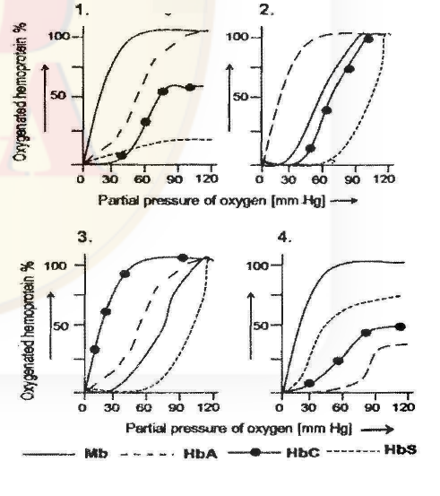

1. (panel 1)
2. (panel 2)
3. (panel 3)
4. (panel 4)

**Answer: 1 (panel 1)**

> **Explanation:** Myoglobin has a hyperbolic, left-shifted curve (highest affinity, no cooperativity); the haemoglobins show sigmoidal curves. Normal HbA sits to the right of Mb; HbS has reduced affinity (further right). The panel showing Mb hyperbolic/leftmost with the haemoglobins progressively right-shifted is the most plausible.

---

### Question 112

Maintaining the salt concentration and volume of plasma are two key parameters for physiological processes achieved by kidney. Which of the following structural and functional combines is the most efficient renal regulatory system in mammals?

| Combination No. | Structural | Functional |
|---|---|---|
| 1 | Large glomerulus, long proximal and distal tubules, long Henle's loop | Transepithelial potential in proximal tubule, countercurrent multiplier, ADH responsiveness of distal tubule |
| 2 | Small glomerulus, short proximal and distal tubule short Henle's loop | Transepithelial potential in distal tubule, very high ADH concentration in circulation |
| 3 | Very large glomerulus, short proximal tubule, very long distal tubule, long Henle's loop | Very efficient glomerular filtration, prevention of solute loss |
| 4 | Small glomerulus, long proximal and distal tubules, Henle's loop | Preventing water and solute filtration, excreting solute, lowering ADH responsiveness |

1. 1
2. 2
3. 3
4. 4

**Answer: 1 (1)**

> **Explanation:** Efficient concentration of urine and salt/volume regulation requires a long loop of Henle (for the countercurrent multiplier), appropriate tubule lengths and ADH-responsive distal segments — the combination in row 1. Short loops (row 2) cannot build a medullary gradient.

---

### Question 113

Which one of the following graphs best represents the hormone profile in a rat right after mating?

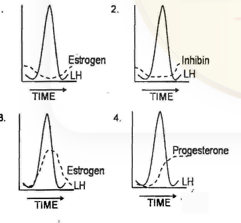

1. (panel 1)
2. (panel 2)
3. (panel 3)
4. (panel 4)

**Answer: 3 (panel 3)**

> **Explanation:** Mating triggers a neural-reflex LH surge that induces ovulation; the ruptured follicle luteinises and progesterone rises sharply and stays elevated thereafter. The correct profile is therefore the one showing the LH peak together with the sustained post-mating progesterone rise — panel 3.

---

### Question 114

Which of the following representations of chromosomal arrangement in meiotic metaphase I best explains the Law of Independent Assortment?

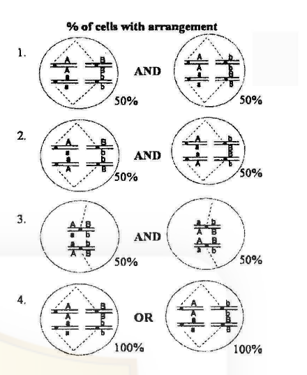

1. (panel 1)
2. (panel 2)
3. (panel 3)
4. (panel 4)

**Answer: 1 (panel 1)**

> **Explanation:** Independent assortment requires that the orientation of one bivalent (A/a) is independent of the other (B/b), each arrangement occurring with equal (50%) frequency. Panel 1 shows the two non-sister configurations of the Aa and Bb bivalents each at 50% joined by "AND", the correct depiction of independent alignment.

---

### Question 115

Which of the following statements are true for Robertsonian translocations?

A. The size of the homologous chromosome involved in translocation will differ
B. Genes on the chromosome involved in translocation will show linkage with genes with which it normally independently assort.
C. There will be change in the physical map, but no change in the genetic map.
D. It can be identified by G-banding of chromosomes.
E. It can be identified by C-banding of chromosomes.
F. It can lead to Down syndrome

Which one of the following combinations is correct?

1. A, C and D
2. A, D and F
3. A, B, D and F
4. A, C, E and F

**Answer: 3 (A, B, D and F)**

> **Explanation:** Robertsonian fusion joins two acrocentrics, so the resulting chromosome differs in size from its homologues (A) and brings previously unlinked genes onto one chromosome (B); it is detectable by G-banding (D) and, in the familiar 21;14 case, causes familial Down syndrome (F).

---

### Question 116

Ames test is used to evaluate mutagens in the environment. Which of the following statements about Ames test are true?

A. The mutagenic effect of a compound is tested using an auxotrophic strain of *Salmonella typhimurium*
B. The mutagenic effect of a compound is tested using *His⁻* strain of *Escherichia coli*.
C. Using appropriate strains, compounds causing base substitutions and frame shift mutations can be distinguished.
D. Liver enzymes are important as they are activated by test compound to evaluate its mutagenicity potential.
E. Many compounds may have to be converted to bioactive metabolites, which is carried out by the enzymes from the liver.

1. A, C and D
2. A, B and D
3. A, C and E
4. A and E only

**Answer: 3 (A, C and E)**

> **Explanation:** The Ames test uses histidine-auxotroph (*his⁻*) strains of *Salmonella typhimurium* (A); different strains report base-substitution vs frameshift mutagens (C); and a liver S9 microsome mix is added to activate promutagens to their mutagenic metabolites (E). It is not the *E. coli* His⁻ test (B), and D mis-states the role of liver enzymes.

---

### Question 117

The genetic map of three genes in *Drosophila melanogaster* is given below:

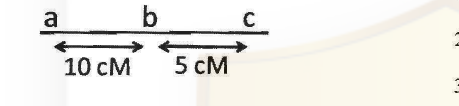

A cross, as given below is made between individuals of the genotype:

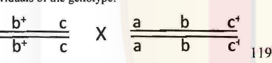

The female F₁ progeny are test-crossed and 1000 progeny are obtained. Assuming that there has been no double crossover, what is the expected number of progeny with the genotypes:

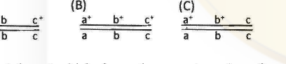

Select the set which shows the correct number of expected progeny.

| Set | (A) | (B) | (C) |
|---|---|---|---|
| 1. | 100 | 50 | 850 |
| 2. | 50 | 25 | 425 |
| 3. | 100 | 850 | 50 |
| 4. | 0 | 425 | 75 |

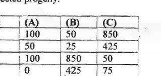

1. 1
2. 2
3. 3
4. 4

**Answer: 2 (2)**

> **Explanation:** The cross a⁺b⁺c/a⁺b⁺c × abc⁺/abc⁺ gives F₁ females a⁺b⁺c / abc⁺, which are test-crossed. With no double crossovers, the a–b interval (10 cM) yields 10% recombinants split equally between the two reciprocal classes (5% = 50 each), and the b–c interval (5 cM) yields 5% recombinants, i.e. 2.5% = 25 per class. The two parental classes share the remaining 90%, i.e. 45% ≈ 425–450 each. Reading the three requested genotypes as one class each, the numbers 50, 25 and 425 (set 2) match: a single a–b recombinant class, a single b–c recombinant class, and one parental class.

---

### Question 118

The following pedigree shows the inheritance pattern of a rare recessive disorder with complete penetrance.

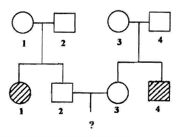

A child from marriage between individuals II-2 & II-3 will show the disorder only if the parents carry the recessive allele. What is the probability that the child will show the disorder?

1. 1/9, and the probability of the parents to carry the recessive allele is 2/3.
2. 1/4, and the probability of the parents to carry the recessive allele is 3/4.
3. 1/16, and the probability of the parents to carry the recessive allele is 2/3.
4. 1/64, and the probability of the parents to carry the recessive allele is 3/4.

**Answer: 1 (1/9, and the probability of the parents to carry the recessive allele is 2/3.)**

> **Explanation:** II-2 and II-3 are unaffected siblings of affected individuals born to unaffected (hence obligate-carrier) parents, so each came from an Aa × Aa mating. Being unaffected, each has probability 2/3 of being a carrier (Aa). The child is affected only if both parents are carriers and both transmit *a*: (2/3) × (2/3) × (1/4) = 4/36 = **1/9**.

---

### Question 119

DNA from a strain of bacteria with genotype *a⁺ b⁺ c⁺ d⁺ e⁺* was isolated and used to transform a strain of bacteria that was *a⁻ b⁻ c⁻ d⁻ e⁻*. The transformed cells were tested for the presence of donated genes. The following genes are found to be co-transformed
i. *a⁺* and *d⁺*
ii. *b⁺* and *e⁺*
iii. *c⁺* and *d⁺*
iv. *c⁺* and *e⁺*

The order of genes on the bacterial chromosome is

1. a – b – c – d – e
2. a – d – c – e – b
3. a – c – d – e – b
4. a – d – b – e – c

**Answer: 2 (a – d – c – e – b)**

> **Explanation:** Co-transformation frequency reflects physical proximity. The linked pairs a–d, c–d, c–e and b–e chain together as a–d–c–e–b, which is the only option consistent with all four observed co-transformations.

---

### Question 120

Coelomates have
A. fluid filled body cavity.
B. a complete lining called peritoneum, derived from mesoderm covering the body cavity.
C. a complete lining called peritoneum, derived from ectoderm covering the body cavity.
D. Round worm as representative of this group.
E. Flat worm as representative of this group.

Select the correct combination

1. A, C and D
2. A, C and E
3. A, B and D
4. A and B

**Answer: 4 (A and B)**

> **Explanation:** A true coelom is a fluid-filled cavity (A) completely lined by mesoderm-derived peritoneum (B). The peritoneum is not ectodermal (C), and roundworms (pseudocoelomates) and flatworms (acoelomates) are not coelomates (D, E wrong).

---

### Question 121

Most biologists agree that seaweeds are protists. Some biologists think that at least some seaweeds should be considered plants, not protists. Which of the following would support the latter one?

1. Certain seaweeds contain several kinds of specialised cells.
2. Certain seaweeds have multicellular organization.
3. Certain seaweeds are found to be prokaryotic.
4. Certain seaweeds undergo sexual and asexual reproduction.

**Answer: 2 (Certain seaweeds have multicellular organization.)**

> **Explanation:** Multicellular organisation is the plant-defining trait among the options and is the evidence the key accepts for reclassifying these seaweeds as plants rather than protists. Sexual and asexual reproduction (option 4) is shared with many protists and so does not distinguish them, and seaweeds are eukaryotic, so option 3 is simply false.

---

### Question 122

Which of following shows the correct systematic hierarchy?

1. Kingdom → Phylum → Subphylum → Superclass → Class → Subclass → Cohort→Order → Suborder→ Super family→ Family → Subfamily → Genus → Subgenus → Species → Subspecies
2. Kingdom → Phylum → Subphylum → Cohort → Superclass → Class → Subclass→ Superfamily→ Family → Subfamily → Order → Suborder → Genus → Subgenus →Species → Subspecies
3. Kingdom → Phylum → Class → Order → Cohort → Family → Genus → Species
4. Kingdom → Phylum → Class → Cohort→ Family → Order → Genus → Species

**Answer: 1 (Kingdom → Phylum → Subphylum → Superclass → Class → Subclass → Cohort → Order → Suborder → Superfamily → Family → Subfamily → Genus → Subgenus → Species → Subspecies)**

> **Explanation:** Option 1 lists the ranks in the correct descending order with the intermediate categories (subphylum, super/subclass, cohort, super/subfamily, subgenus) nested properly. The other options misplace cohort, order and superfamily.

---

### Question 123

Match the following:

| | Disease | | Pathogen/Causative factor |
|---|---|---|---|
| A | Creutzfeldt–Jakob | (i) | Fungi |
| B | Pneumocystis | (ii) | Virus |
| C | Legionnaires diseases | (iii) | Prion |
| D | Rabies | (iv) | Bacteria |

1. A –iv. B – iii, C – ii, D – i
2. A – iii, B – i, C – iv, D – ii
3. A – i, B – ii, C – iii, D – iv
4. A – ii, B – iv, C – i, D – iii

**Answer: 2 (A – iii, B – i, C – iv, D – ii)**

> **Explanation:** Creutzfeldt–Jakob is a prion disease (A–iii); *Pneumocystis* is a fungus (B–i); Legionnaires' disease is bacterial (*Legionella*, C–iv); rabies is viral (D–ii).

---

### Question 124

In the following diagram, two models of succession are represented. In this diagram A, B, C and D are species and arrows indicate 'is replaced by'

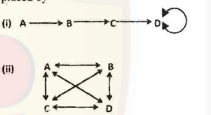

Based on the above, which statement is correct?

1. Fig.(i) represents facilitation model and Fig.(ii) represents tolerance model
2. Fig.(i) represents tolerance model and Fig. (ii) represents facilitation model
3. Fig.(i) represents facilitation model and Fig.(ii) represents inhibition model
4. Fig.(i) represents tolerance model and Fig.(ii) represents inhibition model

**Answer: 3 (Fig.(i) represents facilitation model and Fig.(ii) represents inhibition model)**

> **Explanation:** Fig. (i) is the strict one-way chain A→B→C→D in which each species modifies the environment and prepares it for the next — Connell and Slatyer's facilitation model. Fig. (ii) shows every species able to act on every other through the crossing bidirectional arrows, the signature of the inhibition model, in which no species necessarily prepares the way and established species resist replacement.

---

### Question 125

Lindeman's efficiency between trophic levels is depicted by the formula:

Efficiency = A / B

Where, A and B, respectively are:

1. 'assimilation at trophic level n' and 'assimilation at trophic level n − 1'
2. 'intake at trophic level n' and 'assimilation at trophic level n − 1'
3. 'assimilation at trophic level n' and 'net productivity at trophic level n − 1'
4. 'intake at trophic level n' and 'net productivity at trophic level n − 1'

**Answer: 1 ('assimilation at trophic level n' and 'assimilation at trophic level n − 1')**

> **Explanation:** Lindeman's (trophic-level) efficiency is the ratio of assimilation at one trophic level to assimilation at the preceding level, A/B = assimilation(n)/assimilation(n − 1).

---

### Question 126

The following matrix shows the relationship between probability of death and duration of species association.

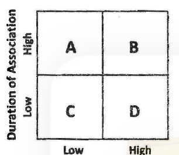

In the above, A, B, C and D are:

1. A – Parasites, B = Parasitoids, C – Grazers, D - Predators
2. A – Carnivores, B = Herbivores, C – Parasites, D - Parasitoids
3. A – Grazers, B = Parasites. C – Herbivores, D - Parasitoids
4. A – Predators, B = Parasitoids, C – Parasites, D - Carnivores

**Answer: 1 (A – Parasites, B = Parasitoids, C – Grazers, D - Predators)**

> **Explanation:** Parasites have long association and low per-encounter host death (A, high duration/low death); parasitoids end in certain host death but a shorter association (B, high death); grazers have brief contact and low mortality (C); predators kill quickly (D, low duration/high death). This matches option 1.

---

### Question 127

An observation was made on a species experiencing three factors A, B and C in order to infer a density dependent population regulation by a factor. The following graph shows the relationship between the adverse effect of the factors in terms of number and population density.

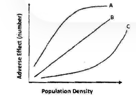

Based on the above observation. which of the following is correct?

1. A – Density independent; B = Density dependent; C – Inversely density dependent
2. A – Inversely density dependent; B = Density independent; C – Density dependent
3. A – Density dependent; B = Inversely density independent; C – Density independent;
4. A – Density dependent; B = Density independent; C – Inversely density dependent

**Answer: 2 (A – Inversely density dependent; B = Density independent; C – Density dependent)**

> **Explanation:** A factor whose adverse effect per individual *falls* as density rises is inversely (negatively) density dependent (curve A, concave-down). A straight line through the origin (B) means effect scales with density in a simple additive, density-independent way. A factor whose effect accelerates with density (curve C, convex) is positively density dependent. Hence option 2.

---

### Question 128

Which of the following biotic provinces are part of Deccan Peninsula biogeographic zone of India?

1. Malabar Coast, Western Plateau, Eastern Plateau
2. Western Ghats, Central Plateau, Eastern Plateau
3. Central Plateau, Eastern Plateau, Chhota Nagpur
4. Central Plateau, Malabar Coast, Western Ghats

**Answer: 3 (Central Plateau, Eastern Plateau, Chhota Nagpur)**

> **Explanation:** The Deccan Peninsula biogeographic zone comprises the Central (Deccan) Plateau, Eastern (Chhattisgarh/Coimbatore) Plateau and the Chhota Nagpur region. The Malabar Coast and Western Ghats belong to the separate Western Ghats zone.

---

### Question 129

Which one of the following plants group combinations reflects the correct increasing order of the number of species it has?

1. Gymnosperms, Bryophytes, Algae, Angiosperms
2. Angiosperms, Algae, Gymnosperms, Fungi
3. Algae, Bryophytes, Gymnosperms, Angiosperms
4. Angiosperms, Gymnosperms, Bryophytes, Algae

**Answer: 1 (Gymnosperms, Bryophytes, Algae, Angiosperms)**

> **Explanation:** The key reads the increasing-species-number order as gymnosperms (fewest, ~1,000) < bryophytes (~20,000) < algae (~30,000+) < angiosperms (by far the most, ~250,000+). Angiosperms must come last and gymnosperms first among the groups offered, and only option 1 satisfies that.

---

### Question 130

Microevolution is the term used for changes in allele frequencies that occur over time. This occurs

A) within a population at species level
B) within a community at genus level
C) due to appearance of new genes from infections
D) due to mutation, natural selection, gene flow and genetic drift

Which of the following combinations is NOT appropriate?

1. A and C
2. A and D
3. B and C
4. B and D

**Answer: 2 (A and D)**

> **Explanation:** Microevolution is change in allele frequency within a population, driven by mutation, natural selection, gene flow and genetic drift — statements A and D. The question is printed with a double negative ("Which of the following combinations is NOT appropriate?"), and the CSIR key answers option 2, i.e. it returns A and D, the *appropriate* pair, treating B (community/genus level) and C ("new genes from infections") as the inappropriate ones. The key's answer is recorded as printed; see `sources.md`.

---

### Question 131

The following genotypes were observed in a population

| Genotype | Number |
|---|---|
| HH | 90 |
| Hh | 60 |
| hh | 50 |

Which of the following is the correct frequency of H allele and what will be the expected number of HH in the given population?

1. 0.60 and 72
2. 0.80 and 96
3. 0.50 and 32
4. 0.30 and 90

**Answer: 1 (0.60 and 72)**

> **Explanation:** Total individuals = 90 + 60 + 50 = 200, hence 400 alleles in the gene pool. The H allele count is 2×90 (from HH) + 60 (from Hh) = 240, so p(H) = 240/400 = **0.60**. The expected number of HH genotypes under Hardy–Weinberg proportions is p² × N = 0.36 × 200 = **72**.

---

### Question 132

The first vertebrate animal appeared in which of the following geological ages?

A) Paleozoic era
B) Mesozoic era
C) Ordovician period
D) Cretaceous period
E) Mississippian epoch
F) Paleocene epoch

Which of the following combinations give the best answer?

1. A, C and F
2. A and F
3. B, D and E
4. A and C

**Answer: 4 (A and C)**

> **Explanation:** The first vertebrates (jawless fish) appear in the fossil record in the Ordovician period (C), which lies within the Paleozoic era (A). The other eras/periods/epochs are much later.

---

### Question 133

Fore limb of human and flippers of whale are embryologically homologous structures. What does the study of homologous structures tell us about evolution?

A. This is the example of adaptive radiation, occurred due to similar group of organisms inhabiting different environments
B. This is the example of divergent evolution, occurred due to similar group of organisms inhabiting different environments
C. Similar group of organisms with mutations and variations getting naturally selected in different environments
D. This is the example of convergent evolution, occurred due to similar group of organisms inhabiting different environments

Which of the following is the correct combination?

1. A, B and C
2. A and D
3. B and D
4. Only D

**Answer: 1 (A, B and C)**

> **Explanation:** Homologous forelimb/flippers reflect a common ancestor whose descendants radiated into different environments — adaptive radiation (A) and divergent evolution (B), driven by mutation/variation and natural selection in those environments (C). Convergent evolution (D) describes analogous, not homologous, structures.

---

### Question 134

Foster pups were presented to a primiparous rat at the mid gestation period. Which of the following behaviour will be found in the pregnant rat?

1. The rat shows maternal behaviour after a few days of presentation of pups.
2. The rat attacks and kills the pups every time they are presented.
3. The rat rejects the pups after repeated presentation.
4. The rat shows fear response for a few days.

**Answer: 1 (The rat shows maternal behaviour after a few days of presentation of pups.)**

> **Explanation:** A primiparous rat at mid-gestation is not yet maternally competent, but repeated presentation of pups (and the accompanying tactile stimulation) induces maternal behaviour within a few days as the hormonal priming matures — the classic sensitivation/photoperiod effect.

---

### Question 135

Electrons are transferred from reduced co-enzymes like NADH, NADPH to pyruvic acid or its derivatives during fermentation. Those final electron acceptors are reduced to the end-products for example lactic acid, propionic acid, etc. The end products depend on the particular microorganism and the substrate

| | Organism | | End product (s) |
|---|---|---|---|
| A | *Streptococcus* | a. | Butanediol, formic acid |
| B. | *Clostridium* | b. | Lactic acid |
| C. | *Salmonella* | c. | Butyric acid, isopropanol |
| D. | *Enterobacter* | d. | Succinic acid, acetic acid |

The correct match is

1. A – a, B – b, C – c, D – d
2. A – d, B – c, C – a, D – c
3. A – b, B – c, C – d, D – a
4. A – c, B – d, C – a, D – b

**Answer: 3 (A – b, B – c, C – d, D – a)**

> **Explanation:** *Streptococcus* is a homolactic fermenter → lactic acid (A–b); *Clostridium* produces butyric acid/isopropanol (B–c); *Salmonella* yields succinic + acetic (mixed-acid) products (C–d); *Enterobacter* makes butanediol + formic acid (the 2,3-butanediol pathway) (D–a).

---

### Question 136

In resting cells, proteins X and Y are localized in the cytosol. Upon stimulation with lipopolysaccharide (LPS), both of them are phosphorylated and translocate to the nucleus. You have used antibodies against phosphorylated forms of proteins X and Y which are conjugated to either red, or green or blue dye. Keeping optical aberration of light in mind, which one of the following will be the best for visualizing X and Y in the nucleus by fluorescence microscopy?

1. Anti green X and anti red Y
2. Anti red X and anti green Y
3. Anti red X and anti blue Y
4. Anti blue X and anti green Y

**Answer: 3 (Anti red X and anti blue Y)**

> **Explanation:** Chromatic aberration grows with wavelength, so pairing fluorophores whose emissions are far apart but whose focus offsets can be reconciled lets both nuclear signals be resolved; the CSIR key selects the red/blue pair (option 3). This item was contested when the key was published — a candidate argued that option 4 (blue + green) is better because "as the wavelength increases the distance of the focus point increases, so keeping optical aberration in mind the red+blue combination is wrong." The key's answer (3) is recorded as printed; see `sources.md` (Q136 entry under `## Unresolved`).

---

### Question 137

A transgenic plant is developed with the following T-DNA construct

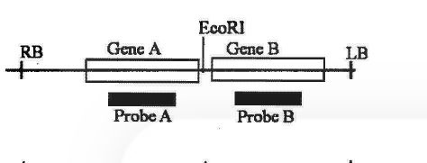

In order to analyze the nature of integration, genomic DNA digested with EcoRI was used for Southern hybridization using either probe A or B. The result obtained is as

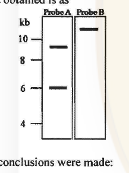

The following conclusions were made:

A. There are two copies of the T-DNA cassette integrated at one loci and a third copy at another loci.
B. There are two copies of the T-DNA cassette integrated at one loci.
C. Complete T-DNA cassette has been integrated in all cases.
D. In one T-DNA cassette there is a truncation towards the RB
E. In one T-DNA cassette there is a truncation towards the LB
F. The arrangement of the T-DNA cassettes integrated at the same loci is

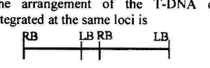

G. The arrangement of the T-DNA cassette integrated at the same loci is
RB — LB RB — LB

Which of the above are correct?

1. B, E and G
2. B, D and F
3. A, D and F
4. B, C and F

**Answer: 2 (B, D and F)**

> **Explanation:** The two-copy (B) head-to-head arrangement (F, RB–LB LB–RB) with one cassette truncated toward the RB end (D) reproduces the observed band pattern: probe A gives two bands (an intact-copy fragment plus a smaller truncated-copy fragment, at ~9 and ~6 kb) while probe B gives a single larger junction fragment (just above 10 kb). The key's accepted combination is B, D and F.

---

### Question 138

While designing an experiment for *Agrobacterium* mediated plant transformation, a student noted down the following points:
A. Ti and Ri plasmids induce crown gall and hairy root disease, respectively
B. Enzymes octopine synthase and nopaline synthase involved in the synthesis of octopine and nopaline, respectively are encoded by T-DNA.
C. All the six *vir* genes, *vir A*, *vir B*, *vir C*, *vir D*, *vir E* and *vir G* are absolutely required for virulence.
D. Almost perfect 25 bp direct repeat sequences flanking all Ti and Ri plasmids in the T-DNA region is essential for T-DNA transfer.

Which one of the following combinations of the above statement is correct?

1. A, B and C
2. B, C and D
3. A, C and D
4. A, B and D

**Answer: 4 (A, B and D)**

> **Explanation:** Ti→crown gall and Ri→hairy root (A); the octopine/nopaline synthase genes lie in the T-DNA (B); and the 25-bp direct repeats flanking the T-DNA are essential for transfer (D). C is wrong because not all six *vir* operons are absolutely required (e.g. *virE* is dispensable under many conditions).

---

### Question 139

The following are certain facts regarding bioremediation:
A. Biodegradable plastics are made using polyhydroxy alkanoates (PHAs) such as polyhydroxybutyrate (PHB).
B. *Pseudomonas putida* F1 bacterial strain is involved in degradation of aromatic hydrocarbon.
C. The bacterium *Deinococcus radiodurans* consume and digest toluene and ionic mercury from highly radioactive nuclear waste.
D. Bioaugmentation is a process of improving the microorganisms already existing in the system for degradation of xenobiotic compound.

Which one of the following combination of above statements is correct?

1. A, B and C
2. A, B and D
3. A, C and D
4. B, C and D

**Answer: 1 (A, B and C)**

> **Explanation:** PHA/PHB bioplastics (A), *P. putida* F1 degrading aromatic hydrocarbons (B), and engineered *D. radiodurans* digesting toluene and mercury in radioactive waste (C) are all correct. D mis-defines bioaugmentation: adding/degrading-in introduced strains is bioaugmentation, whereas improving the *existing* microbes is biostimulation.

---

### Question 140

An unknown peptide was isolated from the leaf of a medicinal plant and purified to homogeneity. The peptide did not yield any sequence when subjected to Edman degradation. However, tryptic digest of the peptide produced a unique sequence. The mass of the intact peptide was found to be 18 Da less than that obtained from the trypsin treated sample. The possible interpretation of the above experimental results could be that the

A. the N-terminus of the peptide was blocked by acetylation or methylation.
B. the peptide was cyclic and contained at least one internal arginine or lysine residue.
C. the peptide was cyclic and contained a lysine or arginine residue at the C-terminus.
D. the peptide was cyclized by peptide bond formation between α-amino group and α-carboxyl group.

Which of the above statements is true?

1. A and D
2. A and B
3. B and C
4. B and D

**Answer: 4 (B and D)**

> **Explanation:** No Edman sequencing means there is no free N-terminal α-amino group — consistent with a head-to-tail cyclic peptide (B) formed by a peptide bond between the α-amino and α-carboxyl groups (D). Trypsin still cuts at internal Arg/Lys, and the linearised product gains the 18 Da (H₂O) of the hydrolysed cyclic bond relative to the intact circle.

---

### Question 141

A gene is regulated by a novel transcription factor. The following techniques may be used to identify the cis- regulatory element in the 1 kb promoter sequence of the gene where the novel transcription factor binds:
A. Bioinformatics analysis.
B. Cell based reporter assay.
C. S1 nuclease assay.
D. Electrophoretic mobility shift assay.
E. DNase-1 foot-printing analysis.

Which one of the following can help to identify the cis element?

1. A and B
2. C and E
3. D only
4. E only

**Answer: 4 (E only)**

> **Explanation:** DNase-1 footprinting maps, at nucleotide resolution, the stretch of promoter DNA protected by the bound transcription factor, so it identifies the cis-regulatory element itself. EMSA (D) only demonstrates that binding occurs, not where; reporter assays (B) show function; S1 nuclease (C) maps RNA ends; bioinformatics (A) only predicts candidates.

---

### Question 142

A protein D is encoded by a gene, which is 5 Kb long and has three Hind III restriction enzyme sites. The first one is 0.5 Kb from the transcription start site, the second one is 2.5 Kb from the first site and the third one is 0.5 Kb internal to the stop codon. The second site is polymorphic. In order to find out whether fetal cells contain the normal or the mutated gene, total genomic DNA from fetal cells was isolated, completely digested with Hind III, separated in an agarose gel, transferred to membrane and detected by a probe against the region between the second and third restriction site. Which one of the following band patterns will be obtained if the fetal cell is heterozygous?

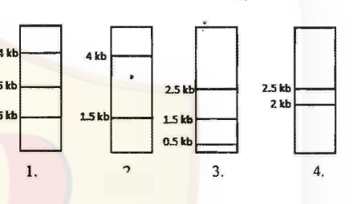

1. (panel 1)
2. (panel 2)
3. (panel 3)
4. (panel 4)

**Answer: 2 (panel 2)**

> **Explanation:** The probe lies between the (polymorphic) second and third HindIII sites. On the normal allele the second site is present, giving one fragment size; on the mutated allele the second site is lost, fusing it with the adjacent fragment to give a larger band. A heterozygote therefore shows **both** bands — the two-band pattern in panel 2.

---

### Question 143

Given below are the experimental protocols to find out the exact location of repetitive DNA sequence in mitotic chromosome by FISH (fluorescence in situ hybridization). Which one of the protocols will give the correct result?

1. Mitotic chromosomes were fixed on glass slide→incubated with biotinylated telomeric DNA→denatured→incubated with fluorescently labeled avidin→localization observed under fluorescence microscope.
2. Mitotic chromosomes were fixed on glass slide→denatured→incubated with FITC labeled unrelated non-repetitive DNA sequence→counterstained with propidium iodide→ localization observed under fluorescence microscope.
3. Mitotic chromosomes were fixed on glass slide→denatured→incubated with biotinylated satellite DNA→ incubated with fluorescently labeled avidin→localization observed under fluorescence microscope.
4. Mitotic chromosomes were fixed on glass slide→incubated with repetitive DNA sequence binding protein→ denatured→FITC labeled antibody against the protein→localization observed under fluorescence microscope.

**Answer: 3 (Mitotic chromosomes were fixed on glass slide→denatured→incubated with biotinylated satellite DNA→ incubated with fluorescently labeled avidin→localization observed under fluorescence microscope.)**

> **Explanation:** FISH needs the target denatured first and then hybridised with a labelled probe complementary to the sequence of interest. Protocol 3 denatures the chromosomes and hybridises a biotinylated **satellite (repetitive) DNA** probe detected by fluorescent avidin — the correct FISH route to localise a repetitive sequence. Protocol 1 uses telomeric DNA (wrong sequence) and never denatures properly, 2 uses unrelated non-repetitive DNA, and 4 is an immunological, not hybridisation, method.

---

### Question 144

At 25°C values of [θ]₂₂₂, the mean residue ellipticity at 222 nm, are − 33,000 and -3,000 deg cm² dmol⁻¹ for a polypeptide existing in α-helical (α) and β-structure (β), respectively. If this polypeptide undergoes a two-state heat-induced α→β transition, and a value of [θ]₂₂₂ = -18,000 deg cm² dmol⁻¹ is observed at 60°C, then this observation leads to the conclusion that the α-helix conversion to β-structure is:

1. 40%
2. 50%
3. 55%
4. 60%

**Answer: 2 (50%)**

> **Explanation:** For a two-state α⇌β mixture, [θ]obs = f_α[θ]_α + f_β[θ]_β with f_α + f_β = 1. Substituting [θ]_α = −33,000, [θ]_β = −3,000 and [θ]obs = −18,000: −18,000 = −33,000 f_α − 3,000(1 − f_α) = −3,000 − 30,000 f_α, so f_α = 15,000/30,000 = 0.50. The fraction of α-helix converted to β-structure is 1 − 0.50 = **50%**.

---

### Question 145

An EEG was recorded and its power spectrum analyses were done in rats with implanted electrode for a long time. The power of the EEG waves decreased two months after electrode implantation.

This observation may be due to the following:

A. Glial cells accumulate surrounding the exposed tips of electrodes.
B. Degeneration of neurons occur surrounding the electrode tips due to metal ion deposition.
C. Coating of electrodes are destroyed with time.
D. The microsocket becomes loose with time.

Which one of the following is true?

1. Only A
2. A and B
3. Only C
4. C and D

**Answer: 2 (A and B)**

> **Explanation:** Chronic implanted electrodes lose signal because a glial scar forms around the tip (A) insulating it, and the surrounding neurons degenerate (partly from metal-ion/tissue reaction) (B), reducing the recorded EEG power. Coating loss (C) or a loose socket (D) would give artefacts/dropout rather than a gradual power decline.
