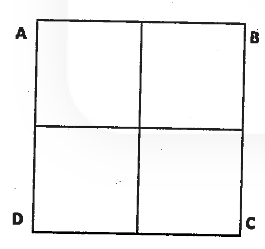
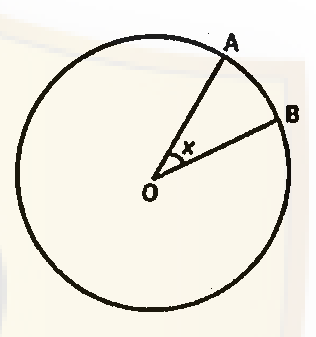
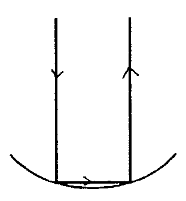
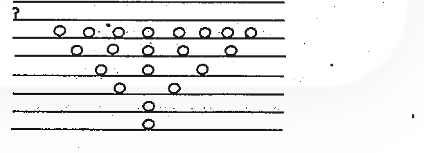
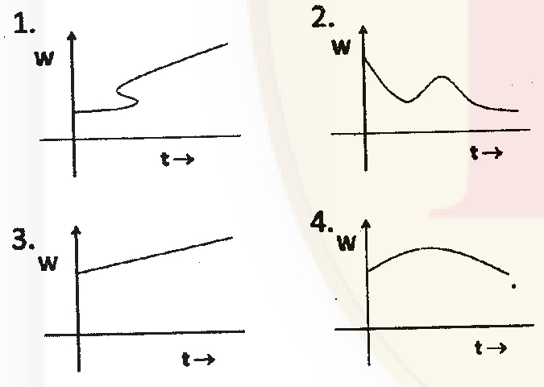
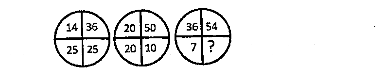

# CSIR NET Life Science — June 2013 (2013 I) — PART 'A'

> Paper code 3112, Booklet H. 145 MCQs total (20 Part A + 50 Part B + 75 Part C).
> **Printed totals in this paper:** Part A = Q1–20 (20 questions), Part B = Q21–70 (50), Part C = Q71–145 (75).
> **Note on format:** despite the "2011–2013 unit-based" premise, this specific paper uses the *standard single-block* Part A/B/C structure with continuous numbering — there are **no** repeated per-unit "Part - B"/"Part - C" headings. English text extracted verbatim; Hindi ignored.
> **Answers are REASONED, not key-confirmed** — no official CSIR/NTA final answer key for June 2013 is publicly available (public keys begin 2017). See `sources.md`.

---

### Question 1

A 16.2 m long wooden log has a uniform diameter of 2 m. To what length the log should be cut to obtain a piece of 22 m³ volume?

1. 3.5 m
2. 7.0 m
3. 14.0 m
4. 22.0 m

**Answer: 2 (7.0 m)**

> **Explanation:** Cross-sectional area = πr² = π(1)² = 3.1416 m². Length = volume/area = 22/3.1416 ≈ 7.0 m.

---

### Question 2

What is the last digit of 7⁷³?

1. 7
2. 9
3. 3
4. 1

**Answer: 1 (7)**

> **Explanation:** Last digits of powers of 7 cycle 7, 9, 3, 1 (period 4). 73 mod 4 = 1, so the first element of the cycle, 7.

---

### Question 3

A lucky man finds 6 pots of gold coins. He counts the coins in the first four pots to be 60, 30, 20 and 15, respectively. If there is a definite progression, what would be the numbers of coins in the next two pots?

1. 10 and 5
2. 4 and 2
3. 15 and 15
4. 12 and 10

**Answer: 4 (12 and 10)**

> **Explanation:** The sequence is harmonic: reciprocals 1/60, 1/30, 1/20, 1/15 form an arithmetic progression with common difference 1/60. Next reciprocals 1/12 and 1/10 → 12 and 10 coins.

---

### Question 4

A bee leaves its hive in the morning and after flying for 30 minutes due south reaches a garden and spends 5 minutes collecting honey. Then it flies for 40 minutes due west and collects honey in another garden for 10 minutes. Then it returns to the hive taking the shortest route. How long was the bee away from its hive? (Assume that the bee flies at constant speed)

1. 85 min
2. 155 min
3. 135 min
4. Less than 1 hour

**Answer: 3 (135 min)**

> **Explanation:** Displacements 30 min south and 40 min west give a 3-4-5 right triangle; the return leg = 50 min of flight. Total away = 30 + 5 + 40 + 10 + 50 = 135 min.

---

### Question 5

A bird perched at the top of a 12 m high tree sees a centipede moving towards the base of the tree from a distance equal to twice the height of the tree. The bird flies along a straight line to catch the centipede. If both move at the same speed, at what distance from the base of the tree will the centipede be picked up by the bird?

1. 16 m
2. 9 m
3. 12 m
4. 14 m

**Answer: 2 (9 m)**

> **Explanation:** Centipede starts 24 m from base. Let catch point be x m from base: centipede travels 24−x; bird flies √(12²+x²). Equal speeds → 24−x = √(144+x²) → 576−48x = 144 → x = 9 m.

---

### Question 6

An ant goes from A to C in the figure crawling only on the lines and taking the least length of path. The number of ways in which it can do so is

1. 2
2. 4
3. 5
4. 6

**Answer: 4 (6)**

> **Explanation:** The shortest path on a 2×2 grid from a corner to the opposite corner uses 2 horizontal + 2 vertical steps = 4 moves. Number of distinct orderings = C(4,2) = 6.

---

### Question 7

A point is chosen at random from a circular disc shown below. What is the probability that the point lies in the sector OAB?

(where ∠AOB = x radians)

1. 2x/π
2. x/π
3. x/2π
4. x/4π

**Answer: 3 (x/2π)**

> **Explanation:** Sector area = ½r²x; disc area = ½r²(2π). Probability = x/2π.

---

### Question 8

A ray of light, after getting reflected twice from a hemispherical mirror of radius R (see the above figure), emerges parallel to the incident ray. The separation of the original incident ray and the final reflected ray is

1. R
2. R√2
3. 2R
4. R√3

**Answer: 2 (R√2)**

> **Explanation:** For two reflections making the emergent ray parallel to the incident ray, the geometry gives a separation of R√2.

---

### Question 9

A king ordered that a golden crown be made for him from 8 kg of gold and 2 kg of silver. The goldsmith took away some amount of gold and replaced it by an equal amount of silver and the crown when made, weighed 10 kg. Archimedes knew that under water gold lost 1/20ᵗʰ of its weight, while silver lost 1/10ᵗʰ. When the crown was weighed under water, it was 9.25 kg. How much gold was stolen by the goldsmith?

1. 0.5 kg
2. 1 kg
3. 2 kg
4. 3 kg

**Answer: 4 (3 kg)**

> **Explanation:** Weight loss = 0.75 kg. With gold g and silver s, g+s=10 and g/20+s/10=0.75 → g+2s=15 → s=5, g=5. Gold stolen = 8−5 = 3 kg.

---

### Question 10

What is the angle between the minute and hour hands of a clock at 7:35?

1. 0°
2. 17.5°
3. 19.5°
4. 20°

**Answer: 2 (17.5°)**

> **Explanation:** Hour hand = 7×30 + 35×0.5 = 227.5°; minute hand = 35×6 = 210°. Difference = 17.5°.

---

### Question 11

A stream of ants go from point A to point B and return to A along the same path. All the ants move at a constant speed and from any given point 2 ants pass per second one way. It takes 1 minute for an ant to go from A to B. How many returning ants will an ant meet in its journey from A to B?

1. 120
2. 60
3. 240
4. 180

**Answer: 3 (240)**

> **Explanation:** Linear density of returning ants λ = flow/speed = 2/(L/60) = 120/L. Relative speed of approach = 2(L/60). Encounters = λ × rel. speed × time = (120/L)(2L/60)(60) = 240.

---

### Question 12

The capacity of the conical vessel shown above is V. It is filled with water upto half its height. The volume of water in the vessel is

1. V/2
2. V/4
3. V/8
4. V/16

**Answer: 3 (V/8)**

> **Explanation:** For similar cones, volume scales as the cube of height. Half height → (½)³ = 1/8 of the capacity.

---

### Question 13

A large tank filled with water is to be emptied by removing half of the water present in it everyday. After how many days will there be closest to 10% water left in the tank?

1. One
2. Two
3. Three
4. Four

**Answer: 3 (Three)**

> **Explanation:** Fraction left after n days = (½)ⁿ. Day 3 = 12.5% (|12.5−10| = 2.5); Day 4 = 6.25% (|6.25−10| = 3.75). Day 3 is closest to 10%.

---

### Question 14

n is a natural number. If n⁵ is odd, which of the following is true?

(A) n is odd
(B) n³ is odd
(C) n⁴ is even

1. A only
2. B only
3. C only
4. A and B only

**Answer: 4 (A and B only)**

> **Explanation:** n⁵ odd ⇒ n odd. Then n³ odd (true) and n⁴ odd, so (C) is false. A and B are true.

---

### Question 15

Suppose you expand the product (x₁+y₁)(x₂+y₂)⋯(x₂₀+y₂₀). How many terms will have only one x and rest y's?

1. 1
2. 5
3. 10
4. 20

**Answer: 4 (20)**

> **Explanation:** Choose which one of the 20 brackets contributes its x-term and all others contribute y: C(20,1) = 20 terms.

---

### Question 16

In the figure below the numbers of circles in the blank rows must be

1. 12 and 20
2. 13 and 20
3. 13 and 21
4. 10 and 11

**Answer: 3 (13 and 21)**

> **Explanation:** The circle counts follow the pattern in the figure; the two blank rows require 13 and 21 circles respectively.

---

### Question 17

If we plot the weight (w) versus age (t) of a child in a graph, the one that will never be obtained from amongst the four graphs given below is

1. 1
2. 2
3. 3
4. 4

**Answer: 1 (1)**

> **Explanation:** Weight must be a single-valued function of age. Graph 1 folds back so one age maps to two weights, which is physically impossible.

---

### Question 18

Find the missing number:

1. 1
2. 0
3. 2
4. 3

**Answer: 4 (3)**

> **Explanation:** In each circle the four quadrant numbers sum to 100: 14+36+25+25 = 100 and 20+50+20+10 = 100. Hence 36+54+7+? = 100 → ? = 3. (Digits re-read from the 300-DPI source after the first crop of this figure was blank.)

---

### Question 19

In solving a quadratic equation of the form x² + ax + b = 0, one student took the wrong value of a and got the roots as 6 and 2; while another student took the wrong value of b and got the roots as 6 and 1. What are the correct values of a and b, respectively?

1. 7 and 12
2. 3 and 4
3. -7 and 12
4. 8 and 12

**Answer: 3 (-7 and 12)**

> **Explanation:** First student's error was in a, so b (product) is correct = 6×2 = 12. Second student's error was in b, so a (−sum) is correct = −(6+1) = −7.

---

### Question 20

The distance between two oil rigs is 6km. What will be the distance between these rigs in maps of 1:50000 and 1:5000 scales, respectively?

1. 12 cm and 1.2 cm
2. 2 cm and 12 cm
3. 120 cm and 12 cm
4. 12 cm and 120 cm

**Answer: 4 (12 cm and 120 cm)**

> **Explanation:** 6 km = 600000 cm. At 1:50000 → 600000/50000 = 12 cm. At 1:5000 → 600000/5000 = 120 cm.
