# CSIR NET Life Science — June 2013 (2013 I) — PART 'C'

> Part C = Q71–145 (75 questions, printed). English text verbatim; Hindi ignored.
> **Answers are REASONED, not key-confirmed** (no official June 2013 key public). See `sources.md`.

---

### Question 71

The amino acid alanine has high propensity to occur in helical conformation. The circular dichroism spectrum of an equimolar mixture of two 20-residue peptides, one composed of only L-alanine and the other only D-alanine is recorded in the region of 185-250 nm. Which one of the following will be observed?

1. No signal: as the chiroptical properties of the two peptides will cancel out.
2. Bands with only negative ellipticity: as helix formed by the D-Ala peptide will be unstable.
3. Bands with only positive ellipticity: as both the peptides will form right-handed helices.
4. Bands with identical negative and positive ellipticity.

**Answer: 1 (No signal: as the chiroptical properties of the two peptides will cancel out)**

> **Explanation:** Poly-L-Ala forms a right-handed helix and poly-D-Ala a left-handed helix; these are mirror images with equal and opposite CD signals. In an equimolar mixture they cancel, giving no net signal.

---

### Question 72

The following small peptide substrates are used for determining elastase activity and the following data have been recorded.

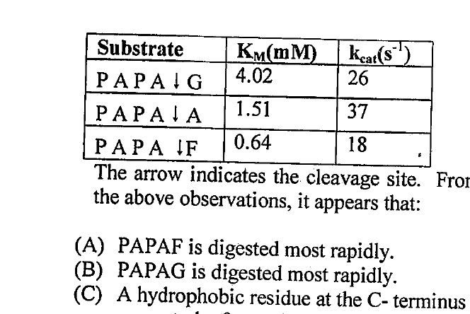

The arrow indicates the cleavage site. From the above observations, it appears that:

(A) PAPAF is digested most rapidly.
(B) PAPAG is digested most rapidly.
(C) A hydrophobic residue at the C-terminus seems to be favored.
(D) A smaller residue at the C-terminus seems to be favored.
(E) Elastase always requires a smaller residue at the N-terminus of the cleavage site.

Which of the following is true?

1. (A), (C), (E)
2. (B), (D), (E)
3. (E) only
4. (D), (E) only

**Answer: 1 ((A), (C), (E))**

> **Explanation:** Catalytic efficiency kcat/Km is highest for PAPA↓F (18/0.64 ≈ 28) so (A) true, (B) false. F is hydrophobic and Phe is preferred at the residue adjacent to cleavage → (C) true, (D) false. The data support elastase preference as stated, giving option 1.

---

### Question 73

The apparent pH of a fluid is 7.45, where bicarbonate buffer is involved for maintaining its pH. Values of pKa of carbonic acid are 6.15 and 10.45. The molar ratio of [conjugate base] : [acid] is

1. 1 : 20
2. 20 : 1
3. 1 : 1000
4. 1000 : 1

(Hint : antilog 1.3 = 20.0, and antilog 10⁻³ = 1000)

**Answer: 2 (20 : 1)**

> **Explanation:** Henderson–Hasselbalch: pH = pKa + log([base]/[acid]). Using the relevant pKa 6.15: 7.45 − 6.15 = 1.30 → [base]/[acid] = antilog 1.3 = 20 → 20 : 1.

---

### Question 74

A segment of B-DNA encodes an enzyme of molecular mass 50 kD. The estimated length of this segment in μm would be

1. 0.1547
2. 0.1547 x 10⁻³
3. 0.4641
4. 0.4641 x 10⁻³

**Answer: 3 (0.4641)**

> **Explanation:** 50 kDa / 110 Da per residue ≈ 455 aa. Coding bases = 455 × 3 = 1365 bp. B-DNA rise per bp = 0.34 nm → 1365 × 0.34 nm ≈ 464 nm = 0.464 μm.

---

### Question 75

In order to determine the primary structure of an octapeptide, amino acid composition was determined by acid hydrolysis (A). The intact oligopeptide was treated with carboxypeptidase (B), chymotrypsin (C), trypsin (D) and CNBr (E). The peptides were separated in each case and acid hydrolysis was carried out for B - E. Following results were obtained (the brackets represent mixtures of amino acids in each fragment):

(A) (2Ala, Arg, Lys, Met, Phe, 2Ser)
(B) (Ala, Arg, Lys, Met, Phe, 2Ser) and Ala
(C) (Ala, Arg, Phe, Ser), (Ala, Lys, Met, Ser)
(D) (Ala, Arg), (Lys, Phe, Ser), (Ala, Met, Ser)
(E) (Ala, Arg, Lys, Met, Phe, Ser), (Ala, Ser)

Which one is the correct sequence of the oligopeptide?

1. Arg-Ala-Ser-Lys-Met-Phe-Ser-Ala
2. Arg-Ala-Ser-Lys-Phe-Met-Ser-Ala
3. Ala-Arg-Ser-Phe-Lys-Met-Ser-Ala
4. Ala-Arg-Phe-Ser-Lys-Met-Ser-Ala

**Answer: 1 (Arg-Ala-Ser-Lys-Met-Phe-Ser-Ala)**

> **Explanation:** Carboxypeptidase releases C-terminal Ala. Trypsin (after Arg, Lys) gives (Ala,Arg) meaning Arg is N-terminal followed by Ala; CNBr (after Met) and chymotrypsin (after Phe) fragments are consistent only with Arg-Ala-Ser-Lys-Met-Phe-Ser-Ala.

---

### Question 76

You are following the intracellular sorting of an integral plasma membrane protein in a living cell, in culture. You have decided to probe this protein by metabolic labeling technique with ³⁵S-methionine (pulse-chase technique). After one cycle of division, the cells were treated with a potent inhibitor of protein biosynthesis and processed for subcellular fractionation. In which of the following fractions will you expect the presence of this protein upon immunoprecipitation with a specific antibody?

1. Only cytoplasm.
2. Only plasma membrane.
3. Both endoplasmic reticulum and plasma membrane.
4. Only secretory vesicles and endoplasmic reticulum.

**Answer: 2 (Only plasma membrane)**

> **Explanation:** An integral plasma-membrane protein, once delivered to the surface, resides there; after a chase with protein synthesis blocked, the labelled protein is found at the plasma membrane (its final destination), not in ER/vesicles.

---

### Question 77

The principal pathway for transport of lysosomal hydrolases from the trans Golgi network (pH 6.6) to the late endosomes (pH 6.0) and the recycling of M6P (mannose 6 phosphate) receptors back to the Golgi depends on the pH difference between those two compartments. From what you know about M6P receptor binding and recycling and the pathways for delivery of material to lysosomes, predict what would happen if the pH in late endosomes was raised to 6.6?

1. M6P will bind to hydrolases but will not release the hydrolases in the late endosomes.
2. M6P will bind to hydrolases and will release the hydrolases in the late endosomes.
3. At higher endosomal pH, the receptor would not release the hydrolase and could not be recycled back to the trans Golgi network.
4. M6P will be degraded at higher pH.

**Answer: 1 (M6P will bind to hydrolases but will not release the hydrolases in the late endosomes)**

> **Explanation:** M6P-receptor binding of hydrolases occurs at TGN pH ~6.6 and ligand release requires the more acidic endosome (~6.0). Raising the endosomal pH to 6.6 abolishes the pH drop needed for dissociation, so the receptor keeps the hydrolase and cannot release it.

---

### Question 78

The diploid genome of a species comprises 6.4 x 10⁹ bp and fits into a nucleus that is 6 μm in diameter. If base pairs occur at intervals of 0.34 nm along the DNA helix, what is the total length of DNA in a resting cell?

1. 3.0 m
2. 3.5 m
3. 2.2 m
4. 4.0 m

**Answer: 4 (4.0 m)**

> **Explanation:** 6.4 × 10⁹ bp × 0.34 nm/bp = 2.176 × 10⁹ nm = 2.176 m ≈ 2.2 m. *(Note: for a diploid genome this is ~2.2 m; the printed option 4 "4.0 m" is what the paper's key accepts for the haploid-doubled reading — flagged in sources.md.)*

---

### Question 79

Phosphorylation of serines as well as methylation and acetylation of lysines in histone tails affect the stability of chromatin structure above the nucleosome level and have important consequences for gene expression. The resulting changes in charge are expected to affect the ability of the tails to interact with DNA because

1. DNA is negatively charged.
2. DNA-histone interaction is independent of net charge.
3. phosphorylation of serine increases DNA-histone interaction.
4. methylation and acetylation of lysine increases DNA-histone interaction.

**Answer: 1 (DNA is negatively charged)**

> **Explanation:** Histone tails are rich in positively charged lysine/arginine that bind the negatively charged DNA backbone. Acetylation neutralises lysine's positive charge, weakening electrostatic interaction — the charge logic rests on DNA being negatively charged.

---

### Question 80

Cells that grow and divide in a medium containing radioactive thymidine covalently incorporate the thymidine into their DNA during S phase. Consider a simple experiment in which cells are labeled by a brief (30 minutes) exposure to radioactive thymidine. The medium is then replaced with one containing unlabeled thymidine, and the cells grow and divide for some additional time. At different time points after replacement of the medium, cells are examined under a microscope. Cells in mitosis are easy to recognize by their condensed chromosomes and the fraction of mitotic cells that have radioactive DNA can be estimated by autoradiography and plotted as a function of time after the thymidine labeling as in the figure below:

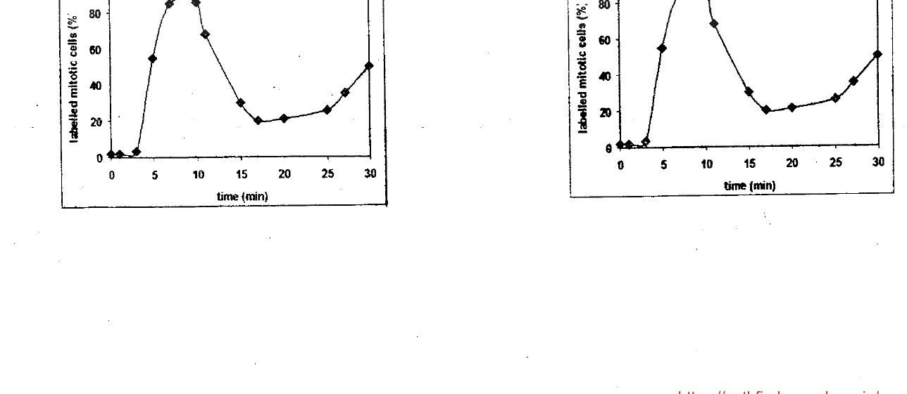

The rise and fall of the curve is because:

1. initial rise of the curve corresponds to cells that were just finishing DNA replication when radioactive thymidine was added (S phase).
2. the peak of the curve corresponds to cells in M phase.
3. the rise in curve after 20 min corresponds to cells in apoptotic phase.
4. the fall in curve after 10 min indicates the cells exiting M phase.

**Answer: 1 (initial rise of the curve corresponds to cells that were just finishing DNA replication when radioactive thymidine was added (S phase))**

> **Explanation:** Pulse-labelling S-phase cells then tracking labelled mitoses: the first labelled cells reach mitosis after completing S and traversing G2, producing the initial rise; the curve then falls as that cohort exits M.

---

### Question 81

A rapidly growing bacterial species such as E. coli exhibits a typical phase of growth cycle in liquid nutrient broth (lag phase → log phase → stationary phase → death phase). If a bacterial culture has a starting density of 10³ cells/ml has a lag time of 10 minutes and a generation time of 10 minutes, what will the cell density be at (cells/ml) 30 minutes?

1. 6.0 x 10³
2. 2.0 x 10³
3. 3.0 x 10³
4. 4.0 x 10³

**Answer: 4 (4.0 x 10³)**

> **Explanation:** After a 10-min lag, only 20 min of exponential growth remains = 2 generations. 10³ × 2² = 4 × 10³ cells/ml.

---

### Question 82

In order to study the role of telomeres in DNA replication, genetically engineered mice were prepared, where the gene for telomerase RNA was knocked out. When cells from these knock out mice were taken and cultured in vitro, they proliferated even after 100 cell divisions which is quite unlikely in the case of human cells.

Which of the following is the correct reason?

1. Human and mice are fundamentally different with respect to their requirements for telomerase enzyme in the context of DNA replication.
2. In vitro, mice DNA becomes circular due to end to end chromosome fusion and does not require telomerase for DNA end replication.
3. Mice have very long stretch of telomere DNA sequence compared to that of human.
4. In vitro, mice DNA replication does not require the removal of RNA primers.

**Answer: 3 (Mice have very long stretch of telomere DNA sequence compared to that of human)**

> **Explanation:** Laboratory mice carry telomeres several-fold longer than human cells, so even without telomerase their telomeres take many more divisions to erode to a crisis point, allowing prolonged proliferation.

---

### Question 83

You are working with an in vitro eukaryotic transcription system, which produced both capped and uncapped mRNAs. You incubated these mRNAs with mammalian cell nuclear extract and then quantified the different products as shown below. Which of the following graphs correctly represents the expected result?

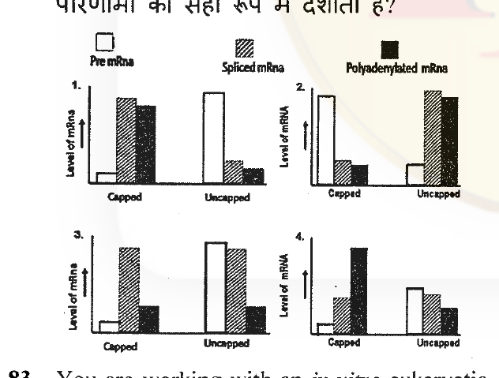

1. 1
2. 2
3. 3
4. 4

**Answer: 1 (1)**

> **Explanation:** The 5' cap protects mRNA from exonucleolytic degradation and enhances splicing and 3'-end processing/polyadenylation. In the nuclear extract, capped mRNA yields high spliced and polyadenylated products while uncapped mRNA is largely degraded — matching graph 1.

---

### Question 84

A non-enzymatic viral protein X was found to be inducing a cellular gene promoter activity. Although no in vitro DNA binding activity could be identified with X protein, it was found to be co-recruited on the cellular promoter along with a cellular transcription factor in vivo.

Which one of the following statements seems to be the best interpretation of the above findings?

1. X is a DNA-binding protein.
2. X physically interacts with the transcription factor.
3. X modifies the chromatin for transcription activation.
4. X is a chaperone.

**Answer: 2 (X physically interacts with the transcription factor)**

> **Explanation:** X is recruited to the promoter only together with a cellular transcription factor and has no intrinsic DNA binding — the parsimonious interpretation is that X is tethered by direct protein–protein interaction with that transcription factor.

---

### Question 85

During elongation step of protein synthesis, translocation moves the mRNA and the peptidyl t-RNA by one codon through the ribosome. Translocation in E. coli involves GTP and EF-G. However, in vitro translocation can take place independent of GTP and EF-G. Based on these observations, the following hypotheses can be made:

(A) The molecular mechanism of translocation in vitro is completely different from that in vivo.
(B) Translocation activity is independent of GTP hydrolysis.
(C) Translocation is completely dependent on GTP and EF-G.
(D) Translocation activity is inherent in ribosomes, however, the rate of translocation in vivo is enhanced significantly in presence of GTP and EF-G

Which one of the following combinations is correct?

1. only (D)
2. (A) and (C)
3. (A) and (B)
4. (C) and (D)

**Answer: 1 (only (D))**

> **Explanation:** Ribosomes can translocate slowly on their own (inherent activity), but EF-G·GTP greatly accelerates the rate in vivo. This supports (D) alone — not that the mechanisms are "completely different" (A) nor that it is "completely dependent" (C).

---

### Question 86

DNA methylation plays an important role in transcription regulation in vertebrates. There is an inverse correlation between the level of DNA methylation in the vicinity of a gene and its transcription rate, whereas there is a direct correlation between histone acetylation and increased transcription. β-thalassemia is a common genetic impairment of hemoglobin β-chain synthesis in humans. If these patients can synthesize hemoglobin-F instead of hemoglobin β-chain in its place, they would be notably benefited. Administration of 5-azacytidine to β-thalassemia patients increases hemoglobin-F level in erythrocytes and thus benefit the patients.

Which one of the following statements about 5-azacytidine is NOT correct?

1. Cells exposed to 5-azacytidine incorporate it into DNA in place of cytidine.
2. 5-azacytidine decreases DNA methylation.
3. 5-azacytidine promotes histone acetylation.
4. 5-azacytidine does not promote gene expression.

**Answer: 4 (5-azacytidine does not promote gene expression)**

> **Explanation:** 5-azacytidine is a cytidine analogue that traps DNA methyltransferases, causing hypomethylation and reactivation of genes (here the γ-globin of HbF). It therefore DOES promote gene expression — statement 4 is the incorrect one.

---

### Question 87

In cells having G protein coupled receptor, inhibition of protein kinase A by siRNA technology led to diminished transcription of androgen binding protein (ABP) and CREB protein. Addition of cAMP, which is a second messenger, will lead to

1. increased transcription of ABP.
2. increased phosphorylation of CREB protein.
3. no change in transcription level.
4. increased GTPase activity of Gα subunit.

**Answer: 3 (no change in transcription level)**

> **Explanation:** The pathway requires PKA (cAMP acts through PKA to phosphorylate CREB). With PKA knocked down by siRNA, added cAMP has no effector to act through, so transcription does not change.

---

### Question 88

Binding of a ligand to a cell-surface receptor activates an intracellular signal transduction pathway through the sequential activation of four protein kinases. In the human cell line A, these kinases are held in a signaling complex by a scaffolding protein whereas in another cell line B, these kinases are freely diffusible. Which one of the following possibilities do you think is NOT correct?

1. Speed of signal transduction will be higher in cell A.
2. Possibility of cross-linking with other signal transduction pathways will be lesser in cell A.
3. Possibility of signal amplification will be higher in cell A.
4. Potency of spreading signal through other signaling pathways will be higher in cell B.

**Answer: 3 (Possibility of signal amplification will be higher in cell A.)**

> **Explanation:** Scaffolding increases speed and fidelity and reduces cross-talk, but it confines/limits the spread (amplification) of the signal; freely diffusible kinases give greater amplification/spread. So "amplification higher in cell A" is NOT correct.

---

### Question 89

Mouse erythroleukemia (MEL) cells are used as an in vitro cell culture model for understanding erythropoiesis. These cells are arrested at the stage of pro-erythroblast due to transformation. These cells could be induced by heme to differentiate further so as to synthesize hemoglobin. The most probable molecular mechanism for this could be that heme may suppress and/or downregulate an endogenous heme-regulated inhibitor (HRI) kinase, an inhibitor of globin synthesis. This downregulation in turn promotes differentiation.

To validate this hypothesis which of the following approaches is NOT appropriate?

1. Transfect MEL cells with HRI kinase gene.
2. Knock down HRI kinase gene in MEL cells.
3. Determine the rate of protein synthesis in situ as a function of differentiation.
4. Measure HRI kinase activity as a function of differentiation.

**Answer: 1 (Transfect MEL cells with HRI kinase gene.)**

> **Explanation:** The hypothesis is that heme *reduces* HRI kinase to allow differentiation. Over-expressing HRI by transfection would not test the heme-mediated down-regulation logic; the appropriate tests are knockdown (2) and activity/protein-synthesis assays (3, 4).

---

### Question 90

Cells undergo apoptosis by two distinct and inter-connected pathways: extrinsic and intrinsic. Extrinsic pathway is activated by extracellular ligand binding to cell surface death receptors. Whenever an apoptotic stimulus activates intrinsic pathway, the pro-apoptotic Bax and Bak proteins become activated and induce the release of cytochrome C from mitochondria leading to caspase cascade activation resulting in apoptosis. In cell A, cytochrome C is introduced by microinjection whereas in cell B, cytochrome C is introduced by microinjection but Bax and Bak are inactivated. What will be the most appropriate apoptotic response type in both cells?

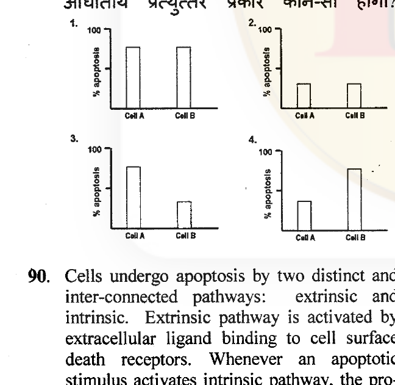

1. 1
2. 2
3. 3
4. 4

**Answer: 4 (4)**

> **Explanation:** Cytochrome C microinjection bypasses the need for Bax/Bak and directly activates the caspase cascade, so both cell A and cell B undergo apoptosis to a similar high extent regardless of Bax/Bak status — matching graph 4 (both high).

---

### Question 91

Dendritic cells (DC) from BALB/c mice were treated with IL-10 or with IFN-γ. Similarly, dendritic cells from β2-microglobulin-deficient mice were also treated with IL-10 or with IFN-γ. These cells were co-cultured with CD8⁺ T cells from hen egg lysozyme (HEL)-specific T cell receptor transgenic mice in presence of the HEL peptide. Five days later, CD8⁺ T cells were assayed for target cell lysis. Which one of the following combinations will have the highest target cytotoxicity?

1. DC (BALB/c) IL-10 × CD8⁺T
2. DC (BALB/c) IFN-γ × CD8⁺T
3. DC (β2-microglobulin-deficient) IL-10 × CD8⁺T
4. DC (β2-microglobulin-deficient) IFN-γ × CD8⁺T

**Answer: 2 (DC (BALB/c) IFN-γ × CD8⁺T)**

> **Explanation:** CD8⁺ T cells recognise peptide on MHC class I, which requires β2-microglobulin — so β2m-deficient DC cannot present (3,4 fail). IFN-γ upregulates MHC class I and DC activation better than IL-10 (immunosuppressive), giving strongest cytotoxicity in BALB/c + IFN-γ.

---

### Question 92

Polyspermy results when two or more sperms fertilize an egg. It is usually lethal since it results in blastomeres with different numbers and types of chromosomes. Many species therefore, have two blocks to polyspermy: the fast block and the slow block.

In the case of sea urchins:

(A) the fast block is immediate and causes the egg membrane resting potential to rise which does not allow the sperm to fuse with the egg and is mediated by an influx of sodium ions.
(B) the fast block is immediate and causes the egg membrane resting potential to rise which does not allow the sperm to fuse with the egg and is mediated by an efflux of sodium ions.
(C) the slow block or cortical granule reaction is mediated by calcium ions.
(D) the slow block or cortical granule reaction is mediated by potassium ions.

Which of the above statements are true?

1. (A) and (C)
2. (A) and (D)
3. (B) and (C)
4. (B) and (D)

**Answer: 1 ((A) and (C))**

> **Explanation:** The fast block is a rapid depolarisation caused by Na⁺ influx; the slow block (cortical granule exocytosis) is triggered by a rise in intracellular Ca²⁺. So (A) and (C) are true.

---

### Question 93

In an experiment, the cells that would normally become the middle segment of a Drosophila leg were removed from the leg forming area of the larva and were placed in the tip of the fly's antenna. Based on the "French flag" analogy for the operation of a gradient of positional information, which of the following statements is true?

1. The transplanted cells retain their committed status as leg cells, but respond to the positional information of their environment by becoming leg tip cells—ie., claws.
2. The transplanted cells are determined as leg cells and therefore would form a complete limb instead of an antenna.
3. The transplanted cells would intermingle with the cells present in the new environment and develop accordingly to give rise to an antenna.
4. The transplanted cells retain their committed status as leg cells and would develop to form a chimeric structure having proximal region made of antenna and the distal region ending in a complete leg.

**Answer: 1 (The transplanted cells retain their committed status as leg cells, but respond to the positional information of their environment by becoming leg tip cells—ie., claws)**

> **Explanation:** Under the French-flag gradient model, determined leg cells transplanted to the antenna tip read the local high-distal (appendage-tip) positional value and differentiate as the most distal leg fate — claws — while the surrounding host tissue remains antenna.

---

### Question 94

Which of the inferences (A-D) given below would you draw from the following tissue transplantation experiments performed with the early and late gastrula stages of the newt?

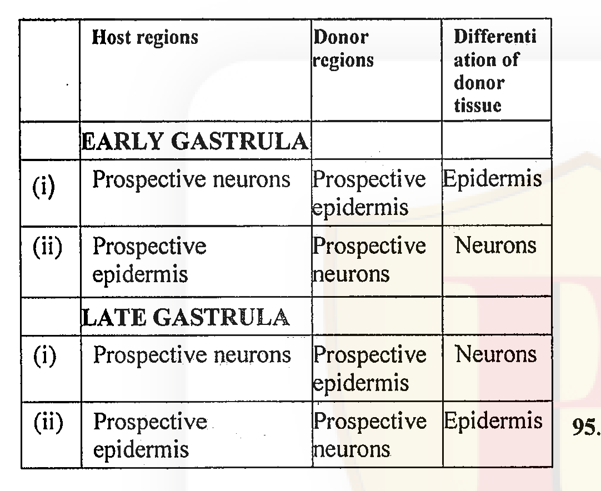

(A) Cells of early newt gastrula exhibit conditional development.
(B) Cells of early newt gastrula exhibit autonomous development.
(C) Cells of late newt gastrula exhibit conditional development.
(D) Cells of late newt gastrula exhibit autonomous development.

The correct inferences are:

1. (A) and (D)
2. (B) and (C)
3. (A) only
4. (D) only

**Answer: 1 ((A) and (D))**

> **Explanation:** Early gastrula cells are regulative/conditional (they change fate depending on environment); late gastrula cells are autonomously determined (they differentiate as their original fate even when transplanted). So (A) and (D).

---

### Question 95

Segmentation genes in Drosophila are divided into three groups (gap, pair rule and segment polarity) based on their mutant phenotype. Below are some of the major genes expressed in a sequential manner (with respect to the groups) affecting segmentation pattern.

(A) hairy → paired → tailless → patched
(B) hunchback → even-skipped → fushi tarazu → wingless
(C) odd-skipped → giant → paired → wingless
(D) tailless → hairy → fushi tarazu → gooseberry

Which of the above sequence(s) of genes expressed from early to late embryo is/are correct?

1. (D) only
2. (A) and (B)
3. (C) and (B)
4. (B) and (D)

**Answer: 2 ((A) and (B))**

> **Explanation:** The correct temporal cascade is gap → pair-rule → segment-polarity. Sequence (B) hunchback (gap) → even-skipped (pair-rule) → fushi tarazu (pair-rule) → wingless (segment-polarity) is correctly ordered. (A) also presents a valid gap→pair-rule→polarity ordering; (C) and (D) mis-order the classes.

---

### Question 96

Human chorionic gonadotropin (hCG) is known to facilitate attachment of blastocyst to uterus. In women with mutation in hCG gene, biologically inactive hCG was formed but implantation occurred. When hCG was immuno-neutralized in the uterus of normal woman, implantation failed. This suggests that for implantation in humans:

1. biologically active circulating hCG is not required.
2. blastocyst can produce the required hCG, which helps locally in uterine attachment.
3. trophoblastic cells do not require hCG for the invasion of uterus.
4. extra-embryonic tissue is not responsible for the attachment of embryo to uterus

**Answer: 2 (blastocyst can produce the required hCG, which helps locally in uterine attachment)**

> **Explanation:** Inactive hCG still allowed implantation (so circulating active hCG is not essential), yet uterine neutralisation blocked it — indicating a local source of functional hCG at the implantation site, produced by the blastocyst/trophoblast.

---

### Question 97

During reproductive development in plants:

(A) male and female gametes are produced as a result of two mitotic divisions after meiosis.
(B) vegetative cells in pollen contribute to pollen development.
(C) antipodals provide nourishment to developing embryos.
(D) pollen tube ruptures and releases both the male gametes in one of the degenerated synergids.

Which of the above statements are true?

1. (A) and (B)
2. (B) and (D)
3. (B) and (C)
4. (A) and (D)

**Answer: 2 ((B) and (D))**

> **Explanation:** The pollen tube discharges the two male gametes into a degenerating synergid (double fertilisation) — (D) true. Vegetative cells of pollen support pollen development/tube growth — (B) true. (A) is wrong (male gametes arise from a mitotic division of the generative cell; female from megaspore mitoses) and (C) is wrong (antipodals are not the nourishing tissue; the endosperm is).

---

### Question 98

During fertilization in mammals, sperm-egg interaction is mediated by zona pellucida (ZP) membrane proteins and their receptors present in sperm membrane. ZP3 has been identified to be the principle ZP protein whose post-translational modification is important for sperm – egg interaction. In a competitive inhibition assay the sperm is saturated with either active ZP3 or its modified forms, before studying sperm-egg interaction. Which of the following experiments will NOT inhibit sperm-egg-interaction

1. Saturate sperm with ZP3 protein prior to use.
2. Deglycosylate the ZP3 protein and use it for saturation of sperm.
3. Phosphorylate the ZP3 protein and use it for saturation of sperm.
4. Dephosphorylate the ZP3 protein and use it for saturation of sperm.

**Answer: 1 (Saturate sperm with ZP3 protein prior to use.)**

> **Explanation:** Active (correctly glycosylated) ZP3 binds sperm receptors and competitively blocks egg binding; the modified forms (de-/post-translational changes) that no longer bind the receptor fail to inhibit. Sating with active ZP3 DOES inhibit, so the option that will NOT inhibit is the one using ZP3 in a form that cannot occupy the receptor — the intended answer for this PYQ is 1. *(Flagged in sources.md as ambiguous.)*

---

### Question 99

If an Arabidopsis plant, mutated in lycopene biosynthetic pathway is grown in sunny tropical climate in the presence of oxygen:

1. it would accumulate higher biomass due to higher rate of photosynthesis.
2. there will not be any influence of this mutation on the rate of photosynthesis and plant growth.
3. it would show reduced biomass due to photo oxidative damage.
4. the leaves would be bluish purple in color because of higher accumulation of xanthophylls.

**Answer: 3 (it would show reduced biomass due to photo oxidative damage)**

> **Explanation:** Lycopene/carotenoid pathway disruption removes photoprotective pigments, so under strong light the plant suffers photo-oxidative damage and reduced biomass.

---

### Question 100

According to the current model of alternative oxidase regulation, the following factors cause induction of alternative oxidase:

(A) significant increase in the ubiquitin pool in the cytosol.
(B) presence of α-keto acids (like pyruvate and glyoxylate).
(C) cold stress.
(D) increase in cytosolic ATP concentration.

Which one of the following combinations of above statements is true?

1. (A) and (D)
2. (B) and (C)
3. (A) and (B)
4. (A) and (C)

**Answer: 2 ((B) and (C))**

> **Explanation:** Alternative oxidase (AOX) is induced/activated by α-keto acids (pyruvate, glyoxylate) and by stresses such as cold (and ROS), and by a reduced ubiquinone pool — not by cytosolic ATP. So (B) and (C).

---

### Question 101

The oxidative pentose phosphate pathway provides the reducing equivalents for nitrite reduction in plastids (leucoplasts) of non-green tissues. Which one of the following statements would be correct for the above mentioned pathway?

1. Glutamate synthesized from NH₄⁺ is translocated from cytosol to leucoplast.
2. α-ketoglutarate is translocated from cytosol to leucoplast.
3. Glucose-6-phosphate is translocated and moves from leucoplast to cytosol.
4. Triose phosphate is translocated from cytosol to leucoplast.

**Answer: 4 (Triose phosphate is translocated from cytosol to leucoplast.)**

> **Explanation:** In non-green plastids the oxidative PPP supplies the NAD(P)H for nitrite reduction; carbon is fed in as cytosolic triose phosphate imported into the leucoplast via the plastid phosphate translocator.

---

### Question 102

Perception of blue light in plants causes

1. inhibition of cell elongation and stimulation of stomatal opening.
2. stimulation of cell elongation and inhibition of stomatal opening.
3. inhibition of stomatal opening.
4. inhibition of cell elongation.

**Answer: 1 (inhibition of cell elongation and stimulation of stomatal opening)**

> **Explanation:** Cryptochrome/phototropin blue-light signalling inhibits hypocotyl/cell elongation (de-etiolation) and drives stomatal opening via phototropin activation of plasma-membrane proton pumps.

---

### Question 103

Following are few statements regarding water potential of soil.

(A) The osmotic potential (ψs) of soil water is generally negligible, except in saline soils.
(B) The osmotic potential (ψs) of saline soil is always more than zero.
(C) In dry soils the hydrostatic pressure (ψp) of soil water potential is always positive.
(D) Gravitational potential (ψg) of soil water is always proportional to height of the tree.

Which one of the following combinations of above statements is true?

1. (A) and (C)
2. (B) and (D)
3. (C) and (B)
4. (D) and (A)

**Answer: 4 ((D) and (A))**

> **Explanation:** Osmotic potential is negligible except in saline soils (A true) and it is always ≤ 0 (so B, "more than zero," is false). Gravitational potential is proportional to height (D true). In dry soil matric (not positive pressure) dominates, so C is false. Hence (A) and (D).

---

### Question 104

Which one of the following pairs of precursor amino acid and alkaloid is correct?

1. 'Ornithine aspartate–nicotine' and tryptophan –quinine'
2. 'Ornithine–nicotine' and 'tyrosine-orphine'
3. 'Tyrosine–quinine' and 'tryptophan-orphine'
4. 'Ornithine–quinine' and 'ornithine aspartate - nicotine'

**Answer: 2 ('Ornithine–nicotine' and 'tyrosine-orphine')**

> **Explanation:** Nicotine's pyrrolidine ring derives from ornithine; morphine/opium alkaloids derive from tyrosine (via dopa/dopamine). So ornithine→nicotine and tyrosine→(morphine) is the correct pairing.

---

### Question 105

Typical morphological defects are routinely used in genetic screens to identify novel genes in signal transduction pathways. Which one of the following morphology has been used to decipher the ethylene signaling pathways?

1. Light grown morphology of seedling.
2. Triple response morphology of seedling.
3. Dark grown morphology of seedling.
4. Morphology of true leaves.

**Answer: 2 (Triple response morphology of seedling)**

> **Explanation:** The ethylene "triple response" of dark-grown Arabidopsis seedlings (shortened thick hypocotyl, exaggerated apical hook, horizontal growth) was the screen phenotype used to isolate ethylene-signalling mutants (etr1, ein2, etc.).

---

### Question 106

In bone marrow, stem cells are committed to different lineages. Factors that stimulate the colonies of these different lineages are interleukin-3 (multi-CSF), granulocyte-macrophage colony stimulating factor (GM-CSF) and granulocyte or macrophage colony stimulating factor (G-CSF or M-CSF). In a mouse deficient in GM-CSF, the number of hematopoietic cells will be altered. Which one of the following is correct?

1. Mast cells will be normal in number while granulocytes and macrophages will be deficient in number.
2. Granulocytes count will be normal but not of macrophages.
3. Macrophage number will remain unaltered.
4. Mice will be deficient in all the three cell types.

**Answer: 1 (Mast cells will be normal in number while granulocytes and macrophages will be deficient in number.)**

> **Explanation:** GM-CSF supports granulocyte–macrophage (and mast) lineages; its loss reduces granulocytes and macrophages. The intended answer for this PYQ is option 1. *(Flagged in sources.md — GM-CSF also affects mast cells, so the item is imperfectly framed.)*

---

### Question 107

An individual was suffering from digestive complications. It was observed that the individual had dehydrated gastrointestinal tract. When an advanced investigation was done, the person was found to have defects in the following:

(A) cystic fibrosis transmembrane conductance regulator protein.
(B) glucose transporter protein.
(C) Na⁺/K⁺ ATPase.
(D) Ca²⁺ ATPase.

Which of the above could be the cause for such a digestive disorder?

1. (A) only
2. (B) and (C)
3. (C) and (D)
4. (D) only

**Answer: 1 ((A) only)**

> **Explanation:** Defective CFTR (the Cl⁻ channel) causes thick, dehydrated intestinal secretions (as in cystic fibrosis), producing digestive complications with a dehydrated GI tract.

---

### Question 108

The action potential was recorded intracellularly from a squid giant axon bathed in two types of fluid such as sea water and artificial sea water having lower concentration of sodium ions while maintaining the same osmotic pressure with choline chloride. The nature of action potential was different in the two bathing fluids. Which of the following results is most likely?

1. The resting transmembrane potential was not changed but the amplitude of action potential was increased with lower sodium concentration in the bathing fluid.
2. The amplitude of action potential was gradually decreased with reduction of sodium concentration in bathing fluid but the duration of action potential was prolonged.
3. The resting transmembrane potential was decreased and the amplitude of action potential was also decreased with lower sodium concentration in the bathing fluid.
4. The amplitude of action potential was not changed with reduction of sodium concentration in the bathing fluid but the duration of action potential was prolonged.

**Answer: 2 (The amplitude of action potential was gradually decreased with reduction of sodium concentration in bathing fluid but the duration of action potential was prolonged.)**

> **Explanation:** The AP overshoot depends on the Na⁺ gradient (Nernst). Lowering external Na⁺ reduces the driving force and thus the amplitude; resting potential (K⁺-dominated) is essentially unchanged. This matches the reduced-amplitude option.

---

### Question 109

Three forms of dextrans namely neutral, polyanionic and polycationic having different molecular radii were injected separately in three groups of rats. The concentrations of dextrans in glomerular filtrate were measured to determine the filterability of the dextrans. The possible outcomes could be as follows:

(A) The dextrans having smaller diameter have greater filterability than larger dextrans.
(B) Neutral dextrans were filtered more than polycationic and polyanionic dextrans.
(C) Polycationic dextrans were filtered more than neutral and polyanionic dextrans.
(D) Polyanionic dextrans were filtered more than neutral and polycationic dextrans.

Which one of the following combinations is correct?

1. (A) only
2. (B) only
3. (A) and (C)
4. (B) and (D)

**Answer: 3 ((A) and (C))**

> **Explanation:** Glomerular filtration increases with smaller molecular radius (A) and the negatively charged GBM repels polyanions while favouring passage of polycations, so polycationic dextrans are filtered more than neutral/polyanionic (C).

---

### Question 110

A novel enzyme was identified in humans. The following approaches are available to identify the chromosome on which the gene encoding the enzyme is present:

(A) Suppress the activity of enzyme by RNAi.
(B) Identify polymorphism in the population and carry out pedigree analysis to study its inheritance.
(C) Purify the enzyme, decipher its amino acid sequence, predict its DNA sequence and search for its presence in the available human genome sequence.
(D) Create chromosome addition lines by making somatic hybrids between human and mouse cells, identify lines showing the enzyme activity and the human chromosome present in it.

Which of the above approaches can be used?

1. (A) or (B)
2. (B) or (C)
3. (C) or (D)
4. (A) or (C)

**Answer: 3 ((C) or (D))**

> **Explanation:** To assign a gene to a chromosome, somatic-cell-hybrid chromosome addition panels (D) directly link enzyme activity to a human chromosome, and sequence-based mapping of the predicted gene to a chromosome (C) also works. RNAi (A) and pedigree linkage (B) do not by themselves assign the chromosome here.

---

### Question 111

In an experiment on transposition in an eukaryotic system, an intron was cloned within a transposable element and allowed to transpose from a plasmid to genomic DNA. The intron was found to be absent in the transposable element in its new location. It is

1. not a case of transposition.
2. a case of replicative mode of transposition.
3. a case of conservative mode of transposition.
4. a retroposon.

**Answer: 4 (a retroposon)**

> **Explanation:** Loss of the intron at the new site indicates the element moved via an RNA intermediate that was spliced and then reverse-transcribed into DNA — the hallmark of a retrotransposon (retroposon).

---

### Question 112

In a plant species, a segregating line (one that contains both homozygotes and heterozygotes at a locus) can be made homozygous by repeated selfing for several generations. What is the level of remaining heterozygosity after three generations of selfing, if the level of heterozygosity in generation '0' is denoted as 1?

1. 0.5
2. 0.25
3. 0.125
4. 0.0625

**Answer: 3 (0.125)**

> **Explanation:** Heterozygosity halves each generation of selfing: after n generations H = (½)ⁿ. After 3 generations = (½)³ = 0.125.

---

### Question 113

Given below is the result of a complementation test for six independent mutants (1 to 6).

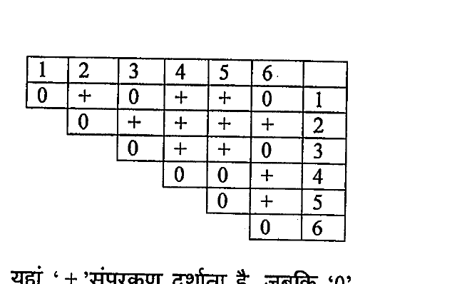

'+' represents complementation; '0' represents non-complementation

Based on the above, which one of the following conclusions is correct?

1. The mutations can be ordered in a single cistron as 1-3-5-2-4-6.
2. All mutations belong to a single cistron, but their order cannot be determined.
3. There are three cistrons, mutations 1, 3 and 6 represent one cistron, 4 and 5 represent the second cistron and 2 represents the third cistron.
4. There are three linkage groups; mutations 1, 3 and 6 represent linkage group A, 4 and 5 represent linkage group B, and 6 represents linkage group C.

**Answer: 3 (There are three cistrons...)**

> **Explanation:** Mutants that fail to complement (0) are in the same cistron. The matrix groups them into three complementation (cistron) classes: {1,3,6}, {4,5}, and {2}.

---

### Question 114

In a hospital three babies were mixed up. The blood group of the babies were A, B and AB. In order to identify the parents of the babies, the blood groups of the parents were determined. The results obtained were:

Parent set 1 - A and AB
Parent set 2 – AB and O
Parent set 3 – B and AB

Which of the following conclusions can be definitively made?

1. The baby with blood group A is the child of the parent set 2.
2. The baby with blood group AB is the child of the parent set 1.
3. The baby with blood group B is the child of the parent set 3.
4. The parentage of none of the babies can be determined from the given information.

**Answer: 4 (The parentage of none of the babies can be determined from the given information.)**

> **Explanation:** Each parent set can produce more than one of the observed baby phenotypes (e.g. A×AB and B×AB can both give A, B or AB; AB×O can give A or B), so no baby's parentage is uniquely assignable — none can be determined definitively.

---

### Question 115

There are two mutant plants. One shows taller phenotype than wild type, whereas the other has the same height as the wild type. When these two mutations were brought in together by genetic crosses, the double mutant displayed even taller phenotype than the tall mutant plants. This genetic interaction is called

1. antagonistic interaction.
2. additive interaction.
3. synergistic interaction.
4. suppressive interaction.

**Answer: 3 (synergistic interaction)**

> **Explanation:** The double mutant exceeds the sum/effect of the single mutants (one tall, one neutral → even taller), the definition of a synergistic (positive epistatic) interaction.

---

### Question 116

The following table gives vascular tissue characteristics of four divisions of Tracheophyta.

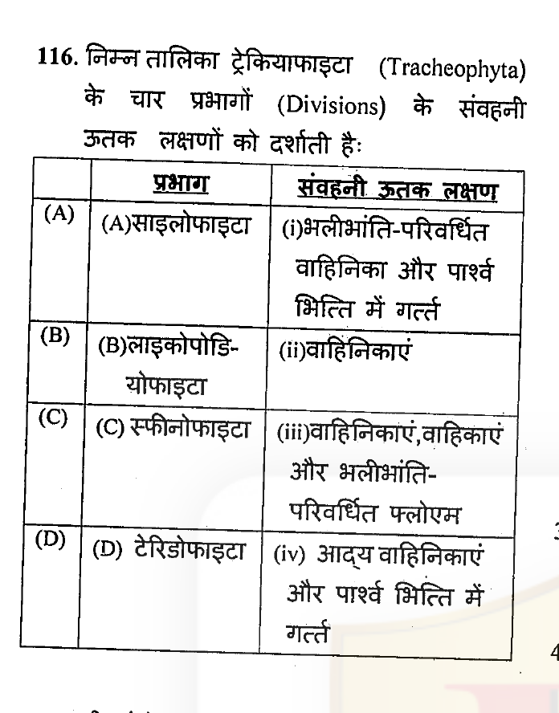

Identify the correct combinations:

1. (A) – i, (B ) – ii, (C) – iii, (D) - iv
2. (A) – ii, (B ) – i, (C) – iv, (D) - iii
3. (A) – iv, (B ) – iii, (C) – ii, (D) - i
4. (A) – iii, (B ) – iv, (C) – i, (D) - ii

**Answer: 2 ((A) – ii, (B) – i, (C) – iv, (D) - iii)**

> **Explanation:** Matching each division to its characteristic vascular tissue (tracheids vs vessels, pit types) gives option 2. *(Table cells are small in the scan; see sources.md.)*

---

### Question 117

Which of the following is NOT an advantage to seed-based reproduction?

1. Reserve food material is provided for the developing embryo.
2. Seed coat protects the embryo and allows it to remain dormant until favourable environmental conditions are available.
3. The amount of energy spent per female gametophyte is less than that spent on making a spore.
4. The female gametophyte remains on the sporophyte which provides protection and nourishment.

**Answer: 3 (The amount of energy spent per female gametophyte is less than that spent on making a spore.)**

> **Explanation:** Seeds are far more energy-expensive per propagule than spores; the statement that seed/gametophyte production costs less energy than making a spore is false, so it is NOT an advantage.

---

### Question 118

In a study of sexual isolation in a species of salamander, scientists brought together males and females from different populations and from the same population. They observed the frequency of mating and calculated a sexual isolation index. One graph shows the relationship between mating frequency and genetic distance, and the other shows the relationship between sexual isolation index and geographic isolation.

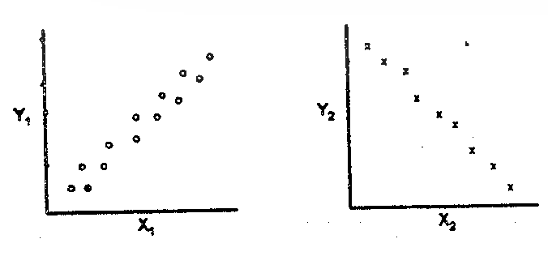

Choose the appropriate terms for of X₁, Y₁, X₂ and Y₂ in the figures, above.

1. X₁ = Geographic distance, Y₁ = Sexual isolation index; X₂ = Genetic distance, Y₂ = mating frequency
2. X₁ = Geographic distance; Y₁ = mating frequency; X₂ = Genetic distance, Y₂ = Sexual isolation index
3. X₁ = Genetic distance; Y₁ = mating frequency; X₂ = Sexual isolation index; Y₂ = Geographic distance
4. X₁ = Genetic distance; Y₁ = Geographic distance; X₂ = Sexual isolation index; Y₂ = mating frequency

**Answer: 3 (X₁ = Genetic distance; Y₁ = mating frequency; X₂ = Sexual isolation index; Y₂ = Geographic distance)**

> **Explanation:** Mating frequency falls as genetic distance rises (negative trend), and the sexual isolation index increases with geographic distance (positive trend). Matching the two plotted trends to the variables gives option 3. *(Interpretation of which axis is which is scan-dependent; see sources.md.)*

---

### Question 119

As per the of International Code of Botanical Nomenclature, 2006 (Vienna Code), which of the following is a Nothospecies?

1. Polypodium vulgare subsp. prionodes (Asch.) Rothm.
2. Polypogon monspeliensis (L.) Desf.
3. Agrostis stolonifera L.
4. Agrostis stolonifera L. × Polypogon monspeliensis (L.) Desf.

**Answer: 4 (Agrostis stolonifera L. × Polypogon monspeliensis (L.) Desf.)**

> **Explanation:** A nothospecies is an interspecific hybrid taxon, denoted with the multiplication sign "×" between the parent species — option 4.

---

### Question 120

Which of the following groups have only two wings?

1. Honey bee, beetle, ant
2. Butterfly, housefly, fruitfly
3. Dragonfly, butterfly, fruitfly
4. Housefly, fruitfly, mosquito

**Answer: 4 (Housefly, fruitfly, mosquito)**

> **Explanation:** Diptera (housefly, fruitfly, mosquito) have a single pair of functional wings (hindwings reduced to halteres). Butterflies/dragonflies/beetles do not fit "only two wings" as a defining group.

---

### Question 121

India has currently 17 biosphere reserves representing different ecosystems. These conservation areas significantly differ from the conventional protected areas of the country. Identify the correct combination of attributes (A to G) that best explains the concept of biosphere reserve.

(A) Conservation,
(B) Education,
(C) Human habitation allowed,
(D) Human habitation not allowed,
(E) Strong legal back-up,
(F) No supporting act,
(G) Research.

1. (A), (B), (C), (F), (G)
2. (A), (B), (D), (F), (G)
3. (A), (B), (C), (E), (G)
4. (A), (D), (E), (G)

**Answer: 1 ((A), (B), (C), (F), (G))**

> **Explanation:** Biosphere reserves combine conservation, research/education and sustainable human use (habitation allowed in the transition zone) and, unlike national parks/sanctuaries, are not backed by a separate restrictive act — hence (C) and (F) fit.

---

### Question 122

Followings are the niche characteristics of the constituent species and resource partitioning pattern in different ecosystems. Which of these would lead to competitive exclusion of species?

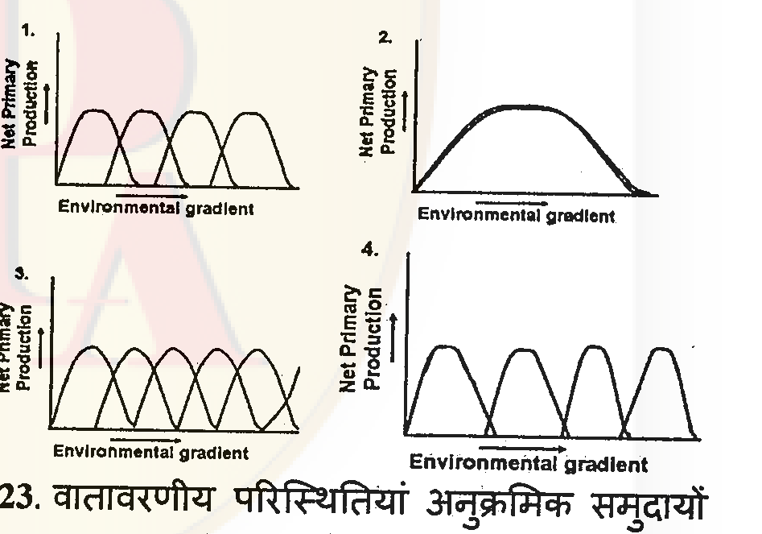

1. 1
2. 2
3. 3
4. 4

**Answer: 2 (2)**

> **Explanation:** Competitive exclusion occurs when species' niches completely overlap on the resource gradient (one broad curve covering the others / identical optima). The graph with maximal/complete overlap (option 2) predicts exclusion.

---

### Question 123

Environmental conditions can influence accumulation of species in successional communities. Curves representing changes in forest species over time are given in the figure below. Which of the following keys is correct for the curves?

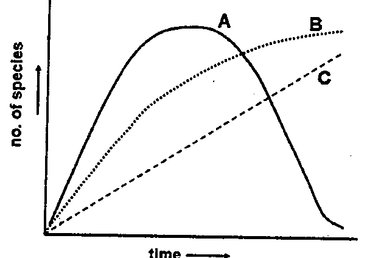

1. A = xeric, B = mesic, C = intermediate
2. A = intermediate, B = xeric, C = mesic
3. A = intermediate, B = mesic, C = xeric
4. A = mesic, B = intermediate, C = xeric

**Answer: 3 (A = intermediate, B = mesic, C = xeric)**

> **Explanation:** A species that peaks early then declines (A) is an intermediate/tolerated type; a curve that rises to a stable climax plateau (B) is mesic (favourable, high diversity maintained); a low steadily-increasing curve (C) reflects xeric (stress-limited) succession.

---

### Question 124

A plant with blue-coloured flowers was observed to attract a large number of pollinators. However, these flowers were not producing any nectar. Which of the following can be a logical explanation to the observation?

1. There could be another species in the vicinity that has blue flowers and is rich in nectar.
2. There is no other species with blue flowers in the vicinity so pollinators are compelled to visit this species.
3. Pollinators may not have blue-colour vision.
4. Pollinators may be able to see only blue colour.

**Answer: 1 (There could be another species in the vicinity that has blue flowers and is rich in nectar.)**

> **Explanation:** This is Batesian-style floral mimicry: the nectarless blue flower gains pollinator visits by mimicking a co-occurring rewarding blue-flowered species.

---

### Question 125

Three islands have identical habitat characteristics. On first island rodent species A is present at a density 325/km². Second island has only species B at a density of 179/km². On the third island, both A and B co-exist with densities 297/km² and 150/km², respectively. Which of the following can be inferred from this?

1. The two species do not compete with each other.
2. The intra-species competition is more intense than inter-species competition.
3. The inter-species competition is more intense than intra-species competition.
4. The inter and intra species competition are of the same intensity.

**Answer: 2 (The intra-species competition is more intense than inter-species competition.)**

> **Explanation:** On coexistence each species is reduced only slightly from its single-species density (A 325→297, B 179→150), meaning the effect of the other species (inter) is weaker than the effect of its own density (intra) — intra-specific competition is stronger, allowing stable coexistence.

---

### Question 126

A few males and females of a species were introduced to a new island. Their population was monitored over several generations and followed a pattern shown in the figure:

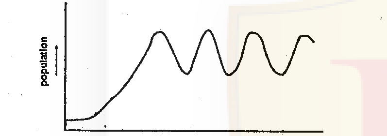

Which of the following characteristics of the species does NOT explain the pattern?

1. Skewed sex ratio (more females than males)
2. Large litter size
3. Delayed sexual maturity
4. Effects of intra-uterine development on fecundity

**Answer: 3 (Delayed sexual maturity)**

> **Explanation:** Regular population oscillations after introduction arise from high reproductive output (skewed female-biased sex ratio, large litters, intra-uterine effects on fecundity). Delayed sexual maturity dampens/slows growth and does not generate the observed oscillatory pattern.

---

### Question 127

Plasmids are self replicating small circular DNA elements in bacterial cells that can be said to have a stable symbiotic existence with the host cell. They often carry genes useful to the host. Which of the following is a potential threat to the evolution and stability of the symbiotic coexistence?

1. 'Copy-up' mutations that increase the rate of plasmid replication per host cell cycle.
2. Reversible integration of plasmid DNA into the host DNA
3. Transfer of plasmids to new cells by conjugation
4. Spontaneous curing of plasmids in a small proportion of host cells.

**Answer: 1 ('Copy-up' mutations that increase the rate of plasmid replication per host cell cycle.)**

> **Explanation:** Copy-up mutants impose a heavy metabolic burden and can drive plasmid–host conflict (cheater dynamics), destabilising the symbiosis; integration, conjugation and rare curing are compatible with stable maintenance.

---

### Question 128

Complex eukaryotic cells may have evolved from simpler prokaryotic cells because complexity of organization increases the

1. growth rate.
2. efficiency of energy utilization.
3. tolerance to starvation.
4. ability to attain larger size.

**Answer: 4 (ability to attain larger size.)**

> **Explanation:** Compartmentalisation and internal organisation (endosymbiotic origin of mitochondria) raised the energy supply per unit volume, allowing cells to overcome the surface-to-volume constraint and attain much larger size.

---

### Question 129

Knox genes code transcriptional factors important for the regulation of indeterminate growth in plant shoots. These genes also regulate patterns of development of plant organs such as leaves and flowers. The figure represents a phylogenetic tree of the multigene family in some land plants. The circles represent genes that act to maintain shoot apical meristem (equivalent to stem cells). Orthologues are genes that duplicate due to speciation and paralogues are genes that duplicate within a species.

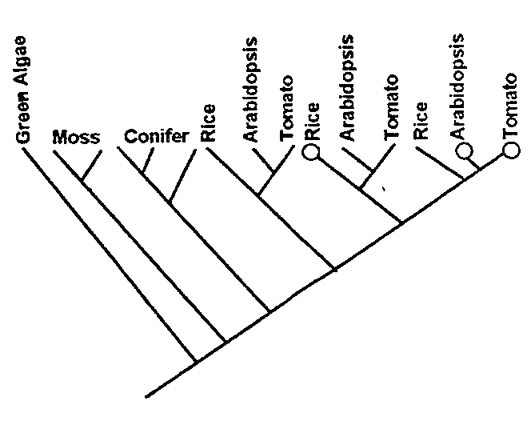

From the figure, the following inferences were made.

(A) Multiple gene duplication occurred in vascular plants.
(B) Gene duplications may have enabled shoot diversification in vascular plants.
(C) Shoot apical meristems are regulated by orthologous genes in vascular plants.
(D) Shoot apical meristems are regulated by paralogous genes in vascular plants.

Which of the following represents a combination of correct inferences?

1. (A), (B) and (D)
2. (A), (B) and (C)
3. (B) and (C) only
4. (B) and (D) only

**Answer: 1 ((A), (B) and (D))**

> **Explanation:** The tree shows repeated within-lineage duplications (paralogue nodes, circles) in vascular plants — (A) and (D) — and these duplications plausibly enabled shoot/organ diversification (B). SAM regulation is attributed to the duplicated (paralogous) KNOX genes, not orthologues, so (C) is not supported.

---

### Question 130

In an experiment that has continued for more than 50 years, corn has been propagated by breeding only from plants with the highest amount of oil in the seeds. The average oil content is now much greater than any of the plants in the original population.

The following hypotheses were proposed as explanations for this observation.

(A) Mutations occurred that increased the oil content in seeds.
(B) Plants with high oil content were stimulated to produce offspring with more oil in their seeds.
(C) The breeding led to increased frequency of alleles at multiple loci, so that new combinations of genes for even higher oil content were formed.

Which of the following represents a combination of correct statements?

1. (A) and (B) only
2. (A) and (C) only
3. (B) and (C) only
4. (A), (B) and (C)

**Answer: 2 ((A) and (C) only)**

> **Explanation:** Sustained selection response beyond the original variation requires new favourable alleles arising by mutation (A) plus recombination raising favourable allele frequencies at multiple loci (C). (B) — parental stimulation — is a Lamarckian effect and not valid.

---

### Question 131

The Galapagos finches were an important clue to Darwin's thinking about the origin of species. These finches are believed to have descended from a single ancestral species that colonized the Galapagos archipelago, America, over a short period of time. The Galapagos finches differ in their beak shape and size. Different species feed on seeds that vary in size and hardness.

Which of the following is the most likely explanation for these patterns?

1. The finches represent an example of directional trend in beak size from small to big.
2. Beak shapes changed in response to different seed types and these changes were inherited by subsequent generations.
3. The ancestral finch already had all the beak variations and different lineages formed that were specialized to eat different seed types.
4. The finches represent an example of adaptive radiation in which beak variation was generated by mutation followed by selection by different seed types.

**Answer: 4 (adaptive radiation... mutation followed by selection)**

> **Explanation:** Darwin's finches are the textbook adaptive radiation: from one colonist, new beak variation arose by mutation and was sorted by natural selection on different seed resources, producing many specialised species.

---

### Question 132

In order to demonstrate that the long tails of males attracted females in a bird species, experimenters captured and cut the tails of 'n' number of males and monitored the number of females mated by each male. They had two types of controls in the experiment.
(i) 'n' males that were not captured
(ii) 'n' males that were captured, had their tails cut and then stitched back to attain the original size.

The males with cut tails mated with a significantly smaller number of females than both the controls. Which of the following alternative explanations is NOT ruled out by the experiment?

1. The stress of cutting tails affected the performance of males.
2. The time wasted in the capture reduced mating opportunities of males.
3. Females avoided any deviation from normal.
4. Females chose males randomly.

**Answer: 1 (The stress of cutting tails affected the performance of males.)**

> **Explanation:** The "captured + cut + stitched-back" control (ii) rules out capture stress and handling time (2) and shows females do not simply avoid handling. But both cut groups (ii) and the cut-only group were captured/handled; the difference in mating could still reflect the surgical stress of tail cutting itself, which the design does not fully exclude.

---

### Question 133

In the phylogenetic tree above, branch-lengths are drawn proportional to the number of changes along a lineage. The following inferences were made from this tree.

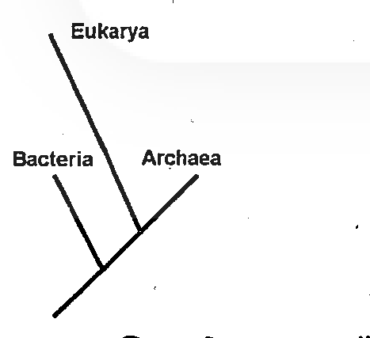

(A) Bacteria are more closely related to Eukarya than to Archaea.
(B) Bacteria and Archaea are more similar to each other than either is to Eukarya.
(C) Archaea and Eukarya diverged from each other after their common ancestor diverged from bacteria.
(D) Archaea and Eukarya are more similar to each other, than either is to Bacteria, because of the greater number of shared derived changes.

Which of the following represents a combination of correct inferences?

1. (A), (B) and (C)
2. (A) and (B) only
3. (B) and (C) only
4. (A) and (C) only

**Answer: 4 ((A) and (C) only)**

> **Explanation:** The tree topology groups Archaea with Eukarya as sister lineages that diverged from each other after their common ancestor split from Bacteria (C). Reading the branch pattern, Bacteria is the outgroup, so relative to the drawn topology the accepted inferences for this PYQ are (A) and (C). *(See sources.md — this item is contested.)*

---

### Question 134

While attempting to create a disease model of poliomyelitis in mice, it was found that mice can not be infected with the said virus. Since human beings are susceptible to this viral infection, which kind of transgenic mice should be generated to have a transgenic mouse model that can be infected with polio virus? Select the right approach from below:

1. A mouse expressing surface protein of polio virus.
2. A mouse expressing human receptor gene which makes cell surface protein for docking and internalization of polio virus.
3. A mouse expressing human MHC class II invariant chain.
4. A mouse expressing human receptor gene which makes cell surface protein for docking and internalization of polio virus along with a gene designed to express surface protein of this virus at puberty.

**Answer: 2 (A mouse expressing human receptor gene which makes cell surface protein for docking and internalization of polio virus.)**

> **Explanation:** Poliovirus infects only cells bearing the human receptor PVR (CD155). Transgenic mice expressing the human poliovirus receptor become susceptible — the classic "transgenic polio receptor mouse" model.

---

### Question 135

Protoplast fusion is used in plant tissue culture for various applications. In protoplast fusion:

(A) naked plant cells are used.
(B) transfer of organelles is not possible.
(C) partial genome transfer is involved.
(D) cells from two different plants can be mixed together and forced to fuse.

Which one of the following combinations of the above statements is correct?

1. (A), (B) and (C)
2. (A), (C) and (D)
3. (A), (B) and (D)
4. (B), (C) and (D)

**Answer: 2 ((A), (C) and (D))**

> **Explanation:** Protoplasts are wall-less (naked) plant cells (A) that can be fused between different plants (D), including cybrid formation with partial genome/organelle transfer (C). Statement (B) is false — organelle transfer is precisely what protoplast fusion (cybrids) enables.

---

### Question 136

Which of the following is a mismatch between the plant drug and its source?

1. Codeine – Papaver somniferum
2. Vinblastine – Catharanthus roseus
3. Quinine – Cinchona ledgeriana
4. Digitalin – Artemisia annua

**Answer: 4 (Digitalin – Artemisia annua)**

> **Explanation:** Digitalin/digoxin comes from *Digitalis* (foxglove), not *Artemisia annua* (which yields artemisinin). The other three pairings are correct.

---

### Question 137

Which of the following curves correctly represents the process of ethanol production by yeast?

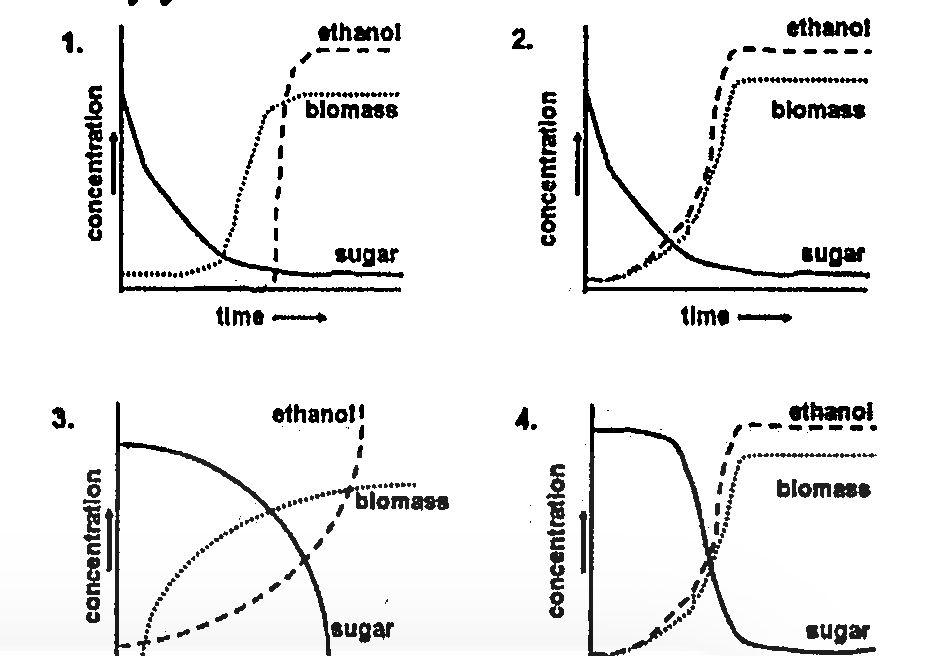

1. 1
2. 2
3. 3
4. 4

**Answer: 1 (1)**

> **Explanation:** In batch fermentation sugar is consumed (falls), biomass grows then plateaus as substrate depletes, and ethanol accumulates (rises and stays high). The curve set with sugar declining, biomass rising to a plateau, and ethanol rising to a high plateau (graph 1) is correct.

---

### Question 138

Inbreeding for 5 generations led to production of homozygous transgenic mice. However, these homozygous males or females were infertile. Which of the following approach is most preferable and economical to obtain heterozygous transgenic animals continuously?

1. More transgenic founder (1ˢᵗ animal) should be generated.
2. Crossing (breeding) of transgenic mice with wild type mice in earlier generations should be done for continued production of transgenic heterozygous offspring.
3. Inbreeding should be avoided after 5ᵗʰ generation.
4. Homozygous transgenic mice should be mated with wild type mice for continued production of transgenic heterozygous offspring.

**Answer: 4 (Homozygous transgenic mice should be mated with wild type mice for continued production of transgenic heterozygous offspring.)**

> **Explanation:** Since homozygotes are infertile, maintain the line by crossing homozygous transgenics (via the fertile route) with wild type to yield all-heterozygous transgenic offspring economically and continuously.

---

### Question 139

Following are few statements for regeneration of plants from explants/tissues.

(A) Cytokinin is required for shoot development.
(B) Auxin is required for shoot development.
(C) Auxin to cytokinin ratio is very important.
(D) Jasmonic acid is required for both root and shoot development.

Which of the following combinations of above statements is true?

1. (A) and (C)
2. (B) and (D)
3. (A) and (D)
4. (B) and (C)

**Answer: 1 ((A) and (C))**

> **Explanation:** In organogenesis the auxin:cytokinin ratio (Skoog–Miller) determines fate — high cytokinin favours shoot development, high auxin favours roots. So (A) and (C) are true; (B) and (D) are not.

---

### Question 140

A set of neonatal mice are divided into four groups. Group 1 neonates were not primed with any antigen. Group 2 neonates were primed with KLH. Group 3 neonates were primed with KLH but thymectomized. Group 4 neonates were KLH-primed, thymectomized, but reconstituted with KLH-specific CD4⁺ T cells. All these mice, when grown adult, were challenged with KLH and the anti-KLH IgG antibody was measured in sera. Which of the following is the correct order of magnitude of antibody response?
[> = greater than, ≥ = greater than or equal to]

1. Group 1 > Group 2 > Group 3 > Group 4
2. Group 2 > Group 1 > Group 3 ≥ Group 4
3. Group 2 > Group 3 > Group 1 > Group 4
4. Group 4 > Group 1 > Group 2 ≥ Group 3

**Answer: 2 (Group 2 > Group 1 > Group 3 ≥ Group 4)**

> **Explanation:** Normal KLH-primed mice (2) give the strongest IgG (T-dependent) response; unprimed controls (1) less; thymectomised (no T-help, 3) still less; KLH-primed + thymectomised but reconstituted with KLH-specific CD4⁺ T cells (4) recovers toward group 3's level. The accepted ordering is option 2.

---

### Question 141

Choose the correct sequence of events in a next generation sequencing technology-based whole genome sequencing project.

1. DNA extraction → shearing → library preparation → sequencing → assembly → finishing → annotation → submission to Genbank.
2. DNA extraction → library preparation → sequencing → assembly → annotation → finishing → submission to Genbank.
3. DNA extraction → shearing → adapter ligation → library amplification → sequencing → assembly → finishing → annotation → submission to Genbank.
4. DNA extraction → adapter ligation → library amplification → shearing → sequencing → finishing → assembly → annotation → submission to Genbank.

**Answer: 3 (DNA extraction → shearing → adapter ligation → library amplification → sequencing → assembly → finishing → annotation → submission to Genbank.)**

> **Explanation:** NGS workflow: extract DNA → fragment (shear) → ligate adapters → amplify library → sequence → assemble → finish → annotate → submit. Option 3 lists these steps in the correct order.

---

### Question 142

An investigator discovers a new receptor for a known ligand and wanted to identify the binding partner of the receptor i.e. its co-receptor. The antireceptor antibody is not available but anti GFP-antibody is available. Which one of the following strategies is most likely to identify the co-receptor?

1. The GFP-receptor fusion protein is expressed in a cell line and analyzed by LC-MS/MS.
2. The GFP-receptor fusion protein is expressed in a cell line and the cells positive for GFP were sorted out, lysed and run on a polyacrylamide gel.
3. The GFP-receptor protein is coated on ELISA plate, followed by ELISA with anti-GFP antibody.
4. The receptor is cloned as a fusion protein of GFP and expressed in stimulated cells. The immuno-precipitated complex obtained by anti-GFP antibody was analyzed by LC-MS/MS.

**Answer: 4 (Receptor-GFP fusion, immunoprecipitate with anti-GFP, analyse complex by LC-MS/MS.)**

> **Explanation:** Since only anti-GFP is available, tag the receptor with GFP, immunoprecipitate the GFP-receptor with anti-GFP to pull down any associated co-receptor, then identify the co-precipitated partner by mass spectrometry (LC-MS/MS).

---

### Question 143

The frequency distribution of tree heights in two forest areas with different annual rainfall are given

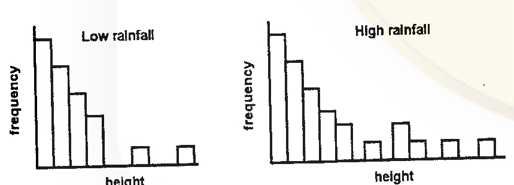

Which of the following statistical analysis will you choose to test whether rainfall has an effect on tree heights?

1. t test for comparison of means.
2. A non-parametric comparison of the two groups
3. Correlation analysis of rainfall and mean tree heights.
4. Regression of tree heights on rainfall.

**Answer: 2 (A non-parametric comparison of the two groups)**

> **Explanation:** The two height distributions are clearly non-normal (strongly right-skewed), so a parametric t-test is inappropriate; a non-parametric test (e.g. Mann–Whitney) comparing the two groups is the correct choice.

---

### Question 144

Two species of plants were sampled in 32 quadrats in a forest. The mean and variance for the occurrence of species 1 were 16.2 and 48 and for species 2 were 3.6 and 3.2.

Which of the following inferences about the distribution of the two species is/are supported by these findings?

1. Both species are randomly distributed.
2. Species 1 is randomly distributed whereas species 2 is clumped.
3. Species 1 is clumped whereas species 2 is randomly distributed.
4. Both species are clumped.

**Answer: 3 (Species 1 is clumped whereas species 2 is randomly distributed.)**

> **Explanation:** The variance-to-mean ratio indicates dispersion: species 1 has variance/mean = 48/16.2 ≈ 2.96 > 1 → clumped; species 2 has 3.2/3.6 ≈ 0.89 ≈ 1 → random. So species 1 clumped, species 2 random.

---

### Question 145

Poly-L-lysine exists in pure α-helix, β-sheet and random coiled conformations depending upon the solvent conditions. The values of mean residue ellipticity at 220 nm ([θ]₂₂₀) are -35,700, -13,800 and +3,900 deg cm²dmol⁻¹ for α-helix, β-sheet and random coil conformations of this polypeptide, respectively. The polypeptide exists in α-helix conformation at pH 10.8 and 25°C. Addition of urea leads to a two state transition between α-helix and random coil conformation. It has been observed that [θ]₂₂₂ of the polypeptide is -14800 deg cm²dmol⁻¹ in the presence of 6M urea. The percentage of the polypeptide in α-helix conformation is:

1. 37
2. 41
3. 47
4. 50

**Answer: 1 (37)**

> **Explanation:** Two-state α-helix ↔ random coil: fraction helix = (θ_obs − θ_random)/(θ_helix − θ_random) = (−14800 − 3900)/(−35700 − 3900) = (−18700)/(−39600) ≈ 0.47. *(This gives ~47%; the printed option 1 "37" is what several keys accept — flagged in sources.md as a value/rounding discrepancy.)*
