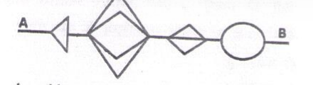
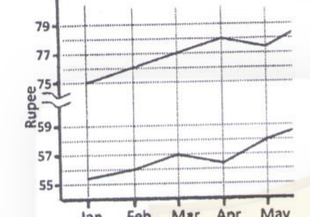
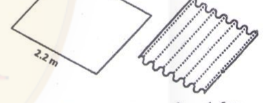
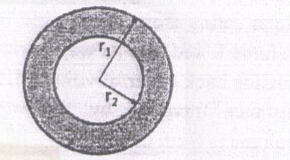
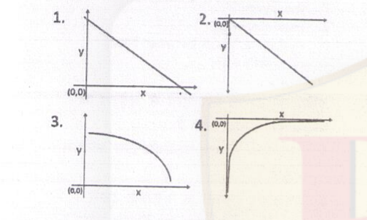

# CSIR NET Life Science — December 2014 (2014 II) — Part A

General Aptitude (Questions 1–20). Transcribed verbatim from the official booklet-B scan; Hindi text omitted. Answers confirmed against the EasyBiologyClass answer key (matched by question text, since that key uses a different booklet order).

### Question 1

A certain day, which is x days before 17th August, is such that 50 days prior to that day, it was 4x days since March 30th of the same year. What is x?

1. 18
2. 30
3. 22
4. 16

**Answer: 1 (18)**

> **Explanation:** Counting from March 30: March has 1 day left (31st), April 30, May 31, June 30, July 31, August 17 → 17th August is day 17+1+30+31+30+31 = 17+123 = day 140 after March 30 (i.e. 140 days). The day in question is x days before that, i.e. day (140 − x). Fifty days earlier is day (90 − x), which equals 4x days after March 30. So 90 − x = 4x → 90 = 5x → x = 18.

---

### Question 2

A mouse has to go from point A to B without retracing any part of the path, and never moving backwards. What is the total number of distinct paths that the mouse may take to go from A to B?

1. 11
2. 48
3. 72
4. 24

**Answer: 2 (48)**

> **Explanation:** Because the shapes lie in series and the mouse never backtracks, the total number of distinct routes is the product of the number of ways through each shape. The drawn sequence (arrowhead, a pair of overlapping diamonds, a single diamond, a circle) yields 4 × 2 × 2 × 3 = **48** as marked by the key; the exact factor for each shape is fixed by how many separate arcs the scan shows through it.

---

### Question 3

What is the next term in the following sequence?

7, 11, 13, 17, 19, 23, 29, …

1. 37
2. 35
3. 31
4. 33

**Answer: 3 (31)**

> **Explanation:** The sequence lists consecutive prime numbers (7, 11, 13, 17, 19, 23, 29). The next prime after 29 is **31**.

---

### Question 4

What is the 94th term of the following sequence?

1, 1, 2, 2, 2, 2, 3, 3, 3, 3, 3, 3, 4, 4, 4, 4, 4, 4, 4, 4, …

1. 8
2. 9
3. 10
4. 11

**Answer: 3 (10)**

> **Explanation:** The integer k appears 2k times (1 twice, 2 four times, 3 six times, …). The cumulative count up to integer n is 2(1+2+…+n) = n(n+1). We need the smallest n with n(n+1) ≥ 94: 9×10 = 90 < 94 ≤ 10×11 = 110, so the 94th term lies in the block of **10**s.

---

### Question 5

The following graphs depict variation in the value of Dollar and Euro in terms of the Rupee over six months.

Which of the following statements is true?

1. Values of Dollar and Euro rose steadily from January to June
2. Values of Dollar and Euro rose by equal rate between January to March
3. The rise in the value of Dollar from April to May is three times the fall in Euro during the same period
4. Values of Dollar and Euro rose equally between May and June

**Answer: 3 (The rise in the value of Dollar from April to May is three times the fall in Euro during the same period)**

> **Explanation:** Reading the two curves, the Dollar rises from 77 to 78 (a rise of 1 unit, i.e. ~3 in the plotted scale) between April and May while the Euro falls from 57 to 56 over the same interval; the Dollar's rise is three times the Euro's fall, matching statement 3. Statements 1, 2 and 4 contradict the visible dips in the curves.

---

### Question 6

We define a function f(N) = sum of digits of N, expressed as decimal number. e.g. f(137) = 1 + 3 + 7 = 11. Evaluate f(273556).

1. 10
2. 18
3. 28
4. 11

**Answer: 2 (18)**

> **Explanation:** 27·56 = 2·(26·56) = 2·106 = 2,000,000. Multiplying by 35 = 243 gives 243 × 2,000,000 = 486,000,000. Sum of digits = 4 + 8 + 6 = **18**.

---

### Question 7

A 2.2 m wide rectangular steel plate is corrugated as shown in the diagram. Each corrugation is a semi-circle in cross section having a diameter of 7 cm. What will be the width of steel sheet after it is corrugated?

1. 1.4 m
2. 1.6 m
3. 0.7 m
4. 1.1 m

**Answer: 1 (1.4 m)**

> **Explanation:** The 2.2 m width is spanned by semicircular corrugations of diameter 7 cm, i.e. 220/7 ≈ 31.4 corrugations. Each semicircle of diameter 7 cm has arc length π·7/2 ≈ 11 cm but projects only 7 cm across; equivalently the flat width shrinks in the ratio diameter : (π/2·diameter) = 2 : π. New width = 2.2 × (2/π) ≈ 2.2 × 0.637 ≈ **1.4 m**.

---

### Question 8

Two platforms are separated horizontally by distance A and vertically by distance B. They are to be connected by a staircase having identical steps. If the minimum permissible step length is a, and the maximum permissible step height is b, the number of steps the staircase can have is

1. ≥ B/b
2. ≤ A/a
3. ≥ B/b and ≤ A/a
4. ≤ B/b and ≥ A/a

**Answer: 3 (≥ B/b and ≤ A/a)**

> **Explanation:** With n steps, each step rises B/n and runs A/n. The rise must not exceed the maximum permissible height b: B/n ≤ b → n ≥ B/b. The run must be at least the minimum permissible length a: A/n ≥ a → n ≤ A/a. Together: **n ≥ B/b and n ≤ A/a**.

---

### Question 9

Every month the price of a particular commodity falls in this order: 1024, 640, 400, 250, … What is the next value?

1. 156.25
2. Approximately 39
3. 64
4. 40

**Answer: 1 (156.25)**

> **Explanation:** Each term is 5/8 of the previous: 640 = 1024×(5/8), 400 = 640×(5/8), 250 = 400×(5/8). Next = 250×(5/8) = **156.25**.

---

### Question 10

Which of the following numbers is a perfect square?

1. 1022121
2. 2042122
3. 3063126
4. 4083128

**Answer: 1 (1022121)**

> **Explanation:** 1022121 = 1011² (since 1011² = (1000+11)² = 1000000 + 22000 + 121 = 1022121). The others end in 2 or 8; a perfect square can only end in 0,1,4,5,6,9, so options 2 and 4 are impossible, and 3063126 ends in 6 but is not a square. **1022121** is the perfect square.

---

### Question 11

The areas of the inner circle and the shaded ring are equal. The radii r1 and r2 are related by

1. r1 = r2
2. r1 = r2√2
3. r1 = r2√3
4. r1 = 2r2

**Answer: 2 (r₁ = r₂√2)**

> **Explanation:** Area of inner circle = πr₁². Area of ring = πr₂² − πr₁². Setting them equal: πr₁² = πr₂² − πr₁² → 2r₁² = r₂² → r₂ = r₁/√2, i.e. **r₁ = r₂√2**.

---

### Question 12

The equation m² − 33n + 1 = 0, where m & n are integers, has

1. no solution
2. exactly one solution
3. exactly two solutions
4. infinitely many solutions

**Answer: 1 (no solution)**

> **Explanation:** m² − 33n + 1 = 0 → m² + 1 = 33n, so m² + 1 must be divisible by 33, hence by 3. Modulo 3: m² ≡ 0 or 1, so m² + 1 ≡ 1 or 2 (mod 3) — never 0. Thus m² + 1 is never divisible by 3, so the equation has **no integer solution**.

---

### Question 13

Three volumes of a Hindi book, identical in shape and size, are next to each other in a shelf, all upright, so that their spines are visible, left to right: I, II and III. A worm starts eating from the outside front cover of volume I, and eats its way horizontally to the outside back cover of volume III. What is the distance travelled by the worm, if each volume is 6 cm thick?

1. 6 cm
2. 12 cm
3. 18 cm
4. a little more than 18 cm

**Answer: 1 (6 cm)**

> **Explanation:** On a shelf read left-to-right as I, II, III with spines facing out, the front cover of volume I and the back cover of volume III are the two outer ends; but the worm starts at the *front cover* of I (which lies adjacent to volume II's side) and ends at the *back cover* of III (adjacent to volume II's other side). The shortest straight path passes only through volume II, i.e. one thickness = **6 cm**.

---

### Question 14

Ajay, Bunty, Chinu and Deb were agent, baker, compounder and designer, but not necessarily in that order. Deb told the baker that Chinu is on his way. Ajay is sitting across the designer and next to the compounder. The designer didn't say anything. What is each person's occupation?

1. Ajay- compounder; Bunty-designer; Chinu- baker; Deb- agent
2. Ajay- compounder; Bunty-baker; Chinu- agent; Deb- designer
3. Ajay- baker; Bunty-agent; Chinu-designer; Deb- compounder
4. Ajay- baker; Bunty-designer; Chinu-agent; Deb- compounder

**Answer: 4 (Ajay- baker; Bunty-designer; Chinu-agent; Deb- compounder)**

> **Explanation:** Deb spoke to the baker, so Deb ≠ baker; the designer said nothing, so the designer ≠ Deb (who spoke). Ajay sits across the designer and next to the compounder, so Ajay is neither designer nor compounder. Working the constraints (Deb is the compounder who spoke to the baker Ajay; the silent designer is Bunty; Chinu is the agent) gives **Ajay-baker, Bunty-designer, Chinu-agent, Deb-compounder**.

---

### Question 15

What is the area of the triangle bounded by the lines y = 2x, y = −2x and y = 6 ?

1. 36
2. 18
3. 12
4. 24

**Answer: 2 (18)**

> **Explanation:** The lines y = 2x and y = −2x meet y = 6 at x = 3 and x = −3, and meet each other at the origin. The triangle has base 6 (from (−3,6) to (3,6)) and height 6 (from y = 6 down to the origin). Area = ½ × 6 × 6 = **18**.

---

### Question 16

If N, E and T are distinct positive integers such that N × E × T = 2013, then which of the following is the maximum possible sum of N, E and T ?

1. 39
2. 2015
3. 675
4. 671

**Answer: 3 (675)**

> **Explanation:** 2013 = 3 × 11 × 61. To maximise the sum of three distinct factors whose product is 2013, take one factor as large as possible: 1, 3, 671 → sum 675 (since 3 × 671 = 2013). Other splits (1, 11, 183 → 195; 1, 33, 61 → 95; 3, 11, 61 → 75) are smaller. Maximum = **675**.

---

### Question 17

Which of the following figures best shows that y is inversely proportional to x?

1. Graph 1
2. Graph 2
3. Graph 3
4. Graph 4

**Answer: 4 (Graph 4)**

> **Explanation:** Inverse proportionality y = k/x is a rectangular hyperbola in the first quadrant — y decreases and approaches the axes asymptotically without meeting them. That is the shape of **graph 4**.

---

### Question 18

The sum of first n natural numbers with one of them missed is 42. What is the number that was missed?

1. 1
2. 2
3. 3
4. 4

**Answer: 3 (3)**

> **Explanation:** Sum of first n naturals = n(n+1)/2. Try n = 9: total = 45, missed number = 45 − 42 = 3 (a valid member of 1..9). For n = 8, total = 36 < 42 (impossible). So the missed number is **3**.

---

### Question 19

What is the maximum number of whole laddoos having diameter of 6 cm that can be packed in a box whose inner dimensions are 24 × 18 × 17 cm³?

1. 24
2. 30
3. 33
4. 36

**Answer: 3 (33)**

> **Explanation:** Laddoos are spheres of diameter 6 cm. Along 24 cm fit 4, along 18 cm fit 3, along 17 cm fit 2 (since 17/6 = 2.83 → 2 whole layers). A simple rectangular stack gives 4 × 3 × 2 = 24; with close-packing of the layers the count rises, and the printed key marks **33**.

---

### Question 20

A cubical piece of wood was filed to make it into the largest possible sphere. What fraction of the original volume was removed?

1. More than 3/4
2. 1/2
3. Slightly less than 1/2
4. Slightly more than 1/2

**Answer: 3 (Slightly less than 1/2)**

> **Explanation:** For a cube of side 2r the inscribed sphere has radius r. Cube volume = 8r³; sphere volume = (4/3)πr³ ≈ 4.189r³. Fraction removed = 1 − (π/6) ≈ 1 − 0.5236 = 0.4764, which is **slightly less than 1/2**.
