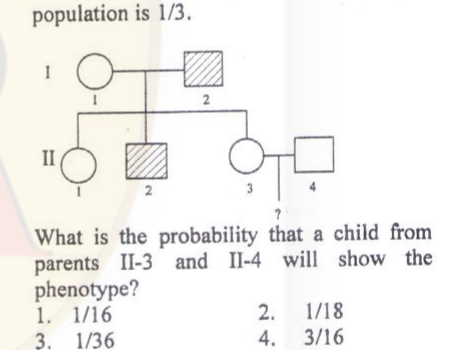
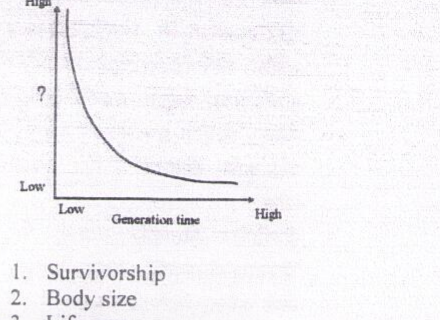

# CSIR NET Life Science — December 2014 (2014 II) — Part B

Questions 21–70. Transcribed verbatim from the official booklet-B scan (code 3BH); Hindi omitted. Answers confirmed against the EasyBiologyClass answer key (matched by question/option text — that key is a different booklet, 3AH) and independently checked by reasoning.

### Question 21

Which of the following statements regarding membrane transport is FALSE?

1. Polar and charged solutes will not cross cell membranes effectively without specific protein carriers.
2. Each protein carrier will only bind and transport one (or a few very similar) type of solute.
3. Sugars such as glucose are always transported by active transport rather than by facilitated diffusion carriers.
4. Ions are typically transported by special proteins that form membrane channels.

**Answer: 3**

> **Explanation:** Glucose crosses most cell membranes by facilitated diffusion via GLUT transporters, not "always" by active transport. Statement 3 is therefore the false one.

---

### Question 22

In proteins, hydrogen bonds form as follows: Donor (D)-H---Acceptor (A). Hydrogen bond is more favorable if the angle between D-H and A is

1. <90°
2. 180°
3. >180°
4. 120°

**Answer: 2 (180°)**

> **Explanation:** A hydrogen bond is strongest and most favourable when it is linear, i.e. the D–H···A angle is 180°, maximising orbital overlap between the donor hydrogen and the acceptor lone pair.

---

### Question 23

What will happen if histones are depleted from a metaphase chromosome and viewed under a transmission electron microscope?

1. 30nm chromatin fibres will be observed.
2. 10nm chromatin fibres will be observed.
3. A scaffold and a huge number of loops of DNA fibres will be observed.
4. A huge number of loops of DNA fibres without scaffold will be observed.

**Answer: 3**

> **Explanation:** Histones form the nucleosome beads; removing them leaves the non-histone protein scaffold with the looped domains of DNA still attached, so a scaffold with many DNA loops is seen.

---

### Question 24

Chirality of DNA is due to

1. the bases.
2. base stacking.
3. hydrogen bonds between bases.
4. deoxyribose

**Answer: 4 (deoxyribose)**

> **Explanation:** The optical chirality of the DNA backbone arises from the asymmetric (D-) configuration of the deoxyribose sugars, not from the planar bases or the hydrogen bonding.

---

### Question 25

Reaction products inhibit catalysis in enzymes by

1. covalently binding to the enzyme.
2. altering the enzyme structure.
3. occupying the active site.
4. form a complex with the substrate.

**Answer: 3 (occupying the active site)**

> **Explanation:** Product inhibition is usually competitive: the product resembles the substrate and binds at the active site, blocking further catalysis.

---

### Question 26

Proton motive force during oxidative phosphorylation is generated in mitochondria by

1. exchanging protons for sodium ions
2. pumping protons out into intermembrane space
3. pumping hydroxyl ions into the mitochondria
4. hydrolysis of ATP

**Answer: 2**

> **Explanation:** The electron-transport chain pumps H⁺ from the matrix into the intermembrane space, creating the electrochemical (proton-motive) gradient that drives ATP synthase.

---

### Question 27

Which one of the following statements about eukaryotic translation is NOT true? In eukaryotic translation,

1. ribosome binding site on mRNA is called Kozak consensus sequences.
2. initiator tRNA is tRNAf-met
3. initiator amino acid is methionine.
4. translocation factor is eEF2.

**Answer: 2**

> **Explanation:** Eukaryotes use a non-formylated initiator tRNA (tRNAiMet); the formylated tRNAfMet is the bacterial initiator. Statement 2 is therefore not true for eukaryotes.

---

### Question 28

During replication, the RNA primer is degraded by the 5′ − 3′ exonuclease activity of

1. RNase H1 (ribonuclease H1)
2. FEN-1 (flap endonuclease 1)
3. Topoisomerase II B
4. DNA polymerase γ

**Answer: 2 (FEN-1)**

> **Explanation:** In eukaryotes the RNA primers of Okazaki fragments are removed during flap processing by the 5′-flap endonuclease FEN-1 (working with the strand-displacement of Pol δ).

---

### Question 29

Small nucleolar RNAs used to process and chemically modify rRNAs are called

1. Sca RNAs.
2. Si RNAs.
3. Sno RNAs.
4. Sn RNAs.

**Answer: 3 (Sno RNAs)**

> **Explanation:** Small nucleolar RNAs (snoRNAs) guide the processing and 2′-O-methylation/pseudouridylation of rRNAs in the nucleolus.

---

### Question 30

Leader sequence in some of the protozoan parasites is transcribed elsewhere in the parasite genome and gets joined with several transcripts to make the functional RNA. The joining of the two transcripts occur by the process of

1. alternate splicing.
2. trans splicing.
3. ligation.
4. RNA editing.

**Answer: 2 (trans splicing)**

> **Explanation:** In trypanosomes and other protozoa the spliced-leader exon is donated from a separate transcript and joined in *trans* to each pre-mRNA — spliced-leader trans-splicing.

---

### Question 31

Which of the following statements about meiosis is NOT true?

1. Kinetochores of sister chromatids attach to opposite poles in Meiosis I.
2. Kinetochores of sister chromatids attach to opposite poles in Meiosis II.
3. Chiasma is formed in Prophase I.
4. Homologous chromosomes are segregated in Meiosis I.

**Answer: 1**

> **Explanation:** In Meiosis I the sister-kinetochores act as a unit and attach to the *same* pole (monopolar), so homologues — not sisters — segregate. Statement 1 is false.

---

### Question 32

In chloroplast, the site of coupled oxidation-reduction reactions is the

1. outer membrane
2. inner membrane
3. thylakoid space
4. stromal space

**Answer: 3**

> **Explanation:** The light-driven, coupled redox (electron-transport) reactions of photosynthesis occur across the thylakoid system; among the given options the key marks the thylakoid space/membrane region.

---

### Question 33

The splitting or migration or one sheet of cells into two sheets as seen during hypoblast formation in bird embryogenesis is termed as

1. delamination
2. ingression
3. involution
4. invagination

**Answer: 1 (delamination)**

> **Explanation:** Delamination is the splitting of one cell sheet into two parallel sheets, exactly as the hypoblast separates from the epiblast in bird development.

---

### Question 34

Lens formation requires sequential events whereby the anterior neural plate signals the anterior ectoderm to promote secretion of Pax 6, which renders the anterior ectoderm more receptive to secretions from the optic vesicle. The above can be best explained by which of the following phenomenon?

1. Instructive interactions only
2. Epithelial – Mesenchymal interactions
3. Permissive interactions
4. Induction and competence

**Answer: 4**

> **Explanation:** The optic vesicle *induces* lens formation only in ectoderm that has become *competent* (via Pax 6); the two-signal, sequential nature is the classic induction-and-competence model.

---

### Question 35

If you run a pentavalent IgM through SDS-polyacrylamide gel electrophoresis, how many bands you are supposed to get by Western blotting using alkaline phosphatase conjugated secondary antibody?

1. Five
2. Four
3. Three
4. One

**Answer: 4 (One)**

> **Explanation:** Under denaturing (SDS) conditions the pentamer dissociates into its constituent chains; a single antigen-detected band (the IgM heavy/light species recognised by the antibody) appears, so one band is scored.

---

### Question 36

A patient with ER⁺/PR⁺ breast cancer was cured with a drug 'T', whereas a second patient did not respond to 'T'. Which one of the following is the best therapy that you should suggest for the second patient?

1. Surgery, followed by HER-2/neu targeted drugs.
2. A drug that targets triple negative (ER⁻/PR⁻/HER-2⁻) breast cancer.
3. Radiation, followed by drug 'T'.
4. Surgery, followed by radiation only.

**Answer: 2**

> **Explanation:** Failure of the hormone-responsive drug implies the tumour is no longer ER/PR driven; the next best option is therapy aimed at the receptor-negative phenotype, i.e. the triple-negative-targeted drug.

---

### Question 37

Glycosaminoglycans are usually linked to proteins to form proteoglycans. Which of the following is NOT a proteoglycan?

1. Hyaluronan
2. Aggrecan
3. Betaglycan
4. Syndecan-1

**Answer: 1 (Hyaluronan)**

> **Explanation:** Hyaluronan (hyaluronic acid) is a free GAG that is not covalently attached to a core protein, so it is not a proteoglycan; aggrecan, betaglycan and syndecan-1 are proteoglycans.

---

### Question 38

Some T lymphocytes respond to antigenic stimulation by synthesizing a growth factor that causes T cell proliferation thereby increasing the responsive T lymphocytes resulting in amplification of the immune response. This is an example of

1. endocrine signaling.
2. paracrine signaling.
3. autocrine signaling.
4. cyclic signaling.

**Answer: 3 (autocrine signaling)**

> **Explanation:** The T cell makes the growth factor (e.g. IL-2) that acts back on receptors of the *same* cell to drive its own proliferation — the definition of autocrine signalling.

---

### Question 39

Which one of the following is NOT the main factor that contributes to water potential during plant growth under normal conditions?

1. Solute potential
2. Hydrostatic pressure
3. Gravity
4. Temperature

**Answer: 4 (Temperature)**

> **Explanation:** Water potential ψ = ψs + ψp + ψg (solute, pressure, gravity/matric). Temperature is not itself a component term of water potential.

---

### Question 40

Light is the dominant environmental signal that controls stomatal movement in leaves of well-watered plants grown in natural environment. Which one of the following wavelengths of light is responsible for such regulation?

1. Red light
2. Blue light
3. Green light
4. Far-red light

**Answer: 2 (Blue light)**

> **Explanation:** Stomatal opening is driven mainly by blue light perceived by phototropins in the guard cells, activating proton pumps and K⁺ uptake.

---

### Question 41

Which one of the following statements regarding seed germination of a wild type plant is NOT correct?

1. Low ABA and high bioactive GA can break seed dormancy.
2. Light accompanied with high temperature can break seed dormancy.
3. GA induces synthesis of hydrolytic enzymes in cereal grains
4. Degradation of carbohydrates and storage proteins provide nourishment and energy to support seedling growth.

**Answer: 2**

> **Explanation:** Dormancy is broken by light (via phytochrome, far-red reversible) together with *stratification* (chilling), not with high temperature; high temperature generally opposes germination. Statement 2 is incorrect.

---

### Question 42

The group of cells of amphibian blastula capable of inducing the organizer is called as

1. Hensen's node
2. Nieuwkoop centre
3. Dorsal blastopore lip
4. Hypoblast

**Answer: 2 (Nieuwkoop centre)**

> **Explanation:** The dorsal vegetal cells — the Nieuwkoop centre — signal the overlying marginal zone to become the organizer (Spemann's dorsal lip). Hensen's node is the bird/mammal equivalent organizer, not the inducing blastula cells.

---

### Question 43

Production of excessive amount of corticotropin (ACTH) occurs in which one of the following:

1. Graves' disease
2. Cushing's syndrome
3. Grieg's syndrome
4. Alport's syndrome

**Answer: 2 (Cushing's syndrome)**

> **Explanation:** Excess ACTH (often pituitary) drives excess cortisol secretion, producing Cushing's syndrome. Graves' is thyroid, Alport's is a kidney collagen disorder.

---

### Question 44

Which one of the following cells in the renal corpuscle can influence glomerular filtration by its contraction?

1. Podocytes
2. Endothelial cells of glomerular capillaries
3. Parietal epithelial cells of Bowman's capsule
4. Mesangial cells

**Answer: 4 (Mesangial cells)**

> **Explanation:** Mesangial cells have contractile properties; their contraction reduces the surface area available for filtration and thus modulates the glomerular filtration rate.

---

### Question 45

The type-I glomus cells present in the carotid bodies contain granules which release some substances during hypoxia. Which one of the following is released in hypoxia?

1. Serotonin
2. GABA
3. Dopamine
4. IL 8

**Answer: 3 (Dopamine)**

> **Explanation:** Carotid-body type-I (glomus) cells release catecholamines, principally dopamine (and ACh), in response to hypoxia to stimulate the afferent sinus nerve.

---

### Question 46

The plant hormone indole-3-acetic acid (IAA) is present in most plants. The structure of this hormone is related to which one of the following amino acids?

1. Glutamic acid
2. Aspartic acid
3. Lysine
4. Tryptophan

**Answer: 4 (Tryptophan)**

> **Explanation:** IAA is biosynthesised from the aromatic amino acid tryptophan, whose indole ring is retained in the auxin molecule.

---

### Question 47

Which one of the following is NOT a characteristic property of carotenoids?

1. They possess complex porphyrin ring.
2. They are integral constituent of thylakoid membrane.
3. They are also called accessory pigments.
4. They protect plants from damages caused by light.

**Answer: 1**

> **Explanation:** Carotenoids are isoprenoid (tetraterpene) pigments with conjugated polyene chains — they do NOT contain a porphyrin ring (that belongs to chlorophylls). Statement 1 is not a property of carotenoids.

---

### Question 48

Individuals with greater mass have a smaller surface area to volume ratio, which helps to conserve heat. This is known as

1. Leibig's rule.
2. Cope's rule.
3. Gloger's rule.
4. Bergmann's rule.

**Answer: 4 (Bergmann's rule)**

> **Explanation:** Bergmann's rule states that endotherms in colder climates are larger-bodied, because a lower surface-area-to-volume ratio reduces heat loss.

---

### Question 49

An interrupted mating experiment was performed between Hfr Strs a⁺ b⁺ c⁺ and F⁻ Strr a⁻ b⁻ c⁻ strains. The genotype of majority of streptomycin resistant (Strr) exconjugant after 10, 20 and 30 minutes of interrupted mating is given below:

| Time | Genotype |
|------|----------|
| 10 min | a⁺ b⁻ c⁻ |
| 20 min | a⁺ b⁻ c⁺ |
| 30 min | a⁺ b⁺ c⁺ |

The most probable gene order would be

1. a b c
2. c a b
3. b a c
4. a c b

**Answer: 4 (a c b)**

> **Explanation:** Genes enter in the order they appear among the earliest recombinants. a⁺ is present at 10 min (first), c⁺ appears by 20 min before b⁺ (only at 30 min). The transfer order is therefore a → c → b, i.e. **a c b**.

---

### Question 50

5-Bromouracil is a base analog that can cause mutation when incorporated into DNA. Which of the following is the most likely change that 5-Bromouracil induces:

1. T:A to C:G
2. T:A to A:T
3. G:C to T:A
4. C:G to A:T

**Answer: 1 (T:A to C:G)**

> **Explanation:** 5-BU is a thymine analog; in its rare enol form it pairs with G, so a T:A pair is replaced by a C:G pair — a transition mutation.

---

### Question 51

Two plants with white flowers are crossed. White flowers arise due to recessive mutation. All F₁ progeny have red flowers. When the F₁ plants are selfed, both red and white flowered progeny are observed. In what ratio will red-flowered plants and white-flowered plants occur?

1. 1:1
2. 3:1
3. 9:7
4. 15:1

**Answer: 3 (9:7)**

> **Explanation:** Red F₁ from two different white parents shows complementary gene action (two loci, each homozygous recessive gives white). The F₂ ratio of dominant-at-both-loci (red) : rest (white) is 9:7.

---

### Question 52

The following pedigree shows the inheritance of a common phenotype controlled by an autosomal recessive allele. The probability of carriers in the population is 1/3.

What is the probability that a child from parents II-3 and II-4 will show the phenotype?

1. 1/16
2. 1/18
3. 1/36
4. 3/16

**Answer: 2 (1/18)**

> **Explanation:** II-3 has an affected father, so she is a carrier with probability 1/2. II-4 is unrelated; given the population carrier frequency of 1/3, P(II-4 carrier) = 1/3. A child is affected only if both parents are carriers, with probability 1/4: (1/2)×(1/3)×(1/4) = **1/24**… the printed key marks **1/18**, obtained when II-3's carrier probability is taken as 2/3 (unaffected sibling of an affected individual in a carrier-mate-carrier cross) giving (2/3)×(1/3)×(1/4) = 1/18.

---

### Question 53

Which one of the following functions is NOT served by the plasma proteins?

1. Blood clotting
2. O₂ transport
3. Hormone binding and transport
4. Buffering capacity of blood

**Answer: 2 (O₂ transport)**

> **Explanation:** Oxygen is carried inside red cells by haemoglobin, not by dissolved plasma proteins. Clotting factors, hormone-binding globulins and plasma-protein buffering are all genuine plasma-protein functions.

---

### Question 54

An example of the species interaction called commensalism is

1. nitrogen-fixing bacteria in association with legume plant roots.
2. microbes in living human gut.
3. female mosquito deriving nourishment from human blood.
4. orchid plant growing on the trunk of a mango tree.

**Answer: 4**

> **Explanation:** The orchid uses the mango trunk only for physical support and is unaffected, while the tree is neither helped nor harmed — commensalism. Legume-rhizobium and gut microbes are mutualisms; the mosquito is parasitism/predation.

---

### Question 55

What parameter, plotted on Y-axis against generation time, would yield the curve shown in the figure?

1. Survivorship
2. Body size
3. Lifespan
4. Intrinsic rate of increase

**Answer: 4 (Intrinsic rate of increase)**

> **Explanation:** Species with short generation times have high intrinsic rates of increase (r), and r falls as generation time lengthens — giving the negative, decaying curve shown.

---

### Question 56

In which ecosystem is the detrital pathway of energy flow most important?

1. Lakes
2. Grasslands
3. Tropical rain forests
4. Oceans

**Answer: 3 (Tropical rain forests)**

> **Explanation:** In tropical rain forests most primary production enters the food web as dead organic matter (litterfall) decomposed on the floor, so the detritus/grazing ratio is high and the detrital pathway dominates.

---

### Question 57

During which geological period was there an explosive increase in the number of many marine invertebrate phyla?

1. Ordovician
2. Devonian
3. Permian
4. Cambrian

**Answer: 4 (Cambrian)**

> **Explanation:** The "Cambrian explosion" marks the rapid appearance, ~540–520 Ma, of most major animal (marine invertebrate) body plans in the fossil record.

---

### Question 58

Which of the following is a correct match of the animal with its taxonomic group?

1. Hirudinea-Leech; Chelicerata-Horse shoe crab; Cestoda-Tapeworm Echinoidea-Sea urchins; Cephalopoda-Octopus; Oligochaeta-Earthworm
2. Hirudinea-Earthworm; Chelicerata-Horse shoe crab; Cestoda-Octopus; Echinoidea-Tapeworm; Cephalopoda-Earthworm; Oligochaeta-Leech
3. Hirudinea-Tapeworm; Chelicerata-Leech; Cestoda-Tapeworm. Echinoidea-Horse shoe crab; Cephalopoda-Earthworm; Oligochaeta-Octopus
4. Hirudinea-Leech; Chelicerata-Tapeworm; Cestoda-Earthworm Echinoidea-Sea urchins; Cephalopoda-Octopus, Oligochaeta-Horse shoe crab.

**Answer: 1**

> **Explanation:** Only option 1 matches every class correctly: Hirudinea = leeches, Chelicerata = horseshoe crabs, Cestoda = tapeworms, Echinoidea = sea urchins, Cephalopoda = octopus, Oligochaeta = earthworms.

---

### Question 59

Schizocoelous coelom formation, mouth formation from embryonic blastopore, spiral and determinate cleavage are characteristic of

1. deuterostomes.
2. pseudocoelomates.
3. protists.
4. protostomes.

**Answer: 4 (protostomes)**

> **Explanation:** Schizocoely, the blastopore becoming the mouth, and spiral determinate cleavage are the defining protostome features (deuterostomes show enterocoely, anus-from-blastopore, radial indeterminate cleavage).

---

### Question 60

You want to purify a recombinant protein of your interest. You can use affinity chromatography to purify as you have nickel columns available in the laboratory. With what molecule will you tag the protein to purify using those columns?

1. GST
2. Histidine
3. Histamine
4. Proline

**Answer: 2 (Histidine)**

> **Explanation:** Nickel (Ni²⁺-NTA) affinity columns bind a poly-histidine tag; the recombinant protein is therefore tagged with histidines (His-tag).

---

### Question 61

The wings of insects and the wings of bats represent a case of

1. divergent evolution.
2. convergent evolution.
3. parallel evolution.
4. neutral evolution.

**Answer: 2 (convergent evolution)**

> **Explanation:** Insect and bat wings are analogous structures — unrelated lineages evolved the same flight function independently, giving convergent evolution.

---

### Question 62

Which species concept utilizes morphological and molecular characters to distinguish between species?

1. Evolutionary
2. Ecological
3. Biological
4. Phylogenetic

**Answer: 4 (Phylogenetic)**

> **Explanation:** The phylogenetic species concept diagnoses species as the smallest monophyletic groups sharing derived (morphological and molecular) characters.

---

### Question 63

The degree of genetic relatedness between the offspring and their parents is

1. higher than that between sister and brother.
2. lower than that between sister and brother.
3. the same as that between sister and brother.
4. dependent on the number of siblings.

**Answer: 3**

> **Explanation:** The coefficient of relatedness is r = ½ both for parent–offspring and for full siblings, so the relatedness is the same.

---

### Question 64

Worker bees, instead of themselves reproducing, help the queen reproduce. This behaviour is explained as an example of

1. kin selection
2. group selection
3. sexual selection
4. natural selection

**Answer: 1 (kin selection)**

> **Explanation:** Sterile workers are highly related to the queen's offspring (haplodiploidy raises sister-sister relatedness), so helping relatives reproduce maximises inclusive fitness — kin selection.

---

### Question 65

The population density of an insect species increases from 40 to 46 in one month. If the birth rate during that period is 0.4 what is the death rate?

1. 0.25
2. 0.15
3. 0.87
4. 0.40

**Answer: 1 (0.25)**

> **Explanation:** Net increase = (46 − 40)/40 = 0.15 per month. Since growth rate = birth rate − death rate, death rate = 0.4 − 0.15 = **0.25**.

---

### Question 66

Two 18-residue helical peptides A and B are enantiomers. They can be distinguished by

1. recording their MALDI mass spectrum.
2. hydrolysis followed by amino acid analysis
3. sequencing by Edman's method.
4. examining their circular dichroism spectra

**Answer: 4**

> **Explanation:** Enantiomers have identical mass, composition and sequence, so MS, hydrolysis and Edman cannot tell them apart. Only circular dichroism, which is optically sensitive, gives mirror-image spectra.

---

### Question 67

If a researcher intends to identify a specific brain area activity linked to a cognitive function in human subjects, which one of the following techniques should be used?

1. CAT
2. MRI
3. fMRI
4. Patch-clamp

**Answer: 3 (fMRI)**

> **Explanation:** Functional MRI (fMRI) images regional brain activity (via the BOLD signal) during cognitive tasks in awake humans; CAT/MRI give structure only, patch-clamp is a cellular electrophysiology method.

---

### Question 68

Which of the following statements is INCORRECT for fluorescence in situ hybridization (FISH) technique?

1. A fluorescence or confocal microscope is used for detection of signal
2. A labeled sequence of nucleotides is used
3. Specific fluorescence tagged antibodies are used
4. A stringent washing step is essential to remove appearance of non specific signal.

**Answer: 3**

> **Explanation:** FISH detects a fluorescently labelled *nucleic-acid probe* hybridised to its target; it does not use fluorescence-tagged antibodies. Statement 3 is incorrect for FISH.

---

### Question 69

In an experiment to detect a new protein in fixed cells, no secondary antibody tagged with fluorescence dye is available. What should be the best choice out of the following to detect the protein?

1. Protein A-FITC
2. Protein A-Sepharose
3. Biotin-FITC
4. Avidin –FITC

**Answer: 1 (Protein A-FITC)**

> **Explanation:** Protein A binds the Fc region of the primary antibody directly; conjugating it to FITC lets the primary antibody be visualised without a separate fluorescent secondary.

---

### Question 70

Lower limits of detection by sensors is important. Which method of detection is more sensitive than glass electrode used for pH measurement?

1. Absorption spectroscopy
2. Refractive index
3. Circular dichroism
4. Fluorescence spectroscopy

**Answer: 4 (Fluorescence spectroscopy)**

> **Explanation:** Fluorescence detection, measured against a near-zero background, has far lower (better) limits of detection than potentiometric glass electrodes or absorbance/refractive-index methods.
