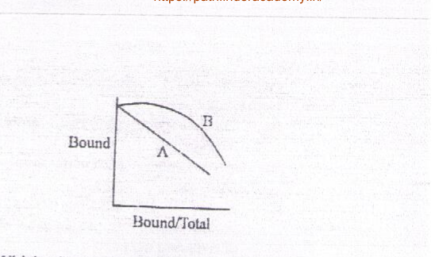
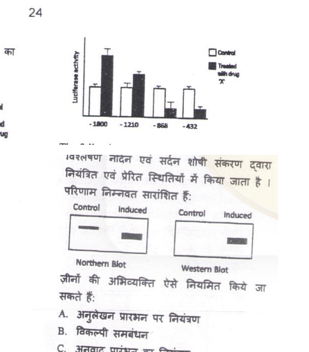
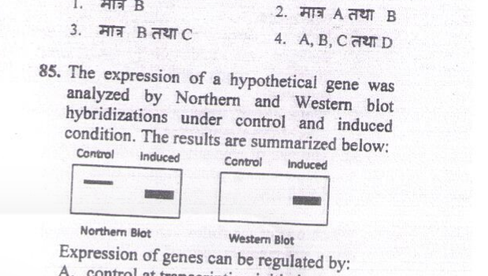
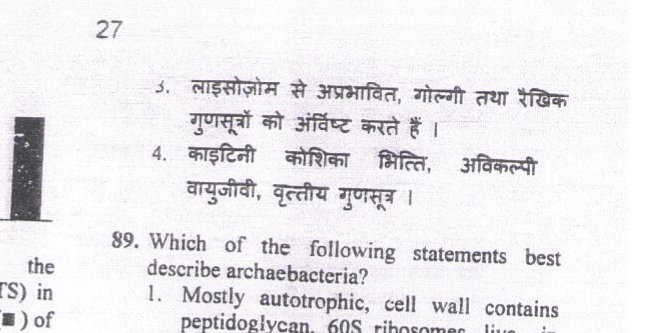
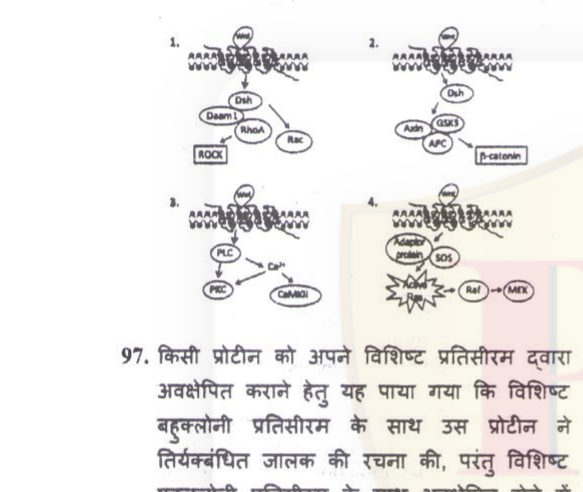
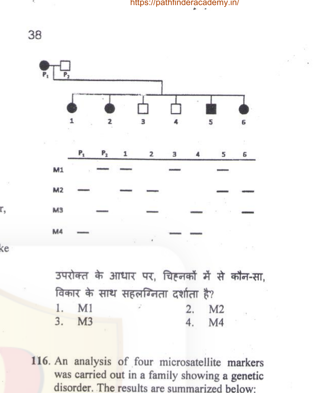
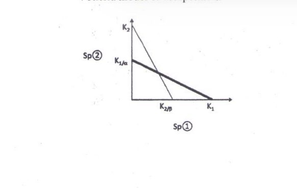
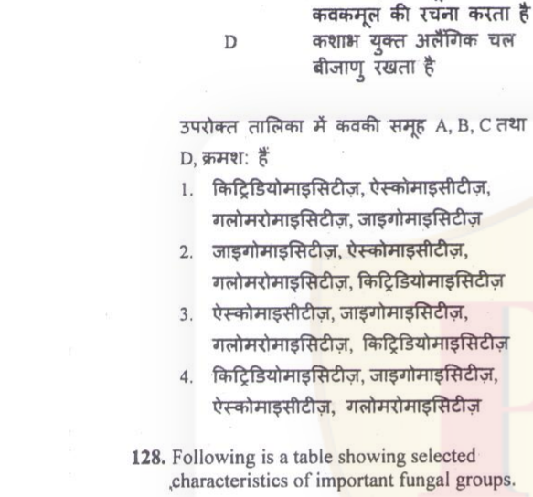
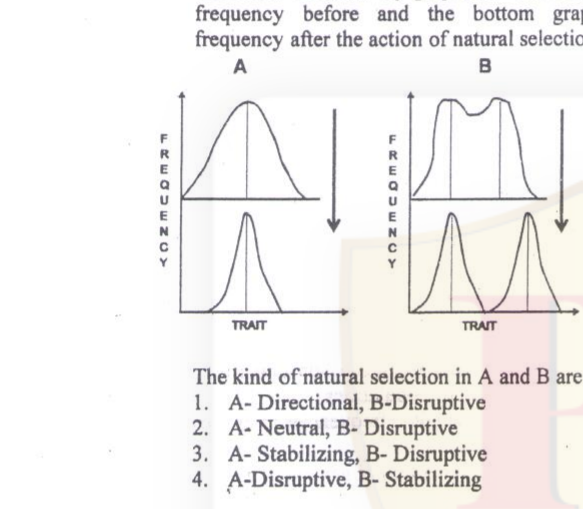
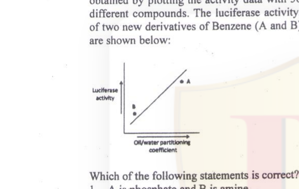

# CSIR NET Life Science — December 2014 (2014 II) — Part C

Higher-order questions, Questions 71–145. Transcribed verbatim from the official booklet-B scan (code 3BH); Hindi omitted. Answers confirmed against the **official CSIR FINAL ANSWER KEY, December 2014, Booklet A** (reproduced in the helpBIOTECH solved-paper PDF, p. 25, and independently in the EasyBiologyClass paper's printed `Ans.` markers). Because that key is Booklet **A** and this paper is Booklet **B**, each answer was transferred by matching question text **and** option text (see `sources.md`).

### Question 71

A newly identified sequence was experimentally tested by *in vitro* transport assay using a radiolabelled protein containing the sequence to test import into mitochondria. Transport assay was done for a short time with or without membrane potential and after the assay, the mitochondria were either treated or not treated with proteinase K. At the end of the assay the mitochondria were pelleted and total protein of the pellet was isolated and separated on SDS-PAGE and autoradiographed. A representative autoradiogram is shown below. Based on this experimental data, which of the following statements is NOT correct.

1. The protein goes into the matrix
2. Not all of the added protein was imported
3. The protein requires membrane potential for import
4. The protein is associated with the outer mitochondrial membrane

**Answer: 4 (The protein is associated with the outer mitochondrial membrane)**

> **Explanation:** Import and processing of the precursor occur only when the membrane potential is present, and the mature band survives proteinase K because it is inside the matrix, i.e. the protein is a matrix protein and not an outer-membrane protein. Statement 4 is therefore the one that is NOT correct.

---

### Question 72

A gene producing red pigment was placed near centromeres of fission yeast and thus subjected to position effect variegation and produced white colonies. A screen for mutants that increased the red pigment production was undertaken. Which of the following genes, when mutated, is likely to produce this genotype?

1. Histone deacetylase
2. Histone acetylase
3. RNA polymerase II
4. TATA binding factor

**Answer: 1 (Histone deacetylase)**

> **Explanation:** Position-effect variegation near a centromere depends on deacetylated, compacted chromatin silencing the pigment gene. Losing a histone **deacetylase** keeps chromatin acetylated and open, so the gene is expressed more and red pigment increases.

---

### Question 73

In order to prove that liposome can serve as a model membrane (mimicking cellular plasma membrane) and can be used as a target for complement-mediated immunolysis, an experiment as below is designed. To initiate such experiment, hapten-conjugated liposomes are made and loaded with umbelliferyl phosphate (UMP; hydrolysed product of UMP is umbelliferone and is fluorescent). Such loaded, hapten-conjugated liposomes in 10 mM Tris buffered saline, pH 7.4 were mixed with anti-hapten antibodies and fresh guinea pig serum (as a source of complement) to induce immunolysis of liposomal membrane. To quantify only the membrane lysis component which of the assay sequences below is MOST appropriate?

1. Mixture is ultra centrifuged and the supernatant reacted with alkaline phosphatase and fluorescence measured
2. Mixture is sequentially reacted with phospholipase and alkaline phosphatase followed by fluorescence measurements
3. Mixture is directly subjected to fluorescence measurement
4. Mixture is treated with Triton X-100 and fluorescence measured

**Answer: 1 (Mixture is ultra centrifuged and the supernatant reacted with alkaline phosphatase and fluorescence measured)**

> **Explanation:** Only intact, unlysed liposomes retain the loaded UMP, so the liposomes must first be pelleted by ultracentrifugation; the released UMP in the supernatant is then converted to fluorescent umbelliferone by alkaline phosphatase. This measures lysis alone, without the confounding total-fluorescence or membrane-digestion routes.

---

### Question 74

A null mutation is created in a gene which is responsible for specific phosphorylation at 6th carbon position of mannose on acid hydrolases occurring in cis-Golgi. The following statements are given towards explaining the effect of this mutation:

A. The lysosomes will be devoid of lysosomal enzymes
B. Lysosomal enzymes will be secreted out
C. Lysosomal enzymes will get localized in cytoplasm

Which statement or combination of statements will explain the effect of mutation if the acid hydrolases in the mutant do not get degraded?

1. A and C
2. B and C
3. C only
4. A and B

**Answer: 4 (A and B)**

> **Explanation:** Mannose-6-phosphate is the cis-Golgi tag that diverts acid hydrolases to the lysosome via the MPR. Without it the enzymes are never delivered (lysosomes devoid, A) and instead follow the default secretory pathway out of the cell (B); they do not reach the cytoplasm (C).

---

### Question 75

Enzyme parameters of four isozymes is given below:

| Isozyme | Km micromolar | Vmax |
|---|---|---|
| A | 0.1 | 15 |
| B | 1.5 | 45 |
| C | 4.0 | 100 |
| D | 0.01 | 10 |

These isozymes are localized in different tissues. In liver the substrate concentration is 0.2 micromolar.

The liver isozyme is likely to be

1. A
2. B
3. C
4. D

**Answer: 1 (A)**

> **Explanation:** At a substrate concentration of 0.2 µM the physiologically sensible liver isozyme is the one whose Km lies near that concentration so that its activity can still be modulated; isozyme A (Km = 0.1 µM) operates close to saturation and responds to changes around 0.2 µM, whereas B, C and D have Km values far above it.

---

### Question 76

Binding of two ligands to their binding proteins were investigated. Following binding isotherms were obtained.

Which of the following statements is correct?

1. A is obtained with an oligomeric protein and B is obtained with a monomeric protein
2. B is obtained with protein with positive cooperativity
3. A and B were obtained by the same protein at two different temperatures
4. The profile B is not possible

**Answer: 2 (B is obtained with protein with positive cooperativity)**

> **Explanation:** The linear isotherm A is the hyperbolic, non-cooperative (monomeric) binding profile, while the sigmoidal curve B that rises increasingly steeply is the signature of **positive cooperativity** in an oligomeric protein.

---

### Question 77

Two homologous proteins were isolated from a psychrophile (P) and a thermophile (T). The purified proteins were subjected to denaturation, protease digestion and circular dichroism (CD). Following observations were made:

A. The CD spectra of P and T proteins are identical
B. Their amino acid composition is 95% identical
C. T and P are equally susceptible to proteolysis in the presence or absence of reducing agent
D. T has higher midpoint of thermal denaturation than P

The reason for enhanced stability in T is due to

1. Altered secondary structure
2. Increased number of disulfides in T
3. Increase in water of hydration
4. Increase in number of salt bridges

**Answer: 4 (Increase in number of salt bridges)**

> **Explanation:** The identical CD spectra (A) rule out altered secondary structure, and equal protease susceptibility with or without reducing agent (C) rules out extra disulfides. Thermophilic proteins are therefore stabilised mainly by increased surface **salt bridges** (ion-pair networks), which raise the midpoint of thermal denaturation.

---

### Question 78

DNA is not hydrolyzed by alkali whereas RNA is readily hydrolyzed. This is due to

1. The double helical structure of DNA
2. The presence of uridine in RNA
3. Due to features observed in RNA such as stem-loop structures
4. The presence of 2'-OH group in RNA

**Answer: 4 (The presence of 2'-OH group in RNA)**

> **Explanation:** Alkali deprotonates the ribose **2'-OH** of RNA, which then attacks the adjacent phosphodiester bond to give a 2',3'-cyclic phosphate intermediate and strand cleavage. DNA lacks the 2'-OH and is therefore alkali-stable.

---

### Question 79

Acetyl-(Ala)18-CONH2 exists in α-helical conformation in solution. Most of the backbone dihedral angles (φ, ψ) will be

1. -60°, -30°
2. 60°, 30°
3. -60°, -30° (50%) and 60°, 30° (50%)
4. -80°, 120°

**Answer: 1 (-60°, -30°)**

> **Explanation:** A right-handed α-helix occupies the (φ, ψ) region of roughly −60°, −45°; among the choices only option 1 places both angles in the left-handed (negative) quadrant characteristic of the α-helix, and a homopolymer of L-alanine gives a single conformer rather than a 50:50 mixture.

---

### Question 80

The lifetime of a peptide bond in proteins is very large (~1000 years). Which statement below is INCORRECT with respect to stability of the peptide bond?

1. The free energy of hydrolysis is negative
2. The free energy of hydrolysis is positive and large
3. The energy barrier to be crossed to go to the hydrolyzed state is large
4. The peptide bond can be hydrolyzed by 6N HCl at 100°C.

**Answer: 2 (The free energy of hydrolysis is positive and large)**

> **Explanation:** Peptide-bond hydrolysis is thermodynamically favourable (ΔG is **negative**), but kinetically slow because the activation energy is large — that is why the bond persists for ~1000 years yet can be driven to completion by 6 N HCl at 100 °C. Statement 2 is the incorrect one.

---
### Question 81

A pharmacy student designed a drug to specifically target the receptors for retinoic acid in order to prevent stem cell differentiation. After *in vitro* trial, the investigator found that the cells underwent differentiation and the drug seemed to be ineffective. The following reasons were given by the student

A. The size of the drug exceeded the size of molecules that could cross the membrane
B. The drug was small in size but hydrophobic in nature
C. The drug did not bind to its receptors

Which of the above could be the probable reason for drug ineffectiveness?

1. Only C
2. A and C
3. A, B and C
4. Only B

**Answer: 1 and 2 (the official key accepts BOTH "Only C" and "A and C")**

> **Explanation:** Retinoic acid receptors are intracellular/nuclear, so a drug that cannot cross the membrane (A) or that fails to bind its receptor (C) would both be ineffective — whereas a small *hydrophobic* molecule (B) would cross the membrane readily and is therefore not a valid explanation. The CSIR final key marked this question as correct for **both option 1 and option 2**, so both are recorded here as the official answer.

---

### Question 82

A researcher wanted to immunize individuals of a particular area with viral infections. The researcher developed two different vaccine types (A and B) with the following properties.

(i) When vaccine type A specific for a viral strain is administered to individuals, they develop strong neutralizing antibody response with very poor immunological memory. Hence it has to be administered in repetitive doses.
(ii) When vaccine type B specific for a viral strain is administered to individuals, they fail to develop circulating antibody response at the time of infection but they develop strong immunological memory.

If two viral strains V1 (incubation period-2 days) and V2 (incubation period-15 days) are likely to infect the area, which of the following vaccine combination would provide maximum immunization?

1. V1 specific type A and V1 specific type B
2. V1 specific type A and V2 specific type B
3. V2 specific type A and V1 specific type B
4. V2 specific type A and V2 specific type B

**Answer: 2 (V1 specific type A and V2 specific type B)**

> **Explanation:** A short incubation period (V1, 2 days) needs antibody present immediately, which only type A supplies; a long incubation period (V2, 15 days) leaves time for a memory-driven secondary response, which type B supplies. Hence V1→type A and V2→type B.

---

### Question 83

A promoter deletion study was done in order to determine the binding sites for a transcription factor on the promoter, which is activated on treatment with the drug 'X'. The following constructs were made-

The following statements can be made.

A. Region between -1800 and -1210 contains a binding site for the activator.
B. Region between -868 and -1210 contains a binding site for a repressor.
C. Region between -868 and -432 contains a binding site for a repressor.
D. Region between -1210 and -868 contains a binding site for the activator.

Which of the above is/are true?

1. A and C
2. B and C
3. A and D
4. B only

**Answer: 1 (A and C)**

> **Explanation:** Drug stimulation is lost when the region between −1800 and −1210 is deleted, so that region carries the activator (inducer-responsive) site (A). Further deletion from −1210 to −868 does not remove activation, but deleting −868→−432 abolishes the remaining response, indicating a repressor element in the −868/−432 interval (C).

---

### Question 84

Total RNA was isolated separately from cytosol and nuclei of human cells growing in a cell culture. Each sample was mixed with a purified denatured fragment of a DNA corresponding to a large intron of a house keeping gene and incubated under renaturing condition. Given below are the statements made about the outcome of the experiment.

A. RNA isolated from nuclei will form RNA-DNA duplexes because of the presence of introns in the primary RNA.
B. Cytosolic RNAs usually will not form RNA-DNA duplexes.
C. Both cytosolic and nuclear RNA will not form RNA-DNA duplexes as transcription and splicing occur simultaneously.
D. Cytosolic RNA will form RNA-DNA duplexes because unspliced cytosolic RNAs are exceptionally stable.

Which of the above statement(s) is/are most likely to be true?

1. Only C
2. A and D
3. A and B
4. Only D

**Answer: 3 (A and B)**

> **Explanation:** Nuclear RNA is largely unspliced pre-mRNA, so it contains intron-complementary sequence and hybridises to the intronic DNA (A). Mature cytoplasmic mRNA has had its introns removed by splicing, so it does not hybridise to intron DNA (B).

---

### Question 85

The expression of a hypothetical gene was analyzed by Northern and Western blot hybridizations under control and induced condition. The results are summarized below:

Expression of genes can be regulated by:

A. control at transcription initiation
B. alternative splicing
C. control of translation initiation
D. protein stability

Which of the above regulatory mechanisms can explain the observations shown in the figures?

1. Only B
2. Only A and B
3. Only B and C
4. A, B, C and D

**Answer: 4 (A, B, C and D)**

> **Explanation:** Both the transcript and the protein increase on induction, so transcriptional control (A) is implicated; because the blots cannot by themselves exclude post-transcriptional, translational or protein-stability effects, all four listed mechanisms remain capable of explaining the observation, and the key records all of them.

---

### Question 86

Following are certain statements related to eukaryotic DNA replication:

A. The genome of multicellular animals contain many potential origins of replication.
B. During early development, when embryos are undergoing rapid cell divisions, origin sites are uniformly activated.
C. "Pulse-chase" technique is used to label sites of DNA replication.
D. The rate of elongation of different DNA chains during genome replication varies drastically.

Which one of the following combinations of above statements is correct?

1. A, B and C
2. A, C and D
3. B, C and D
4. A, B and D

**Answer: 1 (A, B and C)**

> **Explanation:** Eukaryotic genomes fire many potential origins (A), early embryonic cleavage divisions activate origins uniformly to complete rapid S phases (B), and replication sites are mapped by pulse–chase labelling (C). Eukaryotic forks, however, elongate at a fairly constant ~50 nucleotides/min, so D is wrong.

---

### Question 87

Puromycin is an antibiotic used to inhibit protein synthesis. Given below are few statements about the antibiotic.

A. It enters the E-site of the ribosome where it prevents the release of deacetylated tRNA after the action of peptidyl transferase.
B. It blocks the translocation process by binding to the translocation factor EF-G.
C. Puromycin resembles the initiator tRNA, tRNAifmet and binds exclusively to the P-site.
D. It resembles the aminoacyl tRNA and binds to the A-site of the ribosome.
E. Puromycin inhibits only prokaryotic protein synthesis.
F. Puromycin inhibits both prokaryotic and eukaryotic protein synthesis.

Which of the above statement(s) is/are true?

1. A and E
2. B only
3. D and F
4. C and E

**Answer: 3 (D and F)**

> **Explanation:** Puromycin is an aminonucleoside whose structure mimics the aminoacyl end of aminoacyl-tRNA; it enters the **A-site**, accepts the growing chain to form peptidyl-puromycin and causes premature release. Because it works on both bacterial and eukaryotic ribosomes, D and F are the true statements.

---

### Question 88

The following graph represents the expression of tryptophan synthetase (TS) in *E. coli* cells in absence (□) or presence (■) of tryptophan in the medium

If the two trp codons in the leader sequence of trp operon is mutated to ala, which of the following graphs will best represent activity of TS in *E. coli* cells grown in the absence (□) or presence (■) of tryptophan?

1. Graph 1
2. Graph 2
3. Graph 3
4. Graph 4

**Answer: 2**

> **Explanation:** Attenuation depends on the two Trp codons in the leader peptide: with trp→ala substitutions the ribosome no longer stalls at the leader when tryptophan is scarce, so the anti-terminator/terminator decision becomes insensitive to tryptophan. Repression by TrpR still operates, so expression in the presence of tryptophan falls but not to the wild-type level — giving the partially-derepressed pattern of graph 2.

---

### Question 89

Which of the following statements best describe archaebacteria?

1. Mostly autotrophic, cell wall contains peptidoglycan, 60S ribosomes, live in extreme environment.
2. Divide by fission, not susceptible to lysozyme, live in extreme environments, mostly autotrophic.
3. Not susceptible to lysozyme, contain Golgi and linear chromosomes.
4. Chitinous cell wall, obligate aerobic, circular chromosomes.

**Answer: 2 (Divide by fission, not susceptible to lysozyme, live in extreme environments, mostly autotrophic)**

> **Explanation:** Archaea lack peptidoglycan (pseudomurein instead) and are therefore **lysozyme-insensitive**, divide by binary fission, have 70S ribosomes and no membrane-bound organelles such as Golgi, and many are extremophiles — matching option 2 and excluding 1 (peptidoglycan/60S) and 3 (Golgi/linear chromosomes).

---

### Question 90

If a proteasome inhibitor is added to synchronously cycling human cells in G2 phase which one of the following events is likely to happen?

1. Induce re-replication of DNA
2. Arrest cells in G2 phase
3. Arrest cells in Anaphase
4. Block chromatin condensation

**Answer: 3 (Arrest cells in Anaphase)**

> **Explanation:** Exit from mitosis and progression through anaphase require the APC/C-driven **proteasomal degradation** of securin and cyclin B. Blocking the proteasome stabilises these proteins, so cells already in G2 can enter mitosis but cannot segregate chromosomes, arresting at anaphase.

---

### Question 91

Following are certain statements regarding the activities of homeotic genes of classes A, B and C involved in floral organ identity:

A. Activity of A alone specifies sepals
B. Activity of B alone specifies petals
C. Activities of B and C form stamens
D. Activity of C alone specifies carpels

Which one of the following combinations of above statements is correct?

1. A, B and C
2. A, B and D
3. B, C and D
4. A, C and D

**Answer: 4 (A, C and D)**

> **Explanation:** The ABC model gives sepals = A alone, petals = A + B, stamens = B + C, carpels = C alone. Petals therefore require A and B together, so statement B is wrong and A, C and D are correct.

---

### Question 92

A mutant was experimentally generated which had wings reduced to haltere like structure. The following statements are put forward regarding this phenotype:

A. *ultrabithorax* gene ectopically expressed in second thoracic segment
B. *antennapedia* gene ectopically expressed in second thoracic segment
C. A homeotic mutation
D. A mutation in gap gene

The following combination of statements will be most appropriate explaining the molecular basis of mutant phenotype:

1. A and B
2. B and C
3. C and D
4. A and C

**Answer: 4 (A and C)**

> **Explanation:** Wings reduced to haltere-like structures is the classic homeotic transformation of the second thoracic segment toward third-thoracic identity, produced by ectopic expression of *ultrabithorax* in T2. It is therefore a **homeotic** mutation (C) caused by *Ubx* mis-expression (A); *antennapedia* mis-expression transforms T2 toward T1, and gap genes affect polarity, not segment identity.

---

### Question 93

A mutant embryo of *Drosophila* in which one of the major sex determining gene, *sex lethal*, can only undergo default splicing, was allowed to develop. The following statements are towards explaining the determination of sex of the embryo:

A. The embryo will develop into a male fly
B. The embryo will develop into a female fly
C. *sex lethal* gene product directly regulates sex specific alternate splicing of *double sex* RNA
D. *sex lethal* gene product regulates sex specific splicing of *transformer* RNA which in turn regulates splicing of *double sex* RNA

The correct combination of above statements to explain sex determination of the given embryo is

1. A and C
2. A and D
3. B and D
4. B and C

**Answer: 2 (A and D)**

> **Explanation:** Without functional *sex-lethal* product, *transformer* undergoes default (non-functional) splicing, so no Tra protein is made, *dsx* is spliced in the male pattern, and the embryo develops as a **male**. Sex-lethal acts on *transformer*, not directly on *double sex*, so A and D are correct.

---

### Question 94

A two-celled embryo is made of blastomeres A and B. If the two blastomeres are experimentally separated, the 'A' blastomere generates all the cells it would normally make. However, the 'B' blastomere in isolation makes only a small fraction of cells it would normally make. Based on the above observations only, which one of the following conclusions is correct?

1. 'A' blastomere is autonomously specified while 'B' blastomere is conditionally specified.
2. 'A' blastomere is conditionally specified, while 'B' blastomere is autonomously specified.
3. Descendents of 'A' blastomere are autonomously specified.
4. Descendents of 'B' blastomere can either be autonomously specified or conditionally specified.

**Answer: 1 ('A' blastomere is autonomously specified while 'B' blastomere is conditionally specified.)**

> **Explanation:** A blastomere that still makes its normal complement in isolation is autonomously (determinantly) specified; one that makes only a fraction alone and needs its partner's signals is conditionally (regulatively) specified. Hence A is autonomous and B conditional.

---

### Question 95

For successful fertilization in sea urchin, interaction between the surface of the egg and acrosomal proteins, specifically a 30.5 kDa protein called bindin, is necessary. The following factors could affect this interaction and prevent fertilization:

A. Removal of egg jelly polysaccharides.
B. Removal of bindin receptors on the egg vitelline membrane.
C. Removal of bindin receptors from the egg jelly.
D. Removal of bindin receptors from a single cluster on the vitelline membrane.

Which one or the combination of the above statements is correct?

1. A and D
2. Only B
3. A and B
4. Only C

**Answer: 3 (A and B)**

> **Explanation:** Bindin on the acrosomal process binds species-specific receptors in the **vitelline membrane**, and the egg-jelly polysaccharides are the upstream inducer of the acrosome reaction; removing either blocks fertilisation. Bindin receptors are not in the jelly (C), and removing only a single receptor cluster (D) would not abolish binding.

---
### Question 96

Activation of the Wnt signal transduction pathway is extremely important during early development. Of the various pathways, which one of the following is most likely to induce cytoskeletal changes, like cell shape and movement?

1. Pathway 1 (Dsh → Daam1 → RhoA → ROCK)
2. Pathway 2 (Dsh → Axin/GSK3/APC → β-catenin)
3. Pathway 3 (Dsh → PLC → PKC → Ca²⁺/CaMKII)
4. Pathway 4 (Dsh → SOS → Ras → Raf → MEK)

**Answer: 1 (Pathway 1 — Dsh → Daam1 → RhoA → ROCK)**

> **Explanation:** The Wnt/"planar cell polarity" branch that signals through Dsh → Daam1 → RhoA → ROCK remodels the actin cytoskeleton and thereby controls cell shape and movement. The β-catenin branch controls transcription, and the PLC/Ca²⁺ and Ras/MAPK branches are the other, non-cytoskeletal arms.

---

### Question 97

In order to precipitate a particular protein by its specific antiserum, it was found that the protein formed cross-linked lattice with specific polyclonal antiserum but failed to precipitate with specific monoclonal antiserum. Which of the following would accurately justify the reason for this behavior?

1. The protein has multiple copies of the same epitope specific for the monoclonal antibody.
2. The protein has multiple distinct epitopes but each has a single copy.
3. There is total absence of epitopes in the protein.
4. The protein has multiple copies of different epitopes.

**Answer: 2 (The protein has multiple distinct epitopes but each has a single copy)**

> **Explanation:** Lattice formation requires each antibody molecule to bridge two antigen molecules. A monoclonal antibody recognizes only one epitope; if that epitope occurs just once per protein molecule, no cross-linking is possible, whereas polyclonal serum — with antibodies to several different epitopes — can build the lattice.

---

### Question 98

A technician wanted to make rabbit antiserum specific for mouse IgG. The technician injected rabbit with purified mouse IgG but obtained antiserum which reacted strongly with each of the other mouse isotypes. Which of the procedures mentioned below will allow him to make antiserum specific for IgG only?

1. Injecting rabbit with purified F(ab)₂' region of the IgG antibody.
2. Injecting rabbit with purified heavy chain of the IgG antibody.
3. Injecting rabbit with purified light chain of the IgG antibody.
4. Injecting rabbit with purified F(ab')' region of the IgG antibody.

**Answer: 2 (Injecting rabbit with purified heavy chain of the IgG antibody)**

> **Explanation:** Light chains and the Fab (antigen-binding) portions are shared in type with IgA, IgM and IgE, so antisera to them cross-react with other isotypes. Isotype specificity resides in the constant region of the **heavy chain** (γ for IgG), so immunising with purified heavy chain yields an IgG-only antiserum.

---

### Question 99

You have isolated a short chain polypeptide from a bacteria which upon administering to animal cells in culture is demonstrated to get transported to mitochondria and to cause mitochondrial membrane disruption. This peptide is being considered for its therapeutic effects on cancer and is to be tested for its anticancer properties in the following models of the disease.

A. Cancer with Apaf-1 mutation
B. Cancer where *Bax* genes are inactivated
C. Cancer where *Bak* genes are inactivated

Which of the following is likely to provide best effect (i.e. induce apoptosis)

1. Only A
2. B and C
3. A and B
4. A and C

**Answer: 2 (B and C)**

> **Explanation:** The peptide kills by disrupting the mitochondrial membrane directly, bypassing the Bax/Bak pore that normally permeabilises it. It will therefore still work in cancers where *Bax* or *Bak* are lost (B, C), but not where Apaf-1 is mutated, because apoptosome formation downstream of membrane permeabilisation would still be blocked.

---

### Question 100

Which one of the following statements about cell-cell interactions is NOT true?

A. Cadherins are transmembrane linker proteins which carry out Ca²⁺-mediated adhesion between adjacent cells.
B. Integrins are transmembrane adhesion proteins that mediate homophilic adhesion through actin and intermediate filaments.
C. Selectins are cell surface lectins that mediate a variety of transient, cell-cell adhesion interactions in the bloodstream.
D. ICAMs (intracellular cell adhesion molecules) and VCAMs (vascular cell adhesion molecules) are members of immunoglobulin (Ig) superfamily.

1. Only A
2. Only B
3. Both C and D
4. Both A and D

**Answer: 2 (Only B)**

> **Explanation:** Integrins are **heterophilic** adhesion receptors — they bind extracellular-matrix ligands (RGD motifs) and counter-receptors such as ICAMs/VCAMs, not identical integrins on the opposing cell. Cadherins are the Ca²⁺-dependent homophilic linkers (A), selectins bind carbohydrate ligands transiently in blood (C), and ICAMs/VCAMs are Ig superfamily members (D).

---

### Question 101

The heart rate shows variation during respiratory rhythm in most human subjects. Which one of the following statements describing the changes of heart rate during respiratory phases is true?

1. The heart rate is accelerated during expiration, but no change occurs during inspiration.
2. The heart rate is accelerated during inspiration and decelerated during expiration.
3. The heart rate is accelerated during expiration and decelerated during inspiration.
4. The heart rate is accelerated during inspiration and no change occurs during expiration.

**Answer: 2 (The heart rate is accelerated during inspiration and decelerated during expiration)**

> **Explanation:** In respiratory sinus arrhythmia, lung inflation during inspiration inhibits cardiac vagal (parasympathetic) tone, so the heart rate rises; during expiration vagal tone returns and the rate falls.

---

### Question 102

When a nerve fiber is stimulated with increasing strength of stimulus, the action potential fails to generate even though the threshold level may be passed. The following statements may explain this accommodation of nerve fiber:

A. The critical number of open sodium channels required to trigger the action potential may never be attained due to slow depolarization.
B. Potassium channels open in response to slow depolarization, which makes the nerve fiber refractory to depolarization.
C. The low threshold sodium channels remain open, which increases the threshold of firing of action potential.
D. The efflux of sodium and influx of potassium due to operation of Na⁺, K⁺-ATPase oppose the depolarization.

Which one of the following is correct?

1. A only
2. A and B
3. C only
4. C and D

**Answer: 2 (A and B)**

> **Explanation:** With a slowly rising (rectangular) stimulus the membrane accommodates: the few Na⁺ channels that open do so too slowly to reach the critical number needed for the regenerative upstroke (A), while delayed-rectifier K⁺ channels open and carry outward current that clamps the membrane below threshold (B). Na⁺ channels are *not* held open (C), and the pump moves Na⁺ in/K⁺ out, not as stated in D.

---

### Question 103

Different frequencies of sound were presented on the ear and the movement of basilar membrane was experimentally determined. The characteristics of movement of basilar membrane after presentation of 100 Hz sound are described in the following statements:

A. The base of basilar membrane showed resonance.
B. The apex of basilar membrane showed resonance.
C. A wave travelled from the base to apex of basilar membrane but the maximum displacement was noted near the apex.
D. A wave travelled from the base to apex of basilar membrane but the maximum displacement was noted near the base.

Which one of the following is correct?

1. A and C
2. B and D
3. C only
4. D only

**Answer: 3 (C only)**

> **Explanation:** By the travelling-wave (place-coding) principle, a wave always starts at the stiff base and travels toward the apex, and its peak displacement occurs where local resonance matches the frequency. Low frequencies such as 100 Hz peak near the **apex**, so only statement C is correct.

---

### Question 104

The changes in left ventricular stroke work (LVSW) according to the different left ventricular end-diastolic pressures (LVEDP, which indicates the initial myocardial fiber length) in a dog, under control conditions, were recorded, which follows Starling's law of the heart. This LVSW-LVEDP relationship was investigated in the same dog after constant infusion of norepinephrine, and these two data sets were plotted. Which one of the following graphs correctly represents the results obtained?

1. Graph 1
2. Graph 2
3. Graph 3
4. Graph 4

**Answer: 2 (Graph 2)**

> **Explanation:** Norepinephrine is a positive inotrope: at any given LVEDP (initial fibre length) the ventricle ejects more stroke work, so the whole Starling curve is shifted **upward** with a steeper slope. That is graph 2, in which the dashed norepinephrine curve lies above the solid control curve.

---

### Question 105

Following are some statements related to osmotic stress in plants.

A. The accumulation of ions during osmotic adjustment is predominantly restricted to the vacuoles.
B. In order to maintain the water potential equilibrium within the cell, other solutes called as compatible solutes or compatible osmolytes accumulate in the cytoplasm.
C. Galactose is one of the compatible osmolytes involved in osmotic stress in plants.
D. There are mainly four groups of molecules that frequently serve as compatible solutes.

Which one of the following combinations of above statements is correct?

1. A, B and C
2. B, C and D
3. A, B and D
4. A, C and D

**Answer: 3 (A, B and D)**

> **Explanation:** Saline/osmotic adjustment sequesters most inorganic ions in the **vacuole** (A) while the cytoplasm accumulates uncharged compatible solutes that do not disturb metabolism (B); these fall into about four main classes — sugars/polyols, glycine betaine and related quaternary ammonium compounds, proline, and tertiary sulfonium compounds (D). The classic compatible sugar alcohol is **pinitol/mannitol/myo-inositol**, not galactose, so C is wrong.

---

### Question 106

Following are certain statements regarding C₃, C₄ and CAM plants?

A. The ratio of water loss to CO₂ uptake is higher in CAM plants than it is in either C₃ and C₄ plants.
B. The rate of photosynthesis attains maximum rate at lower intracellular CO₂ partial pressure in C₄ plants than in C₃ plants.
C. The compensation point in C₃ plants are always lower than C₄ plants.
D. Plants with C₄ metabolism need less rubisco than C₃ plants to achieve a given rate of photosynthesis.

1. A and B
2. A and C
3. C and D
4. B and D

**Answer: 4 (B and D)**

> **Explanation:** The C₄ CO₂-concentrating pump lets C₄ plants saturate photosynthesis at low internal CO₂ (B) and run on much less rubisco, because photorespiration is suppressed (D). CAM plants are the most water-**economical** (so A is inverted), and their CO₂ compensation point is low, not high, so C is wrong.

---

### Question 107

One of the important functions of program cell death (PCD) in plants is protection against pathogens. PCD also appears to occur during the differentiation of xylem tracheary elements that leads to nuclei and chromatin degradation. These changes result from the activation of certain genes. Following are certain genes encoding

A. Topoisomerase
B. Nuclease
C. RNA polymerase
D. Protease

Which one of the following combinations of the above is involved in differentiation of xylem tracheary elements?

1. A and B
2. B and C
3. C and D
4. D and A

**Answer: 4 (D and A)**

> **Explanation:** During tracheary-element differentiation the protoplast is dismantled: endonucleases/topoisomerase-mediated chromatin degradation and protease action remove the nucleus and cellular contents, leaving a hollow water-conducting cell. The key records the combination of protease and topoisomerase genes (D and A).

---

### Question 108

Light is crucial for plant growth and development. Following are certain statements related to photoreceptors in model plant *Arabidopsis thaliana*.

A. Among the five phytochrome genes, representing a gene family, *PHYB* plays a predominant role in red-light perception.
B. Cryptochromes are involved in the regulation of flowering time and hypocotyl length.
C. phyA photoreceptor is predominantly involved in far-red light perception.
D. The LOV domain of phytochrome C (PHYC) is an important domain for signal transmission.

Which one of the following combinations of above statements is correct?

1. A, B and C
2. A, C and D
3. B, C and D
4. A, B and D

**Answer: 1 (A, B and C)**

> **Explanation:** *PHYB* dominates red-light signalling, cryptochromes control flowering time and hypocotyl growth under blue/UV-A, and *phyA* is the far-red (high-irradiance response) photoreceptor. Statement D is wrong because LOV domains occur in **phototropins**, not in phytochrome C — phytochromes use PAS/GAF/PHY and a histidine-kinase-related output domain.

---

### Question 109

Following are certain statements regarding secondary metabolites found in plants:

A. All terpenes are derived from a six-carbon element.
B. Alkaloids are nitrogen containing compounds.
C. Pyrethroids, a monoterpene ester found in the leaves and flower of *Chrysanthemum* species, show insecticidal activity.
D. Limonoids are groups of alkaloids and have antifeedivial activity.

Which one of the following combinations of above statements is correct?

1. A and B
2. A and D
3. B and C
4. C and D

**Answer: 3 (B and C)**

> **Explanation:** Alkaloids are defined by their basic nitrogen (B), and the insecticidal pyrethrins/pyrethroids of *Chrysanthemum* are monoterpenoid esters (C). Terpenes are built from the **five**-carbon isoprene unit, not six (A), and limonoids are tetranortriterpenoids of the citrus family, not alkaloids (D).

---

### Question 110

A transgenic lettuce plant was generated by over-expressing isopentenyl transferase (IPT) gene under the control of the promoter of senescence activator gene (*SAG12*). Following are some statements regarding this transgenic plant. The transgenic plants

A. exhibit delayed senescence.
B. exhibit fast senescence.
C. have higher amount of cytokinin during senescence.
D. have higher amount of gibberellins during senescence.

Which one of the following combination of above statements is correct?

1. A and B
2. A and C
3. B and D
4. C and D

**Answer: 2 (A and C)**

> **Explanation:** *IPT* is the cytokinin-biosynthetic enzyme, and *SAG12* is switched on only as tissue begins to senesce. So cytokinin is made specifically in senescing tissue (C), which counteracts the programme and **delays** senescence (A) — the classic "stay-green" result.

---

### Question 111

The following is the amino acid sequence of a part of a protein encoded by gene 'X'.

…… Phe Leu Val Pro Ser Tyr Cys ………

A mutant for gene 'X' is isolated following treatment with a mutagen. The amino acid sequence of the same region encoded by the mutant gene is as follows:

…… Phe Leu Phe Arg Arg Ile ………

Which of the following mutagens is most likely to have been used?

1. 5-bromouracil
2. 2-amino-purine
3. Ethyl methanesulfonate
4. Acridine orange

**Answer: 4 (Acridine orange)**

> **Explanation:** The first two residues are unchanged but every residue after them differs, which is the signature of a **frameshift** rather than a base substitution. Only the intercalating agent acridine orange causes frameshifts; 5-bromouracil, 2-aminopurine and EMS are base analogues/alkylators giving transitions.

---

### Question 112

Autotetraploids arise by the doubling of 2n complement to 4n. There are three different pairing possibilities at meiosis in tetraploids as given below:

A. Two bivalents
B. One quadrivalent
C. One univalent + one trivalent

Which of the above pairings can lead to production of diploid gamete?

1. Only A
2. B and C
3. A and C
4. A and B

**Answer: 4 (A and B)**

> **Explanation:** A balanced diploid (2n) gamete needs each homologue pair to segregate evenly. Two bivalents do exactly that, and a quadrivalent can also disjoin 2:2. An univalent plus a trivalent leaves an unequal 1:2 distribution, producing unbalanced (aneuploid) gametes.

---

### Question 113

At 17 years, a 7 feet tall human was diagnosed with gigantism caused by pituitary tumor. The condition was surgically corrected by removal of the person's pituitary gland. Doctors advised hormonal therapy. The possible hormonal therapies that would be required for survival are

A. Thyroid hormone
B. Glucocorticoids
C. Glucagon
D. Growth hormone
E. Insulin

Which one of the following combination can be used?

1. A and B only
2. B and D only
3. A, B and D
4. A, C and E

**Answer: 1 (A and B only)**

> **Explanation:** Removing the pituitary abolishes TSH and ACTH output, so the thyroid and adrenal cortex no longer make hormone — replacement with **thyroid hormone and glucocorticoids** is essential for survival. Growth hormone is not needed in an adult, and glucagon/insulin are pancreatic, not pituitary, hormones.

---

### Question 114

Given below are few statements with reference to blood clot formation which results from triggered chain of reactions:

A. Conversion of fibrinogen to fibrin.
B. Activation of factor XIII, which stabilizes fibrin mesh work.
C. Activation of factor XII, which promotes plasmin activation.
D. Enhancement of platelet aggregation.

Which one of the following combination of statements is correct with reference to roles of thrombin in hemostasis?

1. B, C and D
2. A, B and D
3. A, C and D
4. A, B and C

**Answer: 2 (A, B and D)**

> **Explanation:** Thrombin cleaves fibrinogen to fibrin (A), activates factor XIII to cross-link the mesh (B) and is a potent platelet activator (D). Factor XII activation initiates the contact pathway (and plasmin generation) upstream of thrombin, so C is not a direct role of thrombin.

---

### Question 115

In Group I are given 4 orders of class Insecta. Match each one with a common name (Group II) and its diagnostic characters (Group III)

| Group – I | Group II |
|---|---|
| Dermaptera (A) | Ant (E) |
| Ephemeroptera (B) | Mayfly (F) |
| Odonata (C) | Grasshopper (G) |
| Plecoptera (D) | Damselfly (H) |
|  | Stonefly (I) |
|  | Earwig (J) |

Group III

(i) Elongate, membranous wings with net-like venation, abdomen long and slender, compound eyes occupy most of head, hemimetabolous metamorphosis
(ii) Elongate chewing mouthparts, thread-like antennae, abdomen with unsegmented forceps-like cerci, hemimetabolous metamorphosis
(iii) Forewing long, narrow and leathery, hindwing broad and membranous, chewing mouthparts, hemimetabolous metamorphosis
(iv) Elongate abdomen with two or three tail filaments, two pairs of membranous wings with many veins, forewings triangular, short, bristle-like antennae, hemimetabolous metamorphosis
(v) Adults with reduced mouthparts, elongate antennae, long cerci, nymphs aquatic with gills, hemimetabolous metamorphosis
(vi) Wings membranous with few veins, well developed ovipositors, sometimes modified into a sting, mouth parts modified for biting and lapping, holometabolous metamorphosis

1. A-J-(ii)
2. B-I-(vi)
3. C-H-(v)
4. D-F-(i)

**Answer: 1 (A-J-(ii))**

> **Explanation:** Dermaptera are the earwigs (J), diagnosed by elongate chewing mouthparts, thread-like antennae and the unsegmented forceps-like cerci of description (ii) — so A-J-(ii) is the correct match. The remaining options mis-pair the orders (e.g. Ephemeroptera are mayflies with three tail filaments, and Plecoptera are stoneflies).

---

### Question 116

An analysis of four microsatellite markers was carried out in a family showing a genetic disorder. The results are summarized below:

Based on the above, which of the markers shows linkage to the disorder?

1. M1
2. M2
3. M3
4. M4

**Answer: 2 (M2)**

> **Explanation:** A linked marker must co-segregate with the phenotype. Affected individuals are 1, 2, 5 and 6, and unaffected are 3 and 4. Only the **M2** band (inherited from P1) is present in exactly 1, 2, 5 and 6 and absent from 3 and 4. M1 (in 1, 3, 5), M3 (in 2, 4, 6) and M4 (in 3, 4) each appear in unaffected sibs, so they are unlinked.

---

### Question 117

A hypothetical biochemical pathway for the formation of eye color in insect is given below.

Two autosomal recessive mutants 'a' and 'b' are identified which block the pathway as shown above. Considering that the mutants are not linked, what will be the phenotype of the F₂ progeny if crosses were made between parents of the genotype *aaBB* × *AAbb*, and the F₁ progeny are intercrossed?

1. 9 orange-brown : 3 orange : 3 brown : 1 colorless
2. 9 orange-brown : 7 colorless
3. 1 orange : 2 colorless
4. 15 orange-brown : 1 colorless

**Answer: 1 (9 orange-brown : 3 orange : 3 brown : 1 colorless)**

> **Explanation:** Both pigments are needed for orange-brown, so *A_B_* (9/16) is orange-brown. *aaB_* cannot make brown but still makes orange (3/16), *A_bb* makes only brown (3/16), and *aabb* makes neither and is colourless (1/16) — the classic duplicate-interaction 9:3:3:1.

---

### Question 118

A co-transduction experiment was performed to decipher the linear order of 4 genes: *a*, *b*, *c* and *d*. Three sets of experiments were done where transductants were selected for *a* (Set-1) or *b* (Set-2) or *c* (Set-3) and screened for co-transduction of the other markers.

**Set-1**

| Selected for | Co-transduction | Frequency |
|---|---|---|
| a | b | 31 |
| a | c | 3 |
| a | d | 89 |

**Set-2**

| Selected for | Co-transduction | Frequency |
|---|---|---|
| b | a | 22 |
| b | c | 78 |
| b | d | 68 |

**Set-3**

| Selected for | Co-transduction | Frequency |
|---|---|---|
| c | a | 0 |
| c | b | 69 |
| c | d | 43 |

Based on the frequencies shown above, identify the most likely order in the genome.

1. a b c d
2. b c d a
3. c d a b
4. a d b c

**Answer: 4 (a d b c)**

> **Explanation:** Co-transduction frequency falls as separation grows. *a*–*d* is highest (89) so they are adjacent; *b*–*c* is high (78/69) so they too are adjacent; *a*–*c* is essentially zero (3/0), placing *c* farthest from *a*. The only order consistent with all values is **a – d – b – c**.

---
### Question 119

In *Neurospora*, the mutant *stp* exhibits erratic stop-and-start growth. When a female of *stp* strain is crossed with a normal strain acting as a male, all progeny individuals showed *stp* mutant phenotype. However, the reciprocal cross resulted in all normal progeny individuals. These results can be explained on the basis of

A. maternal inheritance
B. sex limited inheritance
C. sex influenced inheritance
D. *stp* mutation may be located in mitochondrial DNA

The most appropriate statement or combination of the above statements for explaining the experimental results is:

1. A and C
2. C only
3. A and D
4. B and D

**Answer: none — DROPPED / benefit of marks**

> **Explanation:** The official CSIR final answer key marks this question (Booklet A Q115) with an asterisk, i.e. *"benefit of marks to those who attempted"*. No option is recorded as correct, so no answer is invented here. Biologically the reciprocal-cross result is the signature of extranuclear maternal transmission, consistent with the *stp* mutation lying in mitochondrial DNA inherited through the female parent.

---

### Question 120

Which of the following is a correct match of the animal with its attribute?

| Animal | Attribute |
|---|---|
| A-Rotifer | (i) Nauplius larval stage |
| B-Sea anemone | (ii) Radial symmetry |
| C-Barnacle | (iii) Pseudocoelomate body cavity |
| D-Sea urchin | (iv) Water vascular system |

1. A- (iii), B- (ii), C- (i), D- (iv)
2. A- (ii), B- (iii), C- (i), D- (iv)
3. A- (iii), B- (iv), C- (i), D- (ii)
4. A- (iv), B- (iii), C- (ii), D- (i)

**Answer: 1 (A-(iii), B-(ii), C-(i), D-(iv))**

> **Explanation:** Rotifers are pseudocoelomates (iii); sea anemones are radially symmetrical cnidarians (ii); barnacles are crustaceans whose larva is the characteristic nauplius (i); and the water-vascular system is the defining echinoderm feature of the sea urchin (iv).

---

### Question 121

Which of the following is the correct decreasing order for the rate of decomposition of litter constituents?

1. Hemicellulose, cellulose, lignin, phenol
2. Cellulose, hemicellulose, phenol, lignin
3. Hemicellulose, cellulose, phenol, lignin
4. Lignin, phenol, hemicellulose, cellulose

**Answer: 1 (Hemicellulose, cellulose, lignin, phenol)**

> **Explanation:** Decomposition rate follows substrate quality: hemicellulose is the most labile of these, then cellulose, while the aromatic polymer lignin and recalcitrant phenolic compounds decompose progressively more slowly.

---

### Question 122

Complete the following hypothetical life table of a species to calculate the net reproductive rate R₀:

| Age class (x) | Number alive (nₓ) | Number of dying (dₓ) | Age-specific survivor-ship | Age-specific Fertility | lₓmₓ |
|---|---|---|---|---|---|
| 0-1 | 1000 |  |  | 0 |  |
| 1-2 | 800 |  |  | 0 |  |
| 2-3 |  | 200 |  | 0.5 |  |
| 3-4 | 300 | 100 |  | 1.0 |  |
| 4-5 |  | 200 |  | 1.0 |  |

The calculated R₀ will be

1. 0.75.
2. 1.00.
3. 0.65.
4. 1.15.

**Answer: 1 (0.75)**

> **Explanation:** R₀ = Σlₓmₓ. With n₀ = 1000: l₍₂₋₃₎ = 600/1000 = 0.6 → 0.6 × 0.5 = 0.30; l₍₃₋₄₎ = 300/1000 = 0.3 → 0.3 × 1.0 = 0.30; l₍₄₋₅₎ = 150/1000 = 0.15 → 0.15 × 1.0 = 0.15. The fertile classes sum to **0.75** (the first two age classes contribute 0 because fertility is 0).

---

### Question 123

Following four types of species were observed in a community:

A. Species A has a large effect on community because of its abundance.
B. Species B has a large role in community out of proportion to its abundance.
C. Status of species C provides information on the overall health of an ecosystem.
D. Significant conservation resources are allocated to species D which is single, large and instantly recognizable.

According to above description, species A, B, C and D are called respectively,

1. Dominant, Keystone, Indicator and Flagship.
2. Keystone, Flagship, Dominant and Indicator.
3. Keystone, Dominant, Indicator and Flagship.
4. Flagship, Dominant, Keystone and Indicator.

**Answer: 1 (Dominant, Keystone, Indicator and Flagship)**

> **Explanation:** Effect proportional to abundance = **dominant** (A); large effect out of proportion to abundance = **keystone** (B); status reflects ecosystem health = **indicator** (C); a charismatic species that attracts conservation funding = **flagship** (D).

---

### Question 124

The diagram represents competition between species 1 and species 2 according to Lotka-Volterra model of competition.

Given the conditions in the diagram, the predicted outcome of competition is

1. Unstable coexistence between species 1 and 2 because K₁ > K₂/β and K₂ > K₁/α
2. Unstable coexistence between species 1 and 2 because K₁ < K₂/β and K₂ < K₁/α
3. Stable coexistence between species 1 and 2 because K₁ > K₂/β and K₂ > K₁/α
4. Stable coexistence between species 1 and 2 because K₁ < K₂/β and K₂ < K₁/α

**Answer: 1 (Unstable coexistence between species 1 and 2 because K₁ > K₂/β and K₂ > K₁/α)**

> **Explanation:** The isoclines give K₂ > K₁/α on the vertical axis and K₁ > K₂/β on the horizontal axis. Each species limits itself *less* than it is limited by its competitor, so both invasion criteria fail and the equilibrium is **unstable**: the outcome depends on initial densities and one species is eventually excluded.

---

### Question 125

The possible relationships between level of disturbance and species diversity in a biological community are that species diversity

A. is unaffected by disturbance.
B. is highest at intermediate levels of disturbance.
C. decreases exponentially with increasing levels of disturbance.
D. starts decreasing only at higher levels of disturbance.

Match each graph with its corresponding statements above:

1. 1-D, 2-C, 3-B, 4-D
2. 1-C, 2-D, 3-B, 4-A
3. 1-A, 2-B, 3-C, 4-D
4. 1-C, 2-A, 3-B, 4-D

**Answer: 4 (1-C, 2-A, 3-B, 4-D)**

> **Explanation:** Graph 1 falls sharply from the start = exponential decrease (C); graph 2 is flat = unaffected (A); graph 3 peaks in the middle = the intermediate-disturbance maximum (B); graph 4 is flat then drops only at the high end (D).

---

### Question 126

In life history evolution there is generally a trade-off between the size and number of offspring produced. Some conditions are listed below:

A. Scarcity of food during the early stages of life
B. Provision of parental care
C. High mortality during early stages of life
D. Predator's preference for large sized prey

What are the above two conditions that would favour the production of a small number of large-sized offspring?

1. B and C
2. B and D
3. A and B
4. A and C

**Answer: 3 (A and B)**

> **Explanation:** Few, large offspring are favoured when early food is scarce — each young needs a large provision to survive (A) — and where parental care is possible, since care makes heavy investment per offspring affordable (B). High early mortality instead favours many small offspring, and a predator that prefers large prey selects against being large.

---

### Question 127

Which of the following is a correct statement?

1. Euglenids have a spiral or crystalline rod inside flagella.
2. Pheophytes have a spiral or crystalline rod inside flagella.
3. Euglenids have a hairy and smooth flagella.
4. Euglenids and pheophytes both have a spiral or crystalline rod inside flagella.

**Answer: 1 (Euglenids have a spiral or crystalline rod inside flagella.)**

> **Explanation:** The defining flagellar character of Euglenozoa is the paraflagellar body — a **spiral or crystalline rod** alongside the axoneme. Pheophytes (brown algae) have the usual smooth, tinsel/whiplash flagella with no such rod, and their two flagella are unequal but not "hairy and smooth".

---

### Question 128

Following is a table showing selected characteristics of important fungal groups.

| Fungal group | Characteristic |
|---|---|
| A | No regularly occurring septa in thallus |
| B | Perforated septa |
| C | Forms arbuscular mycorrhizae on plant roots |
| D | Have zoospores with flagella |

In the above table, the fungal groups A, B, C and D, are, respectively,

1. Chytridiomycetes, Ascomycetes, Glomeromycetes, Zygomycetes
2. Zygomycetes, Ascomycetes, Glomeromycetes, Chytridiomycetes
3. Ascomycetes, Zygomycetes, Glomeromycetes, Chytridiomycetes
4. Chytridiomycetes, Zygomycetes, Ascomycetes, Glomeromycetes

**Answer: 2 (Zygomycetes, Ascomycetes, Glomeromycetes, Chytridiomycetes)**

> **Explanation:** Aseptate (coenocytic) thalli with only sporangial septa = **Zygomycetes** (A); septa with simple perforate pores = **Ascomycetes** (B); arbuscular mycorrhizal fungi = **Glomeromycetes** (C); and the only fungi with flagellated zoospores are the **Chytridiomycetes** (D).

---

### Question 129

Which of the following statements is NOT correct?

1. Stomata are present in mosses and hornworts but absent in liverworts.
2. Only the lycophytes have microphylls and almost all other vascular plants have megaphylls.
3. Monocot pollen grains have three openings whereas eudicot pollen grains have one opening.
4. Monocots have fibrous root system whereas eudicots have taproot.

**Answer: 3 (Monocot pollen grains have three openings whereas eudicot pollen grains have one opening.)**

> **Explanation:** Statement 3 reverses the actual condition: **monocot** pollen is typically **monosulcate (one aperture)** while **eudicot** pollen is typically **tricolpate (three openings)**, so this is the statement that is NOT correct. The other three are standard textbook characters — stomata are absent from liverworts but present in mosses and hornworts (1), microphylls are confined to lycophytes (2), and monocots generally have a fibrous root system against the eudicot taproot (4). The official key marks option 3, which agrees with the biology.

---

### Question 130

Which of the following characteristics make *Amborella* the most basal living angiosperm?

1. Carpels fused by tissue connection and absence of vessel elements
2. Absence of carpels and presence of vessel elements
3. Carpels free and presence of vessel elements
4. Presence of carpels and absence of vessel elements

**Answer: 4 (Presence of carpels and absence of vessel elements)**

> **Explanation:** *Amborella trichopoda* sits on the sister branch to all other extant angiosperms, and its retained ancestral features include a true carpel together with the remarkable **absence of xylem vessels** (tracheids only) — the combination given in option 4.

---
### Question 131

A student was asked to design a knockout cassette for specifically deleting the p53 gene from the prostate gland of mice. Which one of the following pairs of cassettes will ensure deletion of the gene?

1. Cassette 1
2. Cassette 2
3. Cassette 3
4. Cassette 4

**Answer: 1 (Cassette 1)**

> **Explanation:** Conditional deletion needs (i) Cre placed under a **prostate-specific** promoter so that recombinase is made only in that tissue, and (ii) two *loxP* sites in the **same orientation** bracketing the essential part of the p53 gene, so Cre excises exactly that segment. Only cassette 1 satisfies both; inverted or outward loxP sites invert rather than delete, and a constitutive promoter deletes everywhere.

---

### Question 132

During the production of alcohol by fermentation using budding yeast, oxygen supply is kept limited. Why?

1. Budding yeasts are obligate anaerobes and cannot tolerate oxygen.
2. Budding yeasts lose mitochondria in the absence of oxygen.
3. Budding yeasts are facultative anaerobes.
4. Alcohol is oxidized further in the presence of oxygen.

**Answer: 3 (Budding yeasts are facultative anaerobes.)**

> **Explanation:** *Saccharomyces* is a facultative anaerobe: with oxygen it respires and makes little ethanol, whereas in the absence of oxygen it ferments sugar to ethanol. Limiting O₂ is therefore what forces the cells into the fermentative, ethanol-producing mode; they are not obligate anaerobes, and ethanol is the end-product, not a substrate for further oxidation by the yeast.

---

### Question 133

Which of the following statements is NOT correct regarding effect of genetic drift?

1. It alters allele frequency substantially only in small populations.
2. It can cause allele frequencies to change at random.
3. It can lead to a loss of genetic variation within populations.
4. It can cause harmful alleles to become eliminated.

**Answer: 4 (It can cause harmful alleles to become eliminated.)**

> **Explanation:** Drift is random sampling, so it is strong only in small populations (1), changes frequencies unpredictably (2) and erodes variation, even fixing alleles (3). Because it is indiscriminate, drift can just as easily **fix a harmful allele or lose a beneficial one** as remove a harmful one, so statement 4 is the incorrect description.

---

### Question 134

Two kinds of natural selection (A and B) acting on a trait are shown in the figure below. In each, the top graph shows the trait frequency before and the bottom graph frequency after the action of natural selection.

The kind of natural selection in A and B are

1. A- Directional, B-Disruptive
2. A- Neutral, B- Disruptive
3. A- Stabilizing, B- Disruptive
4. A-Disruptive, B- Stabilizing

**Answer: 3 (A- Stabilizing, B- Disruptive)**

> **Explanation:** In A the intermediate phenotype is favoured, so the distribution narrows around the same mean — **stabilizing** selection. In B the two extremes are favoured at the expense of the intermediate, splitting one curve into two peaks — **disruptive** selection.

---

### Question 135

In a random sample of 400 individuals from a population with alleles of a trait in Hardy-Weinberg equilibrium, 36 individuals are homozygous for allele *a*. How many individuals in the sample are expected to carry at least one allele *A*?

1. 36
2. 168
3. 364
4. 196

**Answer: 3 (364)**

> **Explanation:** q² = 36/400 = 0.09, so q = 0.3 and p = 0.7. Homozygous *AA* = p² × 400 = 0.49 × 400 = 196, and heterozygotes = 2pq × 400 = 0.42 × 400 = 168. The count of individuals carrying at least one *A* is therefore 196 + 168 = **364** (only the 36 *aa* homozygotes lack it).

---

### Question 136

Individual A performs to another individual a behavioral act which has a fitness consequence. Match the behavioral acts (a to e) with the correct fitness consequence ((i) to (iv)).

| Behavioral act | Fitness consequence to A |
|---|---|
| Cooperation (a) | Gains direct fitness but after delay (i) |
| Adaptive altruism (b) | Loses inclusive fitness (ii) |
| Spite (c) | Gain indirect fitness (iii) |
| Deceit and manipulation (d) | Gains direct fitness but immediately (iv) |
| Reciprocity (e) |  |

1. a-(iv); b-(iii); c-(ii); d-(i), e-(i)
2. a-(i); b-(ii); c-(ii), d-(iii), e-(iv)
3. a-(i); b-(iii); c-(ii), d-(ii), e-(iv)
4. a-(ii); b-(ii); c-(iii), d-(i), e-(iv)

**Answer: 1 (a-(iv); b-(iii); c-(ii); d-(i), e-(i))**

> **Explanation:** The four fitness consequences are: (i) direct gain realised after a delay, (ii) loss of inclusive fitness, (iii) gain of indirect fitness, (iv) immediate direct gain. Altruism directed at relatives is scored as **indirect** fitness, spite — which harms the recipient at a cost to the actor — reduces the actor's **inclusive** fitness, and behaviours that manipulate a partner return **direct** fitness. Option 1 is the combination the official key marks for this item; note that the table lists five acts against four consequences, so one consequence necessarily serves two acts.

---

### Question 137

Assume that individual A wants to do an altruistic act to individual B and that the benefit and cost of doing this act are, in 'fitness' units, 40 and 12, respectively. According to Hamilton's Rule, A should perform the altruistic act only if B is his

1. nephew.
2. niece.
3. grandson or granddaughter.
4. daughter or son.

**Answer: 4 (daughter or son.)**

> **Explanation:** Hamilton's rule requires rb > c, i.e. r > c/b = 12/40 = 0.30. A son or daughter has r = 0.5 (> 0.30) so the act is favoured, whereas a nephew/niece or grandchild has r = 0.25 (< 0.30) and would not satisfy the inequality.

---

### Question 138

Which of the following is NOT a benefit for the female adopting polyandry?

1. Greater probability of getting all her eggs fertilized.
2. Ability to receive more resources from the males.
3. Ability to produce more offspring than normal.
4. Improved chances of genetic compatibility with her own DNA.

**Answer: 3 (Ability to produce more offspring than normal.)**

> **Explanation:** Mating with several males raises the chance that all eggs are fertilised (1), can bring more nuptial/parental resources (2) and more offspring (3). It cannot improve compatibility "with her own DNA" — a female's genome is fixed, so this is not a benefit of polyandry.

---

### Question 139

The number of seeds in the fruit of a plant species, H₀ : μ = 30. A random sample of 9 fruits gives the mean number of seeds as 24 with a standard deviation of 6.12. (a) What are the confidence limits for the sample mean? (b) Would your reject or accept the null hypothesis at 95% confidence level?

1. (a) 18 and 30, (b) reject the hypothesis
2. (a) 20 and 28, (b) reject the hypothesis
3. (a) 20 and 28, (b) accept the hypothesis
4. (a) 18 and 30, (b) accept the hypothesis

**Answer: 2 (a) 20 and 28, (b) reject the hypothesis**

> **Explanation:** The standard error of the mean is s/√n = 6.12/3 = 2.04, so the 95% limits (≈ ±2 SE) are 24 ± 4.08, i.e. roughly **20 and 28**. The hypothesised mean μ = 30 falls outside this interval, so H₀ is **rejected**.

---

### Question 140

A chromatin immuno precipitation (ChIP) assay was performed to determine specific transcription factor binding sites on the promoter of a gene. Pull down was done using either IgG or antibodies against c-myc. A DNA containing c-myc binding regions was used as a control for PCR amplification (input). Which one of the following PCR representations of DNA is correct?

1. Panel 1
2. Panel 2
3. Panel 3
4. Panel 4

**Answer: 2 (Panel 2)**

> **Explanation:** A valid ChIP needs three things at once: a product from the **input** lane (proving the c-myc binding region is present in the chromatin and amplifiable), a product from the **anti-c-myc** lane (proving the factor was actually bound there), and **no** product from the nonspecific **IgG** lane (proving the signal is not background pull-down). Reading the bands in the figure, panel 2 is the only one whose IgG lane is empty while both Input and Anti-c-myc carry product. In panels 1, 3 and 4 the IgG control lane is also amplified, so the anti-c-myc signal in those panels cannot be distinguished from nonspecific capture.

---

### Question 141

In an attempt to detect protein expression profile in a cell, Western blot technique is employed. Expression of two new proteins is to be followed by probing with respective high affinity antibodies (raised in rabbit). Unfortunately, the two proteins were found to co-migrate in SDS-PAGE profile. Under this situation, using one dimensional SDS-PAGE and by Western blot, which one of the following is the best way to demonstrate the presence of both the proteins?

1. Develop Western blots with their antibodies in the same gel.
2. SDS-PAGE/Western blot, one protein could be removed by immuno precipitating in the cell extracts.
3. Silencing the expression of one protein at a time by siRNA and performing Western blotting.
4. Subjecting the technique of stripping/reprobing of the gel after transferring to nitrocellulose membrane while doing Western blotting.

**Answer: 4 (Subjecting the technique of stripping/reprobing of the gel after transferring to nitrocellulose membrane while doing Western blotting.)**

> **Explanation:** Because the two proteins co-migrate, one band represents both, and neither antibody alone can resolve them. After transfer to nitrocellulose the membrane can be probed with the first antibody, **stripped**, and re-probed with the second, so each protein is demonstrated at the same position. Developing both together (1) gives one indistinguishable signal.

---

### Question 142

Nichrome coated stainless steel electrodes were implanted in a rat brain for chronically recording the electrical activity of deep brain structures. During a study of 3 months the intensity of electrical signals gradually decreased. The following statements may explain the cause of this observation.

A. The deposition of metallic iron from the electrode tips caused degeneration of some neurons.
B. The gradual accumulation of microglia at the electrode tips increased the resistance of electrodes.
C. The neurons at the electrode tips were hyperpolarized gradually.
D. The threshold for firing action potential in the neurons at the electrode tips was increased due to prolonged presence of electrodes.

Which one of the following is correct?

1. A only
2. A and B
3. C only
4. C and D

**Answer: 2 (A and B)**

> **Explanation:** Chronic implants fail mainly through the tissue reaction: corrosion products and metallic deposition from the tip damage nearby neurons (A), and the encapsulating glial/microglial sheath that forms around the electrode raises its impedance so less signal is picked up (B). Neurons are not progressively hyperpolarised (C), and a raised firing threshold (D) would not by itself reduce the recorded signal intensity.

---

### Question 143

A researcher was repeating a FACS experiment but somehow got confused with the labeling of the tubes. There are four tubes, one control, C (with no fluorescent label), one standard 1, S1 (with FITC label), one standard 2, S2 (with PE label) and the last one test, T (which should be FITC positive). Given below is the result of the FACS experiment.

What should be the correct labeling?

1. a,S2; b,S1; c,T; d,C
2. a,S1; b,T; c,C; d,S2
3. a,S2; b,S1/T; c,C; d,S1/T
4. a,S1/T; b,S2; c,S1/T; d,C

**Answer: 4 (a,S1/T; b,S2; c,S1/T; d,C)**

> **Explanation:** The unstained control must fall in the lower-left, autofluorescence-only quadrant (d = C), and the PE single standard must fall in the PE-only upper-left quadrant (b = S2). The test sample is supposed to be FITC-positive, so it co-localises with the FITC standard in the FITC-only lower-right quadrant — hence a and the FITC position correspond to S1/T.

---

### Question 144

Small molecular weight compounds affect the activity of luciferase differently. The oil/water solubility of various compounds is one property important for its effect on luciferase. The straight line in the graph was obtained by plotting the activity data with 50 different compounds. The luciferase activity, of two new derivatives of Benzene (A and B) are shown below:

Which of the following statements is correct?

1. A is phosphate and B is amine
2. A is methyl and B is amine
3. A is methyl and B is propyl
4. A is amine and B is phosphate

**Answer: 2 (A is methyl and B is amine)**

> **Explanation:** The trend shows that luciferase activity rises with the oil/water partition coefficient, i.e. with increasing lipophilicity. A methyl group is non-polar and raises log P, matching A's position above the line, whereas a polar amine lowers log P, matching B's position at the low, below-the-line end.

---

### Question 145

Following are certain statements regarding somatic hybridization, a technique used for plant improvement.

A. Protoplasts of only sexually compatible plant species can be fused.
B. Hybrids are produced with variable and asymmetric amounts of genetic material of parental species.
C. Protoplast fusion permits transfer of gene block or chromosomes.
D. Genes to be transferred need to be identified and isolated.

Which one of the following combinations of the above statements is correct?

1. A and C
2. B and C
3. A and D
4. B and D

**Answer: 2 (B and C)**

> **Explanation:** Somatic hybridization fuses protoplasts **regardless of sexual compatibility**, so A is wrong, and because whole cells fuse it transfers blocks of genes or entire chromosomes without the genes needing to be identified and cloned first, so D is wrong. The fusion products are indeed variable and often asymmetric in their parental genetic content (B), and the method's value is precisely this transfer of gene blocks/chromosomes (C).

---
