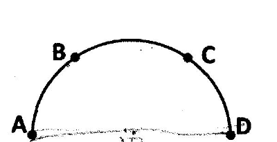
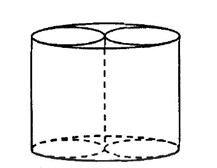
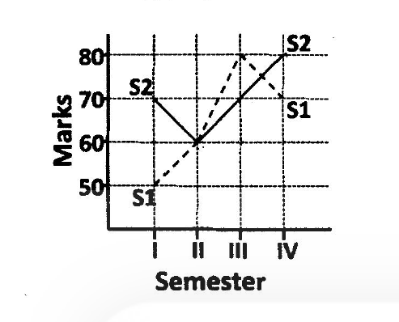

# CSIR NET Life Sciences — June 2014 (2014(I)) — Part A

Booklet code **A** (test booklet serial 20524, subject code 3). Answers confirmed against the official CSIR "ANSWER KEY JUNE, 2014 JRF NET BOOKLET :- A" (see `sources.md`).

### Question 1

On a semi-circle of diameter 10m drawn on a horizontal ground are standing 4 boys A, B, C and D with distances AB = BC = CD. The length of line-segment joining A and B is

1. 5 m
2. 6 m
3. 7 m
4. 5π/3 m

**Answer: 1 (5 m)**

> **Explanation:** AB = BC = CD refers to equal arc lengths, so the 180° semicircle is split into three 60° arcs. The chord subtending 60° at the centre of a circle of radius 5 m equals the radius itself (equilateral triangle), so AB = 5 m.

---

### Question 2

The following table shows the price of diamond crystals of a particular quality.

| Wt. of a diamond crystal (in carat) | Price per carat (in lakh Rs.) |
|---|---|
| 1 | 4 |
| 2 | 8 |
| 3 | 12 |
| 4 | 16 |

What will be the price (in lakh Rs.) of a 2.5 carat diamond crystal?

1. 10
2. 20
3. 25
4. 50

**Answer: 3 (25)**

> **Explanation:** Price per carat is 4 × (weight in carats); for 2.5 carat the rate is 10 lakh Rs. per carat, so the total price is 2.5 × 10 = 25 lakh Rs. (This was the most-contested item in the key: candidates argued the price should be interpolated to 10 or 20, but CSIR's key stands at option 3.)

---

### Question 3

A man on the equator moves along 0° longitude up to 45° N. He then turns east and moves up to 90° E, and returns to the equator along 90°E. The distance covered in multiples of Earth's radius R is

1. (3π/4) R
2. (π/2 + π/4√2) R
3. (π/2 + π/2√2) R
4. (π/4 + π/√2) R

**Answer: 3 ((π/2 + π/2√2) R)**

> **Explanation:** Two meridian legs of 45° each give 2 × (π/4)R = (π/2)R. The eastward leg runs along the 45° N parallel whose radius is R cos45° = R/√2; over 90° of longitude that is (π/2)(R/√2) = (π/2√2)R. Total = (π/2 + π/2√2) R.

---

### Question 4

What is the next number in the following sequence?
2, 3, 5, 6, 3, 4, 7, 12, 4, 5, 9, . . . ,

1. 10
2. 20
3. 13
4. 6

**Answer: 2 (20)**

> **Explanation:** The sequence runs in blocks of four (a, b, a+b, ab): (2,3,5,6), (3,4,7,12), (4,5,9,20). So the next number is 4 × 5 = 20.

---

### Question 5

To go from the engine to the last coach of his train of length 200 m, a man jumped from his train to another train moving on a parallel track in the opposite direction, waited till the last coach of his original train appeared and then jumped back. In how much time did he reach the last coach if the speed of each train was 60 km/hr?

1. 5 s
2. 6 s
3. 10 s
4. 12 s

**Answer: 2 (6 s)**

> **Explanation:** In the frame of the second train, the man's train recedes at the relative speed 60 + 60 = 120 km/h = 100/3 m/s. The 200 m length passes him in 200 ÷ (100/3) = 6 s.

---

### Question 6

How many digits are there in

2¹⁷ × 3² × 5¹⁴ × 7 ?

1. 14
2. 15
3. 16
4. 17

**Answer: 4 (17)**

> **Explanation:** 2¹⁷·3²·5¹⁴·7 = 2³·(2·5)¹⁴·9·7 = 8 × 63 × 10¹⁴ = 504 × 10¹⁴, i.e. a 3-digit number followed by 14 zeros: 17 digits.

---

### Question 7

The following sum is

1 + 1 − 2 + 3 − 4 + 5 − 6 . . . − 20 = ?

1. 10
2. − 10
3. − 11
4. − 9

**Answer: 4 (− 9)**

> **Explanation:** After the leading 1, the remaining terms pair up: (1−2)+(3−4)+…+(19−20) = 10 pairs each equal to −1 = −10. Total = 1 + (−10) = −9.

---

### Question 8

You are given 100 verbs using which you have to form sentences containing at least one verb, without repeating the verbs, under the condition that the number of verbs (from this set of 100) in any two sentences should not be equal. The maximum number of sentences you can form is

1. 10
2. 13
3. 14
4. 100

**Answer: 2 (13)**

> **Explanation:** With pairwise-unequal positive counts, the minimum verbs needed for n sentences is 1+2+…+n = n(n+1)/2. For n = 13 this is 91 ≤ 100; for n = 14 it is 105 > 100. Maximum = 13 sentences.

---

### Question 9

After giving 20% discount on the marked price to a customer, the seller's profit was 20%. Which of the following is true?

1. Sale price = (Marked price+Cost price)/2 ,
2. Sale price < (Marked price+Cost price)/2 ,
3. 2/3 (Marked price + Cost price) > Sale price > (Marked price+Cost price)/2 ,
4. Sale price > 2/3 (Marked price + Cost price).

**Answer: 2 (Sale price < (Marked price+Cost price)/2)**

> **Explanation:** SP = 0.8 MP = 1.2 CP ⇒ MP = 1.5 CP. Then (MP+CP)/2 = 1.25 CP > SP = 1.2 CP, so the sale price is less than the average of marked and cost price.

---

### Question 10

November 9, 1994 was a Wednesday. Then which of the following is true?

1. November 9, 1965 is a Wednesday and November 9, 1970 is a Wednesday.
2. November 9, 1965 is not a Wednesday and November 9, 1970 is a Wednesday.
3. November 9, 1965 is a Wednesday and November 9, 1970 is not a Wednesday.
4. November 9, 1965 is not a Wednesday and November 9, 1970 is not a Wednesday.

**Answer: 4 (November 9, 1965 is not a Wednesday and November 9, 1970 is not a Wednesday.)**

> **Explanation:** 1994→1965 is 29 years with 7 leap days between: odd days = 29 + 7 = 36 ≡ 1 (mod 7), so 1965 was a Tuesday. 1994→1970 is 24 years with 6 leap days: odd days = 30 ≡ 2 (mod 7), so 1970 was a Monday. Neither is a Wednesday.

---

### Question 11

A 4 × 4 magic square is given below.

| 1 | 15 | 14 | 4 |
|---|---|---|---|
| 12 | 6 | 7 | 9 |
| 8 | 10 | 11 | 5 |
| 13 | 3 | 2 | 16 |

How many 2 × 2 squares are there in it whose elements add up to 34?

1. 6
2. 9
3. 4
4. 5

**Answer: 4 (5)**

> **Explanation:** Checking all nine 2×2 sub-squares: rows1-2/cols1-2 = 34, rows1-2/cols3-4 = 34, rows2-3/cols2-3 = 34, rows3-4/cols1-2 = 34, rows3-4/cols3-4 = 34; the remaining four (rows1-2/cols2-3 = 42, rows2-3/cols1-2 = 36, rows2-3/cols3-4 = 32, rows3-4/cols2-3 = 26) do not total 34. Count = 5.

---

### Question 12

Three years ago, the difference in the ages of two brothers was 2 years. The sum of their present ages will double in 10 years. What is the present age of the elder brother?

1. 6
2. 11
3. 7
4. 9

**Answer: 2 (11)**

> **Explanation:** The age difference is always 2 years, so elder = younger + 2. In 10 years the sum increases by 20 and doubles, hence the present sum is 20. Solving x + y = 20, x − y = 2 gives elder = 11.

---

### Question 13

Two identical cylinders of the same height as a bigger hollow cylinder were put vertically into the latter to fit exactly into it. The volume of the bigger cylinder is V. The volume of each of the smaller cylinders is

1. V/8
2. V/4
3. V/2
4. V

**Answer: 2 (V/4)**

> **Explanation:** Two identical cylinders of radius r side by side exactly fill a cylinder of radius R means 2r = R, i.e. r = R/2. Same height, so each small volume = π(R/2)²h = (1/4)πR²h = V/4.

---

### Question 14

You get 20% returns on your investment annually, but also pay a 20% tax on the gain. At the end of 5 years, the net gain made by you (as percentage of the capital) is approximately

1. 0
2. 16
3. 80
4. 100

**Answer: 4 (100)**

> **Explanation:** After tax, the net annual return is 16%, compounding: capital grows by (1.16)⁵ = 2.1003, i.e. a gain of ≈ 110% — the nearest option is 100.

---

### Question 15

A cubic cavity of edge 20 µm is filled with a fluid with a cubic solid of edge 2 µm. What percent of the cavity volume is occupied by the fluid?

1. 10.0
2. 20.0
3. 90.0
4. 99.9

**Answer: 4 (99.9)**

> **Explanation:** Cavity = 20³ = 8000 µm³, solid = 2³ = 8 µm³. Fluid occupies (8000 − 8)/8000 = 0.999 = 99.9%.

---

### Question 16

What is the length of the longest rod that can be put in a hemispherical bowl of radius 10 cm such that no end of the rod is outside the bowl? (Assume that the rod has negligible thickness.)

1. 10√2 cm
2. 10√3 cm
3. 10√4 cm
4. 10√5 cm

**Answer: 3 (10√4 cm)**

> **Explanation:** The longest segment lying wholly in (the closure of) a hemisphere of radius R is a diameter of its great circle, joining two opposite points of the rim: 2R = 20 cm = 10√4 cm.

---

### Question 17

Marks obtained by two students S1 and S2 in a four semester course are plotted in the following graph

Which of the following statements is true?

1. S2 got higher marks than S1 in all four semesters.
2. Over four semesters, S1 improved by a higher percentage compared to S2.
3. Total marks of S1 and S2 are equal.
4. S1 and S2 did not get the same marks in any semester.

**Answer: 2 (Over four semesters, S1 improved by a higher percentage compared to S2.)**

> **Explanation:** From the graph S1 goes 50, 60, 80, 70 (total 260) and S2 goes 70, 60, 80, 70 (total 280): they tie in semesters II and IV (falsifying 1 and 4) and the totals differ (falsifying 3). S1 improves 50→70 (+40%) while S2 improves 70→70 (0%), so statement 2 is true.

---

### Question 18

Find the missing number in the sequence

61, 52, 63, 94, ___, 18, 001, 121.

1. 46
2. 70
3. 66
4. 44

**Answer: 1 (46)**

> **Explanation:** The sequence is the squares 16, 25, 36, 49, 64, 81, 100, 121 written backwards: 61, 52, 63, 49→"94", 46→"64" reversed, 18, 001, 121. The missing term is the reverse of 64, i.e. 46.

---

### Question 19

If a 4 digit year (e.g. 1927) is chosen randomly, what is the probability that it is NOT a leap year?

1. 3/4
2. 1/4
3. < 1/4
4. > 3/4

**Answer: 4 (> 3/4)**

> **Explanation:** Of the 9000 four-digit years (1000–9999), 2250 are divisible by 4. But 90 are century years, of which only 2000, 4000 and 8000 are divisible by 400, so 87 must be subtracted: leap years = 2163, P(leap) = 2163/9000 = 0.2403. Hence P(not leap) = 0.7597 > 3/4.

---

### Question 20

Coordinates of a point in x, y, z space is (1, 2, 3). What would be the coordinates of its reflection in a mirror along the x, z plane?

1. (− 1, −2, −3)
2. (1, −2, −3)
3. (1, −2, 3)
4. (− 1, 2, 3)

**Answer: 3 ((1, −2, 3))**

> **Explanation:** Reflection in the x–z plane leaves x and z unchanged and reverses the sign of y: (1, 2, 3) → (1, −2, 3).
