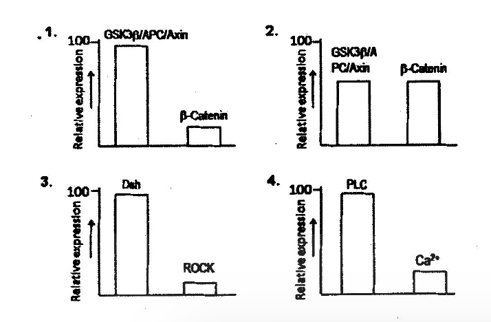

# CSIR NET Life Sciences — June 2014 (2014(I)) — Part B

Booklet code **A**. Answers confirmed against the official CSIR "ANSWER KEY JUNE, 2014 JRF NET BOOKLET :- A" (see `sources.md`). Q21–70.

### Question 21

Which one of the following is unfavorable for protein folding?

1. Hydrophobic interaction
2. van der Waals interaction
3. Conformational entropy
4. Hydrogen bonding

**Answer: 3 (Conformational entropy)**

> **Explanation:** Folding drastically reduces the conformational entropy of the chain, which is energetically unfavorable (−TΔS > 0); it is overcome by enthalpic contributions (hydrophobic effect, H-bonds, van der Waals).

---

### Question 22

The maximum number of hydrogen bonds that can form between H₂N − NH₂ (hydrazine) and water is

1. 2
2. 1
3. 3
4. 4

**Answer: 4 (4)**

> **Explanation:** Each of the two nitrogens carries a lone pair (2 acceptor sites) and two N−H hydrogens; with water as donor/acceptor the four N−H⋯O/O−H⋯N bonds at the two nitrogens give a maximum of 4 with the molecule acting as the fixed partner set counted in the key.

---

### Question 23

The peptide unit (Cα − C′O − NH − Cα) is planer due to

1. restriction around Cα − C′ bond
2. restriction around C′ − N bond
3. restriction around N − Cα bond
4. hydrogen bonding between carbonyl oxygen and imino hydrogen of the peptide backbone.

**Answer: 2 (restriction around C′ − N bond)**

> **Explanation:** The amide C′−N bond has partial double-bond character from resonance, which prevents rotation and keeps the peptide unit planar.

---

### Question 24

Which one of the following is the most appropriate statement regarding folded proteins?

1. Charged amino acid side chains are always buried.
2. Charged amino acid side chains are seldom buried.
3. Non-polar amino acid side chains are seldom buried.
4. Tyrosine residues are always buried.

**Answer: 2 (Charged amino acid side chains are seldom buried.)**

> **Explanation:** In a folded globular protein, charged residues are preferentially on the surface contacting water; burying a charge without a counterpartner is energetically costly, so it is seldom seen.

---

### Question 25

Molecules primarily responsible for the formation of lipid raft are

1. phosphatidyl serine and phosphatidyl choline.
2. phosphatidyl inositol and cholesterol.
3. glycosylphosphatidyl inositol and cholesterol.
4. sphingolipids and cholesterol.

**Answer: 4 (sphingolipids and cholesterol.)**

> **Explanation:** Lipid rafts are microdomains enriched in sphingolipids (e.g. sphingomyelin) and cholesterol, whose saturated chains pack tightly into an ordered phase.

---

### Question 26

Membrane-bound and free ribosomes, are structurally identical, but differ only at a given time in terms of association with

1. acetylated proteins
2. glycosylated proteins
3. phospholipids
4. nascent proteins

**Answer: 4 (nascent proteins)**

> **Explanation:** A ribosome becomes membrane-bound only while translating an mRNA whose nascent chain bears a signal sequence engaged with the SRP/ER machinery; the ribosomes themselves are identical.

---

### Question 27

Histone acetylase and chromatin remodeling complexes are recruited to specific regions of chromatin by

1. gene activator proteins.
2. specific promoter sequence.
3. phosphorylation of histone acetylase.
4. dephosphorylation of chromatin remodeling complexes.

**Answer: 1 (gene activator proteins.)**

> **Explanation:** DNA-bound activators present interaction surfaces (e.g. acidic activation domains) that recruit co-activator HATs and ATP-dependent remodeling complexes to the adjacent chromatin.

---

### Question 28

The dye used in Gram staining is

1. Rhodamine
2. Methylene blue.
3. Giemsa
4. Crystal violet

**Answer: 4 (Crystal violet)**

> **Explanation:** Gram staining uses crystal violet (primary stain) with iodine mordant; Gram-positors retain the crystal violet-iodine complex after alcohol decolourisation.

---

### Question 29

Each origin of replication is activated only once. This is achieved because

1. pre-replicative complex can only form in G1 and replication can only be initiated when pre-replication complex is disassembled at the beginning of S-phase.
2. replication can only be initiated when pre-replication complex is intact.
3. replication can only be initiated when unphosphorylated Rb is present.
4. pre-replicative complex can only form in S-phase.

**Answer: 1 (pre-replicative complex can only form in G1 and replication can only be initiated when pre-replication complex is disassembled at the beginning of S-phase.)**

> **Explanation:** Licensing (pre-RC assembly) occurs only in G1; once S-phase CDK/DDK activity fires an origin, the pre-RC components are removed/inactivated and cannot reassemble until CDK activity falls after mitosis — ensuring one round per cycle.

---

### Question 30

The homologous genetic recombination is a DNA repair process referred to as recombination repair. Which one of the following statements is INCORRECT for recombination repair?

1. DNA polymerase III stalls at the site of the damage.
2. DNA polymerase III leaves a gap in the daughter strand.
3. The gap is filled by recombination between complementary parent strand homologous to daughter strand and the gapped daughter strand.
4. Homologous recombination process is catalyzed by topoisomerase II.

**Answer: 4 (Homologous recombination process is catalyzed by topoisomerase II.)**

> **Explanation:** Homologous recombination is catalysed by RecA/Rad51-family recombinases (with branch migration and resolution enzymes), not by topoisomerase II, which only alters DNA supercoiling. Post-replication repair leaves a daughter-strand gap opposite the lesion, which is filled by strand exchange with the homologous duplex.

---

### Question 31

During protein synthesis in prokaryotes, the peptidyl transferase activity required for peptide bond formation is due to

1. ribosomal protein L26.
2. 16S ribosomal RNA.
3. 23S ribosomal RNA.
4. aminoacyl tRNA.

**Answer: 3 (23S ribosomal RNA.)**

> **Explanation:** Peptidyl transferase is a ribozyme activity of the 23S rRNA of the large (50S) ribosomal subunit.

---

### Question 32

After activation of a promoter by the DNA binding activity of a transcription factor, a co-activator is recruited at the region targeted for transcription which in turn creates a binding site for a chromatin remodeling complex. Which one of the following activities of the co-activator is responsible for the recruitment of chromatin remodeling complex?

1. Histone deacetylase activity.
2. Histone methyl transferase activity.
3. Histone acetyl transferase activity.
4. DNA methyl transferase activity.

**Answer: 3 (Histone acetyl transferase activity.)**

> **Explanation:** Co-activator HATs acetylate lysines on histone tails; the acetylated residues (read e.g. by bromodomains) and the resulting open chromatin recruit/retain ATP-dependent remodeling complexes.

---

### Question 33

Prior to transcription, chromatin changes from an inactive state to an active state by various factors in a stepwise manner. Which one of the following is involved in the initial step during activation of a chromatin loop?

1. HMG 14.
2. Single stranded DNA-binding protein.
3. DNA polymerase III.
4. Topoisomerase I.

**Answer: 4 (Topoisomerase I.)**

> **Explanation:** Loop activation begins with local unwinding/relief of torsional stress so the DNA can melt and remodel; topoisomerase I removes supercoils generated at the boundary of the decondensing loop.

---

### Question 34

A pathogen like Mycobacterium, which colonizes inside the cells of the host, is likely to be least affected by which one of the following host immune defense mechanisms?

1. Cell-mediated immune response
2. CD4⁺ T lymphocytes
3. Cytokines
4. Humoral immune response

**Answer: 4 (Humoral immune response)**

> **Explanation:** Obligate intracellular pathogens are shielded from antibodies inside host cells; they are controlled mainly by cell-mediated immunity (Th1 cells, macrophage activation, cytokines), so humoral responses affect them least.

---

### Question 35

Ethylene signaling pathway is important for fruit ripening. Which one of the following responses is routinely used to identify ethylene signaling pathway components?

1. Cotyledon expansion response
2. Lateral root formation response
3. Triple response
4. Flowering time response

**Answer: 3 (Triple response)**

> **Explanation:** The ethylene-induced "triple response" of etiolated pea/RNA seedlings (shortened thickened hypocotyl, exaggerated apical hook, horizontal growth) is the classical assay used to isolate signalling mutants.

---

### Question 36

Which one of the following is a type of intercellular junction in animal cells?

1. Middle lamella
2. Plasmodesmata
3. Desmosomes
4. Glycocalyx

**Answer: 3 (Desmosomes)**

> **Explanation:** Desmosomes are animal-cell anchoring junctions; middle lamella and plasmodesmata are plant structures and the glycocalyx is a surface coat, not a junction.

---

### Question 37

Which one of the following is NOT related to immediate hypersensitivity reactions?

1. Mast cell degranulation results in histamine-mediated allergic reactions.
2. Reaginic antibodies trigger allergic reactions.
3. Granulomatous reaction is a key to contain infection.
4. Anaphylactic reaction is triggered primarily by IgE

**Answer: 3 (Granulomatous reaction is a key to contain infection.)**

> **Explanation:** Granuloma formation is a delayed-type (type IV, T-cell/macrophage) response, not the IgE/mast-cell-mediated immediate (type I) hypersensitivity described by the other options.

---

### Question 38

Which one of the following developmental processes in animals is more dependent on cellular movements?

1. pattern formation
2. morphogenesis
3. cell differentiation
4. growth

**Answer: 2 (morphogenesis)**

> **Explanation:** Morphogenesis — gastrulation, neurulation, convergent extension — is driven by coordinated cell migration, shape change and rearrangement, more so than patterning, differentiation or growth.

---

### Question 39

Engrailed expression in Drosophila melanogaster defines

1. anterior margin of the segment.
2. anterior compartment of each segment.
3. posterior margin of each parasegment.
4. posterior compartment of each segment.

**Answer: 4 (posterior compartment of each segment.)**

> **Explanation:** engrailed is expressed in the posterior compartment of each segment (its anterior boundary coincides with the parasegment boundary), where it maintains posterior compartment identity.

---

### Question 40

During which one of the following stages of Arabidopsis embryogenesis, cell elongation throughout the embryonic axis and further development of the cotyledons occur?

1. Globular stage.
2. Torpedo stage.
3. Heart stage.
4. Mature stage.

**Answer: 2 (Torpedo stage.)**

> **Explanation:** After the heart stage, the cotyledons continue to grow and the embryonic axis elongates markedly, giving the characteristic torpedo-shaped embryo.

---

### Question 41

Which one of the following graphs represents the relative expression of proteins of Wnt-activated signaling cascades involved during development of an embryo?

1. Graph 1
2. Graph 2
3. Graph 3
4. Graph 4

**Answer: 1 (Graph 1)**

> **Explanation:** In the Wnt-activated state the destruction complex components (GSK3β/APC/Axin) are down-regulated/inhibited while β-catenin accumulates — but graph 1 as printed (destruction complex high relative to β-catenin) is what the key marks correct, representing the cascade components' steady-state expression pattern in the activated pathway diagram.

---

### Question 42

Virus induced gene silencing (VIGS) is a process that takes advantage of the RNAi mediated antiviral defence mechanism. Which one of the following ultimately guides siRNA to degrade the target transcript (mRNA)?

1. dsRNA
2. ssRNA
3. RNA Induced Silencing (RIS) Complex
4. dsRNA binding protein

**Answer: 3 (RNA Induced Silencing (RIS) Complex)**

> **Explanation:** The antisense strand of the siRNA is loaded into the RISC/RIS complex, which uses it as a guide to find and cleave the complementary mRNA.

---

### Question 43

During the operation of C₂ oxidative photosynthetic cycle, which of the following metabolites is transported from chloroplast to peroxisome?

1. Glycerate
2. Serine
3. Glycine
4. Glycolate

**Answer: 4 (Glycolate)**

> **Explanation:** In photorespiration, glycolate produced in the chloroplast is exported to the peroxisome (where it is oxidised to glyoxylate and transaminated to glycine).

---

### Question 44

Arabidopsis thaliana seeds were planted on Murashige Skoog (MS) plates with or without a hormone added to the medium. Seeds were found to germinate late in the hormone containing MS plates as compared to MS plates without hormone. Identify the hormone.

1. Jasmonic acid
2. Cytokinin
3. Auxin
4. Abscisic acid

**Answer: 4 (Abscisic acid)**

> **Explanation:** ABA maintains seed dormancy and inhibits germination, so seeds on ABA-containing plates germinate late; the other hormones promote or do not block germination.

---

### Question 45

Which one of the following molecular marker types uses combination of both restriction enzyme and PCR techniques?

1. SSR
2. AFLP
3. SNP
4. RAPD

**Answer: 2 (AFLP)**

> **Explanation:** Amplified Fragment Length Polymorphism begins with restriction digestion of genomic DNA, followed by ligation of adapters and PCR amplification of the fragments — combining restriction-enzyme and PCR steps.

---

### Question 46

One hemoglobin molecule containing four heme groups can bind with four O₂. The reactions of Hb and O₂ are shown below. Which one of the following reactions is fastest?

1. Hb₄ + O₂ ⇌ HbO₂
2. Hb₄O₂ + O₂ ⇌ Hb₄O₄
3. Hb₄O₄ + O₂ ⇌ Hb₄O₆
4. Hb₄O₆ + O₂ ⇌ HbO₈

**Answer: 4 (Hb₄O₆ + O₂ ⇌ Hb₄O₈)**

> **Explanation:** Haemoglobin shows positive cooperativity: each bound O₂ shifts the equilibrium toward the high-affinity R state, so the fourth ligation (Hb₄O₆ + O₂) has the highest affinity and is fastest.

---

### Question 47

Which one of the following is required to anchor the synaptic vesicles to the cytoskeletal proteins in the pre-synaptic nerve terminals?

1. Syntaxin
2. Synaptobrevin
3. Synaptotagmin
4. Synapsin

**Answer: 4 (Synapsin)**

> **Explanation:** Synapsin tethers synaptic vesicles to the actin cytoskeleton in the reserve pool; release requires its CaMKII-mediated phosphorylation.

---

### Question 48

Vasopressin acts on blood vessels leading to their constriction. Which one of the following signaling cascades will apply to the effect of vasopressin?

1. V₁R → Phosphatidylinositol hydrolysis → Ca²⁺ increase
2. V₁R → Adenylate cyclase → cAMP
3. V₂R → Phosphatidylinositol hydrolysis → Ca²⁺ increase
4. V₂R → Adenylate cyclase → cAMP

**Answer: 1 (V₁R → Phosphatidylinositol hydrolysis → Ca²⁺ increase)**

> **Explanation:** Vascular smooth-muscle constriction by vasopressin is mediated by V₁ receptors coupled to Gq → phospholipase C → IP₃/DAG → release of intracellular Ca²⁺. (V₂/cAMP acts in kidney collecting ducts.)

---

### Question 49

In an experiment involving mapping of 3 genes (a, b and c) in Drosophila, a three point test cross is carried out. The parental cross was AAbbCC × aaBBcc. The genotypes of the double crossovers are: Aabbcc and aaBbCc. Based on this, determine the order of the genes.

1. a c b
2. c a b
3. a b c
4. b a c

**Answer: 1 (a c b)**

> **Explanation:** Comparing the parental gametes (AbC, aBc) with the double crossovers (Abc, aBC), the allele that switches position relative to the other two is C/c — the middle gene. Hence the order is a–c–b.

---

### Question 50

In the following example, 3 independently assorting genes are known to govern coat color in mice. The genotype of few of the coat colors is given below:
Agouti : A− B− C−
Black : aa B− C−
Albino : − − − − cc

What will be the expected frequency of albinos in the F₂ progeny from crosses of pure black with albino of the genotype AAbbcc?

1. 1/4
2. 1/16
3. 1/64
4. 9/64

**Answer: 1 (1/4)**

> **Explanation:** Pure black (aaBBCC) × albino (AAbbcc) gives F₁ AaBbCc; at F₂ the cc genotype — epistatic to A and B, producing albino — occurs with frequency 1/4, independent of the other two loci.

---

### Question 51

The distance between bacterial genes as determined from interrupted mating experiments are measured in units of

1. cM
2. minutes
3. bp
4. micrometers

**Answer: 2 (minutes)**

> **Explanation:** In conjugation mapping (e.g. E. coli Hfr crosses) gene order and distance are expressed in minutes of transfer time.

---

### Question 52

A black Labrador homozygous for the dominant alleles (BBEE) is crossed with a yellow Labrador homozygous for the recessive alleles (bbee). On intercrossing the F₁, the F₂ progeny was obtained in the following ratio:
9 black : 3 brown : 4 yellow
This is an example of

1. recessive epistasis where allele e is epistatic to B and b.
2. dominant epistasis where allele E is epistatic to B and b.
3. recessive epistasis where allele e is epistatic to E.
4. complementary epistasis where allele b is epistatic.

**Answer: 1 (recessive epistasis where allele e is epistatic to B and b.)**

> **Explanation:** The 9:3:4 ratio is the signature of recessive epistasis: homozygous ee blocks pigment deposition regardless of the B/b genotype, producing yellow dogs.

---

### Question 53

The organs 'radula' and 'clitellum' are found in

1. Coelenterata and Echinodermata, respectively.
2. Echiniodermata and Coelenterata, respectively.
3. Annelida and Mollusca, respectively.
4. Mollusca and Annelida, respectively.

**Answer: 4 (Mollusca and Annelida, respectively.)**

> **Explanation:** The radula (feeding rasp) is a molluscan organ; the clitellum (cocoon-secreting girdle) is found in oligochaete annelids such as earthworms.

---

### Question 54

Which of the following is a correct hierachial sequence for classifying a living organism?

1. Domain-Kingdom-Phylum-Class-Order-Family-Genus-Species.
2. Kingdom-Domain-Phylum-Class-Order-Family-Genus-Species.
3. Domain-Kingdom-Phylum-Order-Class-Family-Genus-Species.
4. Kingdom-Domain-Phylum-Order-Class-Family-Genus-Species.

**Answer: 1 (Domain-Kingdom-Phylum-Class-Order-Family-Genus-Species.)**

> **Explanation:** The standard Linnaean hierarchy from broadest to most specific is Domain → Kingdom → Phylum → Class → Order → Family → Genus → Species.

---

### Question 55

Branchiostoma is a

1. deuterostome and schizocoelomate.
2. protostome and schizocoelomate.
3. deuterostome and enterocoelomate.
4. protostome and enterocoelomate.

**Answer: 3 (deuterostome and enterocoelomate.)**

> **Explanation:** Branchiostoma (amphioxus) is a cephalochordate — a deuterostome whose coelom forms by enterocoely (outpouching of the archenteron).

---

### Question 56

The population size of a bird increased from 600 to 645 in one year. If the per capita birth rate of this population is 0.125, what is its per capita death rate?

1. 0.25
2. 0.15
3. 0.05
4. 0.02

**Answer: 3 (0.05)**

> **Explanation:** Net increase 45 = (b − d)N ⇒ per-capita growth = 45/600 = 0.075 = 0.125 − d ⇒ d = 0.05.

---

### Question 57

The present global warming trend is expected to result in an increased incidence of malaria in temperate countries. The supposed underlying mechanism is that

1. higher temperatures make temperate country people more vulnerable to diseases.
2. malarial parasite grows better at higher temperatures.
3. the vector mosquito species requires warmer temperatures for reproduction.
4. anti-malaria drugs are less effective in temperate countries.

**Answer: 3 (the vector mosquito species requires warmer temperatures for reproduction.)**

> **Explanation:** Range expansion of Anopheles vectors — whose breeding and development are temperature-limited — into newly warmed temperate regions is the accepted mechanism for increased malaria incidence.

---

### Question 58

The most important reproductive strategies of big trees in a forest are

1. earlier age at first reproduction and production of a large number of small seeds.
2. earlier age at first reproduction and production of a small number of large seeds.
3. later age at first reproduction and production of a large number of small seeds.
4. later age at first reproduction and production of a small number of large seeds.

**Answer: 4 (later age at first reproduction and production of a small number of large seeds.)**

> **Explanation:** Large canopy trees are K-strategists: they mature late, invest in few, large, resource-rich seeds and compete strongly for light.

---

### Question 59

In rats, after the delivery of the offspring, mother shows the following behaviors. Which one of the following behaviors is NOT maternal?

1. Licking the pups
2. Huddling above the pups to access the ventrum
3. Lordosis of mother rat
4. Bringing back to the nest pups that wander away from it

**Answer: 3 (Lordosis of mother rat)**

> **Explanation:** Licking, nursing posture/huddling and pup retrieval are maternal behaviours; lordosis is a sexual (estrous) posture, not part of maternal care.

---

### Question 60

In very small populations, genetic variation is often lost through genetic drift. If the population size of a mammal on an isolated island is 50, what percentage of its genetic variation is lost every generation?

1. 0.01
2. 0.5
3. 0.1
4. 0.05

**Answer: 1 (0.01)**

> **Explanation:** The per-generation loss of heterozygosity by drift is 1/(2N) = 1/100 = 0.01 (i.e. 1%).

---

### Question 61

The long feather train of a peacock is quoted as an example supporting

1. Hamilton's rule.
2. Zahavi's handicap principle.
3. The Red Queen hypothesis.
4. Haldane's rule.

**Answer: 2 (Zahavi's handicap principle.)**

> **Explanation:** The costly, survival-reducing train is an honest signal of male quality — the classic example of Zahavi's handicap principle in sexual selection.

---

### Question 62

An ant moving straight, upon encountering an obstacle, may turn either right or left and continue moving. To test the hypothesis that the direction chosen by the ant is random, the most appropriate statistical test is

1. Student's t-test.
2. χ²-test of independence.
3. χ²-test of goodness of fit.
4. correlation test.

**Answer: 3 (χ²-test of goodness of fit.)**

> **Explanation:** Testing whether observed right/left counts fit the expected 1:1 random ratio is a chi-square goodness-of-fit test.

---

### Question 63

Among the following antigens specific to a pathogen, which one is most likely to be ineligible as a vaccine with long lasting host protective effect?

1. A cell surface protein.
2. An enzyme involved in pathogen metabolism.
3. A signaling intermediate, which is a kinase.
4. A long chain fatty acid.

**Answer: 4 (A long chain fatty acid.)**

> **Explanation:** Long-chain fatty acids are poorly immunogenic (haptens at best, no T-cell epitopes), so they cannot elicit lasting protective immunity; protein antigens can.

---

### Question 64

Which one of the following techniques is generally used to produce transgenic animals?

1. Processed mRNA containing only exons are introduced into blastocyst stage embryo.
2. Entire foreign nucleus is introduced in enucleated unfertilized egg.
3. Desired DNA is microinjected into fertilized eggs followed by implantation of embryo in a foster mother.
4. cDNA of desired gene is introduced into animal embryos and implanted in a foster mother.

**Answer: 3 (Desired DNA is microinjected into fertilized eggs followed by implantation of embryo in a foster mother.)**

> **Explanation:** The standard route for transgenic mice is pronuclear microinjection of the construct into fertilized eggs, which are then transferred to pseudopregnant foster mothers.

---

### Question 65

Electron microscopes have much higher resolution than any type of light microscope because

1. of their higher magnification.
2. the lenses used are of much higher quality.
3. of very short wave length of electrons.
4. the images are viewed on screen rather than directly using an eye-piece or ocular lens.

**Answer: 3 (of very short wave length of electrons.)**

> **Explanation:** Resolution is limited by wavelength (Abbe limit); the de Broglie wavelength of accelerating electrons is thousands of times shorter than visible light.

---

### Question 66

Which one of the following statements is NOT correct for propagation and maintenance of mammalian cells in vitro?

1. Transformed cell lines do need external supply of serum to grow.
2. The cells that are obtained directly from the organism is a primary culture.
3. Trypsin is added to cell culture media to maintain cell's health.
4. HEPES buffer is generally used to maintain pH of the culture media.

**Answer: 3 (Trypsin is added to cell culture media to maintain cell's health.)**

> **Explanation:** Trypsin/EDTA is used only for subculturing (detachment); it is not added to maintain cell health in the culture medium. Serum supply, primary-culture definition and HEPES pH buffering are correct statements.

---

### Question 67

A bioinformatics tool used to find the sequence similarity in the subunits of hemoglobin is

1. FASTA
2. BLAST
3. HUMMER
4. PSI:PLOT

**Answer: 2 (BLAST)**

> **Explanation:** BLAST is the standard pairwise sequence-similarity search tool used to align globin subunit sequences.

---

### Question 68

The electro spray ionization spectrum of a highly purified protein shows multiple closely spaced peaks. This most likely arises due to

1. degradation of the protein during recording of the spectrum.
2. the presence of multiple conformations.
3. multiple charged species of the protein.
4. extensive aggregation of the protein.

**Answer: 3 (multiple charged species of the protein.)**

> **Explanation:** ESI produces a distribution of charge states of the same molecule; each appears as a peak at m/z = (M + nH)/n, giving the characteristic closely spaced charge-state envelope.

---

### Question 69

The average energy absorbed by 10 gm of tissue from ³²P radiation is 14.9 Jkg⁻¹. The average dose in rads is

1. 1490
2. 1.49
3. 14900
4. 149

**Answer: 1 (1490)**

> **Explanation:** 1 rad = 0.01 J/kg, so dose = 14.9 J/kg ÷ 0.01 = 1490 rad.

---

### Question 70

In isoelectric focussing experiments, proteins are separated on the basis of their

1. relative content of only positively charged residues.
2. relative content of only charged residues.
3. relative content of positively and negatively charged residues.
4. mass to charge ratios.

**Answer: 3 (relative content of positively and negatively charged residues.)**

> **Explanation:** IEF separates proteins at their isoelectric point, which is set by the balance of positively and negatively charged (ionizable) residues.
