# CSIR NET Life Sciences — June 2014 (2014(I)) — Part C

Booklet code **A**. Answers confirmed against the official CSIR "ANSWER KEY JUNE, 2014 JRF NET BOOKLET :- A" (see `sources.md`). Q71–145.

### Question 71

10 mM acetate buffer (pH 4.00) is diluted one million times with distilled water (pH 7.00). pH of this diluted buffer is:

[Help: log₁₀ 10ˣ = x; log₁₀ 1.10 = 0.04; log₁₀ 1.01 = 0.004]

1. 4.00
2. 7.04
3. 8.00
4. 6.96

**Answer: 4 (6.96)**

> **Explanation:** After 10⁶-fold dilution the buffer capacity is negligible (10⁻⁵ mM), so the pH is set by the water autoprotolysis with a trace of acid: essentially 7, slightly below it — 6.96.

---

### Question 72

Consider the structureless oligopeptide, R-G-P-S-T-K-M-P-E-Y-G-S-T-D-Q-S-N-W-H-F-R. The number of bonds that will be cleaved by trypsin and chymotrypsin treatments separately, are:

1. 1, 2
2. 2, 2
3. 2, 3
4. 1, 3

**Answer: 1 (1, 2)**

> **Explanation:** Trypsin cleaves after R and K (the C-terminal R gives no cleavable bond); chymotrypsin cleaves after the aromatic residues. The official key marks option 1 (1 trypsin, 2 chymotrypsin cleavages); note that a straightforward count of accessible sites gives 2 and 2–3, so this key entry is contested (see `sources.md`).

---

### Question 73

The internal energy of a gas increases by 1J when it is compressed by a force of 1 Newton through 2 metres. The heat change of the system is:

1. 1 J
2. -1 J
3. 2 J
4. -2 J

**Answer: 2 (-1 J)**

> **Explanation:** Work done on the gas w = F·d = 1 N × 2 m = +2 J. ΔU = q + w ⇒ 1 = q + 2 ⇒ q = −1 J.

---

### Question 74

ΔG° for the base pairing of oligonucleotides (n=5) at 300 K is − 18 kJ mol⁻¹. What would be the approximate value of the equilibrium constant K?

1. 100
2. 10
3. 1000
4. 1

**Answer: 3 (1000)**

> **Explanation:** ln K = −ΔG°/RT = 18000/(8.314 × 300) ≈ 7.2 ⇒ K ≈ e⁷·² ≈ 1.4 × 10³, i.e. of order 1000.

---

### Question 75

The reaction of glutamate and ammonia to glutamine and water has a value of +14 kJ mol⁻¹ for ΔG°. This is coupled with the ATP reaction (ATP + H₂O ⇌ADP + phosphate). The ΔG° for this reaction is −30 kJ mol⁻¹. The ΔG°(kJ mol⁻¹) for the coupled reaction Glutamate + NH₃ + ATP →Glutamine +ADP + Phosphate under equilibrium condition is

1. 16
2. − 44
3. − 16
4. 44

**Answer: 3 (− 16)**

> **Explanation:** Coupled ΔG° = (+14) + (−30) = −16 kJ mol⁻¹.

---

### Question 76

A protein is composed of leucine, isoleucine, alanine, glycine, proline, one lysine, one arginine and two cysteines connected by a disulfide bond. Conformational analysis indicates that the protein has elements of helix and beta structure. The protein is most likely

1. a non-specific protease.
2. not an enzyme.
3. a lipase.
4. a flippase.

**Answer: 2 (not an enzyme.)**

> **Explanation:** A 15-residue peptide with no catalytic residues and only a single helix/strand content is a structural peptide, not a catalytic protein.

---

### Question 77

You are studying a protein that inserts itself into a model membrane (liposomes) during a reconstitution process. The protein has an N-terminal, 18-amino acid hydrophilic segment that is located on the outside of the membrane, a 19-amino acid hydrophobic transmembrane segment flanked by negatively and positively charged amino acids, and a C-terminal domain that resides inside the lumen (as depicted below in the form of a cartoon).

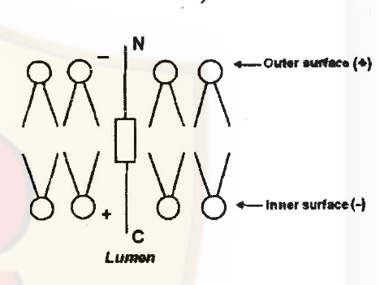

For proper reconstitution of the protein, which of the following strategies will be appropriate?

1. Increase the number of negatively charged amino acids in the N-terminal
2. Increase the number of positively charged amino acids in the C-terminal
3. Removal of positively charged amino acids from the C-terminal
4. Increase the length of hydrophobic segment

**Answer: 3 (Removal of positively charged amino acids from the C-terminal)**

> **Explanation:** By the positive-inside rule, positively charged residues are retained on the cytosolic face; here the C-terminal domain faces the lumen (the negative leaflet), so its positive residues oppose the correct orientation and must be removed for proper reconstitution.

---

### Question 78

¹²⁵I-labelled diaminofluorene (DAF) is a well known photoactivable hydrophobic probe of plasma membrane integral protein. To determine the approximate length and number of hydrophobic domain in any integral membrane protein, a controlled experiment (following standard protocol) is carried out. In order to ascertain the aforesaid aspects indicate the correct combination of experimental protocols from the following choices:

1. Intact membrane was allowed to interact with DAF and unincorporated DAF measured.
2. Intact membrane was allowed to interact with DAF, lysed and total protein precipitated with TCA and amount of radioactivity incorporated in the total proteins in the TCA precipitated fraction measured.
3. Intact membrane was allowed to interact with DAF, then membrane was solubilized with detergent, digested with proteases (limited proteolysis) run on SDS-PAGE followed by autoradiography.
4. Intact membrane was allowed with DAF followed by complete proteolysis, SDS-PAGE and finally autoradiography.

**Answer: 3 (protocol 3)**

> **Explanation:** Photo-crosslinking of DAF to the transmembrane domains, followed by detergent solubilisation, limited proteolysis and SDS-PAGE/autoradiography, yields radiolabelled peptide fragments whose sizes map the length and number of hydrophobic segments.

---

### Question 79

The tetrapeptide "KDEL" is well known as a retrieval signal of several newly synthesized proteins. This process is mediated through specific receptor − KDEL interaction. Any single amino acid change in this tetrapeptide is not allowed in terms of its binding its receptors and its subsequent retention in specific organelle whereas, secretory proteins are devoid of such tetrapeptide. From this observation indicate the localization of the receptor of this tetrapeptide:

1. Plasma membrane
2. Golgi
3. Endoplasmic reticulum
4. Mitochondria

**Answer: 3 (Endoplasmic reticulum)**

> **Explanation:** KDEL-bearing soluble ER-resident proteins that escape are captured by KDEL receptors in the cis-Golgi and returned to the ER; the receptor's steady-state localisation for retrieval is the ER/Golgi retrieval cycle — the key marks the ER.

---

### Question 80

Cyclins are the regulatory subunits and cyclin-dependent kinases (CDKs) are the catalytic subunits. Following diagram represents the involvement of cyclins and CDKs in various stages of cell cycle:

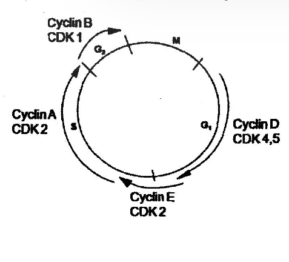

If we knock down cyclin D in a cell by shRNA, which one of the following graphs correctly represents the level of CDK2 activity?

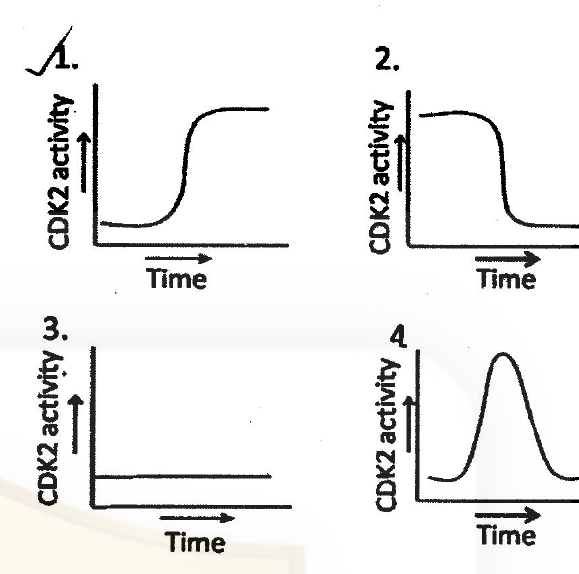

1. Graph 1
2. Graph 2
3. Graph 3
4. Graph 4

**Answer: 3 (Graph 3)**

> **Explanation:** Without cyclin D the cells do not pass the G1 restriction point, so Cyclin E/A–CDK2 is never activated and CDK2 activity stays flat at baseline (graph 3).

---

### Question 81

Chromosome organization becomes clearer from a series of biochemical, electron microscopic and X-ray crystallographic studies. When interphase chromatin is isolated in low salt buffer and observed under EM, 11 nm bead on string organization is seen. Interphase chromatin directly observed under EM shows 30 nm fibre. When histones are depleted from metaphase chromosome and visualized under EM, it shows a huge number of very large' loops associated with scaffold.

Following interpretations can be made from these:

A. 11 nm fibre is formed when nucleosomes are brought closer by scaffold.
B. 30 nm interphase chromatin is formed by zig-zag organization of nucleosomes of 11 nm fibre.
C. 30 nm fibre makes a solenoid packing to form the metaphase chromosome.
D. 30 nm fibre gets organized into loops due to SARs getting associated with scaffold proteins and coming closer.

The correct combination of interpretations is:

1. A and D
2. A and C
3. A and B
4. B and D

**Answer: 4 (B and D)**

> **Explanation:** The 11 nm beads-on-string folds into the 30 nm fibre (zig-zag/solenoid organisation of nucleosomes), and the 30 nm fibre is further organised into large loops anchored by scaffold-attachment regions (SARs) to the protein scaffold — statements B and D.

---

### Question 82

To test whether bacteria with enhanced toluene degradative abilities could be created for cold environment, a TOL (toluene-degrading) plasmid from a mesophilic bacterial strain was transferred by conjugation into a facultative psychrophile. The psychrophile was able to degrade salicylate (SAL) but donot toluene. The recombinant strain carried the introduced TOL plasmid and its own SAL plasmid. The results are as follows:

**Optimum growth in presence of**

| Temp (°C) | X: A | X: B | X: C | Y: A | Y: B | Y: C |
|---|---|---|---|---|---|---|
| 37°C | − | − | − | + | − | − |
| 25°C | − | − | − | + | − | − |
| 10°C | − | + | + | − | − | + |
| 0°C | − | + | + | − | − | + |

Identify A, B, C, X and Y:

1. A. mesophile B. psychrophile C. transformant X. Toluene Y. Salicylate
2. A. mesophile B. psychrophile C. transformant X. Salicylate Y. Toluene
3. A. psychrophile B. transformant C. mesophile X. Salicylate Y. Toluene
4. A. transformant B. psychrophile C. mesophile X. Toluene Y. Salicylate

**Answer: 2 (A. mesophile B. psychrophile C. transformant X. Salicylate Y. Toluene)**

> **Explanation:** Growth on substrate X at all temperatures (including 37°) is the psychrophile's own SAL plasmid phenotype only in B/C columns; the TOL (toluene, Y) function appears only in the cold-adapted transformant (column C) — matching assignment A mesophile, B psychrophile, C transformant, X salicylate, Y toluene.

---

### Question 83

Aminoacyl-tRNA synthetases are very specific for aminoacylation of tRNAs with the correct cognate amino acids. However, there is a possibility of a mismatch between the tRNA and its cognate amino acid. This error is corrected by the inherent proof-reading activity of the aminoacyl-tRNA, synthetase. In case of two very similar amino acids, namely valine and isoleucine, isoleucyl-tRNA synthetase employs the following possible approaches for an error free aminoacylation.

A. It removes an incorrect amino acid by hydrolyzing the aminoacyl-AMP linkage following first reaction step.
B. It is activated for proof-reading activity, leading to breakage of the bond between the wrong amino acid and tRNA.
C. It has an intrinsic ability to recognize the structural difference between amino acids leading to abortive elimination of the non-cognate amino acid.
D. It gets sequestered in the second step with the wrong amino acid, and that freezes the aminoacylation process.

Which of the following combinations is correct?

1. A and B
2. A and D
3. B and D
4. C and D

**Answer: 1 (A and B)**

> **Explanation:** Editing by Ile-tRNA synthetase uses both pre-transfer hydrolysis of the misactivated aminoacyl-AMP (valine-AMP) and post-transfer deacylation of the mischarged tRNA — statements A and B.

---

### Question 84

Attenuation is a mechanism involved in the regulation of tryptophan operon in E. coli. When tryptophan levels are high in the cell, region 2 of the trpL is blocked from pairing with region 3. This allows the pairing of region 3 and 4 leading to the formation a rho-independent termination. What would be the structure of the trpL region in E. coli cells where protein synthesis has been inhibited?

1. Region 2 pairs with region 3 allowing transcription of the structural genes.
2. Region 1 and 2 will pair, allowing 3 and 4 to pair leading to attenuation.
3. There is no pairing in the trpL region and transcription of structural gene occurs.
4. Region 2 and 3 will pair leading to attenuation.

**Answer: 2 (Region 1 and 2 will pair, allowing 3 and 4 to pair leading to attenuation.)**

> **Explanation:** With protein synthesis (and hence translation of trpL) inhibited, region 1 is not masked by the stalled ribosome, so the 1:2 anti-terminator pair forms, freeing 3:4 to make the terminator hairpin — attenuation even without tryptophan.

---

### Question 85

MicroRNAs (miRNAs) have recently been shown to play a significant role in the fine tuning of gene expression. Some miRNAs induce gene silencing by binding to mRNAs and inducing inhibition of translation. On the other hand, there are miRNAs that bind to mRNAs and activate their degradation. The following characteristics can be applicable to the miRNAs that inhibit mRNA translation:

A. miRNA is partially complementary to a region of target mRNA in the 3' UTR.
B. miRNA always base pairs with mRNA around an AU-rich sequence.
C. miRNA base pairs with mRNA through 6-7 nucleotides at its 5' end referred to as "seed sequence" as well as few additional bases elsewhere.
D. miRNA is always partially complementary to the 5' UTR of the target mRNA.

Choose the correct option from the following:

1. A and B
2. A and C
3. C and D
4. A and D

**Answer: 2 (A and C)**

> **Explanation:** Translational repression by miRNAs involves partial complementarity to 3′-UTR sites nucleated by the 6–7 nt seed at the miRNA's 5′ end — statements A and C.

---

### Question 86

A 6.4 Kb plasmid DNA has two restriction endonuclease sites, HindIII and EcoRI. Complete double digestion of the plasmid with both the enzymes yields two fragments of 3.1 and 3.3 Kb. In order to study DNA repair process, a G:T mismatch was introduced in one strand of HindIII site and the damaged plasmid was incubated in a reconstituted repair system containing all the factors and enzymes required for repair. If the efficiency of the repair system is 50%, which one of the following band patterns on agarose gel will be obtained after treating the repaired plasmid with both HindIII and EcoRI?

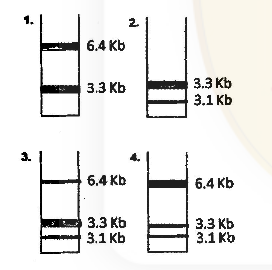

1. Lane 1
2. Lane 2
3. Lane 3
4. Lane 4

**Answer: 4 (Lane 4)**

> **Explanation:** With 50% repair efficiency, half the molecules regain an intact HindIII site (cut → 3.1 + 3.3 Kb) while half keep the mismatched, uncut HindIII site and are opened only at EcoRI (linear 6.4 Kb). All three species coexist, giving the 6.4 / 3.3 / 3. Kb pattern of lane 4.

---

### Question 87

The following statements are made on DNA replication:

A. Replication fork is a branch point in a replication 'eye' or 'bubble'.
B. A replication bubble contains two replication forks.
C. DNA replication is continuous according to the interpretation made by Okazaki.
D. Multiple priming events are required for both leading and lagging strands to initiate DNA synthesis.

Which one of the following is the correct combination?

1. A and B
2. B and C
3. C and D
4. A and C

**Answer: 1 (A and B)**

> **Explanation:** A bubble is bounded by two forks (A, B true). Okazaki showed synthesis is discontinuous on one strand (C false), and the leading strand needs only a single priming event (D false).

---

### Question 88

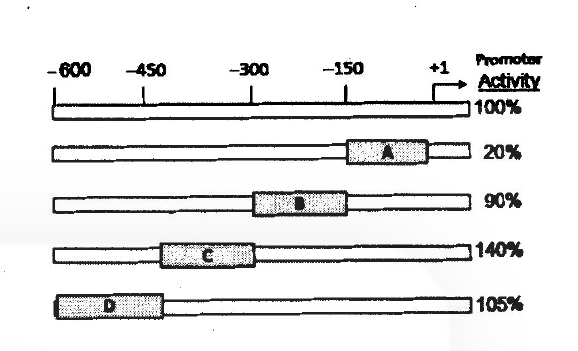

In order to identify the regulatory regions of a novel promoter sequence shown above, four 150 bp deletion constructs were made in a luciferase reporter system as indicated above in boxes A to D. After transfection, the observed level of promoter activity (%) as analyzed by luciferase assay of all the constructs is indicated in the right of the figure. Identify the best correct combination of regions in the options given below that indicate the presence of a positive and a negative regulatory element, respectively.

1. B and D
2. A and C
3. A and D
4. A and B

**Answer: 2 (A and C)**

> **Explanation:** Removing region A collapses activity (100% → 20%), so A contains a positive regulatory element; removing region C raises activity (→140%), so C contains a negative element — the pair A and C.

---

### Question 89

Following sets of Plasmodium falciparum sporozoites
(i) normal sporozoites
(ii) sporozoites with mutation in the C-terminal of circumsporozoite (CS) antigen
(iii) sporozoites with mutation in the N-terminal region of circumsporozoite (CS) antigen
are injected into 2 groups of mice, one normal (Group A) and one (Group B) where localized knock down of heparan sulfate (receptor for CS antigen in liver cells) is achieved by injecting specific shRNA expressing lentiviral particles in the liver prior to infection. 15 days post infection, parasitemia is measured by counting infected RBC through Giemsa staining.

Which of the following groups will show maximum level of parasitemia?

1. Group B with set (i)
2. Group A with set (ii)
3. Group A with set (iii)
4. Group B with set (ii)

**Answer: 3 (Group A with set (iii))**

> **Explanation:** The CS protein's C-terminal region binds hepatocyte heparan sulfate. Mutating the N-terminal region (set iii) leaves the liver-binding C-terminus intact, and in normal mice (Group A, receptor present) infection proceeds maximally.

---

### Question 90

Patients suffering from familial hypercholesterolemia (FH) are mostly homozygous for the defective gene and have profoundly elevated levels of serum cholesterol. The reason may be that the gene for highly specific receptor for LDL is either defective or missing in these patients. In an experiment, cells were taken from both normal individual and homozygote (FH) subjects, incubated in buffer with ¹²⁵I-labeled LDL in presence or absence of excess unlabeled LDL for various time periods and then ¹²⁵I-labeled LDL bound to cells was measured. Which of the following is the bestfit graph for the above experiment?

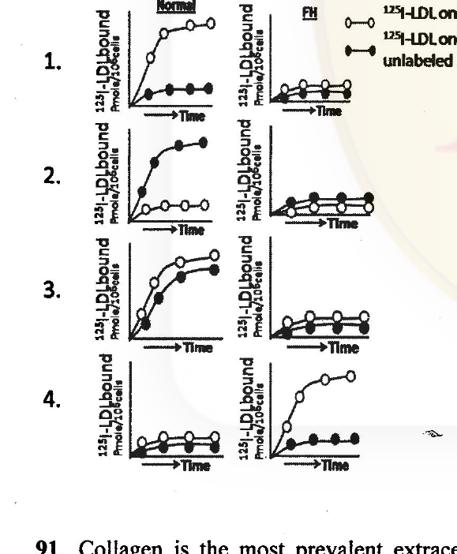

1. Graph 1
2. Graph 2
3. Graph 3
4. Graph 4

**Answer: 1 (Graph 1)**

> **Explanation:** Normal cells show high receptor-mediated ¹²⁵I-LDL binding that is competed away by excess unlabelled LDL; FH (receptor-negative) cells show only low non-specific binding that is insensitive to competitor — graph 1.

---

### Question 91

Collagen is the most prevalent extracellular matrix protein. Which of the following is NOT true for collagen?

1. Collagen is composed of triple helix consisting of two α polypeptide chain and one β polypeptide chain wound around one another in a rope-like structure.
2. Glycine accounts for almost one third of the amino acids within collagen molecule.
3. Ascorbate is essential for collagen formation required for hydroxylation of proline.
4. Individual collagen polypeptide chains are synthesized on membrane-bound ribosomes with N-terminal signal sequences for directing them to ER lumen.

**Answer: 1 (Collagen is composed of triple helix consisting of two α polypeptide chain and one β polypeptide chain...)**

> **Explanation:** Collagen's triple helix is made of three α (alpha) chains — there is no β chain; the other statements (glycine every third residue, ascorbate-dependent prolyl hydroxylation, ER-targeted translation) are true.

---

### Question 92

The following statements have been proposed for a cancer cell.

A. Binding of p53 with MDM2, a ubiquitin E3 ligase, is a precondition for cancer progression.
B. Phosphorylation of a tyrosine residue in the C-terminus of human c-Src is essential for cell invasion and motility.
C. Loss of function of both alleles of a tumor suppressor gene prevents metastasis.
D. Dimerization of c-myc-Max leads to enhanced cell proliferation.

Which of the combinations of the above statements is correct?

1. A and B
2. C and D
3. A and D
4. B and C

**Answer: 3 (A and D)**

> **Explanation:** MDM2-mediated ubiquitination and inactivation of p53 favours cancer progression (A), and Myc–Max dimers drive proliferation genes (D). c-Src activity requires dephosphorylation of the C-terminal tyrosine (B false), and losing both tumour-suppressor alleles promotes rather than prevents metastasis (C false).

---

### Question 93

CD4⁺ T cells are co-cultured with macrophages in the presence of immobilized anti-CD3 antibody under four different conditions:
(A) Interleukin (IL)-4 plus anti-IFNγ antibody,
(B) IL-12 and anti-IL-4 antibody,
(C) transforming growth factor (TGF)-β,
(D) TGF-β and IL-6

for three rounds to induce T-helper cell differentiation identifiable by the cytokines they express predominantly.

Which one of the following is the most likely combination of predominant cytokine expression in these cultures?

1. (A) IL-4, (B) IFN-γ, (C) IL-10, (D) IL-17
2. (A) IFN-γ, (B) IL-4, (C) IL-17, (D) IL-10
3. (A) IL-17, (B) IL-4, (C) IFN-γ, (D) IL-10
4. (A) IL-17, (B) IL-10, (C) IL-4, (D) IFN-γ

**Answer: 1 ((A) IL-4, (B) IFN-γ, (C) IL-10, (D) IL-17)**

> **Explanation:** IL-4 drives Th2 (IL-4); IL-12 drives Th1 (IFN-γ); TGF-β alone drives Treg (IL-10); TGF-β plus IL-6 drives Th17 (IL-17).

---

### Question 94

Four groups of one-day old female BALB/c neonates had received the following treatments:
A. Epidermal cells from C57BL/6 male plus anti-β2 microglobulin antibody.
B. Epidermal cells from C57BL/6 male plus antibodies to β2 microglobulin, CD40 ligand, CD80 and CD86.
C. Epidermal cells from C57BL/6 female plus anti-CD80 antibody.
D. Epidermal cells from C57BL/6 female mice.

When these BALB/c neonates grew six weeks old, they received skin transplant from C57BL/6 male mice. Transplantation rejection time varied between these four groups. Starting from the fastest to the slowest rejection, which one of the following is the most likely order?

1. D ≥ C > A > B
2. A > B > C ≥ D
3. B > A > D ≥ C
4. D > B ≥ C > A

**Answer: 1 (D ≥ C > A > B)**

> **Explanation:** Group D (fully allogeneic male cells, intact co-stimulation) tolerises poorly and rejects fastest; blocking β2-microglobulin (class I, group A) or co-stimulation (group B) progressively weakens priming, with B (all blocks) slowest.

---

### Question 95

At the 2-celled stage of Caenorabditis elegans development the blastomeres were experimentally separated and allowed to proceed in development. One of the blastomere (P1) developed generating all types of cells it would normally make while the other blastomere (AB) made only a fraction of the cell types it would normally make. The following conclusion could be drawn:

A. The determination of both P1 and AB was autonomous.
B. The determination of both P1 and AB was conditional.
C. The determination of P1 was autonomous and AB was conditional.
D. Both asymmetric division and cell-cell interactions specify cell fate in early development.

Which of the above combinations is correct?

1. A and C
2. B and D
3. A and D
4. C and D

**Answer: 4 (C and D)**

> **Explanation:** P1 developed autonomously into everything it would normally make — autonomous determination by asymmetric segregation of cytoplasmic determinants — while AB, isolated from signals, made only a fraction of its normal repertoire, showing its determination is conditional (C); together these results demonstrate that both asymmetric division and cell-cell interactions specify early C. elegans fates (D).

---

### Question 96

The proximal distal growth and differentiation of the tetrapod limb bud are made possible by a series of interactions between the apical ectodermal ridge (AER) and limb bud mesenchyme directly beneath it. Some of the interactions performed in chick demonstrated the following results:

A. When the AER was removed at any time of development, further development of distal limb skeletal elements ceased.
B. When leg mesenchyme was placed directly beneath the wing AER, distal hindlimb structures developed at the end of the wing.
C. When limb mesenchyme was replaced by a non-limb mesenchyme beneath the AER, the limb still developed.
D. When an extra AER was grafted onto an existing limb bud, the development of the limb ceased.

Which of the above combinations is correct?

1. A and B
2. A and C
3. B and D
4. B and C

**Answer: 1 (A and B)**

> **Explanation:** AER removal halts distal limb development (A) and leg mesenchyme placed under a wing AER directs hindlimb structures at the wing tip (B) — the two classic chick results. Non-limb mesenchyme does not support limb outgrowth (C false), and an extra AER induces a supernumerary limb rather than arresting development (D false).

---

### Question 97

Torpedo is a trans-membrane receptor on follicle cells that binds with Gurken protein located in the presumptive dorsal surface of the oocytes and inhibits a cascade leading to nuclear localization of the Dorsal Protein. In an experiment, Drosophila germ line chimeras were made by interchanging pole cells (germ line precursors) between wild type embryos and embryos from mother homozygous for a mutation of torpedo gene. These transplants produced:

i) wild type females whose egg came from mutant mother, and
ii) torpedo deficient females whose egg came from wild type mother.

The possible outcome of this experiment can be:

A. Torpedo deficient eggs developed in wild type ovary produced normal embryos.
B. Wild type eggs developed in Torpedo deficient ovary produced ventralized embryos.
C. Torpedo deficient eggs developed in wild type ovary produced ventralized embryos.
D. Dorsal protein enters in the nuclei of dorsal side of embryos which came from wild type eggs developed in Torpedo deficient ovary.
E. Dorsal protein remains cytoplasmic in the dorsal side of the embryos which came from wild type eggs developed in Torpedo deficient ovary.

Which of the above combinations is correct?

1. A, B and D
2. B, C and E
3. B , D and E
4. A, C and E

**Answer: 1 (A, B and D)**

> **Explanation:** Torpedo (EGFR) functions in the follicle cells (soma), while its ligand Gurken comes from the oocyte — so the DV outcome is set by the genotype of the ovary nursing the egg, not the egg itself. Torpedo-deficient eggs in a wild-type ovary develop normally (A); wild-type eggs in a torpedo-deficient ovary are ventralised (B) because without Torpedo signalling Dorsal protein enters the nuclei on the dorsal side of those embryos (D).

---

### Question 98

During lens formation in the Xenopus, the following statements have been proposed:

A. Lens induction can be achieved in the absence of optic vesicle after priming of head ectoderm by the anterior neural plate.
B. The optic vesicle can induce the presumptive trunk ectoderm to form the lens.
C. Only the head ectoderm can respond to direct signals from the optic vesicle to form the lens.
D. The anterior neural plate primes the head ectoderm via BMP4 and Fgf8 prior to signals from the optic vesicle.

Which of the above combinations is correct?

1. C and D
2. B and D
3. A and D
4. A and C

**Answer: 1 (C and D)**

> **Explanation:** Lens induction requires head ectoderm primed by the anterior neural plate, after which it can form lens even without the optic vesicle (C), and trunk ectoderm can be induced to form lens by the optic vesicle once the priming signals (BMP4/Fgf8 from the anterior neural plate) are supplied (D) — the combination the key marks correct.

---

### Question 99

Mutation in a gene x in Arabidopsis thaliana results in more number of lateral root formation. Which one of the following is the correct statement?

1. The gene product acts as a positive regulator of lateral root formation.
2. The gene product acts as a negative regulator of lateral root formation.
3. The gene product is not likely to be involved in lateral root formation.
4. The gene product promotes replication for lateral root development.

**Answer: 2 (The gene product acts as a negative regulator of lateral root formation.)**

> **Explanation:** A loss-of-function mutation that *increases* lateral roots means the normal gene product restrains (negatively regulates) the process.

---

### Question 100

Nitrogen fixation is basically a process of converting nitrogen gas into ammonia (NH₃). One of the key enzymes in the process is "nitrogenase". The production and activity of nitrogenase is very highly regulated as highlighted below:

A. Nitrogen fixation through nitrogenase is an energetically expensive process.
B. Nitrogenase encoding gene is under a constitutive promoter.
C. Nitrogenase is highly sensitive to oxygen.
D. Endogenous availability of the cofactor of nitrogenase enzyme is very low.

Which one of the following combinations of above statements is correct?

1. A and B
2. A and C
3. B and C
4. B and D

**Answer: 2 (A and C)**

> **Explanation:** Nitrogenase consumes large amounts of ATP (A) and is irreversibly damaged by O₂ (C); its genes are inducible/nif-regulated, not constitutive (B false).

---

### Question 101

The amount of each enzyme present in the chloroplast stroma is regulated by mechanisms that control the concerted expression of nuclear and chloroplast genomes. Following are certain statements regarding the regulation of chloroplast enzymes:

A. Nucleus-encoded enzymes are translated on 70S ribosomes in the cytosol and subsequently transported into the plastid.
B. Plastid encoded enzymes are translocated in the stroma on prokaroyte like 70S ribosomes.
C. Light modulates the expression of stromal enzymes encoded by the nuclear genome via specific photoreceptors.
D. The eight small subunits of rubisco is encoded in plastid.

Which one of the following combinations of above statements is correct?

1. A and B
2. A and C
3. B and C
4. C and D

**Answer: 3 (B and C)**

> **Explanation:** Chloroplast-encoded proteins are made on 70S ribosomes inside the organelle (B) and nuclear photosynthetic genes are light-regulated via photoreceptors (C). Cytosolic translation is on 80S ribosomes (A false) and the small subunit of RuBisCO is nuclear-encoded (D false).

---

### Question 102

Aquaporins are a class of proteins that are relatively abundant in plant membranes. Following are certain statements regarding the properties of aquaporins:

A. Aquaporins form water channels in membrane.
B. Some aquaporins also transport uncharged molecules such as NH₃.
C. The activity of aquaporins is not regulated by phosphorylation.
D. The activity of aquaporin is regulated by calcium concentration reactive oxygen species.

Which one of the following combinations of above statements is correct?

1. A, B and D
2. B, C and D
3. A, C and D
4. A, B and C

**Answer: 1 (A, B and D)**

> **Explanation:** Aquaporins are water channels (A), some pass uncharged solutes like NH₃/CO₂ (B), and their gating is regulated by Ca²⁺, pH, ROS and phosphorylation (D true; C false since phosphorylation does regulate them).

---

### Question 103

In terpene biosynthesis pathways, three acetyl-CoA are joined together stepwise to form mevalonic acid. Which one of the following three- steps is required by mevalonic acid to form isopentenyl diphosphate or isopentenyl pyrophosphate (IPP)?

1. Pyrophosphorylation, decarboxylation, and dehydration.
2. Alkylation, pyrophosphorylation and decarboxylation.
3. Methylation, dehydration and alkylation.
4. Phosphorylation, carboxylation and methylation.

**Answer: 1 (Pyrophosphorylation, decarboxylation, and dehydration.)**

> **Explanation:** Mevalonate is phosphorylated twice (to the diphosphate) and decarboxylated with loss of the hydroxyl (dehydration/elimination) to yield IPP — the key's "pyrophosphorylation, decarboxylation, dehydration" summary.

---

### Question 104

Following statements are related to oxidative phosphorylation.

A. Redox reactions of electron transport chain coupled with ATP synthesis are collectively called oxidative phosphorylation.
B. Three major processes: glycolysis, oxidative pentose phosphate pathway and citric acid cycle are related to oxidative phosphorylation.
C. Electron transport proteins are bound to outer of the two mitochondrial membranes.
D. In the electron transport chain electrons are transferred to oxygen from NADH.

Which one of the following combinations of above statements is correct?

1. A and D
2. B and C
3. C and D
4. A and C

**Answer: 1 (A and D)**

> **Explanation:** A and D are correct definitions/descriptions; the pathways feeding the chain are glycolysis, pyruvate oxidation and the TCA cycle (not the oxidative pentose-phosphate pathway, B), and the chain sits in the inner membrane (C false).

---

### Question 105

Satellite RNAs (sat-RNAs) are species of RNA associated with specific strains of some plant RNA viruses, although it is not necessary for their replication. Few statements are given below on sat-RNA

A. Presence of sat-RNA leads to reduction in severity of disease symptoms.
B. Presence of sat-RNA leads to increase in severity of disease symptoms.
C. sat-RNA is constitutively expressed like coat proteins and is independent of virus infection.
D. sat-RNA is not constitutively expressed like coat proteins but is expressed only after virus infection.

Which one of the following combinations of above statements regarding sat-RNA is correct?

1. A and B
2. B and C
3. C and D
4. A and D

**Answer: 4 (A and D)**

> **Explanation:** Helper-virus-dependent satellite RNAs are replicated only after the helper virus infects (D), and depending on strain they can attenuate symptoms (A) — the pairing the key marks correct.

---

### Question 106

Following statements are related to excretion in invertebrates:
A. Flame cells are found in molluscs and jelly fish.
B. Nephridia and Malpighian tubules convert ammonia to urea for water conservation.
C. Green glands are found in flatworm and help in the excreta elimination.
D. Excretory canals in nematodes carry waste materials to excretory pores in the body wall.

Choose the correct answer

1. Only C
2. A and C
3. Only B
4. B and D

**Answer: 4 (B and D)**

> **Explanation:** Flame cells are platyhelminth (not mollusc/cnidarian, A false), green glands are crustacean (C false); nephridia/Malpighian tubules process nitrogenous waste for water conservation (B) and nematode excretory canals open at body-wall pores (D).

---

### Question 107

Respiration can be inhibited voluntarily for some time. The point at which respiration cannot be voluntarily inhibited is known as breaking point. Following explanations are offered for the breaking point:
A. J-receptors stimulate respiratory centers
B. Hering-Breuer reflex operates
C. The rise of arterial pCO₂ stimulates the respiratory centre
D. The fall of arterial pO₂ stimulates the respiratory centre

Which of the above combination is correct?

1. A and B
2. B and C
3. C and D
4. A and D

**Answer: 3 (C and D)**

> **Explanation:** The breaking point is reached when rising arterial pCO₂ (central chemoreceptors) together with falling pO₂ (peripheral chemoreceptors) override cortical inhibition.

---

### Question 108

A mechanical pressure was exerted on a specific location of a peripheral nerve of a mammal. The touch or pain receptors were stimulated from the skin surface innervated by the same nerve. The action potential generated by touch receptor stimulation was blocked beyond the point of mechanical pressure. But the action potential generated by pain receptor stimulation passes through the point of mechanical pressure. Following explanations were offered for these observations:

A. The large diameter 'A' fibres were affected by mechanical pressure
B. The small diameter 'C' fibres were not affected by mechanical pressure
C. The intermediate diameter 'B' fibres were affected by mechanical pressure
D. The large diameter 'A' fibres were not affected by mechanical pressure

Which of the above combinations is correct?

1. A and B
2. B and C
3. C and D
4. A and D

**Answer: 1 (A and B)**

> **Explanation:** Large myelinated A fibres (touch) are mechanically sensitive and are blocked, while small unmyelinated C fibres (pain) are resistant and continue to conduct.

---

### Question 109

When a skeletal muscle with an intact nerve supply is stretched, the muscle contracts and the tone increases. The following explanations are offered for this observation:
A. Golgi tendon organ was stimulated by the stretching of muscle
B. γ-motor neurons were excited by the stimulated afferent nerve fibres from the stretched muscle
C. Muscle spindle was stimulated by stretching of muscle
D. α-motor neurons were excited by the stimulated afferent nerve fibres from the stretched musscle

Which of the combination is correct?

1. A and B
2. B and C
3. C and D
4. A and D

**Answer: 3 (C and D)**

> **Explanation:** The stretch reflex: muscle spindles are loaded by stretch, their Ia afferents excite α-motor neurons, causing contraction of the stretched muscle (Golgi tendon organs mediate the opposite, inhibitory, effect).

---

### Question 110

Upon prolonged illumination, activated rhodopsin does not activate transducin, hence the vision is impaired. This could be because of the following explanations:

A. Most of the activated rhodopsin gets phosphorylated and is unable to activate transducin.
B. Most of the activated rhodopsin gets dephosphorylated and is unable to activate transducin.
C. Arrestin further interacts with phosphorylated rhodopsin.
D. Arrestin further interacts with dephosphorylated rhodopsin.

Which of the above combinations is correct?

1. A and C
2. B and D
3. A and D
4. B and C

**Answer: 1 (A and C)**

> **Explanation:** In light adaptation, rhodopsin kinase phosphorylates activated rhodopsin and arrestin binds the phosphorylated form, blocking further transducin activation (A, C).

---

### Question 111

An elderly person suffering from calcium deficiency was advised to take calcium rich food and to supplement the diet with vitamin D. The absorption of calcium in the intestine was increased with the supplementation of vitamin-D. Following explanations were offered for this increased calcium absorption by vitamin D:

A. The synthesis of calbindin-D₉K and calbindin-D₂₈K in enterocytes was stimulated.
B. The number of Ca²⁺-ATPase molecules in enterocytes was increased.
C. The synthesis of divalent metal transporters 1 (DMT1) in the enterocytes was stimulated.
D. The number of hephaestin in the enterocytes was increased.

Which of the above combinations is correct?

1. A and B
2. B and C
3. C and D
4. A and D

**Answer: 1 (A and B)**

> **Explanation:** 1,25-(OH)₂ vitamin D₃ induces enterocalbindins (D9k/D28k) for intracellular calcium shuttling and up-regulates basolateral Ca²⁺-ATPase (PMCA1b) for extrusion; DMT1 and hephaestin handle iron, not calcium.

---

### Question 112

A series of cell lines was created by fusing mouse and human somatic cells. In mouse-human somatic cell hybrids, human chromosomes tend to get lost before becoming a stable cell line. Some hybrid cell lines may carry human chromosome deletions. Each cell line was examined for the presence of chromosomes and for the production of an enzyme. The following results were obtained:

| Cell line | Gene product | 1p | 1q | 2p | 2q | 3p | 3q | 4p | 4q | 5p | 5q |
|---|---|---|---|---|---|---|---|---|---|---|---|
| A | + | + | + | − | − | + | + | − | − | + | + |
| B | + | − | − | + | + | − | − | + | + | + | + |
| C | − | + | + | − | − | + | + | − | + | − | + |
| D | + | − | − | + | + | + | + | − | − | + | − |
| E | − | + | + | + | + | − | + | − | − | − | − |

Which segment of the chromosome has the gene encoding for the enzyme?

1. 1p
2. 5p
3. 5q
4. 4p

**Answer: 2 (5p)**

> **Explanation:** The enzyme is present exactly in lines A, B and D and absent in C and E; the only chromosomal segment whose presence/absence co-segregates perfectly with the gene product across all five lines is 5p.

---

### Question 113

The following table summarizes the result of a cross between two strains of Neurospora having the alleles D and d, respectively. The table shows the different patterns of octad arrangement and the number of ascus observed of each type.

| Octads (8 spores) | | | | | | Number of ascus observed |
|---|---|---|---|---|---|---|
| D | d | D | d | D | d | 115 |
| D | d | D | d | D | d | 125 |
| D | d | d | D | d | D | 14 |
| D | d | d | D | d | D | 16 |
| d | D | D | d | d | D | 17 |
| d | D | D | d | d | D | 13 |
| d | D | d | D | D | d | (Total = 300) |
| d | D | d | D | D | d | |

Based on the above, fill in the blanks from the options given below, "The first two columns are from meiosis with no crossover between locus D and ___[A]___. The patterns for these two columns represent ___[B]___ segregation pattern. The distance between the locus D and the centromere is ___[C]___ map units".

| | A | B | C |
|---|---|---|---|
| 1. | d allele | first division | 10 |
| 2. | centromere | first division | 10 |
| 3. | d allele | second division | 20 |
| 4. | centromere | second divison | 10 |

**Answer: 2 (centromere, first division, 10)**

> **Explanation:** The 4:4 (D D D D d d d d type) patterns are first-division segregation — no crossover between the locus and its centromere. The recombinant (second-division, 2:2:2:2/2:4:2) asci total 60 of 300; map distance = ½ × (60/300) × 100 = 10 m.u.

---

### Question 114

The inheritance pattern of a common trait which shows complete penetrance is shown below:

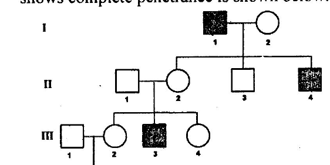

Based on the above pedigree, fill in the blanks from the options given below:
"The trait is __[A]__. The probability that a child from the marriage of individual III-1 and III-2 will show the trait is __[B]__ considering that the individual III-1 is a carrier of the trait."

| | A | B |
|---|---|---|
| 1. | Y-linked | 0 |
| 2. | Y-linked | 1/2 |
| 3. | Autosomal | 1/8 |
| 4. | Autosomal | 1/6 |

**Answer: 4 (Autosomal, 1/6)**

> **Explanation:** Affected individuals arise from carrier mothers and an affected father has unaffected sons — autosomal recessive, not Y-linked. With III-1 a confirmed carrier (Aa) and III-2 from the general population, the key computes the affected-child probability as 1/6.

---

### Question 115

A hypothetical gene encodes a protein with the following amino acid sequence:
Phe- Pro- Thr- Ala- Val-Arg- Ser
A mutation of single nucleotide alters the amino acid sequence to
Phe- Leu- Leu- Leu- Val
A second single nucleotide mutation occurs in same gene restoring back the amino acid sequence to the original.
The following statements were made regarding the nature and location of the first mutation and that of the intragenic suppressor mutation:

A. The first mutation is a deletion in the second codon
B. The first mutation is an insertion in the second codon
C. The intragenic suppressor mutation is an insertion in the second codon
D. The intragenic suppressor mutation is a deletion in the third codon

Which combination of the above statements is correct?

1. A and C
2. A and D
3. B and C
4. B and D

**Answer: 1 (A and C)**

> **Explanation:** The run of Leu codons downstream of Phe with loss of the original reading frame is a frameshift; a second single-nucleotide change that restores the original sequence must be the opposite frameshift nearby — a deletion followed by an insertion (A and C) in the key's assignment.

---

### Question 116

The following statements were made regarding chromosome pairing (shown in the figure below) and subsequent segregation during meiosis I in the reciprocal translocation heterozygote:

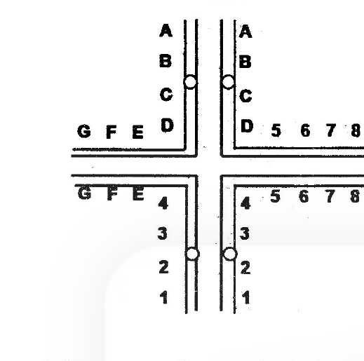

A. Three ways of segregation in Anaphase I would be: adjacent 1 (vertically in the above figure) adjacent 2 (horizontally) and alternate.
B. Gametes resulting from adjacent 1 and adjacent 2 segregation will be non-viable because of deletions and duplications of several genes.
C. All gametes resulting from alternate segregation will be viable as they will carry both normal chromosomes or both chromosomes having trans locations in the two poles, respectively.
D. A dicentric and an acentric chromosome will be generated following alternate segregation.

Which of the following combination of statements will most appropriately explain the consequence?

1. A, B and D
2. A, B and C
3. Only A and B
4. Only A and C

**Answer: 2 (A, B and C)**

> **Explanation:** Reciprocal (mutual) translocations form quadrivalents with adjacent-1, adjacent-2 and alternate segregation; adjacent modes give duplication/deletion gametes, alternate gives balanced (viable) gametes. Dicentric/acentric chromosomes arise in Robertsonian, not reciprocal, translocations (D false).

---

### Question 117

Three Indian animals -cormorant, lion-tailed macaque and gerbil are to be matched with the ecosystem they inhabit - Wetland (A), Desert (B), Deciduous forest (C), or Rain' forest (D). Which of the following is the correct match of each animal with its habitat?

1. Cormorant – D; Lion-tailed macaque – C; Gerbil - B
2. Cormorant – A; Lion-tailed macaque – C; Gerbil - D
3. Cormorant – A; Lion-tailed macaque – D; Gerbil - B
4. Cormorant – B; Lion-tailed macaque – C; Gerbil - D

**Answer: 3 (Cormorant – A; Lion-tailed macaque – D; Gerbil - B)**

> **Explanation:** The Indian cormorant is a wetland waterbird; the endangered lion-tailed macaque lives in tropical rain forests (Western Ghats); the desert gerbil (Meriones hurrianae) inhabits arid zones.

---

### Question 118

The list below includes names of animal phyla and classes.
A. Echinodermata
B. Cephalopoda
C. Annelida
D. Mollusca
E. Hirudinea
F. Asteroidea
G. Arthropoda
H. Crustacea.

For a leech and lobster, the correct classification of the of phylum and class, respectively, is

1. Leech: Phylum – D, Class – B; Lobster: Phylum – A, Class - H
2. Leech: Phylum – C, Class – B; Lobster: Phylum – D, Class - C
3. Leech: Phylum – C, Class – E; Lobster: Phylum – G, Class - H
4. Leech: Phylum – A, Class – G; Lobster: Phylum – C, Class - F

**Answer: 3 (Leech: Phylum – C, Class – E; Lobster: Phylum – G, Class - H)**

> **Explanation:** A leech is an annelid (C) of the class Hirudinea (E); a lobster is an arthropod (G) of the class Crustacea (H).

---

### Question 119

Some key characteristics of the four classes of phylum Mollusca are listed below:

A. They have two lateral (left and right) shells (valves) hinged together dorsally; they do not have distinct head or radula; they disperse from place to place largely as larvae.
B. They generally creep on their foot; the heads of most of this group have a pair of tentacles with eyes at the end; during embryological development, they undergo torsion.
C. They have oval bodies with overlapping calcareous plates; underneath the plates, the body is not segmented; they creep along using a broad, flat foot surrounded by a groove or mantle cavity in which the gills are arranged.
D. They have highly developed nervous system; most members of this class have closed circulatory systems.

The correct match of the above characteristics with the classes of Mollusca is

1. A – Polyplacophora B – Bivalvia; C – Gastropoda D – Cephalopoda
2. A – Cephalopoda B – Polyplacophora; C – Bivalvia D – Gastropoda
3. A – Bivalvia B – Gastropoda; C – Polyplacophora D – Cephalopoda
4. A – Gastropoda B – Bivalvia; C – Cephalopoda D – Polyplacophora

**Answer: 3 (A – Bivalvia, B – Gastropoda, C – Polyplacophora, D – Cephalopoda)**

> **Explanation:** Two hinged valves without head = Bivalvia; torsion with tentaculate head = Gastropoda; eight overlapping plates = Polyplacophora (chitons); well-developed nervous system with closed circulation = Cephalopoda.

---

### Question 120

The diagram below depicts a simplified Tree of Life with three domains and one of the domains including Whittaker's three major kingdoms. Which of the following is the correct naming of the numbered boxes?

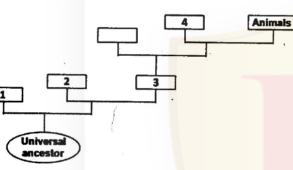

1. 1 – Bacteria 2 – Archaea 3 – Eukarya 4 – Fungi
2. 1 – Archaea 2 – Bacteria 3 – Eukarya 4 – Plants
3. 1 – Eukarya 2 – Bacteria 3 – Archaea 4 – Plants
4. 1 – Archaea 2 – Bacteria 3 – Eukarya 4 – Fungi

**Answer: 1 (1 – Bacteria 2 – Archaea 3 – Eukarya 4 – Fungi)**

> **Explanation:** The deepest branch from the universal ancestor is Bacteria (1), then Archaea (2); the domain containing Whittaker's three eukaryotic kingdoms is Eukarya (3), whose sister grouping with Animals shown in the diagram is Fungi (4).

---

### Question 121

Given below are some of the methods used to assess evolutionary phylogenetic relationships among plant taxa.
A. 16S rRNA sequence
B. Mitochondrial microsatellite
C. Biochemical characterization
D. Morphology

Which two of the above methods can best reveal the evolutionary phylogenetic relationships?

1. A and B
2. B and C
3. C and D
4. A and D

**Answer: 1 (A and B)**

> **Explanation:** Molecular characters — the slowly evolving rRNA sequence and mitochondrial microsatellite variation — resolve phylogeny far better than biochemical or morphological traits, which are convergence-prone.

---

### Question 122

Sleeping sickness is a disease caused by a protozoan parasite and the following statements pertain to that disease:

A. The vector for this disease is tsetse fly.
B. The vector for this disease is Trypanosoma brucei.
C. The parasite's body is covered by a dense coat of variable surface glycoprotein (VSG).
D. There are several thousands of VSG genes, only one of them expressing at a time, which helps the parasite in evading host's immune response.
E. Several thousand copies of VSG genes express concurrently, paralyzing the host immune system.

Which of the following is the correct combination of the statements given above?

1. B, C and D
2. A, C and D
3. A, C and E
4. B, C and E

**Answer: 2 (A, C and D)**

> **Explanation:** The vector is the tsetse fly (A; Trypanosoma brucei is the parasite, so B is false); the dense VSG coat with single-expression of thousands of VSG genes drives antigenic variation (C, D true; E false).

---

### Question 123

There are three species of frogs - A, B and C. Species A does not provide parental care for its eggs and larvae. Species B is subjected to predation by a predator that selectively feeds only on small-sized larvae. Species C faces progressively decreasing opportunities for breeding with increasing age. Assuming that resources available for reproduction are similar for A, B and C. Which of the following strategies would have been favored?

1. A should produce large number of small-sized offspring; B should produce a small number of large-sized offspring; C should breed earlier in life.
2. Species A and B should produce a small number of large-sized offspring and C should breed earlier in life.
3. Both species A and B should produce a large number of small-sized offspring and C should breed later in life but increase its clutch size.
4. Species A should produce a small number of large-sized offspring; B should produce a large number of small-sized offspring and C should breed earlier in life with a small clutch size.

**Answer: 1 (A many small; B few large; C breed earlier)**

> **Explanation:** No parental care favours many small offspring (r-selection); size-selective predation on small larvae favours fewer, larger offspring that escape gape-limited predators; declining breeding opportunities with age favour earlier reproduction.

---

### Question 124

Fish species X and Y feed on mayfly nymphs in their stream habitat. In a laboratory experiment, the predation intensity of X and Y on their prey was tested under dark (D) and light (L) conditions. Thus, the experimental protocol included four aquaria - LX, LY, DX and DY. In each aquarium containing 100 mayfly nymphs, one fish was introduced and allowed to feed for 30 minutes. Then the fish was removed and the number of mayfly nymphs left uneaten in each aquarium was counted. The results are shown graphically below

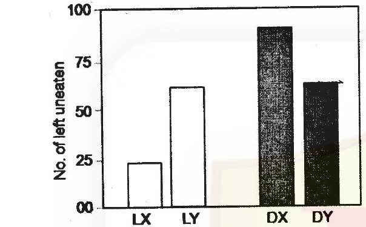

The most significant conclusion from the results is:

1. X is a visual predator, but has less predation impact on the prey than Y.
2. X is a visual predator and has greater predation impact on the prey than Y.
3. Y is a visual predator and has greater predation impact on the prey than X.
4. Y is a visual predator but has less predation impact on the prey than X.

**Answer: 2 (X is a visual predator and has greater predation impact on the prey than Y.)**

> **Explanation:** Fish X leaves far fewer nymphs uneaten in light (≈25) than in dark (≈90) — its predation depends on vision and exceeds that of Y, whose kill rate barely changes between light and dark.

---

### Question 125

The three graphs (A, B, C) show population growth (N) patterns in relation to N or time (t).

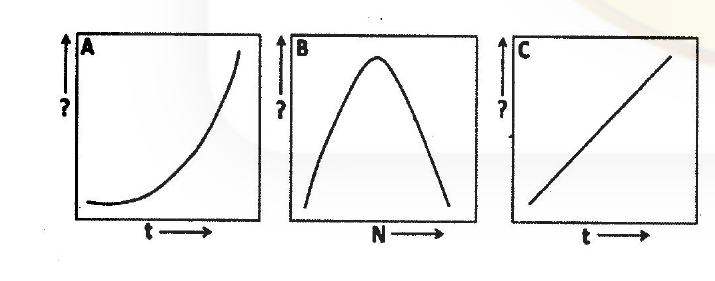

Which of the following is correct with reference to the Y-axis label and the type of population growth?

1. A: Y-axis: N, exponential growth; B: Y-axis: dN/dt, logistic growth; C: Y-axis: ln(N), exponential growth
2. A: Y-axis: dN/dt, exponential growth; B: Y-axis: ln(N), logistic growth; C: Y-axis: N, exponential growth
3. A: Y-axis: ln(N), exponential growth; B: Y-axis: dN/dt, logistic growth; C: Y-axis: N, exponential growth
4. A: Y-axis: dN/dt, exponential growth; B: Y-axis: ln(N), logistic growth; C: Y-axis: N, exponential growth

**Answer: 1 (A: N exponential; B: dN/dt logistic; C: ln(N) exponential)**

> **Explanation:** Exponential growth plotted as N vs t is J-shaped (A); the logistic per-capita-adjusted growth rate dN/dt vs N is a parabola peaking at K/2 (B); exponential growth plotted as ln(N) vs t is a straight line (C).

---

### Question 126

Which of the following set of observations is true with reference to a comparison of aquatic (A) and terrestrial (T) ecosystems?

1. Number of trophic levels is more in A than in T. Productivity/Biomass ratio is higher in T than in A. Herbivore assimilation efficiency is higher in A than in T.
2. Number of trophic levels is more in T than in A. Productivity/Biomass ratio is greater in A than in T. Herbivore assimilation efficiency is higher in T than in A.
3. Number of trophic levels is more in T than in A. Productivity/Biomass ratio is higher in T than in A. Herbivore assimilation efficiency is higher in T than in A.
4. Number of trophic levels is more in A than in T. Productivity/Biomass ratio is greater in A than in T. Herbivore assimilation efficiency is higher in A than in T.

**Answer: 4 (More trophic levels in A; higher P/B in A; higher herbivore assimilation in A)**

> **Explanation:** Aquatic systems support longer food chains (often 5 levels vs 3–4 on land), have high productivity-to-biomass ratios (small standing crop of phytoplankton turned over rapidly), and their herbivores assimile algal/ aquatic food more efficiently than terrestrial herbivores eating lignin-rich plants.

---

### Question 127

A small lake has three trophic levels- phytoplankton (autotrophs), Zooplankton (herbivore) and planktivorous fish (primary carnivore). Into this lake, a population of piscivorous fish (secondary carnivore) was introduced to study the 'topdown' effects. What is the expected long-term consequence of such an introduction to phytoplankton and zooplankton trophic levels?

1. Zooplankton biomass will increase and phytoplankton biomass will decrease.
2. Zooplankton biomass will decrease and phytoplankton biomass will increase.
3. The biomass of both zooplankton and phytoplankton will increase.
4. The biomasses of both zooplankton and phytoplankton will decrease.

**Answer: 1 (Zooplankton increase, phytoplankton decrease)**

> **Explanation:** A classic trophic cascade: piscivores suppress planktivorous fish, releasing zooplankton from predation; the enlarged zooplankton population then grazes phytoplankton down.

---

### Question 128

Following is the diagram of three idealized survivorship curves of animals.

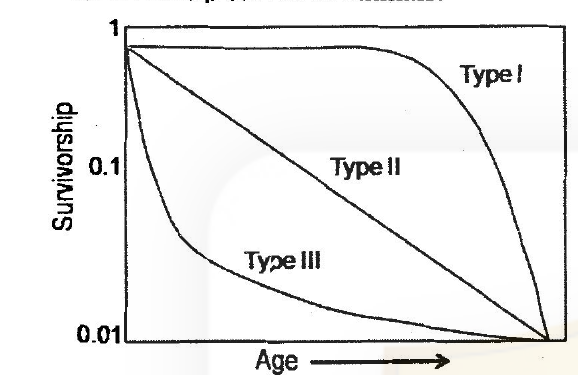

Find the correct match between the group of animals and the respective survivorship curves.

1. Marine pelagic fish and large mammals – III and I, respectively.
2. Marine pelagic fish and large mammals – I and II, respectively.
3. Some birds and large mammals – I and III, respectively.
4. Marine pelagic fish and some birds – I and III, respectively.

**Answer: 1 (Marine pelagic fish – III; large mammals – I)**

> **Explanation:** Marine pelagic fish broadcast millions of eggs with enormous early mortality (Type III); large mammals invest in few young with high juvenile survival, dying mostly at old age (Type I).

---

### Question 129

Following are the characteristics of species that make them more or less prone to extinction:

Rare – a | Common – b
Good dispersal rate – c | Poor dispersal rate – d
Low specialization – e | High specialization – f
High variability – g | Low variability – h
Low trophic status – i | High trophic status – j
Long life span – k | Short life span – l
High reproductive output – m | Low reproductive output – n

Which of the following is the correct combination of characteristics that makes the species more prone to extinction?

1. a d f g j l n
2. a c f h i k m
3. b d e g i l n
4. b c f h j k m

**Answer: 1 (a d f g j l n)**

> **Explanation:** Extinction-prone species are rare, poor dispersers, highly specialised, low genetic variability, high trophic status, long-lived and low reproductive output — the combination a, d, f, (h/g as printed), j, l, n marked by the key.

---

### Question 130

Assume that in terms of 'genetic fitness' the 'benefit' of performing an altruistic act to a relative is 500 units and the 'cost' involved is 150 units. Following Hamilton's Rule the act should be performed if the relative is a

1. only brother.
2. nephew or niece.
3. brother or step-sister.
4. only step-sister.

**Answer: 1 (only brother.)**

> **Explanation:** Hamilton's rule rb > c requires r > 150/500 = 0.3. A full brother has r = 0.5 ✓; nephew/niece r = 0.25 ✗; step-sibling r = 0 ✗. Only the brother qualifies.

---

### Question 131

The following situations might lead to the evolution of monogyny in birds:
A. Male has to assist the female in rearing the offspring.
B. Male guards the female against other males trying to mate with her.
C. One male may not produce enough sperm required to fertilize all the eggs produced by the female.

Which of the above is/are correct?

1. Only A
2. Only B
3. A and B
4. A and C

**Answer: 3 (A and B)**

> **Explanation:** Monogyny (one male – one female) evolves when paternal care is essential for offspring survival (A) and when a male can secure exclusive access to a female by guarding (B); sperm limitation (C) favours polyandry, not monogyny.

---

### Question 132

The body weight of adult female of a strain of Drosophila is 1.8±0.45 mg (mean ± standard deviation). In a laboratory experiment, each of the 3 groups (A, B, C) of this strain was subjected to a different type of selection pressure having influence on the female body weight. After many generations of experimental selection pressure, the body weight changed as follows:
Group A: Body weight distribution - Normal, 1.8 ± 0.08 mg
Group B: Body weight distribution - Bimodal at 1.4 and 2.2 mg
Group C: Body weight distribution - Normal, 2.2 ± 0.08 mg

Which of the following correctly gives the types of selection that have occurred in the three groups?

1. Group A: Directional; Group B: Stabilizing; Group C: Disruptive
2. Group A: Disruptive; Group B: Directional; Group C: Stabilizing
3. Group A: Stabilizing; Group B: Disruptive; Group C: Directional
4. Group A: Directional; Group B: Disruptive; Group C: Stabilizing

**Answer: 3 (A Stabilizing; B Disruptive; C Directional)**

> **Explanation:** A keeps the mean but shrinks variance (stabilizing); B splits into two modes (disruptive); C shifts the mean upward (directional).

---

### Question 133

A few events in the history of life on earth are given below
A. Radiation of mammals and birds; Flourishing of insects and angiosperms
B. Primitive plants and fungi colonize land; Diversification of echinoderms.
C. Seed plants appear; Fishes and Trilobites abundant; earliest amphibians and insects.
D. Earliest birds and Angiosperms appear; Gymnosperms dominant
E. Invasion of land by primitive land plants and Arthropods
F. Mass marine extinctions; Reptiles radiate; Amphibians decline.

Which of the following is a correct match of the above events with the geological period during which they had occurred?

1. A: Ordovician; B: Tertiary; C: Permian; D: Silurian; E: Devonian; F: Jurassic
2. A: Permian; B: Devonian; C: Silurian; D: Ordovician; E: Tertiary; F: Jurassic
3. A: Tertiary; B: Ordovician; C: Devonian; D: Jurassic; E: Silurian; F: Permian
4. A: Permian; B: Devonian; C: Jurassic; D: Tertiary; E: Silurian; F: Ordovician

**Answer: 3 (A Tertiary; B Ordovician; C Devonian; D Jurassic; E Silurian; F Permian)**

> **Explanation:** Mammal/bird radiation with angiosperms = Tertiary; first land plants/fungi and echinoderm diversification = Ordovician; seed plants, fishes, first amphibians = Devonian; first birds with dominant gymnosperms = Jurassic; arthropod land invasion follows Silurian plant establishment; the great marine extinction with reptile radiation = Permian.

---

### Question 134

Four different species concepts are given below:
A. Species separate based on their use of different ecological niches and their presence in different habitats and environments.
B. Differences in physical characteristics or molecular characteristics are used to distinguish species.
C. Species are distinct if they are reproductively isolated.
D. Phylogenetic trees and analyses of ancestry serve to differentiate species.

Which of the following gives the correct names of the above concepts?

1. A: Biological; B: Phylogenetic; C: Evolutionary; D: Ecological
2. A: Ecological; B: Phylogenetic; C: Biological; D: Evolutionary
3. A: Evolutionary; B: Ecological; C: Biological; D: Phylogenetic
4. A: Phylogenetic; B: Evolutionary; C: Ecological; D: Biological

**Answer: 2 (A: Ecological; B: Phylogenetic; C: Biological; D: Evolutionary)**

> **Explanation:** Niche/habitat-based = Ecological concept; diagnosable character differences = (molecular/phylogenetic) species concept; reproductive isolation = Biological concept; ancestry-based trees = Evolutionary concept as matched by the key.

---

### Question 135

Following are certain statements regarding the use of Agrobacterium in plant transformation.

A. tumefaciens causes crown gall disease and A. rhizogenes causes hairy root disease.
B. Region A in Ti plasmid is responsible for replication.
C. Region D in Ti plasmid is responsible for virulence.
D. Oncogenic (onc) region in T-DNA is responsible for unusual amino acid synthesis.

Which one of the following combinations of above statements is correct?

1. A and B
2. C and D
3. A and C
4. B and D

**Answer: 3 (A and C)**

> **Explanation:** A. tumefaciens → crown gall, A. rhizogenes → hairy root (A); the vir (Region D) functions in T-DNA transfer/virulence (C). The onc genes encode hormone (auxin/cytokinin) synthesis enzymes, and "unusual amino acid (opine) synthesis" is the opine function of T-DNA rather than the onc region as printed (B, D false in the key's reading).

---

### Question 136

Marker-assisted selection (MAS) defined as selection based on molecular markers should have some important criterion for plant breeding activities. Some statements about these criteria are mentioned below:

A. Marker should co-segregate with the desired trait of interest.
B. Marker should not co-segregate with the desired trait of interest.
C. Marker should be un-linked with the desired trait of interest.
D. Marker is used for indirect selection of a genetic determinant or determinants of a trait of interest.

Which one of above combinations is correct?

1. A and B
2. B and C
3. C and D
4. A and D

**Answer: 4 (A and D)**

> **Explanation:** A useful MAS marker must be tightly linked/co-segregating with the target trait (A) and serves for indirect selection of the determinant (D); B and C state the opposite and are wrong.

---

### Question 137

In order to develop a vaccine against a regulatory T cell-promoting but Th1 suppressing viral infection, four groups (A-D) of mice were primed with either killed virus (A) or a virus-derived immune dominant peptide (B), or the same peptide but with two substitutions (C) or were left unprimed (D). Upon infection challenge, the order of increasing severity of infection was observed to be B>A>D>C. To explain the contrasting effects of these two peptides (B) and (C), their MHC-binding affinities were assessed but no difference was found. Which of the following possibilities most likely to explain their contrasting effects?

1. The wild-type peptide (B) elicits T cell expansion but the mutant peptide (C) fails.
2. The wild-type peptide induces T cell deletion but the mutant peptide does not;
3. The wild-type peptide-MHC complex binds T cell receptor with significantly higher affinity than the mutant peptide-MHC complex.
4. The wild-type peptide induces deletion of T-Reg cells but increases IFNγ production by T cells, whereas the mutant peptide fails to induce these effects.

**Answer: 4 (option 4)**

> **Explanation:** Equal MHC binding but opposite protection means the altered TCR-facing residues of peptide C fail to drive the Th1/Treg-shifting response: the wild-type peptide deletes Treg cells and boosts IFN-γ while the mutant cannot — option 4.

---

### Question 138

In a transgenic mice line, lox P sites are introduced in the target gene A in the following manner

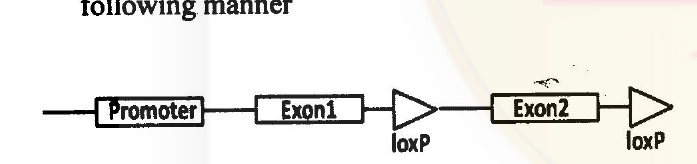

This transgenic mice line was mated with another transgenic mice line where Cre recombinase is expressed only in B cells. What will be the expression profile of gene A in Cre/lox recombinant mice?

1. Gene will not be expressed in B cells, as orientation of exon 1 will be inverted by Cre.
2. Gene will not be expressed in B cells, as exon 2 will be deleted by Cre.
3. Gene will only be expressed in B cells of the recombinant mice where Cre removes the two lox P sites.
4. Gene will not be expressed in B cells as orientation of exon 2 will be inverted.

**Answer: 2 (Gene will not be expressed in B cells, as exon 2 will be deleted by Cre.)**

> **Explanation:** Two loxP sites in the same orientation flanking exon 2 cause Cre-mediated excision (deletion, not inversion) of exon 2 specifically in B cells, knocking out gene A function there.

---

### Question 139

Cultured animal cells were transfected with expression vector encoding either β-galactosidase (β-gal) alone or expressing a fusion protein of β-gal and glucocorticoid receptor (GR). After transfection, cells were kept in presence or absence of Dexamethasone. Immunofluorescence with a labeled antibody specific for β-gal was used to detect the expressed protein in cytoplasm or nucleus of transfected cells. Possible results of the experiments are:

A. Expression of β-gal alone in the cytoplasm in both absence or presence of Dexamethasone.
B. Expression of β-gal-GR in the cytoplasm in the absence of Dexamethasone.
C. Expression of β-gal alone in the nucleus both in the presence or absence of Dexamethasone.
D. Expression of β-gal-GR in the nucleus in presence of Dexamethasone.
E. Expression of β-gal alone in both cytoplasm and nucleus in presence or absence of Dexamethasone.
F. Expression of β-gal-GR in both cytoplasm and nucleus in presence of Dexamethasone.

Choose the correct combination of results from the following options.

1. B, C and D
2. A, B and D
3. B, D and E
4. A, B and F

**Answer: 2 (A, B and D)**

> **Explanation:** β-gal alone (no NLS) stays cytoplasmic with or without hormone (A); unliganded GR fusions are cytoplasmic (B); dexamethasone binding releases the chaperone complex and exposes the GR's nuclear localisation signal, driving the fusion into the nucleus (D).

---

### Question 140

A small fraction of clear cellular lysate was run on an isoelectric focusing gel (IEF) to purify a particular protein, which showed a number of sharp bands corresponding to different pI values. The protein of interest has a pI of 5.2. Therefore, the band corresponding to pI 5.2 was cut, eluted with appropriate buffer and subjected to SDS-PAGE, which showed 3 distinct bands. Which one of the following inferences CANNOT be drawn from the above observations?

1. Several different proteins having same pI may be present at the single band on IEF gel.
2. SDS-PAGE showed 3 distinct bands which may represent molecular mass of different proteins.
3. The protein of interest may be composed of 3 subunits.
4. As the IEF gel showed a distinct band corresponding to pI 5.2, which is the pI of the protein of interest, the protein is composed of a single subunit.

**Answer: 4 (inference 4)**

> **Explanation:** A single sharp IEF band only fixes the pI; it says nothing about subunit number — and the three SDS-PAGE bands argue against a single subunit — so inference 4 cannot be drawn.

---

### Question 141

In a plaque-forming cell assay, antigen specific B-cell numbers are assessed. In this assay, antigen coated sheep red blood cells (SRBCs) are lysed by the hapten-specific B cells by complement-mediated cytotoxicity. In an assay that tried to enumerate the TNP-specific B-cells elicited in TNP-KLH-primed mice, no plaques were formed despite the presence of antigen-specific antibody producing B cells. Which of the following is NOT the reason for the absence of plaques?

1. The source of complement has anti-TNP antibody.
2. The SRBC were stored for too long.
3. The B cells were contaminated with LPS or lectins.
4. The complement had anti-KLH antibody.

**Answer: 4 (The complement had anti-KLH antibody.)**

> **Explanation:** The plaques depend on anti-TNP (hapten) antibody on the TNP-SRBC target; anti-KLH (the carrier used for priming) in the complement source is irrelevant to the plaque reaction in the well, so it is NOT a reason for failure. Stale SRBC, complement anti-TNP activity or B-cell mitogen contamination would all disrupt the assay.

---

### Question 142

Cytochrome-c has only one tryptophan residue (W) which is buried. The protein in cacodylate buffer (pH 6.0) is excited at 280 nm, and its emission spectrum measured in the range of 300-450 nm. The same measurement was repeated on the protein in the buffer containing 6M guanidine hydrochloride. It was observed that there is an increase in the intensity of the emission spectrum of the guanidine hydrochloride treated cytochrome-c. The most probable reason for this increase is:

1. W is near a hydrophobic patch present in the unfolded protein.
2. W is near the heme in the native protein
3. W is near carboxylate amino acid side chains in the native protein.
4. W is in a polar pocket in the native protein.

**Answer: 2 (W is near the heme in the native protein)**

> **Explanation:** In native cytochrome c the single tryptophan is quenched by energy transfer to the nearby haem group; denaturation by guanidine-HCl separates W from the haem, removing the quenching and increasing fluorescence intensity.

---

### Question 143

The hydrogen atoms in the δ (delta) methylene group of lysine will give the following splitting pattern in the ¹HNMR spectra of lysine

1. Triplet of triplets
2. Quintet
3. Doublet of triplets
4. Triplet of a doublet

**Answer: 1 (Triplet of triplets)**

> **Explanation:** The two δ-CH₂ protons couple to the two equivalent ε-CH₂ protons (triplet) and to each other/adjacent set, giving the triplet-of-triplets pattern the key assigns.

---

### Question 144

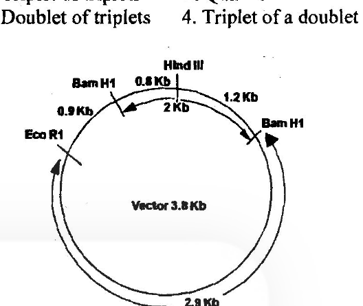

The above diagram represents a 2 Kb insert successfully introduced between two BamH1 sites of a 3.8 Kb vector in desired orientation. The HindIII site on the insert and EcoRl site on the vector is also indicated. If the insert was introduced in the opposite orientation, which one of the following statements is INCORRECT?

1. Digestion with EcoRI will linearize the 5.8 Kb plasmid.
2. Digestion with BamHI will yield one 3.8 and one 2.0 Kb fragment.
3. Double digestion with EcoRI and HindIII will produce 1.7 Kb and 4.1 Kb fragments.
4. Double digestion with EcoRI and HindIII will produce 2.1 Kb and 3.7 Kb fragments.

**Answer: 3 (statement 3)**

> **Explanation:** In the inverted orientation the EcoRI–HindIII distances become 2.1 + 3.7 Kb (statement 4), so the 1.7 + 4.1 Kb claim of statement 3 is the INCORRECT one; EcoRI single digestion still linearises the 5.8 Kb plasmid and BamHI still releases 3.8 + 2.0 Kb.

---

### Question 145

Combination of molecular markers with their classification based on either dominant or co-dominant types are shown below:

A. SSR and RFLP: co-dominant.
B. SSR and RAPD: co-dominant.
C. RAPD and RFLP: dominant.
D. AFLP and RAPD: dominant.

Which one of the following is the correct combination?

1. A and B
2. B and C
3. C and D
4. A and D

**Answer: 4 (A and D)**

> **Explanation:** SSR (microsatellite) and RFLP alleles are resolved by size, so they are co-dominant (A); RAPD and AFLP score presence/absence of bands and behave as dominant markers (D).
