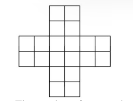
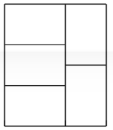
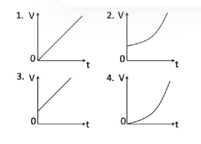
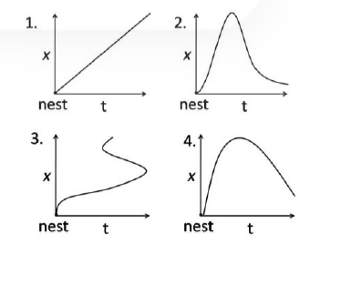

### Question 1

In each of the following groups of words is a hidden number, based on which you should arrange them in descending order. Pick the correct answer:

E. Papers I Xeroxed
F. Wi-Fi veteran
G. Yourself ourselves
H. Breaks even

1. H, F, G, H
2. E, G, F, H
3. H, F, G, E
4. H, E, F, G

**Answer: 4 (H, E, F, G)**

> **Explanation:** Each group conceals a number written inside the words (e.g. "Papers **I X**eroxed" hides the Roman numeral XI, "Wi-**Fi V**eteran" hides VI). Reading out the four hidden values and sorting the groups from largest to smallest gives the order **H, E, F, G**.

---

### Question 2

The number of squares in the above figure is

1. 30
2. 29
3. 25
4. 20

**Answer: 2 (29)**

> **Explanation:** Counting all squares of every size in the cross figure (1×1, 2×2 and the larger squares formed where arms overlap) gives a total of **29**.

---

### Question 3

A shopkeeper purchases a product for Rs.100 and sells it making a profit of 10%. The customer resells it to the same shopkeeper incurring a loss of 10%. In these dealings the shopkeeper makes

1. no profit, no loss
2. Rs. 11
3. Re. 1
4. Rs. 20

**Answer: 2 (Rs. 11)**

> **Explanation:** First transaction: buys at 100, sells at 110 → shopkeeper +10. Second: buys back at 110×0.9 = 99, so he paid 100 and gets the goods back for 99 while having received 110 earlier. Net = −100 +110 −99 +100(goods value) → profit of **Rs. 11**.

---

### Question 4

Five congruent rectangles are drawn inside a big rectangle of perimeter 165 as shown. What is the perimeter of one of the five rectangles?

1. 37
2. 75
3. 15
4. 165

**Answer: 2 (75)**

> **Explanation:** Let each small rectangle have long side x and short side y. The left column of three (lying flat) has height 3y; the right column of two (standing up) has height 2x, so 3y = 2x. The big rectangle is therefore (x + y) wide and 3y high, giving perimeter 2(x + y + 3y) = 2(1.5y + 4y) = 11y = 165 → y = 15, x = 22.5. Perimeter of one small rectangle = 2(x + y) = 2(37.5) = **75**.

---

### Question 5

A person walks downhill at 10 km/h, uphill at 6 km/h and on the plane at 7.5 km/h. If the person takes 3 hours to go from a place A to another place B, and 1 hour on the way back, the distance between A and B is

1. 15 km.
2. 23.5 km.
3. 16 km.
4. Given data is insufficient to calculate the distance.

**Answer: 1 (15 km.)**

> **Explanation:** Split the route into its downhill (x), flat (y) and uphill (z) parts. Outward: x/10 + y/7.5 + z/6 = 3. On the return the same ground is traversed in reverse, so x/6 + y/7.5 + z/10 = 1. Adding the two equations, each segment contributes (1/6 + 1/10) = 4/15 per km: (4/15)(x + y + z) = 4, hence the distance A to B = x + y + z = **15 km**.

---

### Question 6

A vessel is partially filled with water. More water is added to it at a rate directly proportional to time [i.e., dV/dt ∝ t]. Which of the following graphs depicts correctly the variation of total volume V of water with time t?

1. (linear from origin)
2. (rising curve, non-zero intercept)
3. (linear, non-zero intercept)
4. (rising curve from origin)

**Answer: 2 (rising curve, non-zero intercept)**

> **Explanation:** dV/dt = kt → V = (k/2)t² + V₀. Since the vessel starts partially filled, V₀ > 0 (non-zero intercept), and the t² term makes it an upward-opening parabola. That is graph **2**.

---

### Question 7

At one instant, the hour hand and the minute hand of a clock are one over the other in between the markings for 5 and 6 on the dial. At this instant, the tip of the minute hand

1. is closer to the marking for 6
2. is equidistant from the markings for 5 and 6
3. is closer to marking for 5
4. is equidistant from the markings for 11 and 12

**Answer: 3 (is closer to marking for 5)**

> **Explanation:** The hands overlap between 5 and 6 at ≈ 5:27.3, when the minute hand points at ≈ 27.3 min → between the 5 and 6 marks but nearer the 5 mark. Hence **closer to marking for 5**.

---

### Question 8

A bird leaves its nest and flies away. Its distance x from the nest is plotted as a function of time t. Which of the following plots cannot be right?

1. (straight increasing line)
2. (rise then fall, single-valued)
3. (S-shaped curve folding back on itself)
4. (parabolic hump)

**Answer: 3 (S-shaped curve folding back on itself)**

> **Explanation:** Distance from the nest must be a single-valued function of time. Plot 3 doubles back (one time value maps to several distances), which is impossible. So plot **3** cannot be right.

---

### Question 9

A cubical cardboard box made of 1 cm thick card board has outer side of 29 cm. A tight-fitting cubical box of the same thickness is placed inside it, then another one inside it and so on. How many cubical boxes will be there in the entire set?

1. 29
2. 28
3. 15
4. 14

**Answer: 4 (14)**

> **Explanation:** Each successive inner box has outer side reduced by 2 cm (1 cm wall on each of two faces). Sizes: 29, 27, 25, … down to 1 cm. Number of terms = (29−1)/2 + 1 = **14**.

---

### Question 10

Secondary colours are made by a mixture of three primary colours, Red, Green and Blue, in different proportions; each of the primary colours comes in 8 possible levels. Grey corresponds to equal proportions of Red, Green and Blue. How many shades of grey exist in this scheme?

1. 8³
2. 8
3. 3⁸
4. 8 × 3

**Answer: 2 (8)**

> **Explanation:** Grey requires R = G = B. With 8 possible equal levels, there are **8** distinct greys.

---

### Question 11

The triangle formed by the lines y = x, y = 1 − x and x = 0 in a two dimensional plane is (x and y axes have the same scale)

1. isosceles and right-angled
2. isosceles but not right-angled
3. right-angled but not isosceles
4. neither isosceles nor right-angled

**Answer: 1 (isosceles and right-angled)**

> **Explanation:** y = x and y = 1 − x are perpendicular (slopes 1 and −1). Vertices are (0,0), (0,1), (½,½). The two legs from (½,½) are equal, and the angle between the sloped lines is 90°, so the triangle is **isosceles and right-angled**.

---

### Question 12

There are two buckets A and B. Initially A has 2 litres of water and B is empty. At every hour 1 litre of water is transferred from A to B followed by returning ½ litre back to A from B half an hour later. The earliest A will get empty is in:

1. 5 h
2. 4 h
3. 3 h
4. 2 h

**Answer: 3 (3 h)**

> **Explanation:** Net loss from A each hour = 1 − ½ = ½ litre, but the last transfer empties A before the return. After 2 h, A = 1 litre; at the start of hour 3, A gives 1 litre → A = 0. So A is first empty at **3 h**.

---

### Question 13

Statement A. The following statement is true
Statement B. The preceding statement is false.
Choose the correct inference from the following:

1. Statements A and B are always true
2. Statements A and B can be true if there is at least one statement between A and B
3. Statements A and B can be true if there are at least two statements between A and B
4. Statements A and B can never be true, independently.

**Answer: 3 (Statements A and B can be true if there are at least two statements between A and B)**

> **Explanation:** If A and B are adjacent they form a liar-paradox (never both consistent). With at least two intervening statements, "following"/"preceding" refer to other statements, breaking the paradox, so both can be true. Answer **3**.

---

### Question 14

A car is moving at 60 km/h. The instantaneous velocity of the upper most points of its wheels is

1. 60 km/h forward
2. 120 km/h forward
3. 60 km/h backward
4. 120 km/h backward

**Answer: 2 (120 km/h forward)** — the English key gives 2; the bilingual key accepts **2 or 4**.

> **Explanation:** For rolling without slipping, the top point of a wheel moves at twice the centre-of-mass speed: v + ωR = 60 + 60 = **120 km/h forward**. (The official bilingual Booklet-A key marked this question "2 or 4"; the English-only key marked 2.)

---

### Question 15

If D + I + M = 1501
C + I + V + I + L = 157
L + I + V + I + D = 557
C + I + V + I + C = 207
What is V + I + M = ?

1. Cannot be found
2. 1009
3. 1006
4. 509

**Answer: 3 (1006)**

> **Explanation:** The letters are Roman numerals: D = 500, I = 1, M = 1000, C = 100, V = 5, L = 50. Check: D+I+M = 500+1+1000 = 1501 ✓, C+I+V+I+L = 100+1+5+1+50 = 157 ✓, L+I+V+I+D = 557 ✓, C+I+V+I+C = 207 ✓. Therefore V+I+M = 5+1+1000 = **1006**.

---

### Question 16

A living cell has a protoplasm which is water based and demarcated by a lipid bilayer membrane. If a cell is pierced up to 1/5 th of its diameter with a very sharp needle, after taking the needle out

1. no effect will be observed.
2. protoplasm will leak out from the hole made by the needle for a few minutes until the cell heals the wound.
3. protoplasm will keep on leaking out till the cell is dead.
4. the cell will burst like a balloon.

**Answer: 1 (no effect will be observed.)**

> **Explanation:** A lipid bilayer is self-sealing; a needle puncture up to 1/5 of the diameter closes spontaneously, so **no effect will be observed**.

---

### Question 17

Density of a rice grain is 1.5 g/cc and bulk density of rice heap is 0.80 g/cc. If a 1 litre container is completely filled with rice, what will be the approximate volume of pore space in the container?

1. 350 cc
2. 465 cc
3. 550 cc
4. 665 cc

**Answer: 2 (465 cc)**

> **Explanation:** Solids occupy V_s = bulk density/grain density × 1000 = (0.80/1.5)×1000 ≈ 533 cc. Pore space = 1000 − 533 ≈ **465 cc**.

---

### Question 18

A turtle starts swimming from a point A located on the circumference of a circular pond. After swimming for 4 meters in a straight line it hits point B on the circumference of the pond. From there it changes direction and swims for 3 meters in a straight line and arrives at point D diametrically opposite to point A. How far is point D from A?

1. 3 m
2. 4 m
3. 7 m
4. 5 m

**Answer: 4 (5 m)**

> **Explanation:** Angle ABD subtends a diameter, so it is 90°. AD is the hypotenuse of a 3-4 right triangle: AD = √(3²+4²) = **5 m**.

---

### Question 19

Four circles of unit radius each are drawn such that each one touches two others and their centres lie on the vertices of a square. The area of the region enclosed between the circles is

1. π − 1
2. π − 2
3. 3 − π
4. 4 − π

**Answer: 4 (4 − π)**

> **Explanation:** Centres form a square of side 2 (area 4). The four quarter-circles inside the square together have area π(1)² = π. Enclosed gap = 4 − π.

---

### Question 20

A film projector and microscope give equal magnification. But a film projector is not used to see living cells because

1. a living cell cannot be placed in a film projector.
2. the viewer's eye is close to a microscope whereas it is far away from the projector's screen.
3. a microscope produces a virtual image whereas a projector produces a real image.
4. a microscope has greater resolving power than a projector.

**Answer: 4 (a microscope has greater resolving power than a projector.)**

> **Explanation:** Seeing cells needs resolution, not just magnification. A projector's screen/grain limits resolving power; a microscope has far greater resolving power, so it, not a projector, can resolve living cells. Answer **4**.
