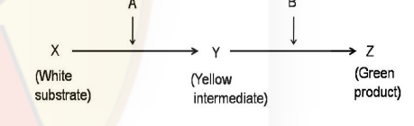
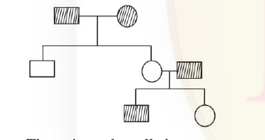

### Question 21

The ionic strength of a 0.2 M Na₂HPO₄ solution will be

1. 0.2 M
2. 0.4 M
3. 0.6 M
4. 0.8 M

**Answer: 3 (0.6 M)**

> **Explanation:** Na₂HPO₄ → 2 Na⁺ (charge +1) + HPO₄²⁻ (charge −2). Ionic strength I = ½ Σ cᵢzᵢ² = ½[(0.4)(1)² + (0.2)(2)²] = ½[0.4 + 0.8] = 0.6 M.

---

### Question 22

A cell line deficient in salvage pathway for nucleotide biosynthesis was fed with medium containing ¹⁵N labelled amino acids. Purines were then extracted. Treatment with which one of the following amino acids is likely to produce ¹⁵N labelled purines?

1. Aspartic acid
2. Glycine
3. Glutamine
4. Aspartamine

**Answer: 1 or 2 or 3 (key accepts Aspartic acid, Glycine, or Glutamine)**

> **Explanation:** The purine ring nitrogens are donated by glycine (N7), glutamine (N3, N9) and aspartate (N1). Any of these three ¹⁵N-labelled amino acids can therefore feed label into the purine ring, which is why the official key accepts options 1, 2 and 3.

---

### Question 23

Enzymes accelerate a reaction by which one of the following strategies?

1. Decreasing energy required to form the transition state.
2. Increasing kinetic energy of the substrate.
3. Increasing the free energy difference between substrate and product.
4. Increasing the turn over number of enzymes.

**Answer: 1 (Decreasing energy required to form the transition state.)**

> **Explanation:** Catalysts lower the activation energy by stabilising the transition state; they do not change ΔG between substrate and product nor add kinetic energy. Hence option **1**.

---

### Question 24

Coupling of the reaction centers of oxidative phosphorylation is achieved by which one of the following?

1. Making a complex of all four reaction centers.
2. Locating all four complexes in the inner membrane.
3. Ubiquinones and cytochrome C.
4. Pumping of protons.

**Answer: 3 (Ubiquinones and cytochrome C.)**

> **Explanation:** The electron-transport complexes are physically separate but functionally coupled by the mobile carriers ubiquinone (Complex I/II → III) and cytochrome c (Complex III → IV).

---

### Question 25

The genome of a bacterium is composed of a single DNA molecule which is 10⁹ bp long. How many moles of genomic DNA is present in the bacterium? [Consider Avogadro No = 6 × 10²³]

1. (1/6) × 10⁻²³
2. (1/6) × 10⁻¹⁴
3. 6 × 10¹⁴
4. 6 × 10²³

**Answer: 1 ((1/6) × 10⁻²³)**

> **Explanation:** One bacterium contains one DNA molecule. Moles = molecules / Avogadro = 1 / (6 × 10²³) = (1/6) × 10⁻²³.

---

### Question 26

It takes 40 minutes for a typical E. coli cell to completely replicate its chromosome. Simultaneous to the ongoing replication, 20 minutes of a fresh round of replication is completed before the cell divides. What would be the generation time of E. coli growing at 37°C in complex medium?

1. 20 minutes
2. 40 minutes
3. 60 minutes
4. 30 minutes

**Answer: 1 (20 minutes)**

> **Explanation:** With multifork replication, a new round initiates before the previous finishes; the net doubling (generation) time under these fast-growing conditions is 20 minutes even though chromosome replication itself takes 40 minutes.

---

### Question 27

Glycophorin having one highly hydrophobic domain is able to span a phospholipid bilayer membrane only

1. once
2. twice
3. thrice
4. four times

**Answer: 1 (once)**

> **Explanation:** A single hydrophobic transmembrane segment can cross the bilayer only once; glycophorin is a monotopic/single-pass transmembrane protein.

---

### Question 28

Given below are events in the cell cycle.

(a) Phosphorylation of lamin A, B, C
(b) Phosphorylation of Rb (Retinoblastoma protein)
(c) Polyubiquitination of securin
(d) Association of inner nuclear membrane proteins and nuclear pore complex proteins with chromosomes.

Which one of the following reflects the correct sequence of events in the mammalian cell cycle?

1. a→b→c→d
2. b→c→d→a
3. c→a→b→d
4. b→a→c→d

**Answer: 4 (b→a→c→d)**

> **Explanation:** Rb phosphorylation (G1/S commitment) precedes nuclear-envelope lamin phosphorylation (prometaphase), which precedes securin polyubiquitination (metaphase APC/C) and the re-association of nuclear membrane/pore proteins with chromosomes (telophase). Order b→a→c→d.

---

### Question 29

Which one of the following chemicals is a DNA intercalator?

1. 5-Bromouracil
2. Ethyl methane sulfonate
3. Acridine orange
4. UV

**Answer: 3 (Acridine orange)**

> **Explanation:** Acridine orange is a planar aromatic dye that slips (intercalates) between base pairs. 5-BU is a base analogue, EMS an alkylator, UV causes pyrimidine dimers.

---

### Question 30

An antibiotic that resembles the 3' end of a charged tRNA molecule is:

1. Streptomycin
2. Sparsomycin
3. Puromycin
4. Tetracycline

**Answer: 3 (Puromycin)**

> **Explanation:** Puromycin mimics the aminoacyl-3' end of tRNA, enters the A site and causes premature chain termination.

---

### Question 31

α-Amanitin is a fungal toxin which inhibits eukaryotic RNA polymerases. The three eukaryotic RNA polymerases show differential sensitivity to this toxin. Which one of the following order (higher to lower) is correct in respect of sensitivity towards α-amanitin?

1. RNA POL III > RNA POL II > RNA POL I
2. RNA POL II > RNA POL III > RNA POL I
3. RNA POL I > RNA POL III > RNA POL II
4. RNA POL II > RNA POL I > RNA POL III

**Answer: 2 (RNA POL II > RNA POL III > RNA POL I)**

> **Explanation:** RNA Pol II is highly sensitive, RNA Pol III moderately sensitive, and RNA Pol I essentially resistant to α-amanitin.

---

### Question 32

In eukaryotic replication, helicase loading occurs at all replicators during

1. G₀ phase
2. G₁ phase
3. S phase
4. G₂ phase

**Answer: 2 (G₁ phase)**

> **Explanation:** The origin recognition complex loads the MCM helicase (pre-replication complex) during G₁; activation/unwinding then occurs in S phase.

---

### Question 33

Cytotoxic T cells express

1. CD8 marker and are class II MHC restricted
2. CD4 marker and are class I MHC restricted
3. CD4 marker and are class II MHC restricted
4. CD8 marker and are class I MHC restricted

**Answer: 4 (CD8 marker and are class I MHC restricted)**

> **Explanation:** Cytotoxic (killer) T lymphocytes carry CD8 and recognise antigen on MHC class I molecules.

---

### Question 34

The mutation in an oncogene falls under which of the following classes?

1. Loss of function mutation
2. Frame shift mutation
3. Gain of function mutation
4. Dominant negative mutation

**Answer: 3 (Gain of function mutation)**

> **Explanation:** Oncogenes arise from proto-oncogenes by activating (gain-of-function) mutations that are dominant at the cellular level.

---

### Question 35

Which of the following is NOT a cell adhesion protein?

1. Cadherin
2. Selectin
3. Immunoglobulin (Ig) superfamily
4. Laminin

**Answer: Question marked "*" in the official key — benefit of marks to all who attempted (no single correct option credited).**

> **Explanation:** The CSIR final key lists Q35 as `*` ("benefit of marks to those who attempted"), i.e. the question was effectively dropped/all-credited. (Cadherins, selectins and Ig-superfamily are cell-adhesion molecules; laminin is a matrix/adhesion glycoprotein — the ambiguity is why no single option was keyed.)

---

### Question 36

Which of the following is NOT a second messenger?

1. Cyclic GMP
2. Diacylglycerol
3. Inositol triphosphate
4. Phosphatidyl inositol

**Answer: 4 (Phosphatidyl inositol)**

> **Explanation:** cGMP, DAG and IP₃ are second messengers; phosphatidylinositol is the membrane phospholipid precursor, not itself a diffusible second messenger.

---

### Question 37

In chick, development of wing feather, thigh feather and claws depends on epithelial specificity conferred by induction from mesenchymal components from different sources of the dermis. This may be attributed to?

1. Autocrine interaction
2. Regional specificity of induction
3. Receptor activation by hormones
4. Inactivation of genetic interactions

**Answer: 2 (Regional specificity of induction)**

> **Explanation:** Different dermal (mesenchymal) regions instruct the overlying epidermis to form feather vs claw structures — a classic example of regionally specific epithelial–mesenchymal induction.

---

### Question 38

Alveolar cells of the lung arise from which one of the following layer(s)?

1. Mesoderm
2. Endoderm
3. Ectoderm
4. Both ectoderm and endoderm

**Answer: 2 (Endoderm)**

> **Explanation:** The lung epithelium, including the alveolar (type I and II) cells, is derived from the foregut endoderm (the surrounding connective tissue is mesodermal, but the alveolar cells themselves are endodermal).

---

### Question 39

Migration of individual cells from the surface into the embryo's interior is termed as

1. ingression
2. involution
3. invagination
4. delamination

**Answer: 1 (ingression)**

> **Explanation:** Ingression is the migration of individual cells from the epithelial sheet into the interior; involution/invagination involve sheets of cells, not single-cell migration.

---

### Question 40

Floral organ development is controlled by overlapping expression of 'A' class, 'B' class and 'C' class genes in different whorls. In an Arabidopsis mutant, the flowers had sepals, sepals, carpels and carpels in the four whorls. Mutation in which one of the following is the cause for the mutant phenotype?

1. 'A' class gene alone
2. 'B' class gene alone
3. 'A' and 'B' class genes
4. 'C' class gene alone

**Answer: 2 ('B' class gene alone)**

> **Explanation:** Sepals–sepals–carpels–carpels is the classic **B-class** loss-of-function phenotype: whorls 1&2 become sepals (A alone, no B to make petals) and whorls 3&4 become carpels (C alone, no B to make stamens). A and C are unaffected, so only the 'B' class gene is mutated.

---

### Question 41

Phenylalanine, a precursor of most of the phenolics in higher plants is a product of which one of the following pathways?

1. Shikimic acid pathway
2. Malonic acid pathway
3. Mevalonic acid pathway
4. Methylerythritol pathway

**Answer: 1 (Shikimic acid pathway)**

> **Explanation:** The aromatic amino acid phenylalanine is synthesised via the shikimate pathway (chorismate → prephenate → phenylalanine).

---

### Question 42

For which one of the following physiological studies ¹²CO₂ and ¹³CO₂ are used?

1. Estimate the rate of photosynthesis
2. Determine rate of photorespiration
3. The ratio of C₄ and CAM pathways of CO₂ fixation
4. The ratio of C₃ and C₄ pathways of CO₂ fixation

**Answer: 4 (The ratio of C₃ and C₄ pathways of CO₂ fixation)**

> **Explanation:** The different isotopic discrimination of C₃ vs C₄ photosynthesis is measured using ¹²C/¹³C ratios (carbon isotope discrimination) to estimate the relative contribution of the two pathways.

---

### Question 43

Gibberellic acid (GA) controls seed germination by directing breakdown of the stored starch. In which one of the following tissues of the barley seed, α-amylase gene is induced in response to GA?

1. Endosperm
2. Coleoptile
3. Aleurone layer
4. Embryo

**Answer: 3 (Aleurone layer)**

> **Explanation:** GA from the embryo acts on the aleurone layer to induce α-amylase synthesis, which then hydrolyses the starchy endosperm.

---

### Question 44

The photosynthetic assimilation of atmospheric CO₂ by leaves yield sucrose and starch as end products of two gluconeogenic pathways that are physically separated. Which one of the following combination of cell organelles are involved in such physical separation of the process?

1. Sucrose in cytosol and starch in mitochondria.
2. Sucrose in chloroplasts and starch in cytosol.
3. Sucrose in mitochondria and starch in cytosol.
4. Sucrose in cytosol and starch in chloroplasts.

**Answer: 4 (Sucrose in cytosol and starch in chloroplasts.)**

> **Explanation:** Starch is synthesised and stored inside the chloroplast, whereas sucrose is assembled in the cytosol from exported triose phosphates.

---

### Question 45

A diabetic patient developed metabolic acidosis resulting in deep and rapid breathing which is called-

1. Kussmaul breathing
2. Cheyne-Stokes respiratory pattern
3. Apneustic breathing
4. Periodic breathing

**Answer: 1 (Kussmaul breathing)**

> **Explanation:** The deep, rapid, laboured respirations that compensate for metabolic (e.g. diabetic ketoacidosis) acidosis are Kussmaul breathing.

---

### Question 46

Which one of the following is NOT involved with the pacemaker potential of heart?

1. "h"-channel
2. Transient calcium channel
3. Long-lasting calcium channel
4. "f"-channel

**Answer: 3 (Long-lasting calcium channel)**

> **Explanation:** The official key credits option 3. The pacemaker (diastolic) potential is generated by the hyperpolarisation-activated funny/"h" current and the transient (T-type) Ca²⁺ current; the long-lasting (L-type) Ca²⁺ channel is responsible for the upstroke rather than the pacemaker depolarisation itself, so it is the option keyed as NOT involved.

---

### Question 47

You are asked to identify the stage of estrus cycle in vaginal smear of a mouse containing large number of leukocytes and very few nucleated epithelial cells. Which one of the following will be the correct stage of estrous cycle?

1. Early estrus, late proestrus
2. Late estrus, early metestrus
3. Late metestrus, early diestrus
4. Late diestrus, early proestrus

**Answer: 4 (Late diestrus, early proestrus)**

> **Explanation:** The official key credits option 4. A smear with large numbers of leukocytes and very few nucleated epithelial cells corresponds to the leukocytic phase spanning late diestrus into early proestrus.

---

### Question 48

Which one of the following neurotransmitters is secreted by the pre-ganglionic neurons of sympathetic nervous system?

1. Epinephrine
2. Acetylcholine
3. Dopamine
4. Norepinephrine

**Answer: 2 (Acetylcholine)**

> **Explanation:** All autonomic pre-ganglionic neurons (sympathetic and parasympathetic) release acetylcholine onto nicotinic receptors of the post-ganglionic neuron.

---

### Question 49

Following is a hypothetical biochemical pathway responsible for pigmentation of leaves. The pathway is controlled by two independently assorting genes 'A' and 'B' encoding enzymes as shown below. Mutant alleles 'a' and 'b' code for non-functional proteins.

What is the expected progeny after selfing a plant with the genotype AaBb?

1. Green (9): White (4): Yellow (3)
2. Green (9): Yellow (4): White (3)
3. Green (9): Yellow (6): White (1)
4. Green (9): White (7)

**Answer: 1 (Green (9): White (4): Yellow (3))**

> **Explanation:** A_B_ (9) make green; A_bb (3) stop at the yellow intermediate; aa__ (4: 3 aaB_ + 1 aabb) cannot make yellow and stay white. Hence 9 green : 3 yellow : 4 white.

---

### Question 50

Mutation in gene 'X' leads to lethality in a haploid organism. Which one of the following is best suited to analyse the function of gene 'X'?

1. Pleiotropic mutants
2. Temperature-sensitive mutants
3. Recessive mutants
4. Mutants with low penetrance

**Answer: 2 (Temperature-sensitive mutants)**

> **Explanation:** A temperature-sensitive allele lets the essential gene function at the permissive temperature and be inactivated at the restrictive temperature, so its normal function can be studied despite lethality.

---

### Question 51

The following pedigree chart shows inheritance of a given trait

The trait can be called

1. autosomal dominant
2. autosomal recessive
3. X-linked dominant
4. sex limited

**Answer: 1 (autosomal dominant)**

> **Explanation:** The trait appears in every generation and two affected parents produce an unaffected child, which is only possible if the allele is dominant and both parents are heterozygous; both sexes are affected, so it is autosomal dominant.

---

### Question 52

In a heterozygous individual for a given gene, if a crossing over has occurred between the gene locus and the centromere of the chromosome, the segregation of the two alleles of the given gene will occur during meiosis at

1. either anaphase I or anaphase II
2. anaphase I only
3. anaphase II only
4. both anaphase I and II

**Answer: 3 (anaphase II only)**

> **Explanation:** A single crossover between the locus and centromere makes the two alleles reside on sister chromatids, so they separate only when sisters split at anaphase II.

---

### Question 53

Most members of bryophyte phylum Anthocerophyta are characterized by

1. gametophyte with single chloroplast per cell and multicellular rhizoids; sporophyte without stomata.
2. gametophyte with single chloroplast per cell and unicellular rhizoids; sporophyte with stomata.
3. gametophyte with multiple chloroplasts per cell and unicellular rhizoids; sporophyte without stomata.
4. gametophyte with single chloroplast per cell and multicellular rhizoids; sporophyte with stomata.

**Answer: 2 (gametophyte with single chloroplast per cell and unicellular rhizoids; sporophyte with stomata.)**

> **Explanation:** Hornworts (Anthocerophyta) have thalloid gametophytes with a single large chloroplast per cell and unicellular rhizoids, and a sporophyte that possesses stomata.

---

### Question 54

Identify the correct match between the animal (flatworm, earthworm, roundworm) and its body cavity type (acoelomate, coelomate, pseudocoelomate):

1. Roundworm – pseudocoelomate; Earthworm - acoelomate; Flatworm – coelomate
2. Roundworm – acoelomate; Earthworm – coelomate; Flatworm – acoelomate
3. Roundworm – pseudocoelomate; Earthworm – coelomate; Flatworm – acoelomate
4. Roundworm –coelomate; Earthworm – pseudocoelomate; Flatworm – acoelomate

**Answer: 3 (Roundworm – pseudocoelomate; Earthworm – coelomate; Flatworm – acoelomate)**

> **Explanation:** Nematodes (roundworms) are pseudocoelomate, annelids (earthworm) are true coelomates, and platyhelminthes (flatworms) are acoelomate.

---

### Question 55

Which one of the following gymnosperm phyla produces motile sperms, bears ovulate and microsporangiate cones on separate plants and has fleshy, coated seeds?

1. Coniferophyta
2. Cycadophyta
3. Ginkgophyta
4. Gnetophyta

**Answer: 2 or 3 (key accepts Cycadophyta or Ginkgophyta)**

> **Explanation:** Both Cycadophyta and Ginkgophyta retain flagellated (motile) sperm and are dioecious with separate cones; the fleshy coated seed fits cycads and ginkgo, so the official key accepts both options 2 and 3.

---

### Question 56

According to 2014 IUCN Red List, which of the following vertebrate classes has the largest percentage of threatened species?

1. Mammals
2. Birds
3. Reptiles
4. Amphibians

**Answer: 4 (Amphibians)**

> **Explanation:** Amphibians show the highest proportion of threatened species of the four vertebrate classes on the IUCN Red List.

---

### Question 57

In the following equations

(a) dN/dt = rN
(b) Nt = N₀eʳᵗ
(c) dN/dt = rN((K−N)/K)
(d) dN/dt = rN × N/K

exponential population growth is described by

1. a and b.
2. a only.
3. c only.
4. b and d.

**Answer: 2 (a only.)**

> **Explanation:** The official key credits option 2 (a only). Equation (b) is printed as "Nt = N₀eʳᵗ" (left side "Nt", not Nₜ), so as printed it is not the correct integrated exponential form; only (a) dN/dt = rN describes exponential growth. (c) is the logistic equation. This row is bolded in the key as a change.

---

### Question 58

Which gas does NOT contribute to global warming through its greenhouse effect?

1. Nitrous oxide
2. Methane
3. Carbon dioxide
4. Nitric oxide

**Answer: 4 (Nitric oxide)**

> **Explanation:** N₂O, CH₄ and CO₂ are greenhouse gases; nitric oxide (NO) is not itself a significant greenhouse gas.

---

### Question 59

A red coloured tubular flower without any odour is most likely to be pollinated by

1. beetles.
2. bees.
3. butterflies.
4. birds.

**Answer: 4 (birds.)**

> **Explanation:** Bird-pollinated flowers are typically red, tubular and odourless (birds have poor smell); bee/butterfly flowers rely on scent and beetle flowers are usually dull and fragrant.

---

### Question 60

Which one of the following conditions is NOT likely to favour male monogamy?

1. When the male has to guard his mate against mating by another male.
2. When the male wants to spend more time for foraging.
3. When the male has to assist the mate in brood and nestling care.
4. When the female guards her mate against seeking other females to mate.

**Answer: 2 (When the male wants to spend more time for foraging.)**

> **Explanation:** Mate-guarding, paternal care and female mate-guarding all favour monogamy; a male needing to spend more time foraging is not a factor that favours staying monogamous.

---

### Question 61

The origin and diversification of Angiosperms was during which geological period?

1. Permian
2. Triassic
3. Jurassic
4. Cretaceous

**Answer: 4 (Cretaceous)**

> **Explanation:** Angiosperms first appear in the fossil record in the Early Cretaceous and diversified through the Cretaceous.

---

### Question 62

Which of the following statements about evolution is NOT true?

1. Evolution is the product of natural selection.
2. Evolution is goal-oriented.
3. Prokaryotes evolve faster than eukaryotes.
4. Evolution need not always lead to a better phenotype.

**Answer: 2 (Evolution is goal-oriented.)**

> **Explanation:** Evolution has no foresight or goal; it is not goal-oriented, which makes statement 2 the false one.

---

### Question 63

Which among the following is the simplest method to estimate the concentration of glycerol in an aqueous solution of glycerol?

1. UV absorption spectroscopy
2. Gas chromatography
3. pH measurement
4. Viscosity measurement

**Answer: 4 (Viscosity measurement)**

> **Explanation:** Glycerol is non-volatile, colourless and neutral, so UV/GC/pH are unsuitable; its strong concentration-dependent viscosity makes viscometry the simplest way to estimate concentration.

---

### Question 64

Application of gene therapy in clinical trials did NOT succeed due to

1. poor integration of a gene in the host genome
2. lack of expression of integrated gene in cells
3. degradation of gene inside the cell
4. activation of oncogenes consequent to integration of the gene

**Answer: 4 (activation of oncogenes consequent to integration of the gene)**

> **Explanation:** Insertional mutagenesis — random integration activating proto-oncogenes (as seen in early X-SCID trials) — is the key safety failure that halted clinical gene therapy.

---

### Question 65

A gene expressing a 50 kDa protein from an eukaryote was cloned in an E. coli plasmid under the lac promoter and operator. Upon addition of IPTG, the 50 kDa protein was not detected. Which one of the following explains the above observation?

1. The cloned sequence lacked the Kozak sequence
2. E. coli does not make proteins larger than 40 kDa
3. Differences in codon preference
4. 50 kDa protein contains a nuclear localization signal

**Answer: 3 (Differences in codon preference)**

> **Explanation:** A eukaryotic gene often uses codons rare in E. coli; without the matching tRNAs translation stalls, so the protein is not produced even after IPTG induction. (Kozak and NLS are eukaryote-specific features irrelevant to E. coli expression; size is not a limit.)

---

### Question 66

Neomycin phosphotransferase gene, frequently used as a selection marker during plant transformation, inactivates which one of the following antibiotics?

1. Hygromycin
2. Ampicillin
3. Streptomycin
4. Kanamycin

**Answer: 4 (Kanamycin)**

> **Explanation:** nptII (neomycin phosphotransferase II) confers resistance to kanamycin (and neomycin/G418) by phosphorylation; it does not inactivate hygromycin, ampicillin or streptomycin.

---

### Question 67

Which one of the following techniques will you use to identify more than 1000 differentially expressed genes in normal and tumor tissues in one single experiment?

1. RAPD
2. Genome sequencing
3. ChIP assay
4. Transcriptome analysis

**Answer: 4 (Transcriptome analysis)**

> **Explanation:** Differential gene expression at genome scale (RNA-seq / transcriptome analysis) identifies thousands of differentially expressed transcripts in one experiment.

---

### Question 68

For identification of three proteins moving together (as a single band) upon loading in a single lane of a SDS-PAGE gel, the best method is:

1. one step Western blot
2. NMR spectroscopy
3. Western blot followed by stripping and reprobing
4. ESR spectroscopy

**Answer: 3 (Western blot followed by stripping and reprobing)**

> **Explanation:** Co-migrating proteins in one band are resolved by probing the blot for one antibody, stripping it off, and reprobing with the next antibody — sequential Western blotting.

---

### Question 69

Which isotope below is best suited for metabolic labelling of glyceraldehyde-3-phospho-dehydrogenase?

1. ¹⁴C
2. ¹²⁵I
3. ³²P
4. ¹³¹I

**Answer: 1 (¹⁴C)**

> **Explanation:** The official key credits option 1. For metabolic labelling of a glycolytic enzyme such as GAPDH, ¹⁴C-labelled carbon is taken up and incorporated into the newly synthesised protein, so ¹⁴C is the isotope of choice.

---

### Question 70

Which one of the following would contribute to intrinsic fluorescence to a protein?

1. aromatic amino acids
2. disulfide bonds
3. charged amino acids
4. branched chain amino acids

**Answer: 1 (aromatic amino acids)**

> **Explanation:** Intrinsic protein fluorescence comes from the aromatic side chains tryptophan, tyrosine (and phenylalanine).
