### Question 71

Which one of the following statements is correct?

1. In all L-amino acids, only the Cα carbon atom is chiral
2. Deoxyribose is optically inactive
3. The specific rotation of sucrose will be the sum of the specific rotations of D-glucose and D-fructose
4. Phosphatidyl choline isolated from biological membranes is optically active

**Answer: 4 (Phosphatidyl choline isolated from biological membranes is optically active)**

> **Explanation:** Phosphatidylcholine (lecithin) has an asymmetric centre and is optically active. Statement 1 is false (e.g. threonine/isoleucine have a second chiral centre), deoxyribose is optically active, and sucrose's rotation is not a simple sum of its monosaccharides.

---

### Question 72

Membrane proteins are synthesized on endoplasmic reticulum and transported to various organelle membranes. One hypothesis for membrane protein sorting is hydrophobicity matching i.e., the proteins with a shorter transmembrane portion would partition into thinner membranes. You are given the following three observations:

A. It was found that transmembrane portions of proteins in Golgi membranes are shorter than those in plasma membranes
B. Presence of cholesterol increases the thickness of the bilayer
C. The phospholipid composition of Golgi and plasma membranes are same

Which one of the following statements is correct?

1. Proteins in plasma membrane have longer transmembrane portion than proteins in Golgi membranes
2. Proteins in Golgi membranes have longer transmembrane portion than proteins in plasma membranes
3. Proteins of both Golgi and plasmamembranes have same length of transmembrane portion
4. Cholesterol is more in Golgi membrane than in plasma membrane

**Answer: 1 (Proteins in plasma membrane have longer transmembrane portion than proteins in Golgi membranes)**

> **Explanation:** The plasma membrane is thicker (more cholesterol) than the Golgi membrane, so by hydrophobic matching its transmembrane segments are longer — matching observation A.

---

### Question 73

Four single amino acid mutants (a to d) of a protein in the epitope-region of a monoclonal antibody X were made and expressed in E. coli. The lysates from the four E. coli cultures expressing these four proteins were run or an SDS-PAGE gel and subsequently transferred to nitrocellulose membrane and Western blotted using a monoclonal antibody X raised against the wild type protein. The results are presented in the figure below

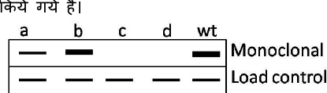

The four single mutation, upon sequencing, were found to be Valine (V) to Alanine (A); Glycine (G) to Proline (P); Alanine (A) to Aspartic acid (D) and isoleucine (I) to leucine (L).

Which one of the following statements is correct?

1. b is due to V → A and c is due to G →P
2. b is due to G → P and d is due to V →A
3. d is due to I → L and a is due to A →D
4. c is due to V → A and a is due to I → L

**Answer: 1 (b is due to V → A and c is due to G →P)**

> **Explanation:** The blot shows loss of antibody-X binding in the lanes where the epitope residues were changed. Matching the pattern of lost bands to the four substitutions gives option 1 (b = V→A, c = G→P).

---

### Question 74

The exact backbone dihedral angles in a folded protein can be obtained by

1. deconvolution of its circular dichroism spectra obtained at different pH and temperature
2. estimating the number of protons that exchange with deuterium on treating the protein with D₂O
3. forming fibres of the protein and analyzing the fibre diffraction pattern
4. analysis of the crystal structure of the protein obtained by X-ray diffraction at high resolutions

**Answer: 4 (analysis of the crystal structure of the protein obtained by X-ray diffraction at high resolutions)**

> **Explanation:** Only high-resolution X-ray crystallography yields the actual atomic coordinates from which exact φ/ψ backbone dihedral angles are computed.

---

### Question 75

The following are the statements about pyruvate kinase (PK).

A. ATP is an allosteric inhibitor of PK
B. Fructose 1, 6 bisphosphate is an activator of PK
C. ADP is an allosteric inhibitor of PK
D. Alanine is an allosteric modulator of PK

Which of the above statement(s) are true?

1. A, B, C
2. A, B, D
3. B, C, D
4. only A

**Answer: 2 (A, B, D)**

> **Explanation:** Pyruvate kinase is inhibited by ATP and by alanine and activated by fructose-1,6-bisphosphate; ADP is a substrate, not an allosteric inhibitor. So A, B and D are true.

---

### Question 76

A practical class was going on where the students were demonstrating ATP synthesis in vitro using active mitochondria. Some students added one of the following to their tubes

A. Dinitrophenol (DNP), an uncoupler
B. Mild acidification of the medium
C. Glutilferone, that permeabilizes both the membranes
D. Elila, an outer membrane permeable H⁺ quencher compound

In which one of the above, ATP synthesis will be detected?

1. A
2. B
3. C
4. D

**Answer: 2 (B)**

> **Explanation:** Mild acidification of the external medium creates a proton gradient across the inner membrane that can drive ATP synthesis; uncouplers (DNP) or permeabilisation of both membranes collapse the gradient and abolish synthesis.

---

### Question 77

A culture medium contains two carbon sources, one is preferred carbon source (glucose) and the second is a non-preferred source (lactose). Which one below is correct regarding the nature of growth curve of E. coli cultured in this medium?

1. Growth curve will be same as when grown in presence of only glucose.
2. Growth curve will be same as when grown in presence of only lactose.
3. A lag phase will be observed between the two exponential phases.
4. Two lag phases will be observed between the two exponential phases.

**Answer: 3 (A lag phase will be observed between the two exponential phases.)**

> **Explanation:** This is diauxic growth: glucose is used first, then a short lag occurs while the lac operon is induced before the second (lactose) exponential phase begins.

---

### Question 78

Which one of the following statements correctly applies to proteins which are translated on the rough endoplasmic reticulum?

1. Cytoplasmic proteins which are targeted to the nucleus in response to hormone stimuli.
2. Proteins targeted to lysosomes, plasma membrane and cell exterior.
3. Proteins which are targeted to the nucleus through endoplasmic reticulum lumen as the lumen is in direct connection with the inter membrane space of the nucleus.
4. All proteins which get targeted to peroxisomes.

**Answer: 2 (Proteins targeted to lysosomes, plasma membrane and cell exterior.)**

> **Explanation:** Rough-ER translation is for the secretory/membrane pathway — lysosomal, plasma-membrane and secreted proteins. Cytosolic and peroxisomal proteins are made on free ribosomes.

---

### Question 79

Lipid rafts are rich in both sphingolipids and cholesterol. Cholesterol plays a central role in raft formation since lipid rafts apparently do not form in its absence. Why do you think cholesterol is essential for the formation of lipid rafts?

1. Cholesterol decreases the mobility of sphingolipids in the lipid bilayer.
2. Large head groups of sphingolipids repel each other in presence of cholesterol.
3. Cholesterol interacts with fatty acid tails in the membrane.
4. The planar cholesterol molecules are postulated to fill the voids that form underneath the large head groups of the sphingolipids.

**Answer: 4 (The planar cholesterol molecules are postulated to fill the voids that form underneath the large head groups of the sphingolipids.)**

> **Explanation:** Cholesterol's rigid planar rings pack into the space beneath sphingolipid head groups, filling voids and ordering the acyl chains so that the tightly packed raft phase can form.

---

### Question 80

Following is the domain organization of three proteins that are targeted to the mitochondria.

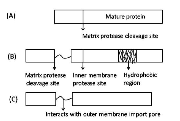

Based on the domain organization in the above figure and assuming the left box to be having the mitochondrial sorting signal, predict the most likely sub-compartment of the mitochondria in which the protein will be found.

1. A in matrix; B in inner membrane; C in inter-membrane space
2. A in inner membrane; B in inter-membrane space; C in outer membrane
3. A and B are in matrix; C in outer membrane
4. A in matrix; B and C are in inter-membrane space

**Answer: 1 (A in matrix; B in inner membrane; C in inter-membrane space)**

> **Explanation:** Protein A has only a cleavable presequence (→ matrix); B additionally carries a stop-transfer/hydrophobic segment (→ inner membrane); C's presequence is followed by an outer-membrane-pore-interacting domain (→ inter-membrane space).

---

### Question 81

You have labelled DNA in a bacterium by growing cells in medium containing either ¹⁴N nitrogen or the heavier isotope, ¹⁵N. Furthermore, you have isolated pure DNA from these organisms, and subjected it to CsCl density gradient centrifugation leading to their separation of light (¹⁴N) and heavy (¹⁵N) forms of DNA to different locations in the centrifuge tube. In the next experiment, bacteria were grown first in medium containing ¹⁵N, so that all the DNA made by cells will be in heavy form. Then these cells were transferred to medium containing only ¹⁴N and allowed the cells to divide for one generation. DNAs were extracted and centrifuged as above in the CsCl gradient. A hybrid DNA band was observed at a position located between and equidistant from the ¹⁵N and ¹⁴N DNA bands. Based on the above observation, which one of the following conclusions is correct?

1. Replication of DNA is conservative
2. Replication of DNA is semi-conservative
3. Replication of DNA is dispersive
4. Replication by rolling circle mode

**Answer: 2 (Replication of DNA is semi-conservative)**

> **Explanation:** After one generation in ¹⁴N all molecules are of a single hybrid (¹⁴N/¹⁵N) density — the Meselson–Stahl result that rules out conservative replication and is consistent with semi-conservative replication.

---

### Question 82

The frequency of cells in a population that are undergoing mitosis (the mitotic index) is a convenient way to estimate the length of the cell cycle. In order to measure the cell cycle in the liver of the adult mouse by measuring the mitotic index, liver slices are prepared and stained to easily identify cells undergoing mitosis. It was observed that only 3 out of 25,000 cells are found to be undergoing mitosis. Assuming that M phase lasts 30 minutes, calculate the approximate length of the cell cycle in the liver of an adult mouse?

1. 76 hours
2. 50 hours
3. 42 hours
4. 21 hours

**Answer: 3 (42 hours)**

> **Explanation:** Cell-cycle length = M-phase duration ÷ mitotic index = 30 min ÷ (3/25000) = 250,000 min ≈ 4167 h, which matches none of the printed options — the question's numbers appear misprinted. The official CSIR key designates option **3 (42 hours)**; the answer is recorded per the key. (Discrepancy noted in sources.md.)

---

### Question 83

Although ribonucleoside triphosphates (rNTPs) are present at approximately 10-fold higher concentration than deoxyribo-nucleoside triphosphates (dNTPs) in the cell, but they are incorporated into DNA at a rate that is more than 1000-fold lower than dNTPs. This is because

1. DNA polymerase cannot discriminate between dNTPs and rNTPs. But as soon as rNTPs are incorporated in the DNA chain, they are hydrolyzed due to the presence of 2'-OH group.
2. DNA polymerase cannot discriminate between dNTPs and rNTPs. But as soon as rNTPs are incorporated in the DNA chain, they are excised by the proof reading activity of DNA polymerase.
3. DNA polymerase efficiently discriminates between rNTPs and dNTPs, because its nucleotide binding pocket cannot accommodate a 2'-OH on the incoming nucleotide.
4. DNA polymerase cannot discriminate between rNTPs and dNTPs. Since the rate of transcription in cell is 10⁶ times faster than replication, it cannot compete with RNA polymerase for rNTPs.

**Answer: 3 (DNA polymerase efficiently discriminates between rNTPs and dNTPs, because its nucleotide binding pocket cannot accommodate a 2'-OH on the incoming nucleotide.)**

> **Explanation:** The DNA polymerase active site has a steric gate (an amino acid that clashes with the ribose 2'-OH), so rNTPs are largely excluded at selection — the primary reason for the low rNTP incorporation rate.

---

### Question 84

The mismatch repair activity of E.coli repairs misincorporated bases which is not removed by the proofreading activity of DNA polymerase. However, while doing so, it has to decide which strand of the DNA is newly synthesized and which one is parental. Mismatch repair system does it by which one of the following ways?

1. It recognizes nearby GATC sequence.
2. It recognizes any nearby palindromic sequence.
3. It recognises a specific repetitive sequence.
4. It recognises the hemi-methylated GATC sequence nearby.

**Answer: 4 (It recognises the hemi-methylated GATC sequence nearby.)**

> **Explanation:** Dam methylation marks the parental strand at GATC; shortly after replication the site is hemi-methylated, and MutS/MutH use this to identify the newly synthesised (unmethylated) strand as the one to repair.

---

### Question 85

Enlisted below are different types of RNAs produced in the cell (Column A) and their functions (Column B), but not in the same order.

| Column A | Column B |
|---|---|
| A. Sn RNAs | (i) turn off gene expression by directing degradation of selective mRNAs. |
| B. si RNAs | (ii) regulate gene expression by blocking translation of selective mRNAs. |
| C. mi RNAs | (iii) function in a variety of processes including splicing of pre-mRNA. |
| D. Sno RNAs | (iv) used to process and chemically modify rRNAs. |

Choose the correct combination

1. A-(iv), B-(ii), C-(i), D-(iii)
2. A-(iii), B-(i), C-(ii), D-(iv)
3. A-(iv), B-(i), C-(ii), D-(iii)
4. A-(iii), B-(ii), C-(i), D-(iv)

**Answer: 2 (A-(iii), B-(i), C-(ii), D-(iv))**

> **Explanation:** snRNA → splicing (iii); siRNA → mRNA degradation (i); miRNA → translational block (ii); snoRNA → rRNA processing/modification (iv).

---

### Question 86

In prokaryotes, the initiator t-RNA is first charged with a methionine, followed by the addition of a formyl group to the methionine by the enzyme Met-tRNA transformylase. Given below are several statements in this context.

A. All prokaryotic proteins have formyl methionine at their amino-terminal end.
B. Deformylase removes the formyl group from the amino terminal methionine.
C. All prokaryotic proteins have methionine at their amino terminal end.
D. Aminopeptidases often remove the amino terminal methionine.
E. Aminopeptidases remove amino terminal formyl methionine.

Which of the above statement(s) are most likely to be true?

1. A only
2. B and C
3. E only
4. B and D

**Answer: 4 (B and D)**

> **Explanation:** The initiator is formyl-methionine, but deformylase (B) then removes the formyl and aminopeptidases (D) often remove the terminal Met, so mature proteins do not all retain fMet or Met — making B and D the true statements.

---

### Question 87

A hypothetical operon involved in the synthesis of an amino acid 'X' is 'ON' (transcribing) in the presence of low levels of 'X' (not transcribing) in presence of high level of 'X'. The symbols a, b and c (in the table below) represents a structural gene for the synthesis of X (X-synthase), the operator region and gene encoding the repressor– but not necessarily in that order. From the following data, in which superscripts denote wild type or defective genotype, identify which are the genes for X-synthase, operator region and the repressor.

| Strain | Genotype | X-synthase activity: Low level of 'X' | High level of 'X' |
|---|---|---|---|
| 1. | a⁺b⁺c⁺ | Detected | Detected |
| 2. | a⁺b⁺c⁻ | Detected | Detected |
| 3. | a⁺b⁻c⁻ | Not detected | Not detected |
| 4. | a⁺b⁺c⁺/a⁻b⁻c⁻ | Detected | Not detected |
| 5. | a⁺b⁺c⁻/a⁻b⁺c⁺ | Detected | Not detected |
| 6. | a⁺b⁻c⁺/a⁺b⁻c⁻ | Detected | Detected |

The respective genes for 'X' – synthase, the operator region and repressor are

1. a, b, c
2. c, a, b
3. b, c, a
4. b, a, c

**Answer: 4 (b, a, c)**

> **Explanation:** The constitutive-dominant behaviour of the c⁻ allele in trans identifies c as the repressor, the cis-dominant uninducible a⁻ as the operator, and b as the structural (X-synthase) gene — giving order b, a, c.

---

### Question 88

A protein has 4 equally spaced trypsin sensitive sites which results in peptide fragments A₁, A₂, A₃, A and A₅ upon digestion with trypsin. The peptides A₂ and A₅ represents N-terminal and C-terminal fragments respectively. Now you are asked to synthesise this protein. At time t = 0 you added all the 20 amino acids labelled with ¹⁴C and initiated the synthesis. At time t = 4, full length protein is synthesized. If you stop the synthesis of the protein in time t = 1 and digest the protein with trypsin, which peptide will have maximum ¹⁴C label than others?

1. A₃
2. A₁
3. A₄
4. A₂

**Answer: 4 (A₂)**

> **Explanation:** Synthesis proceeds from the N-terminus; at t = 1 only the N-terminal region has been made and labelled. Since A₂ is the N-terminal fragment, it carries the most ¹⁴C label among the peptides present at that early time.

---

### Question 89

Which one of the following statements about the nuclear receptor superfamily is NOT true?

1. The receptors are always cytosolic, where they remain associated with heat-shock proteins and have variable ligand binding domains in the N-terminal region.
2. The receptors have characteristic repeat of the C₄ zinc-finger motif
3. The receptors are either homodimeric or heterodimeric, and in the absence of their hormone ligand, the heterodimeric receptors repress transcription, when bound to their response elements.
4. The receptors have a unique N-terminal region of variable length and may contain a nuclear localization signal between the DNA- and ligand-binding domains.

**Answer: 1 (The receptors are always cytosolic, where they remain associated with heat-shock proteins and have variable ligand binding domains in the N-terminal region.)**

> **Explanation:** Nuclear receptors are not "always cytosolic" — many are nuclear even without ligand, and the DNA-binding domain (C₄ zinc fingers), not the variable N-terminal region, is the conserved feature; the ligand-binding domain is C-terminal. Hence statement 1 is the false one.

---

### Question 90

Physical attachment between cells is very important in imparting strength in tissues. Various physical cell junctions in vertebrate epithelial tissues are classified according to their primary functions. Enlisted below in column A is the major function of a particular junction and column B enlists cell junctions, but not in the same order.

| Column A | Column B |
|---|---|
| A. Seals gap between epithelial cells | (i) Desmosomes |
| B. Connects actin filament bundle in one cell with that in the next cell | (ii) Hemidesmosomes |
| C. Connects intermediate filaments in one cell to those in the next cell | (iii) Tight junction |
| D. Anchors intermediate filaments in a cell to extracellular matrix | (iv) Adherens junction |

Choose the correct combination.

1. A – (i), B – (ii), C – (iii), D – (iv)
2. A – (ii), B – (iii), C – (iv), D – (i)
3. A – (iii), B – (iv), C – (i), D – (ii)
4. A – (iv), B – (i), C – (ii), D – (iii)

**Answer: 3 (A – (iii), B – (iv), C – (i), D – (ii))**

> **Explanation:** Tight junctions seal gaps (A-iii); adherens junctions link actin bundles between cells (B-iv); desmosomes link intermediate filaments cell-to-cell (C-i); hemidesmosomes anchor intermediate filaments to the matrix (D-ii).

---

### Question 91

G-protein coupled receptors (GPCR) consist of three protein subunits α, β and γ. In unstimulated state, α subunit is GDP bound and GPCR is inactive. When GPCR gets activated, it acts like guanine nucleotide exchange (GEF) factor and induces α-subunit to release its bound GDP allowing GTP to bind in its place. In order to regulate G-protein activity by regulating GDP/GTP concentration, α subunit acts as

1. GTPase
2. GDP kinase
3. cGMP-specific phosphodiesterase
4. cAMP-specific phosphodiesterase

**Answer: 1 (GTPase)**

> **Explanation:** The α subunit has intrinsic GTPase activity; hydrolysing GTP to GDP switches the signal off and returns the subunit to its inactive state.

---

### Question 92

Cellular level of tumour suppressor protein p53 is maintained by the ubiquitin ligase protein, Mdm2. Over expression of Mdm2 was found to convert a normal cell into cancer cells by destabilizing p53. Another protein p19ᴬᶠ inhibits the activity of Mdm2 thus stabilizing p53. Loss of p19ᴬᴿ function also converts normal cells into cancer cells. Based on the above information, which one of the following statements is correct?

1. Both MDM2 and p19ᴬᴿ are oncogenes.
2. Both MDM2 and p19ᴬᴿ are tumour suppressor genes.
3. MDM2 is an oncogene but p19ᴬᴿ is a tumor suppressor gene.
4. p19ᴬᴿᶠ is an oncogene but MDM2 is a tumor suppressor gene.

**Answer: 3 (MDM2 is an oncogene but p19ᴬᴿ is a tumor suppressor gene.)**

> **Explanation:** Mdm2 promotes cancer when over-expressed (destabilises p53) → oncogene. p19ᴬᶠ restrains Mdm2 and stabilises p53; its loss causes cancer → tumour suppressor.

---

### Question 93

The relation between cellular immune response generated against hepatitis C virus is the critical determinant of the outcome of infection. Given below are the representative figures of cellular immune response in column I and various outcome of infection in column II.

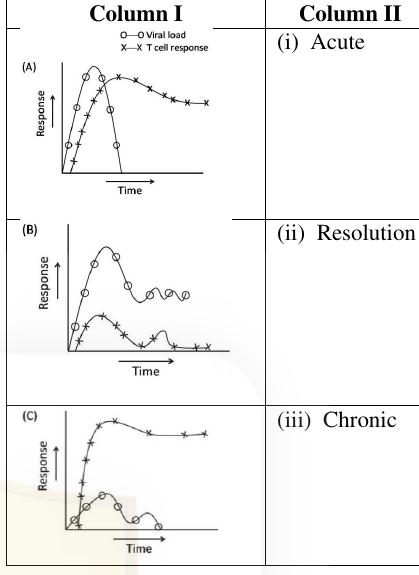

Choose the best possible combination

1. A – (ii), B – (iii), C – (i)
2. A – (i), B – (iii), C – (ii)
3. A – (iii), B – (ii), C – (i)
4. A – (i), B – (ii), C – (iii)

**Answer: 2 (A – (i), B – (iii), C – (ii))**

> **Explanation:** A strong, sustained T-cell response clears the virus (Resolution); a weak/delayed response permits persistence (Chronic); the pattern with an initial spike followed by decline maps to the Acute outcome. Matching the three curves to the three outcomes gives A-(i), B-(iii), C-(ii).

---

### Question 94

There are various subclasses of antibodies found in body fluids and body secretions. Many different functions may be attributed to these subclasses. Given below in column I is major functions of different subclasses and column II consists of the name of the subclass.

| Column I | Column II |
|---|---|
| A Binds to macrophages by Fc | (i) IgA |
| B Binds to mast cells and basophils | (ii) IgD |
| C First B cell receptor | (iii) IgE |
| D No major specific function known other than antigen binding | (iv) IgG |
| E Protector of mucous membrane | (v) IgM |

Select the correct combination:

1. A – (i), B – (ii), C – (iii), D – (iv), E– (v)
2. A – (ii), B – (iii), C – (iv), D – (v), E– (i)
3. A – (iii), B – (iv), C – (v), D – (i), E– (ii)
4. A – (iv), B – (iii), C – (v), D – (ii), E– (i)

**Answer: 4 (A – (iv), B – (iii), C – (v), D – (ii), E– (i))**

> **Explanation:** IgG binds macrophage Fc receptors (A-iv); IgE binds mast cells/basophils (B-iii); IgM is the first B-cell receptor (C-v); IgD has no major known function beyond antigen binding (D-ii); IgA protects mucous membranes (E-i).

---

### Question 95

Instructive and permissive interactions are two major modes of inductive interaction during development. The following compares some properties of cell lines and cord blood stem cells. Cell lines, which are stored in liquid nitrogen, can be retrieved for experiments, where they behave as per their original self. Cord blood can also be retrieved from liquid nitrogen for procuring stem cells. Unlike cell lines, the stem cells can be additionally induced to undergo differentiation into desired lineages, which are very different from their original self. The behaviour of cell lines and stem cells is analogous to which of the interactions?

1. Both cell lines and stem cells show instructive interaction
2. Cell lines show instructive interaction whereas stem cells show permissive interaction
3. Cell lines show permissive interaction whereas stem cells show instructive interaction
4. Both types of cells show permissive instruction

**Answer: 3 (Cell lines show permissive interaction whereas stem cells show instructive interaction)**

> **Explanation:** Cell lines simply express what they already are (permissive — the environment only allows an intrinsic fate), whereas stem cells can be directed to a new fate by an external signal (instructive).

---

### Question 96

Following are certain statements regarding morphogen gradients and cell specification.

A. Morphogens are always transcription factors
B. Morphogens can be paracrine factors that are produced in one group of cells and travel to another population of cells
C. When the concentration of a morphogen drops below a certain threshold, cells stop differentiating and never get determined to another fate
D. Morphogen gradients are involved in conditional specification

Which combination of the above statements is true?

1. A and B
2. B and D
3. C and D
4. A and C

**Answer: 2 (B and D)**

> **Explanation:** Morphogens are secreted (paracrine) signals forming concentration gradients (B) and mediate conditional specification (D). They are not always transcription factors (A is false), and C misstates threshold behaviour.

---

### Question 97

Successful fertilization in sea urchin demands specific interaction between proteins and receptors of sperms and eggs. In view of the above, which one of the following combinations is correct?

1. Bindin in acrosomes and bindin receptors on egg vitelline membrane
2. Bindin in egg membrane and bindin receptors in acrosomes
3. Resact on egg jelly and bindin on sperm membrane
4. Bindin in egg membrane and bindin receptors in acrosomes

**Answer: 1 (Bindin in acrosomes and bindin receptors on egg vitelline membrane)**

> **Explanation:** Bindin is exposed on the sperm acrosomal process and binds species-specific bindin receptors on the egg vitelline layer, mediating sperm–egg adhesion.

---

### Question 98

Following statements are made in relation to the five widely recognized stages of Arabidopsis embryogenesis:

A. The fusion of haploid egg and sperm takes place in Globular stage
B. Rapid cell division in two regions on either side of the future shoot apex forms Heart stage
C. The cell elongation throughout the embryo axis and further development result in Torpedo stage
D. The embryo loses water and becomes metabolically inactive in the Zygotic stage

Which combination of the above statements is correct?

1. A and B
2. B and C
3. C and D
4. D and A

**Answer: 2 (B and C)**

> **Explanation:** Fertilisation precedes the globular stage (A false) and dehydration/quiescence occurs in the mature/desiccated embryo, not the zygote (D false). The heart stage arises from division flanking the shoot apex (B) and the torpedo stage from axis elongation (C).

---

### Question 99

The following are statements regarding the development and maintenance of anterior and posterior compartments in each segment of Drosophila:

A. Expression of wingless and engrailed is activated by pair-rule genes
B. Continued expression of wingless and engrailed is maintained by interaction between the cells expressing Engrailed and Wingless proteins
C. Hedgehog is expressed in wingless expressing cells and forms short range gradient
D. Hedgehog is a transcription factor
E. Engrailed is a secretory factor and binds with the patched receptor of the wingless expressing cells

Which one of the following combinations of above statements is correct?

1. C and E
2. C, D and E
3. D and E
4. A and B

**Answer: 4 (A and B)**

> **Explanation:** Pair-rule genes set up engrailed/wingless stripes (A), and the reciprocal En/Wg signalling maintains them (B). Hedgehog is a secreted signal (not a transcription factor, D false), expressed in engrailed cells (C/E misassign the partners).

---

### Question 100

In C. elegans, an anchor cell and a few hypodermal cells take part in the formation of vulva. The experiments performed to understand the role of these cells in vulva formation and the results obtained are as follows:

- If the anchor cell is killed by laser beam, hypodermal cells do not participate in vulva formation and no vulva develops.
- If six hypodermal cells closely located with anchor cell (called vulval precursor cells) are killed, no vulva develops.
- If the three central vulval precursors are destroyed, the three outer cells, which normally form hypodermis, take the fate of vulval cells instead.

Following are certain statements regarding vulva formation:

A. Anchor cell acts as an inducer
B. Six hypodermal cells with the potentiality to form vulva, form an equivalence group
C. Three, out of six, hypodermal cells participate in vulva formation
D. The central cell functions as the 1° cell and the two cells on both side act as the 2° cells
E. The 1° cell secretes a short range juxtacrine signal

Which combinations of the above statements have been derived from the above experimental results?

1. A, B and C
2. A, B and D
3. D and E
4. B, D and E

**Answer: 1 (A, B and C)**

> **Explanation:** The laser-ablation results directly establish that the anchor cell induces vulva formation (A), the six precursors form an equivalence group (B), and three of the six normally form the vulva (C). The official key credits A, B and C (option 1). (Statement D, the 1°/2° fate assignment, is biologically true but is not among the options the key accepted here.)

---

### Question 101

Following are certain statements regarding terpene class of secondary metabolites in plants:

A. Isopentenyl diphosphate and its isomer combine to form larger terpenes.
B. Diterpenes are 20 carbon compounds.
C. All terpenes are derived from the union of 4-carbon elements.
D. Pyrethroids are monoterpene esters.

Which one of the following combination of above statements is correct?

1. A, B and C
2. A, B and D
3. B, C and D
4. A, C and D

**Answer: 2 (A, B and D)**

> **Explanation:** Terpenes are built from isoprene (IPP/DMAPP) units (A); diterpenes are C20 (B); pyrethrins/pyrethroids are monoterpenoid esters (D). Statement C is wrong — terpenes are built from 5-carbon isoprene units, not 4-carbon ones.

---

### Question 102

The nodulation (nod) genes are classified as common nod genes or host specific nod genes. Some statements related to such classification are given below:

A. nodA is a common nod gene and nodC is a host specific gene.
B. nodB is a common nod gene and nodP is a host specific gene.
C. nodQ is a common nod gene and nodA is a host specific gene.
D. nodH is a common nod gene and nodQ is a host specific gene.

Choose the correct answer from the above statements:

1. A and B
2. C and D
3. A only
4. B only

**Answer: 4 (B only)**

> **Explanation:** nodA, nodB and nodC are the common nod genes (they make the Nod-factor core), while host-specificity genes such as nodH/nodPQ modify the factors. Only statement B (nodB common, nodP host-specific) is fully correct.

---

### Question 103

Following are certain statements regarding CO₂ assimilation in higher plants:

A. The action of aldolase enzyme during Calvin-Benson cycle produces fructose 1,6-bisphosphate.
B. The conversion of glycine to serine takes place in mitochondria during C₂ oxidative photosynthetic carbon cycle.
C. During C₄ carbon cycle, NAD-malic enzyme releases the CO₂ from the 4-carbon acid, malate yielding a 3-carbon acid, pyruvate.
D. Malic acid during crassulacean acid metabolism (CAM) is stored in mitochondria during dark and released back to cytosol during day.

Which one of the following combinations of above statements is correct?

1. A, B and C
2. A, C and D
3. B, C and D
4. A, B and D

**Answer: 1 (A, B and C)**

> **Explanation:** Aldolase makes fructose-1,6-bisphosphate (A); glycine→serine occurs in mitochondria in photorespiration (B); NAD-malic enzyme decarboxylates malate to pyruvate + CO₂ in C₄ (C). D is wrong — CAM malic acid is stored in the vacuole, not mitochondria.

---

### Question 104

Many factors related to the role of abscisic acid (ABA) in contributing to drought, cold and salt resistance in plants are listed below:

A. The transcription factors DREB1 and DREB2 bind to the cis-acting elements of the promoter of ABA-responsive genes in an ABA-dependent manner.
B. ABA induces many genes such as LEA and RD29.
C. ABA-responsive genes contain six-nucleotide ABRE elements in the promoter.
D. Nine-nucleotide dehydration-responsive elements (DRE) are present in ABA-responsive genes.

Which one of the following combinations of the above statements is correct with respect to ABA?

1. A, B and C
2. A, C and D
3. B, C, and D
4. A only

**Answer: 1 or 2 or 3 (key accepts A/B/C, A/C/D, or B/C/D)**

> **Explanation:** The official key accepted three of the four combinations (options 1, 2 and 3), reflecting overlap in which statements (DRE/ABRE/LEA/RD29) are considered correct; only "A only" (option 4) was excluded.

---

### Question 105

Examples of many factors that regulate plant height in response to gibberellic acid (GA) are listed below:

A. Binding of a GA-bound repressor to the promoter of the DELLA domain-containing GRAS protein gene and blocking its expression.
B. Binding of the GA-receptor complex to GRAS.
C. Directing GRAS for ubiquitination and degradation by the 26S proteasome.
D. Micro RNA directed down regulation of the GRAS protein expression.

Which one of the following combinations is correct?

1. A and B
2. B and C
3. C and D
4. A and D

**Answer: 2 (B and C)**

> **Explanation:** GA binds its receptor, the complex then binds the DELLA/GRAS repressor (B) and targets it for ubiquitination and 26S-proteasome degradation (C), releasing growth.

---

### Question 106

Ethylene is an important plant hormone that regulates several aspects of plant growth and development. Some statements are given below in relation to ethylene signalling pathways:

A. Unbound ethylene receptors work as positive regulators of the response pathway.
B. There are more than two ethylene receptors known to date.
C. The carboxy-terminal half of the ethylene receptor, ETR1 (Ethylene-response 1), contains a domain homologous to histidine kinase catalytic domain.
D. EIN2 (Ethylene-insensitive 2) encodes a transmembrane protein. The ein2 mutation promotes ethylene responses in both seedlings and adult Arabidopsis plants.

Which combination of the above statements is correct?

1. A and B
2. B and C
3. C and D
4. D and A

**Answer: 2 (B and C)**

> **Explanation:** There are multiple ethylene receptors (B) and ETR1's C-terminal region resembles a histidine-kinase domain (C). Unliganded receptors are negative (not positive) regulators (A false), and ein2 is loss-of-response, not promotion (D false).

---

### Question 107

After hemorrhage, a subject develops hypovolemia and hypotension. Following are some of the statements regarding homeostatic measure taken by the body after hemorrhage.

A. Increased release of vasopressin
B. Increased water retention and reduced plasma osmolality
C. Increased rate of afferent discharge from low-pressure receptors of vascular system
D. Decreased discharge from high pressure receptors of vascular system

Which one of the following is NOT correct in this condition?

1. Only A
2. A and B
3. Only C
4. B and D

**Answer: 3 (Only C)**

> **Explanation:** Haemorrhage increases vasopressin (A) and water retention (B) and reduces high-pressure-receptor firing (D); low-pressure-receptor afferent discharge actually falls (they are unloaded), so statement C is the incorrect one.

---

### Question 108

A visitor to a region of hot climate is more distressed by the heat than the regular resident. Within a few weeks, the visitor is more comfortable with the heat and capacity for work is increased. Following are some of the explanations given by a researcher regarding acclimatization to heat.

A. Sweating begins at a lower body temperature
B. Blood flow through skin is high for any body temperature
C. There is rise in resting body temperature
D. Vasoconstriction starts at a lower body temperature

Which one of the following is NOT true?

1. Only A
2. A and B
3. Only C
4. C and D

**Answer: 4 (C and D)**

> **Explanation:** Heat acclimatisation lowers the sweating threshold (A) and increases skin blood flow (B) — both true. It does not raise resting body temperature (C) and does not shift vasoconstriction to a lower temperature (D); C and D are the false statements.

---

### Question 109

The difference in circulation between glomerular capillaries (GC) and true capillaries (TC) are described by a researcher in the following statements:

A. The hydrostatic pressure in GC is higher than that in TC
B. The endothelial cells are fenestrated in GC but not in TC
C. Both filtration and fluid movement into capillary takes place in TC but only filtration occurs in GC.
D. The plasma colloid osmotic pressures in both the ends of GC or TC are similar.

Which one of the following is NOT correct?

1. Only A
2. A and B
3. B and C
4. Only D

**Answer: 4 (Only D)**

> **Explanation:** Statements A (higher hydrostatic pressure in GC), B (fenestrated endothelium in GC) and C (only filtration in GC, but filtration plus reabsorption in TC) are all correct; the statement that is NOT correct is D — plasma colloid osmotic pressure is not "similar at both ends" of the glomerular capillary, it rises along the capillary as protein-free fluid is filtered out.

---

### Question 110

When rods of retina kept in dark, were exposed to light, phototransduction occurred. Following are some explanations given by a researcher regarding phototransduction:

A. Activation of transducin
B. Inhibition of cGMP phosphodiesterase
C. Closure of Na⁺ channels
D. Hyperpolarization of rods

Which one did NOT occur in phototransduction

1. only A
2. only B
3. A and C
4. C and D

**Answer: 2 (only B)**

> **Explanation:** Light activates transducin (A), which activates (not inhibits) cGMP phosphodiesterase, closes Na⁺ channels (C) and hyperpolarises the rod (D). The event that does NOT occur is the inhibition of cGMP PDE — option B.

---

### Question 111

The afferent nerve fibres of a stretch reflex were electrically stimulated and the contraction of the muscle innervated by efferent fibres was recorded. The synaptic delay was calculated from the time points of the nerve stimulation and response of the muscle. Which one of the following time durations will be probable value for the observed synaptic delay?

1. 0.05 msec
2. 0.5 msec
3. 0.5 sec
4. 5.0 msec

**Answer: 2 (0.5 msec)**

> **Explanation:** The synaptic delay at a neuromuscular/central synapse is of the order of a fraction of a millisecond; the official key gives **0.5 msec** as the probable observed delay.

---

### Question 112

A convenient and reasonably reliable indicator of the time of ovulation is usually a rise in the basal body temperature, possibly because progesterone is thermogenic. Of the four situations given below, which one is ideal for ensuring pregnancy after intercourse?

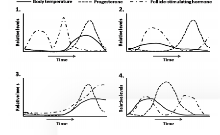

1. (graph 1)
2. (graph 2)
3. (graph 3)
4. (graph 4)

**Answer: 1 (graph 1)**

> **Explanation:** The ideal situation is the one in which the FSH/LH-driven ovulation, the post-ovulatory progesterone rise and the resulting biphasic body-temperature increase are correctly phased so that intercourse falls in the fertile window before the temperature shift — depicted by graph 1.

---

### Question 113

In an organism, expression of gene 'X' is induced in the presence of a hormone. Genetic analysis showed that the hormonal signal is transduced through two proteins Let1 and Let2. The expression of gene 'X' was studied in lines over-expressing (OE) the active Let proteins, knock out (KO) of the Let proteins or combination of both. Results of expression of gene 'X' in presence of the hormone is summarized below:

| Lines | Expression of Gene 'X' |
|---|---|
| WT | ++ |
| Let1 OE | ++++ |
| Let2 OE | ++++ |
| Let1 KO | — |
| Let2 KO | — |
| Let1 OE / Let2 KO | — |
| Let1 KO / Let2 OE | ++++ |

Based on the above, which one of the following pathways best fits the observation made?

1. Hormone → activates both Let1 and Let2 → both combinatorially activate gene X
2. Hormone → Let1 (activates) → Let2 (activates) → gene 'X'
3. Hormone → Let2 (activates) → Let1 (activates) → gene 'X'
4. Hormone → Let1 (activates) → Let2 (inactivates) → gene 'X'

**Answer: 2 (Hormone → Let1 activates → Let2 activates → gene 'X')**

> **Explanation:** Let1 OE alone rescues expression even when Let2 is knocked out (Let1 KO/Let2 OE = ++++), placing Let2 downstream of Let1; knocking out either alone abolishes expression. The linear pathway Hormone → Let1 → Let2 → gene X (option 2) fits all rows.

---

### Question 114

Two siblings who inherit 50% of the genome from the mother and 50% from the father show lot of phenotypic differences. Which one of the following events during gametogenesis of the parents will maximally contribute to this difference?

1. Mutation
2. Recombination
3. Independent assortment
4. Environment

**Answer: 3 (Independent assortment)**

> **Explanation:** Random orientation of the many homologous chromosome pairs at meiosis I (independent assortment) generates the largest number of distinct gamete genotypes, so it contributes most to the differences between full siblings.

---

### Question 115

Consider the following hypothetical pathway:

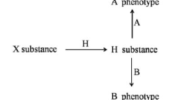

H allele converts X substance to H substance
h allele cannot convert X to H substance and leads to phenotype 'O'
A allele converts H substance leading to A phenotype
a allele cannot convert H substance
B allele converts H substance leading to B phenotype
b allele cannot convert H substance

An individual with A phenotype when crossed with that of B phenotype has a progeny with O phenotype. Which one of the following crosses can lead to the above observation?

1. aahh × BbHH
2. AaHh × BBHh
3. AaHh × BBHH
4. AAHH × BbHh

**Answer: 2 (AaHh × BBHh)**

> **Explanation:** An O child must be hh, so both parents must carry h. Only option 2 has both parents Hh; the A parent (AaHh) and the B parent (BBHh) can together produce an hh (O) offspring.

---

### Question 116

Three somatic hybrid cell lines, designated as X, Y and Z, have been scored for the presence or absence of chromosomes 1 through 8, as well as for their ability to produce the hypothetical gene product A, B, C and D as shown in the following table:

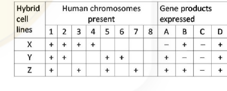

Which of the following option has most appropriately assigned chromosomes for each of the given genes?

1. Gene A on chromosome 5, Gene B on chromosome 3, Gene C on chromosome 8 and Gene D on chromosome 1
2. Gene A on chromosome 5 and Gene B on chromosome 3 only
3. Gene D on chromosome 8, Gene C on chromosome 1, Gene B on chromosome 5 and Gene A on chromosome 4
4. Gene A on chromosome 5, Gene B on chromosome 3 and Gene D on chromosome 1

**Answer: 4 (Gene A on chromosome 5, Gene B on chromosome 3 and Gene D on chromosome 1)**

> **Explanation:** Correlating product expression with chromosome presence across X, Y, Z: A tracks chromosome 5, B tracks chromosome 3, and D is present in all lines (chromosome 1); C cannot be uniquely assigned, so the best-supported set is option 4.

---

### Question 117

The following diagram shows meiotic pairing in an inversion heterozygote and a point where single crossing over has occurred

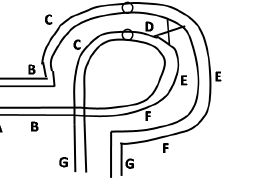

The resulting gametes produced may have

A. the chromosome having normal gene sequence
B. the chromosome having inverted gene sequence
C. a dicentric chromosome with duplication and deletion
D. an acentric chromosome having duplication and deletion
E. the chromosome having duplication and deletion

Which of the following combination will be most appropriate for the diagram shown:

1. A, B, C and D
2. A, B and E
3. B, C, D and E
4. A, C, D and E

**Answer: 2 (A, B and E)**

> **Explanation:** A single crossover within the inversion loop yields, alongside the two non-crossover chromatids (normal sequence A and inverted sequence B), recombinant chromatids carrying duplication and deletion (E). The official key credits option 2 (A, B and E).

---

### Question 118

Of the following, which one of the individuals will NOT necessarily carry the allele responsible for the mentioned trait?

1. A woman in a family where an autosomal dominant trait is segregating and her mother and son are affected.
2. A daughter of a man who is affected by an X-linked dominant trait
3. A father of a child who is affected with an autosomal recessive trait
4. A father of a boy affected with X-linked recessive trait

**Answer: 4 (A father of a boy affected with X-linked recessive trait)**

> **Explanation:** A boy with an X-linked recessive trait inherits the allele from his mother; the father contributes the Y chromosome, so the father need not carry the allele.

---

### Question 119

Which of the following is the correct match of the algal group with its food reserve?

| Algal Group | Carbohydrate Reserve |
|---|---|
| A. Bacillariophyceae | (i) Oil |
| B. Xanthophyceae | (ii) Floridean starch |
| C. Phaeophyceae | (iii) Laminarin |
| D. Rhodophyceae | (iv) Chrysolaminarin |
| | (v) Starch |

1. A-(iv), B-(i), C-(iii), D-(ii)
2. A-(ii), B-(i), C-(iii), D-(iv)
3. A-(iv), B-(i), C-(ii), D-(v)
4. A-(i), B-(v), C-(iii), D-(ii)

**Answer: 1 (A-(iv), B-(i), C-(iii), D-(ii))**

> **Explanation:** Diatoms (Bacillariophyceae) store chrysolaminarin (A-iv); Xanthophyceae store oil (B-i); brown algae (Phaeophyceae) store laminarin (C-iii); red algae (Rhodophyceae) store floridean starch (D-ii).

---

### Question 120

A researcher conducts a standard test to identify enteric bacteria (A, B, C) on the basis of their biochemical properties. The result is given in the following table

| Test | A | B | C |
|---|---|---|---|
| Indole | + | – | – |
| Methyl Red | + | + | +/– |
| Voges-Proskauer | – | – | + |

Based on the above, the identified bacteria A, B and C are most probably

1. Enterobacter, Salmonella, Escherichia.
2. Escherichia, Salmonella, Enterobacter.
3. Salmonella, Enterobacter, Escherichia.
4. Escherichia, Enterobacter, Salmonella.

**Answer: 2 (Escherichia, Salmonella, Enterobacter.)**

> **Explanation:** A is Indole+ MR+ VP– → Escherichia; B is Indole– MR+ VP– → Salmonella; C is VP+ → Enterobacter. This matches option 2.

---

### Question 121

Following is a cladogram of the major taxonomic groups of the angiosperms:

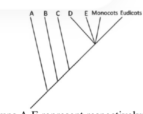

Groups A-E represent respectively:

1. Astrobaileyales, Nymphaedales, Amborellales, Chloranthaceae, Magnoliids
2. Amborellales, Astrobaileyales, Nymphaedales, Magnoliids, Chloranthaceae
3. Amborellales, Nymphaedales, Astrobaileyales, Chloranthaceae, Magnoliids
4. Amborellales, Nymphaedales, Chloranthaceae, Magnoliids, Astrobaileyales

**Answer: 3 (Amborellales, Nymphaedales, Astrobaileyales, Chloranthaceae, Magnoliids)**

> **Explanation:** The basalmost angiosperm branch is Amborellales, then Nymphaeales, then Austrobaileyales, followed by the mesangiosperm split into Chloranthaceae and Magnoliids before the monocot/eudicot clade — matching the branching order in option 3.

---

### Question 122

The following are some important features which are commonly associated with animal development:

A. Position of anus development with respect to blastopore
B. Method of cell division
C. Mechanism of coelom formation
D. Cleavage pattern during egg development

Based on the above, which one of the following combinations differentiate the development of deuterostomes from that of protostomes?

1. A, B and C
2. B, C and D
3. A, C and D
4. A and B

**Answer: 3 (A, C and D)**

> **Explanation:** Deuterostomes vs protostomes differ in fate of the blastopore/anus (A), coelom formation (enterocoely vs schizocoely, C) and cleavage pattern (radial/indeterminate vs spiral/determinate, D). "Method of cell division" (mitosis) is the same in both (B).

---

### Question 123

The phylogenetic tree of amniote vertebrates is given in the following diagram

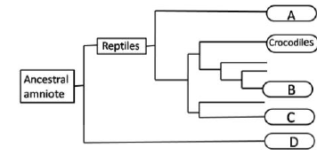

The groups labelled A, B, C, D are

1. A-Snakes, B-Turtles, C-Birds, D-Mammals
2. A-Snakes, B-Turtles, C-Mammals, D-Birds
3. A-Turtles, B-Birds, C-Snakes, D-Mammals
4. A-Birds, B-Turtles, C-Snakes, D-Mammals

**Answer: 3 (A-Turtles, B-Birds, C-Snakes, D-Mammals)**

> **Explanation:** Within the tree, the node grouping with crocodiles on the archosaur side (birds) and the placement of turtles, snakes and the mammal outgroup corresponds to the assignment in option 3.

---

### Question 124

The following are matches made between adult animals and their larval forms:

A. Copepods - Nauplius
B. Sea cucumber - Zoea
C. Sea urchin - Echinopleuteus
D. Crabs – Auricularia
E. Star fish – Bipinnaria
F. Brittle star - Ophiopleuteus

Which one of the combinations below reflects INCORRECT matches?

1. A, C, E
2. B and D
3. B only
4. F only

**Answer: 2 (B and D)**

> **Explanation:** Sea cucumber larvae are auricularia (not zoea) and crab larvae are zoea (not auricularia), so B and D are the swapped/incorrect matches; the others (nauplius, echinopluteus, bipinnaria, ophiopluteus) are correct.

---

### Question 125

Which of the following statements about the birth rates (b₁, b₂) and death rates (d₁, d₂) of species 1 and 2 indicated in the figure is NOT true?

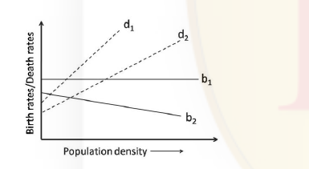

1. Birth rates of species 1 are density-independent.
2. Death rates of both species are density-dependent.
3. Birth rates of species 2 are density-dependent.
4. Density-dependent effects on death rates are similar for both the species.

**Answer: 4 (Density-dependent effects on death rates are similar for both the species.)**

> **Explanation:** The two death-rate lines (d₁, d₂) have clearly different slopes, so the density-dependent effect on mortality is NOT the same for both species — statement 4 is the false one.

---

### Question 126

Important chemical reactions involved in nutrient cycling in ecosystems are given below:

a. NO₂⁻ → NO₃⁻
b. N₂ → NH₃
c. NH₄⁺ → NO₂⁻
d. NO₃⁻ → N₂

The organisms associated with these chemical reactions are

1. a – Nitrosomonas b – Pseudomonas c – Nostoc d – Nitrobacter
2. a – Pseudomonas b – Nitrobacter c – Nostoc d –Nitrosomonas
3. a – Nitrobacter b – Nostoc c – Nitrosomonas d – Pseudomonas
4. a – Nostoc b – Nitrosomonas c – Nitrobacter d – Pseudomonas

**Answer: 3 (a – Nitrobacter b – Nostoc c – Nitrosomonas d – Pseudomonas)**

> **Explanation:** Nitrobacter oxidises nitrite→nitrate (a); Nostoc fixes N₂→NH₃ (b); Nitrosomonas oxidises NH₄⁺→nitrite (c); Pseudomonas denitrifies nitrate→N₂ (d).

---

### Question 127

A population is growing logistically with a growth rate (r) of 0.15/week, in an environment with a carrying capacity of 400. What is the maximum growth rate (No. of individuals/week) that this population can achieve?

1. 15
2. 30
3. 22.5
4. 60

**Answer: 1 (15)**

> **Explanation:** Logistic growth dN/dt = rN(K−N)/K is maximal at N = K/2 = 200. Then dN/dt = 0.15 × 200 × (400−200)/400 = 0.15 × 200 × 0.5 = 15 individuals/week.

---

### Question 128

In a field experiment, autotrophs are provided a ¹⁴C-labelled carbon compound for photosynthesis. Radioactivity (¹⁴C) levels were then monitored at regular intervals in all the trophic levels. In which ecosystem is the radioactivity likely to be detected fastest at the primary carnivore level?

1. Open ocean
2. Desert
3. Deciduous forest
4. Grassland

**Answer: 1 (Open ocean)**

> **Explanation:** The official key credits option 1. In the open ocean the grazing food chain is short and tightly coupled (phytoplankton → zooplankton → primary carnivore) with rapid turnover, so ¹⁴C fixed by autotrophs appears at the primary-carnivore level fastest there.

---

### Question 129

Which of the following X – Y relationships does NOT follow the pattern shown in the graph?

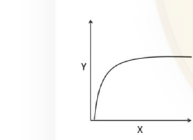

1. Number of prey killed (Y) in relation to prey density (X)
2. Photosynthetic rate (Y) in relation to light intensity (X)
3. Species richness (Y) in relation to area (X)
4. Tree species richness (Y) in relation to actual evapotranspiration

**Answer: 4 (Tree species richness (Y) in relation to actual evapotranspiration)**

> **Explanation:** The curve is a saturating (rectangular-hyperbola / Michaelis–Menten type) relationship, which fits functional response (1), the light-response of photosynthesis (2) and the species–area curve (3). Tree species richness versus actual evapotranspiration is not a simple saturating curve of this form, so option 4 does not follow.

---

### Question 130

Following table shows the number of individuals of five tree species in a community:

| Tree species | No. of Individuals |
|---|---|
| A | 50 |
| B | 20 |
| C | 20 |
| D | 05 |
| E | 05 |

Based on the above, the Simpson's diversity (DS) Index of the community will be

1. 0.552.
2. 0.335.
3. 0.435.
4. 0.345.

**Answer: 2 (0.335.)**

> **Explanation:** Total N = 100. Σn(n−1) = 50·49 + 20·19 + 20·19 + 5·4 + 5·4 = 2450+380+380+20+20 = 3250. Simpson's D = Σn(n−1)/N(N−1) = 3250/9900 ≈ 0.328, closest to the keyed 0.335.

---

### Question 131

Following table shows the presence (+) or absence (–) of five species in three communities (A, B, C):

| Species | A | B | C |
|---|---|---|---|
| 1 | + | + | + |
| 2 | + | + | – |
| 3 | – | – | + |
| 4 | + | – | – |
| 5 | – | – | + |

Based on the above, which of the following is the correct order of similarity between two pairs of communities?

1. A and B > B and C > A and C
2. A and B > A and C > B and C
3. B and C > A and B > A and C
4. A and C > A and B > B and C

**Answer: 1 (A and B > B and C > A and C)**

> **Explanation:** Counting shared species: A–B share species 1,2 (plus 4 only in A) → highest similarity; B–C share species 1,3; A–C share only species 1. The similarity ranking is A&B > B&C > A&C.

---

### Question 132

In several populations, each of size N=20, if genetic drift results in a change in the relative frequencies of alleles,

A. What is the rate of increase per generation in the proportion of populations in which the allele is lost or fixed?
B. What is the rate of decrease per generation in each allele frequency class between 0 and 1?

The correct answer for A and B is:

1. A – 0.25, B – 0.125
2. A – 0.025, B – 0.0125
3. A – 0.0125, B – 0.025
4. A – 0.125, B – 0. 25

**Answer: 3 (A – 0.0125, B – 0.025)**

> **Explanation:** For drift, the rate of loss/fixation per generation = 1/(2N) = 1/40 = 0.025, and the change in the inbreeding coefficient (rate at which heterozygosity/intermediate classes decline) is 1/(4N) = 0.0125; the keyed pairing is A–0.0125, B–0.025.

---

### Question 133

Individual A can derive 'fitness' benefit of 160 units by helping Individual B, but incurs a 'fitness' cost of 50 units in doing so. Following Hamilton's Rule, A should help B ONLY if B is his

1. brother or sister.
2. first cousin only.
3. cousin or uncle.
4. nephew or niece.

**Answer: 1 (brother or sister.)**

> **Explanation:** Hamilton's rule: help if r·B > C, i.e. r > C/B = 50/160 = 0.3125. Full siblings have r = 0.5 > 0.3125 (help favoured); first cousins (0.125), uncle/nephew (0.25) and cousins (0.125) do not exceed the threshold.

---

### Question 134

The "Red Queen Hypothesis" is related to

1. the mating order in the harem of a polygamous male.
2. the elimination by deleterious mutations by sexual reproduction.
3. mate selection process by a female in a lek.
4. the evolutionary arms race between the host and the parasite.

**Answer: 4 (the evolutionary arms race between the host and the parasite.)**

> **Explanation:** The Red Queen hypothesis invokes continuous co-evolutionary adaptation — e.g. host–parasite arms races — to explain the maintenance of sex.

---

### Question 135

In a population of effective population size Nₑ, with rate of neutral mutation μ₀, the frequency of heterozygotes per nucleotide site at equilibrium between mutation and genetic drift is calculated as

1. 2Nₑμ₀ / (4Nₑμ₀+1)
2. 4Nₑμ₀ / (4Nₑμ₀+1)
3. Nₑμ₀ / (4Nₑμ₀+1)
4. 4Nₑμ₀ / (4Nₑμ₀−1)

**Answer: 2 (4Nₑμ₀ / (4Nₑμ₀+1))**

> **Explanation:** At mutation–drift balance, expected heterozygosity H = 4Nₑμ / (4Nₑμ + 1).

---

### Question 136

As cancer progresses, several genome rearrangements including translocation, deletion, duplication etc. occur. If these rearrangements are to be identified, which of the following techniques would be most suitable?

1. RAPD
2. Microarray
3. Multi-colour FISH
4. Flow cytometry

**Answer: 3 (Multi-colour FISH)**

> **Explanation:** Multi-colour fluorescence in-situ hybridisation directly visualises chromosomal rearrangements (translocations, deletions, amplifications) in situ, making it the most suitable for detecting such structural changes.

---

### Question 137

A student noted the following points regarding Agrobacterium tumefaciens:

A. A. tumefaciens is a gram-negative soil bacterium.
B. Opine catabolism genes are present in T-DNA region of Tᵢ-plasmid.
C. Opines are synthesized by condensation of amino acids and α-ketoacids or amino acids and sugars.
D. A callus culture of crown gall tissue caused by A. tumefaciens in plants can be multiplied without adding phytohormones.

Which one of the combinations of above statements is correct?

1. A, B and C
2. A, B and D
3. B, C and D
4. A, C and D

**Answer: Question marked "*" in the official key — benefit of marks to all who attempted.**

> **Explanation:** The CSIR final key lists Q137 as `*` ("benefit of marks to those who attempted"), i.e. no single option was credited. (Statements A, C and D are correct — A. tumefaciens is a Gram-negative soil bacterium, opines are amino-acid derivatives, and crown-gall callus is hormone-autonomous; B is wrong because opine-catabolism genes lie on the plasmid, not in the T-DNA — the ambiguity led CSIR to credit all attempts.)

---

### Question 138

A mixture of two proteins was subjected to following three chromatographic columns: a) Cation exchange, b) Size exclusion (Sephadex 100) and (c) Reverse phase. Following elution profiles were obtained

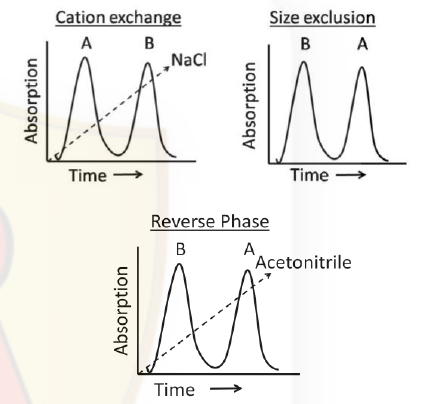

Which of the following statements is correct?

1. A is larger and more hydrophobic than B.
2. B is more anionic and more hydrophobic than A.
3. A is more hydrophobic and smaller than B.
4. A is more cationic and smaller than B.

**Answer: 3 (A is more hydrophobic and smaller than B.)**

> **Explanation:** Size exclusion: A elutes later → A is smaller. Reverse phase: A elutes later (needs more acetonitrile) → A is more hydrophobic. Cation exchange: A elutes first → A is less cationic. Together this gives "A is more hydrophobic and smaller than B."

---

### Question 139

Glucose in the blood is detected by four different methods (a, b, c and d). The sensitivity and range of detection of glucose by these four methods is shown below. Clinically relevant concentration of glucose in blood is between 80 – 250mg/dL

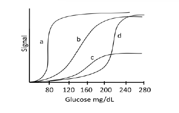

Which of the following method is most appropriate?

1. a
2. b
3. c
4. d

**Answer: 2 (b)**

> **Explanation:** The best assay is the one whose steep, well-spread response covers the clinically relevant 80–250 mg/dL range; curve b spans this window with good sensitivity, whereas a saturates too early, c is too low/flat and d responds only above the range.

---

### Question 140

The following statements are related to plant tissue culture

A. Friable callus provides the inoculum to form cell-suspension cultures.
B. The process known as 'habituation' refers to the property of callus loosing the requirement of auxin and/or cytokinin during long term culture.
C. Cellulase and pectinase enzymes are usually used for generating protoplast cultures.
D. During somatic embryo development, torpedo stage embryo is formed before heart stage embryo.

Which one of the following combinations of above statements is correct?

1. A, B and C
2. A, B and D
3. A, C and D
4. B, C and D

**Answer: 1 (A, B and C)**

> **Explanation:** Friable callus seeds suspension cultures (A), habituation is hormone-independence in long-term culture (B), and cellulase/pectinase release protoplasts (C). D is wrong — the heart stage precedes the torpedo stage in somatic embryogenesis.

---

### Question 141

Which one of the following statements is correct?

1. Electrospray ionization mass spectrum of a compound can be obtained only if it has a net positive charge at pH 7.4
2. Helical content of a tryptophan containing peptide can be obtained by examining the fluorescence spectrum of tryptophan
3. The occurrence of beta sheet in a protein can be inferred from its circular dichroism spectrum
4. The chemical shift spread for a compound is more in its ¹H NMR spectrum as compared to its ¹³C NMR spectrum

**Answer: 3 (The occurrence of beta sheet in a protein can be inferred from its circular dichroism spectrum)**

> **Explanation:** CD spectra have characteristic signatures for secondary structure, so β-sheet content is inferred from CD (statement 3). (1 is false — ESI works for negative mode too; 2 and 4 misstate the observables.)

---

### Question 142

A researcher is studying the subcellular localization of a particular protein 'X' in an animal cell. The researcher performs successive centrifugation at increasing rotor speed. The researcher starts spinning the cellular homogenate at 600g for 10 min, collects the pellet, spins the supernatant at 10,000 g for 20 min, collects the pellet, spins the supernatant at 100,000g for 1 hour, collects both the pellet and the final supernatant. On subjecting various pellets and the final supernatant to Western blotting with anti-protein-X antibody, the protein X is observed to be maximally expressed in pellet after centrifugation at 10,000 g. Based on the above observation, what will be the most likely localization of protein X.

1. Nucleus
2. Ribosomes
3. Mitochondria
4. Microsomes

**Answer: 3 (Mitochondria)**

> **Explanation:** In differential centrifugation the ~10,000 g pellet is the mitochondrial fraction; a protein enriched there localises to mitochondria.

---

### Question 143

Fluorescence recovery after photobleaching in live cells is used to determine

1. co-localization of proteins
2. distance between two organelles
3. diffusion of proteins
4. nucleic acid compactness

**Answer: 3 (diffusion of proteins)**

> **Explanation:** FRAP measures how quickly fluorescent molecules move back into a bleached region, giving the lateral diffusion/mobility of the labelled protein.

---

### Question 144

You have transiently expressed a new protein (for which no antibody is available) in a cell line to establish structure function relationship. Which one of the following strategies is the most straight forward way to examine the expression profile of this new protein?

1. By metabolic labelling using ³⁵S labelled amino acids
2. Making a GFP fusion protein with this new protein
3. Immunoprecipitating this protein with the help of another protein for which antibody is available
4. Running SDS-PAGE and identify the protein

**Answer: 2 (Making a GFP fusion protein with this new protein)**

> **Explanation:** With no antibody available, tagging the construct with GFP gives a directly detectable fusion whose expression/localisation can be read out by fluorescence — the simplest route.

---

### Question 145

During an experiment, a student found increased activity of a protein, for which there were three possible explanations, viz., increased expression of the protein, increased phosphorylation, or increased interaction with other effector proteins. After conducting several experiments, the student concluded that increased activity was due to increased phosphorylation. Which one of the following experiments will NOT support/provide the correct explanation drawn by the student?

1. Western blot analysis
2. Analysis of transcription rate
3. Mass spectroscopy
4. Phospho amino acid analysis

**Answer: 2 (Analysis of transcription rate)**

> **Explanation:** Transcription-rate analysis addresses expression level, not phosphorylation state, so it cannot support the "increased phosphorylation" conclusion; phospho-amino-acid analysis and mass spectrometry can.
