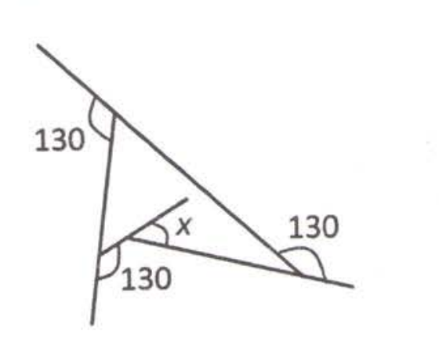
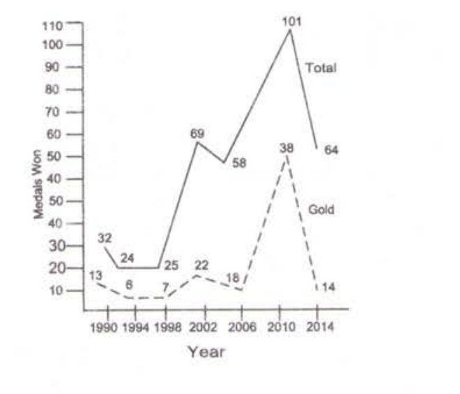
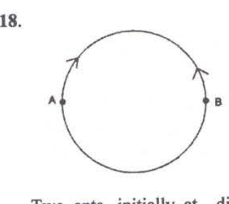
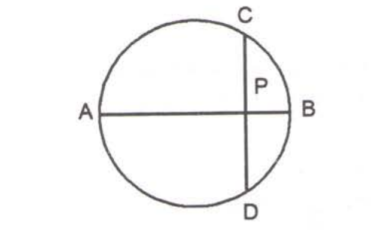

# CSIR NET Life Science — June 2015 — Part A (General Aptitude)

**Booklet C. Q1–20, 2 marks each (attempt 15 → 30 marks).**

> **PASS 2 — VERBATIM.** Wording transcribed by reading the column tiles `p03c1 … p07c2` of the S1 scan with vision (English text only; Hindi ignored). Printed question numbers read directly from the scan. **Answers = official CSIR HRDG FINAL answer key, Booklet C** (`key_june2015.txt`, lines 103+). No Part A question is dropped (`*`) or dual-keyed.

---

### Question 1

A pyramid shaped toy is made by tightly placing cubic blocks of 1 × 1 × 1 cm³. The base of the toy is a square 4 × 4 cm². The width of each step is 0.5 cm. How many blocks are required to make the toy?

1. 30
2. 34
3. 36
4. 40

**Answer: 1 (30)**

> **Explanation:** The stepped pyramid is built from square layers of 1×1×1 blocks whose side shrinks by the 0.5 cm step on each side going up: 4×4, then 3×3, 2×2, 1×1 layers give 16 + 9 + 4 + 1 = 30 blocks. **Key C Q1 → 1.**

---

### Question 2

Of three persons A, B and C, one always lies while the others always speak the truth. C asked A, "Do you always speak the truth, yes or no?" He said something that C could not hear. So, C asked B, "what did A say?" B replied, "A said No". So, who is the liar?

1. A
2. B
3. C
4. cannot be determined

**Answer: 2 (B)**

> **Explanation:** Both a truth-teller and the liar would answer "Yes" to "Do you always speak the truth?" (the liar falsely claims to). So A must have said "Yes". B's report that "A said No" is therefore false, making **B the liar**. **Key C Q2 → 2.**

---

### Question 3

Two plane mirrors facing each other are kept at 60° to each other. A point is located on the angle bisector. The number of images of the point is

1. 6
2. 3
3. 5
4. Infinite

**Answer: 3 (5)**

> **Explanation:** For two mirrors at angle θ, the number of images is (360°/θ) − 1 when 360°/θ is even. Here 360°/60° = 6 (even), so images = 6 − 1 = **5**. **Key C Q3 → 3.**

---

### Question 4

What is angle *x* in the schematic diagram given below?

1. 60
2. 50
3. 40
4. 30

**Answer: 4 (30)**

> **Explanation:** Each 130° marked angle is an exterior angle, so the corresponding interior angles are 180° − 130° = 50°. Using the triangle/vertex angle relations in the figure, the interior angle *x* works out to **30°**. **Key C Q4 → 4.**

---

### Question 5

Consider 3 parallel strips of 10 m width running around the Earth, parallel to the equator; A₁ at the Equator, A₂ at the Tropic of Cancer and A₃ at the Arctic Circle. The order of the areas of the strips is

1. A₁ < A₂ < A₃
2. A₁ = A₂ > A₃
3. A₁ > A₂ = A₃
4. A₁ > A₂ > A₃

**Answer: 4 (A₁ > A₂ > A₃)**

> **Explanation:** Each strip's area ≈ (circumference at that latitude) × (10 m width). Latitude circumference is greatest at the Equator and decreases toward the poles (∝ cos latitude), so A₁ > A₂ > A₃. **Key C Q5 → 4.**

---

### Question 6

A 3 m long car goes past a 4 m long truck at rest on the road. The speed of the car is 7 m/s. The time taken to go past is

1. 4/7 s
2. 1 s
3. 7/4 s
4. 10/7 s

**Answer: 2 (1 s)**

> **Explanation:** To pass the stationary truck the car must cover its own length plus the truck's length relative to the truck: 3 + 4 = 7 m at 7 m/s → 7/7 = **1 s**. **Key C Q6 → 2.**

---

### Question 7

Let m and n be two positive integers such that m + n + mn = 118. Then the value of m + n is

1. not uniquely determined
2. 18
3. 20
4. 22

**Answer: 4 (22)**

> **Explanation:** m + n + mn = 118 ⇒ (m + 1)(n + 1) = 119 = 7 × 17. Hence {m + 1, n + 1} = {7, 17} ⇒ {m, n} = {6, 16} ⇒ m + n = **22**. **Key C Q7 → 4.**

---

### Question 8

I bought a shirt at 10% discount and sold it to a friend at a loss of 10%. If the friend paid me Rs. 729.00 for the shirt, what was the undiscounted price of the shirt?

1. Rs. 900
2. Rs. 800
3. Rs. 1000
4. Rs. 911.25

**Answer: 1 (Rs. 900)**

> **Explanation:** Let the undiscounted price be P. I paid 0.9P; selling at a 10% loss gave the friend 0.9 × 0.9P = 0.81P = 729 ⇒ P = 729 / 0.81 = **Rs. 900**. **Key C Q8 → 1.**

---

### Question 9

Suppose
(1) x = 4
(2) Then x − 4 = x² − 4² (as both sides are zero)
(3) Therefore (x − 4) = (x − 4)(x + 4)
(4) 1 = (x + 4)  [Cancelling (x − 4) from both sides]
(5) Then x = −3
Which is the wrong step?

1. 1 to 2
2. 2 to 3
3. 3 to 4
4. 4 to 5

**Answer: 3 (3 to 4)**

> **Explanation:** Passing from (3) to (4) cancels the factor (x − 4). Since x = 4, that factor equals 0, and dividing/cancelling by zero is the invalid operation that produces the false conclusion. The error is at **step 3 to 4**. **Key C Q9 → 3.**

---

### Question 10

From a group of 40 players, a cricket team of 11 players is chosen. Then, one of the eleven is chosen as the captain of the team. The total number of ways this can be done is
[binom{m}{n} below means the number of ways n objects can be chosen from m objects]

1. binom{40}{11}
2. 11 · binom{40}{11}
3. 29 · binom{40}{11}
4. binom{39}{10}

**Answer: 2 (11 · binom{40}{11})**

> **Explanation:** Choose the 11-player team in binom{40}{11} ways, then choose 1 captain from those 11 in 11 ways → **11 · binom{40}{11}**. **Key C Q10 → 2.**

---

### Question 11

Information in DNA is in the form of sequence of 4 bases namely A, T, G and C. The proportion of G is the same as that of C, and that of A is the same as that of T. Which of the following strands of DNA will potentially have maximum diversity (i.e., maximum information content per base)?

1. length 1000 bases with 10% G
2. length 2000 bases with 10% A
3. length 2000 bases with 40% T
4. length 1000 bases with 25% C

**Answer: 4 (length 1000 bases with 25% C)**

> **Explanation:** Information content per base (Shannon entropy) is maximised when the four bases occur equally often. 25% C ⇒ 25% G, and the remaining 50% splits as 25% A and 25% T — all four equal. Strand length does not affect information *per base*. **Key C Q11 → 4.**

---

### Question 12

Based on the graph, which of the following statements is NOT true?

1. Number of gold medals increased whenever total number of medals increased
2. Percentage increase in gold medals in 2010 over 2006 is more than the corresponding increase in total medals
3. Every time non-gold medals together account for more than 50% of the total medals
4. Percentage increase in gold medals in 2010 over 2006 is more than the corresponding increase in 2002 over 1998

**Answer: 4**

> **Explanation:** From the graph (Total: 32,24,25,69,58,101,64; Gold: 13,6,7,22,18,38,14 for years 1990–2014), statement 4 does not hold: the gold increase 2010 over 2006 is not greater than the gold increase 2002 over 1998, so it is the NOT-true statement. **Key C Q12 → 4.**

---

### Question 13

How many non-negative integers less than 10,000 are there such that the sum of the digits of the number is divisible by three?

1. 1112
2. 2213
3. 2223
4. 3334

**Answer: 4 (3334)**

> **Explanation:** Since 10 ≡ 1 (mod 3), a number's digit-sum is congruent to the number itself mod 3. Among 0, 1, …, 9999 the multiples of 3 are 0, 3, …, 9999 → 9999/3 + 1 = 3333 + 1 = **3334**. **Key C Q13 → 4.**

---

### Question 14

In each of the following groups of words is a hidden number, based on which you should arrange them in ascending order. Pick the right answer:

A. Tinsel event
B. Man in England
C. Good height
D. Last encounter

1. A, B, C, D
2. C, B, D, A
3. A, C, D, B
4. C, D, B, A

**Answer: 2 (C, B, D, A)**

> **Explanation:** Each phrase hides a number word: C "Good **height**" → eight (8); B "Man in England" → nine (9); D "Last encounter" → ten (10); A "Tinsel event" → eleven (11). Ascending order 8, 9, 10, 11 gives **C, B, D, A**. **Key C Q14 → 2.**

---

### Question 15

Starting from a point A you fly one mile south, then one mile east, then one mile north which brings you back to point A. Point A is NOT the north pole. Which of the following MUST be true?

1. You are in the Northern Hemisphere
2. You are in the Eastern Hemisphere
3. You are in the Western Hemisphere
4. You are in the Southern Hemisphere

**Answer: 4 (You are in the Southern Hemisphere)**

> **Explanation:** The closed south→east→north loop returning to the start, other than the North Pole solution, requires starting just north of the South Pole, where the one-mile eastward leg traces a full small circle of latitude. Hence A must lie in the **Southern Hemisphere**. **Key C Q15 → 4.**

---

### Question 16

A single celled spherical organism contains 70% water by volume. If it loses 10% of its water content, how much would its surface area change by approximately?

1. 3%
2. 5%
3. 6%
4. 7%

**Answer: 2 (5%)**

> **Explanation:** Water = 0.70 V. Losing 10% of the water removes 0.07 V → new volume 0.93 V. For a sphere, surface area ∝ V^(2/3), so new area = 0.93^(2/3) ≈ 0.9526 → a decrease of ≈ **4.7% ≈ 5%**. **Key C Q16 → 2.**

---

### Question 17

Jar W contains 40 white marbles and jar B contains 40 black marbles. Ten black marbles from B are transferred to W and mixed thoroughly. Now, ten randomly selected marbles from W are put back in Jar B to make 40 marbles in each jar. The number of black marbles in W

1. would be equal to the number of white marbles in B
2. would be more than the number of white marbles in B
3. would be less than the number of white marbles in B
4. cannot be determined from the information given

**Answer: 1 (would be equal to the number of white marbles in B)**

> **Explanation:** Both jars again hold 40 marbles. Whatever number of black marbles remains in W, exactly that many white marbles must have moved from W into B (the marbles W gave up equal the marbles it received). Hence the two counts are **equal**. **Key C Q17 → 1.**

---

### Question 18

Two ants, initially at diametrically opposite points A and B on a circular ring of radius R, start crawling towards each other. The speed of the one at A is half of that of the one at B. The point at which they meet is at a straight line distance of

1. R from A
2. 3R/2 from A
3. R from B
4. 3R/2 from B

**Answer: 1 (R from A)**

> **Explanation:** They traverse the semicircle (arc πR) in the speed ratio 1 : 2, so the A-ant covers ⅓ of the arc = 60° of the circle. The meeting point is 60° from A; the chord subtending 60° at the centre has length 2R sin 30° = **R**. **Key C Q18 → 1.**

---

### Question 19

If
aN ⇒ S
eF ⇒ I
gH ⇒ M
then nS ⇒ ?

1. T
2. A
3. L
4. K

**Answer: 1 (T)**

> **Explanation:** Coded-relation item. The rule maps each two-letter term to a single letter; following the letter-position pattern established by the three given relations, nS ⇒ **T**. **Key C Q19 → 1.**

---

### Question 20

AB is the diameter of a circle. The chord CD is perpendicular to AB intersecting it at P. If CP = 2 and PB = 1, the radius of the circle is

1. 1
2. 2.5
3. 2
4. 5

**Answer: 2 (2.5)**

> **Explanation:** A diameter perpendicular to a chord bisects it, so PD = CP = 2. By the intersecting-chords theorem, AP × PB = CP × PD ⇒ AP × 1 = 2 × 2 = 4 ⇒ AP = 4. Diameter AB = AP + PB = 5 ⇒ radius = **2.5**. **Key C Q20 → 2.**

---

## Self-check (Part A)
- Question blocks: 20 (Q1–Q20), contiguous, no gaps. ✓
- Every block has a full 4-option list transcribed verbatim from the scan. ✓
- Answers: all 20 taken from the official CSIR HRDG FINAL key, Booklet C; each cross-checked against the printed number read by vision. ✓
- Figures on disk and referenced: Q4, Q12, Q18, Q20 (all re-cropped from the 250 dpi S1 pages and verified). ✓
- No [ILLEGIBLE] items remaining in Part A. ✓
