# CSIR NET Life Science — June 2015 — Booklet C — Part C

Questions 71–145. Source: 52-page image-only bilingual scan (S1, Booklet C); English text transcribed verbatim, Hindi ignored. Answers per OFFICIAL CSIR HRDG JUNE 2015 FINAL ANSWER KEY, BOOKLET C (`/data/sources/key_june2015.txt`, Booklet C block).

**Part heading as printed (p18):** `भाग \ PART 'C'`

**Printed instruction line (p18):** none — no instruction line is visible on the Part C opening page (p18c1/p18c2); the page goes directly from the `भाग \ PART 'C'` heading to Question 71.

### Question 71
Glycolipids and sphingomyelin are produced by the addition of sugars or phosphorylcholine to ceramide on cytosolic and luminal surfaces, respectively, of the Golgi apparatus. Finally, after such modifications, these molecules are located on the outer half of the plasma membrane. What key events are responsible for such localization?

1. Membrane fusion only.
2. Action of Flippase and membrane fusion.
3. Action of only Flippase.
4. Flip flop of these molecules in the golgi membrane catalyzed by proton pump.

**Answer: 2 (Action of Flippase and membrane fusion.) (OFFICIAL CSIR HRDG FINAL key, Booklet C)**

---

### Question 72
When circular plasmids having a centromere sequence are transformed into yeast cells, they replicate and segregate in each cell division. However, if a linear chromosome is generated by cutting the plasmid at a single site with a restriction endonuclease, the plasmids are quickly lost from the yeast. It is known that genes on the plasmids are lost because of the instability of the chromosome ends. What could be done so as to restore its stability and can be inherited?

1. Methylation of adenine residues of the plasmid.
2. Complexing the plasmid ends with histone proteins.
3. By incorporating telomere sequences to the end of plasmid.
4. By incorporating acetylated histone proteins to the plasmid ends.

**Answer: 3 (By incorporating telomere sequences to the end of plasmid.) (OFFICIAL CSIR HRDG FINAL key, Booklet C)**

---

### Question 73
Lipid rafts are involved in signal transduction in cells. Rafts have composition different from rest of the membrane. Rafts were isolated and found to have cholesterol to sphingolipid ratio of 2:1. The estimated size of the raft is 35 nm². If the surface areas of cholesterol is 40Ų and sphingolipid is 60 Ų, how many cholesterol and sphingolipids are present in one raft?

1. 50 cholesterol : 25 sphingolipid
2. 200 cholesterol : 100 sphingolipid
3. 40 cholesterol : 20 sphingolipid
4. 20 cholesterol : 10 sphingolipid

**Answer: 1 (50 cholesterol : 25 sphingolipid) (OFFICIAL CSIR HRDG FINAL key, Booklet C)**

---

### Question 74
In an attempt to study the transport of secretory vesicles containing insulin along microtubules in cultured pancreatic cells, how would treatment with "colcemid" affect the transport of these vesicles?

1. Colcemid induces polymerization of microtubules, which in turn would activate vesicular transport.
2. Polymerization of microtubules is inhibited by colcemid, which in turn would inhibit the transport of secretory vesicles.
3. Colcemid inhibits the vesicular trafficking through inactivation of v-SNARE protein.
4. Colcemid activates t-SNARE proteins and in turn activates vesicular transport.

**Answer: 2 (Polymerization of microtubules is inhibited by colcemid, which in turn would inhibit the transport of secretory vesicles.) (OFFICIAL CSIR HRDG FINAL key, Booklet C)**

---

### Question 75
Sting of a bee causes pain, redness and swelling. Melittin is a major peptide in bee venom. Melittin is a membrane binding peptide that is involved in activating phospholipases in the membrane. The possible target phospholipase that is activated by melittin is

1. Phospholipase C to generate inositol phosphates.
2. Phospholipase A₂ to generate arachidonic acid.
3. Phospholipase D to generate 1',3'-inositol.
4. Phospholipase A₁ to generate palmitic acid

**Answer: 2 (Phospholipase A₂ to generate arachidonic acid.) (OFFICIAL CSIR HRDG FINAL key, Booklet C)**

---

### Question 76
Eukaryotic DNA polymerase α has tightly associated primase activity but moderate processivity. DNA polymerase ε and δ are highly processive but lack primase activity. Given below are four statements about leading and lagging strand synthesis in eukaryotes. Which one is true?

1. Both leading and lagging strands are synthesized by DNA polymerase α. Moderate processivity is essential to maintain fidelity of replication.
2. Entire leading and lagging strands are synthesized by δ and ε. Eukaryotic replication is primer independent process.
3. Only the lagging strand synthesis needs primer and synthesized by DNA polymerase α.
4. Primers for both the strands are synthesized by DNA polymerase α followed by "Polymerase switching" with ε and δ.

**Answer: 4 (Primers for both the strands are synthesized by DNA polymerase α followed by "Polymerase switching" with ε and δ.) (OFFICIAL CSIR HRDG FINAL key, Booklet C)**

---

### Question 77
Following are certain statements regarding seed development in plants:
A. During final phase of development, embryos of "orthodox" seeds become tolerant to desiccation, dehydrate losing up to 90% of water
B. Dormant seeds will germinate upon rehydration while quiescent seeds require additional treatments or signals for germination
C. Precocious germination is germination of seeds without passing through the normal quiescent and/or dormant stage of development
D. Abscisic acid is known to inhibit precocious germination
Which one of the following combinations is correct?

1. A, B and C
2. A, B and D
3. B, C and D
4. A, C and D

**Answer: 4 (A, C and D) (OFFICIAL CSIR HRDG FINAL key, Booklet C)**

---

### Question 78
The glycolysis and citric acid cycles are important pathways to generate energy in the cell. Given below are statements regarding the production of ATP.
A. Electrons released during the oxidative steps of glycolysis and citric acid cycle produce 10 molecules of NADH and 2 molecules of FADH₂ per molecule of glucose.
B. Electrons released during the oxidative steps of glycolysis and citric acid cycle produce 20 molecules of NADH and 4 molecules of FADH₂ per molecule of glucose.
C. The coenzymes produced are oxidized by electron transfer chain.
D. The conversion of ADP and Pᵢ to ATP takes place in the intermembrane space of mitochondria.
Which one of the following combinations of above statements is correct?

1. A and B
2. B and C
3. C and D
4. A and C

**Answer: 4 (A and C) (OFFICIAL CSIR HRDG FINAL key, Booklet C)**

---

### Question 79
In a 30-residue peptide, the dihedral angles φ,ψ have been determined by one or more methods. When their values are examined in the Ramachandran plot, it is

1. not possible for φ,ψ values to be distributed in the helical as well as beta sheet region.
2. possible that the φ,ψ values are all in the helical region although circular dichroism spectral studies indicate beta sheet conformation.
3. possible to conclude that the peptide is composed of entirely D-amino acids.
4. not possible to conclude if the peptide is entirely helical or entirely in beta sheet conformation.

**Answer: 3 (possible to conclude that the peptide is composed of entirely D-amino acids.) (OFFICIAL CSIR HRDG FINAL key, Booklet C)**

---

### Question 80
Hydrogen bonds in proteins occur when two electronegative atoms compete for the same hydrogen atom
    Donor – H …….Acceptor
The angle 'θ' between donor and acceptor of a hydrogen bond was determined from large number of X-ray structures of proteins, as shown below:

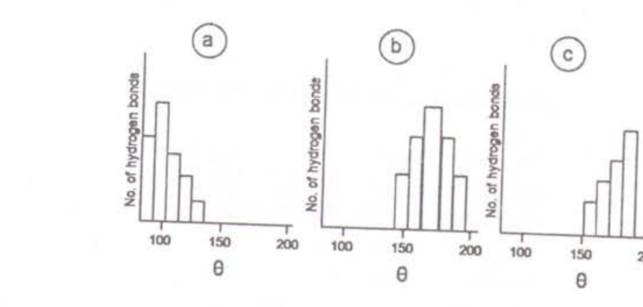

Which one of the distribution of 'θ' was observed from the proteins?

1. Only b
2. Only a
3. Only c
4. a and b

**Answer: 3 (Only c) (OFFICIAL CSIR HRDG FINAL key, Booklet C)**

*Figure: three histograms (a, b, c) of No. of hydrogen bonds vs the donor–H–acceptor angle θ (scale 100–200); (a) skewed to low angles, (b) peaked near 170–180°, (c) skewed to high angles. Crop taken from the English (p22) version.*

---

### Question 81
In context to lac operon, if two bacterial strains P₁ and P₂ with the genotypes Oᶜ I⁺ Z⁻ and O⁺ I⁻ Z⁺ respectively, were used to produce mero-diploid daughter strain D, which one of the following statements correctly predicts the expression of Z gene (β-galactosidase activity) in all the three strains? (O⁺, I⁺ and Z denote the wild type allele of the respective genes).

1. P₁ – No expression; P₂ – constitutive expression; D – Inducible expression.
2. P₁ – No expression; P₂ – constitutive expression; D – constitutive expression.
3. P₁ – No expression; P₂ – Inducible expression; D – Inducible expression.
4. P₁ – Inducible expression; P₂ – constitutive expression; D – Inducible expression.

**Answer: 1 (P₁ – No expression; P₂ – constitutive expression; D – Inducible expression.) (OFFICIAL CSIR HRDG FINAL key, Booklet C)**

---

### Question 82
A patient with breast cancer was given a dose of radiation along with chemotherapy and was apparently cured of the tumor. After five years, a tumor was noticed in the patient's lungs, but the doctors confirmed that it was derived from cells of the mammary gland. The following possibilities were suggested by the doctor.

A. Bacterial infection, after radiation, led to development of the tumors in the lungs.
B. Migration of residual chemo-resistant cells from the mammary gland resulted in tumors in the lungs.
C. Epithelial-to-mesenchymal transition had occurred in the lungs.
D. Cells in the lungs were induced to become a tumor after chemotherapy, and from factors secreted by mammary cells.
Which of the following is correct?

1. B and D
2. Only B
3. A and B
4. A and C

**Answer: 2 (Only B) (OFFICIAL CSIR HRDG FINAL key, Booklet C)**

---

### Question 83
In the accompanying figure, reaction kinetics of three proteins (a, b, c) is presented. Protein concentrations used to obtain this data are a – 1 mg/ml; b- 4 mg/ml. c – 2 mg/ml.

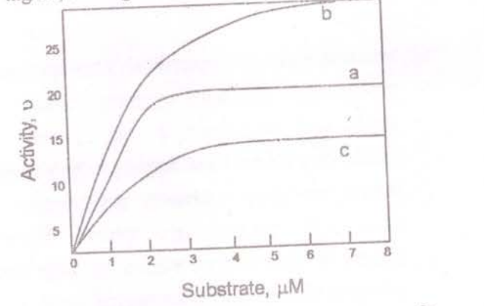

If catalytic efficiency is defined as k_cat/K_m, which of the following statements is correct?

1. b > c > a
2. a > b > c
3. a > c > b
4. c > a > b

**Answer: 2 (a > b > c) (OFFICIAL CSIR HRDG FINAL key, Booklet C)**

*Figure: three saturation (Michaelis–Menten-type) curves of Activity v vs Substrate, µM (0–8); curve b rises steepest and plateaus highest (off-scale above ~25), a plateaus ≈21, c plateaus ≈15.5. Crop taken from the English (p23) version.*

---

### Question 84
The 3′ end of most eukaryotic mRNAs is defined by the addition of a polyA tail – a processing reaction called polyadenylation. The addition of polyA tail is carried out by the enzyme Poly(A) Polymerase. Given below are few statements about this process:

A. Poly(A) Polymerase is a template independent enzyme.
B. Poly(A) Polymerase catalyses the addition of AMP from dATP to the 3′ end of mRNA.
C. Poly(A) Polymerase is a RNA-template dependent enzyme.
D. Poly(A) Polymerase catalyzes the addition of ADP from ATP to the 3′ end of mRNA.
E. Poly (A) Polymerase catalyzes the addition of AMP from ATP to the 3′ end of mRNA.
F. Poly (A) Polymerase catalyzes the addition of AMP from dADP to the 3′ end of mRNA.
Which of the following combination is true?

1. B and C
2. C and D
3. A and E
4. C and F

**Answer: 3 (A and E) (OFFICIAL CSIR HRDG FINAL key, Booklet C)**

---

### Question 85
With an intention to identify the genes expressed in an organism at specific stage of development, mRNAs were isolated from the given organism, cDNAs were synthesized, cloned in a suitable vector and sequenced. A few of the cDNA sequences showed no matches with the genomic DNA sequence. Further, it was observed that these sequences were U-rich and found to be in stretches dispersed along the sequence. The following may be possible reasons for appearance of such RNA:
A. Splicing
B. Alternate splicing
C. Trans-splicing
D. Guide RNA mediated introduction of Us involving endonuclease, terminal-U-transferase and RNA ligase
E. Deaminations converting C to U
Which of the following is the most appropriate reason/s ?

1. A and C
2. B and D
3. C, D and E
4. D only

**Answer: 4 (D only) (OFFICIAL CSIR HRDG FINAL key, Booklet C)**

---

### Question 86
Certain chemokines are known to suppress HIV infection whereas proinflammatory cytokines are known to enhance infection. In order to explain these findings, control and chemokine receptor knock-out animals were treated with proinflammatory cytokines followed by HIV administration and then infection was assessed periodically. Which one of the graphical representation given below best explain the experimental results.

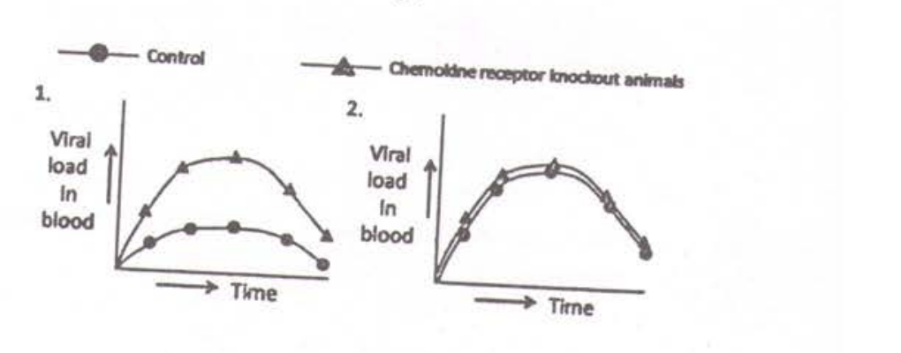

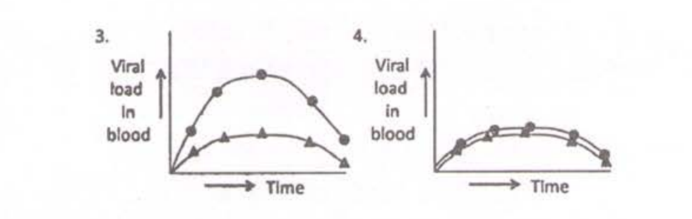

1. 1
2. 2
3. 3
4. 4

**Answer: 3 (graph 3) (OFFICIAL CSIR HRDG FINAL key, Booklet C)**

*Figures: legend "—●— Control  —▲— Chemokine receptor knockout animals" and four graphs of Viral load in blood vs Time. Graph 1: knockout (▲) high peak, control (●) low; graph 2: both curves high and overlapping; graph 3: control (●) high peak, knockout (▲) low; graph 4: both curves low and overlapping. fig1 = legend + graphs 1–2 (p24); fig2 = graphs 3–4 (p25).*

---

### Question 87
When one isolates ribosomes from bacterial lysate, apart from 70S, 50S and 30S ribosomal subunits, one also finds a small population of 100S, 130S and 150S sub-units. EDTA dissociates these larger ribosomal subunits into 50S and 30S, suggesting that they have both the subunits. Upon addition of cations, they reassociate into 70S, but none of the other forms could be detected. What is the reason for not obtaining the >70S forms?

1. The effects of EDTA cannot be reversed by the addition of cations.
2. 100S, 130S and150S are modified form of ribosomes that are irreversibly damaged by EDTA.
3. 100S, 130S, etc. represent polysome that cannot be reassembled denovo without other cellular components.
4. They are obtained as an experimental artifact in preparations of ribosomes.

**Answer: 3 (100S, 130S, etc. represent polysome that cannot be reassembled denovo without other cellular components.) (OFFICIAL CSIR HRDG FINAL key, Booklet C)**

---

### Question 88
In order to study the transcription factor TFIIH, it was cloned from a large number of human subjects. Surprisingly, the subjects having mutation in TFIIH, also showed defects in their DNA repair system. Given below are the explanations:
A. DNA damage is always associated with transcription inhibition.
B. TFIIH has no role in DNA repair.
C. In mammalian system, TFIIH plays an active role in transcription coupled DNA repair process.
D. Because of mutation in TFIIH, transcription initiation is inhibited and incompletely synthesized mRNAs remain attached to the template DNA leading to DNA damage.
Choose the correct answer.

1. A and B
2. C only
3. B and D
4. D only

**Answer: 2 (C only) (OFFICIAL CSIR HRDG FINAL key, Booklet C)**

---

### Question 89
Development of vulva in *C. elegans* is initiated by the induction of a small number of cells by short range signals from a single inducing cell. With reference to this, following statements were put forward.
A. When the anchor cell was ablated early in development, no vulva formed.
B. In a dominant negative mutant of *let-23*, a primary vulva formed but the secondary vulva formation did not take place.
C. A cell adopting a primary fate inhibits adjacent cells from adopting the same fate by lateral inhibition involving LIN-39 and also induces the secondary fate in these cells.
D. A constitutive signal from the hypodermis inhibits the development of both the primary and secondary fates but it is overruled by the initial signal from the anchor cell.
Which of the above statements is true?

1. A and B
2. A and C
3. A and D
4. B and D

**Answer: 3 (A and D) (OFFICIAL CSIR HRDG FINAL key, Booklet C)**

---

### Question 90
Rec 8 is a meiosis specific cohesin that maintains centromeric cohesion between sister chromatids in meiosis I. Which of the phenotypes listed below would you predict will be manifested in a *rec8Δ* yeast?

1. Only low viability of dyads.
2. Improper reduction division and low viability of tetrads.
3. Improper equational division and low viability of dyads.
4. Low tetrad viability with no effect on reduction division.

**Answer: 2 (Improper reduction division and low viability of tetrads.) (OFFICIAL CSIR HRDG FINAL key, Booklet C)**

---

### Question 91
A cross was made between *Hfr met⁺ arg⁺ leu⁺ strˢ* X *F⁻ met⁻ arg⁻ leu⁻ strᴿ*, in which *leu⁺* exconjugants are selected. If the linear organization of the genes are *leu⁺ arg⁺ met⁺*, which one of the following genotypes is expected to occur in the lowest frequency?

1. *leu⁺ arg⁻ met⁻*
2. *leu⁺ arg⁺ met⁻*
3. *leu⁺ arg⁺ met⁺*
4. *leu⁺ arg⁻ met⁺*

**Answer: 4 (*leu⁺ arg⁻ met⁺*) (OFFICIAL CSIR HRDG FINAL key, Booklet C)**

---

### Question 92
Symbiotic nitrogen fixation in legume nodules involves complex interaction between *Rhizobium* and legume roots. This complex interaction is governed by
A. Integration of sym plasmid of *Rhizobium* in the root nuclear genome.
B. Sensing of plant flavonoids by rhizobia.
C. Activation of *nod* genes in rhizobia.
D. Activation of *NODULIN* genes in legume roots.
Which one of the following combinations is correct?

1. A, B and C
2. A, C and D
3. B, C and D
4. A, B and D

**Answer: 3 (B, C and D) (OFFICIAL CSIR HRDG FINAL key, Booklet C)**

---

### Question 93
What will happen if *wingless* RNAi is expressed in *wingless* expressing cells from the stage when this gene initiates its expression in a developing *Drosophila* embryo?
A. The enhanced expression of *wingless* thus caused will broaden the area of *engrailed* expression.
B. Since wingless protein makes a long range gradient, its effect will not be seen in the same segment.
C. The posterior compartment of each future segment will get affected.
D. Since *engrailed* expression is initiated by pair rule genes, the posterior segment will not be affected.
Which one of the following will most appropriately answer the question?

1. A and C
2. Only C
3. B and D
4. Only D

**Answer: 2 (Only C) (OFFICIAL CSIR HRDG FINAL key, Booklet C)**

---

### Question 94
A researcher was studying a protein 'X' which has been observed to move across cells when an extracellular electrical stimulus is provided. An artificial peptide 'P' was prepared which resembles the structure of connexins and competitively inhibits connexon formation. Which one of the following statements will best explain the fate of protein 'X' if the cells are treated with peptide 'P' and then electrical stimulus is provided.

1. X fails to move across cells due to improper formation of tight junctions.
2. X fails to move across cells due to improper formation of gap junctions.
3. X moves freely across cells as before.
4. X fails to move across cells due to improper formation of desmosomes.

**Answer: 2 (X fails to move across cells due to improper formation of gap junctions.) (OFFICIAL CSIR HRDG FINAL key, Booklet C)**

---

### Question 95
Which one of the following about development of sea urchin embryos is TRUE?

1. Each blastomere of a 4-cell stage possesses a portion of the original animal-vegetal axis and if isolated and allowed to develop will form a complete but smaller sized larva.
2. Each blastomere of a 8-cell stage has the capacity to form a complete embryo but by the 16-cell stage, blastomeres will develop according to their presumptive fate.
3. Any blastomere isolated till the pluteus larva formation will regulate to go on and develop into a full sized embryo.
4. After an intricate recombination at the 16-cell stage, the resulting embryo looses its ability to form a complete larva.

**Answer: 1 (Each blastomere of a 4-cell stage possesses a portion of the original animal-vegetal axis and if isolated and allowed to develop will form a complete but smaller sized larva.) (OFFICIAL CSIR HRDG FINAL key, Booklet C)**

---

### Question 96
Of the following signaling processes, which one is NOT involved in cellular movement or cytoskeletal changes?

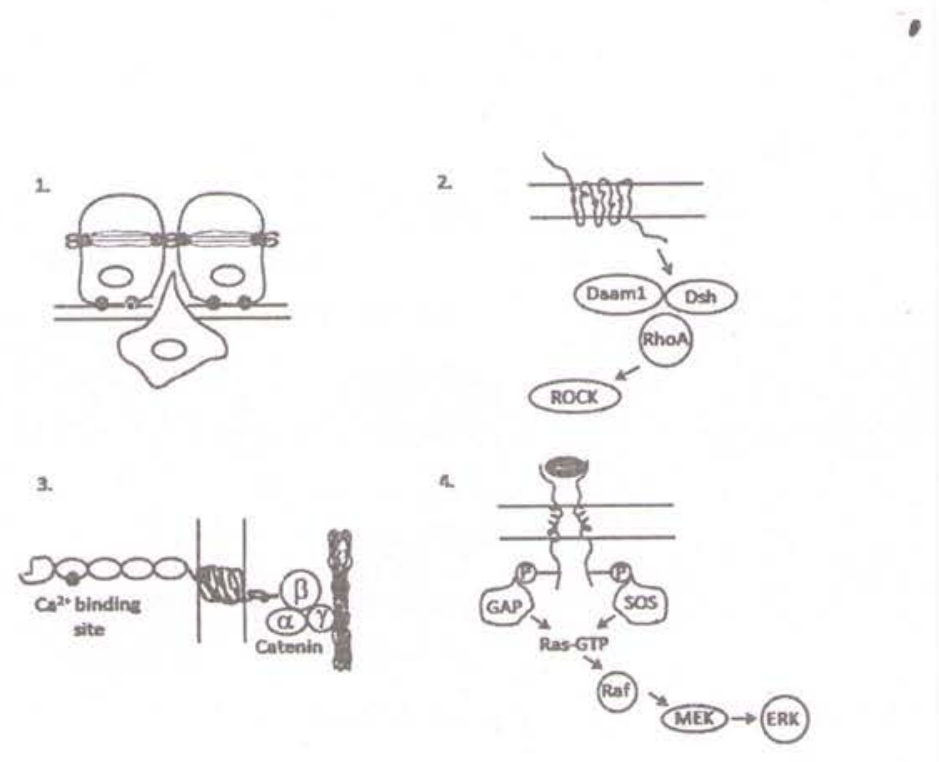

1. (panel 1 — cadherin/catenin junction between two cells with a third cell below)
2. (panel 2 — membrane receptor signalling to Daam1, Dsh, RhoA, ROCK)
3. (panel 3 — Ca²⁺ binding site, α/β/γ Catenin at the membrane)
4. (panel 4 — receptor with GAP, SOS, Ras-GTP, Raf, MEK, ERK cascade)

**Answer: 4 (panel 4 — GAP / SOS / Ras-GTP / Raf / MEK / ERK cascade) (OFFICIAL CSIR HRDG FINAL key, Booklet C)**

*The four panels are the printed options; the option list in the scan carries only the numerals 1–4 next to the drawings, no option text.*

---

### Question 97
Pyru rate dehydrogenase is subject to feed back inhibition by its products in glycolysis. Some of the chemical compounds which might be involved in the process, are listed below:
A. NADH
B. FAD
C. Acetyl-CoA
D. Acetaldehyde
Which one of the following combinations of above chemical compounds is involved in feedback inhibition of pyruvate dehydrogenase?

1. A and B
2. B and C
3. C and D
4. A and C

**Answer: 4 (A and C) (OFFICIAL CSIR HRDG FINAL key, Booklet C)**

---

### Question 98

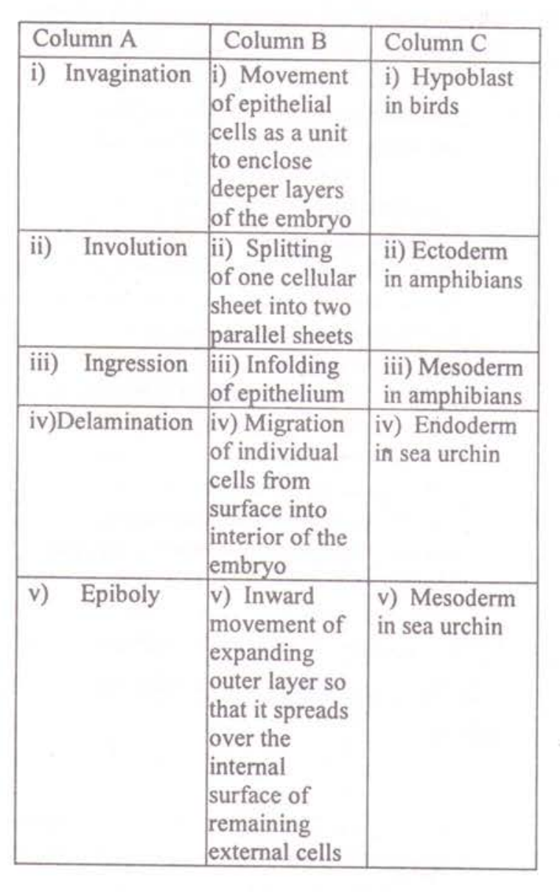

| Column A | Column B | Column C |
|---|---|---|
| i) Invagination | i) Movement of epithelial cells as a unit to enclose deeper layers of the embryo | i) Hypoblast in birds |
| ii) Involution | ii) Splitting of one cellular sheet into two parallel sheets | ii) Ectoderm in amphibians |
| iii) Ingression | iii) Infolding of epithelium | iii) Mesoderm in amphibians |
| iv) Delamination | iv) Migration of individual cells from surface into interior of the embryo | iv) Endoderm in sea urchin |
| v) Epiboly | v) Inward movement of expanding outer layer so that it spreads over the internal surface of remaining external cells | v) Mesoderm in sea urchin |

Which one of the following is the correct combination?

1. A(i), B(iv), C(ii)
2. A(iv), B(iii), C(i)
3. A(iii), B(iv), C(v)
4. A(v), B(ii), C(iii)

**Answer: 3 (A(iii), B(iv), C(v)) (OFFICIAL CSIR HRDG FINAL key, Booklet C)**

---

### Question 99
Chromatin condensation is driven by protein complexes called condensins which are members of a family of "structural maintenance of chromatin" (SMC) proteins that play a key role in the organization of eukaryotic chromosomes. Condensins along with another family of SMC proteins called cohesins significantly contribute to chromosome segregation during mitosis. If the cells are treated with an inhibitor of cdk1 phosphorylation immediately before the cells enter M phase, which of the following statements is most likely to be true?

1. Sister chromatids are held together by condensins along the entire length of the chromosome.
2. Sister chromatids are held together by cohesins along the entire length of the chromosome.
3. Sister chromatids are held together by condensins and attached to each other only at the centromere.
4. Sister chromatids are held together by condensins and attached to each other only at the telomere.

**Answer: 2 (Sister chromatids are held together by cohesins along the entire length of the chromosome.) (OFFICIAL CSIR HRDG FINAL key, Booklet C)**

---

### Question 100
Formation of digits and sculpting the tetrapod limb requires death of specific cells in the limb in a programmed manner. Which one of the following interactions could explain proper limb formation?

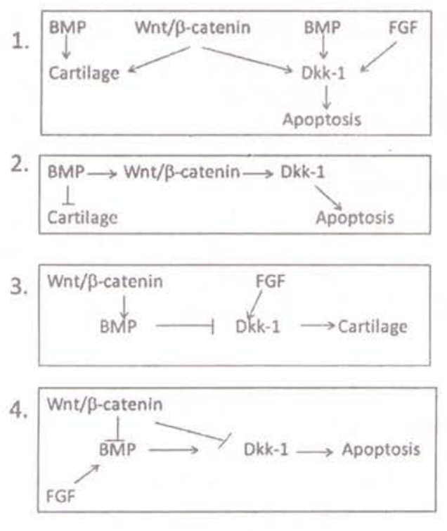

1. (panel 1 — BMP → Cartilage; Wnt/β-catenin → Cartilage and → Dkk-1; BMP → Dkk-1; FGF → Dkk-1; Dkk-1 → Apoptosis)
2. (panel 2 — BMP → Wnt/β-catenin → Dkk-1; BMP ⊣ Cartilage; Dkk-1 → Apoptosis)
3. (panel 3 — Wnt/β-catenin → BMP ⊣ Dkk-1; FGF → Dkk-1; Dkk-1 → Cartilage)
4. (panel 4 — Wnt/β-catenin ⊣ BMP; Wnt/β-catenin → Dkk-1; FGF → BMP; BMP → Dkk-1 → Apoptosis)

**Answer: 1 (panel 1) (OFFICIAL CSIR HRDG FINAL key, Booklet C)**

*The four panels are the printed options; the scan carries only the numerals 1–4 beside the pathway diagrams.*

---

### Question 101
There are three substances A, B and C. Given below are the pattern of immunological responses in rabbits when (i) A is administered along with C, (ii) B is administered along with C and (iii) A is conjugated with B and administered along with C.

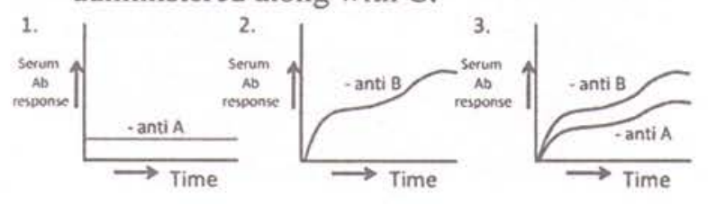

Which one of the following is the correct identification?

1. A-protein, B-hapten, C-adjuvant
2. A-hapten, B-protein, C- adjuvant
3. A-protein, B- adjuvant, C-hapten
4. A-hapten, B- adjuvant, C-protein

**Answer: 2 (A-hapten, B-protein, C- adjuvant) (OFFICIAL CSIR HRDG FINAL key, Booklet C)**

---

### Question 102
Light is an important factor for plant growth and development. There are several photoreceptors in higher plants such as *Arabidopsis thaliana* involved in perception of various wavelengths of light. Some statements are given below related to photoreceptors:
A. Red light photoreceptors are represented by a gene family.
B. Phytochrome C is the most prominent photoreceptor to perceive red light.
C. Cryptochrome 1 and cryptochrome 2 have evolved from bacterial DNA photolyases.
D. Far-red light is perceived by phytochrome D.
Which one of the following combinations of above statements is correct?

1. A and B
2. B and C
3. C and D
4. A and C

**Answer: 4 (A and C) (OFFICIAL CSIR HRDG FINAL key, Booklet C)**

---

### Question 103

103. Two homozygous individuals (P1 and P2) were genotyped using dominant DNA markers A and B, as shown below. The F1 progeny obtained was test crossed. The frequency of progeny with which different genotypes appear, is given below:

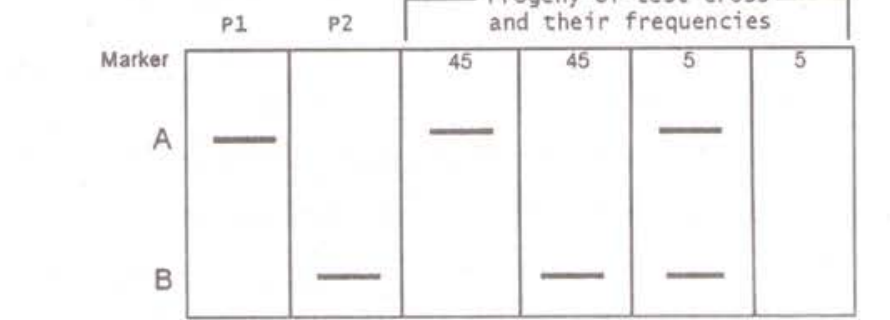

The following conclusions were made:
A. In the F1, markers A and B are linked and in coupling phase (*cis*)
B. In the F1, markers A and B are linked and in repulsion phase (*trans*)
C. The distance between A and B is 10 cM
D. The distance between A and B is 5 cM
Which of the above conclusions are correct?

1. A and C
2. A and D
3. B and C
4. B and D

**Answer: 3 (B and C) (OFFICIAL CSIR HRDG FINAL key, Booklet C)**

---

### Question 104

104. Carbohydrates synthesized by photosynthesis are converted into sucrose and transported via phloem to other parts of the plant. The following aspects are associated with sucrose uploading in phloem and its transport:
A. Both reducing and non-reducing sugars are transported efficiently through phloem.
B. Sucrose uploading can be both symplastic and apoplastic.
C. The route of phloem uploading is – mesophyll cells→phloem parenchyma →companion cells → sieve tubes.
D. Transport in sieve tubes is as per the 'pressure-flow model'.
Which one of the following combinations is correct?

1. A, B and C
2. B, C and D
3. C, D and A
4. D, B and A

**Answer: 2 (B, C and D) (OFFICIAL CSIR HRDG FINAL key, Booklet C)**

---

### Question 105

105. A 'Z' scheme describes electron transport in O2-evolving photosynthetic organisms. The direction of electron flow is presented in the following sequences:
A. P680*→ Pheophytin → QA→ QB → PC → cytochrome b6f → P700
B. P700* → Phylloquinone – FeSA → FeSB → FeSX → Fd
C. P680*→ Pheophytin → QA→ QB → cytochrome b6f → PC→ P700
D. P700* → Phylloquinone → FeSX → FeSA → FeSB → Fd
Which one of the following combinations is correct?

1. A and B
2. B and C
3. C and D
4. D and A

**Answer: 3 (C and D) (OFFICIAL CSIR HRDG FINAL key, Booklet C)**

---

### Question 106

106. During physical exercise, the oxygen supply to the active muscles is increased, which has been explained by the following statements:
A. PO2 declines and PCO2 rises in the active muscles
B. The temperature is increased and pH is decreased in active muscles
C. 2, 3-biphosphoglycerate is decreased in RBC and P50 rises
D. Metabolites accumulating in the active muscles increase the affinity of hemoglobin to oxygen
Which one of the following is NOT correct?

1. A only
2. A and B
3. B and C
4. C and D

**Answer: 4 (C and D) (OFFICIAL CSIR HRDG FINAL key, Booklet C)**

---

### Question 107

107. A plant with red fruit is crossed to a plant with white fruit. The F1 progeny had red fruits. On selfing the F1, two kinds of progeny were observed, plants with red-fruits and those with white-fruits. To test whether it was a case of recessive epistatic interaction a chi-square test was performed. A value of 1.062 was obtained (chi-square value at P0.05=3.841 for Degree of Freedom=1). The following statements were made:
A. The null hypothesis was that plants with red and white fruits will occur in a 9:7 ratio
B. The null hypothesis was that plants with red and white fruits will occur in a 1:1 ratio
C. Based on the chi-square value, it is a case of recessive epistatic interaction
D. Based on the chi-square value, it is not a case of recessive epistatic interaction
Which of the combination of above statements is correct?

1. A and C
2. A and D
3. B and C
4. B and D

**Answer: 1 (A and C) (OFFICIAL CSIR HRDG FINAL key, Booklet C)**

---

### Question 108

108. The fractional clearance of neutral and cationic dextran molecules of various sizes through kidneys of a rat is shown in the figures below. Which one of the following is correct?

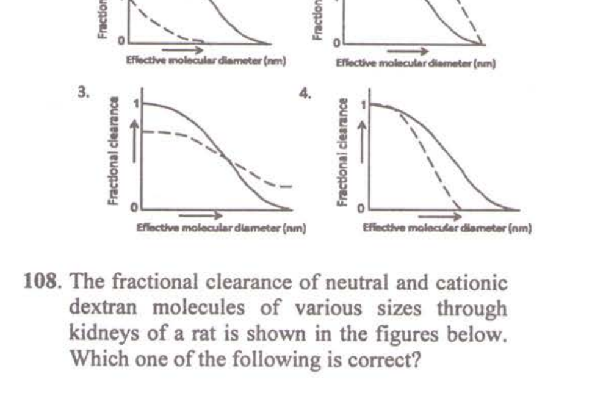

1. (graph 1)
2. (graph 2)
3. (graph 3)
4. (graph 4)

**Answer: 2 (graph 2) (OFFICIAL CSIR HRDG FINAL key, Booklet C)**

---

### Question 109

109. Which one of the following is the most appropriate match for the protected areas of India?

| Category | Protected Area |
|---|---|
| A. Biosphere Reserve | (i) Chambal |
| B. National Park | (ii) Loktak |
| C. Ramsar Site | (iii) Nanda Devi |
| D. Wildlife Sanctuary | (iv) Rajaji |
| | (v) Sundarbans |

1. A – (iii) B – (iv) C – (ii) D – (i)
2. A – (ii) B – (iv) C – (iii) D – (i)
3. A – (i) B – (v) C – (iii) D – (i)
4. A – (iii) B – (ii) C – (v) D – (iv)

**Answer: 1 (A – (iii) B – (iv) C – (ii) D – (i)) (OFFICIAL CSIR HRDG FINAL key, Booklet C)**

---

### Question 110

110. Following are certain statements related to plants exposed to dehydration stress:
A. When the water potential of the rhizosphere decreases due to water deficit, plants can continue to absorb water as long as plant water potential is lower than that of soil water.
B. The ratio of root to shoot growth increases in response to water deficit.
C. Plant cells tend to release solutes to lower water potential during periods of osmotic stress.
D. Abscisic acid is synthesized at a higher rate when leaves are dehydrated, and more ABA accumulates in the leaf apoplast.
Which one of the following combinations of above statements is correct?

1. A, B and C
2. B, C and D
3. A, B and D
4. A, C and D

**Answer: 3 (A, B and D) (OFFICIAL CSIR HRDG FINAL key, Booklet C)**

---

### Question 111

111. Somatic recombination was caused by mild exposure to radiation on flies heterozygous for a given allele during specific stages of development and the individuals were allowed to develop. Such individuals are likely to have
A. clones of homozygous cells in heterozygous body.
B. site specific mutagenesis.
C. twin spots, i.e., patches of mutants cells and homozygous wild type cells in heterozygous body.
D. tissue specific expression of the given allele.
Which of the following combination of answers will be most appropriate?

1. A and B
2. B and C
3. A and C
4. C and D

**Answer: 3 (A and C) (OFFICIAL CSIR HRDG FINAL key, Booklet C)**

---

### Question 112

112.

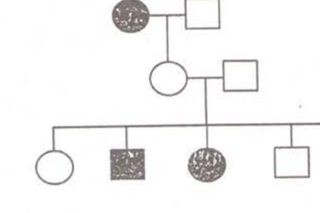

The above pedigree shows the inheritance of a rare allele. The allele is:

1. X-linked recessive
2. autosomal recessive
3. dominant with incomplete penetrance
4. autosomal recessive with incomplete penetrance

**Answer: 3 (dominant with incomplete penetrance) (OFFICIAL CSIR HRDG FINAL key, Booklet C)**

---

### Question 113

113. Estradiol synthesis follows a 2-cell-2-gonadotropin theory, where partial synthesis occurs in the granulosa cells and the rest in the theca interna cells of the Graafian follicle. Which one of the following correctly represents estradiol synthesis and secretion?

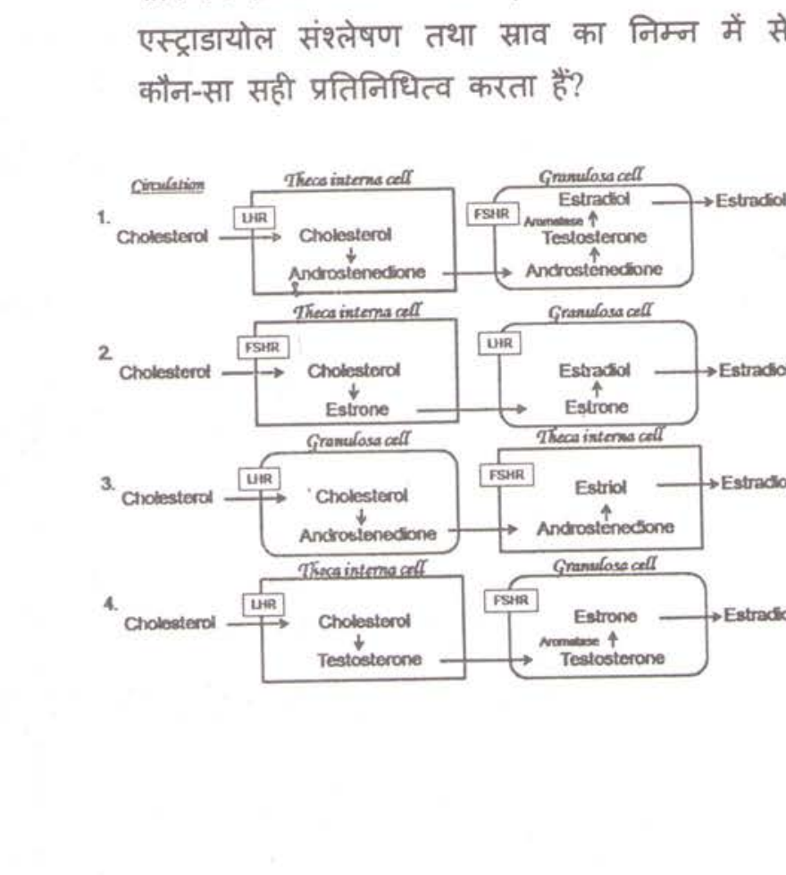

1. (diagram 1)
2. (diagram 2)
3. (diagram 3)
4. (diagram 4)

**Answer: 1 (diagram 1) (OFFICIAL CSIR HRDG FINAL key, Booklet C)**

---

### Question 114

114. Sickle cell anemia is a recessive genetic disease caused due to a point mutation in the 6th codon abolishing one of the *Msp*II endonuclease digestion site present in the β-globin gene. *Msp*II digested DNA from a normal person gives two bands, 1150 bp and 200. bp, in β-globin gene. A family with a proband (based on the disease phenotype) gave the following *Msp*II digestion pattern:

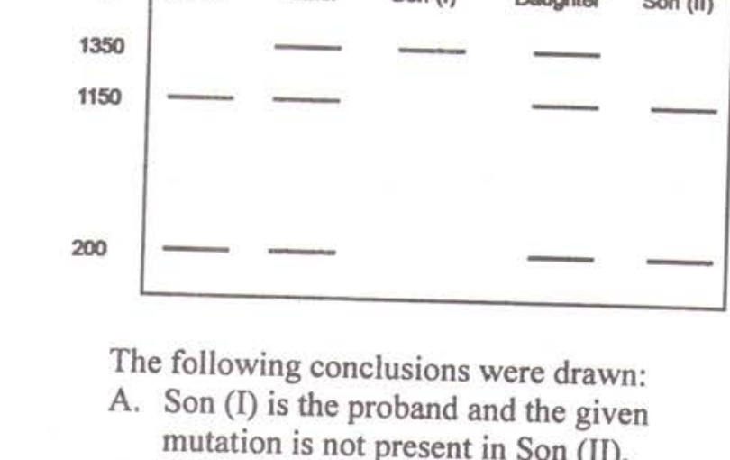

The following conclusions were drawn:
A. Son (I) is the proband and the given mutation is not present in Son (II).
B. The daughter is a carrier for the given mutation.
C. The gene is X-linked and thus Son (I) becomes the proband.
D. The father and daughter are affected.
E. A *de novo* mutation in same site on normal allele has allowed appearance of disease phenotype in the proband.
Which of the following combination of conclusions will be the most appropriate for the figure given above?

1. A, B and E
2. A, B and C
3. B, C and E
4. C and D

**Answer: 1 (A, B and E) (OFFICIAL CSIR HRDG FINAL key, Booklet C)**

---

### Question 115

115. The following table shows selected characters used in analyzing the phylogenetic relationships of four plant taxa:

| Taxon | Xylem or Phloem | Wood | Seed | Flowers |
|---|---|---|---|---|
| T1 | + | – | – | – |
| T2 | + | + | + | + |
| T3 | + | + | + | – |
| T4 | – | – | – | – |

Taxa T1, T2, T3 and T4 are respectively:

1. Ferns, Oaks, Pines, Hornworts
2. Oaks, Pines, Hornworts, Ferns
3. Hornworts, Pines, Oaks, Ferns
4. Ferns, Pines, Oaks, Hornworts

**Answer: 1 (Ferns, Oaks, Pines, Hornworts) (OFFICIAL CSIR HRDG FINAL key, Booklet C)**

---

### Question 116

116. The mechanism of sound localization in a horizontal plane by the human auditory system can be explained by
A. the difference in time between the arrival of stimulus in two ears
B. the difference in phase of the sound waves on two ears
C. the difference in tuning curves of two auditory nerves
D. the activity of neurons in superior olivary nucleus, but not by the neuronal activity of auditory cortex.
Which one of the following is NOT correct?

1. Only A
2. A and B
3. B and C
4. C and D

**Answer: 4 (C and D) (OFFICIAL CSIR HRDG FINAL key, Booklet C)**

---

### Question 117

117. Given below are the main characteristics of a few mammalian orders. Match the names of the animals with the characteristics of their orders:
A. Hooves with even number of toes on each foot, omnivorous
B. Teeth consisting of many thin tubes cemented together, eats ants and termites
C. Opposable thumbs, forward facing eyes, well developed cerebral cortex, omnivorous
D. Hooves with an odd number of toes on each foot; herbivorous

(i) Tapir (ii) Lemur (iii) Aardvark (iv) Pig

Choose the correct combination

1. A – (iii)B – (iv) C – (i) D – (ii)
2. A – (i) B – (iv) C – (ii) D – (iii)
3. A – (iv)B – (iii) C – (ii) D – (i)
4. A – (iv)B – (iii) C – (i) D – (ii)

**Answer: 3 (A – (iv)B – (iii) C – (ii) D – (i)) (OFFICIAL CSIR HRDG FINAL key, Booklet C)**

---

### Question 118

118. Given below is a matrix of possible interactions (beneficial (+), harmful (–), neutral (0)) between species 1 and 2. The names of interactions, A, B, C and D, respectively, are

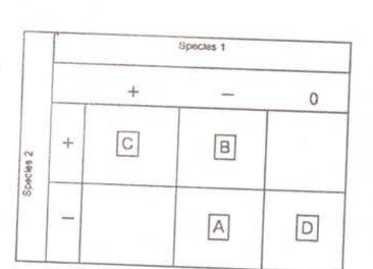

1. Predation, competition, mutualism, commensalism
2. Mutualism, competition, amensalism, commensalism
3. Competition, predation, mutualism, amensalism
4. Competition, mutualism, commensalism, predation

**Answer: 3 (Competition, predation, mutualism, amensalism) (OFFICIAL CSIR HRDG FINAL key, Booklet C)**

---

### Question 119

In high altitude, hypoxia induces increased number of circulating red blood cells, which can be explained by the following changes:
A. The transcription factors, HIFs, are produced
B. Erythropoietin secretion is increased
C. Myoglobin content is decreased
D. Cytochrome oxidase is decreased

Which one of the following is NOT true?

1. Only A
2. A and B
3. B and C
4. C and D

**Answer: 4 (C and D) (OFFICIAL CSIR HRDG FINAL key, Booklet C)**

---

### Question 120

Two lakes (I and II) with a similar trophic structure of phytoplankton-zooplankton-planktivorous fish food chain were chosen. To understand the 'top-down' effects, some piscivorous fish (those that feed on planktivorous fish) were introduced into Lake I, making it a system with four trophic levels. Lake II was enriched by adding large quantities of nitrates and phosphates to study the 'bottom-up' effects over a period of time. Changes in the biomasses of each trophic level were measured. The expected major changes in the two lakes are

1. In Lake I zooplankton biomass increases, phytoplankton biomass decreases.
   In Lake II both phytoplankton and planktivorous fish biomasses increase.
2. In Lake I zooplankton biomass decreases, phytoplankton biomass increases.
   In Lake II both phytoplankton and planktivorous fish biomasses increase.
3. In Lake I planktivorous fish biomass and phytoplankton biomass decrease.
   In Lake II phytoplankton biomass increases, planktivorous fish biomass decreases.
4. In Lake I planktivorous fish and zooplankton biomasses increase.
   In Lake II both phytoplankton and planktivorus fish biomasses increase.

**Answer: 1 (In Lake I zooplankton biomass increases, phytoplankton biomass decreases; in Lake II both phytoplankton and planktivorous fish biomasses increase) (OFFICIAL CSIR HRDG FINAL key, Booklet C)**

---

### Question 121

Which of the following is true about the Digestion Efficiency (DE) (assimilation/consumption) and Ecological Efficiency (EE) (production/consumption) of ectotherms and endotherms?

1. Endotherms have a high DE and ectotherms have a high EE.
2. Endotherms have a low DE and ectotherms have a high EE.
3. Endotherms have a high DE and ectotherms have a low EE.
4. Endotherms have a low DE and ectotherms have a low EE.

**Answer: 1 (Endotherms have a high DE and ectotherms have a high EE) (OFFICIAL CSIR HRDG FINAL key, Booklet C)**

---

### Question 122

Which of the following is/are NOT valid explanation(s) for the observed pattern of species richness?
A. Older communities are more species-rich.
B. Large areas support more species.
C. Natural enemies promote reduced species richness at local level.
D. Communities in climatically similar habitats may themselves be similar in species richness.
E. Greater productivity permits existence of more species.

1. B, C and D
2. Only C
3. Only D
4. A, B and E

**Answer: 2 (Only C) (OFFICIAL CSIR HRDG FINAL key, Booklet C)**

---

### Question 123

The following table shows the number of individuals of each species found in two communities:

| Community | A | B | C | D |
|---|---|---|---|---|
| C1 | 25 | 25 | 25 | 25 |
| C2 | 80 | 05 | 05 | 10 |

(Hint: *ln* values for 0.05, 0.10, 0.25 and 0.80 are −3.0, −2.3, −1.4 and −0.2, respectively)

The calculated Shannon diversity index (H) values for communities C1 and C2, respectively are

1. 1.4 and 0.69
2. 1.2 and 0.34
3. 2.1 and 0.43
4. 1.8 and 0.37

**Answer: 1 (1.4 and 0.69) (OFFICIAL CSIR HRDG FINAL key, Booklet C)**

---

### Question 124

In the evolutional tree given below, terms A, B, C, D and E, represent respectively

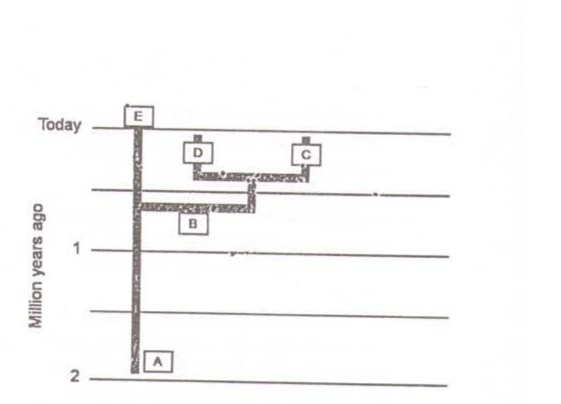

1. *Homo erectus, Homo heidelbergensis*, Neanderthal, Denisovan and *Homo sapiens*.
2. *Homo heidelbergensis, Homo erectus*, Denisovan, Neanderthal and *Homo sapiens*.
3. *Homo erectus, Homo heidelbergensis*, Denisovan, Neanderthal and *Homo sapiens*.
4. *Homo heidelbergensis, Homo sapiens*, Denisovan, Neanderthal, and *Homo erectus*.

**Answer: 1 (Homo erectus, Homo heidelbergensis, Neanderthal, Denisovan and Homo sapiens) (OFFICIAL CSIR HRDG FINAL key, Booklet C)**

---

### Question 125

Which of the following gives the correct human disease – causal microbe match for each?

| Human Disease | Causal Microbe |
|---|---|
| A. Chronic gastritis | (i) *Borrelia burgdorferi* |
| B. Lyme disease | (ii) *Helicobacter pylori* |
| C. Scarlet fever | (iii) *Rickettsia prowazekii* |
| D. Typhus | (iv) *Streptococcus pyogenes* |

1. A – (ii) B – (i) C – (iv) D – (iii)
2. A – (ii) B – (iii) C – (i) D – (iv)
3. A – (iv) B – (i) C – (ii) D – (iii)
4. A – (iv) B – (iii) C – (i) D – (ii)

**Answer: 1 (A–(ii) B–(i) C–(iv) D–(iii)) (OFFICIAL CSIR HRDG FINAL key, Booklet C)**

---

### Question 126

Homing pigeons, when released at a place far away from their home, use earth's magnetic field or the sun as navigational cues and choose the right direction to fly. To test the hypotheses, two experiments were conducted. In Expt.I, one group of pigeons (Test) were equipped with Helmholtz coils (which disrupt magnetic field detection), while the second group (Control) were not. Both groups were released on a sunny day. Expt. II used the same Control and Test groups of pigeons, but they were released on a cloudy, overcast day. The expected results, if the hypotheses is true, would be

1. In Expt. I, both Control and Test groups fly in the right direction, but in Expt. II, only Control group does.
2. In both experiments, Test groups fail to choose the right direction.
3. In Expts. I and II, Test groups fly in the right direction.
4. In Expt. I both groups fly in the right direction but in Expt. II both groups fail to choose the right direction.

**Answer: 1 (In Expt. I, both Control and Test groups fly in the right direction, but in Expt. II, only Control group does) (OFFICIAL CSIR HRDG FINAL key, Booklet C)**

---

### Question 127

Compared to K-selection, r-selection favours

1. rapid development, smaller body size and early, semelparous reproduction.
2. rapid development, smaller body size and early, iteroparous reproduction.
3. slow development, larger body size and late, iteroparous reproduction.
4. slow development, smaller body size and late, iteroparous reproduction

**Answer: 1 (rapid development, smaller body size and early, semelparous reproduction) (OFFICIAL CSIR HRDG FINAL key, Booklet C)**

---

### Question 128

Brothers A and B have the same father but different mothers. B wants A to help him, which involves both benefits (b) and costs (c) for A. If A incurs a cost of 30 'Darwinian fitness units' in that act, under what condition should he help B, following Hamilton's rule?

1. only if b>30
2. only if b>60
3. only if b>120
4. only if b>240

**Answer: 3 (only if b>120) (OFFICIAL CSIR HRDG FINAL key, Booklet C)**

---

### Question 129

Which of the following options match the plant tissue type with its correct function in vascular plants?

| Tissue | Function |
|---|---|
| A. Tracheids | (i) Chief water-conducting element in gymnosperms |
| B. Vessel elements | (ii) Chief water-conducting element in angiosperms |
| C. Sieve tube element | (iii) Food-conducting element in gymnosperms |
| D. Sieve cell | (iv) Food-conducting element in angiosperms |

1. A – (i) B – (ii) C – (iv) D – (iii)
2. A – (ii) B – (i) C – (iii) D – (iv)
3. A – (i) B – (ii) C – (iii) D – (iv)
4. A – (i) B – (iii) C – (iv) D – (ii)

**Answer: 1 (A–(i) B–(ii) C–(iv) D–(iii)) (OFFICIAL CSIR HRDG FINAL key, Booklet C)**

---

### Question 130

Match the five (A – E) group of organisms with their correct taxonomic rank (i – v) given below:

| Group | Taxonomic rank |
|---|---|
| A. Crustacea | (i) Order |
| B. Hominidae | (ii) Domain |
| C. Dermaptera | (iii) Class |
| D. Ctenophora | (iv) Phylum |
| E. Archaea | (v) Family |

1. A – (iii) B – (i) C – (v) D – (iv) E – (ii)
2. A – (i) B – (ii) C – (iii) D – (iv) E – (v)
3. A – (iv) B – (iii) C – (ii) D – (i) E – (v)
4. A – (iii) B – (v) C – (i) D – (iv) E – (ii)

**Answer: 4 (A–(iii) B–(v) C–(i) D–(iv) E–(ii)) (OFFICIAL CSIR HRDG FINAL key, Booklet C)**

---

### Question 131

In a population at Hardy-Weinberg equilibrium, the genotype frequencies are: f(A₁A₁) = 0.59; f(A₁A₂) = 0.16; f(A₂A₂) = 0.25. What are the frequencies of the two alleles at this locus?

1. A₁=0.59  A₂=0.41
2. A₁=0.75  A₂=0.25
3. A₁=0.67  A₂=0.33
4. A₁=0.55  A₂=0.44

**Answer: * (DROPPED — official key marks this question with '*': "Benefit of marks to those who have attempted"; no correct option is designated) (OFFICIAL CSIR HRDG FINAL key, Booklet C)**

---

### Question 132

Following are the main types of defense employed by prey species against predators
**Types of defense:** Chemical with aposematic coloration (A); Cryptic coloration (B); Batesian mimicry (C); Intimidation display (D)
**Prey Species:** Grasshoppers and seahorses (i); Hoverflies and wasps (ii); Bombardier beetles, ladybird beetles, many butterflies (iii); Frilled lizard, Porcupine fish (iv)

Which one of the following combinations is correct?

1. A-(i) B-(iii) C-(ii) D-(iv)
2. A-(iv) B-(ii) C-(i) D-(iii)
3. A-(iii) B-(i) C-(ii) D-(iv)
4. A-(ii) B-(iii) C-(i) D-(iv)

**Answer: 3 (A-(iii) B-(i) C-(ii) D-(iv)) (OFFICIAL CSIR HRDG FINAL key, Booklet C)**

---

### Question 133

In a confirmatory test for HIV, one or more viral antigens are detected in the blood of patients. Following are the steps to be performed for the experiment:

A. Transfer of viral antigens to nitrocellulose paper

B. Incubation with the buffer containing antibodies specific for viral antigens.

C. Separation of viral antigens by SDS-PAGE

D. Detection of bands by enzyme-linked secondary antibody

Identify the correct sequence steps to be performed for the experiment.

1. A-B-C-D
2. B-C-D-A
3. C-A-B-D
4. C-B-A-D

**Answer: 3 (OFFICIAL CSIR HRDG FINAL key, Booklet C)**

---

### Question 134

In transgenic mice, the orientation and location of the loxP sites determine whether *Cre* recombinase induces a deletion, an inversion or a chromosomal translocation. If a researcher wants to put the loxP sites in such a manner that only inversion will take place, which one of the following construct best justifies their intention. Gene X is the target gene.

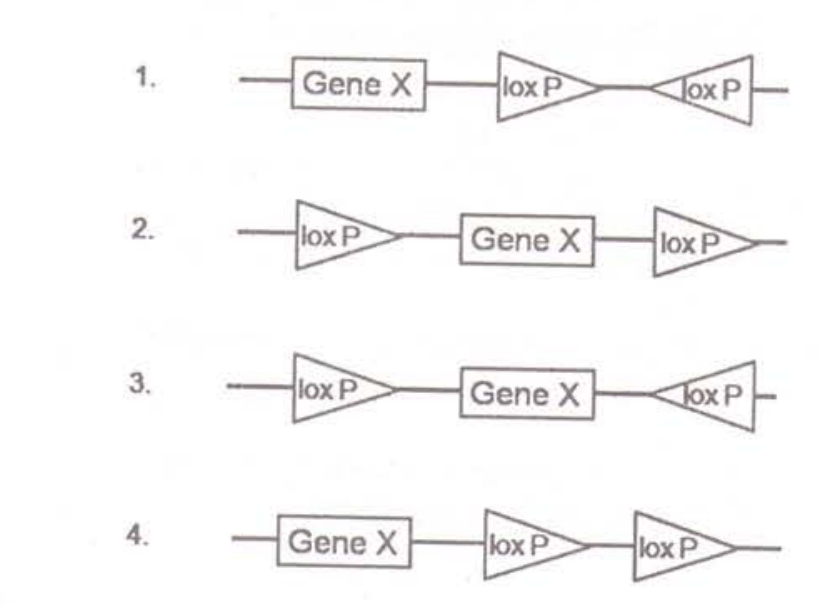

1.
2.
3.
4.

(Options 1-4 are the four constructs shown in the figure above, labelled 1-4 in the scan.)

**Answer: 3 (OFFICIAL CSIR HRDG FINAL key, Booklet C)**

---

### Question 135

For the aquaculture farming of Indian Major carps several techniques are used. Which one of the following techniques is NOT used for this purpose:

1. Induced breeding
2. Selective breeding
3. Inbreeding
4. Composite fish farming

**Answer: 3 (OFFICIAL CSIR HRDG FINAL key, Booklet C)**

---

### Question 136

A protein undergoes post-translational modification. In an experiment to identify the nature of modification, following experimental results were obtained.

A. Protein moved more slowly in an SDS-PAGE.

B. Isoelectric focusing [IEF] showed that there was no change in the pI

C. Mass spectrometric analysis showed that the modification was on serine

The modification that the protein undergoes is likely to be

1. phosphorylation
2. glycosylation
3. ubiquitination
4. ADP-ribosylation

**Answer: 2 (OFFICIAL CSIR HRDG FINAL key, Booklet C)**

---

### Question 137

A student, while constructing knock-out mice, isolated mouse embryonic stem cells and introduced an engineered DNA into the cells. However, none of the mice were     transgenic. On checking the cells containing DNA construct, he found that he had made a mistake in constructing the DNA since the cells were resistant to gancyclovir but sensitive to G418. Which one of the following constructs had he designed ?

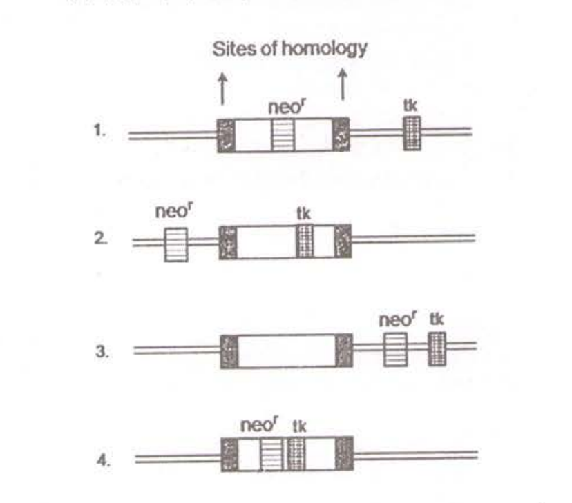

1.
2.
3.
4.

(Options 1-4 are the four constructs shown in the figure above, labelled 1-4 in the scan.)

**Answer: 3 (OFFICIAL CSIR HRDG FINAL key, Booklet C)**

---

### Question 138

A gene from genomic library is screened by using hybridization technique. After hybridizing the probe, usually a stringent washing step is given. The following statements are given to explain the stringent washing step:

A. Stringent washing takes care of removing unincorporated and non-specifically hybridized probe molecules

B Stringent washing is done in solution having high salt concentration and lower temperature

C. Stringent washing is done in solution having low salt concentration keeping higher temperature

D. Salt present in washing solution supports hybrids to stay intact by shielding the interference of water molecules

E. Salt reacts with DNA molecules and allows easy dissociation of hybrids

F. Stability of hybrid is directly proportional to the temperature

Which combination of the above statements is most appropriate for stringent washing step?

1. A, B and D
2. A, C and D
3. A, B and F
4. C, E and F

**Answer: 2 (OFFICIAL CSIR HRDG FINAL key, Booklet C)**

---

### Question 139

Following is the list of some important events in the history of life and the names of the epochs of Cenozoic era.

Events

A. Angiosperm dominance increases; continued radiation of most present day mammalian orders

B. Major radiation of mammals, birds and pollinating insects

C. Origins of many primate groups

D. Origin of genus *Homo*

E. Appearance of bipedal human ancestors

F. Continued radiation of mammals and angiosperms, earliest direct human ancestors

Epochs

(i)Paleocene (ii) Pleistocene (iii) Oligocene

(iv) Pliocene (v) Eocene (vi) Miocene

Which one of the following is the correct match of events with the epochs?

1. A-(v) B-(ii) C-(i) D-(iii) E-(iv) F-(vi)
2. A-(vi) B-(i) C-(ii) D-(iv) E-(iii) F-(v)
3. A-(v) B-(i) C-(iii) D-(ii) E-(iv) F-(vi)
4. A-(iv) B-(i) C-(ii) D-(iii) E-(v) F-(vi)

**Answer: 3 (OFFICIAL CSIR HRDG FINAL key, Booklet C)**

---

### Question 140

In response to a drug, changes in protein levels were examined in a cell line. A pulse chase experiment was performed using ^35S labeled methionine. In comparison to untreated samples, the following observations were made: few minutes after stimulation, protein X accumulates and this was followed by reduction in protein Y and Z. The correct interpretation of these observations would be:

1. Protein X is a protease which degrades Y and Z.
2. Protein X is a transcriptional repressor that controls expression of Y and Z .
3. Expression of protein X and loss of Y and Z are unrelated.
4. Information is not sufficient to distinguish between the three possibilities stated above.

**Answer: 4 (OFFICIAL CSIR HRDG FINAL key, Booklet C)**

---

### Question 141

The most important property of any microscope is its resolution (D) and can be calculated from the formula

D = 0.61λ / N sinα

where D is minimum distance between two distinguishable objects, λ is the wave length of incident light, α is the angular aperture and N is the refractive index of the medium. Given below are several suggestions to improve the resolution of a microscope:

A. decrease the wave length of incident light

B. increase the wave length of incident light

C. use oil which has a higher refractive index

D. use oil because of its lower refractive index

Which one is the correct suggestion?

1. A and C
2. Only B
3. Only D
4. B and D

**Answer: 1 (OFFICIAL CSIR HRDG FINAL key, Booklet C)**

---

### Question 142

The mean and standard deviation of serum cholesterol in a population of senior citizens are assumed to be 200 and 24mg/dl, respectively. In a random sample of 36 senior citizens, what values of cholesterol (to the nearest whole number) should lead to rejection of the null hypothesis at 95% confidence level?

1. above 224
2. above 248
3. below 176 and above 224
4. below 192 and above 208

**Answer: 4 (OFFICIAL CSIR HRDG FINAL key, Booklet C)**

---

### Question 143

Somatic embryogenesis is an important exercise in micropropagation and genetic engineering of plants. The following steps are considered as critical for achieving somatic embryogenesis:

A. Reducing the concentration of sucrose in the medium by half.

B. Addition of the hormone, 2, 4-dichlorophenoxyacetic acid, to induce somatic embryos.

C. Reduce agar concentration to 0.6% (w/v)

D. Use maltose in place of sucrose as a carbon source

Which one of the following combinations is correct?

1. A and C
2. B and D
3. A and B
4. C and D

**Answer: 2 (OFFICIAL CSIR HRDG FINAL key, Booklet C)**

---

### Question 144

Factor IX is essential for blood clotting. Deficiency of Factor IX could be corrected by delivering factor IX gene using viral vectors. In an experiment the gene for Factor IX was cloned appropriately into Adenovirus (AV), Adeno-associated virus (AAV) and Retrovirus (RV). Retrovirus integrate the gene into the dividing cells. AAV integrates partially into non-dividing cells. AV does not integrate the gene but transfects both dividing and non-dividing cells.

Following expression profile for Factor IX was observed when the three vectors were injected intra-muscularly into three groups of experimental mice.

Which one of the following outcomes is correct?

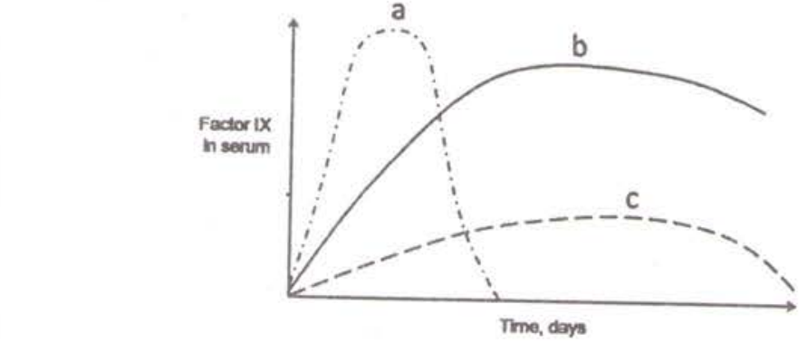

1. a by RV; b by AV; c by AAV
2. a by AV; b by AAV; c by RV
3. a by AAV; b by RV; c by AV
4. a by AV; b by RV; c by AAV

**Answer: 4 (OFFICIAL CSIR HRDG FINAL key, Booklet C)**

---

### Question 145

The following genes have been genetically engineered to develop herbicide resistance in plants:

A. Resistance to glyphosate using the 5-enolpyruvyl shikimate-3-phosphate synthase gene

B. Bialaphos resistance using the *bar* gene

C Sulfonyl urea resistance using the acetolactate synthase gene

D. Atrazine resistance using the glutathione S-transferase gene

In which of the above two cases the mechan-ism is based on abolition of herbicide binding to the enzyme?

1. A and D
2. B and C
3. C and D
4. A and C

**Answer: 4 (OFFICIAL CSIR HRDG FINAL key, Booklet C)**

---
