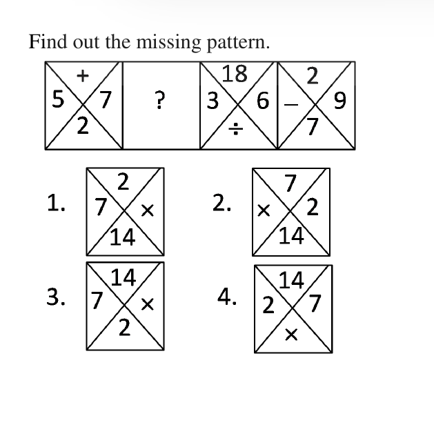
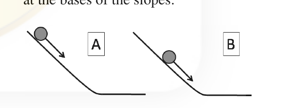
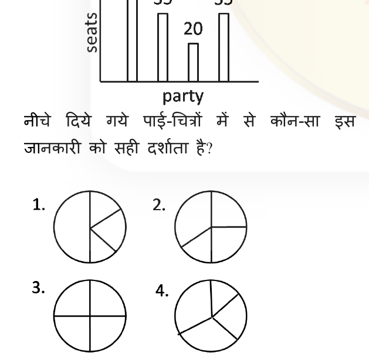
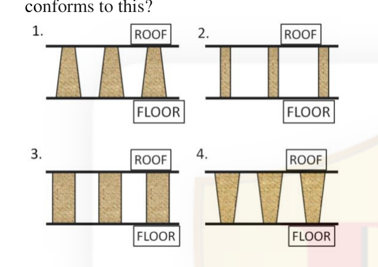
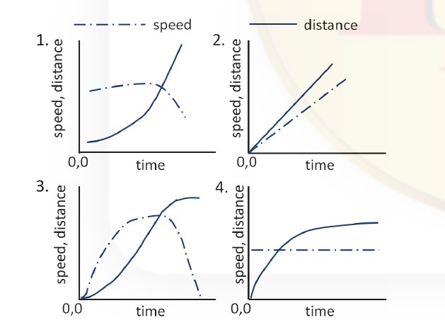
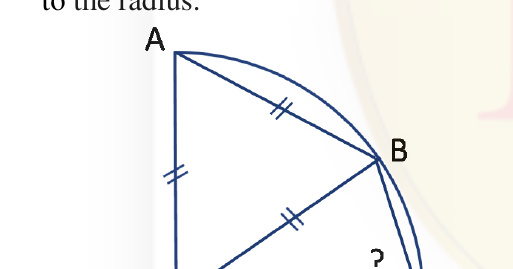

# CSIR NET Life Science — December 2016 — Part A (Booklet A / Set A)

Questions 1–20. Transcribed verbatim from the official bilingual scan (English only).
Answers per the CSIR **FINAL Answer Key, Booklet A** (see `sources.md`).

### Question 1

The random errors associated with the measurement of *P* and *Q* are 10% and 2%, respectively. What is the percentage random error in *P/Q*?

1. 12.0
2. 9.8
3. 8.0
4. 10.2

**Answer: 4 (10.2)**

> **Explanation:** For a quotient *P/Q*, the fractional (relative) random errors add in quadrature: √(0.10² + 0.02²) = √(0.01 + 0.0004) = √0.0104 ≈ 0.102, i.e. about **10.2%**.

---

### Question 2

In how many distinguishable ways can the letters of the word CHANCE be arranged?

1. 120
2. 720
3. 360
4. 240

**Answer: 3 (360)**

> **Explanation:** CHANCE has 6 letters with the letter C repeated twice. Number of distinct arrangements = 6!/2! = 720/2 = **360**.

---

### Question 3

Find out the missing pattern.

1.
2.
3.
4.

**Answer: 1**

> **Explanation:** In each box the top, left, right and bottom entries are related so that the two side numbers combined by the central operator give the fourth (e.g. 5 + 7 → 12 shown with 2, 18 ÷ 3 = 6, 2 − 7 with 9). Working the arithmetic across the given boxes, the missing figure must place the operands and result in the arrangement shown in option **1**.

---

### Question 4

Seeds when soaked in water gain about 20% by weight and 10% by volume. By what factor does the density increase?

1. 1.20
2. 1.10
3. 1.11
4. 1.09

**Answer: 4 (1.09)**

> **Explanation:** Density = mass/volume. New density / old density = (1.20)/(1.10) = 1.0909… ≈ **1.09**.

---

### Question 5

Retarding frictional force, *f*, on a moving ball, is proportional to its velocity, *V*. Two identical balls roll down identical slopes (A & B) from different heights. Compare the retarding forces and the velocities of the balls at the bases of the slopes.

1. *f_A* > *f_B* ; *V_A* > *V_B*
2. *f_A* > *f_B* ; *V_B* > *V_A*
3. *f_B* > *f_A* ; *V_B* > *V_A*
4. *f_B* > *f_A* ; *V_A* > *V_B*

**Answer: 1 (f_A > f_B ; V_A > V_B)**

> **Explanation:** Ball A is released from a greater height, so at the base it has the larger speed (*V_A* > *V_B*). Since the retarding force is proportional to velocity, the faster ball also experiences the larger retarding force (*f_A* > *f_B*).

---

### Question 6

Two cockroaches of the same species have the same thickness but different lengths and widths. Their ability to survive in oxygen deficient environments will be compromised if

1. their thickness increases, and the rest of the size remains the same.
2. their thickness remains unchanged, but their length increases.
3. their thickness remains unchanged, but their width decreases.
4. their thickness decreases, but the rest of the size remains unchanged.

**Answer: 1**

> **Explanation:** Insects take up oxygen largely by diffusion across their surface, and the critical dimension for diffusion distance is body **thickness**. Increasing thickness (with the rest unchanged) lowers the surface-area-to-volume ratio and lengthens the diffusion path, compromising survival in low oxygen.

---

### Question 7

The bar chart shows number of seats won by four political parties in a state legislative assembly.

Which of the following pie-charts correctly depicts this information?

1.
2.
3.
4.

**Answer: 2**

> **Explanation:** Total seats = 50 + 35 + 20 + 35 = 140. The proportions are 50/140 ≈ 128.6°, 35/140 = 90° (twice), and 20/140 ≈ 51.4°. The pie with one quarter (90°) sector appearing twice, one large sector and one small sector — option **2** — matches this.

---

### Question 8

Intravenous (IV) fluid has to be administered to a child of 12 kg with dehydration, at a dose of 20 mg of fluid per kg of body weight, in 1 hour. What should be the drip rate (in drops/min) of IV fluid? (1mg = 20 drops)

1. 7
2. 80
3. 120
4. 4

**Answer: 2 (80)**

> **Explanation:** Dose = 12 kg × 20 mg/kg = 240 mg = 240 × 20 = 4800 drops. Over 1 hour (60 min): 4800/60 = **80 drops/min**.

---

### Question 9

A hall with a high roof is supported by an array of identical columns such that, to a person lying on the floor and looking at the ceiling, the columns *appear parallel to each other*. Which of the following designs conforms to this?

1.
2.
3.
4.

**Answer: 1**

> **Explanation:** For columns to *appear* parallel when viewed from the floor looking up, they must actually be vertical and of equal height and spacing so their images do not converge in perspective — the arrangement shown in option **1**.

---

### Question 10

Which of the following graphs correctly shows the speed and the corresponding distance covered by an object moving along a straight line?

1.
2.
3.
4.

**Answer: 3**

> **Explanation:** Distance is the integral of speed. Where speed is constant, distance grows linearly; where speed rises, distance curves upward. Only option **3** shows a distance curve whose slope consistently tracks the plotted speed curve.

---

### Question 11

A normal TV screen has a width to height ratio of 4:3, while a high definition TV screen has a ratio of 16:9. What is the approximate ratio of their diagonals, if the heights of the two types of screens are the same?

1. 5:9
2. 5:18
3. 5:15
4. 5:6

**Answer: 4 (5:6)**

> **Explanation:** Let common height = h. Normal screen: width = (4/3)h, diagonal = √(h² + (4h/3)²) = (5/3)h. HD screen: width = (16/9)h, diagonal = √(h² + (16h/9)²) = (√(81+256)/9)h = (√337/9)h ≈ (18.36/9)h ≈ 2.04h. Ratio (5/3)h : 2.04h ≈ 1.667 : 2.0 ≈ **5 : 6**.

---

### Question 12

Comparing numerical values, which of the following is different from the rest?

1. The ratio of the circumference of a circle to its diameter.
2. The sum of the three angles of a plane triangle expressed in radians.
3. 22/7.
4. The net volume of a hemisphere of unit radius, and a cone of unit radius and unit height.

**Answer: 3**

> **Explanation:** Option 1 = π; option 2 = π (180° in radians); option 4 = (2/3)π + (1/3)π = π. Only 22/7 (≈3.142857) is a rational *approximation* to π, not π itself, so it is the odd one out.

---

### Question 13

A river is 4.1 km wide. A bridge built across it has 1/7 of its length on one bank and 1/8 of its length on the other bank. What is the total length of the bridge?

1. 5.1 km
2. 4.9 km
3. 5.6 km
4. 5.4 km

**Answer: 3 (5.6 km)**

> **Explanation:** Let total length = L. The portion spanning the river = L − L/7 − L/8 = L(1 − 1/7 − 1/8) = L(56 − 8 − 7)/56 = L(41/56). This equals the river width 4.1 km, so L = 4.1 × 56/41 = **5.6 km**.

---

### Question 14

OA, OB, and OC are radii of the quarter circle shown in the figure. AB is also equal to the radius. What is angle OCB?

1. 60°
2. 75°
3. 55°
4. 65°

**Answer: 2 (75°)**

> **Explanation:** Triangle OAB is equilateral (OA = OB = AB = radius), so angle AOB = 60°. Since angle AOC = 90°, angle BOC = 30°. Triangle OBC is isosceles (OB = OC = radius), so angles OBC = OCB = (180° − 30°)/2 = **75°**.

---

### Question 15

Two iron spheres of radii 12 cm and 1 cm are melted and fused. Two new spheres are made without any loss of iron. Their possible radii could be

1. 9 and 4 cm
2. 9 and 10 cm
3. 8 and 5 cm
4. 2 and 11 cm

**Answer: 2 (9 and 10 cm)**

> **Explanation:** Volume is conserved, so the sum of cubes of the radii must be preserved: 12³ + 1³ = 1728 + 1 = 1729. Option 2 gives 9³ + 10³ = 729 + 1000 = **1729** (the Ramanujan/Hardy number), matching exactly.

---

### Question 16

A man buys alcohol at Rs. 75/cL, adds water, and sells it at Rs. 75/cL making a profit of 50%. What is the ratio of alcohol to water?

1. 2:1
2. 1:2
3. 3:2
4. 2:3

**Answer: 1 (2:1)**

> **Explanation:** He sells at the same price he paid for pure alcohol, yet gains 50%. Selling 1 volume at Rs.75 earns Rs.75; to make 50% profit his alcohol cost must be Rs.50, i.e. alcohol = 2/3 of the mixture. Hence alcohol : water = 2 : 1.

---

### Question 17

The sum of digits of a two-digit number is 9. If the fraction formed by taking 9 less than the number as numerator and 9 more than the number as denominator is 3/4, what is the number?

1. 36
2. 63
3. 45
4. 54

**Answer: 2 (63)**

> **Explanation:** Let the number be N. (N − 9)/(N + 9) = 3/4 → 4N − 36 = 3N + 27 → N = 63. Digit sum 6 + 3 = 9 ✓, so the number is **63**.

---

### Question 18

The distance between X and Y is 1000 km. A person flies from X at 8 AM local time and reaches Y at 10 AM local time. He flies back after a halt of 4 hours at Y and reaches X at 4 PM local time on the same day. What is his average speed for the duration he is in the air?

1. 500 km/hour
2. 250 km/hour
3. 750 km/hour
4. cannot be calculated with the given information

**Answer: 1 (500 km/hour)**

> **Explanation:** The halt at Y is 4 hours. From arrival (10 AM Y) to return-departure is the halt, and total elapsed X→X is 8 hours (8 AM to 4 PM). Time in the air = 8 − 4 = 4 hours for a total distance of 2000 km, so average speed = 2000/4 = **500 km/hour**.

---

### Question 19

If a person travels *x*% faster than normal, he reaches *y* minutes earlier than normal. What is his normal time of travel?

1. (100/*x* + 1) *y* minutes
2. (*x*/100 + 1) *y* minutes
3. (*y*/100 + 1) *x* minutes
4. (100/*y* + 1) *x* minutes

**Answer: 1 ((100/x + 1) y minutes)**

> **Explanation:** Let normal speed = v, normal time = T, distance = vT. Faster speed = v(1 + x/100), time = T − y. So vT = v(1 + x/100)(T − y) → T = (1 + x/100)(T − y). Solving gives T = (1 + x/100)·(100/x)·y = ((100 + x)/x)·y = **(100/x + 1)·y** minutes.

---

### Question 20

A and B walk up an escalator one step at a time, while the escalator itself moves up at a constant speed. A walks twice as fast as B. A reaches the top in 40 steps and B in 30 steps. How many steps of the escalator can be seen when it is not moving?

1. 30
2. 40
3. 50
4. 60

**Answer: 4 (60)**

> **Explanation:** Let N = visible steps and let the escalator add *k* steps for every step B takes. A walks twice as fast as B, so for the same escalator speed A spends half as long on it. B takes 30 steps → escalator adds 30k; A takes 40 steps in half the time → escalator adds 40k/2 = 20k. Both equal N: 30 + 30k = 40 + 20k → 10k = 10 → k = 1. Hence N = 30 + 30 = **60**.
