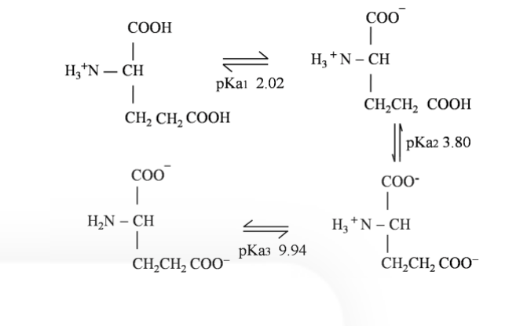
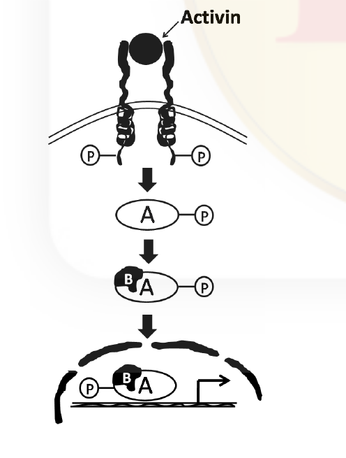

# CSIR NET Life Science — December 2016 — Part B (Booklet A / Set A)

Questions 21–70. Transcribed verbatim from the official bilingual scan (English only).
Answers per the CSIR **FINAL Answer Key, Booklet A** (see `sources.md`).
Q51 is marked `*` in the key = **DROPPED** (benefit of marks to all who attempted).

### Question 21

Choose the most appropriate pH at which the net charge is zero for the molecule from the data shown below:

1. 2.02
2. 2.91
3. 5.98
4. 6.87

**Answer: 2 (2.91)**

> **Explanation:** The isoelectric point (net charge zero) for an acidic amino acid lies midway between the two lowest pKa values (the two carboxyl groups): pI = (pKa1 + pKa2)/2 = (2.02 + 3.80)/2 = **2.91**.

---

### Question 22

Choose the correct statement about peptides in the Ramachandran plot.

1. Peptides that are unstructured will have all the backbone dihedral angles in the disallowed regions.
2. It is not possible to conclude whether a peptide adopts entirely helix or entirely beta sheet conformation.
3. The occurrence of beta turn conformation in a peptide can be deduced.
4. The sequence of a peptide can be deduced.

**Answer: 3**

> **Explanation:** The Ramachandran plot maps backbone φ/ψ angles; characteristic regions correspond to α-helix, β-sheet and β-turn conformations, so a β-turn can be deduced from the angles. It cannot reveal the amino-acid **sequence**, and unstructured residues fall in *allowed* (not disallowed) regions.

---

### Question 23

Equilibrium constant (K′eq) of a reaction is a ratio of product to substrate concentrations. The relation between (K′eq) and free energy change in a reaction (ΔG′) is as follows

ΔG′ = −RT ln K′eq

Reaction A and Reaction B have K′eq values of 10 and 100, respectively. Which of the following statements is correct with respect to ΔG′?

1. ΔG′of A = ΔG′of B
2. ΔG′of A > ΔG′of B
3. ΔG′of B > ΔG′of A
4. ΔG′of A ≃ ΔG′of B

**Answer: 2**

> **Explanation:** ΔG′ = −RT ln K′eq. Larger K′eq gives a more negative ΔG′. A has K′eq = 10 → ΔG′ = −RT ln10; B has K′eq = 100 → ΔG′ = −RT ln100, which is more negative. Hence ΔG′(A) > ΔG′(B).

---

### Question 24

Excess oxygen consumed after a vigorous exercise is

1. to pump out lactic acid from muscle.
2. to increase the concentration of lactic acid in muscle.
3. to reduce dissolved carbon dioxide in blood.
4. to make ATP for gluconeogenesis.

**Answer: 4**

> **Explanation:** The "oxygen debt" repays the energy needed to convert accumulated lactate back to glucose (gluconeogenesis) and restore ATP/creatine-phosphate and O₂ stores; the extra O₂ is used to make the ATP for gluconeogenesis.

---

### Question 25

Which one of the following describes the primary function of flippases?

1. Help in increasing lipid-protein interaction in the outer leaflet of the bilayer
2. Move certain phospholipids from one leaflet of the membrane to another
3. Localize more negatively charged membrane proteins in the lipid bilayer
4. Cause uncoupling of v-SNARES and t-SNARES after fusion of incoming vesicle with target membrane

**Answer: 2**

> **Explanation:** Flippases (aminophospholipid translocases) are P-type ATPases that move specific phospholipids from the outer (exoplasmic) leaflet to the inner (cytosolic) leaflet, maintaining membrane lipid asymmetry.

---

### Question 26

Mitotic cyclin-CDK activity peaks in M phase. This is because

1. Mitotic cyclin is synthesised only in M phase.
2. Threshold level of mitotic cyclin accumulates only in late G₂.
3. Cyclin subunit is activated by phosphorylation only in M phase.
4. The kinase subunit is activated by dephosphorylation only in M phase.

**Answer: 4**

> **Explanation:** MPF (cyclin B–CDK1) activity is switched on at the G₂/M transition by *dephosphorylation* of CDK1 (Cdc25 removes the inhibitory phosphate laid down by Wee1). The cyclin accumulates during S/G₂ but the kinase subunit is activated by dephosphorylation only in M phase.

---

### Question 27

The gel to liquid crystalline phase transition temperature in phosphatidyl choline (PC) lipids composed of dioleoyl (DO), dipalmitoyl (DP), distearoyl (DS) and palmitoyl oleoyl (PO) fatty acids in increasing order will be

1. DOPC > DPPC > POPC > DSPC
2. DSPC > DPPC > POPC > DOPC
3. DPPC > DSPC > DOPC > POPC
4. POPC > DPPC > DOPC > DSPC

**Answer: 2**

> **Explanation:** Transition temperature (Tm) rises with acyl-chain length and with saturation, and falls with unsaturation/kinks. Longest & saturated DS (C18:0) > DP (C16:0) > mixed PO (one unsaturated) > DO (two unsaturated). So increasing order of the *listed* set is DSPC > DPPC > POPC > DOPC (option 2 lists the ranking of Tm values).

---

### Question 28

Which of the following is NOT an example of transmembrane transport between different subcellular compartments?

1. Transport from cytoplasm into the lumen of the endoplasmic reticulum
2. Transport from endoplasmic reticulum to the Golgi complex
3. Transport from stroma into thylakoid space
4. Transport from mitochondrial intermembrane space into the mitochondrial matrix

**Answer: 2**

> **Explanation:** ER→Golgi movement occurs by **vesicular transport** (bulk flow of membrane-bounded carriers), not by transmembrane translocation across a compartment's boundary membrane. The others involve proteins/molecules crossing a membrane.

---

### Question 29

Which of the following are NOT transcribed by RNA polymerase II?

1. miRNA and some snRNA
2. miRNA and snoRNA
3. mRNA and snoRNA
4. tRNA and 5S rRNA

**Answer: 4**

> **Explanation:** RNA polymerase II transcribes mRNA, most snRNA and miRNA/snoRNA. **tRNA and 5S rRNA are transcribed by RNA polymerase III**, so they are the ones NOT made by Pol II.

---

### Question 30

RNA editing, a post-transcriptional process, is achieved with the help of guide RNA (g-RNA). Which one of the following statements about the process is NOT true?

1. g-RNA dependent RNA editing happens in the kinetoplast DNA
2. g-RNA is involved in chemical modification of t-RNA
3. This process involves insertion or deletion of uridines
4. Sequences edited once may be re-edited using a second g-RNA

**Answer: 2**

> **Explanation:** In kinetoplastid mitochondria, g-RNA directs insertion/deletion of uridines (pan-editing), and partially edited sequences can be re-edited by additional g-RNAs. Chemical modification of t-RNA is *not* the g-RNA-dependent editing mechanism.

---

### Question 31

Telomerase, a RNA-protein complex which completes the replication of telomeres during DNA synthesis, is a specialised

1. RNA dependent DNA polymerase
2. DNA dependent DNA polymerase
3. DNA dependent RNA polymerase
4. RNA dependent RNA polymerase

**Answer: 1**

> **Explanation:** Telomerase uses its own internal RNA as a template to synthesise DNA repeats — i.e. it is an RNA-dependent DNA polymerase (a reverse transcriptase).

---

### Question 32

Consider a short double-stranded linear DNA molecule of 10 complete turns with 10.5 bp/turn. The ends of the DNA molecule are sealed together to make a relaxed circle. This relaxed circle will have a linking number of

1. 105
2. 20.5
3. 10.0
4. 10.5

**Answer: 3 (10.0)**

> **Explanation:** For a relaxed closed circle, Lk = number of helical turns = total bp / bp per turn = (10 × 10.5)/10.5 = **10**.

---

### Question 33

In the above signalling cascade, which one of the following molecules is denoted by 'B'?

1. STAT 5
2. SMAD 6
3. GSK3β
4. SMAD 4

**Answer: 4 (SMAD 4)**

> **Explanation:** Activin signals via the TGF-β/Smad pathway: receptor-activated Smad2/3 (here 'A') forms a complex with the co-Smad **Smad 4** ('B') that translocates to the nucleus to regulate transcription.

---

### Question 34

The secondary antibodies routinely used for the detection of primary antibodies in western blotting experiment are

1. anti-allotypic
2. anti-idiotypic
3. anti-isotypic
4. anti-paratypic

**Answer: 3**

> **Explanation:** Secondary antibodies are raised against the constant (Fc) region of the primary antibody's immunoglobulin class — i.e. they are **anti-isotypic** (species- and isotype-specific).

---

### Question 35

Which of the following events will NOT usually lead to transformation of a normal cell into a cancer cell?

1. Gain of function of oncogenes
2. Loss of function of tumor suppressors
3. Gain of function of genes involved in nucleotide excision repair
4. Loss of function of pro-apoptosis related genes

**Answer: 3**

> **Explanation:** Enhanced nucleotide excision repair improves DNA damage removal and is protective, not transforming. Gain-of-function oncogenes, loss of tumour suppressors, and loss of pro-apoptotic genes all promote transformation.

---

### Question 36

Which one of the following is a food borne toxin?

1. Tetanus toxin
2. Botulinum toxin
3. Cholera toxin
4. Diptheria toxin

**Answer: 2 (Botulinum toxin)**

> **Explanation:** Botulinum toxin (from *Clostridium botulinum*) causes food-borne botulism through preformed toxin in improperly preserved food. Tetanus and diphtheria are not food-borne; cholera is water/food-borne infection but the classic "food-borne intoxication" here is botulinum.

---

### Question 37

Which one of the following statements is WRONG?

1. The megasporocyte develops within the megasporangium of the ovule
2. Megasporocyte undergoes meiosis to produce four haploid megaspores
3. All the four megaspores undergo several mitotic divisions to form female gametophyte in most angiosperms
4. Female gametophyte is haploid

**Answer: 3**

> **Explanation:** In most angiosperms only **one** of the four linear megaspores survives (the functional chalazal megaspore); the other three degenerate. It is this single megaspore that undergoes mitosis to form the female gametophyte (embryo sac) — so statement 3 is wrong.

---

### Question 38

Certain proteins or mRNAs that are regionally localized within the unfertilized egg and regulate development are called

1. gene regulators.
2. morphometric determinants.
3. cytoplasmic determinants.
4. mosaic forming factors.

**Answer: 3**

> **Explanation:** Maternal products (mRNAs/proteins) unevenly distributed in the egg cytoplasm that instruct cell fates are **cytoplasmic determinants**.

---

### Question 39

Cell to cell communication is important in development of an organism. The ability of cells to respond to a specific inductive signal is called

1. Regional specificity of induction
2. Competence
3. Juxtracrine signalling
4. Instructive interaction

**Answer: 2 (Competence)**

> **Explanation:** The capacity of a responding cell/tissue to react to an inductive signal is termed **competence**.

---

### Question 40

Apical ectodermal ridge induction is essential for tetrapod limb development. Which one of the following is NOT essential for the formation of a functional limb?

1. Tbx genes and Wnt
2. Androsterone
3. Apoptotic genes
4. Fibroblast growth factor

**Answer: 2 (Androsterone)**

> **Explanation:** Limb initiation/maintenance needs Tbx (Tbx5/Tbx4) with Wnt signalling, FGFs from the AER, and apoptosis (to sculpt digits). The steroid pheromone **androsterone** is unrelated to limb formation.

---

### Question 41

Which one of the following best describes the symplast pathway of water flow from the epidermis to endodermis in a plant root?

1. Water moves through cell walls and extracellular spaces without crossing any membrane
2. Water travels across the root cortex via the plasmodesmata
3. Water crosses the plasma membrane of each cell in its path twice, once on entering and once on exiting
4. Transport across the tonoplast

**Answer: 2**

> **Explanation:** The **symplast** route is movement through the continuous cytoplasm connected by **plasmodesmata**, crossing the plasma membrane only once at the start. (Option 1 describes the apoplast; option 3 the transmembrane cell-to-cell route.)

---

### Question 42

The herbicide, dichlorophenyldimethylurea, is an inhibitor of

1. shikimate pathway for biosynthesis of aromatic amino acids.
2. electron transport from P680 to P700.
3. branched chain amino acid pathway.
4. electron transport from P700 to ferredoxin.

**Answer: 2**

> **Explanation:** DCMU blocks electron flow from Q_B (plastoquinone) of PSII onward, i.e. it inhibits linear electron transport **from P680 toward P700** (PSII→PSI), by binding the QB site.

---

### Question 43

Which one of the following compounds is NOT a part of alkaloid class of secondary metabolites?

1. Lignin
2. Indole
3. Tropane
4. Pyrrolidine

**Answer: 1 (Lignin)**

> **Explanation:** Alkaloids are nitrogen-containing compounds built on indole, tropane, pyrrolidine, pyridine etc. **Lignin** is a phenolic (non-nitrogen) polymer of the phenylpropanoid pathway, not an alkaloid.

---

### Question 44

Which one of the following plant derived signalling molecules induces hyphal branching of arbuscular mycorrhizal fungi, a phenomenon that is observed at the initial stages of colonization by these fungi?

1. Salicylic acid
2. Abscisic acid
3. Strigolactones
4. Systemin

**Answer: 3 (Strigolactones)**

> **Explanation:** Root-exuded **strigolactones** stimulate hyphal branching of AM fungi and also trigger germination of parasitic *Striga*.

---

### Question 45

Serum has essentially the same composition as plasma EXCEPT that it lacks

1. Albumin
2. Stuart-Prower factor
3. Antihemophilic factor
4. Fibrinogen

**Answer: 3 (Antihemophilic factor)**

> **Explanation:** Serum is plasma from which the clotting factors consumed during coagulation have been removed. The official Booklet A key credits option **3 (Antihemophilic factor)**; note that fibrinogen (option 4) is likewise classically absent from serum — see `sources.md` (Unresolved).

---

### Question 46

Which one of the following does NOT occur due to stimulation of baroreceptors?

1. Bradycardia
2. Hypotension
3. Venodilation
4. Vasoconstriction

**Answer: 4 (Vasoconstriction)**

> **Explanation:** High-pressure baroreceptor activation (e.g. raised BP) increases parasympathetic and withdraws sympathetic tone → bradycardia, hypotension and vasodilation/venodilation. **Vasoconstriction** results from *reduced* baroreceptor firing, not stimulation.

---

### Question 47

Vasopressin secretion does NOT increase with

1. exercise
2. an increase in extracellular fluid volume
3. standing
4. vomiting

**Answer: 2**

> **Explanation:** ADH (vasopressin) release rises with increased plasma osmolality, decreased blood volume/pressure, exercise, standing and vomiting. An **increase in extracellular fluid volume** (dilution/hypotonicity) *suppresses* vasopressin secretion.

---

### Question 48

Which type of cells located in gastric glands is responsible for the release of histamine?

1. Mucous neck cells
2. Enterochromaffin-like cells
3. Chief cells
4. Parietal cells

**Answer: 2**

> **Explanation:** Gastric **enterochromaffin-like (ECL) cells** release histamine, which stimulates the parietal-cell H₂ receptors to secrete HCl.

---

### Question 49

If non-disjunction occurs in meiosis I, which of the following scenario is most likely to occur?

1. Two gametes will be n+1 and two will be n-1
2. One gamete will be n+1, two will be 'n' and one will be n-1
3. Two gametes will be normal and two will be n-1
4. Two gametes will be normal and two will be n+1

**Answer: 1**

> **Explanation:** Non-disjunction in **meiosis I** (homologues fail to separate) yields both secondary cells aneuploid, so all four gametes are abnormal: two n+1 and two n−1. (Meiosis II non-disjunction gives option 2.)

---

### Question 50

Which of the following is true for cells harbouring F′ plasmid?

1. Their F plasmid is non-functional.
2. They exhibit increased rates of transfer of all chromosomal genes.
3. They are merodiploids.
4. They fail to survive as the chromosomal origin of replication is inactivated.

**Answer: 3**

> **Explanation:** An F′ plasmid carries a segment of the bacterial chromosome; a cell with F′ plus its own chromosome is **partially diploid (merodiploid)** for those genes.

---

### Question 51

Maternal inheritance of coiling of shell in snail (*Limnaea peregra*) is well established. The dextral coiling depends on dominant allele *D* and sinistral coiling depends upon recessive allele *d*. A female F1 progeny of dextral (*Dd*) type is crossed with a male sinistral snail. What will be the ratio of heterozygous: homozygous individuals in its F₂ progeny?

1. 3:1
2. 1:1
3. 1:3
4. 1:2:1

**Answer: — (DROPPED)**

> **Explanation:** The official Booklet A key marks this question with `*` = "benefit of marks to those who attempted" (question dropped). No correct option is credited; the genotype ratio of the cross Dd × dd is 1:1 but the question was withdrawn.

---

### Question 52

Which of the following mutagens is most likely to result in a single amino acid change in a gene product?

1. Acridine orange
2. X-rays
3. Ethylmethane sulphonate (EMS)
4. Ethidium bromide

**Answer: 3**

> **Explanation:** EMS is a base (alkylating) analog that causes **point mutations** (base substitutions) → single amino-acid change. Acridine orange and ethidium bromide cause frameshifts; X-rays cause large deletions/chromosomal damage.

---

### Question 53

An alga having chlorophyll a, floridean starch as storage product and lacking flagellate cells belongs to the class

1. Phaeophyceae.
2. Chlorophyceae.
3. Rhodophyceae.
4. Xanthophyceae.

**Answer: 3**

> **Explanation:** **Floridean starch** and the complete absence of flagella are diagnostic of red algae (Rhodophyceae).

---

### Question 54

Which of the following is NOT true for monocots?

1. Sieve tube members with companion cells
2. Vasculature atactostelic
3. Tricolpate pollen
4. Vascular cambium absent

**Answer: 3**

> **Explanation:** Monocots have **monosulcate (single-furrow) pollen**; tricolpate pollen is a eudicot feature. Monocots do have sieve cells/companion cells, scattered (atactostele) vascular bundles, and lack a vascular cambium.

---

### Question 55

Individuals occupying a particular habitat and adapted to it phenotypically but not genotypically are known as

1. Ecophenes.
2. Ecotypes.
3. Ecospecies.
4. Coenospecies.

**Answer: 1**

> **Explanation:** An **ecophene** is a phenotype produced by the environment (not genetically fixed); an ecotype is a genetically distinct adapted population.

---

### Question 56

Which one of the following statements supports the concept of trade-off in the evolution of life history traits?

1. Level of parental care and clutch size are positively correlated
2. Animals maturing early tend to live longer
3. An increase in seed size is usually associated with a decrease in seed number
4. Allocation of higher energy for reproduction leads to higher population growth

**Answer: 3**

> **Explanation:** A trade-off means a gain in one trait costs another because resources are finite: **larger seeds are produced in fewer numbers** (size–number trade-off).

---

### Question 57

A plot of dN/dt as a function of population density yields a

1. rectangular hyperbola.
2. negative exponential curve.
3. positive rectilinear curve.
4. bell-shaped curve.

**Answer: 4**

> **Explanation:** In logistic growth, dN/dt = rN(K−N)/K is maximum at N = K/2 and falls to zero at N = 0 and N = K, giving a **bell-shaped (parabolic)** curve of dN/dt versus N.

---

### Question 58

For a species having logistic growth, if K = 20,000 and r = 0.15, the maximum sustainable yield will be

1. 450
2. 1500
3. 3000
4. 6000

**Answer: 2 (1500)**

> **Explanation:** For logistic growth the maximum sustained yield is the peak of dN/dt, MSY = rK/4 = (0.15 × 20000)/4 = 750. This exact value is **not among the options**; the official Booklet A key credits option **2 (1500)** (which corresponds to rK/2). The answer shown is the key's, not the value the standard formula yields — see `sources.md` (Unresolved).

---

### Question 59

Which of the following is a correct ranking of ecosystems based on the root: shoot ratio of plants?

1. Tropical wet forest > Tropical dry forest > Temperate grassland > Tropical grassland
2. Temperate grassland > Tropical grassland > Tropical wet forest > Tropical dry forest
3. Tropical dry forest > Tropical wet forest > Tropical grassland > Temperate grassland
4. Temperate grassland > Tropical grassland > Tropical dry forest > Tropical wet forest

**Answer: 4**

> **Explanation:** Root:shoot ratio is highest in water-limited systems where plants invest below ground. Grasslands (especially temperate) > dry forests > wet forests (which invest in shoots/leaves). Option 4 ranks grasslands above forests and dry above wet.

---

### Question 60

Which of the following periods is known as "Age of Fishes"?

1. Devonian
2. Jurassic
3. Cambrian
4. Carboniferous

**Answer: 1 (Devonian)**

> **Explanation:** The **Devonian** is called the "Age of Fishes" for the great diversification of jawless, placoderm, and early bony and cartilaginous fishes.

---

### Question 61

Which of the following is NOT an assumption of the Hardy-Weinberg model?

1. Population mates at random with respect to the locus in question
2. Selection is not acting on the locus in question
3. One allele is dominant and the other is recessive at this locus
4. The population is effectively infinite in size

**Answer: 3**

> **Explanation:** Hardy-Weinberg assumes random mating, no selection, no mutation, no migration and infinite size. It does **not** require dominance/recessiveness — allele and genotype frequencies follow p², 2pq, q² regardless of dominance.

---

### Question 62

Which of the following geological periods is characterized by the first appearance of mammals?

1. Tertiary
2. Cretaceous
3. Permian
4. Triassic

**Answer: 4 (Triassic)**

> **Explanation:** The earliest true mammals appear in the **Late Triassic**, evolving from cynodont therapsids.

---

### Question 63

In which of the following mating systems there is likely to be NO conflict of interest over reproductive success between the sexes?

1. Polyandry
2. Monogamy
3. Promiscuity
4. Polygamy

**Answer: 2 (Monogamy)**

> **Explanation:** Under strict lifelong **monogamy** the reproductive interests of the pair coincide (shared parentage), minimising sexual conflict; polyandry, polygamy and promiscuity all generate conflict over paternity/investment.

---

### Question 64

Which one of the following analytical techniques does NOT involve an optical measurement?

1. ELISA
2. Microarray
3. Flow cytometry
4. Differential Scanning Calorimetry

**Answer: 4**

> **Explanation:** DSC measures heat flow (thermal), not light. ELISA (colorimetric absorbance), microarray (fluorescence) and flow cytometry (light scatter/fluorescence) all rely on optical detection.

---

### Question 65

Which genes have been introduced in Bollgard II cotton to get resistance against cotton bollworm, tobacco budworm and pink bollworm?

1. *cry1Ab* + *cry1Ac*
2. *cry1Ac* + *cry2Ab*
3. *cry1Ab* + *cry2Ab*
4. *cry9C* + *cry2Ab*

**Answer: 2**

> **Explanation:** Bollgard II expresses two Bt toxins, **Cry1Ac + Cry2Ab**, for broader lepidopteran control and resistance management.

---

### Question 66

Different leads are used to record ECG of humans. Which one of the following is NOT unipolar leads?

1. Augmented limb leads
2. V₁ and V₂ leads
3. Standard limb leads
4. VR and VL leads

**Answer: 3**

> **Explanation:** The three **standard (bipolar) limb leads** (I, II, III) record the potential *difference* between two limbs and are bipolar. Augmented limb leads (aVR, aVL, aVF) and the precordial (V) leads are unipolar.

---

### Question 67

The presence and distribution of specific mRNAs within a cell can be detected by

1. Northern blot analysis
2. RNase protection assay
3. *in situ* hybridization
4. real-time PCR

**Answer: 3**

> **Explanation:** **In situ hybridization** localises specific mRNAs to their spatial distribution *within* intact cells/tissues; the others quantify or size RNA but do not preserve cellular location.

---

### Question 68

The tetanus vaccine given to humans in the case of a deep cut is a

1. DNA vaccine
2. recombinant vector vaccine
3. subunit vaccine
4. toxoid vaccine

**Answer: 4**

> **Explanation:** The tetanus vaccine is a **toxoid** — inactivated tetanus exotoxin that elicits neutralising antitoxin antibodies.

---

### Question 69

The electrospray ionization spectrum of a mixture of two peptides show peaks with m/z values 301, 401, 501, and 601. The molecular weights of the peptides are

1. 1200 and 1250
2. 1200 and 1500
3. 1350 and 1500
4. 1250 and 1350

**Answer: 2 (1200 and 1500)**

> **Explanation:** Electrospray gives multiply-charged ions. For peptide M: peaks 401 (M+3H)/3 and 301 (M+4H)/4 both give M ≈ 1200; peaks 601 (M+2H)/2 and 501 (M+3H)/3 give M ≈ 1200 and 1500. The two peptide masses are **1200 and 1500**.

---

### Question 70

An optical measurement of a protein is taken both before and after digestion of the protein by a protease. In which of the following spectroscopic measurements the signal change, i.e., before vs after protease treatment, could be the maximum?

1. Absorbance at 280 nm
2. Circular dichroism
3. Absorbance at 340 nm
4. Fluorescence value

**Answer: 2 (Circular dichroism)**

> **Explanation:** Far-UV circular dichroism reports on ordered secondary structure (α-helix/β-sheet). Protease digestion cleaves the peptide bonds and destroys that folded structure, so the CD signal changes most. Absorbance at 280 nm (aromatics) and at 340 nm are little affected by cleavage.
