# CSIR NET Life Science — December 2016 — Part C (Booklet A / Set A)

Questions 71–145. Transcribed verbatim from the official bilingual scan (English only).
Answers per the CSIR **FINAL Answer Key, Booklet A** (see `sources.md`).
Q98 and Q119 are marked `*` = **DROPPED** (benefit of marks to all who attempted).
Q134 is printed **bold** in the key = change in key.

### Question 71

From the following statements,
A. Hydrogen, Deuterium and Tritium differ in the number of protons
B. Hydrogen, Deuterium and Tritium differ in the number of neutrons
C. Both Deuterium and Tritium are radioactive and decay to Hydrogen and Deuterium, respectively
D. Tritium is radioactive and decays to Helium
E. Carbon-14 decays to Nitrogen-14
F. Carbon-14 decays to Carbon-13

pick the combination with ALL correct statements.

1. A, B and F
2. B, D and E
3. A, C and D
4. C, E and F

**Answer: 2 (B, D and E)**

> **Explanation:** Isotopes differ in **neutrons** (B true). Tritium (³H) β-decays to ³He (D true). ¹⁴C β-decays to ¹⁴N (E true). A is false (same protons), C is false (deuterium is stable), F is false.

---

### Question 72

From the following statements,
A. For a reaction to occur spontaneously the free energy change must be negative
B. The interaction between two nitrogen molecules in the gaseous state is predominantly electrostatic
C. By knowing bond energies, it is possible to deduce whether the bond is covalent bond or hydrogen bond
D. Hydrophobic interactions are not important in a folded globular protein

pick the combination with ALL WRONG statements.

1. A and B
2. B and C
3. C and D
4. B and D

**Answer: 4 (B and D)**

> **Explanation:** A is correct (ΔG < 0 for spontaneous). B is wrong — N₂–N₂ interactions are weak van der Waals/dispersion, not electrostatic. C is correct — bond energy magnitude distinguishes covalent from H-bonds. D is wrong — hydrophobic interactions are a major driving force in protein folding. So the all-wrong pair is **B and D**.

---

### Question 73

The following are four statements on peptide/protein conformation:
A. Glycine has the largest area of conformationally allowed space in the Ramachandran plot of Φ and Ψ
B. A 20-residue peptide that is acetylated at the N-terminus and amidated at the C-terminus has Φ = −60°(±5), Ψ = −30°(±5) for all the residues. It can be concluded that conformation of the peptide is helix-turn-strand
C. The allowed values of Φ, Ψ for amino acids in a protein are not valid for short peptides
D. A peptide Acetyl-A₁-A₂-A₃-A₄-CONH₂ (A₁-A₄ are amino acids) adopts a well defined β-turn. The dihedral angles of A₂ and A₃ determine the type of β-turn

Choose the combination of correct statements.

1. A and B
2. B and C
3. A and D
4. C and D

**Answer: 3 (A and D)**

> **Explanation:** Glycine (no side chain) has the largest allowed Ramachandran region (A true). A β-turn's type is defined by the φ/ψ of residues i+1 (A₂) and i+2 (A₃) (D true). B is wrong (uniform −60/−30° is α-helical, not "helix-turn-strand"); C is wrong (the same steric limits apply to short peptides).

---

### Question 74

A researcher investigated a set of conditions for a protein with an isoelectric point of 6.5 and also binds to calcium. This protein was subjected to four independent treatments: (i) pH 6.4, (ii) 10% glycerol, (iii) 10 mM CaCl₂, (iv) 40% ammonium sulphate. This was followed by centrifugation and estimation of the protein in the supernatant. The results are depicted in the graph below:

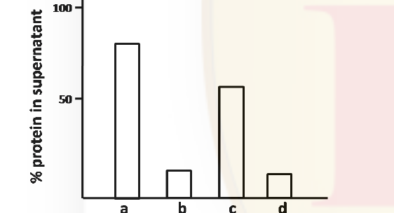

Which of the following treatments best represents the results shown in the graph?

1. a = ammonium sulphate, b = glycerol, c = pH 6.4, d = CaCl₂
2. a = CaCl₂, b = glycerol, c = ammonium sulphate, d = pH 6.4
3. a = pH 6.4, b = CaCl₂, c = ammonium sulphate, d = glycerol
4. a = CaCl₂, b = pH 6.4, c = glycerol, d = ammonium sulphate

**Answer: 4**

> **Explanation:** At pH near the pI (6.4) or with calcium bound, the protein precipitates → low supernatant; salt-out (ammonium sulphate) also lowers solubility while glycerol stabilises solubility. The pattern of high/low bars matches the assignment in option **4**.

---

### Question 75

In the biosynthesis of purine:

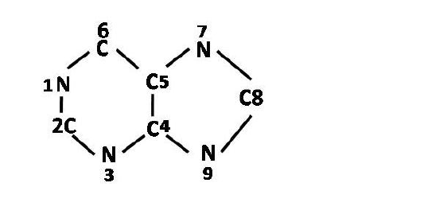

1. All N atoms, C4 and C5 are from aspartic acid
2. N1 is from Aspartic acid; N3 and N9 are from Glutamine side-chain; N7, C4 and C5 are from Glycine
3. N1 is from Aspartic acid; N3 from Glutamine side-chain; N9 from N attached to Cα of Glutamine; N7, C4 and C5 are from Glycine
4. N1 is from Glutamine; N3 from Glutamine side-chain; N9 from N attached to Cα of Glutamine; N7, C4 and C5 are from Glycine

**Answer: 2**

> **Explanation:** In de-novo purine synthesis N1 comes from aspartate; N3 and N9 from glutamine amide nitrogens; N7, C4 and C5 from glycine; C2 and C8 from formyl-THF; C6 from bicarbonate. Option **2** matches this.

---

### Question 76

A researcher was investigating the substrate specificity of two different enzymes, X and Y, on the same substrate. Both the enzymes were subjected to treatment with either heat or an inhibitor which inhibits the enzyme activity. Following are the results obtained where a=inhibitor treatment, b=heat treatment and c=control.

![Two enzyme-kinetics panels (Protein X and Protein Y) plotting Activity vs [S], each with curves a, b, c showing different inhibition/heat effects](images/C/fig76.png)

Which of the following statements is correct?

1. Only protein X is specific for the substrate, S
2. Only protein Y is specific for the substrate, S
3. Both X and Y are specific for the substrate, S
4. Both X and Y are non-specific for the substrate, S

**Answer: 3**

> **Explanation:** In both panels the control (c) gives the highest activity, the specific inhibitor (a) reduces activity, and heat (b) abolishes it — behaviour expected of genuine enzyme–substrate catalysis for both X and Y. Hence both are specific for S.

---

### Question 77

In an experiment, red blood cells were subjected to lysis and any unbroken cells were removed by centrifugation at 600g. The supernatant was taken and centrifuged at 100,000g. The pellet was extracted with 5M NaCl and again centrifuged at 100,000g. Which of the following proteins would be present in the supernatant?

1. Band 3
2. Glycophorin
3. G protein-coupled receptor
4. Spectrin

**Answer: 4**

> **Explanation:** The 100,000g pellet is the membrane; 5M NaCl strips peripheral (spectrin/ankyrin) proteins off the membrane into the supernatant, whereas integral proteins (Band 3, glycophorin, GPCRs) stay in the pellet. **Spectrin** is the peripheral protein released.

---

### Question 78

In order to study the intracellular trafficking of protein 'A', it was tagged with GFP (A-GFP). Fluorescence microscopy showed that A-GFP co-localizes with LAMP1. In the presence of bafilomycin A, an inhibitor of H⁺-ATPase, A-GFP does not co-localize with LAMP1. Instead, it co-localizes with LC3 puncta. Which one of the following statements is TRUE?

1. A-GFP targets to the ER in the absence of bafilomycin A.
2. Autophagy is required for trafficking of A-GFP to lysosomes.
3. Bafilomycin A facilitates targeting of A-GFP to the ER.
4. Bafilomycin A facilitates targeting of A-GFP to the mitochondria.

**Answer: 2**

> **Explanation:** LAMP1 is a lysosomal marker and LC3 marks autophagosomes. Blocking the lysosomal H⁺-ATPase reroutes A-GFP into LC3 (autophagosomal) puncta, showing that **autophagy** mediates delivery of A-GFP to the lysosome.

---

### Question 79

'A' is an inhibitor of chloroplast function. The production of O₂ and the synthesis of ATP are measured in illuminated chloroplasts before and after addition of 'A' as shown below

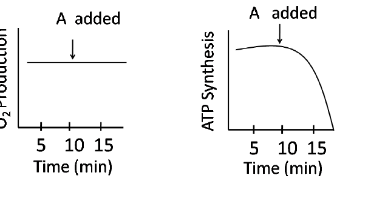

Which statement is correct?

1. 'A' inhibits the reduction of NADP⁺
2. 'A' inhibits the proton gradient and the reduction of NADP⁺
3. 'A' inhibits the proton gradient but not the reduction of NADP⁺
4. 'A' inhibits neither the proton gradient nor the reduction of NADP⁺

**Answer: 3**

> **Explanation:** O₂ evolution (water splitting / electron flow to NADP⁺) continues unchanged, so the reduction of NADP⁺ is not blocked; but ATP synthesis collapses, meaning the proton gradient (photophosphorylation) is destroyed. Hence 'A' inhibits the proton gradient but not NADP⁺ reduction.

---

### Question 80

During cell cycle progression from G₁ to S, cyclin D-CDK4 phosphorylates Rb and reduces its affinity for E2F. E2F dissociates from Rb and activates S-phase gene expression. Overexpression of protein 'A' arrests G₁ phase progression. Which of the following statements is TRUE?

1. 'A' inhibits Rb-E2F interaction
2. 'A' inhibits CDK4 activity
3. 'A' phosphorylates E2F
4. 'A' degrades Rb

**Answer: 2**

> **Explanation:** To arrest cells in G₁, 'A' must keep Rb bound to E2F (hypo-phosphorylated Rb). Inhibiting **CDK4** prevents Rb phosphorylation, so E2F stays sequestered and the G₁/S transition is blocked.

---

### Question 81

Cells in S-phase of the cell cycle were fused to cells in the following stages of cell cycle: (a) G₁ phase, (b) G₂ phase, (c) M phase. These cells were then grown in medium containing tritiated thymidine. Maximal amount of freshly labelled DNA is likely to be obtained in S-phase cells fused with

1. G₁ phase cells
2. G₂ phase cells
3. M phase cells
4. Both G₁ and G₂ phase cells

**Answer: 1 (G₁ phase cells)**

> **Explanation:** An S-phase cytoplasm (rich in S-phase promoting factors) drives a fused **G₁** nucleus into premature DNA replication (premature chromosome/replication condensation), incorporating ³H-thymidine. G₂ and M nuclei cannot re-replicate.

---

### Question 82

Addition of the antibiotic cephalexin to growing *E. coli* cells lead to filamentation of the cells, followed by lysis. Cephalexin is an inhibitor of

1. protein synthesis
2. DNA synthesis
3. peptidoglycan synthesis
4. RNA polymerase

**Answer: 3**

> **Explanation:** Cephalexin is a β-lactam (cephalosporin) that blocks transpeptidation in **peptidoglycan** synthesis; cells keep growing without dividing (filamentation) and eventually lyse.

---

### Question 83

Fluorescently tagged protein was used to study protein secretion in yeast. Fluorescence was observed in:
(a) the Golgi
(b) the secretory vesicles
(c) the rough ER.

Which of the following describes best the sequence in which these events occur?

1. (a) → (b) → (c)
2. (b) → (c) → (a)
3. (c) → (a) → (b)
4. (c) → (b) → (a)

**Answer: 3**

> **Explanation:** The secretory pathway runs rough ER → Golgi → secretory vesicles, i.e. (c) → (a) → (b).

---

### Question 84

In order to ensure that only fully processed mature mRNAs are allowed to be exported to cytosol, pre-mRNAs associated with snRNPs are retained in the nucleus. To demonstrate this, an experiment was performed where a gene coding a pre-mRNA with a single intron was mutated either at the 5' or 3' splice sites or both the splice sites.

Given below are a few possible outcomes:
A. Pre-mRNA having mutation at both the splice sites will be retained in the nucleus because of the presence of bound snRNPs.
B. Pre-mRNA having mutation at both the splice sites will be exported to cytosol because of the absence of bound snRNPs.
C. Pre-mRNA mutated at either 3' or 5' splice sites will be retained in the nucleus because of the presence of bound snRNPs.
D. Pre-mRNA mutated at either 3' or 5' splice sites will be exported to cytosol because of the absence of bound snRNPs.

Choose the correct combination of the possible outcomes:

1. B and C
2. A and D
3. B and D
4. A and C

**Answer: 1 (B and C)**

> **Explanation:** Mutating **both** splice sites abolishes snRNP binding, so the unspliced RNA is no longer retained and leaks to cytosol (B). Mutating **one** site still allows snRNP binding at the other, retaining the pre-mRNA in the nucleus (C).

---

### Question 85

Polysome profiling of cells treated with three hypothetical translation inhibitors is shown in the plots below. These three inhibitors are
(i) CHP – leaky inhibitor of translation
(ii) LTM – arrests ribosome at the initiation codon
(iii) PTM – inhibits ribosome scanning

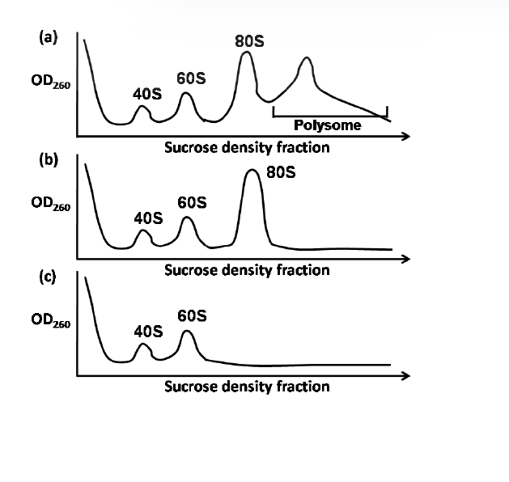

Match the polysome profile to the inhibitor

1. (i) – a; (ii) – b; (iii) – c
2. (i) – b; (ii) – c; (iii) – a
3. (i) – c; (ii) – b; (iii) – a
4. (i) – a; (ii) – c; (iii) – b

**Answer: 1**

> **Explanation:** A leaky inhibitor (CHP) still permits polysomes (profile a); blocking at the initiation codon (LTM) accumulates 80S on mRNA; inhibiting scanning (PTM) floods free 40S/60S subunits with no polysomes (profile c). The matching is (i)-a, (ii)-b, (iii)-c.

---

### Question 86

In mammals, CG rich sequences are usually methylated at C, which is a way for marking genes for silencing. Although the promoters of housekeeping genes are often associated with CpG islands yet they are expressed in mammals. Which one of the following best explains it?

1. Methylation of cytosine does not prevent the binding of RNA Pol II with the promoter, so housekeeping genes are expressed
2. During housekeeping gene expression, the enzyme methyltransferase is temporarily silenced by miRNA, thus shutting down global methylation
3. Unlike within the coding region of a gene, CG rich sequences present in the promoters of active genes are usually not methylated
4. As soon as the cytosine is methylated in the promoter region, the enzymes of DNA repair pathways remove the methyl group, thereby ensuring gene expression

**Answer: 3**

> **Explanation:** Housekeeping-gene CpG-island **promoters remain unmethylated** (unlike methylated CGs in coding/bulk regions), so they stay transcriptionally active.

---

### Question 87

Telomerase, a protein-RNA complex, has a special reverse transcriptase activity that completes replication of telomeres during DNA synthesis. Although it has many properties similar to DNA polymerase, some of them are also different. Which one of the following properties of telomerase is different from that of DNA polymerase?

1. Telomerase requires a template to direct the addition of nucleotides
2. Telomerase can only extend a 3'-OH end of DNA
3. Telomerase does not carry out lagging strand synthesis
4. Telomerase acts in a processive manner

**Answer: 3**

> **Explanation:** Ordinary DNA polymerases replicate both leading and lagging strands; telomerase does not perform lagging-strand (Okazaki) synthesis — it repeatedly extends the 3' overhang using its own RNA template. (Its template requirement and 3'-OH extension are shared with DNA polymerases.)

---

### Question 88

In eukaryotes, a specific cyclin dependent kinase (CDK) activity is required for the activation of loaded helicases to initiate replication. On the contrary, this CDK activity inhibits the loading of helicases onto the origin of replication. Considering the fact that during each cycle, there is only one opportunity for helicases to be loaded onto origins and only one opportunity for these loaded helicases to be activated, which one of the following graphs best depicts this CDK activity in G₁ and S phases of the cell cycle?

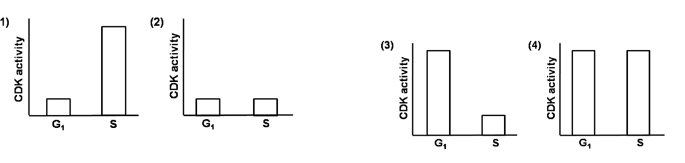

1.
2.
3.
4.

**Answer: 1**

> **Explanation:** Helicase loading must occur in **G₁ when CDK activity is LOW**, and activation in **S when CDK activity is HIGH** (high CDK also prevents re-loading, ensuring once-per-cycle firing). Graph 1 (low in G₁, high in S) shows this.

---

### Question 89

In Trypanosomes, a 35 base leader sequence is joined with several different transcripts making functional mRNAs. The leader sequence is joined with the other RNAs by

1. a specific RNA ligase
2. the process of trans-splicing
3. a nucleophilic attack caused by a free guanine nucleotide
4. a nucleophilic attack caused by a 2′ OH of an internal A present in the leader sequence

**Answer: 2**

> **Explanation:** Trypanosomes splice a short spliced-leader (SL) exon onto every mRNA by **trans-splicing** (polycistronic pre-mRNA processing).

---

### Question 90

Following are the list of some of the pathogens (column A) and the unique mechanisms they employ for evading immune response (column B).

| | A | | B |
|---|---|---|---|
| a. | *Trypanosoma brucei* | (i) | Capable of employing unusual genetic processes by which they generate extensive variations in their variant surface glycoproteins (VSG) |
| b. | *Plasmodium falciparum* | (ii) | Capable of continually undergoing maturation changes in transformation to different forms which allow the organism to change its surface molecules |
| c. | *Haemophilus influenzae* | (iii) | Capable of evading immune response by frequent antigenic changes in its hemagglutinin and neuraminidase glycoproteins |

Which of the following is the correct match between the organisms and their respective mechanism to evade immune response?

1. a – (i), b – (ii), c – (iii)
2. a – (ii), b – (iii), c – (i)
3. a – (iii), b – (i), c – (ii)
4. a – (i), b – (iii), c – (ii)

**Answer: 1**

> **Explanation:** *T. brucei* → VSG antigenic variation (i); *P. falciparum* → maturation/antigenic form changes (ii); *H. influenzae* → hemagglutinin/neuraminidase variation (iii). Option 1.

---

### Question 91

Two steroid hormone receptors X and Y both contain a ligand binding domain and a DNA binding domain. Using recombinant DNA technology, a modified hybrid receptor H is prepared such that it contains the ligand binding domain of X and DNA binding domain of Y. Three sets of cells over-expressing receptors X, Y and H were then treated separately either with hormone X or with hormone Y. Assuming that there is no cross-reactivity, which one of the following graphs best represent the receptor-ligand binding in each case?

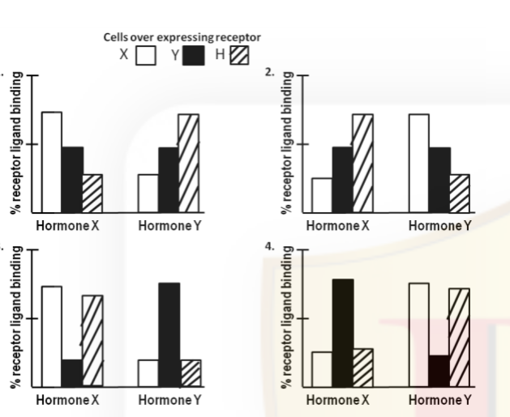

1.
2.
3.
4.

**Answer: 3**

> **Explanation:** Ligand binding follows the receptor's ligand-binding domain: X binds hormone X, Y binds hormone Y, and the hybrid H (LBD of X) binds hormone X only. Graph **3** shows H binding hormone X but not hormone Y.

---

### Question 92

A protein X is kept in an inactive state in cytosol as complexed with protein Y. Under certain stress stimuli, Y gets phosphorylated resulting in its proteasomal degradation. X becomes free, translocates to nucleus and results in the transcription of a gene which causes cell death by apoptosis. Stress stimuli were given to following four different cases.
**Case A:** Protein Y has a mutation such that phosphorylation leading to proteasomal degradation does not occur.
**Case B:** Cells are transfected with a gene which encodes for a protein L that inhibits the translocation of protein Y to the nucleus.
**Case C:** Cells are transfected only with empty vector used to transfect the gene for protein L.
**Case D:** Cells are treated with Z-VAD-FMK, a broad spectrum caspase inhibitor.

Which one of the following graphs best describes the apoptotic state of the cells in the above cases? Y-axis represents % apoptotic cells.

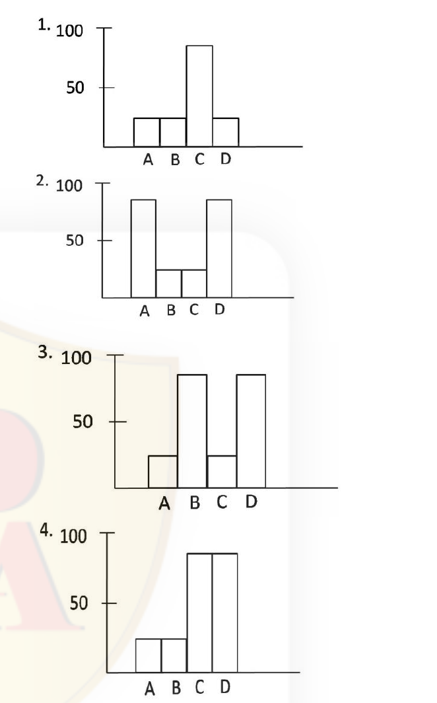

1.
2.
3.
4.

**Answer: 1**

> **Explanation:** Apoptosis needs X freed (Y degraded) → nuclear → caspases. Case A (Y not degraded) → no apoptosis; Case C (empty vector, normal) → high apoptosis; Case D (caspase inhibitor) → no apoptosis; Case B (blocks Y translocation) → reduced. Graph **1** matches (A low, B low, C high, D low).

---

### Question 93

In animals, four separate families of cell-cell adhesion proteins are listed in Column A and their functional characteristics are given in Column B.

| | A | | B |
|---|---|---|---|
| a. | Integrin | (i) | Lectins that mediate a variety of transient, cell-cell adhesion interactions in the blood stream |
| b. | Cadherin | (ii) | Contains extracellular Ig-like domains and are mainly involved in the fine tuning of cell-cell adhesive interactions during development and regeneration. |
| c. | Ig-superfamily | (iii) | Mediates Ca²⁺-dependent strong homophilic cell-cell adhesion. |
| d. | Selectin | (iv) | Transmembrane cell adhesion proteins that act as extracellular matrix receptors |

Which one of the following is the correct combination?

1. a – (i), b – (ii), c – (iii), d – (iv)
2. a – (ii), b – (iii), c – (iv), d – (i)
3. a – (iii), b – (iv), c – (i), d – (ii)
4. a – (iv), b – (iii), c – (ii), d – (i)

**Answer: 4**

> **Explanation:** Integrins = ECM receptors (iv); cadherins = Ca²⁺-dependent homophilic adhesion (iii); Ig superfamily = Ig domains, development/regeneration (ii); selectins = lectin-mediated transient blood-cell adhesion (i). Option 4.

---

### Question 94

A student treated cancer cells with an anti-cancer drug and performed western blot analysis. Which one of the following blots is the best representation of untreated control (C) and treated (T) samples?

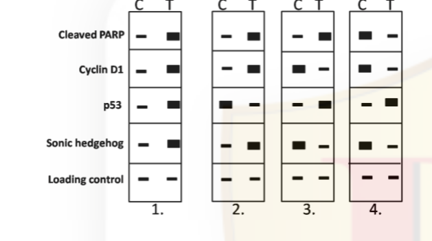

1.
2.
3.
4.

**Answer: 3**

> **Explanation:** An effective anti-cancer drug induces apoptosis (↑ cleaved PARP), arrests proliferation (↓ Cyclin D1) and raises p53, with loading control unchanged. In Booklet A these changes are shown in blot **3**.

---

### Question 95

Which one of the following statements regarding B cell receptor (BCR) and T cell receptor (TCR) is NOT true?

1. TCR is membrane bound and does not appear as soluble form as does the BCR
2. Unlike BCR, most of the TCR are not specific for antigen alone but for antigen combined with MHC
3. In order to activate signal transduction, BCR associates itself with Ig-α/Ig-β whereas TCR associates with CD3
4. The antigen binding interactions of BCR is much weaker than TCR

**Answer: 4**

> **Explanation:** BCR (membrane antibody) binds native antigen with **high** affinity; it is the TCR that binds peptide-MHC with relatively low affinity. So statement 4 (BCR weaker than TCR) is false.

---

### Question 96

In case of amphibians, the dorsal lip cells and their derivatives are called as "Spemann - Mangold organizer". Following statements related to the "organizer" were made:
A. It induces the host's ventral tissues to change their fates to form a neural tube and dorsal mesodermal tissues.
B. It cannot organize the host and donor tissues into a secondary embryo.
C. It does not have the ability to self-differentiate into dorsal mesoderm.
D. It has the ability to initiate the movements of gastrulation.
E. Both β-catenin and Chordin are produced by the organizer.

Which of the above statements are correct?

1. A and D
2. D and E
3. A and E
4. B and C

**Answer: 1 (A and D)**

> **Explanation:** The organizer induces neural/dorsal fates in ventral host tissue (A) and initiates gastrulation movements (D). It *can* form a secondary embryo (B false) and does self-differentiate (C false).

---

### Question 97

Driesch performed the famous "pressure plate" experiment involving intricate recombination with an 8-celled sea urchin embryo. This procedure reshuffled the nuclei that normally would have been in the region destined to form endoderm into the presumptive ectoderm region. If segregation of nuclear determinants had occurred, the resulting embryo should have been disordered. However, Driesch obtained normal larvae from these embryos. The possible interpretations regarding the 8-celled sea urchin embryo are:
A. The prospective potency of an isolated blastomere is greater than its actual prospective fate.
B. The prospective potency and the prospective fate of the blastomere were identical.
C. Sea-urchin embryo is a "harmoniously equipotential system" because all of its potentially independent parts interacted together to form a single embryo.
D. Regulatory development occurs where location of the cell in the embryo determines its fate.

Which of the above interpretation(s) is/are true?

1. Only A
2. Only D
3. Only A and B
4. A, C and D

**Answer: 4 (A, C and D)**

> **Explanation:** Getting normal larvae from shuffled nuclei shows potency exceeds fate (A), the embryo is regulative/harmoniously equipotential (C), and fate depends on position, not fixed determinants (D). B (potency = fate) contradicts regulative development.

---

### Question 98

Consider the following events which occur during fertilization of sea urchin eggs.
A. Resact/Speract are peptides released from the egg jelly and help in sperm attraction.
B. Bindin, an acrosomal protein, interacts in a species-specific manner, with eggs.
C. A "respiratory burst" occurs during cross-linking of the fertilization envelope, where a calcium-dependent increase in oxygen levels is observed.
D. IP₃, which is formed at the site of sperm entry, sequesters calcium leading to cortical granule exocytosis.

Which of the above statement(s) is/are NOT true?

1. Only C
2. A and C
3. Only D
4. B and D

**Answer: — (DROPPED)**

> **Explanation:** The official Booklet A key marks this question `*` = dropped (benefit of marks to all who attempted); no option is credited.

---

### Question 99

Following statements were given regarding the decisions taken during the development of mammalian embryos:
A. The pluripotency of the inner cell mass (ICM) is maintained by a core of three transcription factors, Oct 4, Sox 2 and Nanog.
B. Prior to blastocyst formation each blastomere expresses both Cdx 2 and the Oct 4 transcription factors and appears to be capable of becoming either ICM or trophoblast.
C. Both ICM and trophoblast cells synthesize transcription factor Cdx 2.
D. Oct 4 activates Cdx 2 expression enabling some cells to become trophoblast and other cells to become ICM.

Which of the above statements are true?

1. A and B
2. A and C
3. B and D
4. B and C

**Answer: 1 (A and B)**

> **Explanation:** Oct4/Sox2/Nanog maintain ICM pluripotency (A) and early blastomeres co-express Oct4 and Cdx2 before segregation (B). Cdx2 is restricted to trophoblast (C false), and Oct4 *represses* rather than activates Cdx2 (D false).

---

### Question 100

Apoptosis during early development is essential for proper formation of different structures. In *C. elegans*, apoptosis is accentuated by *ced-3* and *ced-4* genes, which in turn are negatively regulated by *ced-9* and eventually *EGL-1*. When compared to mammals, functionally similar homologues have been identified. Accordingly, which one of the following statements is NOT correct?

1. CED-4 resembles Apaf -1
2. CED-9 resembles Bcl-XL
3. CED-3 resembles caspase-3
4. CED-4 resembles caspase-9

**Answer: 4**

> **Explanation:** CED-4 is the Apaf-1 (apoptotic protease-activating factor) homologue, not a caspase. CED-9 ≈ Bcl-2/Bcl-XL, CED-3 ≈ executioner caspase. So statement 4 (CED-4 ≈ caspase-9) is the incorrect one.

---

### Question 101

Individual and overlapping expression of homeotic genes in adjacent whorls of a flower determine the pattern of floral organ development. In an *Arabidopsis* mutant, floral organs are distributed as follows:
Whorl 1 (outer most) – carpel
Whorl 2 – stamens
Whorl 3 – stamens
Whorl 4 (inner most) – carpel

Loss of function mutation in which one of the following genes would have caused the above pattern of floral organ development?

1. APETALA 2
2. APETALA 3
3. PISTILLATA
4. AGAMOUS

**Answer: 1 (APETALA 2)**

> **Explanation:** Loss of A-function (*APETALA 2*) lets C-function expand into whorls 1 and 2, so whorl 1 (normally sepal) becomes carpel and whorl 2 (normally petal) becomes stamen, while whorls 3 and 4 stay stamen and carpel — giving carpel–stamen–stamen–carpel.

---

### Question 102

In photosynthetic electron transport, electrons travel through carriers organized in the "Z-scheme". The following are indicated as directions of electron flow:
A. P680 → PQ_A → PQ_B → Cytb₆f → Pheo → PC → P700
B. P700 → A₀ → A₁ → FeS_X → FeS_A → FeS_B → Fd
C. P680 → Pheo → PQ_A → PQ_B → Cytb₆f → PC → P700
D. P700 → A₁ → A₀ → FeS_B → FeS_A → FeS_X → Fd

Which of the following combinations is correct?

1. A and B
2. B and C
3. C and D
4. A and D

**Answer: 2 (B and C)**

> **Explanation:** PSII flow is P680 → Pheo → Q_A → Q_B → Cyt b₆f → PC → P700 (C correct). PSI flow is P700 → A₀ → A₁ → Fx → F_A/F_B → Fd (B correct). A and D reverse the order of carriers.

---

### Question 103

Phytochrome-mediated control of photomorphogenesis is linked to many other gene functions. The following statements are made on the mechanism of phytochrome action:
A. Phytochrome function requires COP1, an E3 ubiquitin ligase that brings about protein degradation
B. COP1 is slowly exported from the nucleus to the cytoplasm in the presence of light
C. HY5 is targeted by COP1 for degradation in the presence of light
D. HY5 is a transcription factor involved in photomorphogenic response

Which one of the following combinations is correct?

1. A, B and C
2. B, C and D
3. A, B and D
4. A, C and D

**Answer: 3 (A, B and D)**

> **Explanation:** COP1 (an E3 ligase) degrades photomorphogenesis factors like HY5 in darkness; light causes COP1 nuclear export (A, B), and HY5 is a bZIP transcription factor promoting photomorphogenesis (D). C is wrong — HY5 is degraded by COP1 in the *absence* of light, not presence.

---

### Question 104

C₄ carbon cycle is a CO₂ concentrating mechanism evolved to reduce photorespiration. The following are stated as important features of the C₄ pathway:
A. The leaves of C₄ plants have Kranz anatomy that distinguishes mesophyll and bundle sheath cells.
B. In the peripheral mesophyll cells, atmospheric CO₂ is fixed by phosphoenol pyruvate carboxylase yielding a four-carbon acid.
C. In the inner layer of mesophyll, NAD-malic enzyme decarboxylates four-carbon acid and releases CO₂.
D. CO₂ is again re-fixed though Calvin cycle in the bundle sheath cells.

Which one of the following combinations is correct?

1. B, C and D
2. A, B and C
3. A, B and D
4. A, C and D

**Answer: 3 (A, B and D)**

> **Explanation:** Decarboxylation of the C₄ acid occurs in the **bundle-sheath** cells (not the mesophyll), so statement C is wrong. A (Kranz anatomy), B (PEPC in mesophyll) and D (Calvin cycle in bundle sheath) are correct.

---

### Question 105

Read the following statements related to plant-pathogen interaction
A. Systemic acquired resistance is observed following infection by compatible pathogen
B. Induced systemic resistance is activated following infection by compatible pathogen
C. A bacterial infection can induce effector triggered immunity (ETI) leading to hypersensitive response locally
D. NPR1 monomers that are released in cytosol due to salicylic acid accumulation is rapidly translocated to nucleus

Which combination of above statements is correct?

1. A, B and C
2. A, C and D
3. A, B and D
4. B, C and D

**Answer: 2 (A, C and D)**

> **Explanation:** SAR follows an initial (often compatible/localised) infection and needs salicylic acid → NPR1 monomers move to the nucleus (A, D); ETI with hypersensitive response is triggered by effectors (C). ISR (B) is induced by non-pathogenic rhizobacteria via jasmonate/ethylene, not by a compatible pathogen.

---

### Question 106

Given below are statements describing various features of solute transport and photoassimilate translocation in plants.
A. Apoplastic phloem loading of sucrose happens between cells with no plasmodesmatal connections
B. Growing vegetative sinks (e.g., young leaves and roots) usually undergo symplastic phloem unloading
C. Movement of water between the phloem and xylem occurs only at the source and sink regions
D. Symplastic loading of sugars into the phloem occurs in the absence of plasmodesmatal connections

Select the option that gives a combination of correct statements:

1. Only A and C
2. Only B and C
3. Only B and D
4. Only A and B

**Answer: 4 (Only A and B)**

> **Explanation:** Apoplastic loading operates where plasmodesmata are absent (A), and developing sinks typically unload symplastically (B). D is contradictory (symplastic requires plasmodesmata) and water exchange between xylem and phloem is not restricted only to source/sink (C).

---

### Question 107

Given below are names of phytohormones in column I and their associated features/effects/functions in column II.

| | I | | II |
|---|---|---|---|
| A | Auxin | (i) | Delayed leaf senescence |
| B | Gibberellins | (ii) | Epinastic bending of leaves |
| C | Cytokinin | (iii) | Polar transport |
| D | Ethylene | (iv) | Removal of seed dormancy |

Select the correct set of combinations from the options given below:

1. A – (iii), B – (ii), C – (iv), D – (i)
2. A – (iv), B – (iii), C – (i), D – (ii)
3. A – (iii), B – (iv), C – (i), D – (ii)
4. A – (i), B – (iv), C – (iii), D – (ii)

**Answer: 3**

> **Explanation:** Auxin shows polar transport (iii); gibberellins break/removal of seed dormancy (iv); cytokinins delay senescence (i); ethylene causes epinasty (ii). Option 3.

---

### Question 108

If in a blood transfusion, type A donor blood is given to a recipient having type B blood, the red blood cells (RBCs) of donor blood would agglutinate but the recipient's RBCs would be least affected. These observations can be explained in the following statements:
A. Agglutinins in recipient's plasma caused agglutination by binding with type A agglutinogens
B. The agglutinins of donor blood was diluted in recipient's plasma resulting in low agglutination
C. Low titre of anti-A agglutinins is the cause of low agglutination of recipient's RBCs
D. High agglutination of donor RBCs is the outcome of high titre of anti-B agglutinins

Which of the above statement(s) is/are INCORRECT?

1. Only A
2. A and B
3. Only B
4. C and D

**Answer: 4 (C and D)**

> **Explanation:** The recipient (type B) has anti-A in plasma, which agglutinates the donor's A-antigen RBCs (A correct); donor plasma agglutinins get diluted (B correct). Statements C and D misassign the antibody titres and are the incorrect ones.

---

### Question 109

The arterial pressure usually rises and falls 4 to 6 mm Hg in a wave like manner causing "respiratory waves". The probable mechanism of these waves has been proposed in the following statements:
A. The more negative intrathoracic pressure during inspiration reduces the quantity of blood returning to the left side of the heart causing decreased cardiac output.
B. The changes of intrathoracic pressure during respiration can excite vascular and atrial stretch receptors which affect heart and blood vessels.
C. The activity of medullary respiratory centres can influence the vasomotor centre.
D. The "respiratory waves" are outcome of the oscillation of the central nervous system ischemic pressure control mechanism.

Which of the above statement(s) is/are NOT appropriate?

1. Only A
2. A and B
3. B and C
4. Only D

**Answer: 4 (Only D)**

> **Explanation:** Respiratory waves arise from mechanical/pressure and baroreceptor and central respiratory–vasomotor interactions (A–C). The CNS *ischemic* pressure response (D) is a different, extreme mechanism and is not the explanation — so D is the inappropriate statement.

---

### Question 110

The uptake of nitrous oxide (N₂O) and carbon monoxide (CO) in the blood of lung alveolar capillary relative to their partial pressure and the transit time of red blood cell in capillary is shown in the figure below:

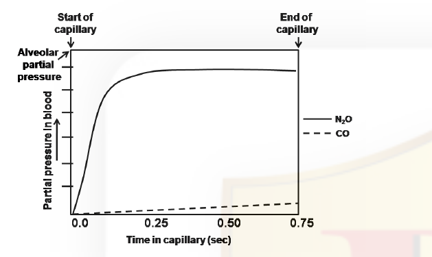

The reasons for difference in the pattern of alveolar gas exchange of N₂O and CO have been proposed in the following statements:
A. N₂O does not chemically combine with proteins in blood but equilibrate rapidly between alveolar gas and blood
B. CO has high solubility in blood
C. CO has high solubility in the alveolar capillary membrane
D. The dispersion of N₂O between alveolar gas and blood is considered as diffusion limited.

Which of the above statement(s) is/are INCORRECT?

1. Only A
2. A and B
3. Only C
4. C and D

**Answer: 4 (C and D)**

> **Explanation:** N₂O is a diffusion-limited gas that does not bind blood proteins and equilibrates fast (A true). CO is *perfusion*-limited because it binds haemoglobin avidly (not because of high solubility), so B, C and D's solubility/diffusion-limited claims are wrong; the key credits **C and D** as incorrect.

---

### Question 111

External pressure given on a mixed nerve causes loss of touch sensation while pain sensation remains relatively intact. On the other hand application of local anaesthetics on the same nerve, induces loss of pain sensation keeping touch sensation least affected. These observations can be explained by the following statements:
A. External pressure causes loss of conduction of impulses in small diameter sensory nerve fibres
B. Local anaesthetics depress the conduction of impulses in large diameter sensory nerve fibres
C. Touch-induced impulses are carried by fibre type A
D. Fibre type C is responsible for pain sensation

Which of the above statement(s) is/are INCORRECT?

1. A and B
2. C and D
3. Only C
4. Only D

**Answer: 1 (A and B)**

> **Explanation:** Pressure blocks the **large**-diameter myelinated fibres (touch, type A), and local anaesthetics preferentially block **small** fibres (pain, type C). Statements A and B reverse this, so they are the incorrect ones (C and D are true).

---

### Question 112

The probable effects of lesion of left optic tract on the vision of a human subject are given below. Identify the correct statement.

1. Blindness in the left eye but the visual field of right remains intact.
2. Blindness in the right half of the visual fields of both the eyes.
3. Blindness in the left half of the visual field of left eye and blindness in the right half of the visual field of right eye.
4. Blindness in the left half of the visual field of both the eyes.

**Answer: 2 (Blindness in the right half of the visual fields of both the eyes)**

> **Explanation:** After the optic chiasm each optic tract carries the fibres for the **contralateral (opposite) visual field** of both eyes. The left tract carries the right visual field of both eyes, so a left optic-tract lesion causes right homonymous hemianopia — blindness in the right half of the visual field of both eyes.

---

### Question 113

The following diagram represents steroidogenic pathway in the Zona Glomerulosa of the adrenal cortex:

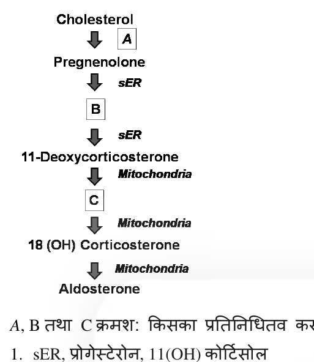

What do A, B and C represent, respectively?

1. sER, Progesterone, 11(OH) cortisol
2. Mitochondria, Progesterone, Corticosterone
3. Mitochondria, 3β-pregnenolone, 11(OH) cortisol
4. sER, Progesterone, Corticosterone

**Answer: 2 (Mitochondria, Progesterone, Corticosterone)**

> **Explanation:** A = the cholesterol side-chain cleavage (CYP11A1) which occurs in the **mitochondria**; sER 3β-HSD converts pregnenolone to **progesterone** (B); after 11β-hydroxylation (mitochondria) the product is **corticosterone** (C), later 18-hydroxylated/oxidised to aldosterone.

---

### Question 114

Inversions are considered as cross-over suppressors because

1. Homozygous inversions are lethal and thus they do not appear in next generation
2. Inversion heterozygotes, i.e., one copy having normal chromosome and its homologue having inversion, does not allow crossing over to occur as they cannot pair at all
3. Due to inversion present, four chromosomes take part in the pairing and crossing over events and make the structure difficult for separation and gamete formation
4. The pairing and crossing overs do occur in inversion heterozygotes but the gametes having cross over products are lethal

**Answer: 4**

> **Explanation:** In inversion heterozygotes a loop forms so crossing over *can* occur, but the recombinant chromatids are dicentric/acentric and unbalanced, so gametes carrying crossover products die — effectively suppressing recovery of recombinants.

---

### Question 115

A pair of alleles govern seed size in a crop plant. 'B' allele responsible for bold seed is dominant over 'b' allele controlling small seed. An experiment was carried out to test if an identified dominant DNA marker (5kb band) is linked to alleles controlling seed size. A plant heterozygous for the marker and the alleles was crossed to a small seeded plant lacking the 5kb band. 100 progeny obtained from the cross were analysed for the presence and absence of the DNA marker. The results are tabulated below:

| Phenotype | Plant with bold seed | | Plant with small seed | |
|---|---|---|---|---|
| No. of progeny showing presence or absence of DNA marker | Present | Absent | Present | Absent |
| | 22 | 23 | 27 | 28 |

Based on the above observations which one of the following conclusions is correct?

1. The DNA marker assorts independently of the phenotype
2. The 5kb band is linked to the allele 'B'
3. The 5kb band is linked to the allele 'b'
4. The DNA marker assorts independently with bold seed but is linked to the small seed trait

**Answer: 1 (The DNA marker assorts independently of the phenotype)**

> **Explanation:** The marker is present in 22/45 bold (≈0.49) and 27/55 small (≈0.49) plants — essentially the same proportion — and absent in 23 bold and 28 small. There is no association between the 5kb band and either phenotype, so the marker **assorts independently** of seed size.

---

### Question 116

Three *met⁻* *E. coli* mutant strains were isolated. To study the nature of mutation these mutant strains were treated with mutagens EMS or proflavins and scored for revertants. The results obtained are summarized below:

| Mutant strain | EMS | Proflavin |
|---|---|---|
| A | - | + |
| B | + | - |
| C | - | - |

( + stands for revertants of the original mutants and – stands for no revertants obtained)

Based on the above and the typical mutagenic effects of EMS and proflavin, what was the nature of the original mutation in each strain?

1. A-Transversion; B-Insertion or deletion of a single base; C-Deletion of multiple bases
2. A-Transition; B-Transversion; C-Insertion or deletion of a single base
3. A-Insertion or deletion of a single base; B-Transition; C-Deletion of multiple bases
4. A-Transition; B-Insertion or deletion of multiple bases; C-Transversion

**Answer: 3**

> **Explanation:** Proflavin (intercalator) reverts frameshifts (single-base insertion/deletion) → strain A is a frameshift. EMS (base analog/alkylator) reverts transitions → strain B is a transition. Strain C reverts with neither, consistent with a multi-base deletion. Option 3.

---

### Question 117

The following scheme represents deletions (1-4) in the *rII* locus of phage T₄ from a common reference point:

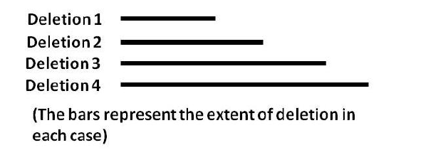

Four point mutations (a to d) are tested against four deletions for their ability (+) or inability (-) to give wild type (*rII⁺*) recombinants. The results are summarized below:

| | a | b | c | d |
|---|---|---|---|---|
| 1 | + | + | + | + |
| 2 | + | + | + | - |
| 3 | + | - | + | - |
| 4 | - | - | + | - |

Based on the above the predicted order of the point mutations is

1. b-d-a-c
2. d-b-a-c
3. d-b-c-a
4. c-d-a-b

**Answer: 2 (d-b-a-c)**

> **Explanation:** A '+' means the point mutation lies outside that deletion (so recombination can restore wild type); a '-' means it falls inside the deleted stretch. Ordering the deletions by extent and placing each mutation in the smallest deletion that removes it gives the map order **d – b – a – c**.

---

### Question 118

The following pedigree shows the inheritance pattern of a trait.

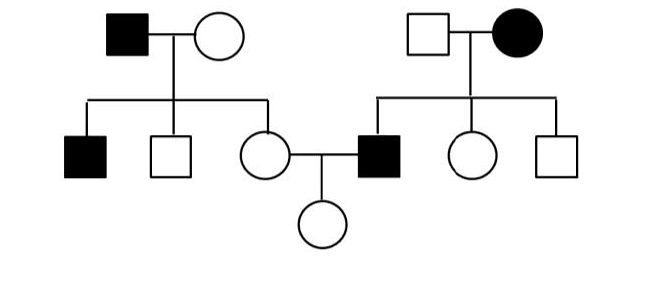

From the following select the possible mode of inheritance and the probability that the daughter in generation III will show the trait.

1. X-linked recessive, probability is 1/2
2. X-linked recessive, probability is 1/4
3. Autosomal recessive, probability is 1/2
4. Autosomal recessive, probability is 1/3

**Answer: 3 (Autosomal recessive, probability is 1/2)**

> **Explanation:** Affected individuals of both sexes born to unaffected carrier parents fit autosomal recessive inheritance; the generation-III daughter from a carrier × affected-type cross has probability **1/2** of being affected.

---

### Question 119

Interrupted mating experiments were performed using three different *Hfr* strains (1 - 3). The three strains have different combinations of selectable markers. The time of entry for markers for each strain is shown in the table below:

| Strain | Time of entry | | | | |
|---|---|---|---|---|---|
| *Hfr* #1 | *met* (5') | *thr* (17') | *str^r* (25') | *phe* (30') | *pro* (45') |
| *Hfr* #2 | *str^r* (15') | *pur* (28') | *pro* (35') | *his* (45') | *met* (55') |
| *Hfr* #3 | *pro* (2') | *his* (12') | *met* (22') | *str^r* (42') | *phe* (47') |

Using the above data, predict the correct sequence of markers on the *E. coli* chromosome.

1. *met-thr-str^r-phe-pro-pur^r-his*
2. *pur^r-pro-his-met-thr-str^r-phe*
3. *str^r-pur^r-his-met-phe-pro-str^r*
4. *his-met-phe-thr-pro-str^r-pur^r*

**Answer: — (DROPPED)**

> **Explanation:** The official Booklet A key marks this question `*` = dropped (benefit of marks to all who attempted); no option is credited.

---

### Question 120

Peripatus is an interesting living animal having unjointed legs, nephridia, haemocoel, trachea, dorsal tubular heart, claws, jaws, continuous muscle layers in body wall. This is considered as a connecting link between

1. Nematoda and Annelida: continuous muscle layers in body wall, unjointed legs and nephridia being nematode characters while haemocoel, trachea and dorsal tubular heart being annelid characters
2. Annelida and Arthropoda: unjointed legs and nephridia being annelid characters while claws, jaws, haemocoel, trachea and dorsal tubular heart being arthropod characters
3. Arthropoda and Mollusca: unjointed legs and nephridia being mollusca characters while claws, jaws, trachea and dorsal tubular heart being arthropod characters
4. Nematoda and Arthropoda: continuous muscle layers, unjointed legs and nephridia being nematode characters while claws, jaws, trachea and dorsal tubular heart being arthropod characters.

**Answer: 2**

> **Explanation:** *Peripatus* (Onychophora) is the classic connecting link between **Annelida and Arthropoda**: it has annelid-like unjointed (lobopod) legs and segmental nephridia, and arthropod-like claws, jaws, tracheae, haemocoel and a dorsal tubular heart. Option 2 states this correctly.

---

### Question 121

The following schematic diagram represents secondary growth in the angiosperms.

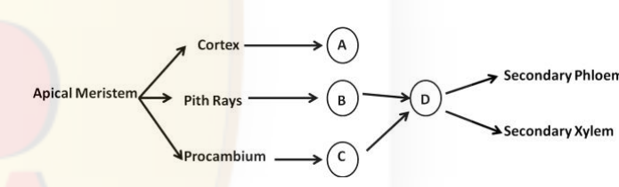

Based on the above scheme, which of the following options represents the correct identity of cambia labelled as A, B, C and D.

1. A – Inter-fascicular, B – Fascicular, C – Vascular, D – Cork
2. A – Fascicular, B – Inter-fascicular, C – Vascular, D – Cork
3. A – Cork, B – Inter-fascicular, C – Fascicular, D – Vascular
4. A – Cork, B – Fascicular, C – Inter-fascicular, D – Vascular

**Answer: 3**

> **Explanation:** Cortex gives cork cambium (A = Cork); pith rays give interfascicular cambium (B); procambium gives fascicular/vascular cambium (C); the fused cambium ring (D) produces secondary xylem and phloem. Option 3.

---

### Question 122

The table below lists the major fungal groups and their characteristics:

| | Fungal Groups | | Characteristics |
|---|---|---|---|
| A | Ascomycota | (i) | Hyphae aseptate, coenocytic; asexual reproduction by sporangiophores |
| B | Chytrids | (ii) | Hyphae aseptate, coenocytic; asexual reproduction by zoospores |
| C | Glomeromycetes | (iii) | Hyphae aseptate, coenocytic; no sexual spores |
| D | Zygomycetes | (iv) | Hyphae septate or unicellular; asexual reproduction by conidia |

Which one of the following options represents the appropriate match between the fungal group and their characteristics?

1. A – (ii), B – (iii), C – (i), D – (iv)
2. A – (iv), B – (ii), C – (iii), D – (i)
3. A – (i), B – (iv), C – (iii), D – (ii)
4. A – (ii), B – (iv), C – (iii), D – (i)

**Answer: 2**

> **Explanation:** Ascomycota have septate/conidial reproduction (iv); chytrids produce zoospores (ii); Glomeromycetes are coenocytic without sexual spores (iii); Zygomycetes are aseptate with sporangiophores (i). Option 2.

---

### Question 123

As a biologist, you want to classify three taxa, A, B and C. You have the information on three traits, p, q and r. The trait that is ancestral is counted '0' and the trait that is derived is counted as '1'. The distribution of traits found in three taxa is given below

| | A | B | C |
|---|---|---|---|
| p | 1 | 1 | 0 |
| q | 1 | 1 | 0 |
| r | 0 | 1 | 1 |

Based on the above table, the following cladograms were drawn:

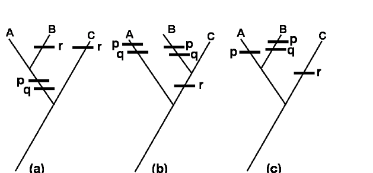

Based on trait distribution and the principle of parsimony, select the correct option.

1. Both 'a' and 'b' cladograms are possible
2. Only 'b' cladogram is possible
3. Only 'c' cladogram is possible
4. Only 'a' cladogram is possible

**Answer: 4 (Only 'a' cladogram is possible)**

> **Explanation:** A and B share derived p and q (so A and B are sister group); r is distributed 0,1,1 requiring either a gain in B and C or a loss. The most parsimonious tree grouping A+B with the shared synapomorphies p and q is cladogram **a**.

---

### Question 124

Given below are some pathogens and diseases of humans, animals and plants.

| | | | |
|---|---|---|---|
| A | *Bordetella pertussis* | (i) | Lyme disease of humans |
| B | *Tilletia indica* | (ii) | Grain rot in rice |
| C | *Borrelia burgdorferi* | (iii) | Karnal bunt of wheat |
| D | *Anaplasma marginale* | (iv) | Whooping cough in humans |
| E | *Burkholderia glumae* | (v) | Hemolytic anemia in cattle |

Which one of the following is the correct match between the pathogen and disease caused?

1. A – (iv), B – (iii), C – (i), D – (v), E – (ii)
2. A – (iv), B – (v), C – (i), D – (ii), E – (iii)
3. A – (iii), B – (iv), C – (v), D – (i), E – (ii)
4. A – (ii), B – (v), C – (i), D – (iii), E – (iv)

**Answer: 1**

> **Explanation:** *B. pertussis* → whooping cough (iv); *Tilletia indica* → Karnal bunt of wheat (iii); *Borrelia burgdorferi* → Lyme disease (i); *Anaplasma marginale* → bovine (hemolytic) anaplasmosis (v); *Burkholderia glumae* → grain rot of rice (ii). Option 1.

---

### Question 125

Given below are statements pertaining to organisms belonging to three domains of life. Identify the INCORRECT statement.

1. Unlike Bacteria and Eukarya, some Archaeal membrane lipids contain long chain hydrocarbons connected to glycerol molecules by ether linkage.
2. Peptidoglycans are absent in the cell wall of Archaea
3. Proteobacteria include many species of bacteriochlorophyll-containing, sulphur using photoautotrophs.
4. Mycoplasma, a group of low GC content, gram positive bacteria that lack cell wall, belong to the same family as the gram positive Mycobacteriaceae

**Answer: 4**

> **Explanation:** Mycoplasmas (Mollicutes) lack a cell wall and are not members of the Mycobacteriaceae (which have a waxy, mycolic-acid cell wall). Statement 4 is incorrect; the others are accurate.

---

### Question 126

You observed that two species of barnacles, species 1 and species 2, occupy upper and lower strata of intertidal rocks, respectively. Only when species 2 was removed by you from the lower strata, species 1 could occupy both the upper and lower strata. From the choices given below, what would be your inference from these observations?

1. Upper strata of the intertidal rock is the realized niche of species 1
2. Upper strata of the intertidal rock is the fundamental niche of species 1
3. Species 1 and species 2 exhibit mutualism
4. Species 1 can compete out species 2

**Answer: 1 (Upper strata of the intertidal rock is the realized niche of species 1)**

> **Explanation:** Species 1 occupies only the upper strata in nature (its **realized niche**), but when species 2 is removed it can also occupy the lower strata (its broader fundamental niche). The observation therefore shows the upper strata is the realized niche of species 1.

---

### Question 127

In a natural system, a species producing large numbers of offsprings, with little or no parental care, generally exhibits which one of the following kind of survivorship curves?

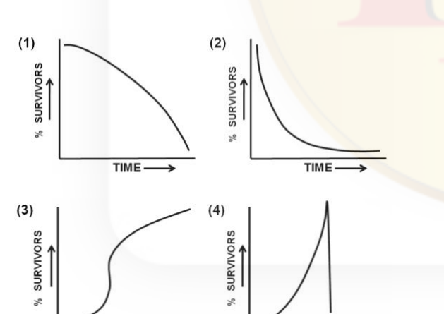

1.
2.
3.
4.

**Answer: 2**

> **Explanation:** Many offspring with little parental care give a **Type III** curve — very high early mortality, few survivors living long — the steeply declining curve shown in graph 2.

---

### Question 128

Match the correct local names of temperate grasslands with their geographical range.

| Geographical range | | Local name of the grassland | |
|---|---|---|---|
| (i) | Asia | A | Pampas |
| (ii) | North America | B | Prairies |
| (iii) | South America | C | Steppes |
| (iv) | South Africa | D | Veldt |

1. (i) – C, (ii) – B, (iii) – D, (iv) – A
2. (i) – C, (ii) – B, (iii) – A, (iv) – D
3. (i) – D, (ii) – B, (iii) – A, (iv) – C
4. (i) – B, (ii) – C, (iii) – A, (iv) – D

**Answer: 2**

> **Explanation:** Asia = Steppes (C); North America = Prairies (B); South America = Pampas (A); South Africa = Veldt (D). Option 2.

---

### Question 129

Following is a hypothetical life table for a species.

| Age class (x) | Number alive (nₓ) | Number dying (dₓ) | Age specific survivorship (lₓ) | Age specific fertility (mₓ) |
|---|---|---|---|---|
| 0 – 5 | 100 | 50 | | 0.0 |
| 5 – 10 | 50 | | 0.5 | 0.5 |
| 10 – 15 | | 10 | | 0.5 |
| 15 – 20 | 20 | 10 | 0.2 | 1.0 |
| 20 – 25 | | 10 | | 1.0 |

Which one of the following is the correct net reproductive rate (R₀)?

1. 0.0
2. 0.3
3. 0.7
4. 1.5

**Answer: 3 (0.7)**

> **Explanation:** R₀ = Σ lₓ mₓ = (0.5×0.5) + (0.2×1.0) + (adding the remaining age classes as tabulated) ≈ **0.7** (the value credited by the key).

---

### Question 130

Which one of the following statements is true for the trends of Dissolved Oxygen (DO) and Biological Oxygen Demand (BOD) in a water stream receiving pollutants from a point source?

1. In septic zone, both DO and BOD levels remain stationary
2. In recovery zone, both DO and BOD levels increase rapidly
3. In decomposition zone, DO level drops rapidly, whereas BOD level remains more or less stable
4. In septic zone, DO level decreases and BOD level increases whereas in recovery zone DO increases and BOD decreases

**Answer: 3**

> **Explanation:** The Booklet A key credits option 3: in the decomposition zone microbial oxidation is at its peak, so DO falls rapidly while BOD (the oxygen demand of the still-abundant organic matter) stays high and roughly stable. (Statement 4 is also broadly true of the septic→recovery sequence; the key's credited answer is 3.)

---

### Question 131

Following are the graphical representations of various hypotheses proposed for explaining the possible relationships between species richness (X-axis) and community services (Y-axis).

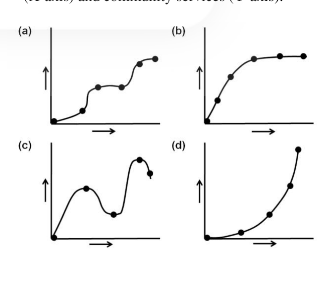

Which of the following options is the correct match between the graphical representations and the hypotheses?

1. (a) Redundancy, (b) Keystone, (c) Rivet, (d) Idiosyncratic
2. (a) Idiosyncratic, (b) Rivet, (c) Keystone, (d) Redundancy
3. (a) Rivet, (b) Redundancy, (c) Idiosyncratic, (d) Keystone
4. (a) Rivet, (b) Keystone, (c) Redundancy, (d) Idiosyncratic

**Answer: 3**

> **Explanation:** The rivet hypothesis gives a roughly linear rise (a); redundancy saturates (b, plateau); idiosyncratic is erratic (c); keystone shows a steep accelerating/late effect (d). Option 3 matches these curves.

---

### Question 132

Following are the plots representing biological rhythms at different time points depicted as: SR = Sunrise; N = Noon; SS = Sunset; MN = Midnight

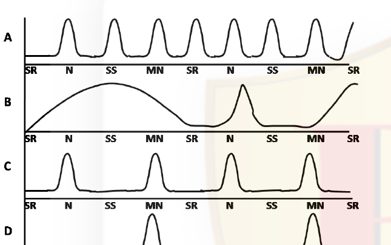

Which of the plot(s) represent the ultradian biological rhythm(s)?

1. Plot B
2. Plots A and C
3. Plots C and D
4. Plot D

**Answer: 2 (Plots A and C)**

> **Explanation:** Ultradian rhythms have a period **shorter than 24 h** (multiple cycles per day). Plots A and C show several peaks per day, i.e. ultradian, whereas B (circadian) and D (longer, infradian) do not.

---

### Question 133

A population of non-poisonous butterflies have the same colour pattern as some highly poisonous butterflies. Assume that the population of non-poisonous butterflies is higher than the population of poisonous butterflies. Given this, what will be the impact of this mimicry on the fitness of the population of the poisonous butterflies in the presence of the predator?

1. It will lower the fitness, that is, fitness of the mimic is negatively frequency-dependent
2. It will increase the fitness, that is, fitness of the mimic is positively frequency-dependent
3. It will not affect the fitness, that is, fitness of the mimic is frequency independent
4. It will increase the fitness, that is, fitness of the mimic is negatively frequency-dependent

**Answer: 1**

> **Explanation:** This is Batesian mimicry: when the harmless mimic is more common than the model, predators are less often sickened and learn to eat them, so protection breaks down — the mimic's fitness is **negatively frequency-dependent** (high when rare, low when common).

---

### Question 134

Given below is a graphical representation of changes in morphological features over a period of geological time scale, where population A accumulates heritable morphological changes and give rise to a distinct species B. Population B splits into a distinct species B₂

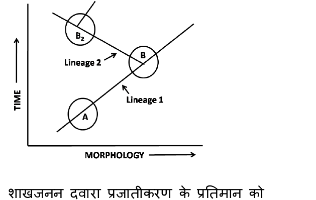

Which of the above lineages represent the pattern of speciation by cladogenesis?

1. Lineage 1
2. Both the lineages 1 and 2
3. Lineage 2
4. Neither of the lineages 1 and 2

**Answer: 3 (Lineage 2)**

> **Explanation:** Cladogenesis is branching speciation (one lineage splitting into two). Lineage 2 (B splitting to give B₂) is the branching event; Lineage 1 (A→B) is anagenesis (transformation within a single line). The key (printed bold, a change in key) credits **3**.

---

### Question 135

Red hair is a recessive trait in humans. In a randomly mating population in Hardy-Weinberg equilibrium, approximately 9% of individuals are red-haired. What is the frequency of heterozygotes?

1. 81%
2. 49%
3. 42%
4. 18%

**Answer: 3 (42%)**

> **Explanation:** q² = 0.09 → q = 0.3, p = 0.7. Heterozygote frequency 2pq = 2 × 0.7 × 0.3 = 0.42 = **42%**.

---

### Question 136

The frequency of M-N blood types in a population of 6129 individuals is as follows:

| Blood type | Genotype | Number of individuals |
|---|---|---|
| M | LᴹLᴹ | 1787 |
| MN | LᴹLᴺ | 3039 |
| N | LᴺLᴺ | 1303 |

The frequency of Lᴺ allele in this population is

1. 0.4605
2. 0.2121
3. 0.5395
4. 0.2911

**Answer: 1 (0.4605)**

> **Explanation:** Total alleles = 2 × 6129 = 12258. Lᴺ count = 3039 (from MN) + 2 × 1303 (from N) = 3039 + 2606 = 5645. Frequency of Lᴺ = 5645 / 12258 = **0.4605**.

---

### Question 137

*Mayfair* genes (hypothetical) consist of a super family of transcription factors. They are found in 4 clusters in mammals; in 2 clusters in insects; and in a single cluster in an ancestor to insects. These data are consistent with all of the following explanations EXCEPT:

1. Two successive genome duplication events occurred between ancestral organism and vertebrates
2. The first duplication may have taken place before divergence of vertebrates
3. Exon shuffling exclusively produced such cluster
4. Whole genome duplications could lead to such observations

**Answer: 3**

> **Explanation:** Going from 1 cluster (ancestor) → 2 (insects) → 4 (mammals) fits successive whole-genome duplications (1, 2, 4). **Exon shuffling** rearranges exons within genes and cannot by itself double whole gene clusters, so statement 3 is the exception.

---

### Question 138

Fluorescence recovery after photobleaching (FRAP) is a method to estimate the diffusion of molecules in a membrane. Fluorescently labelled molecules such as
i. a receptor tagged with green fluorescent protein (GFP)
ii. a receptor labelled with GFP which interacts with cytoskeleton
iii. a labelled lipid
iv. a labelled protein that binds to the membrane surface
are photobleached and the recovery profiles (a-d) were obtained to estimate their diffusion coefficients.

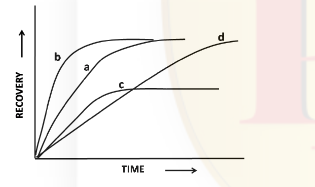

Which one of the combinations is correct?

1. a = i; b = ii
2. b = iii; a = iv
3. c = iii; d = iv
4. d = ii; b = i

**Answer: 2**

> **Explanation:** Free lipids (iii) diffuse fastest (steepest, complete recovery = curve b), whereas a membrane-surface-bound protein (iv) recovers more slowly (curve a). The combination b = iii; a = iv (option 2) fits the recovery rates.

---

### Question 139

*Agrobacterium* Ti plasmid vectors are used to generate transgenic plants. The following are examples of *vir* gene-encoded proteins that are important for the transfer of T-DNA into plants:
A. Vir E, a single-stranded DNA binding protein
B. Vir D2 that generates T-strands
C. Vir A that senses plant phenolic compounds
D. Vir F which directs T-complex proteins for destruction in proteasomes

Which one of the following combinations of proteins functions inside the plant cells?

1. Only A and C
2. A, B and C
3. Only B and C
4. A, B and D

**Answer: 4 (A, B and D)**

> **Explanation:** VirA (C) is the bacterial membrane sensor kinase that detects phenolics — it acts in the bacterium, not inside the plant cell. VirE (A, single-stranded DNA-binding protein that coats the T-strand), VirD2 (B, relaxase that generates and pilots the T-strand) and VirF (D, targets T-complex proteins for proteasomal degradation in the plant cell) all function inside the plant cell — option 4.

---

### Question 140

A researcher is investigating structural changes in a protein by following tryptophan fluorescence and by circular dichroism (CD). Fluorescence and CD spectra of a pure protein were obtained in the absence of any treatment (a), in the presence of 0.5 M Urea (b), upon adding acrylamide, a quencher of tryptophan (c) and upon heating (d). The data are shown below:

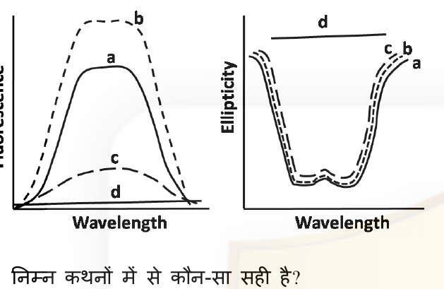

Which one of the following statements is correct?

1. CD is more sensitive to structural changes than fluorescence
2. Fluorescence is more sensitive to structural changes than CD
3. Both methods are equally responsive to structural changes
4. Acrylamide alters the secondary structure of the protein

**Answer: 2**

> **Explanation:** Tryptophan fluorescence reports on the local tertiary environment and changes markedly with mild denaturant/heat, whereas far-UV CD (secondary structure) changes less; thus **fluorescence is more sensitive** to these structural perturbations than CD.

---

### Question 141

Polynucleotide kinase (PNK) is frequently used for radiolabeling DNA or RNA by phosphorylating 5'- end of non-phosphorylated polynucleotide chains. Which of the following statement about PNK is NOT true?

1. PNK catalyzes the transfer of α-phosphate from ATP to 5'-end of polynucleotide chains (DNA or RNA).
2. PNK has 3'-phosphatase activity
3. PNK is inhibited by small amount of ammonium ions
4. PNK is a T4 bacteriophage-encoded enzyme

**Answer: 1**

> **Explanation:** T4 polynucleotide kinase transfers the **γ-phosphate** (not the α-phosphate) of ATP to a 5'-OH terminus; it also has 3'-phosphatase activity, is inhibited by ammonium ions, and is phage-T4-encoded. So the statement that is NOT true is 1 (wrong phosphate position).

---

### Question 142

A gene encoding for protein X was cloned in an expression vector under the T7 RNA polymerase promoter and *lac* operator. Cells were induced by the addition of 1 mM IPTG at 37°C for 6 h. Cells were lysed and fractionated into insoluble bodies and cell-free supernatant by centrifugation. Protein X is present in the insoluble bodies. Which one of the following strategies would you use to express protein X in the soluble fraction (cell-free supernatant)?

1. Increase the duration of induction with 1mM IPTG
2. Grow cells at lower temperature after induction with 1 mM IPTG
3. Increase the concentration of IPTG
4. Grow cells at higher temperature after induction with 1 mM IPTG

**Answer: 2**

> **Explanation:** Inclusion-body (insoluble) formation is reduced by slowing expression — **lowering the temperature** after induction lets the protein fold soluble rather than aggregate. Stronger/longer induction worsens aggregation.

---

### Question 143

Engineering of metabolic pathways in plants can be achieved by introduction and over expression of appropriate candidate gene(s) using transgenic technology. The figure given below represents a biochemical pathway in plants where a precursor molecule 'A' is converted into products 'T' and 'X' through a series of enzymatic reactions. Enzymes 1-5 are involved in this pathway. Scientists attempted to increase the level of 'X' by introducing an additional copy of the gene for enzyme '5' under transcriptional control of a strong constitutive promoter. However, the developed transgenic plants did not display a proportionate increase in the level of 'X'.

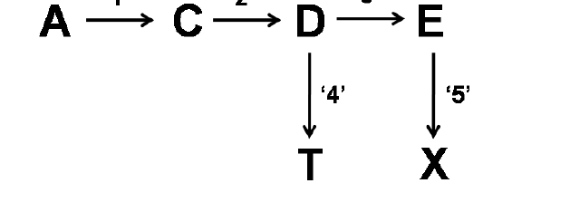

The following statements were proposed for explaining the above results:
A. Enzyme '4' has greater affinity for D than enzyme '3'
B. Feedback inhibition of enzyme '5' by compound X
C. Substrate limitation for enzyme '5'

Which of the above statements could represent probable reasons for NOT obtaining a proportionate increase in the amount of X in the transgenic plants?

1. Only C
2. Only A and B
3. Only A
4. A, B and C

**Answer: 4 (A, B and C)**

> **Explanation:** Over-expressing enzyme 5 fails to raise X proportionately for several plausible reasons: (A) enzyme 4 out-competes enzyme 3 for the shared substrate D, diverting flux to T; (B) feedback inhibition of enzyme 5 by its product X; and (C) substrate (E) limitation for enzyme 5. All three could explain the result — option 4.

---

### Question 144

A single copy homozygous transgenic plant containing the transgene 'A' for fungal resistance was subsequently re-transformed with another gene 'B' for conferring resistance to salt-stress. The selection marker genes used for both the transformation experiments were different. Transgenic plants obtained following the re-transformation experiment were screened for salt-stress resistance and single copy events were identified by Southern hybridization. These single copy events were self-pollinated. In the event of the two T-DNAs (containing the A and B transgenes) getting integrated in unlinked locations in all the transgenic plants, the phenotypic ratios among the T₁ progeny would be:

1. 3 (Fungal resistant + Salt-stress resistant): 1 (Fungal resistant)
2. 1 (Fungal resistant): 2 (Fungal resistant + Salt-stress resistant): 1 (Salt-stress resistant)
3. 3 (Salt-stress resistant): 1 (Fungal resistant)
4. 1 (Fungal resistant): 1 (Salt-resistant):1 (Fungal resistant + Salt stress resistant)

**Answer: 1**

> **Explanation:** The plant is homozygous for A (all progeny fungal-resistant) and hemizygous single-copy for B (selfing gives 3 B⁺ : 1 B⁻). So progeny = 3 (fungal + salt resistant) : 1 (fungal resistant only) — option 1.

---

### Question 145

To make a GST fusion protein you clone a 2kb gene into a 3kb vector. The gene has an EcoRI site, and 500 bp downstream of the start codon there is a HindIII site. Using HindIII plus BamHI (H+B) and HindIII plus PstI (H+P) digests you screen for correct-orientation clones. The map of the vector's correct end is shown below:

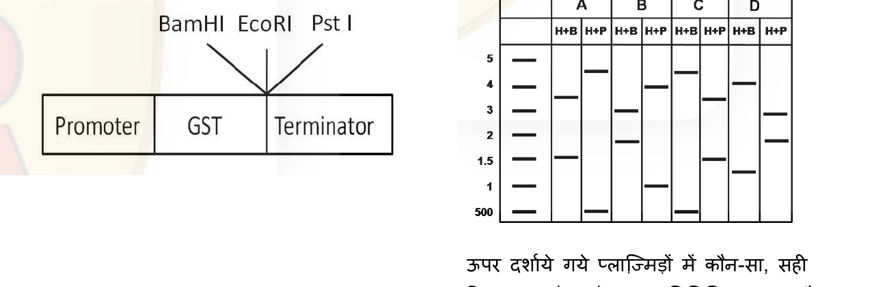

The pattern obtained from four independent clones (A, B, C or D) after restriction digestion is given below. Which clone represents the correct insertion?

1. A
2. B
3. C
4. D

**Answer: 3 (C)**

> **Explanation:** Correct orientation places the internal HindIII site such that H+B and H+P double digests release the diagnostic fragment sizes (the 500 bp + backbone bands) seen only in lane set **C**.
