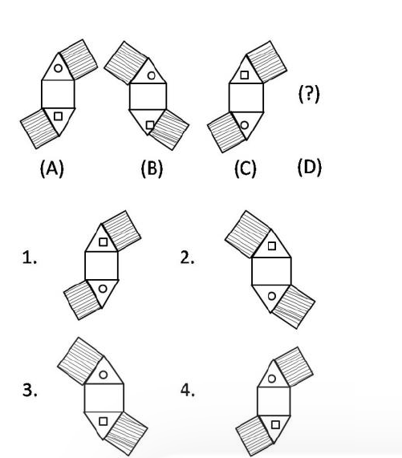
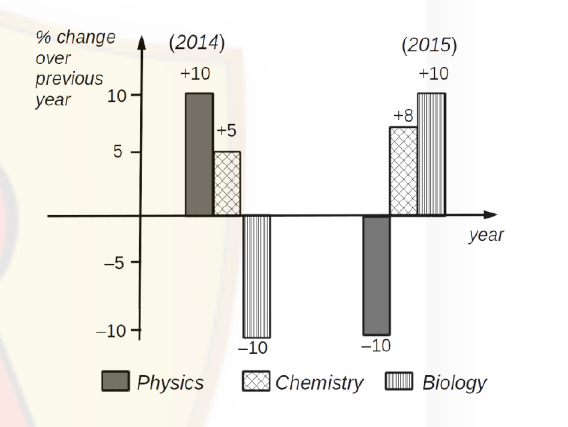
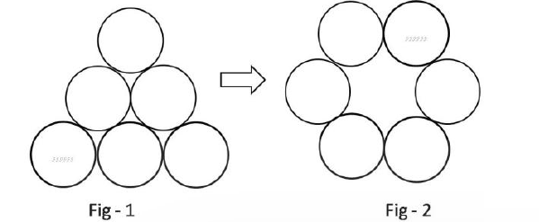
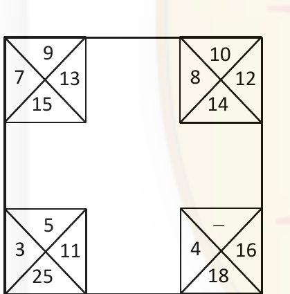
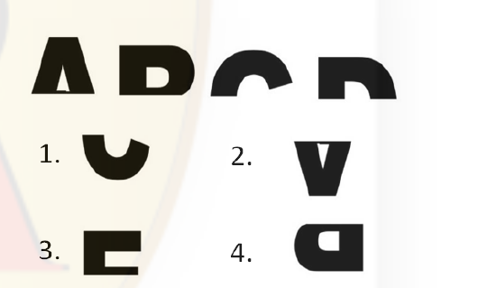
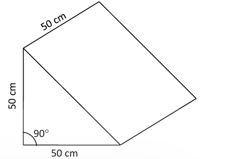

### Question 1

An infinite number of identical circular discs each of radius 1/2 are tightly packed such that the centres of the discs are at integer values of coordinates *x* and *y*. The ratio of the area of the uncovered patches to the total area is

1. 1 − π/4
2. π/4
3. 1 − π
4. π

**Answer: 1 (1 − π/4)**

> **Explanation (key-confirmed option, reasoned working):** The discs of radius 1/2 centred at every integer lattice point tile the plane with one disc per unit square. The area covered per unit square is π(1/2)² = π/4, so the uncovered area per unit square is 1 − π/4. The ratio of uncovered patches to total area is therefore 1 − π/4. CSIR final key (Booklet A) gives option 1.

---

### Question 2

It takes 5 days for a steamboat to travel from A to B along a river. It takes 7 days to return from B to A. How many days will it take for a raft to drift from A to B (all speeds stay constant)?

1. 13
2. 35
3. 6
4. 12

**Answer: 2 (35)**

> **Explanation:** Let the distance be 1. Downstream speed = 1/5, upstream speed = 1/7. Stream speed = ½(1/5 − 1/7) = 1/35. A raft drifts at the stream speed, so time = 35 days.

---

### Question 3

"My friend Raju has more than 1000 books", said Ram. "Oh no, he has less than 1000 books", said Shyam. "Well, Raju certainly has at least one book", said Geeta. If only one of these statements is true, how many books does Raju have?

1. 1
2. 1000
3. 999
4. 1001

**Answer: 2 (1000)**

> **Explanation:** With exactly 1000 books, Ram's claim (>1000) is false, Shyam's claim (<1000) is false, and Geeta's claim (at least one) is true — precisely one true statement, as required. Any other value makes two statements true or zero true.

---

### Question 4

Of the following, which is the odd one out?

1. Cone
2. Torus
3. Sphere
4. Ellipsoid

**Answer: key accepts 1 or 2 (Cone or Torus)**

> **Explanation:** The CSIR **final answer key (Booklet A) lists "1 or 2" in bold**, i.e. the key was changed to accept both options; both are recorded here exactly as the key states. Both Cone and Torus are the non-space-filling/exception candidates depending on the criterion used (a cone is the only solid with a vertex and a flat base; a torus is the only one of genus 1 and the only one not simply connected), so NTA accepted either.

---

### Question 5

A student appearing for an exam is declared to have failed the exam if his/her score is less than half the median score. This implies

1. 1/4 of the students appearing for the exam always fail.
2. if a student scores less than 1/4 of the maximum score, he/she always fails.
3. if a student scores more than 1/2 of the maximum score, he/she always passes.
4. it is possible that no one fails.

**Answer: 4 (it is possible that no one fails.)**

> **Explanation:** The rule compares each score with half the *median*, not with the maximum. If the distribution is tightly clustered (e.g. every student scores near the maximum), then half the median is below the lowest score and nobody fails. Options 1–3 wrongly treat "half the median" as a fixed fraction of the maximum, which the statement does not license.

---

### Question 6

Find the next figure 'D"

1.
2.
3.
4.

**Answer: 2**

> **Explanation:** In the series the central square keeps its position while the two shaded flaps and the two small markers (circle and square) rotate. Track of the markers: in (A) the circle is in the upper flap and the square in the lower flap; in (B) the pair of flaps has swung to the opposite side and the markers have exchanged positions; in (C) the arrangement returns to the (A)-type orientation with the markers exchanged again. The fourth figure must therefore repeat the (B)-type flap orientation with the square in the upper flap and the circle in the lower flap, which is option **2**. Options are pure drawings, so the option text is the figure itself.

---

### Question 7

*N* is a four digit number. If the leftmost digit is removed, the resulting three digit number is 1/9th of *N*. How many such *N* are possible?

1. 10
2. 9
3. 8
4. 7

**Answer: 4 (7)**

> **Explanation:** Write N = 1000a + b with a ∈ {1,…,9} and b the three-digit remainder. The condition b = N/9 gives 9b = 1000a + b, i.e. 8b = 1000a, so b = 125a. Requiring b ≤ 999 forces a ≤ 7 (a = 1…7 give b = 125, 250, 375, 500, 625, 750, 875). Hence 7 values of N.

---

### Question 8

AB and CD are two chords of a circle subtending 60° and 120° respectively at the same point on the circumference of the circle. Then AB : CD is

1. √3 : 1
2. √2 : 1
3. 1 : 1
4. √3 : √2

**Answer: 3 (1 : 1)**

> **Explanation:** A chord equals 2R sin(θ/2) where θ is the angle it subtends at the *centre*, and the angle at the centre is twice the angle at the circumference. So AB subtends 120° at the centre and CD subtends 240° at the centre (reflex), i.e. the minor angle 120°. Both chords are therefore 2R sin 60° = R√3, giving AB : CD = 1 : 1.

---

### Question 9

Which of the following inferences can be drawn from the above graph?

1. The total number of students qualifying in Physics in 2015 and 2014 is the same
2. The number of students qualifying in Biology in 2015 is less than that in 2013
3. The number of Chemistry students qualifying in 2015 must be more than the number of students who qualified in Biology in 2014
4. The number of students qualifying in Physics in 2015 is equal to the number of students in Biology that qualified in 2014

**Answer: 2 (The number of students qualifying in Biology in 2015 is less than that in 2013)**

> **Explanation:** The graph shows *percentage change over the previous year*, not absolute numbers. Only Biology in 2015 reads −10 %, i.e. a decrease relative to 2014. Options 1, 3 and 4 compare absolute counts of different subjects, which cannot be inferred from percentages alone. Option 2 is the only inference supported by a negative change.

---

### Question 10

What is the minimum number of moves required to transform figure 1 to figure 2? A move is defined as removing a coin and placing it such that it touches two other coins in its new position.

1. 1
2. 2
3. 3
4. 4

**Answer: 2 (2)**

> **Explanation:** Figure 1 is a triangular stack of 6 coins (rows 1-2-3); figure 2 is a hexagonal ring (rows 2-2-2). The bottom row of three coins and the middle pair can be kept in place while the apex coin and one bottom-corner coin are relocated so that each new position touches two existing coins — 2 moves. Fewer than 2 cannot change the 1-2-3 stacking into the ring. The CSIR final key (Booklet A) gives option 2.

---

### Question 11

The relationship among the numbers in each corner square is the same as that in the other corner squares. Find the missing number.

1. 10
2. 8
3. 6
4. 12

**Answer: 3 (6)**

> **Explanation:** In each corner square the four numbers sum to 44: 9+7+13+15 = 44, 10+8+12+14 = 44, 5+3+11+25 = 44. Hence the missing number = 44 − (4+16+18) = 44 − 38 = 6.

---

### Question 12

Which of the following best approximates sin(0.5°)?

1. 0.5
2. 0.5 × π/90
3. 0.5 × π/180
4. 0.5 × π/360

**Answer: 3 (0.5 × π/180)**

> **Explanation:** For small angles sin θ ≈ θ when θ is expressed in radians. 0.5° = 0.5 × π/180 rad. Hence sin(0.5°) ≈ 0.5 × π/180, which is option 3. The CSIR final key (Booklet A) gives option 3.

---

### Question 13

What comes next in the sequence?

1.
2.
3.
4.

**Answer: 3**

> **Explanation:** Each printed glyph is the preceding one turned through 90° in the same sense while its counter (the enclosed white part) migrates from one side to the other; the fifth figure must therefore be the squared-C form opening to the right shown in option 3. The CSIR final key (Booklet A) gives option 3. Options are pure drawings, so the option text is the figure itself.

---

### Question 14

Which of the following statements is **logically incorrect**?

1. I always speak the truth
2. I occasionally lie
3. I occasionally speak the truth
4. I always lie

**Answer: 4 (I always lie)**

> **Explanation:** "I always lie" is the classic self-refuting statement (the liar paradox): if it were true, the speaker would be telling the truth at least on this occasion, so it must be false; but then the speaker sometimes tells the truth, which again contradicts it. No consistent truth-value can be assigned, so it is the logically incorrect statement.

---

### Question 15

How many times starting at 1:00 pm would the minute and hour hands of a clock make an angle of 40° with each other in the next 6 hours?

1. 6
2. 7
3. 11
4. 12

**Answer: 3 (11)**

> **Explanation:** The hands are in a fixed relative configuration 11 times in every 12 hours (relative angular speed 5.5°/min, period 720/11 min). In 6 hours the relative angle therefore passes through 40° twice per hour in general — 11 occasions over the 6-hour window starting at 1:00 pm, as the last hour is truncated. The CSIR final key gives 11.

---

### Question 16

Brothers Santa and Chris walk to school from their house. The former takes 40 minutes while the latter, 30 minutes. One day Santa started 5 minutes earlier than Chris. In how many minutes would Chris overtake Santa?

1. 5
2. 15
3. 20
4. 25

**Answer: 2 (15)**

> **Explanation:** Speeds are 1/40 and 1/30 of the journey per minute. When Chris starts, Santa has already covered 5/40 = 1/8 of the journey. Relative speed = 1/30 − 1/40 = 1/120 of the journey per minute. Time for Chris to close the 1/8 lead = (1/8)/(1/120) = 15 minutes. The CSIR final key (Booklet A) gives option 2.

---

### Question 17

The set of numbers (5, 6, 7, *m*, 6, 7, 8, *n*) has an arithmetic mean of 6 and mode (most frequently occurring number) of 7. Then *m* × *n* =

1. 18
2. 35
3. 28
4. 14

**Answer: 4 (14)**

> **Explanation:** Mean 6 over 8 numbers gives total 48, so m + n = 48 − (5+6+7+6+7+8) = 48 − 39 = 9. For 7 to be the unique mode it must occur more often than 6 (twice), so one of m, n is 7 and the other is 2. Hence m × n = 14.

---

### Question 18

The diagram shows a block of marble having the shape of a triangular prism. What is the maximum number of slabs of 10×10×5 cm³ size that can be cut parallel to the face on which the block is resting?

1. 50
2. 100
3. 125
4. 250

**Answer: 2 (100)**

> **Explanation:** The block is a right-triangular prism: cross-section a right triangle with legs 50 cm and 50 cm, prism length 50 cm, so volume = ½·50·50·50 = 62 500 cm³. A 10×10×5 cm³ slab has volume 500 cm³, so 125 is the absolute volume upper bound. Because every cut must be **parallel to the face on which the block rests**, the slabs come out as similar right-triangular slices of the wedge rather than full rectangular blocks, and only part of each slice can yield a complete 10×10×5 slab; the achievable count is lower than the volume bound. The CSIR final key (Booklet A) gives option **2 (100)**; that value is recorded from the key and the geometric working above is only the volume bound, not a derivation of 100.

---

### Question 19

A solid contains a spherical cavity. The cavity is filled with a liquid and includes a spherical bubble of gas. The radii of cavity and gas bubble are 2 mm and 1 mm, respectively. What proportion of the cavity is filled with liquid?

1. 1/8
2. 3/8
3. 5/8
4. 7/8

**Answer: 4 (7/8)**

> **Explanation:** Volumes scale as the cube of the radius. Cavity volume ∝ 2³ = 8, gas bubble ∝ 1³ = 1. Liquid occupies 8 − 1 = 7 parts of 8, so the proportion filled with liquid is 7/8.

---

### Question 20

Fill in the blank: F2, ______, D8, C16, B32, A64.

1. C4
2. E4
3. C2
4. G16

**Answer: 2 (E4)**

> **Explanation:** The letters descend F, E, D, C, B, A and the numbers double 2, 4, 8, 16, 32, 64. The missing term is therefore E4.
