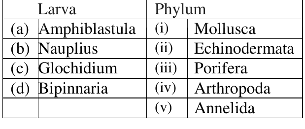

### Question 21

The solubility of gases in water depends on their interaction with water molecules. Four gases i.e. carbon dioxide, oxygen, sulphur dioxide and ammonia are dissolved in water. In terms of their solubility which of the following statements is correct?

1. Ammonia > Oxygen > Sulphur dioxide > Carbon dioxide
2. Oxygen > Carbon dioxide > Sulphur dioxide > Ammonia
3. Sulphur dioxide > Oxygen > Ammonia > Carbon dioxide
4. Ammonia > Sulphur dioxide > Carbon dioxide > Oxygen

**Answer: 4 (Ammonia > Sulphur dioxide > Carbon dioxide > Oxygen)**

> **Explanation:** Ammonia is the most soluble (highly polar, hydrogen-bonds and reacts with water), SO₂ follows (polar and hydrates to sulphurous acid), CO₂ is moderately soluble, and non-polar O₂ is the least soluble.

---

### Question 22

Penicillin acts as a suicide substrate. Which one of the following steps of catalysis does a suicide inhibitor affect?

![Reaction scheme: E_f + S reversible with k1 to [E.S] reversible with k2 to [E.P] reversible with k3 to [E_f +P], with a back arrow labelled k4 returning from product to free enzyme](images/B/fig22.png)

1. k₁
2. k₂
3. k₃
4. k₄

**Answer: 3 (k₃)**

> **Explanation:** A suicide substrate proceeds normally through binding (k₁) and the first catalytic steps, but during the chemistry step it is converted into a reactive species that covalently traps the enzyme. That corresponds to the k₃ step — the chemical conversion of the bound intermediate to product — which is why penicillin (a β-lactam) irreversibly acylates the transpeptidase.

---

### Question 23

Which of the following is **NOT** true for cholesterol metabolism?

1. HMG-CoA reductase is the key regulator of cholesterol biosynthesis.
2. Biosynthesis takes place in the cytoplasm.
3. Reduction reactions use NADH as cofactor.
4. Cholesterol is transported by LDL in plasma.

**Answer: 3 (Reduction reactions use NADH as cofactor.)**

> **Explanation:** The reductive steps of the mevalonate pathway (HMG-CoA → mevalonate, and the squalene/lanosterol reductions) use **NADPH**, not NADH. Statements 1, 2 and 4 are correct.

---

### Question 24

Predominant interactions between phospholipids that stabilize a biological membrane include

1. hydrogen bonds and covalent interactions.
2. van der Waal and ionic interactions.
3. hydrophobic interactions and hydrogen bonding.
4. covalent and hydrophobic interactions.

**Answer: 3 (hydrophobic interactions and hydrogen bonding.)**

> **Explanation:** The bilayer is assembled and held together by the hydrophobic effect (sequestration of the fatty-acyl chains from water) together with hydrogen bonding and electrostatic interactions at the hydrated headgroup interface. There are no covalent bonds between neighbouring phospholipids.

---

### Question 25

Entry of enveloped viruses into its host cells is mediated by:

1. Only endocytosis
2. Both endocytosis and phagocytosis
3. Both endocytosis and membrane fusion
4. Only pinocytosis

**Answer: 3 (Both endocytosis and membrane fusion)**

> **Explanation:** Enveloped viruses enter either by receptor-mediated endocytosis followed by low-pH-triggered fusion of the viral envelope with the endosomal membrane (e.g. influenza), or by direct fusion of the envelope with the plasma membrane (e.g. HIV). Phagocytosis and pinocytosis alone do not describe these routes.

---

### Question 26

Lateral diffusion of proteins in membrane can be followed and diffusion rate calculated by

1. Atomic force microscopy
2. Scanning electron microscopy
3. Transmission electron microscopy
4. FRAP

**Answer: 4 (FRAP)**

> **Explanation:** Fluorescence Recovery After Photobleaching bleaches a defined membrane patch and the recovery of fluorescence by lateral inflow of unbleached molecules is measured, from which the lateral diffusion coefficient is calculated. The microscopy methods listed in 1–3 give structure, not diffusion rates.

---

### Question 27

Histone deacytalase (HDAC) catalyses the removal of acetyl group from N-terminal of histones. Which amino acid of histone is involved in this process?

1. Lysine
2. Arginine
3. Asparagine
4. Histidine

**Answer: 1 (Lysine)**

> **Explanation:** Histone acetylation occurs on the ε-amino group of lysine residues in the N-terminal tails; HDACs hydrolyse this amide (acetyl-lysine) linkage to restore the positive charge.

---

### Question 28

Labelling of membrane spanning domain of any integral membrane protein in a given plasma membrane vesicle (without disrupting its structure) is successfully carried out by

1. immunochemical methods.
2. metabolic labelling with radioisotopes.
3. hydrophobic photoaffinity labelling.
4. limited proteolysis followed by metabolic labelling.

**Answer: 3 (hydrophobic photoaffinity labelling.)**

> **Explanation:** A hydrophobic photoaffinity probe (e.g. an aryl azide or diazirine such as TID) partitions into the lipid bilayer and, on irradiation, covalently labels only the segments of the protein that lie within the membrane, leaving the intact vesicle unlysed. Immunochemical labelling needs accessible epitopes, and metabolic labelling is not spatially specific.

---

### Question 29

*E.coli* is being grown in a medium containing both glucose and lactose. On depletion of glucose, expression of β-galactoside will

1. remain unchanged
2. increase
3. decrease
4. initially decrease and then increase

**Answer: DROPPED — key marks "*" (benefit of marks to those who attempted)**

> **Explanation:** The CSIR final answer key (Booklet A) carries no option for Q29; it is marked `*`, whose legend reads "*benefit of marks to those who attempted". The question was therefore awarded to all who attempted it and no correct option is stated by the key. (For reference, catabolite repression relief on glucose removal raises cAMP and so increases lac-operon expression — option 2 — but this is reasoning, not the key's verdict.)

---

### Question 30

Error-free repair of double strand breaks in DNA is accomplished by

1. non-homologous end-joining.
2. base excision repair.
3. homologous recombination.
4. mismatch repair.

**Answer: 3 (homologous recombination.)**

> **Explanation:** Homologous recombination uses the intact sister chromatid as a template and therefore restores the original sequence exactly. Non-homologous end-joining simply ligates the ends and is error-prone (bases can be lost); base-excision and mismatch repair act on single-strand lesions, not double-strand breaks.

---

### Question 31

The –COOH group of cellular amino acids can form which of the following bonds inside the cell?

1. Ether and ester bonds.
2. Ester and amide bonds.
3. Amide and ether bonds.
4. Amide and carboxylic anhydride bonds.

**Answer: 2 (Ester and amide bonds.)**

> **Explanation:** The carboxyl group of a cellular amino acid forms an amide (peptide) bond with an amino group and can form an ester bond with a hydroxyl group (e.g. aminoacyl-tRNA, where the amino acid is esterified to the 3′-OH of the terminal adenosine). Ether and mixed anhydride linkages are not formed from –COOH in ordinary cellular chemistry.

---

### Question 32

RNA interference is mediated by both siRNA and miRNA. Which one of the following statement about them is **NOT** true?

1. Both siRNA and miRNA are processed by DICER.
2. Both siRNA and miRNA usually guide silencing of the same genetic loci from which they originate.
3. miRNA is a natural molecule while siRNA is either natural or a synthetic one.
4. miRNA, but not siRNA is processed by Drosha.

**Answer: 2 (Both siRNA and miRNA usually guide silencing of the same genetic loci from which they originate.)**

> **Explanation:** Statement 2 is false: siRNA is derived from and silences the same (perfectly complementary) sequence, whereas animal miRNAs are encoded at loci distinct from their targets and act by partial complementarity on other genes. Both are DICER substrates (1), miRNA is natural while siRNA may be natural or synthetic (3), and only miRNA (as a pri-miRNA hairpin) is cleaved by Drosha (4).

---

### Question 33

Following are some of the characteristics of MHC class I and class II molecules except one which is applicable only for MHC class I. Identify the appropriate statement.

1. They are expressed constitutively an all nucleated cells.
2. They are glycosylated polypeptides with domain structure.
3. They are involved in presentation of antigen fragments to cells.
4. They are expressed on surface membrane of B cells.

**Answer: 1 (They are expressed constitutively an all nucleated cells.)**

> **Explanation:** Constitutive expression on **all nucleated cells** is the class I hallmark. Class II molecules are restricted to professional antigen-presenting cells (dendritic cells, macrophages, B cells) and are inducible. Glycosylated domain-containing polypeptides presenting peptide fragments is common to both, and B cells express class II, so options 2–4 do not single out class I.

---

### Question 34

Which of the following bacteria has subcellular localization in lysosomes?

1. *Salmonella typhi*
2. *Streptococcus pneumoniae*
3. *Vibrio cholerae*
4. *Mycobacterium tuberculosis*

**Answer: DROPPED — key marks "*" (benefit of marks to those who attempted)**

> **Explanation:** The CSIR final answer key (Booklet A) marks Q34 with `*`, i.e. "*benefit of marks to those who attempted"; no correct option is stated. (Mycobacterium tuberculosis is the organism classically associated with arresting phagolysosome maturation rather than localising in lysosomes — option 4 would be the reasoned pick — but this is reasoning, not the key's verdict.)

---

### Question 35

Which one of the following best defines an oncogene?

1. An oncogene never codes for a cell cycle protein, which promotes cell proliferation.
2. Oncogenes are always involved in inherited forms of cancer.
3. An oncogene codes for a protein that prevents a cell from undergoing apoptosis.
4. An oncogene is a dominantly expressed mutated gene that renders a cell advantageous towards survival.

**Answer: 4 (An oncogene is a dominantly expressed mutated gene that renders a cell advantageous towards survival.)**

> **Explanation:** An oncogene is a gain-of-function, dominantly acting allele of a proto-oncogene whose product drives proliferation/survival. Option 1 is self-contradictory, option 2 wrongly restricts oncogenes to inherited cancer, and option 3 describes only anti-apoptotic genes, which is not the definition.

---

### Question 36

Which one of the following statements about receptor – enzyme is **FALSE**?

1. A receptor – enzyme has an extracellular ligand binding domain, a transmembrane domain and an intracellular catalytic (enzyme) domain.
2. Many types of receptor enzymes are found in animals.
3. The signal transduction pathways of receptor – enzyme involve phosphorylation cascades.
4. Receptor – enzymes interact directly with intracellular G-proteins.

**Answer: 4 (Receptor – enzymes interact directly with intracellular G-proteins.)**

> **Explanation:** Receptor-enzymes (receptor tyrosine kinases, guanylyl cyclase receptors, etc.) signal through their own intrinsic catalytic domain and recruit adaptor proteins; it is the **seven-transmembrane receptors (GPCRs)**, not receptor-enzymes, that interact directly with heterotrimeric G-proteins. Statements 1–3 are true.

---

### Question 37

Bones of vertebrates are derived from embryonic

1. ectoderm
2. epiderm
3. mesoderm
4. endoderm

**Answer: 3 (mesoderm)**

> **Explanation:** The vertebrate skeleton (bone and cartilage) arises from the mesoderm — specifically the axial/somitic and lateral plate mesoderm, with cranial skeleton additionally from neural crest.

---

### Question 38

During development, if a cell has committed to a particular fate, it is said to be

1. pluripotent
2. totipotent
3. determined
4. differentiated

**Answer: 3 (determined)**

> **Explanation:** Commitment without yet having expressed the phenotype is called **determination**; the cell will follow that fate even when transplanted. Differentiation is the subsequent acquisition of the specialized phenotype, while totipotency/pluripotency describe the range of possible fates, not a committed one.

---

### Question 39

The initial dorsal-ventral axis in amphibian embryos is determined by

1. the point of sperm entry.
2. gravity.
3. the point of contact with the uterus.
4. genetic differences in the cells.

**Answer: 1 (the point of sperm entry.)**

> **Explanation:** Sperm entry triggers the cortical rotation of the egg, which displaces determinants towards the future dorsal side and establishes the dorsal–ventral axis (hence the grey crescent forms opposite the sperm entry point).

---

### Question 40

Sperm cell behaviour during double fertilization in *Arabidopsis* can be stated as follows. Identify the **INCORRECT** statement:

1. Pollen tube bursts and discharges sperm cells.
2. Sperm cells produce pollen tubes and enter into female gametophyte.
3. The receptive antipodal cells break down when pollen tube enters the female gametophyte.
4. One sperm nucleus fuses with the egg cell and the other fuses with the central cells.

**Answer: key accepts 2 or 3**

> **Explanation:** The CSIR final answer key (Booklet A) lists **"2 or 3"** in bold for Q40, so both are accepted as correct responses to the "identify the INCORRECT statement" question. Statement 2 is clearly incorrect (the pollen tube is produced by the pollen grain, not by the sperm cells). Statement 3 is also treated as acceptable because the cells that degenerate on pollen-tube entry are the synergids, not the antipodals. Both key-accepted options are recorded here as the key states.

---

### Question 41

Rhizobial genes that participate in legume nodule formation are called *nodulation (nod)* gens. The *nodD*-encoded protein

1. is an acetyl transferase that adds a fatty acyl chain to the Nod factor.
2. binds to the *nod* box and induces transcription of all *nod* genes.
3. catalyzes the linkage of N-acetyl glucosamine residues.
4. influences the host specificity of *Rhizobium*.

**Answer: 2 (binds to the nod box and induces transcription of all nod genes.)**

> **Explanation:** NodD is a LysR-type transcriptional activator: it binds the conserved *nod* box upstream of the *nod* gene operons and, in the presence of flavonoids, activates transcription of all the *nod* genes. The acyl-transferase activity (1) belongs to NodA/NodC-type synthesis enzymes and NodABC make the Nod-factor backbone (3).

---

### Question 42

Which one of the following plant hormones use the two-component histidine kinase receptor system for signal transduction?

1. Auxin
2. Gibberellin
3. Cytokinin
4. Abscisic acid

**Answer: 3 (Cytokinin)**

> **Explanation:** Cytokinin perception uses the histidine-kinase-type receptors (AHK2/AHK3/CRE1) coupled to AHP phosphotransfer proteins and B-type response regulators — a bacterial-style two-component system. Auxin, gibberellin and ABA use proteolysis/degradation-based (TIR1, GID1, PYR/PYL–PP2C) mechanisms.

---

### Question 43

Which one of the following photoreceptors plays a role in day length perception and circadian rhythms?

1. Zeitlupe family
2. Cryptochromes
3. Phototropins
4. UV Resistance locus 8

**Answer: 1 (Zeitlupe family)**

> **Explanation:** The Zeitlupe (ZTL/FKF1/LKP2) flavin-binding family is the photoreceptor module that feeds light input into the circadian clock and controls photoperiodic flowering (day-length perception) via degradation of CO. Cryptochromes act in circadian entrainment and photomorphogenesis, phototropins in bending and stomatal opening, and UVR8 in UV-B responses. The CSIR final key (Booklet A) gives option 1.

---

### Question 44

Which one of the following is the correct order of electron transport during light reaction in the thylakoid membrane of chloroplast?

1. P680→ Cytochrome *bf* → PC → PQ
2. P680→ PC → Cytochrome *bf* → PQ
3. P680→ PQ → PC → Cytochrome *bf*
4. P680→ PQ → Cytochrome *bf* → PC

**Answer: 4 (P680→ PQ → Cytochrome *bf* → PC)**

> **Explanation:** After excitation of P680 in PSII, electrons pass to pheophytin/quinone, then to the mobile plastoquinone pool (PQ), through the cytochrome *b₆f* complex, and on to plastocyanin (PC) which delivers them to PSI. Hence P680 → PQ → Cyt *bf* → PC.

---

### Question 45

Insulin increases facilitated diffusion of glucose in muscle cells by:-

1. phosphorylation of glucose transporters.
2. translocation of glucose transporter-containing endosomes into the cell membrane.
3. inhibition of the synthesis of mRNA for glucose transporters.
4. dephosphorylation of glucose transporters.

**Answer: 2 (translocation of glucose transporter-containing endosomes into the cell membrane.)**

> **Explanation:** Insulin signalling via PI3K/Akt causes intracellular GLUT4-containing vesicles to translocate to and fuse with the plasma membrane, increasing the number of surface transporters and hence facilitated glucose uptake. The transporter itself is not activated by phosphorylation state.

---

### Question 46

The transport of fructose into the enterocytes is mediated by:-

1. sodium-dependent glucose transporter 1 (SGLT 1).
2. glucose transporter 5 (GLUT5).
3. SGLT 2.
4. GLUT 4.

**Answer: 2 (glucose transporter 5 (GLUT5).)**

> **Explanation:** Apical fructose uptake in the small intestine occurs by the facilitated transporter GLUT5. SGLT1 co-transports glucose and galactose with Na⁺, SGLT2 works in the kidney, and GLUT4 is the insulin-regulated glucose transporter of muscle and fat.

---

### Question 47

The cell bodies of sympathetic preganglionic neurons are located in:-

1. Intermediolateral cell column of spinal cord
2. Posterior cell column of spinal cord
3. Celiac ganglion
4. Paravertebral ganglion

**Answer: 1 (Intermediolateral cell column of spinal cord)**

> **Explanation:** Sympathetic preganglionic neuron somata lie in the lateral (intermediolateral) horn/column of spinal cord segments T1–L2. Their postganglionic partners lie in the paravertebral and prevertebral (e.g. coeliac) ganglia; the posterior horn is sensory.

---

### Question 48

The di- and tripeptides are transported in the enterocytes by peptide transporter 1 that requires:-

1. Na⁺
2. Ca⁺⁺
3. H⁺
4. Cl⁻

**Answer: 3 (H⁺)**

> **Explanation:** PepT1 (SLC15A1) is a proton-coupled symporter: peptide uptake is driven by the inward H⁺ gradient generated by the Na⁺/H⁺ exchanger at the brush border. The direct co-substrate is therefore H⁺.

---

### Question 49

Which one of the following statements is **INCORRECT**?

1. Quantitative inheritance results in a range of measurable phenotypes for a polygenic trait.
2. Polygenic traits often demonstrate continuous variation.
3. Certain alleles of quantitative trait loci (QTL) have an additive effect on the character/trait.
4. Alleles governing quantitative traits do not segregate and assort independently.

**Answer: 4 (Alleles governing quantitative traits do not segregate and assort independently.)**

> **Explanation:** Statement 4 is false: the genes underlying quantitative traits do segregate and assort independently (Mendelian inheritance of many loci is exactly what generates the continuous distribution, per the Nilsson-Ehle/Fisher model). Statements 1–3 are the standard description of quantitative inheritance.

---

### Question 50

A mouse carrying two alleles of insulin-like growth factor II (IgF2) is normal in size; whereas a mouse that carries two mutant alleles lacking the growth factor is dwarf. The size of a heterozygous mouse carrying one normal and one mutant allele depends on the parental origin of the wild type allele. Such pattern of inheritance is known as

1. Sex-linked inheritance
2. Genomic imprinting
3. Gene-environment interaction
4. Cytoplasm inheritance

**Answer: 2 (Genomic imprinting)**

> **Explanation:** Dependence of the phenotype on which parent contributed the wild-type allele is the definition of genomic imprinting. *Igf2* is a classic imprinted gene, expressed only from the paternal allele, so a heterozygote is normal when the wild-type copy is paternal and dwarf when it is maternal.

---

### Question 51

Which one of the following statements is **INCORRECT**?

1. Loss of genetic variation occurs within a small population due to genetic drift.
2. The number of deleterious alleles present in the gene pool of a population is called the genetic load.
3. Genetic erosion is a reduction in levels of homozygosity.
4. Inbreeding depression results from increased homozygosity for deleterious alleles.

**Answer: 3 (Genetic erosion is a reduction in levels of homozygosity.)**

> **Explanation:** Statement 3 is false. Genetic erosion is the **loss of genetic diversity** from a population/gene pool; inbreeding in fact *increases* homozygosity (and thereby causes inbreeding depression, statement 4). Statements 1, 2 and 4 are correct.

---

### Question 52

What is the genotype of a male *Drosophila* fly that has yellow body colour and red eyes. Brown (y⁺) is dominant over yellow (y) and red (w⁺) is dominant over white (w). Both are carried on X chromosome.

1. X^(w+y) Y
2. X^(wy)Y
3. X^(wy+)Y
4. X^(wy+ / X^(wy+)Y

**Answer: 1 (X^(w+y) Y)**

> **Explanation:** A male has a single X, so its phenotype directly reveals its X genotype. Yellow body requires the *y* allele (not y⁺) and red eyes require *w⁺*. The X must therefore carry w⁺ together with y, i.e. option 1.

---

### Question 53

Which of the following statements is **NOT** true regarding the closer affinity of Archaea to Eukarya than to Bacteria?

1. Both Archaea and Eukarya lack peptide-glycan in their cell walls.
2. The initiator amino acid for protein synthesis is methionine in both Archaea and Eukarya.
3. Histones associated with DNA are absent in both Archaea and Eukarya.
4. In both Archaea and Eukarya the RNA polymerase is of several kinds.

**Answer: 3 (Histones associated with DNA are absent in both Archaea and Eukarya.)**

> **Explanation:** Statement 3 is the false one — histones are **present** in both Archaea and Eukarya (and absent from true bacteria), which is one of the characters uniting the two domains. The other statements are consistent with the archaeal–eukaryotic affinity: no peptidoglycan, methionine (not formyl-methionine) as initiator, and multiple RNA polymerases.

---

### Question 54

Match the following larval forms with the phyla that they occur in

1. a – iii, b – iv, c – i, d – ii
2. a – iv, b – iii, c – i, d – v
3. a – ii, b – v, c – iv, d – i
4. a – v, b – i, c – ii, d – iii

**Answer: 1 (a – iii, b – iv, c – i, d – ii)**

> **Explanation:** Amphiblastula is a hollow blastula-type larva of sponges (Porifera, iii); Nauplius is the characteristic crustacean larva (Arthropoda, iv); Glochidium is the bivalve larva (Mollusca, i); Bipinnaria is the starfish/echinoderm larva (Echinodermata, ii).

---

### Question 55

Which of the following National parks has the highest density of tigers among protected areas in the world?

1. Jim Corbett
2. Kaziranga
3. Keoladeo Ghana
4. Manas

**Answer: 2 (Kaziranga)**

> **Explanation:** Kaziranga National Park is reported to hold the highest tiger density among the world's protected areas. Jim Corbett has a large absolute area with lower density, Keoladeo (Ghana) is a bird sanctuary, and Manas has comparatively lower recorded density.

---

### Question 56

Which of the following is **NOT** a prediction arising out of Wilson-MacArthur's Theory of Island Biogeography?

1. The number of species on an island should increase with its size/area.
2. The number of species should decrease with increasing distance of the island from the source pool.
3. The turnover of species should be common and frequent.
4. Species richness on an island should be related to its average distance to the neighbouring islands.

**Answer: 3 (The turnover of species should be common and frequent.)**

> **Explanation:** The equilibrium theory predicts species number rises with island area and falls with isolation from the source pool (1, 2), and that richness relates to distance from neighbouring/source islands (4). At equilibrium the model predicts a **dynamic balance** with low, steady turnover rather than that turnover should be "common and frequent"; the CSIR final key (Booklet A) records option **3 in bold**, i.e. the key was changed to 3.

---

### Question 57

During which of the following major mass extinction events, over 95% of the marine species disappeared from the planet Earth?

1. Ordovician
2. Devonian
3. Permian
4. Triassic

**Answer: 3 (Permian)**

> **Explanation:** The end-Permian (P/T, ~252 Ma) extinction is the largest, wiping out about 95–96 % of marine species (and ~70 % of terrestrial vertebrates). The Ordovician, Devonian and Triassic events were severe but of lower magnitude.

---

### Question 58

Which of the following global hotspots of biodiversity has the highest number of endemic plants and vertebrates?

1. Sundaland
2. Tropical Andes
3. Brazil's Atlantic Forest
4. Mesoamerican forests

**Answer: 2 (Tropical Andes)**

> **Explanation:** The Tropical Andes is the richest hotspot on Earth in terms of number of endemic plant and vertebrate species (roughly 1500 endemics per 10,000 km², and about one-third of all plant species occurring there).

---

### Question 59

For a population growing exponentially with a growth rate *r*, its population doubling time is

1. (*N*₀ × 2)/*r*
2. ln 2/*r*
3. λ ln 2
4. ln *r* × 2

**Answer: 2 (ln 2/*r*)**

> **Explanation:** For dN/dt = rN, N(t) = N₀e^(rt). Setting N = 2N₀ gives e^(rt) = 2, so t = ln 2 / r.

---

### Question 60

Fossils of the same species of fresh water reptiles have been found in South America and Africa. Based on the current understanding, which of the following is the best possible explanation for this pattern?

1. The same species originated and evolved independently in these two places.
2. Species migrated from Africa to establish new populations in South America.
3. Species migrated from South America to establish new populations in Africa.
4. South America and Africa were joined at some point in Earth's history.

**Answer: 4 (South America and Africa were joined at some point in Earth's history.)**

> **Explanation:** Fresh-water reptiles cannot cross a wide ocean. The shared fossils are explained by continental drift — both landmasses were joined in Gondwana (part of Pangaea), allowing a single population to be split by the later opening of the South Atlantic (vicariance), rather than by trans-oceanic migration.

---

### Question 61

In which ecosystem is the autotroph-fixed energy likely to reach the primary carnivore level in the shortest time?

1. Temperate deciduous forest
2. Grassland
3. Ocean
4. Tropical rain forest

**Answer: 3 (Ocean)**

> **Explanation:** In oceanic ecosystems the producers are tiny, fast-turning phytoplankton with very short generation times and little structural (woody/cellulose) biomass, so energy moves through the grazing chain to carnivores much faster than in forests or grasslands where most production is locked in long-lived structural tissue.

---

### Question 62

The utilization or consumption efficiency of herbivores is highest in

1. plankton communities of ocean waters.
2. mature temperate forests.
3. managed grasslands.
4. managed rangelands.

**Answer: 1 (plankton communities of ocean waters.)**

> **Explanation:** Consumption efficiency (ingestion/production at the previous trophic level) is highest where the plant material is palatable, nitrogen-rich and low in structural fibre. Marine phytoplankton are almost entirely digestible, so zooplankton consume a very large fraction of primary production (often 30–50 %+), far above the values for woody or grass-herbivore systems.

---

### Question 63

Which of the following is **NOT** an attribute of a species that makes it vulnerable to extinction?

1. Specialized diet
2. Low dispersal ability
3. Low trophic status
4. Variable population density

**Answer: 3 (Low trophic status)**

> **Explanation:** High trophic status (top predators, low population density, large body size) makes species vulnerable; being at a **low** trophic level is generally protective because such species are abundant and energy-rich. Specialized diet, poor dispersal and fluctuating (variable) population density all increase extinction risk.

---

### Question 64

TILLING is a reverse genetics approach used in functional genomics. Which one of the following is used for TILLING?

1. T-DNA tagging by *Agrobacterium*-mediated transformation.
2. Transposon tagging using Ac/Ds elements.
3. Mutagenesis with ethylmethane sulphonate.
4. Protoplast transformation by electroporation.

**Answer: 3 (Mutagenesis with ethylmethane sulphonate.)**

> **Explanation:** TILLING (Targeting Induced Local Lesions IN Genomes) uses a chemically mutagenized population — typically generated with EMS, which creates random point mutations — screened by mutation-specific endonuclease (CEL I) cleavage and reverse transcription/PCR for lesions in a gene of interest. It is a non-transgenic reverse-genetics method, so T-DNA, transposon and electroporation tagging do not apply.

---

### Question 65

Which one of the following will be observed when auxin to cytokinin ratio is increased in the culture medium during organogenesis from tobacco pith callus?

1. Adventitious roots will form.
2. Adventitious shoot will form.
3. There will be no root formation.
4. There will be no shoot formation.

**Answer: 1 (Adventitious roots will form.)**

> **Explanation:** In the classic Skoog culture of tobacco pith, a high auxin:cytokinin ratio induces organogenesis of adventitious roots, a high cytokinin:auxin ratio induces shoots, and roughly equal ratios give callus growth only.

---

### Question 66

Which of the following is wild relative of wheat?

1. *Triticum monococcum*
2. *Triticum compactum*
3. *Triticum vulgare*
4. *Triticum boeoticum*

**Answer: 1 (Triticum monococcum)**

> **Explanation:** *Triticum monococcum* (einkorn, AA genome) is a wild/diploid progenitor-type wheat relative, whereas *T. compactum* (compactum) and *T. vulgare* (a synonym of common bread wheat) are cultivated polyploids. The CSIR final key (Booklet A) gives option 1.

---

### Question 67

A and B are two enantiomeric helical peptides. Their chirality can be determined by recording their

1. circular dichroism spectrum.
2. UV spectrum.
3. fluorescence spectrum.
4. Edman sequencing.

**Answer: 1 (circular dichroism spectrum.)**

> **Explanation:** Circular dichroism measures the differential absorption of left- and right-circularly polarised light, which is directly sensitive to secondary structure and handedness: two enantiomeric helices give mirror-image CD spectra. UV and fluorescence spectra and Edman sequencing do not report helical chirality.

---

### Question 68

The use of Kruskat Wallis test is most appropriate in which of these cases?

1. There are more than two groups and each group is normally distributed.
2. There are more than two groups and the distribution in each group is not normal.
3. There are two groups and each group is normally distributed.
4. There are two groups and the distribution in each group is not normal.

**Answer: 2 (There are more than two groups and the distribution in each group is not normal.)**

> **Explanation:** The Kruskal–Wallis test is the non-parametric analogue of one-way ANOVA: it is used to compare **more than two** independent groups when the data are not normally distributed (rank-based). For >2 normal groups one uses ANOVA (1); for two groups one uses t-test (3) or Mann–Whitney U (4).

---

### Question 69

Which one of the following can be analysed using Surface Plasmon Resonance method?

1. Radiolabelled DNA probes.
2. Protein structure.
3. Optical density of a solution.
4. Label-free bimolecular interaction.

**Answer: 4 (Label-free bimolecular interaction.)**

> **Explanation:** SPR detects changes in the refractive index at a metal (gold) surface when one binding partner immobilised there captures the other in solution, giving real-time association/dissolution kinetics and affinity **without any label**. Radiolabelled probes, static protein structure and bulk optical density are not what SPR measures.

---

### Question 70

Which one of the following statements is correct for amplified-fragment length polymorphism (AFLP)?

1. PCR using a combination of random and gene-specific primers.
2. PCR amplification followed by digestion with restriction enzymes.
3. Digestion of DNA with restriction enzymes followed by one PCR step.
4. Digestion of DNA with restriction enzymes followed by two PCR steps.

**Answer: 4 (Digestion of DNA with restriction enzymes followed by two PCR steps.)**

> **Explanation:** AFLP begins with restriction digestion of genomic DNA (usually EcoRI + MseI) and ligation of adapters, followed by **two** amplifications: a pre-selective PCR (primers with one added selective base) and a subsequent selective PCR (primers with 3–4 selective bases) that reveals the fragments on a gel. Option 1 describes RAPD, and option 2 inverts the order.
