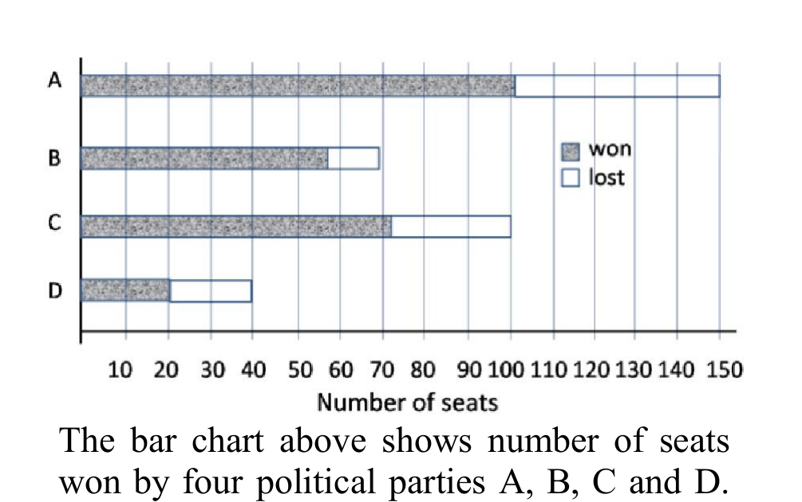
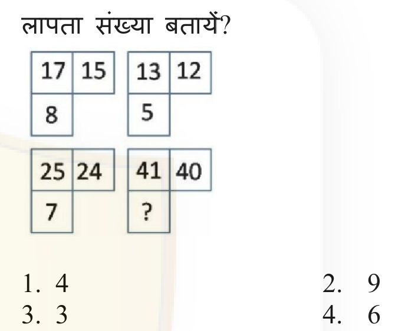
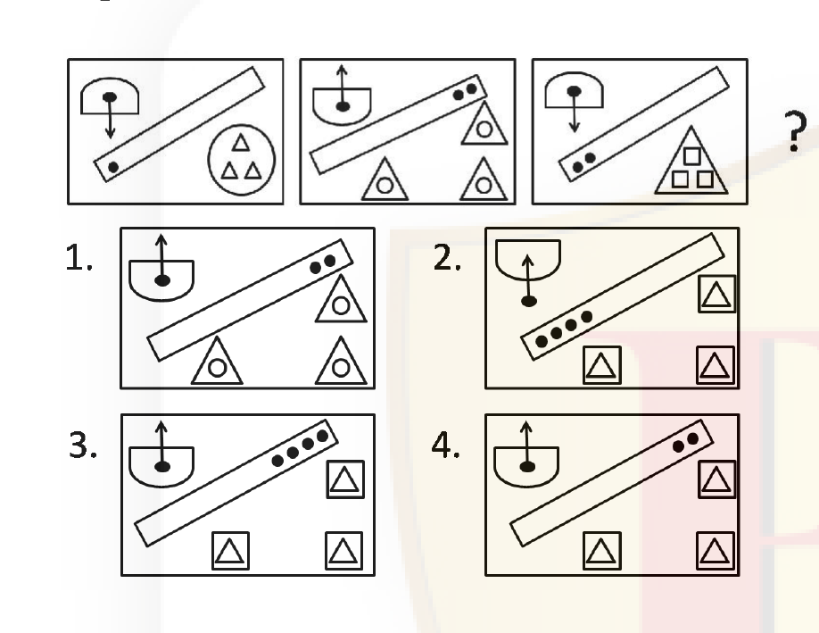
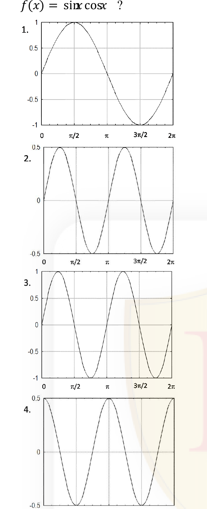
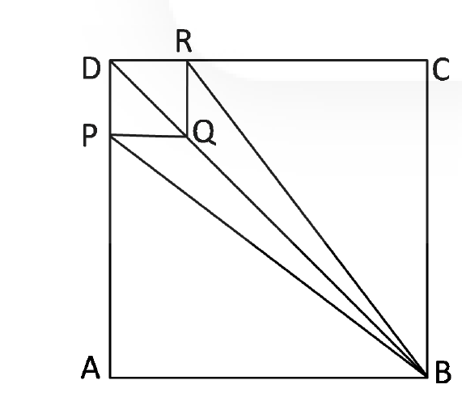

# CSIR NET Life Science — December 2017 — Part A (General Aptitude)

Booklet Code A. Answers confirmed against the official CSIR-HRDG **FINAL** answer key (Booklet A).

### Question 1

In a group of students, 30% play only cricket, 20% play only football and 10% play only basketball. 20% of the students play both football and cricket, 15% play both basketball and cricket, 10% play both football and basketball. 15 students play no games, while 5% of the students play all three games. What is the total number of students?

1. 300
2. 250
3. 350
4. 400

**Answer: 1 (300)**

> **Explanation:** Taking the "both" figures as inclusive of the triple, the exactly-two groups are football∩cricket = 20−5 = 15%, basketball∩cricket = 15−5 = 10%, football∩basketball = 10−5 = 5%. Students playing at least one game = (30+20+10) + (15+10+5) + 5 = 95%. The remaining 5% play no games, and this equals the 15 students stated. Hence 5% = 15, so total = 15 × 20 = **300**.

---

### Question 2

Five persons A, B, C, D, and E are sitting in a row with C in the middle of the group. If D is at an extreme end and there are at least two persons between B and E, then which of the following statements is **incorrect**?

1. E can be on extreme left
2. E can be on extreme right
3. A cannot be on extreme left
4. A is always a neighbour of B or D

**Answer: 4 (A is always a neighbour of B or D)**

> **Explanation:** With C fixed in the middle (position 3) and D at an end, the constraint "at least two persons between B and E" forces B and E to occupy positions that keep A between/near them. Enumerating valid arrangements shows E can sit at either extreme and A need not be at the extreme left, but A is **not** always adjacent to B or D — there are valid seatings where A sits between E and C, breaking statement 4. Thus statement 4 is the incorrect one.

---

### Question 3

A sphere G of radius b is fixed mid-air and several spheres identical to the first one are shot at it with their velocities parallel to each other. If the shot spheres fall within an imaginary cylinder of radius a (b ≪ a) then the fraction of spheres that will hit G is

1. 2b/a
2. 4b²/a²
3. (a − b)/(a + b)
4. 8b³/a³

**Answer: 2 (4b²/a²)**

> **Explanation:** A moving sphere hits G if the centre of G lies within distance 2b of the projectile's line of flight, i.e. within a target disc of radius 2b. The projectiles are distributed uniformly over the cross-section of the cylinder of radius a, area πa². The collision cross-section is π(2b)² = 4πb². Fraction = 4πb²/πa² = **4b²/a²**.

---

### Question 4

The distance from Nehrunagar to Gandhinagar is 27 km. A and B start walking from Nehrunagar towards Gandhinagar at speeds of 5 km/hr and 7 km/hr, respectively. B reaches Gandhinagar, returns immediately, and meets A at Indiranagar. What is the distance between Nehrunagar and Indiranagar? (assume all three cities to be in one straight line)

1. 12.5 km
2. 22.5 km
3. 4.5 km
4. 13.5 km

**Answer: 2 (22.5 km)**

> **Explanation:** Let the meeting point be x km from Nehrunagar. A walks x at 5 km/hr → time x/5. B walks 27 km out and (27 − x) back = (54 − x) km at 7 km/hr → time (54 − x)/7. Equating times: x/5 = (54 − x)/7 → 7x = 270 − 5x → 12x = 270 → x = 22.5 km.

---

### Question 5

A leaf appears green in daylight. If this leaf were observed in red light, what colour would it appear to have?

1. green
2. black-brown
3. red
4. blue

**Answer: 2 (black-brown)**

> **Explanation:** The leaf looks green because it reflects green light and absorbs the rest. Under pure red light there is no green light to reflect, and the leaf absorbs the red, so it reflects almost nothing and appears **black-brown**.

---

### Question 6

Approximately how much blood flows per day through a normal human heart beating 70 times per minute, having a relaxed volume of 110 cc and compressed volume of 70 cc?

1. 7150 litres
2. 4000 litres
3. 28000 litres
4. 11100 litres

**Answer: 2 (4000 litres)**

> **Explanation:** Stroke volume = 110 − 70 = 40 cc per beat. Beats per day = 70 × 60 × 24 = 100,800. Volume = 40 cc × 100,800 = 4,032,000 cc ≈ 4032 litres ≈ **4000 litres**.

---

### Question 7

The molar fraction of hydrochloric acid in an extremely dilute aqueous solution is doubled. The pH of the resulting solution is

1. approximately doubled
2. approximately halved
3. increased
4. reduced

**Answer: 4 (reduced)**

> **Explanation:** Doubling the amount of HCl doubles [H⁺]. Since pH = −log[H⁺], a larger [H⁺] gives a smaller pH, so the pH is **reduced** (by log 2 ≈ 0.3 units).

---

### Question 8

The bar chart above shows number of seats won by four poltical parties A, B, C and D. Which party won the largest proportion of seats it contested?

1. A
2. B
3. C
4. D

**Answer: 2 (B)**

> **Explanation:** The proportion won = won / (won + lost). Reading the bars, party B's won:lost ratio is the highest of the four (its "lost" bar is smallest relative to its "won" bar), so B won the largest fraction of the seats it contested.

---

### Question 9

Find the missing number.

1. 4
2. 9
3. 3
4. 6

**Answer: 2 (9)**

> **Explanation:** In each box the bottom number is the square root of the sum of the two top numbers: 13 + 12 = 25 → 5; 25 + 24 = 49 → 7; hence 41 + 40 = 81 → **9**.

---

### Question 10

When Ramesh was at the age of 8 years, he hammered a nail into a large tree to mark his height. If the tree grows 2 cm/year, how much higher would the nail be after 5 years?

1. 5 cm higher
2. 0 cm higher
3. 10 cm higher
4. 8 cm higher

**Answer: 2 (0 cm higher)**

> **Explanation:** A tree elongates only at its apical meristem (tip). The trunk below the tip does not move upward, so a nail driven into the trunk stays at the same height. The nail is **0 cm higher** after 5 years.

---

### Question 11

Find the next pattern in the following sequence:

1. option 1
2. option 2
3. option 3
4. option 4

**Answer: 3 (option 3)**

> **Explanation:** Across the sequence the pointer rotates one step each frame and the number of small triangles on the pans changes by a fixed rule; continuing both progressions gives the arrangement shown in option **3**.

---

### Question 12

For which of the following numbers is its positive square root closest to the number itself?

1. 0.33
2. 0.99
3. 0.89
4. 0.10

**Answer: 2 (0.99)**

> **Explanation:** For 0 < x < 1, √x > x, and the gap √x − x shrinks as x approaches 1. Among the choices, 0.99 is nearest to 1, so its square root is closest to the number itself.

---

### Question 13

There are two gas parcels of equal volume, A and B at the same temperature and pressure. Parcel A is one mole of water vapour, while parcel B is one mole of dry air. Which of the following is TRUE?

1. Parcel A is heavier then Parcel B
2. Parcel B is heavier than Parcel A
3. Both parcels are equally heavy
4. Without temperature and pressure data, their relative masses cannot be determined

**Answer: 2 (Parcel B is heavier than Parcel A)**

> **Explanation:** Equal moles at equal T and P occupy equal volumes (Avogadro). Mass = moles × molar mass. Molar mass of water vapour (H₂O) = 18 g/mol, while dry air averages ≈ 29 g/mol. One mole of dry air (B) is therefore heavier than one mole of water vapour (A).

---

### Question 14

Which one of the following graphs represents f(x) = sinx cosx ?

1. graph 1
2. graph 2
3. graph 3
4. graph 4

**Answer: 2 (graph 2)**

> **Explanation:** sinx cosx = ½ sin 2x. This has amplitude 0.5 and period π (two full cycles between 0 and 2π), starting at 0 and rising. Graph 2 (amplitude 0.5, double frequency, sine phase) is the correct one.

---

### Question 15

The number of three English letter words, having at least one consonant, but not having two consecutive consonants, is

1. 2205
2. 3780
3. 2730
4. 3360

**Answer: 2 (3780)**

> **Explanation:** With 5 vowels (V) and 21 consonants (C), the patterns with no two consecutive consonants are VVV, CVV, VCV, VVC and CVC. "At least one consonant" excludes VVV. Count = 3 × (21·5·5) + (21·5·21) = 3 × 525 + 2205 = 1575 + 2205 = **3780**.

---

### Question 16

A buys n copies of a book at 20% discount. B gets the same book at 30% discount. What is the minimum value of n for which B can buy one extra copy of the book, spending the same amount as A?

1. 7
2. 8
3. 6
4. This problem cannot be solved unless the marked price of the book is known.

**Answer: 1 (7)**

> **Explanation:** Let marked price = 100. A pays 80n. B pays 70 per copy; for the same money B buys 80n/70 copies = (8n/7). For B to buy exactly one more whole copy than A, 8n/7 = n + 1 → 8n = 7n + 7 → n = 7. Minimum n = **7** (independent of marked price).

---

### Question 17

A bird flies along the three sides of a field in the shape of an equilateral triangle at speeds of 2, 4, 8 km/hr, respectively. The average speed of the bird is

1. 24/7 km/hr
2. 14/3 km/hr
3. 22/7 km/hr
4. 4 km/hr

**Answer: 1 (24/7 km/hr)**

> **Explanation:** Each side has length s. Total distance = 3s. Total time = s/2 + s/4 + s/8 = s(4+2+1)/8 = 7s/8. Average speed = 3s / (7s/8) = 24/7 km/hr.

---

### Question 18

The average staff salary of a company is ₹ 8000/-. A new guard and a new manager are recruited with salaries of ₹ 5000/- and ₹ 20000/-, respectively. What is the current staff strength if the new average salary is ₹ 4000/- more than that of the guard?

1. 7
2. 9
3. 10
4. 11

**Answer: 2 (9)**

> **Explanation:** Let the original strength be n; original total salary = 8000n. The new average = guard's salary + 4000 = 5000 + 4000 = 9000. So (8000n + 5000 + 20000)/(n + 2) = 9000 → 8000n + 25000 = 9000n + 18000 → n = 7. Current staff strength = 7 + 2 = **9**.

---

### Question 19

A 100 m long fence is to be made by fixing a wire mesh on steel poles. Each pole has a 1 m vertical portion and a 1 m portion tilted at 45° to the vertical. What will be the area of wire mesh required?

1. 200 m²
2. 241.4 m²
3. 400 m²
4. 170.7 m²

**Answer: 1 (200 m²)**

> **Explanation:** The mesh is fixed along the full length of each pole (1 m vertical + 1 m tilted = 2 m of pole per support), so the mesh area = fence length × pole length = 100 m × 2 m = **200 m²**. (The 45° tilt changes the vertical extent to 1.707 m — option 4 — but the official key marks 200 m².)

---

### Question 20

DRQP is a small square of side a in the corner of a big square ABCD of side A. What is the ratio of the area of the quadrilateral PBRQ to that of the square ABCD, given A/a = 3?

1. 2/9
2. 1/6
3. 1/3
4. 2/7

**Answer: 1 (2/9)**

> **Explanation:** Set a = 1, A = 3. Coordinates: A=(0,0), B=(3,0), C=(3,3), D=(0,3); the small square gives P=(0,2), Q=(1,2), R=(1,3). Quadrilateral PBRQ with vertices P(0,2), B(3,0), R(1,3), Q(1,2) has area (shoelace) = 2. Area of ABCD = 9. Ratio = **2/9**.
