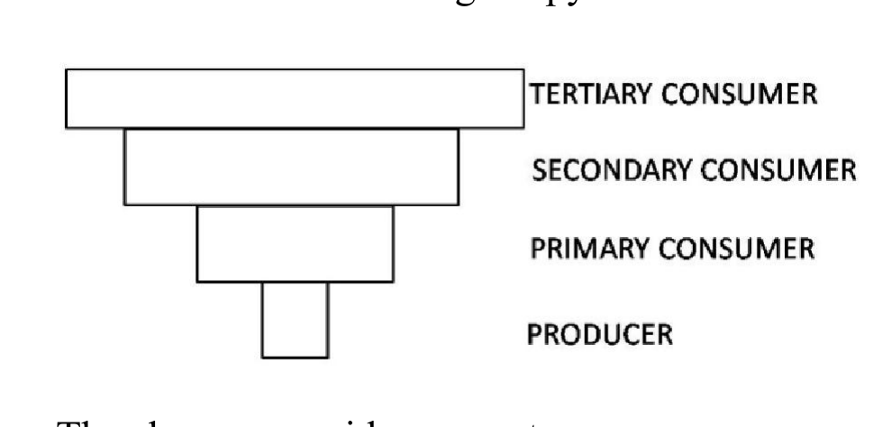
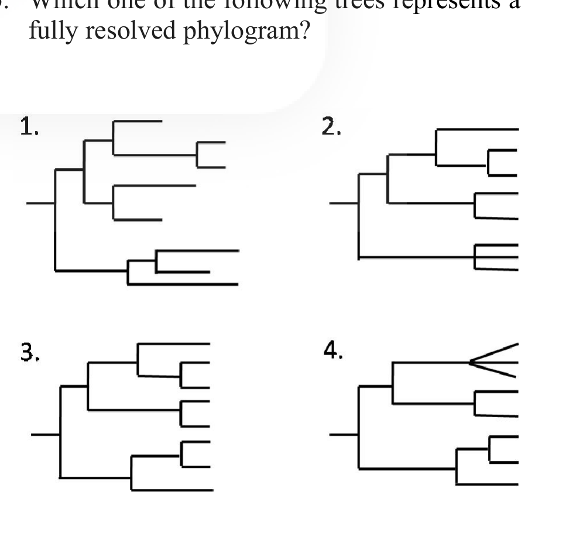
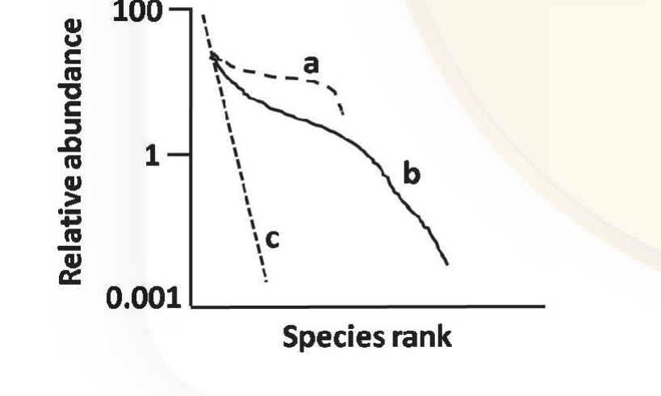

# CSIR NET Life Science — December 2017 — Part B

Booklet Code A. Q21–70. Answers confirmed against the official CSIR-HRDG **FINAL** answer key (Booklet A). Q70 is marked **\*** in the key = *benefit of marks to those who attempted* (no correct option).

### Question 21

Choose the correct statement from the following:

1. Disulfide bonds in a 20-residue peptide can be formed only if the cysteines are adjacent to each other.
2. The amino acid isoleucine has only one chiral centre.
3. Both bases and sugar contribute to chirality of nucleic acids.
4. The pI of aspartic acid is less than that of glutamic acid.

**Answer: 4 (The pI of aspartic acid is less than that of glutamic acid)**

> **Explanation:** Aspartic acid has one extra methylene less than glutamic acid, so its side-chain carboxyl is closer to the α-carboxyl and slightly more acidic; its pI (~2.8) is lower than that of glutamic acid (~3.2). Statement 1 is false (disulfides form between any two cysteines brought together by folding), 2 is false (Ile has two chiral centres, Cα and Cβ), 3 is false (the deoxyribose provides chirality; the bases are planar and achiral).

---

### Question 22

Indicate the **INCORRECT** statement from the following:

1. Allosteric enzymes function through reversible noncovalent binding of allosteric modulators or effectors.
2. Monoclonal antibodies that catalyze hydrolysis of esters or carbonates can be produced.
3. Enzymes are not inhibited irreversibly by heavy metals such as Hg²⁺, Ag⁺.
4. Acid phosphatases hydrolyze biological phosphate esters at ~ pH 5.0.

**Answer: 3 (Enzymes are not inhibited irreversibly by heavy metals such as Hg²⁺, Ag⁺.)**

> **Explanation:** Heavy metals such as Hg²⁺ and Ag⁺ bind tightly (effectively irreversibly) to essential –SH groups of enzymes and inactivate them, so statement 3 is the incorrect one. Allosteric regulation is reversible/noncovalent (1), catalytic antibodies (abzymes) for ester/carbonate hydrolysis exist (2), and acid phosphatases act at ~pH 5 (4).

---

### Question 23

What is the effect of sudden increase in the levels of ATP and citrate on an erythrocyte undergoing glycolysis?

1. It inhibits glycolysis.
2. It stimulates glycolysis.
3. The rate of glycolysis remains unaltered.
4. The rate of glycolysis increases gradually.

**Answer: 1 (It inhibits glycolysis.)**

> **Explanation:** ATP and citrate are the classical allosteric inhibitors of phosphofructokinase-1. A rise in their levels signals abundant energy and slows glycolysis.

---

### Question 24

The ϕ and ψ values of a β-strand composed of all D-amino acids will mainly occupy which quadrant in the Ramachandran plot?

1. upper left
2. upper right
3. lower left
4. lower right

**Answer: 4 (lower right)**

> **Explanation:** An all-L β-strand occupies the extended β region of the Ramachandran map (φ ≈ −120°, ψ ≈ +130°, upper left). Mirror-image (D) residues have both torsion angles reversed in sign, so an all-D β-strand plots at φ ≈ +120°, ψ ≈ −130° — the **lower right** quadrant.

---

### Question 25

In a signalling event, binding of an extracellular ligand activates G-protein coupled receptor (GPCR) that eventually activates phospholipase C-β. Which one of the following statements truly reflects the function of phospholipase C-β ?

1. Phospholipase C-β converts PI (3,4,5)P₃ to PI (4,5)P₂
2. Phospholipase C-β converts PI (4)P to PI (4,5)P₂
3. Phospholipase C-β converts PI (4,5)P₂ to diacylglycerol and IP₃
4. Phospholipase C-β converts PI (5)P to PI (4,5)P₂

**Answer: 3 (Phospholipase C-β converts PI (4,5)P₂ to diacylglycerol and IP₃)**

> **Explanation:** PLC-β cleaves phosphatidylinositol 4,5-bisphosphate into inositol 1,4,5-trisphosphate (IP₃) and diacylglycerol (DAG), the two second messengers of the pathway.

---

### Question 26

Select a cellular body which is **NOT** a part of the nuclear bodies:

1. P-bodies
2. Nucleolus
3. Cajal bodies
4. Interchromatin granule clusters

**Answer: 1 (P-bodies)**

> **Explanation:** P-bodies (processing bodies) are cytoplasmic ribonucleoprotein granules involved in mRNA decay, not nuclear bodies. The nucleolus, Cajal bodies and interchromatin granule clusters (speckles) are all nuclear.

---

### Question 27

Which one of the following statements about chromatin is **NOT** true?

1. DNA winds approximately 1.65 times around the nucleosomes
2. H2A-H2B bind to both the entry and exit ends of DNA in nucleosomes
3. Covalent modification of histones influence chromatin compaction
4. Non-histone proteins are part of mitotic chromosomes

**Answer: 2 (H2A-H2B bind to both the entry and exit ends of DNA in nucleosomes)**

> **Explanation:** It is the H2A–H2B dimers that sit on the outer surface of the histone octamer; the entry/exit ends of the nucleosomal DNA are stabilised by the linker histone H1, and the (H3–H4)₂ tetramer forms the central wrap. Statement 2 is therefore the false one.

---

### Question 28

During eukaryotic cell division, metaphase to anaphase transition is regulated by degradation of

1. Cyclin B1
2. CDK1
3. Aurora A kinase
4. Polo-like kinase

**Answer: 1 (Cyclin B1)**

> **Explanation:** The anaphase-promoting complex/cyclosome ubiquitinates securin and cyclin B1. Destruction of cyclin B1 inactivates CDK1 and drives the metaphase→anaphase transition.

---

### Question 29

One of the mechanisms used by bacteria for adaptation to changed environment is altering transcription of their genes. In this regard, which one of the following responses is **NOT** found in bacteria?

1. A gene with two different promoters for expression in different conditions
2. Use of different sigma factors for transcription of genes
3. Expression of alternate α, β and β' subunits
4. Expression of anti-sigma factors

**Answer: 3 (Expression of alternate α, β and β' subunits)**

> **Explanation:** Bacteria vary transcription via alternative promoters, alternative σ factors and anti-σ factors; they do not swap alternative α, β, β′ core subunits of RNA polymerase as a regulatable mechanism.

---

### Question 30

Which one of the following λ proteins acts both as an activator and repressor of transcription?

1. cI protein
2. N protein
3. cII protein
4. Q protein

**Answer: 1 (cI protein)**

> **Explanation:** λ cI represses the lytic promoters P_R and P_L while, bound at OR3, it activates transcription of its own promoter P_RM — the classic dual repressor/activator of λ.

---

### Question 31

A highly specific inhibitor that targets the phosphorylation activity of TFIIH is added to an *in vitro* transcription reaction. Which one of the following steps is most likely to be affected?

1. Binding of RNA polymerase to promoter sequence
2. Promoter clearance
3. Recruitment of TFIID
4. Open promoter complex formation

**Answer: 2 (Promoter clearance)**

> **Explanation:** TFIIH's kinase (CDK7 of the CAK module) phosphorylates the Pol II CTD, which is required for escape of the polymerase from the promoter. Assembly steps (TFIID recruitment, Pol II binding, open complex) precede and do not need this phosphorylation.

---

### Question 32

During eukaryotic protein synthesis, stress conditions result in activation of specific kinases leading to phosphorylation of a key translation initiation factor that inhibits protein synthesis from a large number of cellular mRNA. Which one of the following factors is the target of the kinase?

1. eIF4E
2. eIF4G
3. eIF2α
4. Gcn4

**Answer: 3 (eIF2α)**

> **Explanation:** Stress-activated kinases (HRI, PKR, GCN2, PERK) phosphorylate eIF2α, converting eIF2 into an inhibitor of its own guanine nucleotide exchange factor eIF2B and thereby shutting down global translation initiation.

---

### Question 33

Proteins with cytoplasmic domains having tyrosine kinase activity do **NOT** act as receptors for

1. Epidermal growth factor (EGF)
2. Platelet-derived growth factor (PDGF)
3. Insulin
4. Transferrin

**Answer: 4 (Transferrin)**

> **Explanation:** EGF, PDGF and insulin receptors are receptor tyrosine kinases. Transferrin is taken up by the transferrin receptor, a non-enzymatic iron-uptake receptor, which has no kinase activity.

---

### Question 34

Which one of the following is a group of signalling molecules that act as morphogens during development of an organism and its effects are mediated through the receptor Patched and its binding partner Smoothened?

1. Hedgehog protein
2. Notch protein
3. Wnt protein
4. β-catenin

**Answer: 1 (Hedgehog protein)**

> **Explanation:** Hedgehog signals by binding Patched, which relieves its inhibition of Smoothened, the transducer of the pathway. Notch uses Delta/Serrate ligands; Wnt uses Frizzled/LRP.

---

### Question 35

Junctions which tether cytoskeletal filaments inside the cell are known as

1. anchoring junctions
2. occluding junctions
3. channel – forming junctions
4. signal – relaying junctions

**Answer: 1 (anchoring junctions)**

> **Explanation:** Anchoring junctions (desmosomes, adherens junctions, hemidesmosomes) attach cells to each other or to matrix through cytoskeletal filaments. Occluding (tight) junctions seal, channel-forming (gap) junctions communicate.

---

### Question 36

Which one of the following human serum immunoglobulins takes part in classical complement fixation pathway?

1. IgD
2. IgE
3. IgA
4. IgG

**Answer: 4 (IgG)**

> **Explanation:** IgG (and IgM) fix complement by the classical pathway through C1q binding to the Fc region. IgD, IgE and secretory IgA do not activate the classical pathway.

---

### Question 37

Match the following cleavage patterns with the species in which they occur.

| | Species | | Cleavage Pattern |
|---|---|---|---|
| A. | Flatworm | i. | Meroblastic discoidal |
| B. | Frog | ii. | Meroblastic superficial |
| C. | Birds | iii. | Holoblastic displaced radial |
| D. | Insect | iv. | Holoblastic spiral |

1. A – iv, B – iii, C – i, D – ii
2. A – iii, B – i, C – iv, D – ii
3. A – ii, B – iii, C – i, D – iv
4. A – ii, B – iv, C – iii, D – i

**Answer: 1 (A – iv, B – iii, C – i, D – ii)**

> **Explanation:** Flatworms show holoblastic spiral cleavage; frogs (mesolecithal) show holoblastic displaced radial cleavage; birds (telolecithal) show meroblastic discoidal cleavage; insects (centrolecithal) show meroblastic superficial cleavage.

---

### Question 38

Which one of the following statements regarding limb development in mice is true?

1. The gene encoding Tbx5 is transcribed in the limb fields of the hindlimbs.
2. The gene encoding Tbx4 is transcribed in the limb fields of the forelimbs.
3. Genes encoding Islet 1, Tbx4 and Pitx are expressed in the presumptive hindlimb.
4. Genes encoding Islet 1, Tbx4 and Pitx are expressed in the presumptive forelimb.

**Answer: 3 (Genes encoding Islet 1, Tbx4 and Pitx are expressed in the presumptive hindlimb.)**

> **Explanation:** Tbx5 marks the forelimb field, whereas Tbx4 together with Pitx1 (and the motor-neuron gene Islet1) characterises the hindlimb field. Hence statements 1 and 2 are wrong, and option 3 is the correct combination.

---

### Question 39

Based on ABC model during flower development, loss of class A activity results in the formation of only stamen and carpel. Which of the following floral organ identity genes controls the class A activity?

1. APETALA 1 and APETALA 2
2. APETALA 3 and PISTILLATA
3. Only PISTILLATA
4. Only AGAMOUS

**Answer: 1 (APETALA 1 and APETALA 2)**

> **Explanation:** Class A function in *Arabidopsis* is provided by APETALA1 and APETALA2. Class B is AP3 + PI, class C is AGAMOUS.

---

### Question 40

In a given experiment, transplantation of micromeres from the vegetal pole of a 16-cell sea urchin embryo onto the animal pole of a host 16-cell sea urchin embryo would initiate:

1. the transplanted micromeres to invaginate into the blastocoel to create a new set of skeletogenic mesenchyme cells
2. the transplanted micromeres to ingress into the blastocoel to create a new set of skeletogenic mesenchymal cells
3. the transplanted micromeres will mingle with the host micromeres to ingress into the blastocoel to create skeletogenic mesenchyme cells.
4. the transplanted micromeres will form the secondary archenteron.

**Answer: 1 (the transplanted micromeres to invaginate into the blastocoel to create a new set of skeletogenic mesenchyme cells)**

> **Explanation:** Micromeres carry the autonomous specification for skeletogenic (primary) mesenchyme. When moved to the animal pole they retain that programme and form an additional set of skeletogenic mesenchyme cells inside the blastocoel, so option 1 is the keyed answer. (The official key marks option 1; note that the micromeres normally ingress, so options 1 and 2 differ mainly in the verb used by the paper.)

---

### Question 41

Which one of the following is **NOT** a phenotype of dark-grown seedlings that are etiolated?

1. Short hypocotyls
2. An apical hook
3. Closed cotyledons
4. Non-photosynthetic proplastids

**Answer: 1 (Short hypocotyls)**

> **Explanation:** Etiolated (dark-grown) seedlings are characterised by an **elongated** hypocotyl, an apical hook, closed/unexpanded cotyledons and colorless etioplasts. "Short hypocotyls" is therefore not an etiolation phenotype — it is a feature of light-grown (de-etiolated) seedlings.

---

### Question 42

Which one of the following is the correct function of JAZ (JASMONATE ZIM-DOMAIN) protein family, a key regulator of Jasmonic Acid (JA) signalling response?

1. Binds to MYC2 and represses the JA dependent genes.
2. Binds to MYC2 and transcribes JA dependent genes.
3. Acts as receptor of JA signal.
4. Involved in directly inducing JA dependent genes.

**Answer: 1 (Binds to MYC2 and represses the JA dependent genes.)**

> **Explanation:** In the absence of JA, JAZ proteins bind and repress the transcription factor MYC2. JA-isoleucine promotes COI1-mediated degradation of JAZ, releasing MYC2 to activate JA-responsive genes. (The receptor is the COI1–JAZ complex, not JAZ alone.)

---

### Question 43

The plant hormone, Gibberellic Acid is generally **NOT** associated with

1. stem elongation
2. parthenocarpy
3. parthenogenesis
4. malt production

**Answer: 3 (parthenogenesis)**

> **Explanation:** GA promotes stem elongation, induces seedless fruit (parthenocarpy) and triggers α-amylase synthesis used in malting. Parthenogenesis (development of an embryo from an unfertilised egg) is not a GA-mediated process.

---

### Question 44

Which one of the following statements is **NOT** correct for Casparian strip?

1. It breaks the continuity of water movement through the apoplast pathway
2. It is formed in the growing part of the root
3. It is formed several millimetres or several centimetres behind the root tip
4. It is a band within the radial cell walls of the endodermis that is impregnated with lignin

**Answer: 2 (It is formed in the growing part of the root)**

> **Explanation:** The Casparian strip is deposited in differentiated endodermal cells some distance behind the growing root tip, not in the growing region. It is a ligno-suberised band in radial (and transverse) walls that blocks apoplastic flow.

---

### Question 45

Which one of the following is **NOT** involved with the absorption of iron in the intestine?

1. Divalent metal transporter
2. Ferroportin I
3. Hephaestin
4. Transferrin

**Answer: 4 (Transferrin)**

> **Explanation:** DMT1 imports Fe²⁺ across the apical brush border, ferroportin exports it across the basolateral membrane and hephaestin (a ferroxidase) loads it onto transferrin in plasma. Transferrin itself is the plasma carrier that delivers iron to tissues, not a component of intestinal absorption.

---

### Question 46

In which one of the body fluids is K⁺ concentration higher than that of Na⁺?

1. Plasma
2. Perilymph
3. Endolymph
4. Cerebrospinal fluid

**Answer: 3 (Endolymph)**

> **Explanation:** Endolymph in the scala media is unusual in being K⁺-rich (~150 mM) and Na⁺-poor, like intracellular fluid. Plasma, perilymph and CSF are all Na⁺-dominated extracellular fluids.

---

### Question 47

Mammillary bodies are present in

1. thalamus
2. epithalamus
3. hypothalamus
4. midbrain

**Answer: 3 (hypothalamus)**

> **Explanation:** The mammillary bodies are two small round structures of the posterior hypothalamus, part of the Papez circuit (lesions cause anterograde amnesia, e.g. Wernicke–Korsakoff syndrome).

---

### Question 48

Reflex ovulation does **NOT** occur in

1. cats
2. rabbits
3. mink
4. rats

**Answer: 4 (rats)**

> **Explanation:** Cats, rabbits and mink are induced ("reflex") ovulators requiring coital stimulation. Rats (like humans, dogs, horses) ovulate spontaneously.

---

### Question 49

Two mutant plants, both bearing white flowers, were crossed. All F₁ plants had red coloured flowers. When an F₁ plant was selfed it produced progeny with either red or white coloured flowers in 9:7 ratio. Based on this information, which one of the following conclusions is correct?

1. The mutations in the parents do not complement each other
2. The mutations in the parents are allelic
3. The mutations in the parents are non-allelic
4. The mutations in the parents are linked

**Answer: 3 (The mutations in the parents are non-allelic)**

> **Explanation:** Restoration of the wild-type (red) phenotype in the F₁ shows complementation, so the two recessive mutations must lie in different genes (non-allelic). Selfing then gives the 9:7 duplicate-recessive (complementary gene) ratio.

---

### Question 50

In a linkage map, two genes A and B, are 70 cM apart. If individuals heterozygous for both the genes are test crossed number of progeny with parental phenotype will be:

1. equal to the number of progeny with recombinant phenotype
2. more than the number of progeny with recombinant phenotype
3. less than the number of progeny with recombinant phenotype
4. could be more or less than the number of progeny with recombinant phenotype depending on whether the genes are linked in *cis* or *trans*, respectively

**Answer: 1 (equal to the number of progeny with recombinant phenotype)**

> **Explanation:** Recombination frequency is capped at 50%. At 70 cM the two loci behave as if unlinked, so the test cross yields 50% parental and 50% recombinant progeny — equal numbers.

---

### Question 51

A researcher exposed *Drosophila* larvae to 37⁰C during their growth. One of the adult flies that emerged had a crossveinless phenotype. Crossveinless is a known mutant in *Drosophila*. When this crossveinless fly was crossed to a known crossveinless mutant fly all the progeny had normal phenotype. The observed phenotype can be best explained as an example of

1. Conditional mutant
2. Phenocopy
3. Penetrance
4. Pleiotropy

**Answer: 2 (Phenocopy)**

> **Explanation:** Heat shock produced the crossveinless appearance without altering the genotype; the fly's normal alleles are complemented by the true mutant strain's wild-type copy in the progeny. An environmentally induced mimic of a genetic phenotype is a phenocopy.

---

### Question 52

Phages are collected from an infected *E. coli* donor strain of genotype *cys⁺ leu⁺ thr⁺* and used to transduce a recipient of genotype *cys⁻ leu⁻ thr⁻*. The treated recipient population is plated on a minimal medium supplemented with leucine and threonine. Many colonies grew. Which one of the following combination of genotypes are appropriate for the colonies that grew?

1. cys⁺ leu⁺ thr⁺, cys⁺ leu⁻ thr⁻, cys⁻ leu thr⁻
2. cys⁻ leu⁺ thr⁺, cys⁺ leu⁻ thr⁻, cys⁺ leu⁺ thr⁻
3. cys⁻ leu⁻ thr⁻, cys⁻ leu⁻ thr⁺, cys⁻ leu⁺ thr⁻
4. cys⁺ leu⁻ thr⁻, cys⁺ leu⁻ thr⁺, cys⁺ leu⁺ thr⁺

**Answer: 4 (cys⁺ leu⁻ thr⁻, cys⁺ leu⁻ thr⁺, cys⁺ leu⁺ thr⁺)**

> **Explanation:** The medium supplies leucine and threonine, so the only requirement for growth is that the cell has received *cys⁺*. Every listed genotype in option 4 is cys⁺ (the others contain cys⁻ genotypes that could not grow), so option 4 is the correct set.

---

### Question 53

Given below are growth equations where dN/dt is defined as

A. rN/K
B. rN
C. rN[(K-N)/N]
D. rN[(K-N)/K]

With reference to the above equations, which one of the following statements is correct?

1. B represents exponential growth and A represents logistic growth
2. B represents exponential growth and D represents logistic growth
3. B represents zero growth and C represents logistic growth
4. A represents exponential growth and D represents logistic growth

**Answer: 2 (B represents exponential growth and D represents logistic growth)**

> **Explanation:** dN/dt = rN (equation B) is the exponential (Malthusian) growth model; dN/dt = rN[(K−N)/K] (equation D) is the logistic model with the (K−N)/K braking term.

---

### Question 54

Among the following statements, which is the correct one that refers to a Holotype?

1. Specimens collected from different locations and designated as type specimens by the author
2. A single specimen or illustration upon which name is based and designated as nomenclature type by the author
3. Specimens collected from different places and designated as type specimen
4. A single specimen designated to serve as nomenclatural type when all of the materials on which the name of the taxon was based is missing

**Answer: 2 (A single specimen or illustration upon which name is based and designated as nomenclature type by the author)**

> **Explanation:** A holotype is the single physical specimen (or original illustration) explicitly designated by the author as the name-bearing type at publication. Option 4 describes a *neotype*.

---

### Question 55

Which one of the following statements is true about xylem in plants?

1. It is characterized by the presence of tracheary elements responsible for the conduction of water in vascular plants
2. It is responsible for the transport of water and characterized by sieve elements like parenchyma cells and sclereids
3. It is responsible for the transport of assimilates in the vascular plants and characterized by tracheary elements.
4. It is responsible for the transport of assimilates in both vascular and non-vascular plants

**Answer: 1 (It is characterized by the presence of tracheary elements responsible for the conduction of water in vascular plants)**

> **Explanation:** Xylem conducts water and minerals and consists of tracheary elements (tracheids and vessel elements) plus fibres and parenchyma. Sieve elements belong to phloem, which transports assimilates.

---

### Question 56

Identify the plant species from which artemisinin, an anti-malarial drug, is extracted.

1. Artemisia maritima
2. Artemisia scoparia
3. Artemisia annua
4. Cinchona officinalis

**Answer: 3 (Artemisia annua)**

> **Explanation:** Artemisinin (a sesquiterpene lactone endoperoxide) is extracted from sweet wormwood, *Artemisia annua*. *Cinchona* yields quinine.

---

### Question 57

Which of the following statements is **INCORRECT** about a keystone species?

1. Species other than consumers can be a keystone species
2. Keystone species has influence on a community proportionate to its abundance
3. Removing a keystone species can reduce species richness of a community
4. Removing a keystone species can effect successive trophic levels causing a trophic cascade

**Answer: 2 (Keystone species has influence on a community proportionate to its abundance)**

> **Explanation:** The defining feature of a keystone species is that its effect is **disproportionately large relative to its abundance**. Its removal reduces richness and can trigger trophic cascades, and keystone roles are not restricted to consumers (e.g. ecosystem engineers).

---

### Question 58

A species whose life history strategies allow for high intrinsic rates of increase (r-strategist) will also exhibit the following **EXCEPT**

1. high tolerance for both environmental instability and low quality resources.
2. short period of exponential population growth (r)
3. reproductive strategy that involves random mating, semelparity and little or no parental investment
4. survivorship that show density-dependent mortality, typically exhibiting Type 1 or 2 survivorship curves.

**Answer: 4 (survivorship that show density-dependent mortality, typically exhibiting Type 1 or 2 survivorship curves.)**

> **Explanation:** r-strategists show density-**independent** mortality and Type III survivorship curves. Type I/II survivorship with density-dependent regulation is characteristic of K-strategists.

---

### Question 59

In the context of diversity patterns of species, which one of the following statements is **INCORRECT**?

1. Alpha diversity is diversity within a single community
2. Beta diversity is a measure of the change in species composition from one community or habitat to another
3. Alpha diversity is the regional diversity found among range of communities in a geographical region
4. Gamma diversity is the regional diversity found among range of communities/habitats in a geographical region

**Answer: 3 (Alpha diversity is the regional diversity found among range of communities in a geographical region)**

> **Explanation:** Alpha diversity is local within-habitat diversity. The regional diversity across a set of communities is **gamma** diversity, so statement 3 mislabels it.

---

### Question 60

Given below is an ecological pyramid. The above pyramid represents:

1. Pyramid of number of a parasitic food chain and pyramid of biomass of a pond ecosystem
2. Pyramid of number of a pond ecosystem and pyramid of biomass of a forest ecosystem
3. Pyramid of energy of a grassland and pyramid of biomass of an open ocean ecosystem
4. Pyramid of biomass of a grassland and pyramid of number of a tropical forest ecosystem

**Answer: 1 (Pyramid of number of a parasitic food chain and pyramid of biomass of a pond ecosystem)**

> **Explanation:** The pyramid is inverted (widest at the top). An upright-to-inverted pyramid of number occurs in a parasitic food chain (few hosts support many parasites), and pond biomass pyramids are inverted because the phytoplankton biomass at any instant is smaller than that of the consumers. Energy pyramids are always upright, ruling out option 3.

---

### Question 61

Which one of the following statements is **NOT TRUE** about the Neutral Theory as proposed by Motoo Kimura?

1. Except for advantageous mutations, most alleles are under neutral selection
2. The rate of evolution for most genes will be equal to the neutral mutation rate
3. Advantageous mutations are exceedingly rare
4. At the level of DNA sequences, genetic drift dominates evolution

**Answer: 1 (Except for advantageous mutations, most alleles are under neutral selection)**

> **Explanation:** Kimura's theory holds that the vast majority of evolutionary changes and polymorphisms are governed by **drift of selectively neutral (or nearly neutral) mutations**, not by "neutral selection". The other three statements correctly summarise the theory.

---

### Question 62

Which one of the following statements is **NOT TRUE** about homologous characters?

1. Similar traits may not be homologous
2. Similar traits may be a result of convergent evolution
3. A homologous trait that is derived and shared from a common ancestor is called an autapomorphy
4. Homologous characters may show structural similarity but functional diversity

**Answer: 3 (A homologous trait that is derived and shared from a common ancestor is called an autapomorphy)**

> **Explanation:** A derived trait shared by two or more taxa through common ancestry is a **synapomorphy**; an *auto*pomorphy is a derived state unique to a single terminal taxon. Homologues can differ in function (forelimb vs wing), and convergent (analogous) similarity is not homology.

---

### Question 63

Which one of the following trees represents a fully resolved phylogram?

1. tree 1
2. tree 2
3. tree 3
4. tree 4

**Answer: 1 (tree 1)**

> **Explanation:** A fully resolved phylogram has every internal node dividing into exactly two descendants (no polytomies) and branch lengths that differ, reflecting different amounts of evolutionary change. Tree 4 ends in a multifurcation (unresolved), and trees 2 and 3 do not meet both conditions; tree 1 is the fully resolved dichotomous phylogram.

---

### Question 64

The rank/abundance plot given below illustrates three well known species abundance curves (a, b, c). Based on the shapes of the curves select the correct option.

1. a-exponential, b-log normal, c-geometric series
2. a-broken stick, b-geometric series, c-log normal
3. a-broken stick, b-log normal, c-geometric series
4. a-exponential, b-geometric series, c-log normal

**Answer: 3 (a-broken stick, b-log normal, c-geometric series)**

> **Explanation:** The broken-stick model gives the flattest curve with high evenness (a); the log-normal gives an intermediate curve with many moderately rare species (b); the geometric series gives the steepest curve dominated by a few species (c).

---

### Question 65

Which one of the following microscopes would you use to visualize a protein fused to an appropriate reporter in a living cell?

1. Fluorescence microscope
2. Scanning electron microscope
3. Differential interference contrast microscope
4. Phase contrast microscope

**Answer: 1 (Fluorescence microscope)**

> **Explanation:** Reporter fusions (e.g. GFP-tagged proteins) are detected by their emitted fluorescence in living cells. DIC and phase contrast image unstained cells but cannot identify a specific fusion protein, and SEM requires fixed, dehydrated, coated dead specimens.

---

### Question 66

Which one of the following statements regarding use of hybrid nucleases for plant genome engineering is **INCORRECT**?

1. For gene knock out experiments, the nuclease is expressed without a donor DNA template.
2. Hybrid nucleases typically comprise two protein subunits that dimerize at their nuclease domain.
3. Zinc finger nucleases (ZFNs) can efficiently target all nuclear genes with equal efficiency.
4. Both ZFNs and TALENs are fused with cleavage domains of FokI endonuclease.

**Answer: 3 (Zinc finger nucleases (ZFNs) can efficiently target all nuclear genes with equal efficiency.)**

> **Explanation:** ZFN targeting efficiency depends strongly on the trinucleotide preference of available zinc finger modules and on the spacing between sites, so not all loci can be cut equally well. Knock-outs need only the nuclease (error-prone NHEJ), FokI must dimerise so two subunits are used, and both ZFNs and TALENs are FokI fusions — statements 1, 2 and 4 are correct.

---

### Question 67

Which one of the following statements regarding proteins is CORRECT?

1. n → σ* transition requires less energy than n → π* transition and can be monitored by mass spectrometry.
2. n → π* transition requires more energy than π → π* transition and can be monitored by UV-Vis spectroscopy.
3. n → π* transition requires less energy than n → σ* transition and can be monitored by CD spectroscopy.
4. σ → σ* transition requires less energy than n → π* transition and can be monitored by CD spectroscopy.

**Answer: 3 (n → π* transition requires less energy than n → σ* transition and can be monitored by CD spectroscopy.)**

> **Explanation:** The n→π* transition of the amide/carbonyl chromophore is the lowest-energy electronic transition (far-UV, ~220 nm), requiring less energy than σ→σ* or n→σ* transitions, and it is the transition whose differential absorption circular dichroism measures — CD is the standard tool for following protein secondary structure.

---

### Question 68

Which of the following host systems is best suited to express large amounts of glycosylated protein for structural studies?

1. GST fusion protein in E. coli
2. His-tagged protein in E. coli
3. Native protein in baculovirus
4. Native protein in Pseudomonas fluorescens

**Answer: 3 (Native protein in baculovirus)**

> **Explanation:** Baculovirus-infected insect cells perform eukaryotic post-translational modification, including glycosylation, and yield large amounts of near-native protein. *E. coli* (options 1, 2 and 4) cannot glycosylate proteins.

---

### Question 69

Which of the following statements about YACs is **FALSE**?

1. YACs can carry DNA fragments of 1Mb
2. A single yeast may contain more than one YAC
3. YACs in rearrangements are rare because recombination is poor in yeast
4. YACs have to be transferred to bacteria for subsequent DNA manipulations

**Answer: 3 (YACs in rearrangements are rare because recombination is poor in yeast)**

> **Explanation:** The well-known weakness of YACs is that they **are** prone to chimerism and rearrangement because homologous recombination occurs in yeast, so statement 3 is false. YACs do carry inserts up to ~1 Mb, a yeast clone can hold more than one YAC, and YACs are shuttled into *E. coli* for routine manipulation.

---

### Question 70

In an intact cell patch-clamp experiment,

1. two electrodes are inserted into the cytosol but at different depths.
2. one electrode is applied to the plasma membrane in a region containing only lipids and one into the cytosol.
3. two electrodes are applied to the plasma membrane, one in a region containing only lipids and the other in a region containing one or few ion channels.
4. one electrode is applied to the plasma membrane containing one or few ion channels and one electrode inserted into the cytosol.

**Answer: — (no correct option; the key marks this question \* = benefit of marks to those who attempted)**

> **Explanation:** The CSIR-HRDG final key carries an asterisk against Q70 with the note "*benefit of marks to those who attempted". The question was therefore not scored and no option is to be recorded as correct.
