# CSIR NET Life Science — December 2017 — Part C

Booklet Code A. Q71–145. Answers confirmed against the official CSIR-HRDG **FINAL** answer key (Booklet A). Q80 is marked **\*** in the key = *benefit of marks to those who attempted* (no correct option).

### Question 71

Match the coenzymes in column I serving as transient carriers of specific atoms or functional groups in column II

| | Column I | | Column II |
|---|---|---|---|
| (A) | Coenzyme A | (i) | Aldehyde groups |
| (B) | Flavin adenine dinucleotide | (ii) | Amino groups |
| (C) | Pyridoxal phosphate | (iii) | Hydrogen atoms |
| (D) | Thiamine pyrophosphate | (iv) | Acyl groups |

Select correct combinations from the options given below:

1. A-(iv), B-(iii), C-(ii), D-(i)
2. A-(iii), B-(iv), C-(i), D-(ii)
3. A-(i), B-(ii), C-(iii), D-(iv)
4. A-(ii), B-(i), C-(iv), D-(iii)

**Answer: 1 (A-(iv), B-(iii), C-(ii), D-(i))**

> **Explanation:** Coenzyme A carries **acyl** groups (thioester); FAD carries **hydrogen atoms** (redox); pyridoxal phosphate handles **amino groups** (transamination); thiamine pyrophosphate stabilises carbanions and carries **aldehyde** groups (α-keto acid decarboxylation). Hence A-iv, B-iii, C-ii, D-i.

---

### Question 72

Out of the statements mentioned below
A. L-threonine and L-allo-threonine interact identically with plane polarized light.
B. van der Waals' interactions are always attractive.
C. Poly (pro) II-helix is not stabilized by intermolecular hydrogen bonds.
D. The folding of a protein is associated with an overall positive change in free energy and negative change in entropy.
E. Lysine acetylation on histone is associated with loosening of the histone complex from DNA.
Which of the following combinations is CORRECT?

1. A and C
2. B and D
3. C and E
4. D and E

**Answer: 3 (C and E)**

> **Explanation:** The poly(proline) II helix has no intra-chain hydrogen bonds (backbone is fully extended) — C is correct. Lysine acetylation neutralises the positive charge on histones, weakening electrostatic contact with the negatively charged DNA and loosening the nucleosome — E is correct. A is false (diastereomers rotate light differently), B is false (van der Waals forces also repulsive at short range), D is false (folding has negative ΔG).

---

### Question 73

The following statements are made:
A. α and β anomers of glucose are interconvertible and the ratio of their abundance is 1:2, respectively.
B. Single chain lipids (≥C₁₄) form micelles and double chain lipids form bilayers in water.
C. Proline is energetically favoured at the C-termini of an α-helix than at the N-termini.
D. Major groove of DNA readily accommodates several common structural motifs in protein than the minor groove.
E. Replacement of a canonical Watson-Crick pairing by Wobble base pairs does not change the surface properties in t-RNA.
Which one of the following combinations is **INCORRECT**?

1. A and D
2. B and E
3. C and E
4. B and C

**Answer: 3 (C and E)**

> **Explanation:** Statement C is wrong — proline is a helix breaker and is generally disfavoured within/at the C-terminus of an α-helix. Statement E is wrong — a wobble pair does alter the local surface/geometry compared with a canonical pair. The other statements (A, B, D) are correct, so the "INCORRECT" combination is C and E.

---

### Question 74

From the following statements
A. Enzymes enhance reaction rates by a factor of 2 to 10.
B. The activation energy for a reaction is lowered by enzymes.
C. The interactions between enzymes and substrates are hydrogen bonding, hydrophobic and ionic.
D. Substrate concentration does not affect the rate of enzyme catalyzed reactions.
Pick the combination with all **INCORRECT** statements.

1. A, B
2. B, C
3. A, C
4. A, D

**Answer: 4 (A, D)**

> **Explanation:** Enzymes accelerate reactions by factors far greater than 2–10 (often 10⁶–10¹²), so A is incorrect. Substrate concentration strongly affects the rate (Michaelis–Menten kinetics), so D is incorrect. B (lowering activation energy) and C (non-covalent binding interactions) are correct.

---

### Question 75

Match the chemical agents that interfere in oxidative phosphorylation process with their respective mode of action.

| | Column I | | Column II |
|---|---|---|---|
| (A) | Antimycin A | (i) | Inhibits F₀ component of ATP synthase |
| (B) | Oligomycin | (ii) | Disrupts inner mitochondrial membrane potential |
| (C) | Valinomycin | (iii) | Prevent electron transport from Fe/S cluster to ubiquinone |
| (D) | Rotenone | (iv) | Blocks electron transfer from cytochrome b to cytochrome c₁ |
| | | (v) | Inhibits adenine nucleotide translocase |

Choose the correct combination from below:

1. A-(ii), B-(iv), C-(v), D-(iii)
2. A-(iv), B-(i), C-(ii), D-(iii)
3. A-(i), B-(iii), C-(ii), D-(v)
4. A-(v), B-(ii), C-(i), D-(ii)

**Answer: 2 (A-(iv), B-(i), C-(ii), D-(iii))**

> **Explanation:** Antimycin A blocks the cyt b→c₁ step (complex III) = iv; oligomycin inhibits the F₀ proton channel of ATP synthase = i; valinomycin is a K⁺ ionophore that collapses the membrane potential = ii; rotenone blocks electron flow from the Fe/S centre of complex I to ubiquinone = iii.

---

### Question 76

A polymer is synthesized from an achiral amino acid. Conformation of the polymer can be investigated by the following techniques.
A. Fibre diffraction
B. Nuclear magnetic resonance spectroscopy
C. Circular dichroism spectroscopy
D. Differential scanning calorimetry
Choose the combination which would indicate that the polymer adopts a helical conformation

1. A, C
2. B, D
3. A, B
4. C, D

**Answer: 3 (A, B)**

> **Explanation:** A helical conformation is diagnosed by the characteristic X-shaped pattern in fibre diffraction (A) and by NMR NOE/connectivity data (B). Circular dichroism reports secondary-structure content but for an achiral-residue homopolymer gives no chiral signal, and DSC measures thermal transitions rather than helical geometry.

---

### Question 77

Sphingolipids (S) and cholesterol (C) molecules of the lipid bilayer aggregate into multiple tiny rafts instead of a single large one. Considering that size of a lipid raft depends on the affinity of S and C for one another and other lipids in the membrane, choose the option that best describes this property.

1. S and C bind to one another tightly and independent of any other lipid molecules.
2. S and C bind to one another with same affinity as they bind to other lipid species of the membrane.
3. S and C bind to one another with high affinity under the influence of some cytoskeletal elements.
4. S and C have slightly higher affinity than other lipid molecules of the membrane and are in dynamic equilibrium with their free forms.

**Answer: 4 (S and C have slightly higher affinity than other lipid molecules of the membrane and are in dynamic equilibrium with their free forms.)**

> **Explanation:** Lipid rafts are transient, nanoscale assemblies held together by only slightly favourable sphingolipid–cholesterol interactions; because the affinity is modest, the components remain in dynamic equilibrium with the surrounding membrane rather than fusing into one large domain.

---

### Question 78

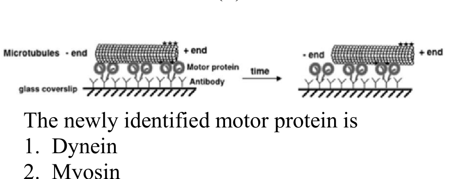

To understand the microtubule-dependent motor activity of a freshly purified motor protein from budding yeast, a researcher set up microtubule based gliding assay. In such an assay where microtubules are fluorescently tagged at its (+) end, the researcher observed that this motor protein moves the microtubule in the direction of its (+) end as shown below:

The newly identified motor protein is

1. Dynein
2. Myosin
3. Kinesin 1
4. Either Dynein or Kinesin 1

**Answer: 1 (Dynein)**

> **Explanation:** In the gliding assay the microtubule is moved toward its minus end over a lawn of the motor (the plus end is carried along behind), which is the hallmark of the minus-end-directed microtubule motor **dynein**. Kinesin-1 is plus-end directed, and myosin moves on actin, not microtubules.

---

### Question 79

Given below are organelles (column A) and properties associated with the organelles (column B).

| | Column A | | Column B |
|---|---|---|---|
| A | Lysosomes | (i) | Anterograde transport from ER to Golgi |
| B | cis – Golgi | (ii) | Clathrin – coated vesicles |
| C | trans – Golgi | (iii) | Cop I vesicle budding |
| D | Cop II vesicles | (iv) | Mannose-6-phosphate receptor |
| E | Endocytic vesicles | (v) | Protein aggregate for secretion |

Choose the option that matches the organelles with the most appropriate property.

1. A – (iv) ; B – (iii); C – (v); D – (i); E – (ii)
2. A – (v) ; B – (iv); C – (i); D – (v); E – (ii)
3. A – (iii) ; B – (v); C – (i); D – (iv); E – (ii)
4. A – (iv) ; B – (v); C – (ii); D – (i); E – (iii)

**Answer: 1 (A – (iv) ; B – (iii); C – (v); D – (i); E – (ii))**

> **Explanation:** Lysosomal enzymes are sorted by the mannose-6-phosphate receptor (A-iv); COPI vesicles mediate retrograde budding at the cis-Golgi (B-iii); the trans-Golgi is where secretory proteins aggregate (C-v); COPII vesicles drive anterograde ER→Golgi transport (D-i); endocytic vesicles are clathrin-coated (E-ii).

---

### Question 80

Cell cycle checkpoints are surveillance mechanisms that ensure order and fidelity of events of the cell cycle. Given below are some of the checkpoint proteins and their functions.

| | | | |
|---|---|---|---|
| A | Mad2 | (i) | Prevention of Cdc14 activation |
| B | Tem1 | (ii) | Prevention of Cdc20 activation |
| C | ATM, ATR | (iii) | Inhibition of p21^CIP |
| | | (iv) | Inhibition of separase action |

Match the checkpoint protein with its function.

1. A - iv, B - i and ii, C - iii
2. A – ii and iv, B - i, C - iii
3. A - ii, B - i and iii, C - iv
4. A – ii and iv, B - iii, C - i

**Answer: — (no correct option; the key marks this question \* = benefit of marks to those who attempted)**

> **Explanation:** The CSIR-HRDG final key carries an asterisk against Q80 with the note "*benefit of marks to those who attempted". No option is recorded as correct.

---

### Question 81

You have discovered a new transposon, TnX, and would like to identify its mode of replication. A heteroduplex of the TnX sequence is made with a few mismatches and introduced into bacteria. The newly transposed genomic loci are sequenced. You find that the sequence of the transposon matched exactly with one of its parent strands. This suggests that

1. TnX transposes by conservative transposition mechanism.
2. TnX transposes using a site-specific recombination mechanism.
3. single-strands of the duplex are inserted.
4. TnX transposes by replicative mechanism.

**Answer: 4 (TnX transposes by replicative mechanism.)**

> **Explanation:** If the excised copy is an exact match to one parental strand while the original remains at the donor site, a new copy was synthesised during transposition — the defining feature of **replicative** transposition. Conservative transposition would leave no copy behind at the donor.

---

### Question 82

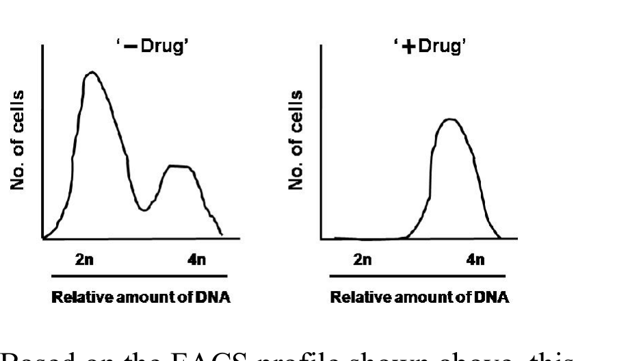

To assess the impact of a newly identified drug when added to a culture of sub-confluent HeLa cells, a researcher analyzes the fluorescence activated cell sorting (FACS) profile of untreated (- Drug) versus treated (+ Drug) cells.

Based on the FACS profile shown above, this drug inhibits

1. G₁ phase of the cell cycle
2. S phase of the cell cycle
3. G₂/M phase of the cell cycle
4. G₀ phase of cell cycle

**Answer: 3 (G₂/M phase of the cell cycle)**

> **Explanation:** The treated population collapses to a single peak at 4n DNA, meaning cells complete S phase but cannot divide — the classic signature of a **G₂/M block** (e.g. a spindle/miotic inhibitor). A G₁ block would accumulate 2n cells.

---

### Question 83

Following table lists the two major forms of DNA duplexes, conformation of base attached to the sugar and the nature of major and minor grooves.

| | DNA duplex | | Properties |
|---|---|---|---|
| (A) | A form | (i) | Syn conformation of the base to sugar |
| (B) | B form | (ii) | Anti conformation of the base to sugar |
| | | (iii) | Wide major groove |
| | | (iv) | Narrow major groove |
| | | (v) | Wide minor groove |
| | | (vi) | Narrow minor groove |

Which of the following combination correctly depicts the types of DNA duplexes and their properties (numbered within bracket)?

1. A - (i) (iii) (vi); B - (ii) (iii) (vi)
2. A - (i) (iii) (vi); B - (ii) (iii) (v)
3. A - (ii) (iv) (v); B - (ii) (iii) (vi)
4. A - (ii) (iv) (v); B - (i) (iii) (vi)

**Answer: 3 (A - (ii) (iv) (v); B - (ii) (iii) (vi))**

> **Explanation:** A-form DNA has a deep, narrow major groove (iv) and a wide, shallow minor groove (v); B-form DNA has a wide major groove (iii) and a narrow minor groove (vi). Both are predominantly anti (ii) in base–sugar conformation. Option 3 captures these groove geometries.

---

### Question 84

Imagine the following RNA sequence is translated in the mammalian cytosol and mitochondria.
RNA sequence:
AUG AUA CUG UGA CUU AGG CUC UAA
Following are some putative peptide sequences

| | Cytosol | | Mitochondria |
|---|---|---|---|
| (a) | Met-Ile-Leu | (i) | Met-Ile-Leu-Trp-Leu-Arg-Leu |
| (b) | Met-Ile-Leu-Trp-Leu-Arg-Leu | (ii) | Met-Met-Leu-Trp-Leu |

Find out the correct combination of peptides made in the cytosol and mitochondria.

1. (a) (i)
2. (a) (ii)
3. (b) (i)
4. (b) (ii)

**Answer: 2 (a) (ii)**

> **Explanation:** In the cytosol, UGA is a stop codon, so translation terminates after Met-Ile-Leu = peptide (a). In the mammalian mitochondrial code UGA reads as **tryptophan**, so translation continues through UGA-CUU-AGG-CUC to UAA, giving Met-Ile-Leu-Trp-Leu-Arg-Leu = (ii).

---

### Question 85

In all organisms, it is critical that replication initiation be tightly controlled to ensure that chromosome number and cell number remain appropriately balanced. Given below are several statements regarding regulation of replication in E. coli.
A. Hemimethylation and sequestration of oriC (origin of replication) by a protein called SeqA prevents initiation of replication.
B. Availability of DnaA protein is an important requirement for initiation of replication.
C. The ratio of ADP : ATP is important as high level of ADP is required for initiation of replication.
D. Recruitment of Hda protein by sliding clamp inhibits ATP hydrolysis required for initiation of replication.
Which of the above statements are **NOT** true?

1. A and B
2. B and C
3. C and D
4. D and A

**Answer: 3 (C and D)**

> **Explanation:** Initiation requires DnaA bound to **ATP**, not ADP (C is false), and the Hda–sliding-clamp complex stimulates (not inhibits) RIDA — the hydrolysis of DnaA-ATP to DnaA-ADP to prevent re-initiation (D is false). SeqA sequestration of hemimethylated oriC (A) and DnaA availability (B) are correct.

---

### Question 86

In *E. coli*, though DNA polymerase I (Pol I) plays an essential role in the replication process, it is not the major polymerase. Instead, the enzyme responsible for advancement of replication fork is Pol III. From the four DNA structures (A, B, C and D) given below, students made several interpretations about the shorter arm being extended by Pol I and/or Pol III.

A. PO₄-5'————3'-PO₄ / HO-3'————5'-PO₄
B. HO-3'————5'-PO₄ / HO-5'————3'-OH
C. PO₄-5'————3'-OH / HO-3'————5'-PO₄
D. PO₄-5'————3'-OH / HO-3'————5'-PO₄

Which one of the interpretation written below is correct?

1. A will be extended by Pol III but not by Pol I.
2. Neither B nor C will be extended by either Pol I or Pol III.
3. C will be extended by both Pol I and Pol III.
4. D will be extended only by Pol I, but not by Pol III.

**Answer: 2 (Neither B nor C will be extended by either Pol I or Pol III.)**

> **Explanation:** DNA polymerases require a primer strand with a free 3'-OH paired to a template bearing a 5'-phosphate downstream. Structures B and C lack the correct 3'-OH/5'-PO₄ primer–template arrangement, so neither Pol I nor Pol III can extend them.

---

### Question 87

tRNA genes of a Gram positive bacteria were sequenced. While some of the genes possessed sequence corresponding to the –CCA end of the tRNA, others did not. Interestingly, even the genes that lacked the sequence corresponding to the –CCA end of the tRNA were found to code for a functional tRNA. This is because

1. the –CCA end in the tRNA is not essential for its function.
2. the genes that do not possess sequence corresponding to the –CCA ends of the tRNA are repaired prior to their transcription.
3. the –CCA end is added to the tRNA during their maturation.
4. the primary transcripts of the genes lacking sequence corresponding to the – CCA end are subjected to g-RNA mediated editing prior to their maturation.

**Answer: 3 (the –CCA end is added to the tRNA during their maturation.)**

> **Explanation:** The 3'-terminal CCA is added post-transcriptionally by **tRNA nucleotidyltransferase (CCA-adding enzyme)** during tRNA maturation, so a gene need not encode it for the mature tRNA to carry the essential CCA acceptor end.

---

### Question 88

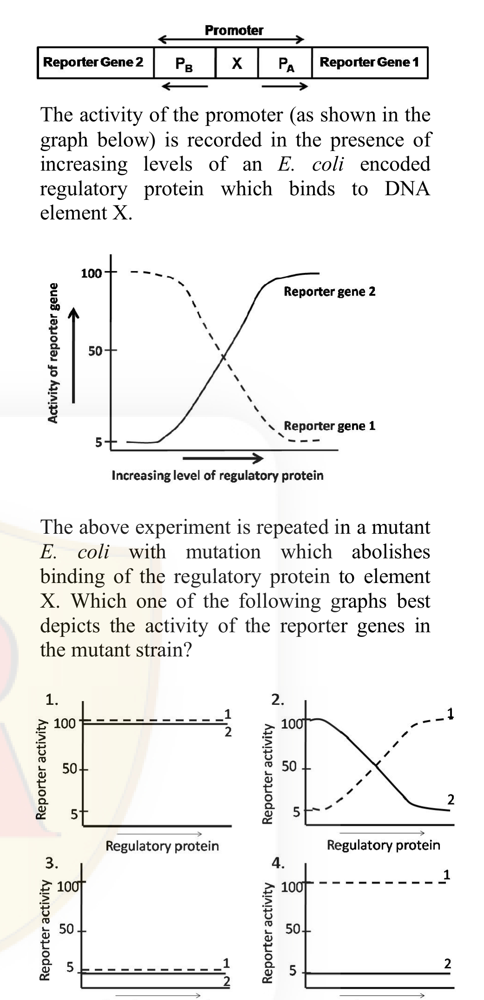

A construct (shown below) was generated to access the activity of bidirectional promoter (A and B) which has a common regulatory DNA element (X). The construct was used to transform *E. coli*.

The activity of the promoter (as shown in the graph below) is recorded in the presence of increasing levels of an *E. coli* encoded regulatory protein which binds to DNA element X.

The above experiment is repeated in a mutant *E. coli* with mutation which abolishes binding of the regulatory protein to element X. Which one of the following graphs best depicts the activity of the reporter genes in the mutant strain?

1. graph 1
2. graph 2
3. graph 3
4. graph 4

**Answer: 4 (graph 4)**

> **Explanation:** The wild-type curves show the regulatory protein repressing reporter gene 1 and activating reporter gene 2. If the protein can no longer bind element X, neither effect occurs, so both reporters stay at their basal (unregulated) level regardless of protein concentration — the flat, low lines of graph 4.

---

### Question 89

In a type of signal transduction pathway, ligand binding to a receptor triggers activation of a receptor-associated kinase. This kinase may be an intrinsic part of the receptor protein or tightly bound to the receptor. Receptors in which the tyrosine kinase is an intrinsic part of it's polypeptide chain are called the receptor tyrosine kinase (RTK). Which one of the following statements regarding RTK is **INCORRECT**?

1. All RTKs have three essential components: an extracellular domain containing ligand binding site, a transmembrane domain and a cytoplasmic segment that includes a domain with protein tyrosine kinase activity.
2. Most RTKs are monomeric and ligand binding to the extracellular domain induces formation of receptor dimers.
3. All cytokine receptors belong to RTKs and cytokine binding activates tyrosine kinase and receptor dimerization.
4. Ligand binding to RTK leads to autophosphorylation of the protein tyrosine kinase in the cytoplasmic domain. The activated kinase then phosphorylates several tyrosine residues in the receptor's cytoplasmic domain.

**Answer: 3 (All cytokine receptors belong to RTKs and cytokine binding activates tyrosine kinase and receptor dimerization.)**

> **Explanation:** Cytokine receptors have **no intrinsic kinase domain**; they signal through separately-bound JAK tyrosine kinases (the JAK–STAT pathway). They are therefore not RTKs, making statement 3 the incorrect one. Statements 1, 2 and 4 correctly describe RTKs.

---

### Question 90

Two classes of genes - proto-oncogene and tumor suppressor gene usually contribute to the development of cancer. Following are some of the statements regarding both the genes.
A. Proto-oncogenes result in the development of cancer by gain-of-function mutation whereas tumor suppressor gene leads to cancer development by loss-of-function mutation.
B. Proto-oncogenes result in development of cancer by loss-of-function mutation whereas tumor suppressor gene leads to cancer development by gain-of-function mutation.
C. Mutation in both the alleles of a proto-oncogene is required for induction of cancer whereas mutation in one of the two alleles in tumor suppressor gene is sufficient for promoting tumorigenesis.
D. Mutation in one of the two alleles in proto-oncogene is sufficient for induction of cancer whereas mutation in both the alleles of a tumor suppressor gene is required for promoting tumorigenesis.
Which combination of the above statements are true for both the genes?

1. A and B
2. A and C
3. A and D
4. B and C

**Answer: 3 (A and D)**

> **Explanation:** Proto-oncogenes are activated by gain-of-function and behave dominantly — mutation of one allele suffices (A and D). Tumour suppressors are inactivated by loss-of-function and require both alleles to be hit ("two-hit", recessive), which is also stated in D. B and C invert these relationships.

---

### Question 91

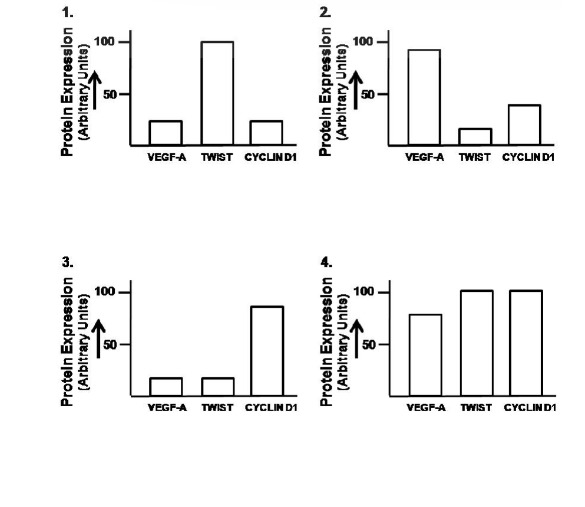

Two important features which aid the development of a tumor and its metastasis are epithelial-to-mesenchymal transition and angiogenesis. A student tested four cell lines to determine their invasiveness and proliferation capability by checking the expression of VEGF-A, TWIST and Cyclin D1. Which one of the following figures is most likely to exhibit the characteristics of a highly metastatic cancer cell?

1. figure 1
2. figure 2
3. figure 3
4. figure 4

**Answer: 4 (figure 4)**

> **Explanation:** A highly metastatic cell over-expresses all three markers — VEGF-A (angiogenesis), TWIST (epithelial-to-mesenchymal transition/invasion) and Cyclin D1 (proliferation). Only figure 4 shows high levels of all three.

---

### Question 92

Which of the following statements is **NOT** true for integrins?

1. Integrins are transmembrane linker proteins that link to the cytoskeleton.
2. An integrin molecule is composed of two non-covalently associated glycoprotein subunits α and β. Both subunits span the cell membrane, with short intracellular C-terminal tails and large N-terminal extracellular domains.
3. The extracellular portion of the integrin dimer binds to specific carbohydrate residues in extracellular matrix proteins or to ligands on the surface of other cells.
4. The intracellular portion binds to a complex of proteins that form a linkage to the cytoskeleton.

**Answer: 3 (The extracellular portion of the integrin dimer binds to specific carbohydrate residues in extracellular matrix proteins or to ligands on the surface of other cells.)**

> **Explanation:** Integrins bind **peptide** motifs in matrix/counter-receptor proteins (e.g. the RGD sequence of fibronectin), not carbohydrate residues. Carbohydrate recognition is the hallmark of selectins, not integrins. Statements 1, 2 and 4 correctly describe integrin structure/function.

---

### Question 93

Major histocompatibility complex (MHC) molecules are encoded by a cluster of genes called MHC locus. There are several reasons why an MHC molecule on the surface of a cell is important. Which one of the following reasons is **INCORRECT**?

1. To display self class I to demonstrate that the cell is normal and healthy.
2. To display foreign-peptide in class I to show that the cell is infected and to engage with T helper cells.
3. To display a self-peptide in class I and II to test developing T cells for autoreactivity.
4. To display a self-peptide in class I and II to maintain tolerance to self-proteins.

**Answer: 2 (To display foreign-peptide in class I to show that the cell is infected and to engage with T helper cells.)**

> **Explanation:** Class I presents peptides to **CD8⁺ cytotoxic** T cells, not T helper cells; T-helper (CD4⁺) cells recognise antigen on **class II**. The other statements correctly describe MHC roles in self-recognition, thymic selection and tolerance.

---

### Question 94

Oncogenic viruses could have either DNA or RNA genomes. Listed below are some oncogenic viruses (Column A), their genome types (Column B) and the cancers caused by these viruses (Column C).

| | A | | B | | C |
|---|---|---|---|---|---|
| (a) | Hepatitis B | (i) | DNA | (x) | Burkitt's lymphoma |
| (b) | Epstein-Barr Virus | (ii) | RNA | (y) | T cell leukaemia |
| (c) | HTLV | | | (z) | Hepatocellular carcinoma |

Find out the correct combination.

1. (a) (i) (x), (b) (ii) (y), (c) (ii) (z)
2. (a) (ii) (y), (b) (i) (z), (c) (ii) (x)
3. (a) (ii) (y), (b) (ii) (z), (c) (i) (y)
4. (a) (i) (z), (b) (i) (x), (c) (ii) (y)

**Answer: 4 ( (a) (i) (z), (b) (i) (x), (c) (ii) (y) )**

> **Explanation:** Hepatitis B is a DNA virus causing hepatocellular carcinoma (a-i-z); Epstein–Barr virus is a DNA virus associated with Burkitt's lymphoma (b-i-x); HTLV (HTLV-1) is an RNA retrovirus causing T-cell leukaemia (c-ii-y).

---

### Question 95

Identification of genes that are associated with the development of male and/or female gametophyte and embryogenesis in plants is facilitated by T-DNA mediated insertional mutagenesis. In an experiment, a transgenic plant was generated by insertion of T-DNA (containing a Kanamycin-resistance gene) into a gene "A". Self pollination of the T₀ plant generated F₁ progeny that segregated in a 2:1 ratio for resistance:sensitivity to Kanamycin. These observations indicate that

1. the mutant allele did not segregate from the wild type allele.
2. mutation in gene "A" induces lethality in the male gametophyte.
3. mutation in gene "A" induces lethality in the female gametophyte.
4. mutation in gene "A" induces zygotic lethality.

**Answer: 4 (mutation in gene "A" induces zygotic lethality.)**

> **Explanation:** A selfed heterozygote should give 3:1 resistant:sensitive, but only 2:1 is observed because the homozygous mutant (a/a) class dies — i.e. the insertion causes **zygotic/embryo lethality**, eliminating one quarter of the progeny and leaving 2 resistant : 1 sensitive.

---

### Question 96

During vulva development in *C. elegans*, the anchor cell produces Lin-3 protein which interacts with the Let-23 protein present on the six vulval precursor cells (VPCs) that form an equivalence group. The central lineage cell (P6.p) adopts the primary fate, the adjacent VPCs (P5.p and P7.p) adopt the secondary fate and the rest VPCs adopt the tertiary fate. Few mutants (Column A) and phenotypes (Column B) are listed in the table given below.

| | Column A | | Column B |
|---|---|---|---|
| A | Loss of function of lin-3 | i | P5.p, P6.p and P7.p adopt primary fate, P4.p and P8.p adopt secondary fate |
| B | Loss of function of lin-3 and gain of function of let-23 | ii | Multivulva |
| C | Reduced function of lin-3 | iii | P6.p adopt primary fate and the rest of the VPCs adopt tertiary fate |
| D | Overexpression of lin-3 | iv | All VPCs adopt tertiary fate |

Match the correct mutant with the observed phenotype.

1. A-iv, B-ii, C-iii, D-i
2. A-iv, B-iii, C-i, D-ii
3. A-ii, B-iii, C-iv, D-i
4. A-iii, B-i, C-ii, D-iv

**Answer: 1 (A-iv, B-ii, C-iii, D-i)**

> **Explanation:** No Lin-3 (loss of the inductive signal) → all VPCs default to tertiary (A-iv). Constitutively active Let-23 with reduced/absent ligand still fires the pathway → multivulva (B-ii). Reduced Lin-3 → only the strongest P6.p is induced (C-iii). Over-expressed Lin-3 spreads the signal to neighbouring cells (D-i).

---

### Question 97

*C. elegans* embryo uses both autonomous and conditional modes of specification. Conditional specification at the 4-cell stage can be seen in the development of the endoderm cell lineage and also in the establishment of dorsal-ventral axis. Following are few statements regarding this:
A. If the P₂ cell is removed at the early 4-cell stage, the EMS cell will divide into two MS cells and no endoderm will be made.
B. In pop-1 deficient embryos, both EMS daughter cells become E cells.
C. When the position of ABa and ABp was reversed, their fates get reversed and no normal embryo forms.
D. In embryos whose mother have mutant glp-1, ABp is transformed into ABar cell.
Which of the above statements are true?

1. A, B and D
2. A, B and C
3. B, C and D
4. A, C and D

**Answer: 1 (A, B and D)**

> **Explanation:** P₂ gives the Wnt signal that polarises EMS; removing it yields two MS-like cells and no endoderm (A true). POP-1 (TCF) asymmetrically restricts endoderm, so its loss makes both EMS daughters E-like (B true). glp-1 mutants transform ABp toward an MS/ABar fate (D true). Statement C is wrong — reversing ABa/ABp positions swaps their fates but a normal embryo still forms, which is the classic demonstration of conditional (inductive) specification.

---

### Question 98

Following are the events that might take place during dorso-ventral axis specification in early embryonic development of *Drosophila*:
A. 'Torpedo' receptor activation
B. 'Pipe' synthesis
C. A cascade of protease activity
D. 'Cactus' dephosphorylation
E. Entry of 'Dorsal' in the nuclei of syncytial blastoderm stage embryo.
Which combination of the above events will occur in the presumptive dorsal side of the embryo deficient in maternal *gurken*?

1. A only
2. B and C only
3. B, C and E only
4. B, C, D and E only

**Answer: 3 (B, C and E only)**

> **Explanation:** Maternal *gurken* is required to restrict the ventralising pathway to the ventral side; in its absence the Pipe → protease-cascade → nuclear-Dorsal events (B, C, E) are no longer confined and the official key records them as occurring on the presumptive dorsal side. **Conflict noted:** taken literally, a *gurken* mutant is dorsalised because Torpedo is not activated in the overlying follicle cells, which would argue for "A only". The answer above follows the official CSIR-HRDG final key (Booklet A, Q98 = 3); see `sources.md`.

---

### Question 99

What would be the effect on newt limb regeneration, if more than 90% of the nerve supply is severed before amputation?

1. The apical ectodermal cap stimulates growth of the blastema by secreting FGF8 but regeneration does not take place.
2. Limb regeneration will take place and form a limb with no nerve supply.
3. Outgrowth will occur but the identity of the limb formed will be lost with no clear anterior-posterior polarity.
4. Limb regeneration with nerve supply will take place.

**Answer: 1 (The apical ectodermal cap stimulates growth of the blastema by secreting FGF8 but regeneration does not take place.)**

> **Explanation:** Salamander/newt limb regeneration is **nerve-dependent**: without adequate nerve supply the wound epidermis cannot be converted into a functional apical ectodermal cap and the blastema fails to be maintained, so regeneration does not proceed even though AEC/FGF8 growth signalling is described.

---

### Question 100

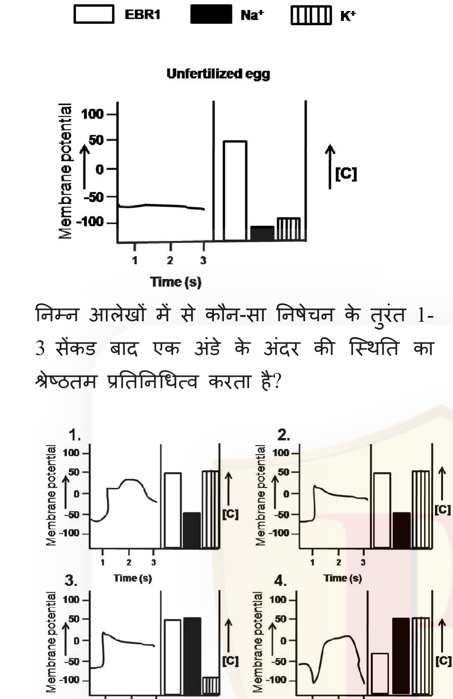

Fertilization in sea urchin involves interaction of sperm Bindin with its receptor EBR1, a 350 kDa glycoprotein on the egg vitelline membrane. The plot given below shows the status of membrane potential and levels of EBR1, Na⁺ and K⁺ in an unfertilized egg.

Which one of the following graphs best represents the condition within an egg 1-3 seconds after fertilization?

1. graph 1
2. graph 2
3. graph 3
4. graph 4

**Answer: 3 (graph 3)**

> **Explanation:** Within 1–3 s of fertilisation the egg undergoes the fast **positive Na⁺-dependent membrane-potential shift** (from ~ −70 mV toward positive). EBR1 is consumed and intracellular Na⁺ rises while K⁺ falls. Graph 3 shows the transient depolarisation with the correct Na⁺/K⁺/EBR1 bar pattern.

---

### Question 101

A specific Mitogen Activated Protein Kinase (MAPK) cascade comprising MEKK1(a MAP3K), MKK1 (a MAP2K) and MPK6 (a MAPK) is activated sequentially in that order in Arabidopsis plants upon perceiving certain abiotic stress stimuli. The activated MPK6 phosphorylates and activates a transcription factor 'X', thereby making plant tolerant to the abiotic stress. Two different variants of MKK1 protein, a kinase inactive (KI) and a constitutively active (CA) forms were expressed independently in mkk1 mutant Arabidopsis plant. Considering above facts, which one of the following statements is CORRECT?

1. 'X' will be activated even in the absence of stimuli in CA plants
2. 'X' will not be activated in the absence of stimuli in CA plants
3. 'X' will be activated in the absence of stimuli in KI plants
4. The KI plants will be tolerant to the abiotic stress.

**Answer: 1 ('X' will be activated even in the absence of stimuli in CA plants)**

> **Explanation:** A constitutively active MKK1 drives the cascade continuously, so MPK6 phosphorylates transcription factor X even without stress (CA plants are tolerant even unstressed). A kinase-inactive MKK1 cannot transmit the signal, so X stays off in KI plants regardless of stimulus.

---

### Question 102

Given below are some statements on secondary metabolites in plants.
A. Glucosinolates are synthesized by elongation in the length of side chains of their precursor amino acids.
B. All terpenes produced in herbs and spices are sticky, oily liquids which reduces the palatability (edible value) of these plants.
C. Cyanogenic glycosides are produced and stored in a toxic form in plants and are therefore more effective in defense against invading pathogens and herbivores.
D. The defense molecules, alkaloids (or their precursors), are gathered from plants and used by some insects for their own protection against predators.
Which one of the following represents correct statements?

1. B and C only
2. A and B only
3. C only
4. A and D only

**Answer: 4 (A and D only)**

> **Explanation:** Glucosinolates are derived from amino acids with side-chain elongation (A true), and insects such as monarchs sequester plant alkaloids for their own defence (D true). B is false (not all terpenes are sticky liquids, and many are not deterrents), and C is false (cyanogenic glycosides are stored non-toxically and become toxic only upon tissue damage when the compartmented β-glucosidase hydrolyses them).

---

### Question 103

A researcher developed quadruple mutant that disrupted the function of all phytochrome interacting factor (PIF) family members. The following hypotheses were proposed regarding the phenotype of the mutant plants when grown in dark:
A. Plants would show short hypocotyls
B. Plants would be etiolated
C. Light induced genes would be activated
D. The cotyledons would be open
Which one of the following combinations of the above hypotheses is correct?

1. A, B and C
2. A, B and D
3. A, C and D
4. B, C and D

**Answer: 3 (A, C and D)**

> **Explanation:** PIFs promote skotomorphogenesis (long hypocotyl) in the dark by repressing light-signalling. In a PIF quadruple mutant the dark-grown seedling behaves as if de-etiolated: short hypocotyl (A), light-induced genes activated (C) and open, greened cotyledons (D). It would **not** show the normal etiolated phenotype (B false).

---

### Question 104

The photon intensity captured by green plants is used in the following processes:
(i) Photosynthesis
(ii) Generation of heat
(iii) Production of toxic products such as superoxide, singlet oxygen etc.
(iv) Damage to D1 protein of PSII
Based on the above facts, photoinhibiton will happen when the

1. entire photon intensity is used for photosynthesis
2. excess photon intensity is completely used for heat generation
3. excess photon intensity is used for heat generation and formation of toxic products
4. excess photon intensity leads to the damage of D1 protein

**Answer: 4 (excess photon intensity leads to the damage of D1 protein)**

> **Explanation:** Photoinhibition is the light-induced inactivation of PSII, whose diagnostic event is damage and turnover of the **D1 reaction-centre protein**. When excess energy cannot be safely dissipated as heat, ROS form and D1 is damaged — that damage defines photoinhibition.

---

### Question 105

With reference to plant biotic interactions, match the terms of Column I with the most appropriate term of Column II

| | Column I | | Column II |
|---|---|---|---|
| A. | Phytoliths of Poaceae | (i) | Phloem feeders |
| B. | Salicylic acid signalling pathway | (ii) | Decrease in stomatal aperture |
| C. | MAMP | (iii) | R genes/NBS-LRR receptor |
| D. | Effector – triggered immunity | (iv) | Mechanical barrier to herbivory |

1. A – (ii), B – (iv), C – (i), D – (iii)
2. A – (iii), B – (i), C – (ii), D – (iv)
3. A – (iv), B – (ii), C – (iii), D – (i)
4. A – (iv), B – (i), C – (ii), D – (iii)

**Answer: 4 (A – (iv), B – (i), C – (ii), D – (iii))**

> **Explanation:** Silica phytoliths of grasses (Poaceae) are a **mechanical barrier to herbivory** (A-iv). Salicylic-acid signalling defends against **phloem feeders** and biotrophs (B-i). MAMP perception triggers **decrease in stomatal aperture**, i.e. stomatal immunity (C-ii). Effector-triggered immunity is mounted by intracellular **R genes / NBS-LRR receptors** (D-iii).

---

### Question 106

Transgenic tobacco plants over-expressing isopentenyl transferase (IPT) under the control of promoter region of Senescence-Associated Receptor kinase (P_SARK) were exposed to drought for 15 days followed by re-watering for 7 days. The following hypotheses were proposed regarding changes in the transgenic plants at the end of 7 days of re-watering:
A. The plants would be wilted and fail to survive.
B. The plants would be healthy and survive.
C. The plants would show higher production of cytokinin compared to wild type plants.
D. The plants would show higher production of abscisic acid compared to wild type plants.
Which one of the following combinations of the above hypotheses is correct?

1. A and C
2. A and D
3. B and C
4. B and D

**Answer: 3 (B and C)**

> **Explanation:** IPT is a cytokinin-biosynthesis gene, so the transgenics make more cytokinin (C). Under the SARK (senescence/drought-induced) promoter this delays senescence and, after re-watering, the plants recover and survive as healthy (B). Abscisic acid is not increased by this construct (D false).

---

### Question 107

The following statements describe the possible functions of the outer hair cells (OHC) of organ of Corti:
A. The outer hair cells (OHC) are depolarized or hyperpolarized depending on the direction of movement of stereocilia.
B. The OHC are lengthened in depolarization and shortened in hyperpolarization
C. The OHC decrease the amplitude and clarity of sound by shortening and lengthening.
D. The efferent nerve fibers of olivocochlear bundle modulate the sensitivity of the OHC
E. The effect of stimulation of olivocochlear bundle on the OHC is excitatory.
Which one of the options given below represents the correct statements?

1. A and B
2. C and D
3. A and D
4. D and E

**Answer: 3 (A and D)**

> **Explanation:** OHCs change their membrane potential with the direction of stereocilia deflection (A true) and receive efferent olivocochlear fibres that modulate their sensitivity (D true). B is reversed (OHCs *shorten* on depolarisation), C is wrong (they *amplify*, the cochlear amplifier), and the olivocochlear effect on OHCs is predominantly inhibitory, not excitatory (E false).

---

### Question 108

The pacemaker cells of sinoatrial node (SA node) are inhibited by the stimulation of vagus nerve. The probable mechanisms of this inhibition are stated as follows:
A. The acetylcholine- regulated K⁺ channels are activated
B. The outward K⁺ causes hyperpolarization of pacemaker cells
C. The inward "funny current" of pacemaker potential is increased
D. The increased intracellular cAMP, induced by activation of M₂ muscarinic receptors, slows the opening of Ca⁺⁺ channels
Choose the answer with correct statements.

1. A and C
2. B and C
3. A and B
4. C and D

**Answer: 3 (A and B)**

> **Explanation:** Vagal ACh acts on M₂ receptors to open G-protein-coupled K⁺ channels (I_K,ACh); the resulting outward K⁺ current hyperpolarises the pacemaker cells and slows the rate (A and B). Vagal stimulation *decreases* cAMP and *decreases* the funny current, so C and D are wrong.

---

### Question 109

In the glomerular capillary (GC), fluid moves into Bowman's capsule through its almost entire length. But in the muscle capillary (MC), fluid moves into interstitial space at its arteriolar end. The difference between these two capillaries is explained in the following proposed statements:
A. Afferent and efferent arterioles are present on the two ends of GC, but in MC, arteriole and venule are present on two ends.
B. The hydrostatic pressure in GC is higher than that in MC.
C. The efferent arteriole in GC has a relatively low resistance, but venules in MC has a high resistance.
D. The difference of hydrostatic pressure between two ends of GC is relatively more but it is negligible in MC.
E. The difference of oncotic pressure between two ends of MC is negligible but it is relatively more in GC.
F. The net filtration pressure falls to zero at the efferent end of GC but it is 9 mm Hg inward at the venular end of MC.
Which of the above statements are **INCORRECT**?

1. A and B
2. C and D
3. E and F
4. B and F

**Answer: 2 (C and D)**

> **Explanation:** The efferent arteriole of the glomerulus has a relatively **high** resistance (that is what keeps glomerular hydrostatic pressure high), so C is incorrect. The hydrostatic-pressure difference along the GC is actually small while the opposing oncotic pressure rises, so D is incorrect. The remaining statements correctly contrast the two capillary beds.

---

### Question 110

When a skeletal muscle was passively stretched, it contracted reflexly. However, when the muscle was over stretched in this way it showed sudden cessation of contraction followed by relaxation. The following statements provided the possible explanation of these observations:
A. The passive stretching of muscle caused stretching of muscle spindle
B. The over stretching of muscle stimulated Golgi tendon organ
C. Group 1b sensory nerve fibers were stimulated by stretching of muscle spindle
D. Group 1b sensory nerve fibers stimulated α-motor neurons that supplied the muscle from which these fibers arose.
E. Group 1a sensory nerve fibers were connected to Golgi tendon organ.
F. The stimulation of group 1a sensory fibers led to the production of IPSP on the α-motor neurons that supplied the muscle from which these fibers arose.
Which of the above statement(s) is/are correct?

1. A and B
2. C and D
3. E and F
4. C and F

**Answer: 1 (A and B)**

> **Explanation:** The stretch reflex arises because passive stretch loads the **muscle spindle**, whose Ia afferents excite the α-motoneurone (A). The sudden inhibition on over-stretch is the **Golgi tendon organ** (Ib) autogenic-inhibition reflex (B). The other statements mis-pair the sensory fibres with the receptors or the motor response.

---

### Question 111

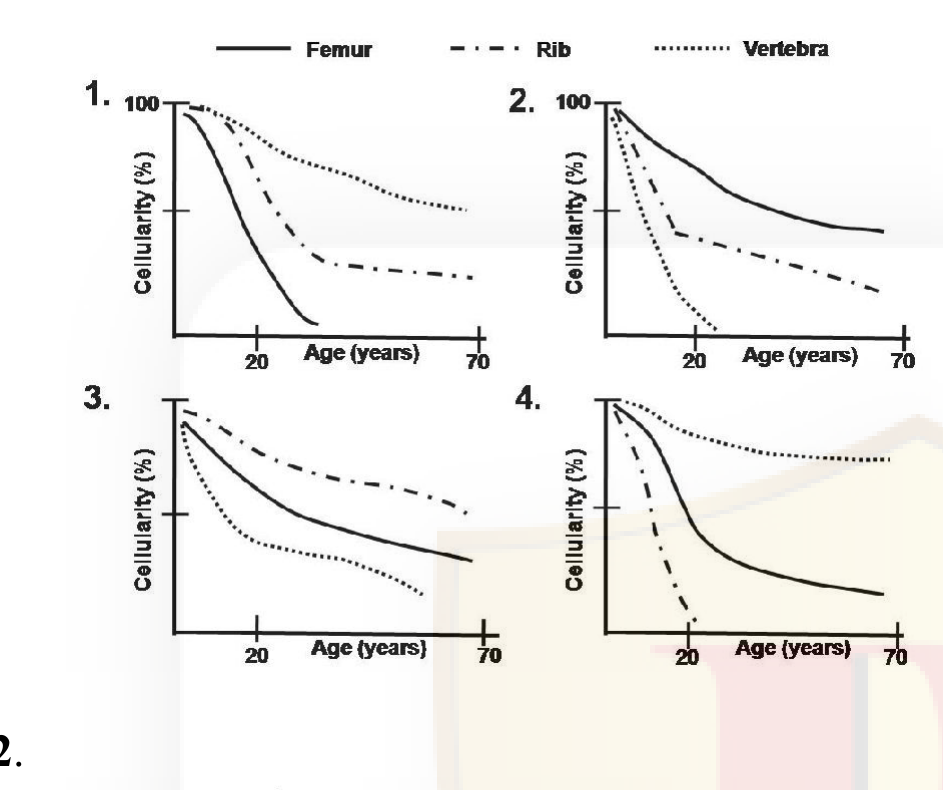

Relative rates of red blood cells production in bone marrow of different bones of different ages are shown below: Identify the correct figure.

1. figure 1
2. figure 2
3. figure 3
4. figure 4

**Answer: 1 (figure 1)**

> **Explanation:** In infants all bones are red-marrow (high cellularity). With age, red marrow is replaced by yellow marrow first in the long bones (femur falls steeply), then in flat/axial bones, while the vertebrae retain haematopoietic (red) marrow into old age. Figure 1 shows the correct rank order of residual cellularity (vertebra > rib > femur) with age.

---

### Question 112

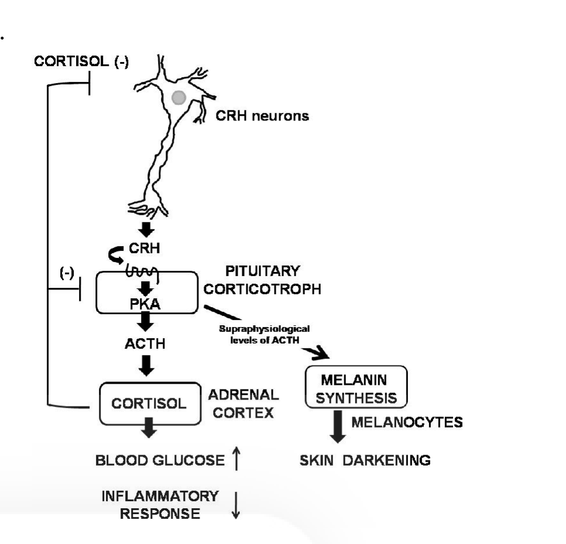

The above figure depicts the regulation of hypothalamo-pituitary-adrenal (HPA) axis. Changes in cortisol level in Addison's disease can lead to

1. suppressed immune system and increased blood glucose level
2. gain of body weight and lightening of skin
3. loss of body weight, reduced blood glucose level and hyperpigmentation
4. increased blood glucose and activated immune system

**Answer: 3 (loss of body weight, reduced blood glucose level and hyperpigmentation)**

> **Explanation:** Addison's disease is primary adrenal insufficiency with **low cortisol**. Cortisol deficiency causes weight loss and hypoglycaemia; the resulting loss of negative feedback raises ACTH (and MSH co-secreted from POMC), producing hyperpigmentation.

---

### Question 113

The following table shows mapping data from three interrupted mating experiments using three different Hfr strains and an F⁻ strain:

| | Appearance of genes in F⁻ cells |
|---|---|
| Hfr 1 | Genes: e⁺ f⁺ c⁺ d⁺ b⁺ ; Time: 6 24 34 49 54 |
| Hfr 2 | Genes: b⁺ d⁺ c⁺ f⁺ g⁺ ; Time: 1 6 21 31 63 |
| Hfr 3 | Genes: d⁺ c⁺ f⁺ e⁺ g⁺ ; Time: 4 19 29 47 61 |

(Time is represented in minutes)
The following answers are derived:
The order of genes is
A. e g b d c f
B. f g b d c e
The distance between
C. f and g is 32 min and between f and b is 30 min
D. c and e is 28 min and between b and c is 20 min
The correct combination of answers is

1. A, C and D
2. B and C
3. A and B
4. B and D

**Answer: 1 (A, C and D)**

> **Explanation:** Aligning the three transfer orders around the circular chromosome gives the gene sequence e–g–b–d–c–f (A). Converting the entry times into intergene distances yields the values in C (f–g = 32, f–b = 30) and D (c–e = 28, b–c = 20), so A, C and D are consistent.

---

### Question 114

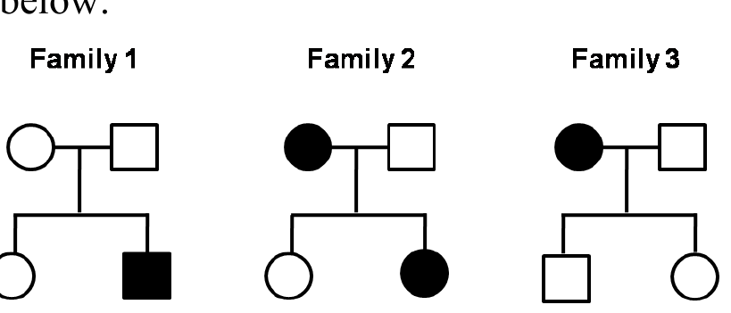

The inheritance of a given disorder is recorded in three small families shown below:

Based on the above limited information, which one of the following inheritance pattern best explains the observations?

1. X-linked recessive
2. X-linked dominant
3. Autosomal recessive
4. Autosomal dominant

**Answer: 3 (Autosomal recessive)**

> **Explanation:** The trait appears in offspring of unaffected carrier parents, affects both sons and daughters, and an affected mother transmits to a son but not necessarily all children — the pattern that fits across all three families is autosomal recessive (no sex bias, skips generations via carriers).

---

### Question 115

A new mutant called early ripening (EL) is identified in a plant. The wild type phenotype is late ripening (LR). Further DNA marker(s) is/are observed to be polymorphic between EL and LR plants. A cross was made between pure lines of LR and ER. The F₁ progeny was test crossed and its progeny was analyzed. The parental, F₁ and progeny of test cross were also analyzed for the DNA marker. The table below summarizes the phenotype of the progeny and the pattern of DNA marker observed in each case:

| | Parent | | F₁ | | Progeny of test cross | | | |
|---|---|---|---|---|---|---|---|---|
| Phenotype | ER | LR | | LR only | | LR | | ER |
| No. of progeny | | | | | | 52 | | 48 |
| Pattern of DNA marker on gel electrophoresis | – | – | | – | – | – | – | – |
| No. of progeny for each pattern | | | | | 25 | 27 | 23 | 25 |

Based on the above information, the following statements were made:
A. LR is dominant to ER
B. The DNA marker used is a dominant marker
C. The DNA marker is linked to the phenotype
Which of the above statements are correct?

1. A only
2. A and B only
3. A and C only
4. A, B and C only

**Answer: 1 (A only)**

> **Explanation:** The F₁ shows only the LR phenotype, so LR is dominant to ER (A true). The marker bands appear in both phenotype classes in the test-cross progeny and do not track the phenotype, so it is not a dominant marker (B false) and is not linked to the phenotype (C false).

---

### Question 116

In Burkitt's Lymphoma a reciprocal translocation between chromosome 8 and 14 is observed. If an individual is heterozygous for this translocation, the consequence in meiosis will be as follows:
A. Four chromosomes, i.e., normal chromosome 8 and 14, and translocated chromosome 8 and 14, pair together
B. The two normal chromosomes 8 and 14, and two translocated chromosomes pair separately
C. All gametes produced from this meiosis are non-viable as they have deletions and duplications
D. In one of the cross configurations called "alternate segregation" all gametes having normal or translocated chromosomes, survive
E. The gametes having normal chromosomes only survive while all gametes having translocated chromosomes are non-viable, hence the translocations are used as crossover suppressors
Which of the following combinations best describes the meiotic consequences for the translocation described above?

1. B and E
2. B, C and E
3. A, C and E
4. A and D

**Answer: 4 (A and D)**

> **Explanation:** A reciprocal translocation heterozygote forms a **quadrivalent** in which the four chromosomes (two normal + two translocated) pair together (A). **Alternate segregation** of that quadrivalent yields gametes that are either fully normal or fully balanced-translocation, both viable (D). Adjacent segregation gives the duplications/deletions; "all gametes non-viable" (C) and the crossover-suppressor claim (E) are wrong.

---

### Question 117

In *Drosophila*, Bar eye (B) is a dominant mutation while miniature wing (m) and yellow body colour (y) are recessive mutations. Heterozygous females for these mutations were crossed to normal eyed miniature winged and yellow body coloured males. Assume the following progeny was obtained:

| Phenotypes | Number |
|---|---|
| B⁺ m⁺ y⁺ | 30 |
| B m y⁺ | 25 |
| B m⁺ y⁺ | 165 |
| B⁺ m y | 120 |
| B m y | 20 |
| B⁺ m y | 185 |
| B m⁺ y | 110 |
| B⁺ m⁺ y | 45 |

Based on the results obtained, the order of genes will be:
A. B m y
B. m B y
The genetic distance between B and y will be:
C. 40 cM
D. 17.1 cM
The correct combination of answer is

1. A and C
2. B and C
3. A and D
4. B and D

**Answer: 2 (B and C)**

> **Explanation:** Comparing the parental classes (B m⁺ y⁺ / B⁺ m y) with the rarest double-crossover classes shows that **B** lies in the middle, giving the order m–B–y (B). The recombination frequency between B and y, counting the single and double crossovers over the total progeny, works out to **40 cM** (C).

---

### Question 118

Two inbred lines of beans were intercrossed. In F1 the variance in bean length was measured as 2.0. The F1 was selfed to obtain F2 and the variance in bean length in F2 was 7.0. The broad heritability of bean length in the F2 population will be:

1. 0.75
2. 9.0
3. 5.0
4. 0.71

**Answer: 4 (0.71)**

> **Explanation:** F1 (genetically uniform) variance is entirely environmental: V_E = 2.0. F2 variance = V_G + V_E = 7.0, so V_G = 5.0. Broad-sense heritability H² = V_G / V_P = 5.0 / 7.0 = **0.71**.

---

### Question 119

Euphorbiaceae generally represents milky sap bearing plants but there are also some non-milky sap bearing plants that belong to this family. Identify the correct combination of the following given plants which belong to family Euphorbiaceae.

1. Terminalia bellirica, Euphorbia hirta, Nerium indicum
2. Mallotus philippense, Ficus religiosa, Ricinus communis
3. Mallotus philippense, Acalypha indica, Emblica officinalis
4. Acalypha indica, Ricinus communis, Mangifera indica

**Answer: 3 (Mallotus philippense, Acalypha indica, Emblica officinalis)**

> **Explanation:** *Mallotus*, *Acalypha* and *Emblica* (Phyllanthus) are all genuine members of Euphorbiaceae. The other options include genera from different families (e.g. *Ficus* = Moraceae, *Nerium* = Apocynaceae, *Terminalia* = Combretaceae, *Mangifera* = Anacardiaceae).

---

### Question 120

Given below are statements on key characteristics of two fungal lineages.
(A) Microsporidia do not have true mitochondria
(B) Most chytrids produce flagellated gametes
(C) Microsporidia are usually free-living
(D) Chytrids reproduce sexually without a dikaryon stage
Choose the combination with correct statements

1. A, B and C only
2. A, B and D only
3. B, C and D only
4. A and B only

**Answer: 2 (A, B and D only)**

> **Explanation:** Microsporidia are highly reduced obligate intracellular parasites lacking true mitochondria (A) — but they are **not** free-living, so C is false. Chytrids produce uniflagellated zoospores/gametes (B) and can complete a sexual cycle without a prolonged dikaryon (D).

---

### Question 121

Match the two columns that represent plant organs (I) and parts within these organs (II).

| | Column I | | Column II |
|---|---|---|---|
| A | Carpel | (i) | Petals, corolla |
| B | Perianth | (ii) | Vegetative cell, generative cell |
| C | Microsporocyte | (iii) | Stigma, style, ovary |
| D | Megasporocyte | (iv) | Antipodal cells, polar nuclei, synergid cells |

1. A-(i); B-(iii); C-(ii); D-(iv)
2. A-(iii); B-(iv); C-(i); D-(ii)
3. A-(i); B-(iii); C-(iv); D-(ii)
4. A-(iii); B-(i); C-(ii); D-(iv)

**Answer: 4 (A-(iii); B-(i); C-(ii); D-(iv))**

> **Explanation:** The carpel comprises stigma, style and ovary (A-iii); the perianth is the petals/corolla (and calyx) (B-i); the microsporocyte gives rise to the vegetative and generative cells of the pollen (C-ii); the megasporocyte develops into the embryo sac with antipodals, polar nuclei and synergids (D-iv).

---

### Question 122

Given below are larval stages and phylum to which they belong. Select the **INCORRECT** combination.

1. Parenchyma and Amphiblastula - Phylum Porifera
2. Bipinnaria and Auricularia- Phylum Echinodermata
3. Tornaria and Axolotl- Phylum Hemichordata
4. Planula and Ephyra- Phylum Cnidaria

**Answer: 3 (Tornaria and Axolotl- Phylum Hemichordata)**

> **Explanation:** The tornaria larva is indeed a hemichordate larva, but the **axolotl** is the larval/neotenic stage of a salamander (Chordata), not a hemichordate — so this pairing is incorrect. The other three larva–phylum matches are correct.

---

### Question 123

During the course of evolution, the jawbones got modified into three ear ossicles in mammals. Which one of the following is a correct match of all three ear ossicles and their jawbones?

1. stapes – articular; incus – quadrate; malleus – hyomandibular.
2. stapes – quadrate; incus – articular; malleus – hyomandibular
3. stapes – articular; incus – hyomandibular; malleus – quadrate
4. stapes – hyomandibular; incus – quadrate; malleus – articular

**Answer: 4 (stapes – hyomandibular; incus – quadrate; malleus – articular)**

> **Explanation:** In the reptilian jaw→mammalian middle-ear transition the **hyomandibular** (hyoid arch) element becomes the stapes (columella), the **quadrate** becomes the incus, and the **articular** becomes the malleus.

---

### Question 124

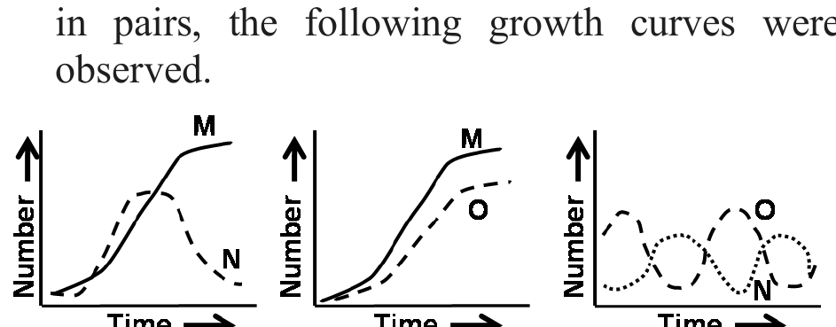

Three species M, N and O when grown independently in a laboratory showed typical logistic growth curves. However, when grown in pairs, the following growth curves were observed. What interpretation regarding the interspecific relationship between M, N and O can be deduced from the above observations?

1. N predates over O and therefore can also predate on M.
2. N is competed out by M and O.
3. N and O possibly have a prey-predator relationship.
4. M and O exhibit prey-predator relationship.

**Answer: 3 (N and O possibly have a prey-predator relationship.)**

> **Explanation:** In the M–N and M–O pairings M reaches carrying capacity while the other is suppressed (competition), but in the N–O pairing the two curves show the classic coupled oscillations of a **predator–prey** interaction, so statement 3 is the valid deduction.

---

### Question 125

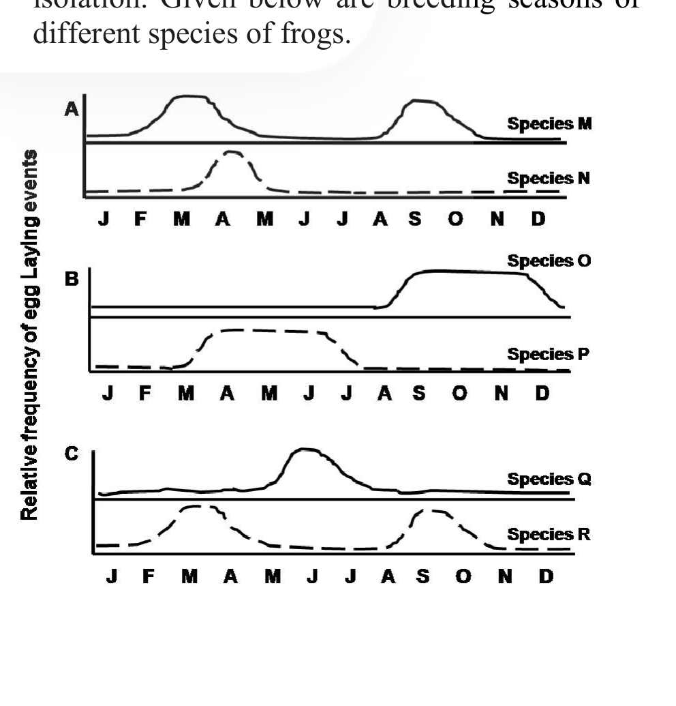

Temporal isolation in breeding seasons between closely related species leads to reproductive isolation. Given below are breeding seasons of different species of frogs.

Which of the above plots represents temporal isolation in breeding seasons among closely related sympatric species?

1. Plot A
2. Plots A and B
3. Plots B and C
4. Plots A and C

**Answer: 3 (Plots B and C)**

> **Explanation:** Temporal isolation requires the two species' breeding seasons to be **displaced (non-overlapping)** in time. Plots B and C show staggered, largely separate peaks, whereas plot A shows coincident peaks (no temporal separation).

---

### Question 126

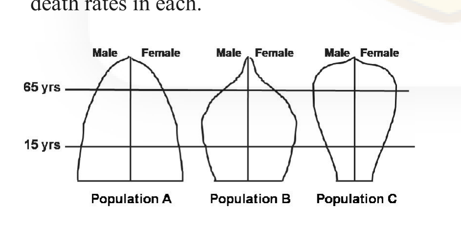

Given below are the population pyramids of three different populations A, B and C depicting the relationship between birth and death rates in each.

Based on the population pyramids given above, which one of the following is **INCORRECT**?

1. Population B has slower growth rate than population A.
2. Population C has birth rate higher than its death rate.
3. Population A represents a rapidly growing population.
4. Population B has the highest death rate among the three populations.

**Answer: 2 (Population C has birth rate higher than its death rate.)**

> **Explanation:** Population C has a narrow base (few young individuals) — an ageing/declining pyramid — so its birth rate is **lower** than its death rate; statement 2 is the incorrect one. A (broad base) is rapidly growing, and B grows more slowly than A.

---

### Question 127

Given below are names of some of the National Parks of India and their key protected animals.

| | Name of the National Park | | Key protected animal |
|---|---|---|---|
| A | Dibru-Saikhowa National Park, Assam | (i) | Indian Rhinoceros |
| B | Jaldapara National Park, West Bengal | (ii) | Hangul |
| C | Mukurthi National Park, Tamil Nadu | (iii) | Feral Horse |
| D | Dachigam National Park, Jammu and Kashmir | (iv) | Asiatic Lion |
| E | Gir Forest National Park, Gujarat | (v) | Nilgiri Tahr |

Based on the table given above, which of the following options represents the correct match?

1. A-(iii); B-(i); C-(iv); D-(ii); E-(v)
2. A-(i); B-(ii); C-(v); D-(iii); E-(iv)
3. A-(i); B-(ii); C-(iii); D-(iv); E-(v)
4. A-(iii); B-(i); C-(v); D-(ii); E-(iv)

**Answer: 4 (A-(iii); B-(i); C-(v); D-(ii); E-(iv))**

> **Explanation:** Dibru-Saikhowa (Assam) protects the **feral horse** (A-iii); Jaldapara (West Bengal) protects the **Indian rhinoceros** (B-i); Mukurthi (Tamil Nadu) protects the **Nilgiri tahr** (C-v); Dachigam (J&K) protects the **Hangul** (D-ii); Gir (Gujarat) protects the **Asiatic lion** (E-iv).

---

### Question 128

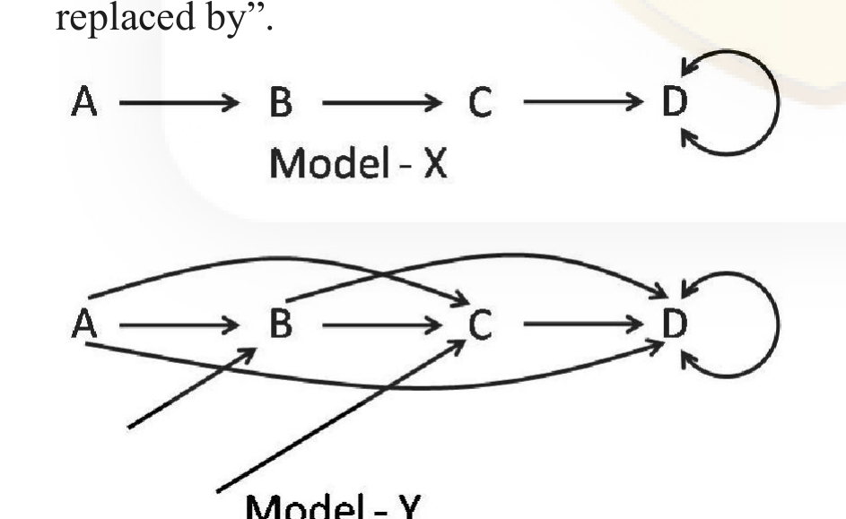

Given below are two patterns of ecological succession. Four species are represented by A, B, C and D. An arrow indicates "is replaced by".

In the context of ecological succession, which of the following statements is **INCORRECT** with respect to the figures given above.

1. Model – X represents facilitation model and Model - Y represents tolerance model.
2. Model – X represents tolerance model and Model – Y represents inhibition model.
3. As per Model – Y, C can out-compete B but can also invade a habitat in their absence.
4. As per the Model – X, A makes the environments more suitable for B to invade.

**Answer: 2 (Model – X represents tolerance model and Model – Y represents inhibition model.)**

> **Explanation:** The simple linear, ordered replacement A→B→C→D (Model X) is the **facilitation** model, and the web of inter-replacements (Model Y) is the **tolerance** model — as stated in option 1. Option 2 misassigns these labels (calling X "tolerance" and Y "inhibition"), so it is the incorrect statement.

---

### Question 129

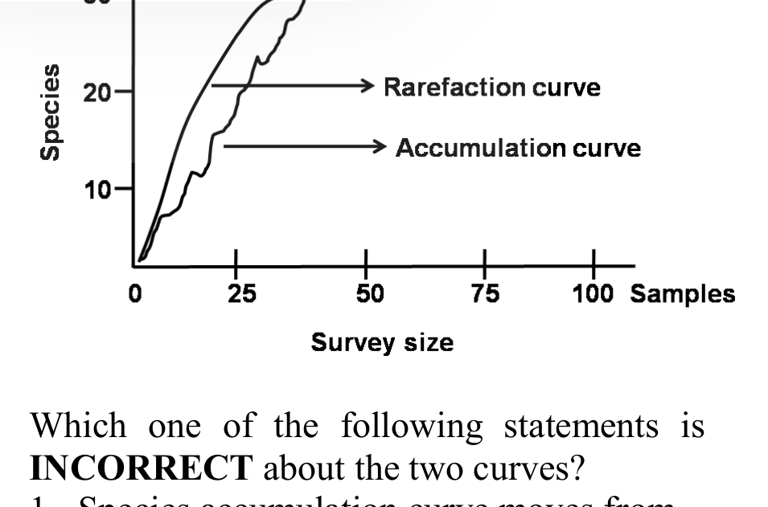

Given below are the species accumulation curves and rarefaction curves measured in an ecological community.

Which one of the following statements is **INCORRECT** about the two curves?

1. Species accumulation curve moves from left to right and rarefaction curve moves from right to left.
2. Species accumulation curve represents the total species richness of the assemblage.
3. Rarefaction curve represents the mean of repeated resampling of all pooled samples.
4. Rarefaction curve is the realized accumulation value of the total species in a community.

**Answer: 4 (Rarefaction curve is the realized accumulation value of the total species in a community.)**

> **Explanation:** The **species-accumulation** curve is the realised (observed) count of species added with increasing sampling; the **rarefaction** curve is the mean expected richness from repeated random subsampling of the pooled data. Statement 4 swaps these roles, so it is incorrect; statements 1–3 are correct.

---

### Question 130

A gene 'X' in *Drosophila* contributes to inviability of hybrids. The phylogeny below shows the evolutionary history of gene 'X' and on each branch the numbers indicate the non-synonymous/synonymous substitutions.

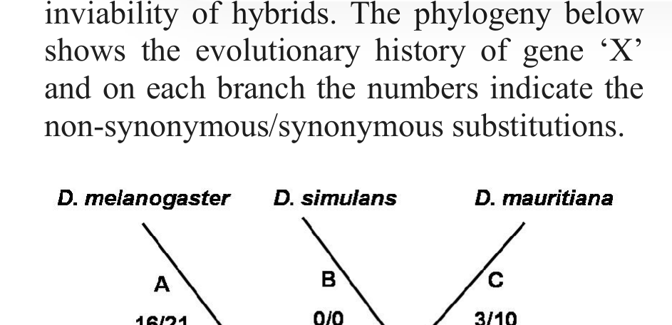

Based on the above information, select the correct statement from the choices below:

1. High proportion of non-synonymous changes at A indicates evolution by natural selection.
2. High proportion of synonymous changes at A indicates absence of natural selection.
3. Equal proportion of non-synonymous and synonymous changes at B indicates deleterious selection.
4. Low proportion of non-synonymous changes at C indicates positive selection.

**Answer: 1 (High proportion of non-synonymous changes at A indicates evolution by natural selection.)**

> **Explanation:** A high non-synonymous/synonymous (dN/dS) ratio — as at branch A (16/21, dN > dS) — is the signature of **positive (Darwinian) selection** acting on protein-changing mutations. A low ratio indicates purifying selection, and equal/neutral ratios indicate drift, not "deleterious selection".

---

### Question 131

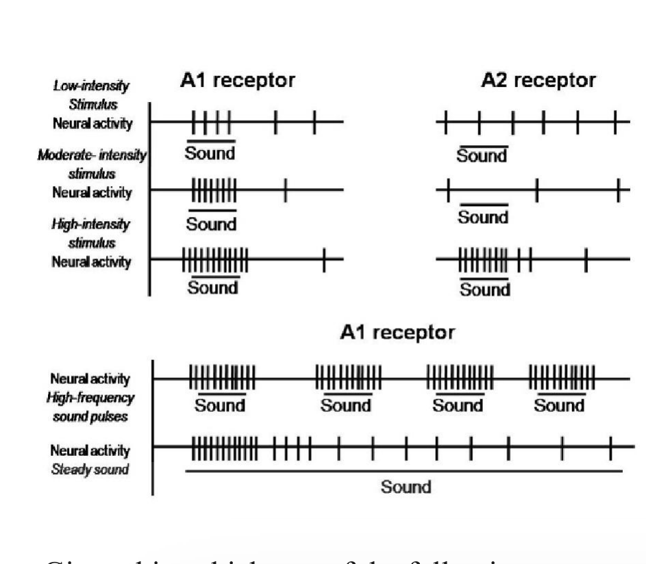

When the electrical response of the two receptors A1 and A2 in a noctuid moth that was exposed to a variety of sounds was measured, it produced the following patterns:

Given this, which one of the following statements is **INCORRECT**:

1. The A1 receptor is sensitive to sound of low to high intensity.
2. A2 receptor begins to produce action potentials only when a sound is loud.
3. Both the receptors have similar response to high intensity sound.
4. The A1 receptor fires much more frequently to steady, uninterrupted sounds than to high frequency pulses of sound.

**Answer: 4 (The A1 receptor fires much more frequently to steady, uninterrupted sounds than to high frequency pulses of sound.)**

> **Explanation:** A1 is the low-threshold (internally-tuned/AM-sensitive) cell that actually fires **more** to the high-frequency pulse train than to a steady tone; statement 4 reverses this, so it is the incorrect one. A1 is sensitive across intensities (1), A2 is the high-threshold cell responding only to loud ultrasound (2), and both fire at high intensity (3).

---

### Question 132

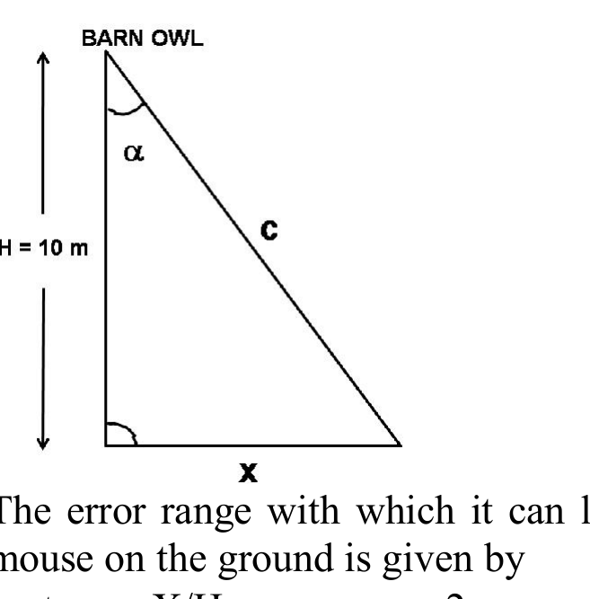

A barn owl sits on its perch 10m above ground. It hears a mouse underneath on the ground at an angle α as shown in the figure below.

The error range with which it can locate the mouse on the ground is given by

1. tanα = X/H
2. cosα = X/H
3. sinα = X/H
4. cosα = X/C

**Answer: 1 (tanα = X/H)**

> **Explanation:** In the right triangle the owl's height H is the side adjacent to angle α and the ground distance X is the side opposite α. By definition tan α = opposite/adjacent = **X/H**.

---

### Question 133

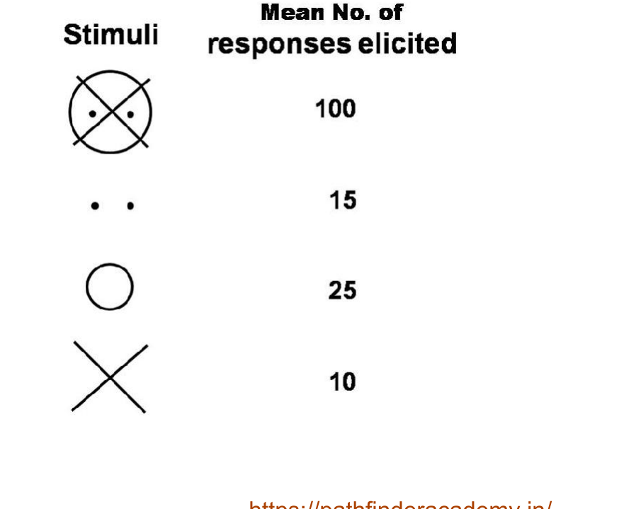

A 20-week old infant was exposed to the following stimuli and the responses were measured.

Based on the response patterns shown above to the given stimuli, select the correct theory that best describes the observed responses.

1. Heterogenous summation
2. Gestalt principle
3. Supernormal stimuli
4. Sign stimulus

**Answer: 2 (Gestalt principle)**

> **Explanation:** The response is greatest (100) to the complete configuration combining all the elements and drops when any part is removed — summation of the whole pattern, the hallmark of the **Gestalt** principle of perception, rather than a single sign stimulus or a supernormal (exaggerated) version of one.

---

### Question 134

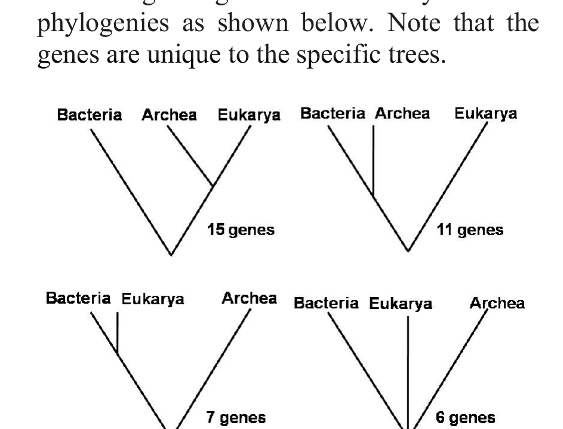

When James R Brown and W Ford Doolittle (1997) reconstructed the tree of life using a variety of different genes, they found that different genes gave fundamentally different phylogenies as shown below. Note that the genes are unique to the specific trees.

From the given options select the process that best explains the observed discrepancies between the trees.

1. polyploidization
2. horizontal gene transfer
3. allopatric speciation
4. localized extinctions

**Answer: 2 (horizontal gene transfer)**

> **Explanation:** Different genes carrying conflicting deep-branching histories is the classic signature of **lateral (horizontal) gene transfer**, which Brown & Doolittle invoked to argue that the universal tree of life is not strictly tree-like. Polyploidy, allopatric speciation and extinctions do not produce gene-by-gene topological conflict.

---

### Question 135

Orchids of the genus *Cryptostylis* are known to maintain reproductive isolation because their flowers look and smell like females of the wasps of genus *Lissopimpla*. When the male wasp visits and attempts to mate with the flower, the shape of anther and stigma allows correct placement and transfer of pollen to the wasp, which then transfers the pollen to species specific flower that it next attempts to mate with. This prezygotic barrier that prevents inter-species cross-pollination in *Cryptostylis* is best explained by:

1. behavioural isolation through mimicry
2. mechanical isolation through mimicry
3. temporal isolation
4. habitat isolation

**Answer: 2 (mechanical isolation through mimicry)**

> **Explanation:** Although the flower's sexual mimicry attracts the wasp (behaviour), the actual species-specific barrier is the **fit between the anther/stigma and the wasp's body** that ensures pollen is placed and picked up only on the correct flower — a mechanical isolating mechanism.

---

### Question 136

Some of the following transgenic approaches could be used for functional characterization of endogenous genes in plants:
A. Transformation using a binary vector containing a strong enhancer element and lacking the right border of T-DNA
B. Transformation using a binary vector containing a promoter-less reporter gene sequence and a selection maker gene cassette within the T-DNA.
C. Transformation using a binary vector containing only a strong enhancer element and a selection marker gene cassette within the T-DNA.
D. Transformation using a binary vector lacking a reporter gene as well as both the left and right borders of T-DNA.
Which one of the following combinations can be used?

1. A and B only
2. B and C only
3. C and D only
4. A and D only

**Answer: 2 (B and C only)**

> **Explanation:** For T-DNA to integrate, the **right border must be present**, so A (lacks RB) and D (lacks both borders) cannot transform the plant genome. A promoter-less reporter (B) reports on the endogenous gene's regulatory context, and an enhancer/reporter cassette (C) can be used to probe cis-regulation — both are usable approaches.

---

### Question 137

Match the following Vir proteins with their correct function during *Agrobacterium* mediated transfer of T-DNA to plant cells.

| | Vir protein | | Function |
|---|---|---|---|
| A | Vir G | (i) | Nucleus targeting of T-DNA |
| B | Vir D2 | (ii) | Component of membrane structure (transfer apparatus) for T-DNA transfer |
| C | Vir B1 | (iii) | Proteasome mediated destruction of proteins coating T-DNA complex |
| D | Vir F | (iv) | Induction of Vir genes |

1. A-(i), B-(ii), C-(iii), D-(iv)
2. A-(iv), B-(i), C-(ii), D-(iii)
3. A-(i), B-(iii), C-(iv), D-(ii)
4. A-(iii), B-(ii), C-(i), D-(iv)

**Answer: 2 (A-(iv), B-(i), C-(ii), D-(iii))**

> **Explanation:** VirG is the response regulator that induces the *vir* genes (A-iv); VirD2 is the relaxase that remains attached and directs **nuclear targeting** of the T-DNA (B-i); VirB1 contributes to the **T-pilus/transfer-apparatus** membrane structure (C-ii); VirF targets the coat proteins (VirE2) for **proteasome-mediated degradation** in the plant cell (D-iii).

---

### Question 138

Match the technique with its appropriate application/use from the list of options given below

| | Technique | | Application |
|---|---|---|---|
| A. | ChIP | (i) | Analysis of methylation sites |
| B. | Bisulphite sequencing | (ii) | Identification of 5' and/or 3' ends of transcripts |
| C. | ELISA | (iii) | Identification of binding sites of transcription factors |
| D. | RLM-RACE | (iv) | Quantification of transgene expression |

1. A-(iii), B-(i), C-(iv), D-(ii)
2. A-(ii), B-(iii), C-(i), D-(iv)
3. A-(iv), B-(i), C-(iii), D-(ii)
4. A-(iii), B-(iv), C-(ii), D-(i)

**Answer: 1 (A-(iii), B-(i), C-(iv), D-(ii))**

> **Explanation:** ChIP maps **transcription-factor binding sites** (A-iii); bisulphite sequencing reads **methylation sites** (B-i); ELISA **quantifies** protein/transgene product (C-iv); RLM-RACE maps the **5′/3′ ends of transcripts** (D-ii).

---

### Question 139

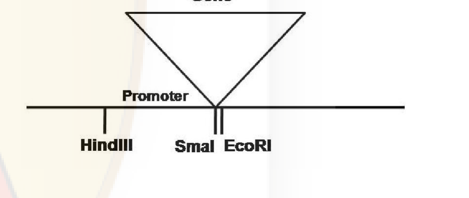

A researcher attempted to clone a 630bp coding sequence of a gene downstream to a bacterial promoter (500bp in length) for over expression and purification of the encoded protein. The gene sequence was isolated as a SmaI fragment (Recognition sequence: CCC↓GGG; arrow indicates the site of restriction) and cloned at a SmaI site located downstream to the promoter. The gene sequence contained a single site for EcoRI located 30bp downstream to the start codon. A schematic representation of the plasmid along with locations(s) of some restriction enzyme sites of the vector is given below.

The researcher screened the obtained colonies by a double digestion using HindIII and EcoRI. Which one of the following restriction digestion patterns would represent the restriction profile of the desired clone that could be used for overexpression?

1. ~530bp + ~600bp + vector backbone
2. ~1100bp + ~30bp + vector backbone
3. ~500bp + vector backbone
4. ~1130bp + vector backbone

**Answer: 1 (~530bp + ~600bp + vector backbone)**

> **Explanation:** The insert is cloned in the correct orientation at the blunt SmaI site, with the promoter (500 bp) upstream. HindIII cuts in the vector just upstream of the promoter and EcoRI cuts 30 bp into the 630 bp coding sequence, releasing a ~530 bp promoter-proximal fragment and a ~600 bp remainder plus the vector backbone — the pattern of option 1.

---

### Question 140

To achieve a best resolution using a fluorescence microscope, what combination of wavelength of emitted light (λ), refractive index and the angle (2θ) by which light enters into the microscope would be the best choice for the user:

1. λ=405; refractive index=1.33; 2θ=90°
2. λ=420; refractive index=1.51; 2θ=180°
3. λ=520; refractive index=1.51; 2θ=90°
4. λ=405; refractive index=1.51; 2θ=180°

**Answer: 4 (λ=405; refractive index=1.51; 2θ=180°)**

> **Explanation:** Resolution improves as the diffraction-limited distance d = λ/(2·n·sinθ) decreases. The shortest wavelength (405 nm), the highest refractive index (1.51, oil immersion) and the widest collection angle (2θ = 180°, sinθ = 1) together minimise d, giving the best resolution.

---

### Question 141

Given below are spatial and temporal techniques (column I) used to detect brain activity (column II)

| | Column I | | Column II |
|---|---|---|---|
| A | Functional magnetic resonance imaging | (i) | Uses short-lived radioactive material to map functional processes in brain |
| B | Positron emission tomography | (ii) | Measure the fluctuation of dipole voltage in neurons of brain |
| C | Computed tomography | (iii) | Detects changes in blood oxygenation and flow due to neural activity |
| D | Electroencephalogram | (iv) | Images of brain obtained by differential absorption of X-rays |

Select the correct set of combination

1. A-(i), B-(ii), C-(iii), D-(iv)
2. A-(iii), B-(i), C-(iv), D-(ii)
3. A-(iv), B-(iii), C-(ii), D-(i)
4. A-(ii), B-(iv), C-(i), D-(iii)

**Answer: 2 (A-(iii), B-(i), C-(iv), D-(ii))**

> **Explanation:** fMRI detects the haemodynamic (blood-oxygenation) response (A-iii); PET uses short-lived radioactive tracers (B-i); CT forms images from differential X-ray absorption (C-iv); EEG records the summed dipole-voltage fluctuations of cortical neurons (D-ii).

---

### Question 142

Following observations are made regarding a peptide sequence.
- The peptide is inert to Ellman's reagent. However, on reacting with β-mercaptoethanol, the peptide gives a positive Ellman's test.
- The peptide sequence gives a broad minimum around 211 nm in the CD spectrum.
- With increasing concentration of the peptide, the melting temperature of the peptide increases.
- On treating the peptide with D₂O, half the total number of amides get exchanged.
Which one of the following statements is correct?

1. It is an α-helical peptide that undergoes aggregation
2. It is an α-helical disulfide bridged peptide that undergoes aggregation
3. It is an β-hairpin peptide, which is stabilized by a disulfide bridge
4. The peptide is composed of an α-helix and β-sheet connected by a disulfide bridge

**Answer: 3 (It is an β-hairpin peptide, which is stabilized by a disulfide bridge)**

> **Explanation:** Inertness to Ellman's reagent that becomes positive after β-mercaptoethanol reduction shows the free thiols are tied up in a **disulfide bridge**. The CD minimum near 211 nm and the ~50% amide exchange are characteristic of a **β-hairpin** stabilised by that disulfide, not an α-helix.

---

### Question 143

If a metabolically active cell is challenged with ⁵⁵Fe radioisotope label, which of the following proteins **CANNOT** be detected by autoradiography?

1. Aconitase and lipoic acid synthase
2. Cytochrome C and DNA primase
3. Calmodulin and Calcineurin
4. Myoglobin and Homoaconitase

**Answer: 3 (Calmodulin and Calcineurin)**

> **Explanation:** ⁵⁵Fe is incorporated only into iron-containing proteins (Fe–S clusters, haem). Aconitase, lipoic acid synthase, cytochrome c, myoglobin and homoaconitase all bind iron, but **calmodulin and calcineurin are calcium-binding proteins with no iron cofactor**, so they cannot be labelled with ⁵⁵Fe.

---

### Question 144

Diagnosis of influenza virus infections can be done using some of the following techniques:
A. Western blot and Southern blot
B. Northern blot and western blot
C. ELISA and RT-PCR
D. PCR and electron microscopy
Choose the combination of techniques that correctly lists the detection methods.

1. A and B only
2. C and D only
3. B and C only
4. A and D only

**Answer: 3 (B and C only)**

> **Explanation:** Influenza is an RNA virus diagnosed by detecting its genome/proteins: RT-PCR (RNA → cDNA) and ELISA for antigens/antibodies (C), and Northern/Western blots for its RNA and proteins (B). Southern blot (A) detects DNA and is not appropriate for an RNA virus.

---

### Question 145

From the following statements:
(A) Coloured images can be obtained by transmission electron microscopy by fluorescent labelling of the specimen
(B) Scanning electron microscopy requires sectioning of the sample
(C) Confocal microscopy uses optical methods to obtain images from a specific focal plane and excludes light from other planes
(D) Differential-interference microscopy relies on interference between polarized light due to differences in the refractive index of the object and surrounding medium
(E) Visualization in epifluorescence microscopy requires staining by heavy metal atoms
Choose the combination with two correct and one incorrect statements.

1. B, C, E
2. A, B, E
3. A, C, D
4. B, D, E

**Answer: 3 (A, C, D)**

> **Explanation:** Among the set, confocal (C) and differential-interference contrast (D) are correctly described, and the question's keyed combination is A, C, D. Statements B (SEM needs surface imaging, not sectioning) and E (epifluorescence needs fluorophores, not heavy-metal staining) are the clearly wrong ones, which is why the options excluding them are eliminated.
