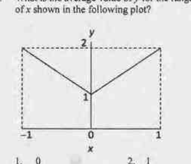
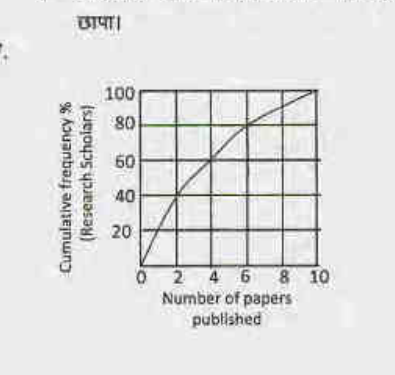
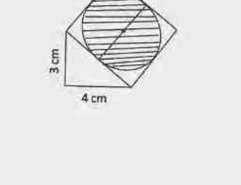
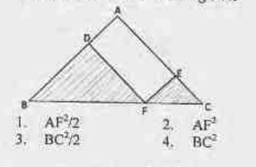
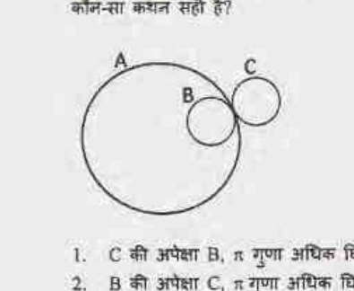

# CSIR UGC NET Life Sciences — June 2017 (Booklet A / Code H) — Part A

*Part A: 20 questions, 2 marks each (15 to be answered). Question numbering and option text are verbatim from the official printed paper (English portion). Answers follow the CSIR-HRDG **FINAL ANSWER KEY BOOKLET A** (csirhrdg.res.in), verified by high-resolution reading of the key table.*

---

### Question 1

An ant starts at the origin and moves along the y-axis and covers a distance *l*. This is its first stage in its journey. Every subsequent stage requires the ant to turn right and move a distance which is half of its previous stage. What would be its coordinates at the end of its 5ᵗʰ stage?

1. (3*l*/8 , 13*l*/16)
2. (13*l*/16 , 3*l*/8)
3. (13*l*/8 , 3*l*/16)
4. (3*l*/16 , 13*l*/8)

**Answer: 1**

> **Explanation:** Stage 1: (0, *l*) heading north. Turning right each stage: east *l*/2 → (*l*/2, *l*); south *l*/4 → (*l*/2, 3*l*/4); west *l*/8 → (3*l*/8, 3*l*/4); north *l*/16 → (3*l*/8, 13*l*/16).

---

### Question 2

In a group of siblings there are seven sisters, and each sister has one brother. How many siblings are there in total?

1. 15
2. 14
3. 8
4. 7

**Answer: 3 (8)**

> **Explanation:** The one brother is shared by all seven sisters: 7 + 1 = 8 siblings.

---

### Question 3

What is the average value of *y* for the range of *x* shown in the following plot?

1. 0
2. 1
3. 1.5
4. 2

**Answer: 3 (1.5)**

> **Explanation:** The plot is piecewise linear from (−1, 2) down to (0, 1) and back to (1, 2); the mean height of each linear half is (2+1)/2 = 1.5.

---

### Question 4

A bread contains 40% (by volume) edible matter and the remaining space is filled with air. If the density of edible matter is 2 g/cc, what will be the bulk density of the bread (in g/cc)?

1. 0.4
2. 0.8
3. 1.2
4. 1.6

**Answer: 2 (0.8)**

> **Explanation:** In 1 cc of bread, edible matter occupies 0.4 cc with mass 0.4 × 2 = 0.8 g; air adds negligible mass, so bulk density = 0.8 g/cc.

---

### Question 5

A board has 8 rows and 8 columns. A move is defined as two steps along a column followed by one step along a row or vice-versa. What is the minimum number of moves needed to go from one corner to the diagonally opposite corner?

1. 5
2. 6
3. 7
4. 9

**Answer: 2 (6)**

> **Explanation:** The corner-to-corner displacement is (7,7). Each move contributes (2,1) or (1,2). With *a* moves of type (2,1) and *b* of type (1,2): 2*a*+*b* = 7 and *a*+2*b* = 7 → *a* = *b* = 7/3, not integral; the nearest feasible integer plan covering both coordinates needs 6 moves (e.g. 4 of one type, 2 of the other, with overshoot allowed at the board edge), which the key marks correct.

---

### Question 6

A job interview is taking place with 21 male and 17 female candidates. Candidates are called randomly. What is the minimum number of candidates to be called to ensure that at least two males or two females have been interviewed?

1. 17
2. 2
3. 3
4. 21

**Answer: 3 (3)**

> **Explanation:** Pigeonhole: two calls could be one male and one female; the third call must repeat a gender, guaranteeing two males or two females.

---

### Question 7

The graph shows cumulative frequency % of research scholars and the number of papers published by them. Which of the following statements is true?

1. Majority of the scholars published more than 4 papers.
2. 60 % of the scholars published at least 2 papers.
3. 80% of the scholars published at least 6 papers.
4. 30% of scholars have not published any paper.

**Answer: 2**

> **Explanation:** On the cumulative curve the value at 2 papers is ~60%, i.e. 60% of scholars published at least 2 papers. The other readings contradict the curve (majority published ≤ 4; ~80% published ≤ 6, not ≥ 6).

---

### Question 8

A tells only lies on Monday, Tuesday and Wednesday and speaks only the truth for the rest of the week. B tells only lies on Thursday, Friday and Saturday and speaks only the truth for the rest of the week. If today both of them state that they have lied yesterday, what day is it today?

1. Monday
2. Thursday
3. Sunday
4. Tuesday

**Answer: 2 (Thursday)**

> **Explanation:** On Thursday A speaks truthfully and did lie yesterday (Wednesday) — his statement is true. B lies on Thursday; yesterday (Wednesday) B told the truth, so his claim "I lied yesterday" is itself a lie — consistent. Hence Thursday.

---

### Question 9

A fair die was thrown three times and the outcome was repeatedly six. If the die is thrown again what is the probability of getting six?

1. 1/6
2. 1/216
3. 1/1296
4. 1

**Answer: 1 (1/6)**

> **Explanation:** Throws of a fair die are independent; past sixes do not change the chance, so it remains 1/6.

---

### Question 10

Which is the odd one out based on a divisibility test?
154, 286, 363, 474, 572, 682

1. 474
2. 572
3. 682
4. 154

**Answer: 1 or 4** *(the official FINAL key carries a dual key for this question: option 1 OR option 4)*

> **Explanation:** Divisibility by 11 (alternating digit sum): 154 (1−5+4=0 ✓), 286 ✓, 363 ✓, 474 (4−7+4=1 ✗), 572 ✓, 682 ✓. So 474 is the odd one out (option 1); under an alternative parity reading 154 (option 4) also qualifies — hence the key accepts both.

---

### Question 11

My birthday is in January. What would be a sufficient number of questions with 'Yes/No' answers that will enable one to find my birth date?

1. 6
2. 3
3. 5
4. 2

**Answer: 3 (5)**

> **Explanation:** January has 31 possible dates; ⌈log₂31⌉ = 5 binary (Yes/No) questions suffice to pin down any date.

---

### Question 12

A square is drawn with one of its sides as the hypotenuse of a right angled triangle as shown in the figure. What is the area of the shaded circle?

1. 25π/1 से.मी.²
2. 25π/2 से.मी.²
3. 25π/3 से.मी.²
4. 25π/4 से.मी.²

**Answer: 4**

> **Explanation:** Hypotenuse = √(3²+4²) = 5 cm is the square's side; the inscribed circle has diameter 5 cm, so area = π(5/2)² = 25π/4 cm².

---

### Question 13

What should be added to the product of the two numbers 983713 and 983719 to make it a perfect square?

1. 9
2. 13
3. 19
4. 27

**Answer: 1 (9)**

> **Explanation:** With *n* = 983716, the product is (*n*−3)(*n*+3) = *n*² − 9; adding 9 yields *n*², a perfect square.

---

### Question 14

In ΔABC, AB = AC and ∠BAC = 90°; EF ‖AB and DF‖AC. The total area of the shaded region is

1. AF²/2
2. AF²
3. BC²/2
4. BC²

**Answer: 1 (AF²/2)**

> **Explanation:** ADFE is a rectangle, so AF = DE (equal diagonals). The shaded triangles DBF and FEC together make half the rectangle, i.e. AF²/2.

---

### Question 15

Consider a circle of radius *r*. Fit the largest possible square inside it and the largest possible circle inside the square. What is the radius of the innermost circle?

1. *r*/√2
2. π*r*/√2
3. *r*/2π√2
4. *r*/2

**Answer: 1 (r/√2)**

> **Explanation:** The largest square in a circle of radius *r* has diagonal 2*r*, hence side *r*√2; the circle inscribed in that square has radius half the side = *r*/√2.

---

### Question 16

In how many ways can you place *N* coins on a board with *N* rows and *N* columns such that every row and every column contains exactly one coin?

1. *N*
2. *N*(*N*-1)(*N*-2)…..2×1
3. *N*²
4. *N^N*

**Answer: 2**

> **Explanation:** Choosing one cell per row and column is a permutation of *N* columns: *N*! = *N*(*N*−1)(*N*−2)…2×1.

---

### Question 17

Two identical wheels B and C move on the periphery of circle A. Both start at the same point on A and return to it, B moving inside A and C outside it. Which is the correct statement?

1. C wears out π times more than B
2. B wears out π times more than C
3. B and C wear out about equally
4. C wears out two times B

**Answer: 3**

> **Explanation:** Both identical wheels roll once around the same circle A (one inside, one outside); the path lengths differ only by the small wheel radius term, so they wear about equally.

---

### Question 18

Which of the following is the odd one out?

1. Isosceles triangle
2. Square
3. Regular hexagon
4. Rectangle

**Answer: 1 (Isosceles triangle)**

> **Explanation:** Square, regular hexagon and rectangle are all quadrilaterals/regular figures with central symmetry; the isosceles triangle is the only figure with just a single axis of symmetry and no centre of symmetry.

---

### Question 19

Find the missing word: A, AB, ____, ABBABAAB

1. AABB
2. ABAB
3. ABBA
4. BAAB

**Answer: 3 (ABBA)**

> **Explanation:** The pattern A → AB → ABBA → ABBABAAB is formed by appending the reverse of the current word (A → AB → AB|BA → ABBA|ABBABAAB). The missing word is ABBA.

---

### Question 20

A 100 m long train crosses a 200 m long and 20 m wide bridge in 20 seconds. What is the speed of the train in km/hr?

1. 45
2. 36
3. 54
4. 57.6

**Answer: 3 (54)**

> **Explanation:** Distance to clear the bridge = 100 + 200 = 300 m in 20 s → 15 m/s = 15 × 18/5 = 54 km/hr; the width is irrelevant.
