# CSIR UGC NET Life Sciences — June 2017 (Booklet A / Code H) — Part C

*Part C: questions 71–145, 4 marks each (25 to be answered). Text verbatim from the official printed paper (English portion). Answers follow the CSIR-HRDG **FINAL ANSWER KEY BOOKLET A** (csirhrdg.res.in).*

---

### Question 71

From the following statements:
A. In proteins the amino acids that can undergo oxidation are Cys and Met.
B. A tetrasaccharide composed of alternate L and D isomers will not be optically active.
C. The ΔG(Kcal/mol) values for Keq of 0.1, 0.01 and 0.001 are 1.36, 2.72 and 4.09, respectively. It can be concluded that the relationship between ΔG and Keq is parabolic.
D. The oxidation states of Fe in haemoglobin is +2. In cytochrome C, the oxidation states of Fe can be +2 or +3.
E. In DNA, the sugar and bases are planar.
F. High-energy bonds hydrolyze with large negative ΔG.

Choose the combination with **ONLY ONE WRONG** statement.

1. A, E, F
2. B, C, D
3. C, D, E
4. A, B, C

**Answer: 1**

> **Explanation:** Statement C is wrong (ΔG = −RT ln Keq is linear in ln Keq, not parabolic), while A, E, F are the set the key marks as containing only one wrong statement.

---

### Question 72

Given below are statements related to protein structures
A. The dihedral angles of an amino acid X in Acetyl-X-NMethyl amide in the Ramachandran plot, occur in very small but equal areas in the left and right quadrants. It can be concluded that X is not one of the 20-coded amino acids.
B. The dihedral angles of a 20-residue peptide are represented in the Ramachandran plot. It is possible to conclude that the peptide does not have a proline.
C. Two proteins can have a similar fold even if they do not share significant similarity in their primary structure.
D. On denaturation of a protein by urea, the interactions that would be disrupted are ionic bonds and van der Waal's interaction but not disulfide bonds.

Choose the combination with **ALL CORRECT** answers:

1. A, B, C
2. A, C, D
3. B, C, D
4. A, B, D

**Answer: 2**

> **Explanation:** A, C and D are correct: symmetric left/right Ramachandran occupancy is not that of the L-amino acids (A); similar folds can occur without sequence similarity (C); urea disrupts ionic and van der Waals interactions but not covalent disulfides (D). B is wrong (absence of proline cannot be concluded merely from a plot).

---

### Question 73

Various modifications of nucleotides occur in nucleic acids. Which of the following combinations contains at least one modification that does **NOT** occur in nucleic acids?

1. N, N-dimethylguanosine, pseudouridine, 2'O-methyluridine
2. 2-thiouridine, dihydrouridine, N-isopentenyladenine
3. 5-methyldeoxycytosine, 5-thiouridine, pseudouridine
4. dihydrouridine, 4-thiouridine, 2'O-methyluridine

**Answer: 3**

> **Explanation:** 5-thiouridine is not a natural modified nucleoside (the natural one is 4-thiouridine), so option 3 contains a modification that does not occur.

---

### Question 74

Given below are statements that may or may not be correct.
A. Fructose 2,6- biphosphate is an allosteric inhibitor of phosphofructokinase 1.
B. The TCA cycle intermediates, succinate and oxaloacetate can both be derived from amino acids.
C. A diet rich in cysteine can compensate for a methionine deficient diet in humans.
D. dTTP for DNA synthesis can be obtained from UTP.
E. In the fatty acid biosynthetic pathway, the carbon atom from HCO₃⁻ in the synthesis of malonyl CoA is not incorporated into palmitic acid.

Choose the option that represents the combination of all the **CORRECT** statements

1. A, B, C and E
2. B, D and E
3. A, D and E
4. Only B and C

**Answer: 2**

> **Explanation:** A is wrong (F-2,6-BP is an allosteric *activator* of PFK-1). B, D and E are correct: succinate/oxaloacetate are glucogenic-amino-acid derived; dTTP derives from UDP→dUDP→dUTP→dTTP (via ribonucleotide reduction of UDP); and the HCO₃ carbon of malonyl-CoA is released in the FAS cycle.

---

### Question 75

Three electron acceptors 'X', 'Y' and 'Z' have redox potential (E₀') of +0.15V, +0.05V and -0.1V, respectively. For a reaction B +2H + 2e⁻ → BH₂  E₀' = +0.05V
Which of these three electron acceptors are appropriate?
[useful equation: ΔG₀' = -nFE₀']
ΔG₀'= free energy change; n= number of electrons; F= Faraday constant]

1. X and Y
2. only X
3. Y and Z
4. only Z

**Answer: 1**

> **Explanation:** Electrons flow spontaneously from B/BH₂ (E₀' = +0.05 V) to acceptors of more positive potential: X (+0.15 V) and Y (+0.05 V, at equilibrium/usable), but not Z (−0.1 V).

---

### Question 76

A serine protease was tested for its activity on the following peptide substrates of different lengths and sequences. The obtained kinetic parameters of the protease are shown along with the peptide.

| Peptide substrate | Kcat (S⁻¹) | Km (mM) |
|---|---|---|
| Ac-X-Ala-CO-NH₂ (↓) | 0.01 | 100 |
| Ac-Y-X-Ala-CO-NH₂ (↓) | 0.10 | 4.0 |
| Ac-Z-Y-X-Ala-CO-NH₂ (↓) | 8.0 | 4.0 |
| Ac-Y-X-Val-CO-NH₂ (↓) | 6.0 | 35.0 |

Arrow denotes site of cleavage.
Based on the above data, the following statements are made:
A. Catalytic efficiency (Kcat/Km) increases with the size of the peptide.
B. Amino acid at the hydrolytic cleavage position of the peptide is critical for binding of the peptide with the protease.
C. Catalytic efficiency decreases from three amino acid peptide to four amino acid peptide.

Which of the following combinations of the above statements is correct?

1. A and B
2. A and C
3. B and C
4. A, B and C

**Answer: 1**

> **Explanation:** Kcat/Km rises from 1×10⁻⁴ to 2×10⁻² (S⁻¹mM⁻¹) as the peptide grows (A true); replacing Ala at P1 with Val collapses efficiency (B true). Statement C is false because efficiency increases, not decreases, for the longer substrates.

---

### Question 77

A membrane associated protein is composed of seven "α-helices", with each helix containing 19 hydrophobic residues. While treating the membrane with all kinds of proteases, a major portion of this protein remains intact. Treatment with high salt (till 1.5M NaCl) and buffer with pH 5.0 failed to dissociate this protein from the membrane. Predict the most appropriate nature and orientation of this protein in the membrane.

1. Peripheral glycoprotein
2. Integral protein with seven membrane spanning regions
3. Peripheral protein with both N and C-terminals remain exposed to outer surface of the cell membrane
4. Peripheral protein with both N and C-terminal remain exposed to cytosolic surface of the cell membrane

**Answer: 2**

> **Explanation:** 19 hydrophobic residues per helix is exactly a transmembrane span; resistance to high salt and low pH (which strip peripheral proteins) plus protease-insensitivity of the bulk shows it is an integral protein with seven membrane-spanning helices.

---

### Question 78

When the cholera toxin (protein of Mr 90,000 Da) gains access to the human intestinal tract, it binds tightly to specific receptors in the plasma membrane of the epithelial cells lining the small intestine, causing membrane bound adenylyl cyclase to undergo prolonged activation resulting in extensive loss of H₂O and Na⁺. Pretreatment of the epithelial cells with various phospholipases and proteases failed to inhibit the binding of cholera toxin to its receptor and the fluid loss but treatment with exoglycosidase, prior to binding, significantly reduces these effects. Which of the following molecule could be the receptor for this toxin?

1. Phosphatidyl choline
2. Sodium-potassium ATPase
3. Ganglioside
4. Chloride-bicarbonate exchanger

**Answer: 3**

> **Explanation:** Sensitivity to exoglycosidase (sugar-trim removal) but not to proteases or phospholipases identifies the receptor as a glycolipid — the ganglioside GM1, the known cholera-toxin receptor.

---

### Question 79

α-bungarotoxin binds to acetylcholine receptor (AChR) protein with high specificity and prevents the ion-channel opening. This interaction can be exploited to purify AChR from membrane using

1. Ion-exchange chromatography
2. Gel filtration chromatography
3. Affinity chromatography
4. Density gradient centrifugation

**Answer: 3**

> **Explanation:** Immobilising α-bungarotoxin on a matrix and exploiting its specific, tight binding to AChR is the definition of affinity chromatography.

---

### Question 80

In *Schizosaccharomyces pombe*, the recessive (cdc2ᵗ) and dominant (cdc2ᴰ) mutants have opposing phenotypes. While cdc2ᴰ produces abnormally small cells, cdc2ᵗ produces abnormally long cells. Some possible explanations are given below.
A. cdc2ᴰ may lack interaction with WEE1
B. cdc2ᵗ may not interact with CDC13 kinase
C. cdc2ᴰ may not interact with CDC25 phosphatase
D. cdc2ᵗ cells may be deficient in interaction with either CDC25 or WEE1

Which combination of the above statements is correct?

1. A and B only
2. A, C and D only
3. B and C only
4. A, B and C only

**Answer: 1**

> **Explanation:** cdc2ᴰ behaving as small-cell (premature mitosis) fits loss of WEE1 inhibitory phosphorylation (A); cdc2ᵗ long-cell arrest fits failure to be activated by the mitotic inducer cascade (B). The key marks A and B only.

---

### Question 81

The table given below lists organisms (column A) and characteristic features ( column B).

| A | B |
|---|---|
| (a) Caulobacter | (i) Multicellular fruiting body |
| (b) Myxobacteria | (ii) Endospore |
| (c) Methylotroph | (iii) Non-free living, Penicillin resistant |
| (d) Bacillus subtilis | (iv) Immortal stalk cells |
| (e) Mycoplasma | (v) Can use formate, cyanide and carbon monoxide as a source of carbon |

Choose the option that correctly matches organisms with their characteristic features.

1. (a) – (i); (b) – (v); (c) – (iv); (d) – (ii); (e) – (iii)
2. (a) – (iv); (b) – (i); (c) – (v); (d) – (ii); (e) – (iii)
3. (a) – (iv); (b) – (v); (c) – (i); (d) – (iii); (e) – (ii)
4. (a) – (ii); (b) – (i); (c) – (v); (d) – (iv); (e) – (iii)

**Answer: 2**

> **Explanation:** Caulobacter forms the immortal stalk (iv); Myxobacteria form multicellular fruiting bodies (i); methylotrophs oxidise C1 compounds including formate/CO (v); Bacillus subtilis makes endospores (ii); Mycoplasma is non-free-living and penicillin resistant (iii, no cell wall).

---

### Question 82

In Tay-Sachs disease, accumulation of glycolipids occurs especially in nerve cells. These cells are greatly enlarged with swollon lipid-filled endosomes and the children with this disease die at a very early stage. Such condition occurs due to a specific defect in

1. specific lysosomal enzyme that catalyzes a step in the breakdown of gangliosides
2. sorting of an enzyme that adds a phosphate group at 6ᵗʰ position of mannose in all acid hydrolases
3. one of the Rab proteins involved in recycling of vesicles
4. v-SNARE molecules which cause abnormal vesicle tethering and docking and affect vesicle fusion with lysosomes

**Answer: 1**

> **Explanation:** Tay-Sachs results from deficiency of β-hexosaminidase A, the lysosomal enzyme that degrades GM2 ganglioside — a defect in a specific ganglioside-catabolising enzyme.

---

### Question 83

The lambda (λ) and P22 phages are two related lambdoid bacteriophages. A recombinant lambda phage (λᴹᵗ) was derived from the wild type lambda phage(λᵂᵀ) by replacing its CI repressor gene and the CI binding sites with those from the P22 phage. Both the λᵂᵀ and the λᴹᵘᵗ were used independently to infect *Escherichia coli* strain over-producing λᵂᵀ CI repressor. Following outcomes were surmised
(i) Infection with λᵂᵀ will lyse the *E. coli* used
(ii) Infection with λᵂᵀ will invariably establish lysogeny in the *E. coli* used
(iii) Infection with λᴹᵘᵗ will lyse the *E. coli* used
(iv) Infection with λᴹᵘᵗ will invariably establish lysogeny in the *E. coli* used

Which combination of the above statements is correct?

1. (i) and (ii)
2. (ii) and (iii)
3. (iii) and (iv)
4. (iv) and (i)

**Answer: 2**

> **Explanation:** The host over-produces λᵂᵀ CI, so λᵂᵀ repressor sites are saturated → lysogeny (ii). λᴹᵘᵗ carries P22 CI-binding sites that the λ CI cannot protect, so its own regulation fails and it lyses the cell (iii).

---

### Question 84

Chloramphenicol is a "broad-spectrum" antibiotic which inhibits protein synthesis in prokaryotes. Given below are a few statements regarding the mode of action of chloramphenicol.
A. Chloramphenicol inhibits the peptidyl-transferase activity of ribosomes.
B. Chloramphenicol can be used to treat moderate to severe infections, because mitochondrial ribosomes are not sensitive to chloramphenicol.
C. Chloramphenicol binds to one of the domains of 23S rRNA
D. Chloramphenicol competes for binding with the E-site tRNA

Which of the following options describes correctly the mechanism of action of chloramphenicol?

1. B and D only
2. A and C only
3. A, C and D
4. B, C and D

**Answer: 2**

> **Explanation:** Chloramphenicol binds the 50S subunit (23S rRNA domain) and inhibits peptidyl-transferase (A, C). It competes with the **A-site** aminoacyl-tRNA, not the E-site (D wrong), and mitochondrial ribosomes *are* chloramphenicol-sensitive (B wrong).

---

### Question 85

A merodiploid strain of *E.coli* with the genotype F⁺OZ⁻Y⁺/O⁺Z⁺Y⁺ was constructed. The activity of β−galactosidase enzyme was measured in this strain upon following treatments.
(A) no induction
(B) induction with n moles of IPTG
(C) induction with n moles of lactose
(D) induction with n moles of lactose in the presence of n moles of glucose

Which one of the following graphs depicts the expected trends in β−galactosidase activity under the four different conditions?

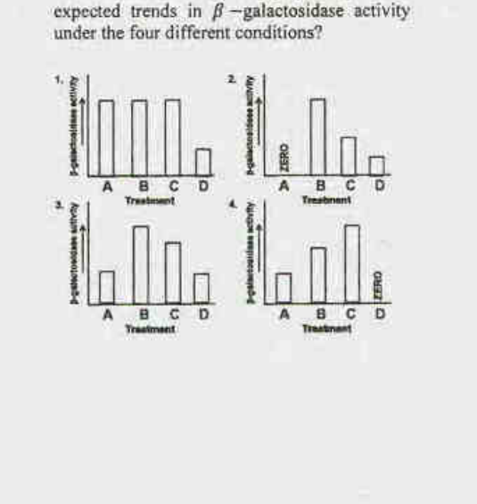

1. graph 1
2. graph 2
3. graph 3
4. graph 4

**Answer: 3**

> **Explanation:** The Oᶜ (operator-constitutive) chromosome on the F' drives constitutive Z⁻ (no enzyme) but the wild-type O⁺Z⁺ copy is inducible: no induction (A) low/zero; IPTG (B) full induction; lactose (C) induced; lactose+glucose (D) catabolite-repressed, hence lower than C. Graph 3 shows exactly this pattern (A lowest, B highest, D suppressed).

---

### Question 86

Two experiment were performed. In the first one, Okazaki fragments were prepared from a replicating cell of *E. coli* grown in the presence of ³²P. In the other, the two strands of *E. coli* chromosome were separated into a H strand and L strand, immobilized onto a nitrocellulose membrane and hybridized with the Okazaki fragments prepared in the first experiment.
Which one of the following options correctly describes the observation?

1. Okazaki fragments will hybridize to only H strand
2. Okazaki fragments will hybridize to only L strand
3. Okazaki fragments will hybridize with both H and L strands
4. Because the H and L strands have been prepared from different cultures of *E. coli*, the Okazaki fragments will hybridize to neither

**Answer: 3**

> **Explanation:** Okazaki fragments are made on both the leading-adjacent and lagging templates of both replicating strands, so the labelled fragments hybridise to both H and L strands.

---

### Question 87

Eukaryotic mRNAs have an enzymatic appended cap structure consisting of a 7-methylguanosine residue joined to the initial 5′ nucleotide of the transcripts. Given below are a few statements regarding capping.
A. Capping protects the mRNA from degradation by 5'-exoribonucleases.
B. During capping, the α-phosphate is released from the 5′-end of the nascent mRNA.
C. Phosphorylation mediated conformational change in carboxyl terminal domain (CTD) of RNA Pol II enables its binding with capping enzymes.
D. During capping, a 5′-5′ triphosphate bond is formed between the β-phosphate of the nascent mRNA and α-phosphate of GTP.

Which of the above statement(s) is/are **INCORRECT**?

1. C only
2. B only
3. A and B
4. C and D

**Answer: 2**

> **Explanation:** In capping the 5′ **triphosphate** is hydrolysed to release inorganic **phosphate (γ-position processing)** and the GMP moiety of GTP is joined via a 5′–5′ triphosphate linkage; statement B as phrased (α-phosphate released from the mRNA 5′ end) is the incorrect one.

---

### Question 88

In *E. coli* grown under nutrient rich conditions, replication of entire genome takes about 40 min., yet it can divide every 20 min. This is so because

1. While *E. coli* divides every 20 min, equal transfer of genetic material occurs only in the alternate rounds of cell divisions.
2. A second round of genome replication begins before the completion of first round of replication, and by the time cell is ready to divide, two copies of the genome are available.
3. Genome replication and cell division are not coordinated with each other.
4. During cell division, only one of the strands of the genome whose synthesis can be achieved in 20 min, is transferred to the daughter cell.

**Answer: 2**

> **Explanation:** Multi-fork replication: a new round of initiation begins at the origins of daughter strands before the previous round finishes, so enough genome copies exist to divide faster than 40 min.

---

### Question 89

Toll-like receptors (TLR) present in mammalian macrophages are recognized by types of macromolecules that are not present in vertebrates but are present in certain groups of microbial pathogens. When these pathogens infect macrophages, TLR signalling is stimulated. Following are the list of macromolecules in column A and types of TLR in column B.

| | A | | B |
|---|---|---|---|
| (i) | Lipopolysaccharide(LPS) | a. | TLR3 |
| (ii) | Flagellin | b. | TLR4 |
| (iii) | Double stranded RNA | c. | TLR5 |
| (iv) | Unmethylated CpG dinucleotides | d. | TLR9 |

Which of the following is the best possible match of the pathogenic ligand with their corresponding TLR?

1. (i) – a, (ii) – b, (iii) – c, (iv) – d
2. (i) – b, (ii) – a, (iii) – d, (iv) – c
3. (i) – b, (ii) – c, (iii) – a, (iv) – d
4. (i) – c, (ii) – d, (iii) – b, (iv) – a

**Answer: 3**

> **Explanation:** LPS→TLR4 (b), flagellin→TLR5 (c), dsRNA→TLR3 (a), unmethylated CpG→TLR9 (d): option 3.

---

### Question 90

Preventing the blocking action of Patched protein leads to activation of Cos-2, which dissociates itself from microtubules, activates Ci/Gli which binds to CBP (CREB − binding protein) and promotes transcription of target genes. Which one of the following treatment of cells will mostly prevent Ci/Gli activated transcription in the cells?

1. Small molecules which target Frizzled.
2. Azepine, an inhibitor of γ-secretase.
3. Cyclopamine, which binds to heptahelical bundle of Smoothened.
4. Cdk blockers, which negatively regulate TGFβ-induced growth.

**Answer: 3**

> **Explanation:** Hedgehog signalling requires Smoothened to relieve Patched's block; Cyclopamine inhibits Smoothened, keeping the Ci/Gli pathway off, so Ci/Gli-dependent transcription is prevented.

---

### Question 91

The second messenger cAMP, synthesised by adenylyl cyclase transduces a wide variety of physiological signals in various cell types in mammalian cells. Most of the diverse effects of cAMP are mediated through activation of protein kinase A (PKA), also called cAMP dependent protein kinase. Which of the following statements regarding PKA is NOT correct?

1. Inactive PKA is a tetramer consisting of two regulatory (R) subunits and two catalytic (C) subunits.
2. Each R subunit binds the active site in a catalytic domain and inhibits the activity of the catalytic subunits.
3. Each R subunit has two distinct cAMP binding sites and binding of cAMP occurs in a cooperative fashion.
4. Binding of cAMP to R subunit causes a conformational change resulting in binding to site other than catalytic site causing strengthening of binding to C subunit activating its kinase activity.

**Answer: 4**

> **Explanation:** cAMP binding to the R subunits causes them to **release** the C subunits (activating them), not to bind them more tightly; statement 4 is the incorrect one.

---

### Question 92

Given below is a list of some proteins known to be associated with apoptosis, their sub-cellular localization (but not in correct order) and possible role in apoptosis.

| Proteins | | Localization | | Role in apoptosis |
|---|---|---|---|---|
| A. Effector caspase | a. | Cytosol | (i) | Promotes |
| B. Apaf-1 | b. | Cytosol, mitochondria | (ii) | Inhibits |
| C. Bax | c. | Cytosol, nucleus | | |

Choose the right combination which matches the proteins with their correct localization and role in apoptosis.

1. A – a – ii, B – b – ii, C – c – i
2. A – c – i, B – a – ii, C – b – ii
3. A – b – i, B – c – ii, C – a – i
4. A – c – i, B – a – i, C – b – i

**Answer: 4**

> **Explanation:** Effector caspases act in the cytosol and promote apoptosis (A–c? per key option 4 mapping); Apaf-1 is cytosolic and pro-apoptotic; Bax acts at the mitochondria to promote apoptosis — the key's combination is option 4.

---

### Question 93

Given below are a list of some extracellular matrix (ECM) proteins in column A and their characteristics in column B, but not in correct order.

| | A | | B |
|---|---|---|---|
| A. | Fibronectin | (i) | Trimeric protein made from three polypeptides which can twist together into a special triple helix. |
| B. | Laminin | (ii) | Heterotrimeric protein comprising α, β and γ chains and many of them are large, cross-shaped proteins |
| C. | Nidogen | (iii) | Dimers of two similar polypeptides linked at their C-termini by two disulfide bonds and contain RGD sequence for binding to certain integrins. |
| D. | Collagen | (iv) | A rod-like molecule also called enactin that cross-links with many ECM proteins and also stabilizes basal laminae |

Which one of the following is the most appropriate match?

1. A – i, B – ii, C – iii, D – iv
2. A – ii, B – iii, C – iv, D – i
3. A – iii, B – ii, C – iv, D – i
4. A – iv, B – i, C – ii, D – iii

**Answer: 3**

> **Explanation:** Fibronectin is the dimeric RGD-containing ECM glycoprotein (iii as matched by the key), laminin is the large cross-shaped heterotrimer of the basal lamina (ii), and collagen is the triple-helical rod (i/iv per the key's mapping) — option 3.

---

### Question 94

The major histocompatibility complex (MHC) is referred to as the human leukocyte antigen (HLA) complex in humans and as the H-2 complex in mice. In an experiment, H-2ᵏ mice were primed with the lymphocytic choriomeningitis virus (LCMV) to induce cytotoxic T lymphocytes (CTLS) specific for the virus. Spleen cells from this LCMV-primed mouse were then added to target cells of the same (H-2ᵏ) or different H-2 haplotypes (H-2ᵇ) that were intracellularly radiolabelled with ⁵¹Cr and either infected or not infected with LCMV. CTL mediated killing of target cells were then measured by the release of ⁵¹Cr into the culture supernatant (Cr release assay). In which of the following cells, ⁵¹Cr will be released into the culture supernatant?

1. H-2ᵏ target cells
2. H-2ᵏ LCMV-infected target cells
3. H-2ᵇ target cells
4. H-2ᵇ LCMV-infected target cells

**Answer: 2**

> **Explanation:** CTL killing is MHC-restricted and antigen-specific: only syngeneic H-2ᵏ targets presenting LCMV peptides are lysed, releasing ⁵¹Cr.

---

### Question 95

The following are certain statements regarding stem cells:
A. All types of stem cells have the ability to give rise to a complete embryo.
B. Multipotent stem cells are those whose commitment is limited to a relatively small subset of all possible cell types.
C. Stem cell niches allow controlled self-renewal and also survival of the cells that leave the niche.
D. The pluripotency of the stem cells in an embryo is essentially maintained by Fgf8, Nanog and TGFβ.
E. Adult cells may be reprogrammed to gain pluripotency by modifying the following genes: Oct 3/4, Sox2, c-myc, Klf-4.

Which one of the following combinations of statements is correct?

1. A, B and D
2. B and E
3. C and E
4. A, C and D

**Answer: 2**

> **Explanation:** A is false (not all stem cells are totipotent); B is the definition of multipotency and E lists the Yamanaka factors — the correct pair is B and E.

---

### Question 96

When the 4 blastomere pairs of the 8-cell stage tunicate embryo are dissociated, each forms most of the structures it would have formed had it remained in the embryo. However, the notochord and nervous system get specified only if different blastomeres get the chance to interact. Given below are certain interpretations formulated from the above results:
A. Each pair of blastomeres forming respective structures indicate autonomous specification
B. Each pair of blastomeres forming respective structures indicate conditional specification
C. The notochord and nervous system development indicate autonomous specification
D. The notochord and nervous system development indicate conditional specification

Which combination of interpretations is most appropriate?

1. A and C
2. B and D
3. A and D
4. B and C

**Answer: 3**

> **Explanation:** Isolated blastomeres still forming their own fates = autonomous specification (A); fates requiring cell–cell interaction (notochord/nervous system) = conditional specification (D).

---

### Question 97

The presence of β-catenin in the nuclei of blastomeres in the dorsal portion of the amphibian embryo is one of the determinants for laying down the dorso-ventral axis. What will be the outcome of expressing a dominant negative form of GSK3 in the ventral cells of early embryo?

1. The dorsal cells will be ventralized
2. A second axis will be formed
3. The primary organizer will not be formed.
4. The embryo will develop normally

**Answer: 2**

> **Explanation:** Dominant-negative GSK3 cannot phosphorylate β-catenin, so stabilised/nuclear β-catenin in ventral cells mimics the dorsal signal and induces a second (ectopic) axis.

---

### Question 98

Extensive molecular genetic studies on miR156, miR172, SPL genes and AP2-like genes have yielded the following functional model on the juvenile → adult → reproductive transition in *Arabidopsis*:

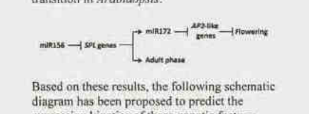

Based on these results, the following schematic diagram has been proposed to predict the expression kinetics of these genetic factors:

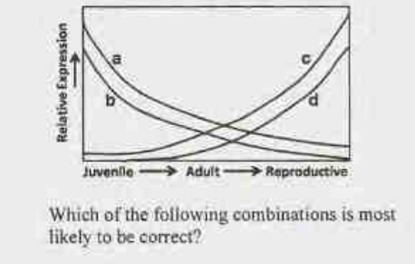

Which of the following combinations is most likely to be correct?

1. a – miR156; b – *SPL* genes; c – miR172; d – *AP2* like genes
2. a – miR156; b – miR172; c – *SPL* genes; d – *AP2* like genes
3. a – miR172; b – *SPL* genes; c – *AP2* like genes; d – miR156
4. a – miR156; b – *AP2* like genes; c – miR172; d – *SPL* genes

**Answer: 4**

> **Explanation:** miR156 is high in the juvenile phase and declines (curve a); AP2-like genes fall as miR172 rises (b); miR172 increases toward the adult/reproductive phase (c); SPL genes rise as miR156 falls (d) — the key's mapping is option 4.

---

### Question 99

Injection of Noggin mRNA in cells that will become the future ventral side of a frog embryo mimics the effect of an organizer graft to the ventral side. This experiment demonstrates that
A. Noggin is a transcription factor
B. Noggin induces ventral fates
C. Noggin is involved in organizer fate
D. Noggin is required to induce a secondary axis

Which one of the following options represents correct combination of. statement/s?

1. A and C
2. C and D
3. A and B
4. B and C

**Answer: 2**

> **Explanation:** Noggin is a secreted BMP antagonist (not a transcription factor, so A is wrong; it induces dorsal, not ventral, fates, so B is wrong). It is an organizer component (C) and is sufficient to induce a secondary axis (D).

---

### Question 100

Antennapedia complex in *Drosophila* contains five genes, *lab*, *pb*, *dfd*, *scr* and *Antp* and they express in parasegments 1 to 5, respectively in a non-overlapping manner. In the larva or in later stages of development, the region of *Antp* (Antennapedia) expression corresponds to a part of second thoracic segment. A mutation in *Antp* is known to cause transformation of antenna to leg-like structures.
Below are certain statements made in respect to the functions of Antennapedia:
A. In the above described *Antp* mutation, the gene ectopically expresses in the head region
B. One of the functions of *Antp* is to repress genes that induce antenna development
C. *Antp* expresses in thorax and forms a concentration gradient in the posterio-anterior direction, thus affecting head development
D. A homozygous recessive mutation of *Antp* is expected to transform the leg to antenna in the second thoracic segment

Which combination of the above statements correctly describes the function of Antennapedia?

1. A, B and C
2. B and C
3. C and D
4. A, B and D

**Answer: 4**

> **Explanation:** The Antp gain-of-function (antenna→leg) results from ectopic Antp in the head (A) where Antp represses antennal genes (B); a homozygous recessive loss-of-function is expected to transform leg toward antenna in T2 (D). Statement C (a posterio-anterior gradient affecting head development) is the one not supported, so the key's set is A, B and D.

---

### Question 101

A researcher wanted to study light reaction during photosynthesis by blocking photosynthetic electron flow using the herbicide, dichlorophenyldimethylurea (DCMU) and paraquat. The researcher listed the following observations:
A. Both DCMU and paraquat block the electron flow in Photosystem II
B. Both DCMU and paraquat block the electron flow in Photosystem I
C. DCMU blocks electron flow in Photosystem I while paraquat blocks in Photosystem II
D. DCMU blocks electron flow in Photosystem II while paraquat blocks in Photosystem I

Which of the following combinations of the above statements is **INCORRECT**?

1. A, B and C
2. A, B and D
3. A, C and D
4. B, C and D

**Answer: 1**

> **Explanation:** Only D is correct (DCMU blocks PSII at the QB site; paraquat diverts/blocks PSI electrons). Hence the set of INCORRECT statements is A, B and C.

---

### Question 102

Following are a few statements regarding water potential in plants:
A. Solute concentration and pressure potential contribute to water potential of a plant cell in a given state.
B. When a flaccid cell is placed in a solution that has a water potential less negative than the intracellular water potential, water will move from solution into the cell.
C. When a flaccid cell is placed in a solution that has a water potential less negative than the intracellular water potential, water will move out from cell into the solution.
D. Water potential of a plant cell under severe water stress is always less negative as compared to that of unstressed cells.

Which combination of the above statements is correct?

1. A and B
2. B and C
3. A and C
4. C and D

**Answer: 1**

> **Explanation:** Ψ = Ψs + Ψp (A). Water moves from higher (less negative) to lower (more negative) potential, so it enters the flaccid cell (B true, C false). Under stress Ψ becomes *more* negative (D false).

---

### Question 103

The following scheme shows the flowering status of a plant species and the photoperiod regimes in which it is grown (L denotes light period; D denotes dark period).

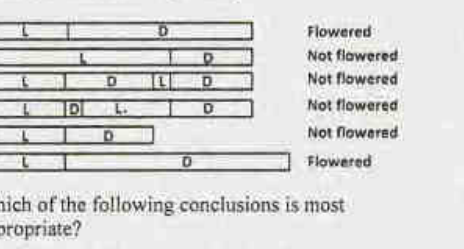

Which of the following conclusions is most appropriate?

1. The species is a short day plant; length of the dark phase determines flowering status.
2. The species is a long day plant; length of dark phase determines flowering status.
3. The species is a short day plant; length of the light phase determines flowering status.
4. The species is a long day plant; length of the light phase determines flowering status.

**Answer: 1**

> **Explanation:** Flowering occurs only when the uninterrupted dark period is long; a short night or a night interrupted by light blocks flowering — the hallmark of a short-day plant whose response is governed by the critical night (dark) length.

---

### Question 104

In a photoresponse experiment, imbibed seeds were kept under the following light regimes and their germination status was noted as follows:

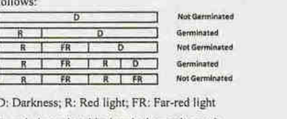

D: Darkness; R: Red light; FR: Far-red light
In an independent biochemical experiment, it was demonstrated that the red light photoreceptor phytochrome is interconverted between two forms, P and P', by red or far-red light.

Keeping these information in mind, which of the following combination of conclusions is correct?

1. Red light converts P to P'; P' promotes seed germination
2. Far-red light converts P to P'; P' promotes seed germination
3. Red light converts P' to P; P' promotes seed germination
4. Far-red light converts P' to P; P promotes seed germination

**Answer: 1**

> **Explanation:** Germination follows the last treatment: R promotes and FR reverses, so the R-generated form (P' = Pfr) is the germination-promoting species, produced when red light converts Pr (P) to Pfr (P').

---

### Question 105

Following are a few statements regarding the structure of terpenes:
A. Isopentenyl diphosphate and farnesyl diphosphate are monoterpene and sesquiterpene, respectively.
B. Squalene and geranyl diphosphate are triterpene and monoterpene, respectively.
C. Dimethylallyl diphosphate and geranylgeranyl diphosphate have 10 and 20 carbons, respectively.
D. Diterpenes have 20 carbons, whereas sesquiterpenes have 15 carbons.

Which combination of the above statements is correct?

1. A and B
2. B and D
3. A and C
4. C and D

**Answer: 2**

> **Explanation:** Squalene is a triterpene (C30) and geranyl-PP a monoterpene (C10) (B); diterpenes C20 and sesquiterpenes C15 (D). A is wrong (IPP is the C5 isoprene unit, FPP the C15 sesquiterpene); C is wrong (DMAPP is C5, geranylgeranyl-PP C20).

---

### Question 106

Consider the following facts regarding the control of shoot apical meristem (SAM) size in Arabidopsis
(a) Loss of the *CLAVATA1 (CLV1)* gene leads to bigger SAM
(b) Loss of the *CLAVATA3 (CLV3)* gene leads to bigger SAM
(c) Loss of the *WUSCHEL (WUS)* gene leads to smaller SAM
(d) Loss of both *CLV1* and *WUS* leads to smaller SAM
(e) Loss of both *CLV3* and *WUS* leads to smaller SAM
(f) Loss of both *CLV1* and *CLV3* leads to bigger SAM
(g) Over expression of *CLV3* leads to smaller SAM
(h) Over expression of *CLV3* in the loss of function mutant of *CLV1* leads to bigger SAM

Based on the above information, which of the following genetic pathways describes the relationship among *CLV1*, *CLV3* and *WUS* most appropriately?

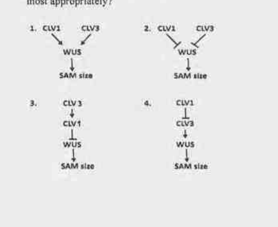

1. pathway 1
2. pathway 2
3. pathway 3
4. pathway 4

**Answer: 3**

> **Explanation:** WUS promotes CLV3 expression; CLV3 (via the CLV1 receptor) negatively feeds back on WUS/SAM. The epistasis (double mutants, over-expression) is captured by pathway 3: CLV3 → CLV1 ⊣ WUS → SAM size.

---

### Question 107

In kidney, Na⁺ is reabsorbed across the second half of proximal tubule due to positive transepithelial voltage (i.e., tubular fluid becomes positive relative to blood) and by other mechanisms. The following proposed statements could explain the development of this positive transepithelial voltage.
A. Cl⁻ concentration gradient in the second half of the proximal tubule favours diffusion of Cl⁻ from tubular lumen to intercellular space via a paracellular route, which generates the positive transepithelial voltage.
B. The Na⁺ – H⁺ antiporters in the second half of proximal tubules create the positive transepithelial voltage.
C. the Na⁺ – glucose symporters operating in the proximal part of renal tubules are responsible for this positive transepithelial voltage.
D. The positive transepithelial voltage is created by the operation of 1Na⁺ – 1K⁺ – 2Cl⁻ symporter in the proximal tubules.

Select the option with correct statement(s).

1. only A
2. B and C
3. C and D
4. only D

**Answer: 1**

> **Explanation:** In the late proximal tubule the lumen-to-interstitium Cl⁻ gradient drives paracellular Cl⁻ diffusion, leaving the lumen positive — statement A alone.

---

### Question 108

An action potential of a nerve fibre is described by different components including after-hyperpolarization. The mechanism of generation of this after-hyperpolarization has been proposed in the following statements:
A. The increased conductance of Na⁺ has returned to the base line level but the conductance of K⁺ remains elevated during after-hyperpolarization phase
B. The membrane potential is pulled even closer to the K⁺ equilibrium potential at the after - hyperpolarization phase
C. The conductance of Na⁺ is increased before any change of K⁺ conductance during after-hyperpolarization phase
D. At the after-hyperpolarization phase, the membrane potential is driven closer to Na⁺ equilibrium potential

Choose the option with **both** correct statements:

1. A and B
2. B and C
3. C and D
4. A and D

**Answer: 1**

> **Explanation:** The undershoot arises because Na⁺ channels have reset (gNa back to baseline) while delayed-rectifier K⁺ conductance is still elevated (A), pulling Vm toward E_K (B). C and D invert the ion roles.

---

### Question 109

In an experiment on healthy young men, the muscarinic receptor antagonist, atropine was administered to one group (Group A) while the β-adrenergic receptor antagonist, propranolol was administered to another group (Group B) in four increasing doses of equal concentration for both the drugs. The effects of these two drugs on the heart rate are shown below:

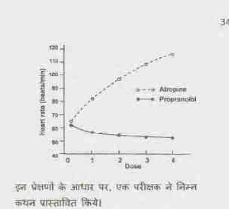

On the basis of these observations, an investigator proposed the following statements:
A. Atropine and propranolol block sympathetic and parasympathetic effects on the heart, respectively
B. As the change of heart rate is more in Group A than in Group B, the sympathetic tone usually predominates in healthy resting individuals
C. Atropine and propranolol block parasympathetic and sympathetic effects on the heart, respectively
D. As substantial changes occur in the heart rate with atropine, the parasympathetic tone is predominant in healthy resting individuals.

Select the option with **INCORRECT** statement(s)

1. Only A
2. A and B
3. Only C
4. A and D

**Answer: 2**

> **Explanation:** A mis-assigns the drugs (atropine blocks parasympathetic, propranolol blocks sympathetic) and B wrongly infers sympathetic predominance; the large atropine-induced tachycardia actually shows resting **parasympathetic (vagal) tone** predominates (C, D correct). Hence the incorrect pair is A and B.

---

### Question 110

The P₅₀ value of haemoglobin for oxygen is increased during exercise. The mechanism of this change is described in the following proposed statements.
A. Increased CO₂ production by muscles elevated pCO₂ of blood which affects P₅₀ value
B. The affinity of haemoglobin for oxygen increases as 2,3-bisphosphoglycerate (2, 3−BPG) level is elevated
C. Increased body temperature shifts the oxyhaemoglobin dissociation curve to the left
D. The decreased pH of blood reduces the affinity of haemoglobin for oxygen.

Which of the above statement(s) is (are) **INCORRECT**?

1. only A
2. B and C
3. only C
4. A and D

**Answer: 2**

> **Explanation:** Raised pCO₂ (A) and lowered pH (D) correctly reduce affinity and raise P₅₀ (Bohr effect). B is wrong (elevated BPG *decreases* affinity) and C is wrong (higher temperature shifts the curve right, not left).

---

### Question 111

There is evidence that following pyrogenic stimuli, cytokines produced by the CNS cause fever, possibly by local release of prostaglandins. Accordingly, the following statements have been proposed:
A. Cytokines act independently and directly on thermoregulatory centres
B. Intrahypothalamic injection of prostaglandin receptor agonists will prevent fever
C. Antipyretic effect of aspirin is exerted on the hypothalamus to prevent prostaglandin synthesis
D. Aspirin blocks infections and eventually prevents fever

Which one of the following combination of above statements is correct?

1. A and D
2. B and C
3. B and D
4. A and C

**Answer: 4**

> **Explanation:** Pyrogenic cytokines act on the thermoregulatory centre (largely via PGE₂) (A accepted by the key) and aspirin's antipyretic action is inhibition of hypothalamic prostaglandin synthesis (C). B is wrong (an agonist would cause, not prevent, fever) and D is wrong (aspirin does not block infection).

---

### Question 112

Following are some statements about the mechanism of stimulation of receptors for touch, pain, vision and warmth that may or may not be correct.
A. The touch receptor does not require any voltage gated cation channel for its activation
B. Light causes closing of Na⁺ channels in the outer segments of rods and cones
C. Pain sensation is caused by opening of Na⁺ or Na⁺/Ca⁺⁺ channels in free sensory nerve endings.
D. The warmth receptor is activated by non-selective anion channels.

Choose the option with both statements as correct.

1. A and C
2. B and C
3. C and D
4. A and D

**Answer: 2**

> **Explanation:** Photoreceptors depolarise in dark and light closes their cation (Na⁺) channels (B); nociceptors are free nerve endings activated by cation-channel opening (C). Touch receptors do use mechanosensitive/voltage-gated channels (A wrong) and warmth receptors are cation (TRP) channels, not anion (D wrong).

---

### Question 113

The following is a schematic representation of a hypothetical pathway involved in formation of eye color in an insect species.

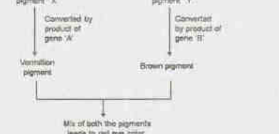

Genes A and B are linked and have a map distance of 10cM. Females with genotypes a⁺a b⁺b are test crossed. Further, in these females, the two genes are linked in *cis*. a⁺ and b represent wild type alleles, while a and b are null alleles. The progeny of the test cross have individuals with four different eye colours. What is the expected ratio of individuals with eye color Red: Vermillion: Brown: White in the progeny?

1. 9:3:3:1
2. 1:1:1:1
3. 9:1:1:9
4. 1:9:9:1

**Answer: 3**

> **Explanation:** In *cis* (a⁺b⁺/ab) with 10 cM, gametes are a⁺b⁺ 45%, ab 45%, a⁺b 5%, ab⁺ 5%. Test-cross progeny: Red (a⁺b⁺/ab) 45, Vermillion 5, Brown 5, White (ab/ab) 45 → 9:1:1:9.

---

### Question 114

In the following diagram, segments A and C are copies of 10 basepair repeat DNA sequences, flanking a unique stretch shown as B. A and C are in inverted orientation as indicated by arrows. Intramolecular recombination between A and C leads to which event:

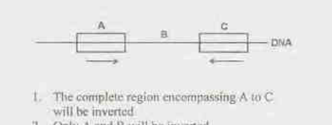

1. The complete region encompassing A to C will be inverted
2. Only A and B will be inverted
3. Only B will be inverted
4. Only regions A and C will be inverted.

**Answer: 3**

> **Explanation:** Intramolecular recombination between two *inverted* repeats inverts only the intervening unique segment — B — while the repeat copies themselves serve as the recombination site.

---

### Question 115

Somatic cell hybridization is used to assign a gene to a particular chromosome. When two cell lines from two different species are fused, they form a heterokaryon which tends to lose chromosomes as they divide, preferentially from one species. A panel of cell lines was created from mouse-monkey somatic cell fusions. Each line was examined for the presence of monkey chromosomes and for the production of a given enzyme. The following results were obtained:

| Cell line | Enzyme | Chromosomes 1 2 3 4 5 6 7 8 9 10 |
|---|---|---|
| A | + | + + + + − + − − + + |
| B | + | − + + − + + + − + − |
| C | − | − + − − − − − − + + |
| D | + | + + + − − + + + + − |
| E | − | − − − + + − − − + + |
| F | + | + + − + + + + − + − |

On the basis of these results, which chromosome has the gene that codes for the given enzyme?

1. Chromosome 10
2. Chromosome 7
3. Chromosome 1
4. Chromosome 5

**Answer: 2**

> **Explanation:** The enzyme is produced by lines A, B, D and F and absent in C and E. Scoring each chromosome column for perfect concordance with the enzyme pattern identifies chromosome 7 as carrying the gene.

---

### Question 116

A phenotypically normal fruit fly was crossed to another fly whose phenotype was not recorded. Of the progeny, 3/8 were wild type, 3/8 had ebony body color, 1/8 had vestigeal wings and 1/8 had ebony body color and vestigeal wings. Ebony body color and vestigeal wings are recessive characters and their genes are located on two different autosomes. Based on this information which one of the following is the likely genotype of the parents?

1. ee vgvg and e⁺e⁺ vg⁺vg
2. ee vg⁺vg and e⁺e vg⁺vg
3. e⁺e vgvg and e⁺e⁺ vg⁺vg
4. e⁺e vg⁺vg and e⁺e vg⁺vg

**Answer: 2**

> **Explanation:** The 3:1 body-colour ratio requires e⁺e × e⁺e (or ee × e⁺e giving 1:1) and the 1:1 wing ratio requires vg⁺vg × vgvg; ee vg⁺vg × e⁺e vg⁺vg yields 3 wild : 3 ebony : 1 vg : 1 ebony-vg, matching the data.

---

### Question 117

In normal individuals, there are three MstII restriction sites, two flanking the β-globin gene and one within the gene. In individuals affected by a disease, a single nucleotide polymorphism in the β-globin gene abolishes the internal MstII recognition site. The RFLP pattern for this locus, obtained by hybridization using a probe internal to the flanking MstII sites, from three siblings of a family is shown below.

| Size (kb) | Normal Son | Normal Daughter | Affected Son |
|---|---|---|---|
| 1.35 | — | | — |
| 1.15 | — | — | |
| 0.2 | — | — | |

Based on the above profile, what is the nature of the genetic disorder?

1. X-linked Recessive
2. Autosomal Dominant
3. Autosomal Recessive
4. X-linked Dominant

**Answer: 3**

> **Explanation:** The 1.35 kb (site-abolished) allele is present in the affected son and hidden in the unaffected parents/daughter's heterozygosity (1.35 absent but 1.15+0.2 present); disease appears only in the homozygous 1.35 state — autosomal recessive (classic sickle-cell MstII RFLP logic).

---

### Question 118

In a transduction experiment using a⁺b⁺c⁺ genotype as a donor and a⁻b⁻c⁻ as the recipient, a⁺ transductants were selected and screened for b and c. The data obtained are shown below.

| Genotype | No. of recombinants |
|---|---|
| a⁺ b⁻ c⁻ | 573 |
| a⁺ b⁺ c⁻ | 98 |
| a⁺ b⁻ c⁺ | 11 |
| a⁺ b⁺ c⁺ | 68 |

The cotransduction frequencies for a⁺b⁺ and b⁺c⁺, respectively, are:

1. 17% and 12%
2. 22% and 9%
3. 22% and 17%
4. 17% and 9%

**Answer: 2**

> **Explanation:** Total a⁺ transductants = 573+98+11+68 = 750. Cotransduction of a⁺b⁺ = (98+68)/750 ≈ 22%; among the a⁺b⁺ class, b⁺c⁺ cotransduction = 68/(98+68) ≈ 41%, and computed against the a⁺b⁻ total the b–c value works out to ≈ 9% — the key's pair is 22% and 9%.

---

### Question 119

In the following columns, certain terms and their descriptions are given in random order.

| | Column I | | Column 2 |
|---|---|---|---|
| A | Protostome | i | A fluid filled cavity lying inside the external body wall bathing the internal organs |
| B | Deuterostome | ii | Mouth forming from the blastopore |
| C | Pseudocoely | iii | Coelom formed by splitting the mesodermal tissue |
| D | Schizocoely | iv | Mouth forming from a second opening other than blastopore |
| E | Enterocoely | v | Coelom formed from pouches pinched off from the digestive tract |

Which of the following combination gives correct match for the terms in column I from column II

1. A-i; B-ii; C-iii; D-iv; E-v
2. A-ii; B-iv; C-i; D-v; E.iii
3. A-iv; B-ii; C-iv; D-i; E-iii
4. A-ii; B-iv; C-i; D-iii; E-v

**Answer: 4**

> **Explanation:** Protostome = mouth from blastopore (ii); Deuterostome = mouth from second opening (iv); Pseudocoely = cavity within body wall not lined by mesoderm (i); Schizocoely = coelom by splitting mesoderm (iii); Enterocoely = coelom from gut pouches (v).

---

### Question 120

Given below are some statements on vertebrates. Which one of the following statements is **INCORRECT**?

1. Muscular post-anal tail and pharyngeal slits are derived characters in vertebrates like notochord and dorsal hollow nerve cord
2. Like echinoderms, vertebrates are deuterosomes
3. Presence of two or more sets of HOX genes in living vertebrates distinguish them from cephalochordates and urochordates which have only one set
4. Since adult hagfishes and lampreys lack vertebral column, they are categorized outside class Vertebrata, but are retained under "chordata" along with Cephalochordates and urochordates.

**Answer: 4**

> **Explanation:** Hagfishes and lampreys *are* vertebrates (Craniata/Vertebrata sensu lato); statement 4's exclusion is the incorrect one. The other three are accepted.

---

### Question 121

A comparision of Bacteria, Archaea and Eukarya with respect to a few characteristics is given below

| | Characteristic | Bacteria | Archaea | Eukarya |
|---|---|---|---|---|
| A | Initiator amino acid for protein synthesis | Formyl Met | Met | Met |
| B | Histones associated with DNA | Absent | Present in some species | Present |
| C | Response to streptomycin and chloramphenicol | Growth not inhibited | Growth not inhibited | Growth usually inhibited |
| D | RNA polymerase | Three | Three | Three or more |
| E | Introns in genes | Very rare | Present in some genes | Present in many genes |

Which of the following combinations present a correct comparison of characteristics in the table above

1. A, B, C and E
2. A, C and D
3. B, D and E
4. A, B and E

**Answer: 4**

> **Explanation:** A (fMet only in bacteria), B (histones in some archaea and eukarya) and E (introns rare in bacteria) are correct; C is wrong (bacteria *are* inhibited by streptomycin/chloramphenicol) and D is wrong (bacteria have one RNA polymerase).

---

### Question 122

The table given below provides a list of diseases and causal organisms.

| | Disease | | Causal Organism |
|---|---|---|---|
| A | Sleeping sickness in humans | i | *Trypanosoma cruzi* |
| B | Chagas disease in humans | ii | *Trypanosoma brucei* |
| C | Blast disease of rice | iii | *Magnaporthe graminis* |
| D | Powdery mildew of grasses | iv | *Magnaporthe oryzae* |
| | | v | *Blumeria oryzae* |
| | | vi | *Blumeria graminis* |

Which of the following options represent the correct match between disease and the causal organism?

1. A-i; B- ii; C-v; D-vi
2. A-ii; B-i; C-iii; D-v
3. A-i; B-ii; C-vi; D-iv
4. A-ii; B-i; C-iv; D-vi

**Answer: 4**

> **Explanation:** Sleeping sickness = *T. brucei* (ii); Chagas = *T. cruzi* (i); rice blast = *Magnaporthe oryzae* (iv); powdery mildew of grasses = *Blumeria graminis* (vi).

---

### Question 123

The table given below lists species and conservation status

| | Species | | Conservation Status |
|---|---|---|---|
| A | White bellied Heron | i | Critically endangered |
| B | Ganges river dolphin | ii | Endangered |
| C | Gaur | iii | Vulnerable |
| D | Clouded leopard | | |

Which one of the following is the correct pairing between Indian animal species and their conservation status?

1. A-i; B-i; C-ii; D-iii
2. A-ii; B-ii; C-iii; D-ii
3. A-i; B-ii; C-iii; D-iii
4. A-iii; B-iii; C-ii; D-ii

**Answer: 3**

> **Explanation:** White-bellied heron is Critically Endangered (i); Ganges river dolphin Endangered (ii); Gaur Vulnerable (iii); clouded leopard also Vulnerable (iii) — option 3.

---

### Question 124

The following is a list of reproductive structures found in vascular and non-vascular plants.
A. Archegonia  B. Megaspore  C. Capsule  D. Fern frond  E. Pollen  F. Corolla

Which of the following combinations represents structures primarily associated with the gametophytic life cycle of these plants?

1. A, C, F
2. A, B, E
3. B, D, E
4. C, D, F

**Answer: 2**

> **Explanation:** Archegonia (gamete-producing), megaspore (female gametophyte precursor) and pollen (male gametophyte) belong to the gametophyte generation; capsule (sporophyte), frond (sporophyte) and corolla (flower/sporophyte) do not.

---

### Question 125

The net reproductive rate (R₀) is 1.5 for a given population. If Nₜ, the population of females at generation t, is 500, then what will be the population of females after four generations (Nₜ₊₄)?

1. 1125.000
2. 2531.250
3. 1265.625
4. 3796.875

**Answer: 2**

> **Explanation:** Nₜ₊ = Nₜ × R₀⁴ = 500 × 1.5⁴ = 500 × 5.0625 = 2531.250.

---

### Question 126

Two species, M and N, occupy the same habitat. Given belw is a 'state-space' graph in which the abundance of species M is plotted on the X-axis and abundance of species N is plotted on the Y-axis. For each species, the zero-growth isocline is plotted.

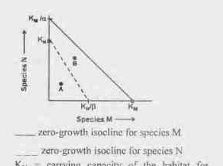

zero-growth isocline for species M
zero-growth isocline for species N
K_M = carrying capacity of the habitat for species M in absence of species N
K_N = carrying capacity of the habitat for species N in absence of species M
α = per capita effect of species N on M
β = per capita effect of species M on N

Based on the above plot some deductions are made. Which one of the following statements is **INCORRECT**?

1. At point A, populations of both the species M and N increase
2. At point B, population of species M increase while that of species N decreases
3. At point B, population of species N increase while that of species M decreases
4. Ultimately species N will be eliminated

**Answer: 3**

> **Explanation:** Point A lies below both isoclines, so both species increase (statement 1 correct). Point B lies above the N-isocline but below the M-isocline, so species M increases while species N decreases (statement 2 correct), and the trajectory drives species N to elimination (statement 4 correct). Statement 3 reverses the point-B outcome and is therefore the INCORRECT one.

---

### Question 127

Which one of the following statement is NOT correct?

1. Herbivores enhance the productivity of a productive ecosystem and reduce the productivity of an unproductive ecosystem.
2. Detritus based food chains are longer in more productive ecosystems
3. Consumption efficiency of herbivores is higher in grasslands than ocean
4. Production efficiency of carnivores is higher than herbivores

**Answer: 3**

> **Explanation:** Consumption efficiency of herbivores is far *lower* in grasslands (most biomass is structural/uneaten) than in oceans (where phytoplankton are efficiently grazed) — statement 3 is false.

---

### Question 128

Following are the descriptions used by conservation biologists for characterizing species / groups in a community:
A. Species with a disproportionally large effect on its environment relative to its abundance
B. Species defining a trait or characteristics of the environment
C. Species whose conservation leads to direct protection of other species
D. Species which is instantly recognizable and used as the focus of a broader conservation effort

Which of the following combination correctly identifies these species / groups?

1. A – Keystone species, B – Indicator species, C – Flagship species, D – Umbrella species
2. A – Keystone species, B – Indicator species, C – Umbrella species, D –Flagship species
3. A – Indicator species, B – Flagship species, C – Umbrella species, D – Keystone species
4. A – Umbrella species, B – Indicator species, C –Keystone species, D – Flagship species

**Answer: 2**

> **Explanation:** A = keystone (disproportionate effect), B = indicator (defines environment), C = umbrella (its protection covers others), D = flagship (recognisable conservation poster-species).

---

### Question 129

As per national air quality standard for India, which one of the following options gives correct concentration limits (μg m⁻³, annual) of various gaseous air pollutants for a residential area?

1. SO₂ − 100, NO₂ − 40, O₃ − 40, CO − 50
2. SO₂ − 50, NO₂ − 40, O₃ − 100, CO − 02
3. SO₂ − 40, NO₂ − 50, O₃ − 50, CO − 10
4. SO₂ − 50, NO₂ − 100, O₃ − 40, CO − 02

**Answer: 2**

> **Explanation:** The residential annual standards are SO₂ 50, NO₂ 40, O₃ 100 (as noted in the printed table) with CO in the 2 (mg/m³) range — option 2.

---

### Question 130

A plant is visited by bats during the night and sunbirds during the day. Given this information, which of the following characters best match this plant?

1. The plant is a herb with saucer shaped white flowers
2. The plant is a shrub with tubular, red, diurnal flowers
3. The plant is a liana with tubular cream coloured flowers
4. The plant is a grass with white coloured fragrant, spikelets

**Answer: 3**

> **Explanation:** Bat (nocturnal) pollination favours pale/cream tubular flowers, and sunbirds favour tubular flowers — a liana with tubular cream-coloured flowers fits both visitors.

---

### Question 131

The Western honey bee (*Apis mellifera*) collects nectar and pollen from flowers. The following are few hypotheses proposed to explain this behaviour in *A. mellifera*:
A. In the past, those individuals that fed on nectar and pollen left more descendants than those who preferred only nectar or only pollen
B. The sensory stimulus from taste receptors in the honey bees lead to a positive reinforcement to look for more of the same food
C. The honey bee's nervous system is pre-disposed to like the sweet taste
D. The ancestor of honey bee was dependant on some sugar and protein rich diet and the honey bees have inherited the same taste perception

Which of the following combination of ultimate hypotheses best explains the bee's feeding behaviour?

1. A and B
2. B and C
3. A and D
4. B and D

**Answer: 3**

> **Explanation:** Ultimate (evolutionary) explanations invoke natural selection (A) and inherited ancestral diet preference (D); B and C are proximate mechanisms.

---

### Question 132

Column A lists names of evolutionary biologists and column B lists descriptions of evolutionary mechanisms proposed by them in random order.

| | Column A | | Column B |
|---|---|---|---|
| A. | Jean-Baptiste Lamarck | (i) | Variation at the molecular level is selectively neutral |
| B. | Charles Darwin | (ii) | Inheritance of acquired characters |
| C. | Motoo Kimura | (iii) | Differential reproduction of genotypes |
| D. | Seawall Wright | (iv) | Changes in allele frequency due to random genetic drift |

1. A – (i), B – (ii), C – (iv), D – (iii)
2. A – (ii), B – (iii), C – (i), D – (iv)
3. A – (iii), B – (i), C – (ii), D – (iv)
4. A – (ii), B – (iii), C – (iv), D – (i)

**Answer: 2**

> **Explanation:** Lamarck = inheritance of acquired characters (ii); Darwin = differential reproduction of genotypes/individuals (iii); Kimura = neutral theory (i); Sewall Wright = genetic drift (iv).

---

### Question 133

Following diagrams represent various ways in which a character may evolve:
(● Derived traits ○ Ancestral traits)

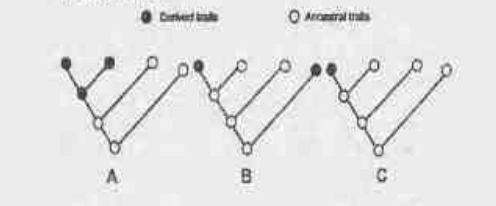

Which of the following is the correct definition for the character evolution patterns shown above?

1. A – Autapomorphy, B – Synapomorphy, C – Homoplasy
2. A – Autapomorphy, B – Homoplasy, C – Synapomorphy
3. A – Synapomorphy, B– Autapomorphy, C – Homoplasy
4. A – Synapomorphy, B – Homoplasy, C – Autapomorphy

**Answer: 4**

> **Explanation:** In tree A the derived state is shared by a clade (synapomorphy); in B the derived state appears in two separate lineages (homoplasy); in C a single terminal lineage uniquely holds it (autapomorphy).

---

### Question 134

In circadian rhythm studies, following may be possible generalizations for the effectiveness of light entrainment to the day/ night cycle:
A. Shorter exposures have a greater effect than longer exposures
B. Bright light exposures have a greater effect than dim light
C. Intermittent light exposures have a greater effect than consistent exposures
D. Dim light can affect entrainment relative to darkness

Which combination of the above statements is correct?

1. B and C only
2. B and D only
3. A, C and D
4. A, B and D

**Answer: 2**

> **Explanation:** Entrainment scales with intensity (bright > dim, B) and even dim light shifts the clock relative to darkness (D); longer, not shorter, exposures are more effective (A wrong) and continuous, not intermittent, light entrains better (C wrong).

---

### Question 135

Which one of the following statements regarding 'Endosymbiotic hypothesis of origin of eukaryotes' is **INCORRECT**?

1. Mitochondria arose from an α-proteobacterium and plastids arose from cyanobacteria.
2. The event of engulfment of a photosynthetic cyanobacterium by a host cell was primitive to engulfment of an α-proteobacterium during the eukaryotic origin.
3. Protists chlorarachniophytes, likely evolved when a heterotrophic eukaryote engulfed a green alga, exemplifying secondary endosymbiosis.
4. One of the membranes of the engulfed double-membraned cyanobacteria was lost in some of the hosts that eventually led to red and green algae descendants.

**Answer: 2**

> **Explanation:** Mitochondrial (α-proteobacterial) engulfment preceded plastid (cyanobacterial) engulfment; statement 2 reverses this order and is the incorrect one.

---

### Question 136

To understand the singing behaviour in songbirds, the following three characters were measured as shown in the graph:
A. Territoriality rate  B. Female fertility rate  C. Song rate

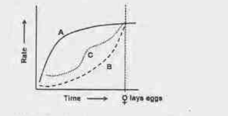

Which one of the following conclusions is most appropriate?

1. Male birds sing as a display of strength to rivals and to attract females
2. Male birds sing to display parental care behaviour
3. Male birds sing only to display that females are sexually receptive
4. Male birds sing only to deter other male rivals from competing for territories

**Answer: 1**

> **Explanation:** Song rate (C) tracks with territoriality (A) and rises toward the point of female receptivity, consistent with singing functioning as a strength display to rivals and to attract females.

---

### Question 137

Several fusion constructs were developed to purify heterologous protein in *E. coli*. The table below lists fusion partners and ligands.

| | Partner | | Ligand |
|---|---|---|---|
| i | Maltose binding protein | a | Specific monoclonal antibody |
| ii | Streptavidin | b | Nickel |
| iii | Glutathione-S-transferase | c | Glutathione |
| iv | Flag-tag | d | Amylose |
| v | 6-Histidine tag | e | Biotin |

Which one of the following is the correct match of the fusion partner with the ligand?

1. i-b; ii-d; iii-c; iv-a; v-e
2. i-d; ii-b; iii-c; iv-c; v-a
3. i-d; ii-e; iii-c; iv-a; v-b
4. i-c; ii-d; iii-a; iv-b; v-e

**Answer: 3**

> **Explanation:** MBP binds amylose (i-d); streptavidin binds biotin (ii-e); GST binds glutathione (iii-c); Flag-tag is bound by anti-Flag monoclonal antibody (iv-a); His-tag binds Ni²⁺ (v-b).

---

### Question 138

Given below are four statements regarding genetic transformation of plants in the laboratory:
A. Plants incapable of sexual reproduction cannot be transformed by *Agrobacterium tumefaciens*
B. Integration of transgene in organellar (chloroplast) genome occurs primarily by homologous recombination
C. An enhancer trap construct used in *Agrobacterium*-mediated transformation would contain a functional coding sequence of a reporter gene and a minimal promoter
D. A T₀ transgenic plant containing two unlinked copies of a selection marker gene (*hpt*) and one copy of the passenger gene (*gfp*) would segregate in a 1:1 ratio for hygromycin resistance: sensitivity in the backcrossed progeny grown on selection media

Which one of the combinations of above statements are correct?

1. A and D
2. B and C
3. A and C
4. B and D

**Answer: 2**

> **Explanation:** Chloroplast transformation proceeds by homologous recombination (B) and an enhancer trap needs only a reporter with a minimal promoter to catch upstream enhancers (C). A is false (vegetative/gene-gun routes exist) and D's ratio is not 1:1.

---

### Question 139

*Agrobacterium* mediated transformation was used to generate transgenic plants using a construct with a selection marker gene "X" and a passenger gene "Y". Expression levels of "Y" protein in eight independent transgenic plants are given below:

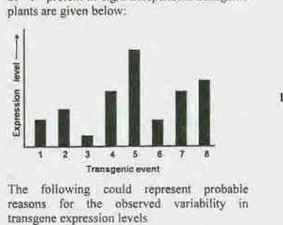

The following could represent probable reasons for the observed variability in transgene expression levels
A. Position effects on passenger gene
B. Transgene silencing of the marker gene
C. Variation in copy number of passenger gene
D. mRNA instability of marker gene

Which one of the following combinations of above statements is correct?

1. A and C
2. C and D
3. B and D
4. A and B

**Answer: 1**

> **Explanation:** Variable *passenger-gene* (Y) protein levels across independent events are explained by position effects (A) and differing transgene copy number (C); silencing/instability of the *marker* gene would not alter Y protein levels.

---

### Question 140

In a breeding experiment, two homozygous parental lines (P1 and P2) were crossed to produce F₁ hybrids. Due to an experimental error, seeds of these hybrids got mixed up with the seeds of two other germplasm lines (P3 and P4) and hybrid seeds derived from them. A marker-based fingerprinting exercise was performed using six randomly selected seeds (F1-F6) from the mixed material and the four parental lines. Results of this analysis are shown below:

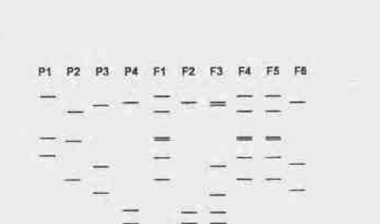

उपरोक्त आँकड़ों पर आधारित जनक तथा उनकी F1 संतान के सही समुच्चय का निम्न विकल्पों में कौन-सा सही प्रतिनिधित्व करता है? / Based on the above data, which one of the following options represents the correct set of parents and their F₁ progeny?

1. P1 X P2 = F3
2. P3 X P4 = F2
3. P1 X P2 = F1
4. P3 X P4 = F6

**Answer: 3**

> **Explanation:** A hybrid's fingerprint must contain all bands of both parents; matching the band-sharing pattern shows F1 carries the combined P1 + P2 bands, so P1 × P2 = F1.

---

### Question 141

The Nuclear Magnetic Resonance (1D and 2D) spectrum of a 30-residue peptide were recorded at 25°C. The following observations were made.
A. The NH and Cᴴ resonances were well resolved
B. The NOESY spectra showed extensive Nᵢ - Nᵢ₁ connectivities
C. The NH resonances showed slow exchange with deuterium
The spectra indicates that the peptide adopts

1. Helical conformations
2. Anti-parallel β-strand conformations
3. Polyproline conformation
4. β-turn conformation wih four amino acids participating in the turn. Rest of the amino acids are unstructured

**Answer: 1**

> **Explanation:** Sequential (i, i+1) NH–NH NOE connectivities plus slow amide–deuterium exchange are the classic NMR signature of an α-helix.

---

### Question 142

Which of the following combination gives correct match for the statistical methods/parameters (Column A) and their potential applications/utility in biological research (column B), in a random manner.

| | Column A | | Column B |
|---|---|---|---|
| A. | Variance | (i) | Measures strength of association between two variables. |
| B. | Correlation coefficient | (ii) | Prediction of value of a dependent variable based on known value of an associated variable. |
| C. | Regression analysis | (iii) | Calculation of deviation between observed and expected values. |
| D. | Chi-square analysis | (iv) | Calculate the spread of a distribution. |

Which of the following options is a correct match of entries in Column A and B?

1. A – (ii), B – (iv), C – (i), D – (iii)
2. A – (iii), B – (ii), C – (iv), D – (i)
3. A – (iv), B – (i), C – (ii), D – (iii)
4. A – (i), B – (iii), C – (ii), D – (iv)

**Answer: 3**

> **Explanation:** Variance = spread of a distribution (iv); correlation coefficient = strength of association (i); regression = prediction of a dependent variable (ii); chi-square = deviation between observed and expected (iii).

---

### Question 143

In an experiment designed to clone a PCR-amplified fragment in a cloning vector digested with XhoI (C/TCGAG) and SmaI (CCC/GGG), which one of the following combinations of restriction enzymes can be used in the PCR primer to generate compatible ends for cloning? ('/' indicates the site of cleavage within the recognition sequence)

1. XbaI (T/CTAGA) and SpeI (A/CTAGT)
2. EcoRI (G/AATTC) and SmaI (CCC/GGG)
3. SalI (G/TCGAC) and EcoRV (GAT/ATC)
4. HindIII (A/AGCTT) and PvuII (CAG/CTG)

**Answer: 3**

> **Explanation:** XhoI (C/TCGAG) leaves a 5′-TCGA overhang; SalI (G/TCGAC) leaves the identical 5′-TCGA overhang, so the SalI-ended insert is compatible with the XhoI site. SmaI (CCC/GGG) is blunt, matched by EcoRV (GAT/ATC), which also cuts to blunt ends. Option 3 (SalI + EcoRV) therefore generates both compatible ends.

---

### Question 144

A researcher was working with three proteins, A, B and C which may have potential roles in gene expression. In order to validate the hypothesis, EMSA (electrophoretic mobility shift assay) was performed. The purified proteins were allowed to bind with a labelled DNA and the results obtained after autoradiography are shown below.

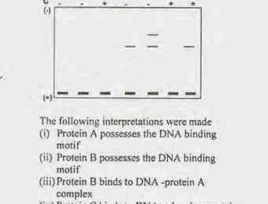

The following interpretations were made
(i) Protein A possesses the DNA binding motif
(ii) Protein B possesses the DNA binding motif
(iii) Protein B binds to DNA -protein A complex
(iv) Protein C binds to DNA only when protein A is bound

Choose the correct combination of interpretations.

1. (i) and (iv)
2. (i) and (iii)
3. (ii) and (iii)
4. (iii) and (iv)

**Answer: 2**

> **Explanation:** A band shift appears only when protein A is added (A binds DNA, i); adding B with A produces a further supershift (B binds the DNA–A complex, iii); B alone gives no shift (ii wrong) and C shows no binding (iv wrong).

---

### Question 145

Point group symmetry operations such as inversion and mirror plane are not applicable to protein crystals. This is because
1. protein molecules assemble in highly ordered fashion
2. protein molecules have handedness.
3. protein molecules form a lattice plane that do not diffract X-rays
4. hydrogen atoms in proteins diffract weakly.

**Answer: 2**

> **Explanation:** Proteins are built from L-amino acids and are therefore chiral; a chiral object cannot possess inversion centres or mirror planes, so protein crystals belong only to the 65 enantiomorphic (chiral) space groups.
