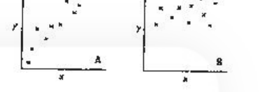
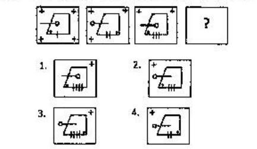
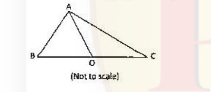

# CSIR NET Life Science — December 2018 — Part A

Global numbering: Part A = Q1–20. Answers are taken from the **official CSIR-HRDG FINAL Answer Key, LIFE SCIENCES – SET-A (BILINGUAL & ENGLISH), held 16-12-2018**. Question and option text transcribed verbatim from the scanned paper (booklet code A / 2018 (II)).

---

### Question 1

A rectangular photo frame of size 30 cm × 40 cm has a photograph mounted at the centre leaving a 5 cm border all around. The area of the border is

1. 600 cm²
2. 350 cm²
3. 400 cm²
4. 700 cm²

**Answer: 1 (600 cm²)**

> **Explanation:** Frame area = 30 × 40 = 1200 cm². The photograph is inset by a 5 cm border on every side, so its dimensions are (30 − 10) × (40 − 10) = 20 × 30 = 600 cm². Border area = 1200 − 600 = **600 cm²**.

---

### Question 2

At a birthday party, every child gets 2 chocolates, every mother gets 1 chocolate, while no father gets a chocolate. In total 69 persons get 70 chocolates. If the number of children is half of the number of mothers and fathers put together, then how many fathers are there?

1. 22
2. 23
3. 24
4. 69

**Answer: 1 (22)**

> **Explanation:** Let children = c, mothers = m, fathers = f. Then c + m + f = 69 and 2c + m = 70, with c = (m + f)/2. Put m + f = x, so c = x/2 and 1.5x = 69 → x = 46, c = 23. From 2c + m = 70 → 46 + m = 70 → m = 24, hence f = 46 − 24 = **22**.

---

### Question 3

What is the value of 1² − 2² + 3² − 4² + 5² −…+ 17² − 18² + 19²?

1. −5
2. 12
3. 95
4. 190

**Answer: 4 (190)**

> **Explanation:** Group as (1² − 2²) + (3² − 4²) + … + (17² − 18²) + 19². Each pair n² − (n+1)² = −(2n+1) for n = 1,3,…,17 gives −(3+7+11+…+35) = −171. Adding 19² = 361 → 361 − 171 = **190**.

---

### Question 4

The curves of y = 2x² and y = 4x intersect each other at

1. only one point.
2. exactly two points.
3. more than two points.
4. no point at all.

**Answer: 2 (exactly two points.)**

> **Explanation:** 2x² = 4x → 2x(x − 2) = 0 → x = 0 or x = 2, giving the two points (0,0) and (2,8). Hence **exactly two points**.

---

### Question 5

The diameters of the pinholes of two otherwise identical cameras A and B are 500 μm and 200 μm, respectively. Then the image in camera A will be

1. sharper than in B
2. darker than in B
3. less sharp and brighter than in B
4. sharper and brighter than in B

**Answer: 3 (less sharp and brighter than in B)**

> **Explanation:** A larger pinhole admits more light (brighter image) but produces a larger circle of confusion, reducing sharpness. Camera A (500 μm) is therefore **less sharp and brighter** than camera B (200 μm).

---

### Question 6

If D = ABC + BCA + CAB where A, B and C are decimal digits, then D is divisible by

1. 37 and 29
2. 37 but not 29
3. 29 but not 37
4. neither 29 nor 37

**Answer: 2 (37 but not 29)**

> **Explanation:** ABC + BCA + CAB = (100A+10B+C)+(100B+10C+A)+(100C+10A+B) = 111(A+B+C) = 3 × 37 × (A+B+C). Thus D is always divisible by **37**, but not necessarily by 29.

---

### Question 7

For the following set of observed values {60, 65, 65, 70, 70, 70, 70, 82, 85, 90, 95, 95, 100, 160, 160}, which of the statements is true?

1. mode < median < mean
2. mode < mean < median
3. mean < median < mode
4. median < mode < mean

**Answer: 1 (mode < median < mean)**

> **Explanation:** Mode = 70 (occurs 4 times). Median (8th of 15 ordered values) = 82. Mean = 1337/15 ≈ 89.1. Hence **mode < median < mean**.

---

### Question 8

A circular running track has six lanes, each 1 m wide. How far ahead (in metres) should the runner in the outermost lane start from, so as to cover the same distance in one lap as the runner in the innermost lane?

1. 6 π
2. 10 π
3. 12 π
4. 36 π

**Answer: 2 (10 π)**

> **Explanation:** The outermost lane centre is 5 lane-widths (5 m) outside the innermost lane centre. The extra circumference per lap = 2π × 5 = **10π** m.

---

### Question 9

In an examination 100 questions of 1 mark each are given. After the examination, 20 questions are deleted from evaluation, leaving 80 questions with a total of 100 marks. Student A had answered 4 of the deleted questions correctly and got 40 marks, whereas student B had answered 10 of the deleted questions correctly and got 35 marks. In this situation

1. A and B were equally benefitted.
2. A and B lost equally.
3. B lost more than A.
4. A lost more than B.

**Answer: 3 (B lost more than A.)**

> **Explanation:** Each retained question is now worth 100/80 = 1.25 marks. A's 40 marks = 32 correct among the 80, plus 4 correct deleted (total 36 correct → 36 marks if unmodified, but scored 40): A gained. B's 35 marks = 28 correct among the 80, plus 10 correct deleted (total 38 correct → 38 marks if unmodified, scored 35): B lost. Net effect: **B lost more than A**.

---

### Question 10

A tourist drives 20 km towards east, turns right and drives 6 km, then drives 6 km towards west. He then turns to his left and drives 4 km and finally turns right and drives 14 km. Where is he from his starting point?

1. 6 km towards east
2. 20 km towards west
3. 14 km towards north
4. 10 km towards south

**Answer: 4 (10 km towards south)**

> **Explanation:** Taking east = +x, north = +y: (0,0) → +20E → (20,0); right (south) 6 → (20,−6); 6 west → (14,−6); left (south) 4 → (14,−10); right (west) 14 → (0,−10). Final position is **10 km south** of the start.

---

### Question 11

If 'SELDON' means 'NOODLES' then what does 'SPUOS' mean?

1. SALAD
2. SOUPS
3. RASAM
4. ONION

**Answer: 2 (SOUPS)**

> **Explanation:** The code reverses the letters (SELDON reversed ≈ NOODLES). Reversing 'SPUOS' gives **SOUPS**.

---

### Question 12

An ideal pendulum oscillates with angular amplitude of 30° from the vertical. If it is observed at a random instant of time, its angular deviation from the vertical is most likely to be

1. 0°
2. ±10°
3. ±20°
4. ±30°

**Answer: 4 (±30°)**

> **Explanation:** A pendulum moves slowest near its extreme positions and fastest through the mean position, so it spends the greatest fraction of its time near the turning points. At a random instant it is therefore most likely to be found near the amplitude, **±30°**.

---

### Question 13

In the context of tiling a plane surface, which of the following polygons is the odd one out?

1. Equilateral triangle
2. Square
3. Regular pentagon
4. Regular hexagon

**Answer: 3 (Regular pentagon)**

> **Explanation:** Regular polygons tile the plane only when their interior angle divides 360°. Equilateral triangle (60°), square (90°) and regular hexagon (120°) all tile; the regular pentagon (108°) does **not**, so it is the odd one out.

---

### Question 14

Scatter plots for pairs of observations on the variables x and y in samples A and B are shown in the figure.

Which of the following is suggested by the plots?

1. Correlation between x and y is stronger in A than in B.
2. Correlation between x and y is absent in B.
3. Correlation between x and y is weaker in A than in B.
4. y and x have a cause – effect relationship in A, but not in B

**Answer: 1 (Correlation between x and y is stronger in A than in B.)**

> **Explanation:** Both plots show a positive association, but the points in A lie closer to an imaginary straight line (less scatter) than in B, so the linear correlation is **stronger in A than in B**. Correlation alone does not imply cause–effect.

---

### Question 15

Two solutions X and Y containing ingredients A, B and C in proportions a:b:c and c:b:a, respectively, are mixed. For the resultant mixture to have A, B and C in equal proportion, it is necessary that

1. b = (c − a)/2
2. c = (a + b)/2
3. c = (a − b)/2
4. b = (c + a)/2

**Answer: 4 (b = (c + a)/2)**

> **Explanation:** Mixing equal volumes gives A ∝ (a + c)/2, B ∝ b, C ∝ (c + a)/2. For all three to be equal, b = (a + c)/2, i.e. **b = (c + a)/2**.

---

### Question 16

Find the missing figure in the following sequence.

1.
2.
3.
4.

**Answer: 3**

> **Explanation:** In the sequence the number of short vertical tick marks increases by one at each step while the other elements rotate consistently; the next figure must continue this progression, which matches option **3**.

---

### Question 17

In triangle ABC, AB = 11, BC = 61, AC = 60, and O is the mid-point of BC. Then AO is

1. 18.5
2. 24.0
3. 30.5
4. 36.0

**Answer: 3 (30.5)**

> **Explanation:** 11² + 60² = 121 + 3600 = 3721 = 61², so the triangle is right-angled at A and BC is the hypotenuse. The median from the right angle to the hypotenuse equals half the hypotenuse: AO = 61/2 = **30.5**.

---

### Question 18

Areas of three parts of a rectangle are given in unit of cm². What is the total area of the rectangle?

| 3 | 9 |
|---|---|
| 6 |   |

1. 18
2. 24
3. 36
4. 108

**Answer: 3 (36)**

> **Explanation:** The rectangle is split by one vertical and one horizontal line. Areas in the same row are proportional across columns: 3 : 9 = 1 : 3, so the missing cell = 6 × 3 = 18. Total = 3 + 9 + 6 + 18 = **36**.

---

### Question 19

A student is free to choose only Chemistry, only Biology or both. If out of 32 students, Chemistry has been chosen by 16 and Biology by 25, then how many students have chosen Biology but not Chemistry?

1. 9
2. 16
3. 25
4. 7

**Answer: 2 (16)**

> **Explanation:** Both subjects = 16 + 25 − 32 = 9. Biology but not Chemistry = 25 − 9 = **16**.

---

### Question 20

The lift (upward force due to air) generated by the wings and engines of an aircraft is

1. positive (upwards) while landing and negative (downwards) while taking off.
2. negative (downwards) while landing and positive (upwards) while taking off.
3. negative (downwards) while landing as well as while taking off.
4. positive (upwards) while landing as well as while taking off.

**Answer: 4 (positive (upwards) while landing as well as while taking off.)**

> **Explanation:** Lift is by definition the upward aerodynamic force that supports the aircraft; it acts **upwards (positive) both while taking off and while landing**.
