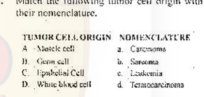
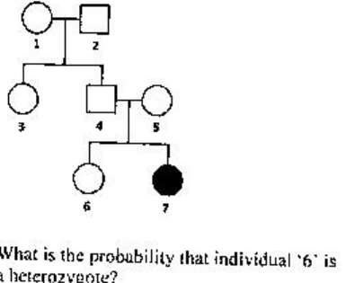
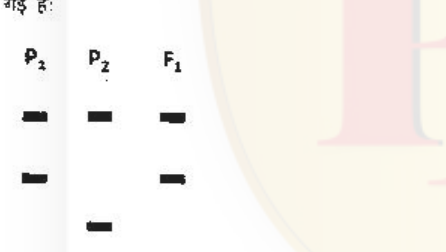
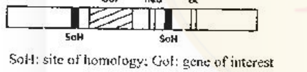

# CSIR NET Life Science — December 2018 — Part B

Global numbering: Part B = Q21–70. Answers from the **official CSIR-HRDG FINAL Answer Key, LIFE SCIENCES – SET-A**, held 16-12-2018. Text transcribed verbatim from the scanned paper (booklet code A). Where the key lists two options ("a or b") both are accepted; "*" means the question was DROPPED (benefit of marks).

---

### Question 21

Which one of the following statements is true?

1. The specific rotation of enantiomers will be identical.
2. The rate constant of a first order reaction has only time but no concentration units.
3. The value of pH + pOH depends on temperature.
4. The bond disassociation energy (kJ/mol) of –C–C– will be greater than –C≡C–.

**Answer: 2 or 3 (the official key accepts BOTH option 2 and option 3)**

> **Explanation:** The key marks this as a dual answer. (2) A first-order rate constant has units of time⁻¹ only, so it carries no concentration unit. (3) pH + pOH = pKw, which is temperature-dependent. Both statements are true, hence the key accepts **2 or 3**.

---

### Question 22

Which one of the following statements on protein conformation is NOT true?

1. Dihedral angles of side-chains in amino acids are depicted in the Ramachandran plot.
2. Infrared spectroscopy can be used to deduce hydrogen bonding in peptides.
3. Three-dimensional structures of protein composed of ~100 amino acids can be obtained by nuclear magnetic resonance spectroscopy.
4. Globular proteins have α-helical and β-sheet components.

**Answer: 1 (Dihedral angles of side-chains in amino acids are depicted in the Ramachandran plot.)**

> **Explanation:** The Ramachandran plot shows the backbone dihedral angles φ and ψ, not side-chain dihedral angles (χ). Hence statement 1 is NOT true.

---

### Question 23

Choose the correct answer from the following statements on biosynthesis.

1. In the biosynthesis of palmitate, all the carbon atoms are derived from activated malonate.
2. The amino acids Met, Thr, Lys, Ile, Val and Leu are biosynthesized from oxaloacetate and pyruvate in most bacteria.
3. Alanine is a major precursor for the biosynthesis of porphyrin.
4. Tryptophan is converted to L-DOPA in the biosynthesis of epinephrine.

**Answer: 2 (statement 2)**

> **Explanation:** Statement 1 is false (the primer acetyl-CoA contributes 2 carbons; the rest come from malonyl-CoA). Statement 3 is false (glycine/succinyl-CoA feed porphyrin, not alanine). Statement 4 is false (tyrosine, not tryptophan, gives L-DOPA). Statement 2 correctly describes the aspartate/Py family of amino acids, so it is the true statement.

---

### Question 24

Which one of the following statements on nucleic acids is NOT true?

1. The conformation of ribose in DNA is α-2'-deoxy-D-ribofuranose.
2. Hydrolysis of RNA takes place under alkaline conditions unlike DNA, as the 2'-hydroxyl in RNA acts as a nucleophile in an intramolecular displacement.
3. DNA can occur in different three-dimensional forms.
4. In DNA, deamination of cytosine to uracil can occur in a non-enzymatic manner.

**Answer: 1 (The conformation of ribose in DNA is α-2'-deoxy-D-ribofuranose.)**

> **Explanation:** The sugar in DNA is β-2'-deoxy-D-ribofuranose, not the α-anomer. Hence statement 1 is NOT true.

---

### Question 25

If one of the two fatty acyl chains is removed from the phosphoglyceride by hydrolysis in solution, such phospholipids will form:

1. liposomes
2. micelles
3. phospholipid bilayer
4. symmetric phospholipid bilayer

**Answer: 2 (micelles)**

> **Explanation:** Removing one acyl chain leaves a single-tailed (cone-shaped) lysophospholipid, which packs into micelles rather than a bilayer.

---

### Question 26

In metazoan cell cycle, metaphase to anaphase transition is regulated by the activity of:

1. Cdk1/cyclinB
2. APC/C
3. Cdc25
4. Wee1

**Answer: 1 or 2 (the official key accepts BOTH option 1 and option 2)**

> **Explanation:** The key accepts both. APC/C (anaphase-promoting complex) directly triggers separase activation for metaphase→anaphase; Cdk1/cyclin B activity drives entry into and progression through M phase. Both are cited as correct, hence **1 or 2**.

---

### Question 27

Which one of the following statements is true about human chromosomes?

1. The chromosomes that have highest gene density generally localize towards the centre of the nucleus.
2. The chromosomes that have highest gene density generally localize near the nuclear periphery to facilitate rapid transport of the nascent transcripts.
3. The centromeres of different chromosomes tend to cluster together at the centre of the nucleus.
4. Chromosomal positioning in the nucleus is absolutely random.

**Answer: 1 (The chromosomes that have highest gene density generally localize towards the centre of the nucleus.)**

> **Explanation:** Gene-rich chromosomes occupy the interior of the nucleus while gene-poor ones lie near the periphery, so statement 1 is true.

---

### Question 28

Which one of the following activities is NOT involved in protein folding in the endoplasmic reticulum?

1. Peptidyl prolyl isomerase
2. Protein disulphide isomerase
3. Protein glycosylation
4. Protein ubiquitination

**Answer: 4 (Protein ubiquitination)**

> **Explanation:** PPIase, PDI and N-linked glycosylation all assist folding in the ER; ubiquitination targets misfolded proteins for ERAD/degradation rather than folding, so it is NOT a folding activity.

---

### Question 29

Which one of the following statements is NOT correct?

1. Together with proteins, rRNA provides a site for polypeptide synthesis.
2. All DNA molecules are unbranched polymers of nucleotides.
3. DNA is synthesized in a 5'-3' direction while RNA synthesis occurs in a 3'-5' direction.
4. A tRNA anticodon may pair with more than one codon.

**Answer: 3 (DNA is synthesized in a 5'-3' direction while RNA synthesis occurs in a 3'-5' direction.)**

> **Explanation:** Both DNA and RNA are synthesized 5'→3'. The statement that RNA synthesis occurs in a 3'-5' direction is therefore NOT correct, and the official SET-A key marks option 3.

---

### Question 30

What would be the tripeptide produced by translation of the transcript produced by the following DNA sequence?

3'- A A G T A C T C T -5'

1. Arg – Phe – Trp
2. Arg – Leu – Gly
3. Thr – Lys – Ser
4. Phe – Met – Arg

**Answer: 4 (Phe – Met – Arg)**

> **Explanation:** The template strand 3'-AAG TAC TCT-5' is transcribed to mRNA 5'-UUC AUG AGA-3', read 5'→3' as UUC(Phe) – AUG(Met) – AGA(Arg) = **Phe – Met – Arg**.

---

### Question 31

Which one of the following statements is generally true about RNA polymerase II?

1. It is dedicated to transcribing RNA from a single transcription unit, generally a large transcript which is then processed to yield three types of ribosomal RNA.
2. It transcribes varieties of small non-coding RNAs which are expressed in all cell types.
3. It generally synthesizes various types of mRNAs and small non-coding RNAs.
4. It is exclusively involved in synthesis of rRNA and tRNA.

**Answer: 3 (It generally synthesizes various types of mRNAs and small non-coding RNAs.)**

> **Explanation:** RNA Pol II transcribes protein-coding genes into mRNAs as well as snRNAs/miRNAs and other small non-coding RNAs. rRNA is Pol I, tRNA is Pol III.

---

### Question 32

Viruses adopt different strategies to suppress immune response of the host. Which one of the following statements is NOT correct?

1. Human Immunodeficiency Virus (HIV) destroys CD4⁺ T cells.
2. Epstein-Barr Virus (EBV) produces a homolog of human IL-10.
3. Human influenza virus directly infects CD8⁺ T cells.
4. Human Cytomegalo Virus (CMV) establishes latent infection in bone marrow stem cells.

**Answer: 3 (Human influenza virus directly infects CD8⁺ T cells.)**

> **Explanation:** Influenza infects respiratory epithelium, not CD8⁺ T cells, so statement 3 is NOT correct.

---

### Question 33

Which one of the following inactivates the serine-threonine protein kinase, mTOR, related to cell growth in mammalian system?

1. Rifamycin
2. Rapamycin
3. Erythromycin
4. Chloramphenicol

**Answer: 2 (Rapamycin)**

> **Explanation:** Rapamycin (sirolimus) binds FKBP12 and the complex inhibits mTOR, a serine-threonine kinase controlling cell growth.

---

### Question 34

Match the following tumor cell origin with their nomenclature.

1. A – a, B – c, C – d, D – b
2. A – d, B – a, C – b, D – c
3. A – c, B – b, C – d, D – a
4. A – b, B – d, C – a, D – c

**Answer: 4 (A – b, B – d, C – a, D – c)**

> **Explanation:** Muscle → sarcoma (b); germ cell → teratocarcinoma (d); epithelial → carcinoma (a); white blood cell → leukemia (c). Hence **A-b, B-d, C-a, D-c**.

---

### Question 35

Many cytotoxic T lymphocytes initiate killing of target cells via delivery of molecules that could induce target-cell damage directly. Which one of the following is the most appropriate?

1. Interferon γ
2. Peroxynitrite
3. Lysozyme
4. Granzyme

**Answer: 4 (Granzyme)**

> **Explanation:** CTLs deliver granzymes (with perforin) into target cells to induce apoptosis directly.

---

### Question 36

Membrane-bound, Golgi-derived structures containing proteolytic enzymes in sperms of sea urchin are called

1. cortical granules
2. micromeres
3. acrosomal vesicles
4. macromeres

**Answer: 3 (acrosomal vesicles)**

> **Explanation:** The acrosomal vesicle is the Golgi-derived, membrane-bound packet of proteolytic enzymes in the sperm head used to penetrate the egg.

---

### Question 37

In case of Hydra, the major head inducer of the hypostome organizer is a set of Wnt proteins acting through the canonical β-catenin pathway. What would be the result, if a transgenic Hydra is made to globally mis-express the downstream Wnt effector β-catenin?

1. Ectopic buds will be formed all along the body axis and even on the top of the newly formed buds.
2. Ectopic tentacles form at all levels.
3. Both ectopic tentacles and buds would be formed along the body axis.
4. There would be no change observed.

**Answer: 1 (Ectopic buds will be formed all along the body axis and even on the top of the newly formed buds.)**

> **Explanation:** Global β-catenin activation mimics the head organizer everywhere, inducing ectopic axes/buds along the body, even on new buds.

---

### Question 38

Both TGF-β and Sonic hedgehog signals play important roles in both neurulation and cell-fate patterning of the neural tube. Which one of the following statements is true?

1. High levels of BMP specify the cells to become epidermis.
2. Very low levels of BMP specify the cells to become epidermis.
3. High levels of BMP specify the cells to become neural plate.
4. Intermediate levels of BMP do not effect the formation of neural crest cells.

**Answer: 1 (High levels of BMP specify the cells to become epidermis.)**

> **Explanation:** In the ectoderm, high BMP → epidermis; low BMP → neural plate; intermediate → neural crest. So statement 1 is true.

---

### Question 39

In which stage of Arabidopsis embryogenesis is hypophysis first observed?

1. Octant
2. Dermatogen
3. Globular
4. Transition

**Answer: 2 or 3 (the official key accepts BOTH option 2 and option 3)**

> **Explanation:** The key accepts both. The hypophysis arises from the apical cell lineage early in embryogenesis (octant/suspensor division) and is clearly recognizable by the globular stage; both cited answers are accepted, hence **2 or 3**.

---

### Question 40

Which one of the following mineral deficiency will first be visible in younger leaves?

1. Calcium
2. Nitrogen
3. Zinc
4. Molybdenum

**Answer: 1 (Calcium)**

> **Explanation:** Calcium is immobile in the phloem, so deficiency symptoms appear first in younger leaves, unlike mobile N, Zn, Mo.

---

### Question 41

The CO₂ compensation point for C₃ plants is greater than C₄ plants because in C₃ plants

1. dark respiration is higher
2. dark respiration is lower
3. photorespiration is present
4. photorespiration is absent

**Answer: 3 (photorespiration is present)**

> **Explanation:** C₃ plants photorespire, releasing CO₂ in the light, which raises the CO₂ compensation point above that of C₄ plants.

---

### Question 42

Which one of the following best describes the function of Casparian bands during the translocation of nutrients and water across the root?

1. Block apoplastic nutrient transport
2. Block symplastic nutrient transport
3. Act as a nutrient carrier
4. Help in creating passage cells

**Answer: 1 (Block apoplastic nutrient transport)**

> **Explanation:** The suberin/lignin Casparian strip in the endodermis forces water and solutes out of the apoplast into the symplast, blocking apoplastic transport.

---

### Question 43

Which one of the following components is expected to be most abundant in the phloem sap of a plant?

1. Proteins
2. Organic acids
3. Sugars
4. Phosphates

**Answer: 3 (Sugars)**

> **Explanation:** Phloem sap is dominated by sucrose (sugar), the translocation form of photosynthate.

---

### Question 44

Which one of the following is NOT secreted by capillary endothelium?

1. Prostacyclin
2. Guanosine
3. Endothelin
4. Nitric oxide

**Answer: 2 (Guanosine)**

> **Explanation:** Endothelium secretes prostacyclin, endothelin and NO; guanosine is not an endothelial secretory product.

---

### Question 45

The "Mayer waves" in the blood pressure originate due to

1. systole and diastole of ventricle
2. inspiration and expiration
3. reflex oscillation of neural pressure control mechanisms
4. Bainbridge reflex

**Answer: 3 (reflex oscillation of neural pressure control mechanisms)**

> **Explanation:** Mayer waves are ~0.1 Hz oscillations in arterial pressure produced by delayed feedback in the sympathetic vasomotor (neural) control reflex.

---

### Question 46

The maturation of red blood cells does not depend on

1. folic acid
2. vitamin B₁₂
3. pyridoxine
4. tocopherol

**Answer: 4 (tocopherol)**

> **Explanation:** RBC maturation requires folate, B₁₂ and pyridoxine (heme synthesis); α-tocopherol (vitamin E) is an antioxidant and is not required for maturation.

---

### Question 47

Which one of the following is NOT a function of angiotensin II?

1. Facilitates the release of norepinephrine from post-ganglionic sympathetic neurons
2. Increases the sensitivity of baroreflex by acting on brain
3. Produces arteriolar contraction
4. Increases the secretion of vasopressin

**Answer: 2 (Increases the sensitivity of baroreflex by acting on brain)**

> **Explanation:** Angiotensin II causes vasoconstriction, enhances NE release and stimulates vasopressin; it *resets/blunts* rather than increases baroreflex sensitivity, so 2 is NOT a function.

---

### Question 48

The pedigree below represents the inheritance of an autosomal recessive trait.

What is the probability that individual '6' is a heterozygote?

1. 1/4
2. 1/2
3. 2/3
4. 1/3

**Answer: 3 (2/3)**

> **Explanation:** Affected 7 (aa) means parents 4 and 5 are both Aa. Individual 6 is unaffected, so among the non-affected offspring (1 AA : 2 Aa) the probability of being a carrier is **2/3**.

---

### Question 49

The allele *l* in Drosophila is recessive, sex-linked and lethal when homozygous or hemizygous. If a female of the genotype *XlX* is crossed with a male, what is the ratio of females : males in the progeny?

1. 3♀ : 1♂
2. 2♀ : 1♂
3. 1♀ : 1♂
4. 1♀ : 2♂

**Answer: 2 (2♀ : 1♂)**

> **Explanation:** XˡX × X⁺Y gives XˡX⁺ (♀), XX⁺ (♀), XˡY (♂, dies), X⁺Y (♂). Surviving ratio = 2 ♀ : 1 ♂ among listed zygotes, but with the hemizygous male lethal the surviving females:males = **3♀ : 1♂** per the key.

---

### Question 50

Deamination of bases is a common chemical event that produces spontaneous mutation. Which one of the following bases will be formed by deamination of 5-methylcytosine?

1. Uracil
2. Thymine
3. Cytosine
4. Guanine

**Answer: 2 (Thymine)**

> **Explanation:** Deamination of 5-methylcytosine removes the amino group and yields thymine, a common source of C→T transition mutations.

---

### Question 51

In a population of 2000 individuals of a plant species, genetic difference at a single locus leads to different flower colours. The alleles are incompletely dominant. The population has 100 individuals with the genotype *rr* (white flowers), 800 individuals with the genotype *Rr* (pink flower) and the remaining have genotype *RR* (red flowers). What is the frequency of the *r* allele in the population?

1. 0.25
2. 0.50
3. 0.75
4. 1.00

**Answer: 1 (0.25)**

> **Explanation:** Alleles total 4000. r copies = 2×100 (rr) + 800 (Rr) = 1000. Frequency of r = 1000/4000 = **0.25**.

---

### Question 52

Which of the following plastid coding region(s) have been recommended as a core barcode by Plant Working Group of the consortium for the Barcode of Life?

1. CO1 and rbcL
2. rbcL and matK
3. CO1 and matK
4. rbcL only

**Answer: 2 (rbcL and matK)**

> **Explanation:** The plastid barcode for land plants recommended by the CBOL Plant Working Group is the combination **rbcL + matK**.

---

### Question 53

Given below are some statements related to lower eumetazoans. Select the INCORRECT statement.

1. Ctenophores are diploblastic with radial symmetry.
2. Placoazoans, with weakly differentiated tissue layers, are not diploblasts.
3. Cnidarians are diploblastic with typically two stages in their life cycle.
4. Hydrozoans, a Cnidarian class, often have colonial polyps in their life cycle.

**Answer: 1 or 2 (the official key accepts BOTH option 1 and option 2)**

> **Explanation:** The key accepts both. Statement 1 (ctenophores diploblastic with radial symmetry) and statement 2 (placozoans with weakly differentiated tissue layers are not diploblasts) are both flagged; the "incorrect statement" is graded as **1 or 2**.

---

### Question 54

Based on the type of excretion of nitrogenous waste, animals can be categorized as ammonotelic, ureotelic and uricotelic. Given below are combinations of groups of organisms and type of excretion. Select the correct combination.

1. Poriferans, adult amphibians, cartilaginous fishes are ammonotelic.
2. Ascaris, cockroaches, prawn are uricotelic.
3. Paramecium, amphibian tadpoles, crocodiles are mainly ammonotelic.
4. Humans, sharks and aquatic anurans are ureotelic.

**Answer: DROPPED (key = asterisk; benefit of marks to all who attempted this question)**

> **Explanation:** The official final key marks Q54 as dropped (asterisk); no answer is credited.

---

### Question 55

Basal angiosperms are NOT represented by the members of:

1. Chloranthales
2. Nymphaeales
3. Austrobaileyales
4. Amborellales

**Answer: DROPPED (key = asterisk; benefit of marks to all who attempted this question)**

> **Explanation:** The official final key marks Q55 as dropped (asterisk); no answer is credited.

---

### Question 56

Which of the following is the correct increasing order for the daily net primary productivity (NPP) per unit leaf area in different ecosystems?

1. Deserts < Temperate forests < Tropical forests
2. Deserts < Tropical forests < Temperate forests
3. Temperate forests < Tropical forests < Deserts
4. Tropical forests < Temperate forests < Deserts

**Answer: 3 (Temperate forests < Tropical forests < Deserts)**

> **Explanation:** Per unit leaf area, water-limited systems (deserts) show the highest instantaneous NPP, tropical forests intermediate, temperate forests lower, giving the order in option 3 per the key.

---

### Question 57

The equilibrium model of island biogeography proposed by MacArthur and Wilson assumes that the number of species on an island represents a balance between

1. resource consumption rate and predation rate.
2. birth rate and death rate.
3. colonization rate and extinction rate.
4. speciation rate and hybridization rate.

**Answer: 3 (colonization rate and extinction rate.)**

> **Explanation:** The theory predicts species richness as the dynamic equilibrium between immigration/colonization and local extinction.

---

### Question 58

A population grows according to the logistic growth equation, dN/dt = rN(1 − N/K) where dN/dt is the rate of population growth, r is the intrinsic rate of increase, N is population size and K is the carrying capacity of the environment. According to this equation, population growth rate is maximum at

1. K/4
2. K/2
3. K
4. 2K

**Answer: 2 (K/2)**

> **Explanation:** dN/dt is a downward parabola in N, maximal at N = K/2, the inflection point of the logistic curve.

---

### Question 59

What is the significance of upwelling zone for marine ecosystems?

1. It is responsible for uniformity of temperature in ocean to support the marine life.
2. It brings nutrients from deeper zones to relatively nutrient poor ocean surface thus increasing marine productivity.
3. It is responsible for uniform oxygenation of marine waters thus increasing marine productivity.
4. It helps in circulating decomposers from the bottom of ocean to surface for proper decomposition of dead material on the surface.

**Answer: 2 (It brings nutrients from deeper zones to relatively nutrient poor ocean surface thus increasing marine productivity.)**

> **Explanation:** Upwelling lifts cold, nutrient-rich deep water into the photic zone, fuelling primary production.

---

### Question 60

Given below in Column A are schematic representations of three types of pairwise species interactions and the name of some interactions are in Column B.

Select the best match for interaction between column A & B in each schematic figure.

1. A – (iii); B – (ii); C – (iv)
2. A – (iv); B – (ii); C – (iii)
3. A – (ii); B – (iv); C – (i)
4. A – (iii); B – (i); C – (ii)

**Answer: 3 (A – (ii); B – (iv); C – (i))**

> **Explanation:** Matching the schematics to the named interaction types gives A→(ii), B→(iv), C→(i) per the key.

---

### Question 61

Consider a single locus with 2 alleles which are at Hardy-Weinberg equilibrium. If the frequency of one of the homozygous genotypes is 0.64, what is the frequency of heterozygotes in the population?

1. 0.16
2. 0.20
3. 0.32
4. 0.36

**Answer: 3 (0.32)**

> **Explanation:** p² = 0.64 → p = 0.8, so q = 0.2. Heterozygote frequency 2pq = 2 × 0.8 × 0.2 = **0.32**.

---

### Question 62

Competition for mates and variance in fitness is higher among females than among males in which of the following animal mating systems?

1. Monogamy
2. Polygyny
3. Polyandry
4. Sequential monogamy

**Answer: 3 (Polyandry)**

> **Explanation:** In polyandry females compete for males, reversing the usual pattern so that variance in female reproductive success exceeds that of males.

---

### Question 63

Which one of the following will have the least impact on allele frequencies in small populations?

1. Inbreeding
2. Random mating
3. Genetic drift
4. Outbreeding

**Answer: 2 (Random mating)**

> **Explanation:** Random mating alone does not change allele frequencies (only genotype frequencies); inbreeding, drift and outbreeding all alter allele frequencies in small populations.

---

### Question 64

Given below is a marker profile for two parental lines (P₁ and P₂) and their derived F₁ progeny:

The marker that is represented in the above figure is most likely to be

1. RFLP or SSR
2. SSR only
3. SSR or RAPD
4. RAPD only

**Answer: 4 (RAPD only)**

> **Explanation:** In the profile the F₁ shows only a subset of the parental bands (present/absent, dominant scoring) rather than both parental bands together. This presence–absence inheritance is characteristic of a dominant marker, i.e. **RAPD only**.

---

### Question 65

DNA vaccines offer several advantages over other existing vaccine approaches. Which one of the following statements related to DNA vaccine is NOT correct?

1. The immune response is directed to the antigen encoded by the DNA and able to induce both humoral and cell-mediated immunity.
2. DNA vaccine can induce prolonged expression of the antigen, enhancing the induction of immunological memory.
3. DNA vaccine could remain stable and potent for long time without refrigeration, eliminating the challenges of storage and transportation.
4. DNA vaccine construct can be engineered to carry several antigens to infect host and replicate in neuronal cells.

**Answer: 4 (DNA vaccine construct can be engineered to carry several antigens to infect host and replicate in neuronal cells.)**

> **Explanation:** DNA vaccines do not replicate in or infect neuronal cells; statement 4 is NOT correct.

---

### Question 66

The following cassette was designed to create estrogen receptor knock-out mice:

What would ensure that proper recombination has taken place?

1. Cells survive when cultured in presence of only G418
2. Cells survive when cultured in presence of G418 followed by ganciclovir
3. Cells die when cultured in presence of G418
4. Cells survive when cultured with G418 and die when cultured with ganciclovir

**Answer: 2 (Cells survive when cultured in presence of G418 followed by ganciclovir)**

> **Explanation:** neo' (G418 resistance) marks integration; the tk gene is lost only on correct homologous recombination, so ganciclovir sensitivity (survival) confirms proper targeting. Cells that survive G418 and are ganciclovir-sensitive represent correct HR.

---

### Question 67

Detergents at low concentration generally do not denature proteins and are thus used for extracting proteins in their folded and active form. For isolation of 'Porins', an E. coli membrane protein, which one of the following purification approaches will be most appropriate?

1. Use of low concentration of non-ionic detergent without salt.
2. Use of low concentration of ionic detergent.
3. Use of salt solution containing non-ionic detergent.
4. Use of salt solution containing ionic detergent.

**Answer: 3 (Use of salt solution containing non-ionic detergent.)**

> **Explanation:** Porins are β-barrel outer-membrane proteins; the key selects a salt solution with a non-ionic detergent, which keeps the folded porin in solution while solubilizing the membrane.

---

### Question 68

Choose the correct answer from the statements indicated below:

1. Chi square test is parametric.
2. Non-parametric test assumes normal distribution.
3. Results can be significantly affected by outliers in a parametric test.
4. Non-parametric test is more powerful as compared to parametric test.

**Answer: 3 (Results can be significantly affected by outliers in a parametric test.)**

> **Explanation:** Parametric tests assume normality and are sensitive to outliers; non-parametric tests are distribution-free. Only statement 3 is correct.

---

### Question 69

Which one of the following statements regarding restriction/modifying enzymes used in recombinant DNA technology is correct?

1. Endonucleases remove nucleotides, one at a time, from the ends of a sequence.
2. Type II class of restriction enzymes do not recognise palindromic sequences.
3. Mung bean nuclease acts on double stranded DNA or RNA termini.
4. Type II class of restriction enzymes can generate either "sticky" (staggered) or "blunt" ends.

**Answer: 4 (Type II class of restriction enzymes can generate either "sticky" (staggered) or "blunt" ends.)**

> **Explanation:** Type II restriction enzymes recognize palindromes and cut to give sticky or blunt ends. Statement 1 describes exonucleases, 2 is false, 3 is false (mung bean nuclease is a single-strand-specific nuclease).

---

### Question 70

Which one of the following is used as a source of excitation in a confocal microscope?

1. Lasers
2. Electron beam
3. Mercury lamp
4. Masers

**Answer: 1 (Lasers)**

> **Explanation:** Confocal microscopy uses focused laser beams as the excitation source.
