# CSIR NET Life Science — December 2018 — Part C

Global numbering: Part C = Q71–145. Answers from the **official CSIR-HRDG FINAL Answer Key, LIFE SCIENCES – SET-A**, held 16-12-2018. Text transcribed verbatim from the scanned paper (booklet code A, Pathfinder Academy reproduction). "*" means the question was DROPPED (benefit of marks).

---

### Question 71

Following are statements on β-turns:

A. All the 20 coded amino acids have equal propensity to form β-turns.
B. Pro cannot occur in β-turns.
C. Pro-Gly sequence strongly favours β-turns.
D. In Asn-Gly β-turns, Asn can have positive Φ, Ψ values.

Choose the combination with all correct statements

1. B, D
2. A, C
3. A, D
4. C, D

**Answer: 4 (C, D)**

> **Explanation:** Statement A is false (amino acids differ greatly in β-turn propensity) and B is false (proline is actually a strong β-turn former because its ring fixes the backbone). C is true (Pro-Gly is a classic, strongly favoured β-turn pair) and D is true (in Asn-Gly type turns Asn can adopt positive Φ,Ψ). Hence the all-correct combination is **C, D**.

---

### Question 72

DNA melting temperature (Tₘ) was found to be 47°C and enthalpy measured at Tₘ was 0.032 kJ. The entropy change would be:

1. 1 × 10⁻³ kJ
2. 1 × 10⁻⁴ kJ
3. 3 × 10⁻² kJ
4. 6 × 10⁻² kJ

**Answer: 2 (1 × 10⁻⁴ kJ)**

> **Explanation:** At the melting temperature the duplex and single strands are at equilibrium, so ΔG = 0 and ΔS = ΔH/T. With T = 47°C = 320 K and ΔH = 0.032 kJ, ΔS = 0.032/320 = **1 × 10⁻⁴ kJ**.

---

### Question 73

Match the following bonds with their approximate energies:

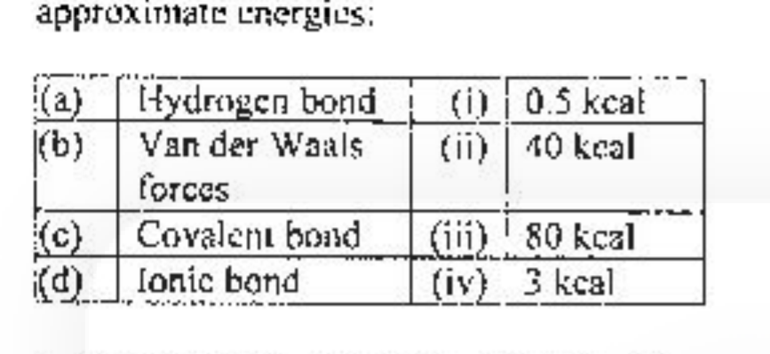

1. (a) – (iv), (b) – (iii), (c) – (ii), (d) – (i)
2. (a) – (ii), (b) – (i), (c) – (iii), (d) – (iv)
3. (a) – (i), (b) – (iv), (c) – (ii), (d) – (iii)
4. (a) – (iv), (b) – (i), (c) – (iii), (d) – (ii)

**Answer: 4 (a) – (iv), (b) – (i), (c) – (iii), (d) – (ii)**

> **Explanation:** Approximate bond energies: hydrogen bond ≈ 3 kcal (iv), Van der Waals ≈ 0.5 kcal (i), covalent bond ≈ 80 kcal (iii), ionic bond ≈ 40 kcal (ii). This gives **(a)-(iv), (b)-(i), (c)-(iii), (d)-(ii)**.

---

### Question 74

The following are some statements regarding glycolysis:

A. Glycolysis is not regulated by pyruvate kinase.
B. Lactate can be an end product of glycolysis.
C. Glycolysis cannot function anaerobically.
D. In erythrocytes, the second site in glycolysis for ATP generation can be bypassed.

From the above, choose the combination with both INCORRECT statements:

1. A and B
2. B and D
3. C and D
4. A and C

**Answer: DROPPED (key = asterisk; benefit of marks to all who attempted this question)**

> **Explanation:** The official final SET-A key marks Q74 as dropped (asterisk); no answer is credited.

---

### Question 75

For a reversible non-competitive inhibition of an enzyme, choose the plot that you would use to determine Kₘ:

![Four Lineweaver–Burk double-reciprocal plots (1/V versus 1/[S]) numbered 1, 2, 3 and 4; each shows a solid "No inhibitor" line and a dashed "Inhibitor" line with different slope/intercept relationships](images/C/fig75.png)

1. Plot 1
2. Plot 2
3. Plot 3
4. Plot 4

**Answer: 3**

> **Explanation:** Pure non-competitive inhibition lowers Vₘₐₓ but leaves Kₘ unchanged, so on a Lineweaver–Burk plot the inhibited and uninhibited lines intersect **on the 1/[S] (x) axis**; the shared x-intercept (−1/Kₘ) is what allows Kₘ to be read. Plot 3 shows this common x-intercept.

---

### Question 76

An investigator expresses a GFP-fused protein that localizes to the outer membrane of Golgi apparatus. Upon visualising GFP-signal in the fluorescence microscope, it was noted that GFP is pericentrosomal in its localization (Fig A). Treatment of such GFP expressing cells with a newly identified drug disrupted the Golgi into small vesicles (Fig B).

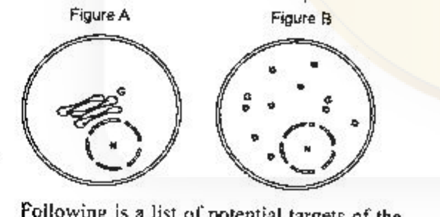

Following is a list of potential targets of the drug:

A. Dynein complex
B. Myosin
C. Microtubules
D. Dicer

Choose the combination with all correct targets:

1. A, B and D only
2. B and D only
3. A and C only
4. A only

**Answer: 3 (A and C only)**

> **Explanation:** The Golgi is held in its compact pericentrosomal position by dynein-mediated transport along microtubules. Disrupting either the dynein complex (A) or the microtubules (C) releases the Golgi into scattered small vesicles, as in Fig B. Myosin (actin-based) and Dicer (RNAi) are not involved, so the correct targets are **A and C**.

---

### Question 77

Following observation was made when a mammalian cell in one phase of cell cycle was fused with a cell in another phase of cell cycle:

A. Fusion of a cell in G₁ phase with S phase caused the G₁ nucleus to enter S phase.
B. Upon fusion of a G₂ cell with an S phase cell, G₂ cell does not enter S phase.
C. Upon fusion of a G₁ cell with G₂ cell, G₁ nucleus enters G₂ phase.
D. Fusion of an S phase cell with a M phase causes the S phase cell to immediately enter mitosis.

Choose the combination with all correct statements.

1. A, B, C
2. A, C, D
3. B, C, D
4. A, B, D

**Answer: 4 (A, B, D)**

> **Explanation:** These are the classic cell-fusion (Rao–Johnson) results. A is true: an S-phase cytoplasm drives a G₁ nucleus into DNA synthesis. B is true: a G₂ nucleus is not re-driven into S phase (no re-replication). D is true: an M-phase cytoplasm (MPF) forces an S-phase nucleus into premature mitosis. C is false: fusing a G₁ cell with a G₂ cell does not convert the G₁ nucleus into a G₂ nucleus. Hence the correct combination is **A, B, D**.

---

### Question 78

In an experiment, intact chromatin was isolated and digested with micrococcal nuclease in independent tubes for 30 min, 1 h, 2 h, and 4 h. Further, the DNA was purified from each tube, separated on agarose gel and Southern hybridization was performed with rRNA gene probe and a centromeric DNA probe. Which one of the following patterns of signal intensity from both of the probes is likely to be obtained following Southern hybridization?

1. With increasing time, compared to centromeric probe, a rapid increase in signal intensity of rRNA gene probe was observed.
2. With increasing time, compared to centromeric probe, a rapid decrease in signal intensity of rRNA gene probe was observed.
3. Irrespective of incubation period, both probes produced identical band intensities.
4. Treatment with micrococcal nuclease would instantly degrade the DNA, hence, no hybridization signal would be obtained in any of the samples.

**Answer: 2 (With increasing time, compared to centromeric probe, a rapid decrease in signal intensity of rRNA gene probe was observed.)**

> **Explanation:** rRNA genes lie in open, transcriptionally active euchromatin and are therefore cleaved by micrococcal nuclease quickly, whereas centromeric DNA is tightly packed heterochromatin and is protected. As digestion time increases the rRNA-gene signal is lost faster than the centromeric signal — a rapid decrease relative to the centromeric probe.

---

### Question 79

Which one of the following proteins is most likely to be found in the inter-membrane space of mitochondria? A protein containing

1. an N-terminal matrix targeting sequence followed by hydrophobic stop-transfer anchor sequence
2. an N-terminal matrix targeting sequence followed by a cleavable hydrophobic sequence that blocks complete translocation
3. a protein with multiple internal sequences that are recognized by Tim 22 complex
4. a protein with an outer membrane localization sequence followed by a matrix targeting signal

**Answer: 2 (an N-terminal matrix targeting sequence followed by a cleavable hydrophobic sequence that blocks complete translocation)**

> **Explanation:** The classic pathway to the inter-membrane space is an N-terminal matrix-targeting presequence followed by a hydrophobic sorting signal that halts translocation through the Tim23 channel; the protein is then released (with cleavage of the presequence) into the IMS. Option 3 (Tim22 internal signals) gives inner-membrane polytopic carriers, not a soluble IMS protein.

---

### Question 80

A single protofilament of microtubule grows at the speed of 2 µm/min. Considering that there is no catastrophe in the microtubule nucleation and the size of the tubulin unit is of the order of 5 nm, how many tubulin units are added to the growing microtubule per minute?

1. 400
2. 1600
3. 3200
4. 5200

**Answer: 4 (5200)**

> **Explanation:** One protofilament elongating at 2 µm/min = 2000 nm/min adds 2000/5 = 400 tubulin subunits per minute. A microtubule is a hollow tube of 13 parallel protofilaments, so the whole microtubule gains 400 × 13 = **5200** tubulin units per minute.

---

### Question 81

mRNA of a gene was depleted in human cells using siRNA that arrest cells in the G₂ phase of the cell cycle. In order to test whether the G₂ arrest is due to an off-target or an on-target effect of siRNA mediated mRNA depletion, an investigator can:

A. re-introduce an ectopic copy of the gene coding for the wild-type mRNA and protein
B. re-introduce an ectopic copy of the gene that is different in its mRNA sequence at the siRNA target site but encodes for the same protein
C. re-introduce an ectopic copy of the gene that codes for different mRNA and protein
D. utilize few more siRNAs targeting different regions of the mRNA in question

Choose the combination with correct statements

1. A, B, C only
2. C and D only
3. B and D only
4. B, C, D only

**Answer: 3 (B and D only)**

> **Explanation:** A rescue construct whose coding sequence is recoded at the siRNA target site (B) still gives the same protein but is no longer knocked down — if the arrest is rescued, the effect was on-target. Using independent siRNAs against other regions of the same mRNA (D) tests reproducibility of the knock-down phenotype. A (wild-type copy, still targeted) and C (different protein) are not valid controls, so **B and D**.

---

### Question 82

Presence of selenocysteine in proteins in *E. coli* is a consequence of:

1. post-translational modification of cysteine present in special structural regions of the proteins by SelB and SelC.
2. post-translational modification of serine present in special structural regions of the proteins by SelB and SelC.
3. aminoacylation of a special tRNA (tRNA^Sec) by serine tRNA synthetase with serine followed by further modification of the attached serine to selenocysteine followed by its transport to the ribosome by SelB
4. aminoacylation of a special tRNA (tRNA^Sec) by serine tRNA synthetase with selenocysteine followed by its transport to ribosome by SelB.

**Answer: 3**

> **Explanation:** Selenocysteine is not added by modifying a cysteine/serine already in the polypeptide. The special tRNA^Sec is first charged with serine by seryl-tRNA synthetase; the esterified serine is then converted to selenocysteine, and the Sec-tRNA is delivered to the ribosome by the elongation factor SelB. Hence option 3.

---

### Question 83

A DNA segment was cloned into the active site region of *lacZ* gene and the recombinant plasmid introduced into *lacZ*⁻ strain of *E. coli* and plated on a medium containing X-gal. The colonies showed blue color. Which one of the following statements is correct?

1. The nature of the cloned DNA segment need not be special as cloning of any DNA in *lacZ* will result in disruption of its reading frame and production of blue colour on X-gal plates.
2. The cloned DNA segment could be a Group I intron whose removal from the precursor *lacZ* transcript in *E. coli* results in production of mature *lacZ* mRNA which can then produce active LacZ protein.
3. The cloned sequence is likely to be *lacY* sequence which is naturally a part of *lac* operon in *E. coli*.
4. The cloned sequence is likely to be an anti-terminator sequence which allows full length transcription of *lacZ*.

**Answer: 2**

> **Explanation:** Blue colour on X-gal requires active β-galactosidase, so the inserted DNA must NOT permanently disrupt the *lacZ* reading frame. A self-splicing (Group I) intron inserted into the gene is removed from the transcript, restoring a functional *lacZ* mRNA and hence blue colonies. Disrupting the reading frame (option 1) would give white colonies, so option 2 is correct.

---

### Question 84

An intron in a yeast reporter gene carries a mutation in the splice site branch point (UACUAAC to UACA′AAC). To suppress the mutation, a library of point mutants of snRNAs was introduced into the mutant strain. The suppressor is most likely to have a point mutation in:

1. U₁ snRNA
2. U₂ snRNA
3. RNase P
4. U₆ snRNA

**Answer: 2 (U₂ snRNA)**

> **Explanation:** The branch-point adenosine is recognised by base-pairing with U₂ snRNA. A point mutation in U₂ snRNA can restore complementarity to the altered branch-point sequence and rescue splicing, so the suppressor lies in U₂ snRNA.

---

### Question 85

A researcher wanted to identify the enhancer sequences of a newly discovered gene. Shown below are the relevant regions of some of the reporter constructs the researcher designed to identify the enhancer.

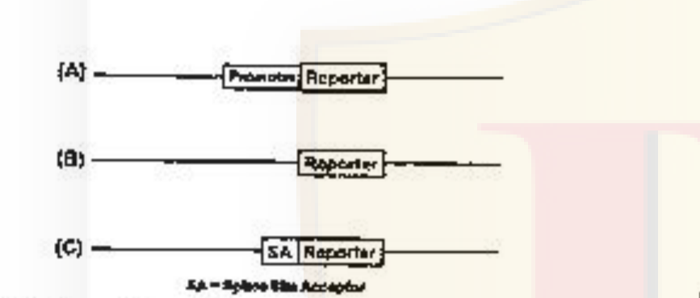

Which of the above constructs can be used to identify the enhancer?

1. A only
2. B only
3. Both A and C
4. C only

**Answer: 1 (A only)**

> **Explanation:** An enhancer increases transcription only from a promoter; it cannot initiate transcription on its own. Only construct A (promoter–reporter) provides the promoter whose activity the candidate enhancer can boost, so a change in reporter expression reports enhancer function. The promoterless construct B and the splice-acceptor (gene-trap) construct C cannot report a cloned enhancer.

---

### Question 86

In a genetic assay, randomly generated fragments of yeast DNA were cloned into a bacterial plasmid containing gene 'X' essential for yeast viability on minimal media. The recombinant plasmid was used to transform a yeast strain deficient in recombination and lacking 'X' gene. Transformants, which survive on minimal media and form colonies should essentially have:

1. Yeast centromeric sequence which ensures integrity of the plasmid after transformation.
2. Enhancers for the essential gene missing in the transformed strain.
3. A sequence similar to bacterial origin of replication
4. Yeast autonomous replicating sequence.

**Answer: 4 (Yeast autonomous replicating sequence.)**

> **Explanation:** Because the host is recombination-deficient, the plasmid cannot integrate into the genome; to be maintained and to express gene X it must replicate as an episome. That requires a yeast autonomous replicating sequence (ARS). A bacterial ori does not work in yeast and a centromere alone does not allow replication, so the essential element is the **ARS**.

---

### Question 87

Following statements have been made about recombination in a diploid organism:

A. Recombination could be identified by genotyping parents and offsprings for a pair of loci.
B. Recombination frequency does not exceed 0.5, and therefore, 50cM would be the maximum distance between two loci.
C. Recombination is a reciprocal process. However, a non-reciprocal exchange may cause gene conversion.
D. Occasionally non-homologous recombination happens and this functions as a source of chromosomal rearrangement.

Select the combination with all correct statements.

1. A, B, C
2. A, B, D
3. B, C, D
4. A, C, D

**Answer: 4 (A, C, D)**

> **Explanation:** A, C and D are true. B is false: although the *observed recombination frequency* saturates at 0.5, the true map distance between two loci can far exceed 50 cM because multiple (double) crossovers are not counted. Hence the all-correct set is **A, C, D**.

---

### Question 88

Bacteria adopt different strategies to evade host defense mechanisms. From the lists of various different mechanisms and bacterial strategies against host defense given below, select the option representing all correct pairings.

1. a – W; b – X; c – Y; d – Z
2. a – X; b – Y; c – Z; d – W
3. a – Z; b – Y; c – X; d – W
4. a – Y; b – W; c – Z; d – X

**Answer: 2 (a – X; b – Y; c – Z; d – W)**

> **Explanation:** Capsular polysaccharides (X) resist phagocytosis (a); protein A (Y) binds the Fc of IgG (b); elastase that inactivates C3a/C5a (Z) counters antibody/complement-mediated agglutination (c); and increasing the surface positive charge (W) repels cationic antimicrobial peptides (d). Hence **a-X, b-Y, c-Z, d-W**.

---

### Question 89

Bacterial chemotaxis response is mediated by histidine-kinase-associated receptors that activate a two-component signalling pathway which enables chemotaxis receptors to control the flagellar motors. When bacteria move towards attractant, they produce smooth swimming by rotating flagella counterclockwise, whereas when bacteria move away from repellent, they produce increased tumbling by rotating flagella clockwise. Which of the following characteristics regarding chemotaxis receptor is NOT true?

1. The receptors are dimeric transmembrane proteins that bind specific attractants and repellents on the outside of the plasma membrane.
2. The cytoplasmic tail of the receptor is stably associated with a histidine kinase CheA via an adapter protein CheW.
3. The receptor and its associated proteins are all clustered at one end of the cell.
4. The binding of an attractant increases the activity of the receptor whereas binding of a repellent decreases the activity.

**Answer: 4 (The binding of an attractant increases the activity of the receptor whereas binding of a repellent decreases the activity.)**

> **Explanation:** In the two-component system, attractant binding *inhibits* the receptor-associated CheA kinase activity (reducing CheY phosphorylation → counterclockwise rotation, smooth swimming), whereas repellent binding *increases* kinase activity. Statement 4 states the opposite, so it is NOT true.

---

### Question 90

Following are a list of extracellular matrix proteins (Column A) along with their functional characteristics (Column B):

![Two-column matching table. Column A: A. Connexin; B. Plasmodesmata; C. ICAM; D. Selectin. Column B: (i) The chief endothelial cell proteins that are recognized by the white blood cell integrins and member of immunoglobulin (Ig) superfamily; (ii) Cell surface carbohydrate binding proteins that mediate a variety of transient cell-cell adhesion interactions in the bloodstream; (iii) Four-pass transmembrane protein which is the major constituent of gap junctions in forming a continuous aqueous channel; (iv) It is the only class of intercellular junctions in plants that directly connect the cytoplasm of adjacent cells](images/C/fig90.png)

Which one of the following is the correct match?

1. A – i; B – iv; C – iii; D – ii
2. A – ii; B – iii; C – iv; D – i
3. A – iii; B – iv; C – i; D – ii
4. A – iv; B – i; C – ii; D – iii

**Answer: 3 (A – iii; B – iv; C – i; D – ii)**

> **Explanation:** Connexin is the four-pass transmembrane subunit of gap junctions (iii); plasmodesmata are the plant junctions directly connecting adjacent cytoplasms (iv); ICAM is the endothelial Ig-superfamily ligand for leukocyte integrins (i); selectins are carbohydrate-binding proteins mediating transient adhesion in the bloodstream (ii). Hence **A-iii, B-iv, C-i, D-ii**.

---

### Question 91

A western blot analysis after treating cancer cells with a prospective anti-cancer drug is shown below:

The following assumptions were made:

A. The drug may have arrested the growth of cells at the G₁ phase.
B. The drug targeted the JAK-STAT signalling pathway.
C. The drug led to apoptosis of the cells.
D. Drug-induced apoptosis was through the extrinsic or mitochondrial-independent pathway.

Which one of the following combination is correct?

1. Only B and D
2. A, B and C
3. Only A and B
4. B, C and D

**Answer: 2 (A, B and C)**

> **Explanation:** The loss of pSTAT3 (band fainter in +Drug) shows the drug targets the JAK-STAT pathway (B); the strong Cleaved-PARP band in +Drug shows apoptosis was induced (C); and the altered G₁ cyclin/CDK pattern is consistent with a G₁ arrest (A). The blot gives no information that distinguishes an extrinsic/mitochondrial-independent route, so D is unsupported. Hence **A, B and C**.

---

### Question 92

Which one of the following statements regarding clonal selection hypothesis is NOT CORRECT?

1. Mature B lymphocytes bear Ig receptors on their cell surface and all receptors on a single B cell have variable specificity for antigen.
2. On antigen stimulation, B cell matures, migrates to lymphoid organs and replicates. Its clonal descendents bear the same receptor as parental B cell and secrete antibodies with identical specificity.
3. After immune response, more B cells bearing receptors will remain in the host and act as memory cells for mounting enhanced secondary response.
4. B cells with receptors for self antigens are deleted during embryonic development.

**Answer: 1 (Mature B lymphocytes bear Ig receptors on their cell surface and all receptors on a single B cell have variable specificity for antigen.)**

> **Explanation:** Clonal selection holds that all antigen receptors on a single B lymphocyte are identical and have one (single, not variable) specificity. Statement 1 wrongly says the receptors on a single B cell have variable specificity, so it is NOT correct.

---

### Question 93

Susceptible individuals were infected with pathogen A and pathogen B separately. Pathogen A has a very short incubation period and disease symptoms are already underway by the time memory cells are activated. Pathogen B on the other hand has a long incubation period which allows the memory cells to be activated and respond. Which one of the following will be the most appropriate vaccination strategy against both pathogens A and B?

1. Repeated vaccination against both A and B for maintaining high levels of neutralizing antibodies.
2. Repeated vaccination against A and a single injection of pathogen B vaccine for maintaining high levels of neutralizing antibodies.
3. Single injection of pathogen A vaccine and repeated vaccination against pathogen B for maintaining high levels of neutralizing antibodies.
4. Single injection of both pathogens A and B vaccine so that memory cells can respond by producing high levels of serum antibodies.

**Answer: 2 (Repeated vaccination against A and a single injection of pathogen B vaccine for maintaining high levels of neutralizing antibodies.)**

> **Explanation:** For pathogen A the incubation is too short for a memory (secondary) response to be raised in time, so protection requires continuously high neutralizing antibody, achieved by repeated vaccination/boosters. For pathogen B the long incubation lets a single vaccination prime memory that responds before disease. Hence **repeated vaccination against A, single injection against B**.

---

### Question 94

Human sperms are allowed to fertilize ova having non-functional ovastacin. The following possibilities may be of significance in the fusion of these gametes:

A. The sperms will not fertilize ova.
B. The sperms will bind and penetrate the zona pellucida but will not be able to fuse with ovum membrane.
C. ZP2 will not be clipped by cortical granule protease.
D. CD9 protein of egg membrane microvilli will not be able to interact with sperm membrane proteins in the absence of ovastacin.
E. Polyspermy may occur frequently.

Which combination of statements represent the outcome of the above event?

1. A and B
2. C and E
3. C and D
4. B and C

**Answer: 2 (C and E)**

> **Explanation:** Ovastacin is the cortical-granule protease that cleaves ZP2 after fertilization, hardening the zona pellucida to block polyspermy. Without functional ovastacin, ZP2 is not clipped (C) and the block to polyspermy fails, so multiple sperm can enter — polyspermy (E). Sperm binding/fusion are unaffected, so A, B, D do not follow. Hence **C and E**.

---

### Question 95

Temporal expression of N-cadherin is extremely important during early development of the mammalian embryos. Accordingly, which one of the following statements about N-cadherin is true?

1. Injection of N-cadherin antibodies just prior to condensation of mesenchymal cells will aid cartilage formation.
2. Presence of N-cadherin just prior to condensation will facilitate nodule formation and development of the limb skeleton.
3. The border between the nervous system and skin will form properly only if epidermal cells are experimentally made to express N-cadherin.
4. Expression of N-cadherin is redundant during separation of neural and epidermal precursor cells.

**Answer: 2 (Presence of N-cadherin just prior to condensation will facilitate nodule formation and development of the limb skeleton.)**

> **Explanation:** During limb skeletogenesis, mesenchymal cells switch to N-cadherin to condense into cartilage nodules; N-cadherin present just before condensation therefore promotes nodule formation and limb-skeleton development. Blocking it (antibodies) would impair, not aid, cartilage formation, and N-cadherin/E-cadherin differential expression is what separates neural from epidermal precursors — so 2 is the true statement.

---

### Question 96

The zygote of *C. elegans* exhibits rotational cleavage. When the first two blastomeres formed (P1 and AB) are experimentally separated, the following outcomes may be possible:

A. The P1 cell in isolation generates all the cells it would normally make, showing autonomous specification.
B. The P1 cell in isolation generates all the cells it would normally make, showing conditional specification.
C. The AB cell in isolation generates a small fraction of cell types it would normally make, showing conditional specification.
D. The AB cell in isolation generates a small fraction of cell types it would normally make, showing autonomous specification.

Which one of the above combination of statements is true?

1. A and C
2. B and C
3. B and D
4. A and D

**Answer: 1 (A and C)**

> **Explanation:** The official SET-A key credits option 1 (A and C). A is true — the P1 (germline) blastomere in isolation still gives rise to all the cells it was fated to make, the signature of autonomous specification. C is the credited companion — the AB cell in isolation yields only a small fraction of the cell types it would normally produce, which the key treats as conditional specification. Hence the credited combination is **A and C**. (Note: the alternative reading that pairs A with D — both blastomeres autonomous — is common in textbooks; the archive follows the official key. See `sources.md`.)

---

### Question 97

Given below are some of the statements regarding regeneration:

A. The type of regeneration characteristic of mammalian liver is considered as Compensatory regeneration.
B. Regrowth of hair shaft from follicular cells exemplifies stem cell mediated regeneration.
C. Regeneration occurring through the repatterning of existing tissues with little new growth is known as morphallaxis.
D. Adult structures undergoing dedifferentiation forming a blastema, that then redifferentiates to form the lost structure, is called epimorphosis.

Choose the most appropriate combination of correct statements:

1. D only
2. C and D only
3. A, B and C only
4. A, B, C and D

**Answer: 4 (A, B, C and D)**

> **Explanation:** All four definitions are standard: liver regrowth is compensatory regeneration (A); hair-shaft renewal is stem-cell mediated (B); repatterning of existing tissue with little new growth is morphallaxis (C); and blastema-based dedifferentiation/redifferentiation is epimorphosis (D). Hence **A, B, C and D**.

---

### Question 98

Following are certain statements regarding apomixis in plants:

A. Apomixis cannot be used to maintain hybrid vigor over many generations in plants.
B. In sporophytic apomixis maternal genotype is maintained.
C. There is an event of meiosis during gametophytic apomixis and is also referred as apomixosis.
D. In diplospory, meiosis of the megaspore mother cell is aborted, resulting in two unreduced spores, out of which one forms the female gametophyte.

Which one of the following combinations is correct?

1. A and B
2. A and C
3. B and C
4. B and D

**Answer: 4 (B and D)**

> **Explanation:** Apomixis is asexual seed formation that FIXES hybrid vigor, so A is false. Sporophytic apomixis (adventitious embryony) maintains the maternal genotype (B, true), and diplospory is the abortion of megaspore-mother-cell meiosis giving unreduced spores that form the female gametophyte (D, true). Gametophytic apomixis is defined by the *absence* of normal meiosis/fertilization, so C is false. Hence **B and D**.

---

### Question 99

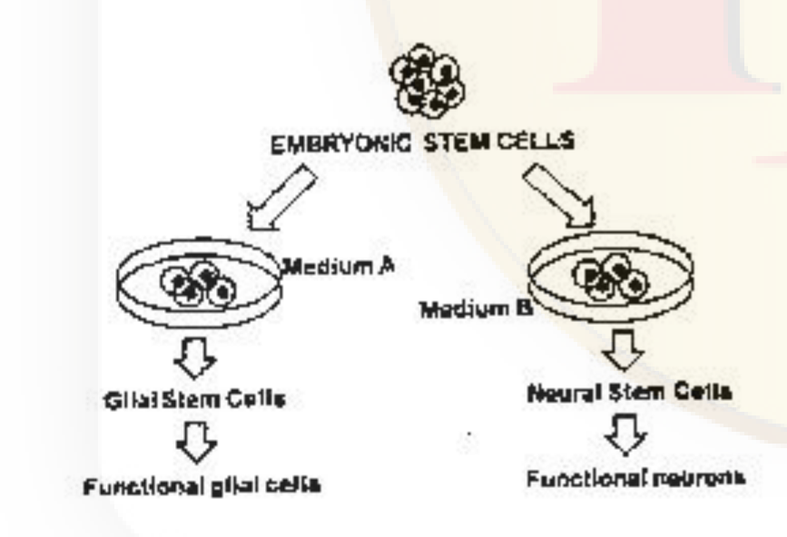

The following assumptions were derived from the above experiment:

A. Medium A contained bFGF and PDGF.
B. Medium B contained retinoic acid.
C. Cells cultured in Medium B were determined to become functional neurons prior to addition of the medium.

Which one of the following combinations represents correct statements?

1. A and B only
2. A, B and C
3. B and C only
4. A and C only

**Answer: 1 (A and B only)**

> **Explanation:** bFGF + PDGF drive embryonic stem cells toward a glial (oligodendrocyte-type) lineage (Medium A → glial), while retinoic acid promotes a neuronal fate (Medium B → neurons), so A and B are correct. Commitment occurs in response to the medium, not before it, so C is false. Hence **A and B only**.

---

### Question 100

Following statements were made with respect to symbiotic association of rhizobia with legumes:

A. *nodD* is a regulatory gene.
B. Nod factors are lipochitooligosaccharides.
C. Nod factors predominantly have α-1→4 linked N-acetyl-D-glucosamine backbone.
D. Receptors for Nod factors are protein kinases with extracellular sugar-binding LysM domain.

Which one of the following combinations represents all correct statements?

1. A, B, and C
2. A, C and D
3. B, C and D
4. A, B and D

**Answer: 4 (A, B and D)**

> **Explanation:** *nodD* is the regulatory gene (A), Nod factors are lipochitooligosaccharides (B), and their receptors are LysM-domain receptor-like protein kinases (D) — all correct. C is wrong because the chitin-like Nod-factor oligosaccharide backbone is **β-1→4** linked N-acetylglucosamine, not α-1→4. Hence **A, B and D**.

---

### Question 101

A quadratic check of gene combinations and disease reaction types in a host-pathogen system where the gene-for-gene concept operates is represented below:

The following statements were made about the above genotypes:

A. AR genotype had incompatible (resistant) reactions.
B. Ar genotype had compatible (susceptible) reactions.
C. ar genotype had compatible (susceptible) reactions.
D. aR genotype had incompatible (resistant) reactions.

Choose the combination with all correct statements.

1. A, B and D
2. A, B and C
3. B, C and D
4. A, C and D

**Answer: 2 (A, B and C)**

> **Explanation:** Gene-for-gene resistance requires the pathogen avirulence allele (A) matched with the plant resistance allele (R). AR → recognized → incompatible/resistant (A true). Ar and ar lack a functional plant R gene → compatible/susceptible (B, C true). aR has a virulent pathogen that is not recognized by R, so the reaction is compatible/susceptible, not resistant — D is false. Hence **A, B and C**.

---

### Question 102

Following observations were recorded while studying physiological parameters of sorghum and wheat under similar conditions:

A. Sorghum RUHISCO exhibits relatively higher affinity for CO₂ compared to that of wheat.
B. Light saturation of net photosynthetic flux is relatively lower for sorghum compared to that of wheat.
C. Warburg effect is difficult to record for sorghum and could be said as "not measurable" whereas it could be easily recorded for wheat.
D. Temperature optimum for net photosynthesis is lower for sorghum compared to that of wheat.
E. ¹³C/¹²C ratio of assimilate is relatively higher for sorghum compared to that of wheat.

Which one of the following combination of the above observation is correct?

1. Only A, B and C
2. Only B, C and E
3. Only A, B and D
4. Only A, C and E

**Answer: 4 (Only A, C and E)**

> **Explanation:** Sorghum is a C₄ plant and wheat a C₃ plant. C₄ photosynthesis suppresses photorespiration, so the Warburg (O₂-inhibition) effect is not measurable in sorghum but is in wheat (C true), and C₄ plants discriminate less against ¹³C so the ¹³C/¹²C ratio of assimilate is higher (E true); the higher effective CO₂ affinity at the carboxylation step (A) is credited. B is false — light saturation of net photosynthesis is *higher* (not lower) in C₄ sorghum, and D is false — C₄ plants have a *higher* temperature optimum. Hence the correct combination is **A, C and E**.

---

### Question 103

Following are certain statements regarding respiratory metabolism in plants:

A. Respiratory quotient during partial breakdown of carbohydrate (alcoholic fermentation) will be infinity.
B. Respiratory quotient indirectly provides information about (i) nature of the substrate used for respiration and (ii) the relative rate of competing respiratory processes.
C. Breakdown of organic acids in mature fruit will exhibit a respiratory quotient value of more than one since organic acids are relatively oxygen-rich compared to other common substrates.
D. Anabolic metabolism can influence respiratory quotient by removing reduction equivalents for respiration leading to decrease in oxygen uptake.

Which one of the following combination of the above statement is correct?

1. Only A
2. Only B and C
3. Only D
4. A, B, C and D

**Answer: 4 (A, B, C and D)**

> **Explanation:** All four are correct. Alcoholic fermentation releases CO₂ without O₂ uptake, so RQ = CO₂/O₂ → infinity (A). RQ reports both substrate type and the balance of respiratory pathways (B). Oxygen-rich organic acids give RQ > 1 (C). Anabolism consuming reducing equivalents lowers O₂ uptake and thus alters RQ (D). Hence **A, B, C and D**.

---

### Question 104

Sieve elements of phloem conduct sugars and other organic materials throughout the plant. The following statements were made about characteristics of sieve elements in seed plants:

A. Angiosperms contain sieve plate pores.
B. There are no sieve plates in gymnosperms.
C. P-protein is present in all eudicots and many monocots.
D. There is no P-protein in angiosperms.

Which of the following combination is correct?

1. B, C and D
2. A, B and C
3. A, B and D
4. A, C and D

**Answer: 2 (A, B and C)**

> **Explanation:** Angiosperm sieve-tube members have true sieve plates with pores (A), gymnosperms have only sieve areas (no sieve plates) (B), and P-protein occurs in all eudicots and many monocots (C). D is false because P-protein is in fact present in angiosperms. Hence **A, B and C**.

---

### Question 105

The plant hormones, auxins and cytokinins, and their interactions play an important role in regulating apical dominance. The following figure represents an experiment related to the study of gene interactions that influence axillary bud outgrowth or dormancy. Q, Z and M represent genes involved in phytohormone pathway.

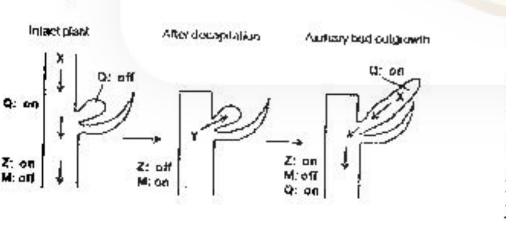

Based on the above figure, the following statements were made:

A. 'X' is an auxin that maintains expression of 'Q' and 'Z' and represses 'M'.
B. 'Y' is a cytokinin that promotes axillary bud growth and is induced by 'M'.
C. Decapitation (removal of apex) activates 'X'.
D. 'X' is a cytokinin that represses 'M'.

Which one of the following options represents correct statement(s)?

1. A and C only
2. B and D only
3. A and B only
4. C only

**Answer: 3 (A and B only)**

> **Explanation:** In the intact plant the apical auxin signal X keeps Q and Z on and M off (bud dormant); removing the apex (decapitation) removes X, so Q/Z go off and M is switched on, and M induces the cytokinin Y that drives bud outgrowth. Thus A and B are correct. C is false (decapitation removes/inactivates X, not activates it) and D is false (X is the auxin, not a cytokinin). Hence **A and B only**.

---

### Question 106

The conduction velocity of action potential in a myelinated nerve fibre was much greater than that of an unmyelinated fibre of the same diameter. The following statements were proposed to explain this observation:

A. The speed of conduction in a nerve fibre is determined by the plasma membrane resistance and axial resistance of axonal cytoplasm.
B. The electrical properties of myelinated and unmyelinated nerve fibres are not similar.
C. The myelin sheath decreases the effective membrane resistance.
D. The magnitude of an electrotonic potential decreases more with distance along the axon in myelinated nerve fibres than that of unmyelinated fibres.
E. The voltage-gated Na⁺ channels are highly concentrated at the nodes of Ranvier.

Choose one of the following combinations with both INCORRECT statements.

1. A and B
2. B and C
3. C and D
4. D and E

**Answer: 3 (C and D)**

> **Explanation:** C is incorrect — myelin *increases* (not decreases) the effective membrane resistance, which is what speeds conduction. D is incorrect — in myelinated fibres the electrotonic potential decays *less* with distance (saltatory conduction between nodes), not more. A, B and E are all correct statements, so the pair of INCORRECT statements is **C and D**.

---

### Question 107

A four year old boy was brought to hospital for weak bones in spite of sufficient intake of calcium in his diet. The attending doctor examined the functioning of the following organs:

A. Liver
B. Kidney
C. Lung
D. Pancreas

Which one of the following options represents a combination of probable malfunctioning organs?

1. A and B
2. B and C
3. C and D
4. A and D

**Answer: 1 (A and B)**

> **Explanation:** Dietary calcium can only be absorbed if vitamin D is fully activated — the liver performs the 25-hydroxylation and the kidney the 1α-hydroxylation that yields active calcitriol. Weak bones despite adequate calcium intake therefore point to failure of these activation steps, i.e. malfunction of the **liver and kidney (A and B)**.

---

### Question 108

The oxygen-haemoglobin dissociation curve illustrates the relationship between pO₂ in blood and the number of O₂ molecules bound to haemoglobin. The 'S' shape of the curve has been explained in the following proposed statements:

A. The quaternary structure of haemoglobin determines its affinity to O₂.
B. In deoxyhaemoglobin, the globin units are tightly bound in a T-configuration.
C. The interactions between globin subunits are altered when O₂ binds with deoxyhaemoglobin.
D. The affinity to O₂ in T-configuration of haemoglobin is increased.
E. In the relaxed configuration of haemoglobin, the affinity to O₂ is reduced.

Choose one of the following combinations with both INCORRECT statements.

1. A and B
2. B and C
3. C and D
4. D and E

**Answer: 4 (D and E)**

> **Explanation:** The T (tense, deoxy) configuration has LOW affinity for O₂, so D is incorrect. The R (relaxed, oxygenated) configuration has HIGH affinity, so E is also incorrect. A, B and C correctly describe the allosteric T↔R transition that generates the sigmoidal curve. The pair of INCORRECT statements is **D and E**.

---

### Question 109

The changes in left atrial, left ventricular and aortic pressure in a cardiac cycle are shown below in the figure:

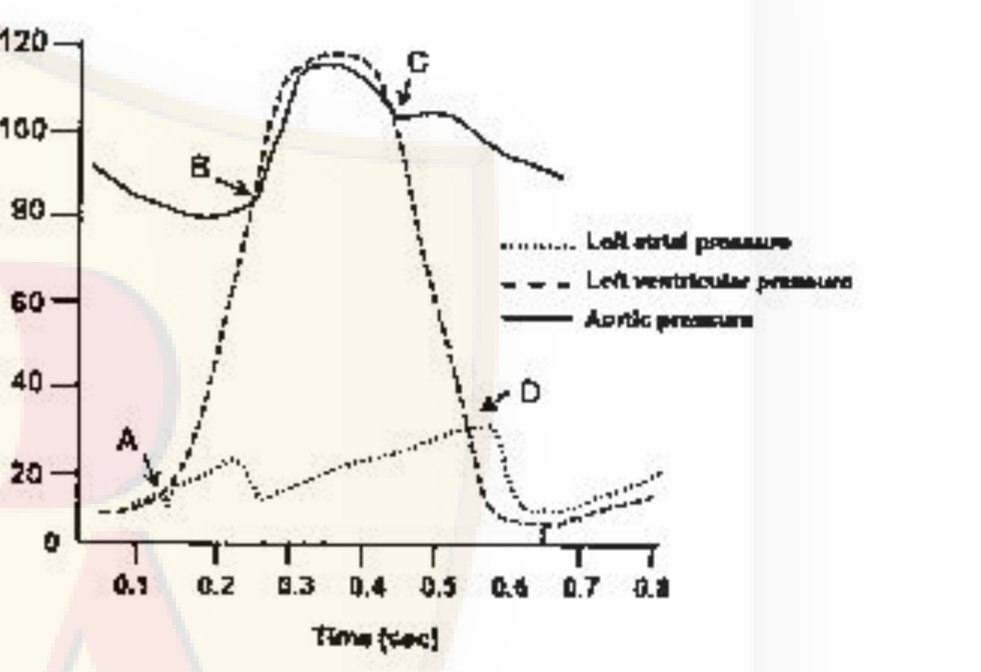

Given below are the events of cardiac cycle (column A) associated with marked points (A, B, C, D) in the figure (column B).

| Column A | | Column B |
|---|---|---|
| a. Aortic valve opens | (i) | D |
| b. Mitral valve closes | (ii) | B |
| c. Mitral valve opens | (iii) | A |
| d. Aortic valve closes | (iv) | C |

Choose the option that matches the events with marked points in the figure.

1. a – (ii), b – (iii), c – (i), d – (iv)
2. a – (i), b – (iv), c – (ii), d – (iii)
3. a – (iv), b – (i), c – (iii), d – (ii)
4. a – (iii), b – (ii), c – (iv), d – (i)

**Answer: 1 (a – (ii), b – (iii), c – (i), d – (iv))**

> **Explanation:** Point A marks the start of ventricular systole where ventricular pressure exceeds atrial pressure — the mitral valve closes (b→A=(iii)). Point B is where ventricular pressure exceeds aortic pressure — the aortic valve opens (a→B=(ii)). Point C is the end of ejection when ventricular pressure falls below aortic — the aortic valve closes (d→C=(iv)). Point D is where falling ventricular pressure drops below atrial — the mitral valve opens (c→D=(i)). Hence **a-(ii), b-(iii), c-(i), d-(iv)**.

---

### Question 110

A person recovered from a moderate degree of haemorrhagic shock. The participating physiological mechanisms in this recovery process are proposed in the following statements.

A. The decrease in arterial pressure after haemorrhage causes inhibition of sympathetic-vasoconstrictor system.
B. After haemorrhage, the angiotensin II level in blood is increased which causes increased re-absorption of Na⁺ in renal tubules.
C. The increased secretion of vasopressin after haemorrhage increases water retention by the kidneys.
D. After haemorrhage, the reduced secretion of epinephrine and nor-epinephrine from adrenal medulla induces decreased peripheral resistance.
E. In haemorrhage, the central nervous system ischemic response elicits sympathetic inhibition.

Choose one of the following combinations with both the correct statements.

1. A and B
2. B and C
3. C and D
4. D and E

**Answer: 2 (B and C)**

> **Explanation:** Recovery from haemorrhage is driven by RAAS activation — angiotensin II rises and increases renal Na⁺ reabsorption (B) — and by vasopressin (ADH), which increases water retention (C). A, D and E are all wrong: low arterial pressure *stimulates* (not inhibits) the sympathetic-vasoconstrictor system, epinephrine/norepinephrine secretion *increases* to raise peripheral resistance, and the CNS ischemic response causes massive sympathetic *excitation*, not inhibition. Hence **B and C**.

---

### Question 111

A healthy individual was immersed in water up to neck in an upright posture for 3 h. The plasma concentration of atrial natriuretic peptide (ANP), renin and aldosterone were measured for 5 h at 1 h intervals including the immersion period. The results are graphically presented below.

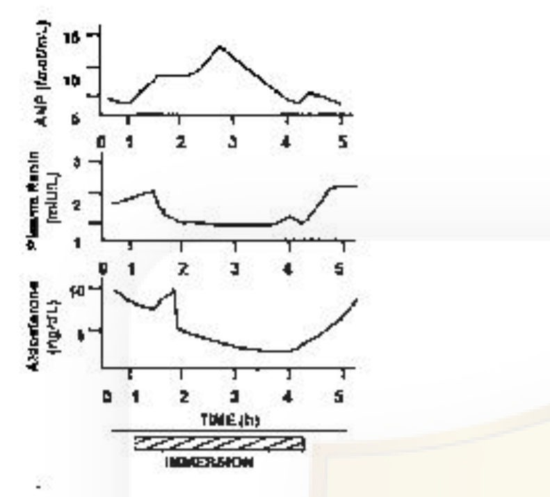

The results of this experimental condition (EC) are explained in the following proposed statements which may be correct or incorrect.

A. ANP secretion is proportional to the degree of stretch of atria.
B. The decreased plasma renin concentration in EC is due to increase in sympathetic activity.
C. The decreased aldosterone level in EC is the effect of plasma renin level.
D. The effect of gravity on the circulation is counteracted in EC.
E. The central venous pressure is decreased in EC.

Choose one of the following combinations with all correct statements.

1. A, B, C
2. A, C, D
3. C, D, E
4. B, C, D

**Answer: 2 (A, C, D)**

> **Explanation:** Head-out water immersion shifts blood centrally, stretching the atria and raising ANP in proportion to atrial stretch (A true); the resulting fall in renin drags aldosterone down (C true); and immersion removes the hydrostatic column, counteracting gravity's effect on the circulation (D true). B is false (renin falls because sympathetic drive to the kidney is reduced, not increased) and E is false (central venous pressure rises, not falls). Hence **A, C, D**.

---

### Question 112

Several mutants (1-4) are isolated, all of which require compound E for growth. The compounds A to D in the biosynthetic pathway to E are known, but their order in the pathway is not known. Each compound is tested for its ability to support the growth of each mutant (1-4). In the following table, a plus sign indicates growth and a minus sign indicates no growth.

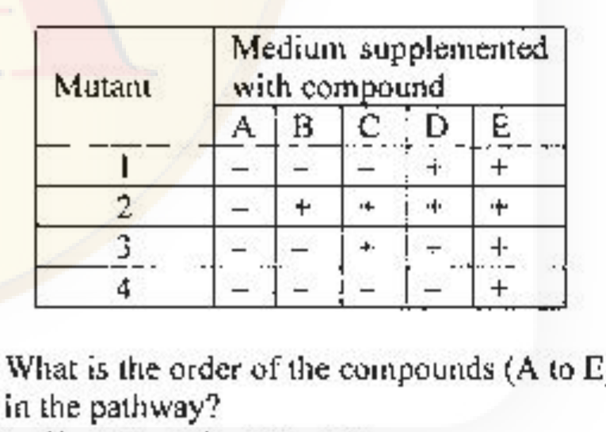

What is the order of the compounds (A to E) in the pathway?

1. E → D → C → B → A
2. A → C → D → B → E
3. E → B → D → C → A
4. A → B → C → D → E

**Answer: 4 (A → B → C → D → E)**

> **Explanation:** A compound rescues a mutant only if it lies downstream of the mutant's enzymatic block, so the more compounds that rescue a mutant, the earlier its block. Mutant 2 grows on B, C, D, E (block right after A); mutant 1 grows on D, E (block after C); mutant 4 grows on E only (block after D). These three fix the order as A → B → C → D → E. (Mutant 3's row is anomalous in the scan — it is printed as C⁺, D⁻, E⁺, which does not fit a single linear pathway; the intended/credited answer is nevertheless **A → B → C → D → E**. See `sources.md`.)

---

### Question 113

Following is the picture of an inversion heterozygote undergoing a single crossing-over event

The following statements are given towards explaining the consequences at the end of meiosis:

A. The resultant two chromosomes will have deletions and duplications.
B. A dicentric and an acentric chromosome will be formed.
C. The inversion does not allow crossing over to occur, so even if a crossing over is initiated, it will fail to occur.
D. The crossing over is considered suppressed by inversion as the acentric chromosome will not segregate normally.
E. All the gametes formed with cross-over chromatids at the end of meiosis will be non-viable as they carry large deletion or duplication.
F. The gametes having non-crossover (parental) chromatid will survive.

Which combination of statements is correct?

1. B and E
2. A and C
3. B, D and F
4. A, E and F

**Answer: 4 (A, E and F)**

> **Explanation:** Because the centromere lies inside the inverted segment, this is a pericentric inversion, so a single crossover in the loop yields two recombinant chromosomes each carrying a duplication plus a deficiency (deletion) — A is true (the dicentric/acentric products of B and D belong to a *paracentric* inversion, so they are wrong here). C is false (crossing over does occur within the loop). The crossover chromatids are genetically unbalanced and give non-viable gametes (E true), while the non-crossover (parental) chromatids are balanced and survive (F true). Hence **A, E and F**.

---

### Question 114

Polymorphic DNA sequences are used for molecular identification. Short tandem repeats (STRs) and Single Nucleotide Polymorphism (SNPs) are used as polymorphic markers. The table below summarizes the status of autosomal SNP, autosomal STR, mitochondrial SNP, Y-linked STR for four individuals related to each other, representing parents and their two children.

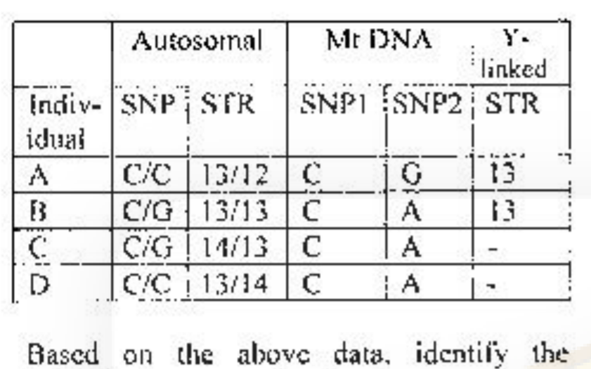

Based on the above data, identify the individuals representing the two parents.

1. Individuals A and D
2. Individuals A and C
3. Individuals B and C
4. Individuals C and D

**Answer: 2 (Individuals A and C)**

> **Explanation:** The 14 allele at the autosomal STR occurs only in C and D, so the parents must supply it — this excludes A×B. Testing A (13/12) × C (14/13): their children could be 13/13 (B) and 13/14 (D), which fits. C is female (no Y-linked STR) and A is the father (Y-linked 13); the son B carries A's Y (13) and both children B and D carry C's maternal mtDNA (SNP2 = A), while A's own mtDNA (G) is not inherited. Autosomal SNP also reconciles (A C/C × C C/G → B C/G, D C/C). Hence the parents are **A and C**.

---

### Question 115

An autosomal recessive condition affects 1 newborn in 10,000 in a random mating population without any disruptive acting force. What is the approximate expected frequency of carriers in this population?

1. 1 in 1000 newborns
2. 1 in 500 newborns
3. 1 in 100 newborns
4. 1 in 50 newborns

**Answer: 4 (1 in 50 newborns)**

> **Explanation:** Affected (q²) = 1/10,000, so q = 1/100 and p = 99/100. Carrier frequency = 2pq = 2 × (99/100) × (1/100) ≈ 198/10,000 ≈ 1/50. So about **1 in 50** newborns are carriers.

---

### Question 116

Angelman syndrome (AS) and Prader-Willi Syndrome (PWS) have very distinct symptoms. Factors responsible for the occurrence of these syndromes are given below.

A. Microdeletion of 15q11-13 in paternal chromosome.
B. Uniparental disomy of maternal chromosome 15.
C. Lack of functional maternal copy of ubiquitin ligase E3A.
D. Lack of SNURF-SNRPN transcript, which is produced only from paternal chromosome.
E. Deficiencies of small nucleolar RNAs, which are encoded from the introns of SNURF-SNRPN transcript from paternal chromosome.

Which of the following combination of answers is correct for Angelman and Prader-Willi Syndromes?

1. PWS - A, C, D; AS - B, E
2. PWS - B only; AS - A, C, D, E
3. PWS - A, B, D, E; AS - C only
4. PWS - A, B; AS - C, D, E

**Answer: 3 (PWS - A, B, D, E; AS - C only)**

> **Explanation:** PWS results from loss of the *paternal* contribution to 15q11-q13: paternal microdeletion (A), maternal uniparental disomy (B, two maternal copies and no paternal), absence of the paternally expressed SNURF-SNRPN transcript (D) and of the paternal snoRNAs in its introns (E). Angelman syndrome results from loss of the *maternal* contribution — the functional maternal copy of ubiquitin ligase E3A (UBE3A) (C). Hence **PWS = A, B, D, E; AS = C only**.

---

### Question 117

Using interrupted mating, four *Hfr* strains were analysed for the sequence in which they transmitted a number of different genes to a F⁻ strain. Each *Hfr* strain was found to transmit its genes in a unique order as summarized in the table [Only the first five genes were scored].

| Order of transmission | Hfr 1 | Hfr 2 | Hfr 3 | Hfr 4 |
|---|---|---|---|---|
| First | A | B | M | F |
| | B | A | K | H |
| | D | L | J | G |
| | F | M | G | J |
| Last | H | K | H | K |

Which one of the following correctly represents the gene sequence in the original strain from which the *Hfr* strains were derived as well as the place of integration and polarity of the F plasmid?

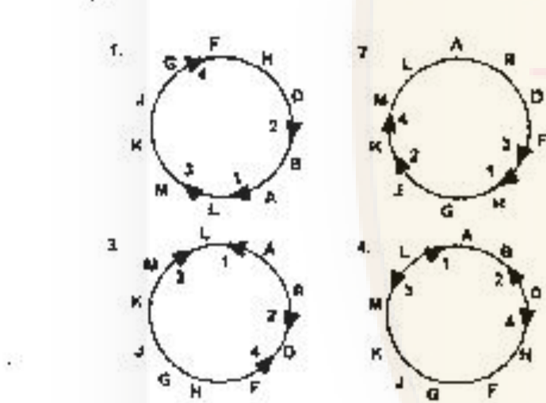

1. Map 1
2. Map 2
3. Map 3
4. Map 4

**Answer: 3**

> **Explanation:** The four transfer orders are colinear around a single circular chromosome. Stitching them gives the gene order **A–B–D–F–H–G–J–K–M–L** (back to A): *Hfr*1 reads A→B→D→F→H, *Hfr*4 reads F→H→G→J→K, *Hfr*3 reads M→K→J→G→H (opposite orientation), and *Hfr*2 reads B→A→L→M→K (opposite orientation). Each strain's order is a run around this circle starting at its own F-integration point and following that point's polarity. Map 3 is the only one whose gene ring and F-integration site/orientation reproduce all four transfer sequences, so the answer is **Map 3**.

---

### Question 118

Given below is a list of bacteria either functioning as methanogens or methanotrophs:

A. *Methanobacterium* sp
B. *Methanococcus* sp
C. *Methylomonas* sp
D. *Methylosinus* sp

Which of the following options classifies the above list correctly?

1. Methanogen – A; Methanotrophs – B, C, D
2. Methonogens – A, B, C; Methanotroph – D
3. Methanogens – A, B; Methanotrophs – C, D
4. Methonogens – A, D; Methanotrophs – B, C

**Answer: 3 (Methanogens – A, B; Methanotrophs – C, D)**

> **Explanation:** *Methanobacterium* (A) and *Methanococcus* (B) are archaea that produce methane (methanogens). *Methylomonas* (C) and *Methylosinus* (D) are bacteria that oxidize methane/methanol for carbon and energy (methanotrophs). Hence **Methanogens A, B; Methanotrophs C, D**.

---

### Question 119

The table given below provides a list of groups of Arthropods (A-D) and some features (i-v).

| Groups of Arthropods | | Features |
|---|---|---|
| A. Onychophorans | (i) | includes insects |
| B. Trilobites | (ii) | have cephalothorax and often pincer-like appendage |
| C. Hexapods | (iii) | marine arthropods that disappeared in the Permian extinction |
| D. Chelicerates | (iv) | are considered related to arthropods but have unjointed appendages |
| | (v) | only arthropod group without antennae |

Which one of the following options represents the correct match between the arthropod groups with these features?

1. A – (iv); B – (iii); C – (i); D – (v)
2. A – (i); B – (iii); C – (iv); D – (ii)
3. A – (iii); B – (iv); C – (ii); D – (i)
4. A – (iv); B – (iii); C – (v); D – (ii)

**Answer: 1 (A – (iv); B – (iii); C – (i); D – (v))**

> **Explanation:** Onychophorans (velvet worms) are lobopodians regarded as relatives of arthropods but with unjointed appendages → A-(iv). Trilobites are the extinct marine arthropods that disappeared at the Permian extinction → B-(iii). Hexapods include the insects → C-(i). Chelicerates are the only arthropod group lacking antennae → D-(v). (Feature (ii) is the distractor.) Hence **A-(iv), B-(iii), C-(i), D-(v)**.

---

### Question 120

In the following table, a list of threat categories and animals of India is given in an alphabetical order:

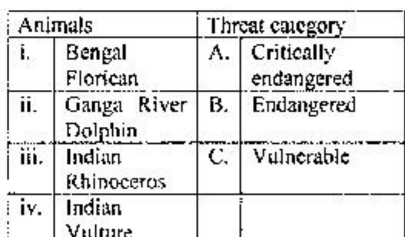

Which of the following options show correct combination of animals and their threat category as per Red Data list of IUCN?

1. i – A; ii – A; iii – B; iv – C
2. i – A; ii – B; iii – C; iv – A
3. i – B; ii – C; iii – B; iv – A
4. i – C; ii – A; iii – B; iv – B

**Answer: 2 (i – A; ii – B; iii – C; iv – A)**

> **Explanation:** The two firm anchors are the Indian rhinoceros as Vulnerable (iii-C) and the Indian vulture (Gyps spp.) as Critically Endangered (iv-A); pairing these selects option 2, which also places the Ganga river dolphin as Endangered (ii-B). Hence the credited combination is **i-A, ii-B, iii-C, iv-A**.

---

### Question 121

Following table shows presence (+) and absence (-) of selected distinguishing characters of different plant taxa:

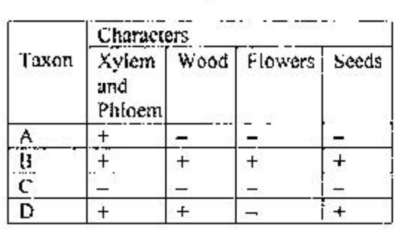

Based on the above, which of the following shows correct identity of taxa A, B, C and D?

1. A – Hornworts; B – Oaks; C – Ferns; D – Pines
2. A – Ferns; B – Oaks; C – Hornworts; D – Pines
3. A – Hornworts; B – Pines; C – Ferns; D – Oaks
4. A – Ferns; B – Pines; C – Hornworts; D – Oaks

**Answer: 2 (A – Ferns; B – Oaks; C – Hornworts; D – Pines)**

> **Explanation:** Hornworts lack true xylem/phloem, wood, flowers and seeds (all "−") → C. Ferns have vascular tissue but no wood, flowers or seeds (+ − − −) → A. Oaks are angiosperms with all four (+ + + +) → B. Pines are gymnosperms: vascular, woody, seed-bearing but no flowers (+ + − +) → D. Hence **A-Ferns, B-Oaks, C-Hornworts, D-Pines**.

---

### Question 122

Following table shows an alphabetical list of certain domesticated crops and places of origin:

| Crop | | Place of origin |
|---|---|---|
| i. Barley | A. | China |
| ii. Maize | B. | Fertile Crescent |
| iii. Mung Bean | C. | India |
| iv. Rice | D. | Southern Mexico |
| v. Wheat | | |

Based on the above, which one of the following options represent the correct match between crops and their place of origin?

1. i – C; ii – D; iii – A; iv – B; v – B
2. i – B, D; ii – B; iii – A,C; iv – A; v – B
3. i – C; ii – D; iii – C; iv – B; v – C
4. i – B; ii – D; iii – C; iv – A, C; v – B

**Answer: 4 (i – B; ii – D; iii – C; iv – A, C; v – B)**

> **Explanation:** Barley and wheat were both first domesticated in the Fertile Crescent (i-B, v-B); maize in Southern Mexico/Central America (ii-D); mung bean in India (iii-C); and rice in the China–India region, hence A and C (iv-A,C). This gives **i-B, ii-D, iii-C, iv-A,C, v-B**.

---

### Question 123

A list of floral formulae and plant families are given in the following table:

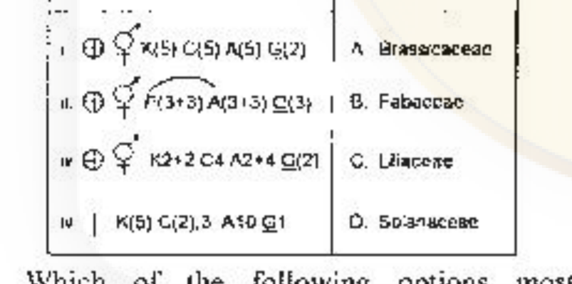

Which of the following options most appropriately matches given plant families with their representative floral formulae?

1. i – D; ii – B; iii – A; iv – C
2. i – D; ii – C; iii – A; iv – B
3. i – D; ii – C; iii – B; iv – A
4. i – A; ii – C; iii – B; iv – D

**Answer: 2 (i – D; ii – C; iii – A; iv – B)**

> **Explanation:** i (⊕, K(5)C(5)A(5)G(2)) is the solanaceous formula → D. ii (⊕, P(3+3) A(3+3) G(3), tepals) is liliaceous → C. iii (⊕, K2+2 C4 A2+4 G(2), the crucifer formula) is Brassicaceae → A. iv (zygomorphic ↑, papilionaceous K(5) C(1+2+(2)) A(9)+1 G(1)) is Fabaceae → B. Hence **i-D, ii-C, iii-A, iv-B**.

---

### Question 124

Grassland plots with varying number of grass species were cultivated for 10 years. At the end of the experiment, total plant cover was measured. Soil nitrogen was also measured to assess its utilization by plants. The relationships are shown in the following plots.

Which one of the following inferences can be drawn from the above experiment?

1. Grasses in plots with lower species richness enriched soil nitrogen, thereby increasing the plant cover.
2. Plots with greater species richness showed greater stability and more efficient soil nitrogen utilization.
3. Plots with greater species richness utilized nitrogen more efficiently, but would not show increased net primary production.
4. No correlation can be drawn between species richness, community productivity and nitrogen utilization.

**Answer: 2 (Plots with greater species richness showed greater stability and more efficient soil nitrogen utilization.)**

> **Explanation:** As species number rises, total plant cover (productivity) increases and residual soil nitrogen decreases — the more diverse plots take up nitrogen more completely (efficiently). This is the classic diversity–productivity result, so greater species richness gives greater stability and more efficient soil-nitrogen utilization. Hence option 2.

---

### Question 125

Complete the following sentence with the most appropriate option.

Global analysis of a large number of plant species traits showed that with increase in leaf lifespan,

1. specific leaf area increases whereas leaf nitrogen and net photosynthesis rate decrease.
2. specific leaf area, leaf nitrogen and net photosynthesis rate increase.
3. specific leaf area, leaf nitrogen and net photosynthesis rate decrease.
4. specific leaf area decreases whereas leaf nitrogen and net photosynthesis rate increase.

**Answer: 3 (specific leaf area, leaf nitrogen and net photosynthesis rate decrease.)**

> **Explanation:** The leaf economics spectrum: long-lived leaves are thick, dense and conservative — they have LOW specific leaf area, LOW leaf nitrogen and LOW mass-based net photosynthesis. So with increasing leaf lifespan, SLA, leaf N and photosynthetic rate all decrease (option 3).

---

### Question 126

Forest fragments in an agricultural landscape can be viewed as islands of habitat in an ocean of non-habitat. MacArthur and Wilson's island biogeography model can be used to predict patterns of species richness in these forest fragments which are represented in the graphs below.

Which one of the following combinations of the graphs correctly represents predictions from the model?

1. A and C
2. A and D
3. B and C
4. B and D

**Answer: 2 (A and D)**

> **Explanation:** The equilibrium model predicts species richness rises with island/fragment area (the area effect — more species in larger fragments, graph A) and falls with isolation, i.e. distance from the source of colonists (the distance effect — fewer species in remote fragments, graph D). Hence **A and D**.

---

### Question 127

In order to estimate population size of a fish species in a lake, a researcher captures 100 fish from the lake and marks them with coloured tags. A week later, the researcher returns to the lake and catches 150 fish of the same species and finds that 25 of them are previously tagged ones. Assuming no immigration or emigration occurred, the total population size of the fish species in the lake will be:

1. 17
2. 38
3. 600
4. 860

**Answer: 3 (600)**

> **Explanation:** Lincoln (mark–recapture) index: N = (M × C) / R = (100 × 150) / 25 = 15000 / 25 = **600**.

---

### Question 128

Given below is a graphical representation of plant life histories based on Grime's model in which stress, disturbance and competition are the important factors.

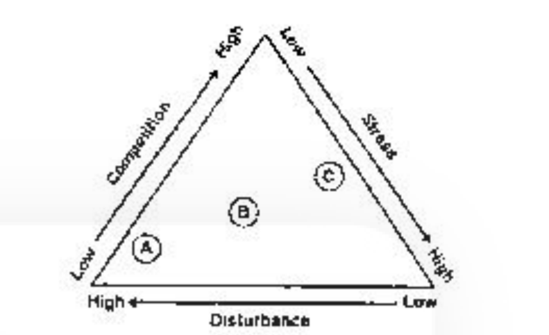

Which of the following options correctly represents A, B and C, respectively in the figure above?

1. perennial herbs, trees and shrubs, annual plants.
2. annual plants, perennial herbs, trees and shrubs.
3. annual plants, trees and shrubs, perennial herbs.
4. trees and shrubs, perennial herbs, annual plants.

**Answer: 2 (annual plants, perennial herbs, trees and shrubs.)**

> **Explanation:** In Grime's CSR scheme the position along the disturbance gradient maps onto plant life span. A sits at the high-disturbance, low-competition corner — the ruderal strategy of short-lived **annual plants**. B is intermediate — **perennial herbs**. C is at the low-disturbance, high-stress/competitive end occupied by long-lived woody **trees and shrubs**. Hence **A = annual plants, B = perennial herbs, C = trees and shrubs**.

---

### Question 129

Following table shows attributes of selected species A, B, C and D:

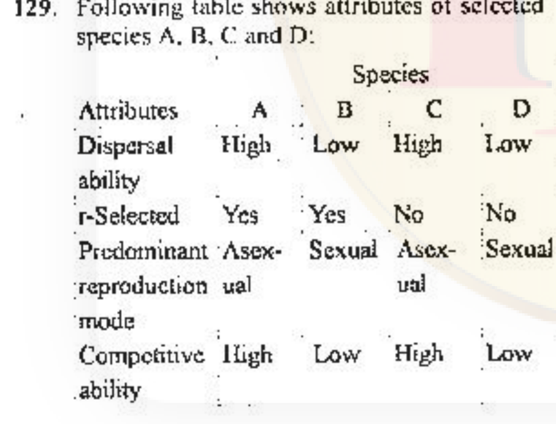

Based on the above information, which of the following is most likely to become invasive if climate matches between its site of origin and site of colonization?

1. Species A and D
2. Species A only
3. Species D only
4. Species B and C

**Answer: 2 (Species A only)**

> **Explanation:** Successful invaders combine high dispersal ability, an r-selected (fast-reproducing) life history and high competitive ability. Only species A has all three (High dispersal, r-Selected = Yes, High competitive ability). D is a strong competitor but poor disperser and not r-selected; C is a good competitor but not r-selected and cannot disperse far; B is r-selected but a weak competitor and poor disperser. Hence **Species A only**.

---

### Question 130

Four drugs (A,B,C,D) were used to disrupt a biological rhythm in experimental animals. The changes in the pattern of the biological rhythm as compared to untreated are shown below. The solid line represents the biological rhythm of the untreated and broken line represents that of the treated animals.

Which of the following interpretations from the above experiment is INCORRECT?

1. Drug A can be used to reduce the period length of the rhythm.
2. Drug B can be used for sustained lowering of amplitude of the rhythm without changing its period.
3. Drug C can be used for sustained lowering of amplitude and period of the rhythm.
4. Drug D can be used to reduce the robustness and dampen out the rhythm.

**Answer: 3 (Drug C can be used for sustained lowering of amplitude and period of the rhythm.)**

> **Explanation:** In panel C the broken (treated) trace has *lower amplitude* but a *longer* period (fewer cycles than the solid reference), not a shorter one — so "lowering of amplitude **and period**" is wrong, making statement 3 the INCORRECT interpretation. A (shorter period), B (lower amplitude, same period) and D (damped, reduced robustness) all match their traces.

---

### Question 131

The phylogenetic tree below shows evolutionary relationships among 8 species. Males of these species are either blue (b) or red (r) in colour, the colour being indicated next to each species name.

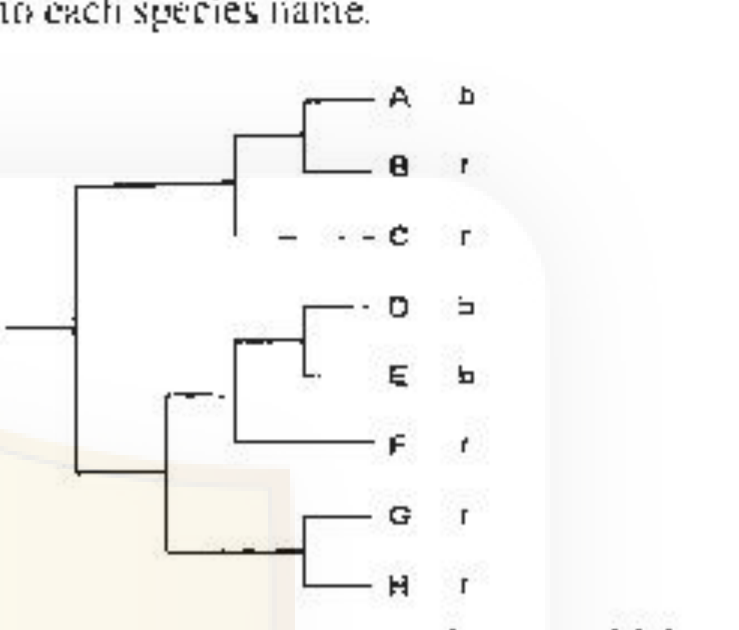

Based on the principle of parsimony, which of the following statements best represents the evolution of male body colour in this set of species?

1. The most recent common ancestor of all 8 species was blue; red evolved independently 3 times.
2. The most recent common ancestor of all 8 species was blue; red evolved independently 4 times.
3. The most recent common ancestor of all 8 species was red; blue evolved independently 3 times.
4. The most recent common ancestor of all 8 species was red; blue evolved independently 2 times.

**Answer: 4 (The most recent common ancestor of all 8 species was red; blue evolved independently 2 times)**

> **Explanation:** Fitch parsimony: the five reds (B, C, F, G, H) are scattered such that reconstructing the root as red is cheapest. Blue then needs only two changes — one on the branch to A, and one on the common ancestor of the sister pair D+E. That is 2 independent origins of blue with a red ancestor (total 2 steps), which is fewer than the alternatives. Hence the MRCA was **red and blue evolved independently 2 times**.

---

### Question 132

An alphabetical list of tropical rainforest mammals from South America and Africa is given below:

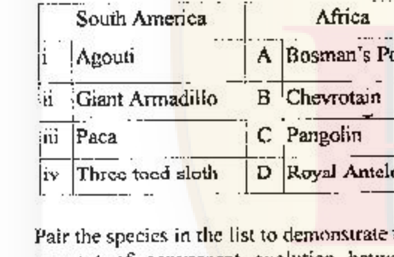

Pair the species in the list to demonstrate the concept of convergent evolution between the two continents.

1. i – D; ii – C; iii – A; iv – B
2. i – A; ii – C; iii – D; iv – B
3. i – A; ii – B; iii – D; iv – C
4. i – D; ii – C; iii – B; iv – A

**Answer: 4 (i – D; ii – C; iii – B; iv – A)**

> **Explanation:** The textbook convergence here is the Giant Armadillo (ii) with the Pangolin (C) — unrelated, armour-plated, ant/termite-eating forest mammals that evolved the same defence and feeding strategy on the two continents — so any correct option must pair ii–C, leaving options 1 and 4. The official SET-A key credits option 4, extending the pairing to i–D, iii–B, iv–A. (The remaining pairs are the credited answer; see `sources.md`.) Hence **i-D, ii-C, iii-B, iv-A**.

---

### Question 133

A study tested the importance of learning mechanisms in the development of anti-predator escape responses in tadpoles of a frog species. Tadpoles hatched from eggs in the lab were kept individually either with predator chemical cues (prior exposure) or without predator chemical cues (naive) for 1 week. These individuals were tested for their escape response when exposed to a live predator. They were tested either alone or together with 3 older experienced tadpoles. The graph below shows the escape response of the test individuals in the four different treatments.

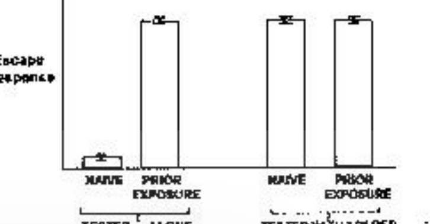

Some of the inferences drawn are given below:

A. Prior exposure to predator cues is necessary for the development of escape response.
B. Prior exposure to predator cues positively influences the development of escape response.
C. The presence of older experienced individuals is necessary for the development of escape response.
D. The presence of older experienced individuals positively influences the development of escape response.
E. An individual with prior exposure and with older and experienced individuals showed the strongest escape response.

Which one of the following combination of statements represents the correct inference from the experiment?

1. A and C
2. B and D
3. A and D
4. A, C and E

**Answer: 2 (B and D)**

> **Explanation:** Naive tadpoles tested alone show almost no escape response, but the response is high when they had prior exposure to predator cues (B true) *or* when they are tested with older experienced tadpoles (D true). Because either factor alone restores the response, neither prior exposure (A) nor experienced companions (C) is *necessary*, and the prior-exposure-plus-companions treatment is not greater than the others (E false). Hence **B and D**.

---

### Question 134

Beak shape in birds has evolved in response to their diet. The table listing bird species and food type is given below.

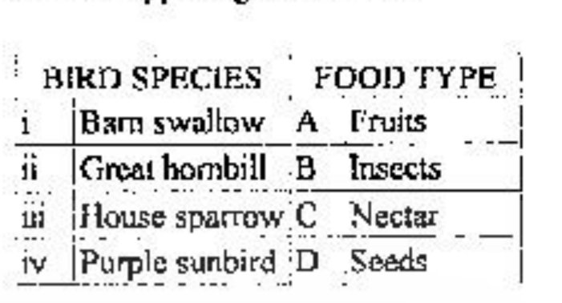

Match the bird species shown above to their main food resource.

1. i-D; ii-A; iii-C; iv-B
2. i-B; ii-D; iii-A; iv-C
3. i-C; ii-B; iii-D; iv-A
4. i-B; ii-A; iii-D; iv-C

**Answer: 4 (i-B; ii-A; iii-D; iv-C)**

> **Explanation:** The barn swallow (i) is an aerial insectivore → Insects (B); the great hornbill (ii) is a frugivore → Fruits (A); the house sparrow (iii) is a seed-eater with a conical bill → Seeds (D); the purple sunbird (iv) is a nectarivore with a long decurved bill → Nectar (C). Hence **i-B, ii-A, iii-D, iv-C**.

---

### Question 135

Given below are four statements related to *Agrobacterium*-mediated transfer of T-DNA into plant cells:

A. Production of single-stranded T-DNA by VirD1 and VirD2 proteins.
B. Interaction of VirE2 with VIP1 and VirE3.
C. Use of VirB/VirD4 type IV secretion system.
D. Activation of VirA-VirG complex.

Choose the correct sequence of events (from sensing to integration)?

1. A-B-D-C
2. B-C-A-D
3. C-A-B-D
4. D-A-C-B

**Answer: 4 (D-A-C-B)**

> **Explanation:** The pathway begins when phenolic compounds/sugars are sensed, activating the VirA–VirG two-component system (D). Phosphorylated VirG then drives expression of the vir genes, and VirD1/D2 nick the border repeats to excise the single-stranded T-DNA (A). The VirB/VirD4 type IV secretion system then translocates the T-strand (covalently capped by VirD2) into the plant cell (C). Finally VirE2, aided by VIP1 and VirE3, coats the T-strand to form the T-complex for nuclear import and integration (B). Hence **D → A → C → B**.

---

### Question 136

Construction of knockout mice may be performed using the Cre-LoxP system. Eventually, the Cre recombinase of the bacteriophage P1 mediates site-specific recombination at a 34 bp sequence, lox P. From the following statements, choose the INCORRECT event:

1. The alteration of the chromosomal copy of the target gene requires a guide RNA.
2. The loxP containing mice should not express Cre recombinase prior to mating.
3. The Cre recombinase can be expressed by an inducible promoter.
4. Induction of the promoter results in the expression of Cre, recombination at lox P sites and excision of the sequence in between.

**Answer: 1 (The alteration of the chromosomal copy of the target gene requires a guide RNA.)**

> **Explanation:** A guide RNA is a component of CRISPR-Cas9 genome editing, not of the Cre-LoxP system. Cre-LoxP uses only the Cre recombinase acting on loxP sites; no guide RNA is involved. Statements 2, 3 and 4 correctly describe the conditional-knockout logic (Cre kept off until mating/induction, then excising the floxed sequence). Hence the INCORRECT event is **1**.

---

### Question 137

Monoclonal antibodies can be modified for better research and therapeutic applications. Several such approaches are mentioned below (Column A) along with their possible applications (Column B).

Which one of the following options represents a correct combination of terms in Column A and Column B?

1. i-a; ii-b; iii-c
2. i-b; ii-a; iii-c
3. i-c; ii-b; iii-a
4. i-b; ii-c; iii-a

**Answer: 4 (i-b; ii-c; iii-a)**

> **Explanation:** Placing mouse antigen-binding sites onto a human antibody framework makes a humanized antibody, which reduces the side effects of xenogenic antibodies in immunotherapy → i-b. Conjugating an antibody to a cell-killing toxin creates an immunotoxin → ii-c. An antibody that binds and stabilizes the transition state of a reaction is catalytic, i.e. an abzyme → iii-a. Hence **i-b, ii-c, iii-a**.

---

### Question 138

Given below is a table comprising various terms associated with plant tissue culture in Column A and Column B.

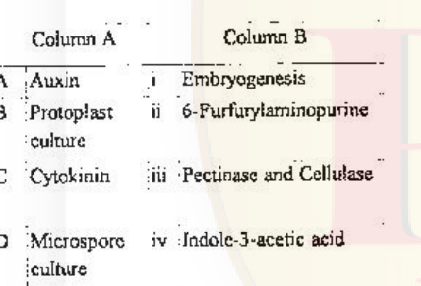

Which one of the following options represents the most appropriate match between all the terms of Column A and Column B?

1. A-ii; B-i; C-iv; D-iii
2. A-iv; B-iii; C-ii; D-i
3. A-ii; B-iv; C-i; D-iii
4. A-iv; B-i; C-ii; D-iii

**Answer: 2 (A-iv; B-iii; C-ii; D-i)**

> **Explanation:** Auxin is indole-3-acetic acid (A-iv); protoplast isolation uses pectinase and cellulase to remove the wall (B-iii); the cytokinin kinetin is 6-furfurylaminopurine (C-ii); and microspore (anther) culture is used to induce embryogenesis/androgenesis (D-i). Hence **A-iv, B-iii, C-ii, D-i**.

---

### Question 139

In an attempt to increase the yield of a commercially important enzyme from natural isolate, several strategies were adopted as follows:

A. Genome was selectively modified to increase yield.
B. Reappraisal of culture requirements of the modified organism to increase yield.
C. Induced mutants were screened and selected for organism synthesizing improved levels of the enzyme.
D. Organism was genetically modified, so that it produces a factor that enhances stability of the enzyme.

Which one of the following options represents strategies that are appropriate for the purpose?

1. A, B, C and D
2. B and C only
3. A, C and D only
4. A and B only

**Answer: 1 (A, B, C and D)**

> **Explanation:** All four are legitimate strain-improvement approaches for raising enzyme yield: targeted genome modification (A), optimising/reappraising the culture (fermentation) conditions (B), mutagenesis plus screening for over-producing clones (C), and engineering the organism to stabilise the enzyme (D). Hence **A, B, C and D**.

---

### Question 140

Given below are names of techniques (Column A) and their characteristic features/applications (Column B):

Which one of the following represents a correct match between Column A and Column B:

1. A – (ii); B – (iii); C – (iv); D – (i)
2. A – (iii); B – (iv); C – (i); D – (ii)
3. A – (iv); B – (i); C – (ii); D – (iii)
4. A – (ii); B – (iv); C – (i); D – (iii)

**Answer: 2 (A – (iii); B – (iv); C – (i); D – (ii))**

> **Explanation:** Hybridoma technology produces identical (monoclonal) antibodies (A-iii); MALDI-TOF mass spectrometry determines the molecular weight of proteins/peptides (B-iv); ion-exchange chromatography separates proteins by charge (C-i); and co-immunoprecipitation identifies protein complexes in cells (D-ii). Hence **A-iii, B-iv, C-i, D-ii**.

---

### Question 141

Three proteins, Blm 1, Blm 2, Blm 3 were shown to be involved in repair of DNA double strand breaks. A chromatin immunoprecipitation experiment was performed for the three proteins. The pattern of results obtained is shown below:

Based on the above figure, choose the option that correctly interprets the data.

1. Blm 1, Blm 2, Blm 3 bind to DNA break sites
2. Blm 1 binds to the break site; Blm 3 binds to the break site and beyond
3. Blm 2 remains bound to DNA after the break is induced
4. Blm 3 binds to DNA irrespective of the break

**Answer: 2 (Blm 1 binds to the break site; Blm 3 binds to the break site and beyond)**

> **Explanation:** After the break, Blm 1 is enriched only at the 0 Kb (break-site) position, whereas Blm 3 is enriched at both 0 Kb and 1 Kb — i.e. at the break site and the flanking region beyond it. Blm 2's signal is present before the break and lost after it (so it does not remain bound, ruling out 3), and Blm 3 is recruited only after the break (ruling out 4). Hence **Blm 1 binds the break site; Blm 3 binds the break site and beyond**.

---

### Question 142

The most important property of any microscope is its resolution (D). Which one of the following wavelengths (nm) would be used to achieve the best resolution using a light microscope with lenses having numerical aperture (NA) of 1.4?

1. 450
2. 480
3. 560
4. 700

**Answer: 1 (450)**

> **Explanation:** Resolution distance d = 0.61λ/NA, so the smallest resolvable distance (best resolution) is obtained with the shortest wavelength. Of the options, 450 nm is the shortest wavelength, giving the best resolution. Hence **450**.

---

### Question 143

Detailed NMR spectra of a 20-residue peptide were recorded using a 600 MHz instrument. If the peptide adopts an α-helical conformation, which one of the following statements is correct?

1. Prominent NHᵢ – NHᵢ₊₁ NOE peaks would be observed along with ³JNH-Hα coupling constants ~ 8.5 Hz
2. Prominent CαHᵢ – NHᵢ₁ NOE peaks would be observed along with ³JNH-Hα coupling constants ~ 4.8 Hz
3. Prominent CαHᵢ – CαHᵢ₊₁ NOE peaks would be observed along with ³JNH-Hα coupling constants ~ 8.5 Hz
4. Prominent NHᵢ – NHᵢ₊₁ NOE peaks would be observed along with ³JNH-Hα coupling constants ~ 4.8 Hz

**Answer: 4 (Prominent NHᵢ – NH₊₁ NOE peaks would be observed along with ³JNH-Hα coupling constants ~ 4.8 Hz)**

> **Explanation:** An α-helix is defined by a small backbone dihedral that gives a small ³JNH-Hα coupling (~4–5 Hz) and, because of its i→i+1 geometry, strong sequential amide–amide (NHᵢ–NHᵢ₊₁) NOEs. The large ~8.5 Hz coupling and CαH–NH/CαH–CαH NOEs are hallmarks of the extended β-strand, not the helix. Hence **4**.

---

### Question 144

Given below are names of statistical distribution (Column I) and their characteristic features (Column II)

Which one of the following represents a correct match between columns I and II?

1. A – (ii); B – (i); C – (iii)
2. A – (i); B – (ii); C – (iii)
3. A – (i); B – (iii); C – (ii)
4. A – (iii); B – (ii); C – (i)

**Answer: 3 (A – (i); B – (iii); C – (ii))**

> **Explanation:** The binomial distribution describes trials with one of two outcomes, success or failure (A-i); the Poisson distribution gives the probability of a given number of events in a fixed interval of time (B-iii); and the normal distribution is the bell-shaped curve symmetric about the mean (C-ii). Hence **A-(i), B-(iii), C-(ii)**.

---

### Question 145

Highly purified peptides P1, P2 and P3 were subjected to MALDI mass spectral analysis. The following observations were made:
P1: Showed a m/z of 16 more than the expected value.
P2: Showed a m/z of 80 more than the expected value. MS/MS spectra of the peptide resulted in a precursor ion with m/z 98 less than the expected m/z.
P3: Showed a m/z that was double the expected value.
[Note: z = +1 for all the mass spectra.]

Which one of the options given below comprises all correct interpretations?

1. P1: Cys is oxidized; P2: has undergone oxidation at multiple Met residues; P3: is a non-covalent dimer.
2. P1: Met is oxidized; P2: is phosphorylated; P3: is a covalent dimer.
3. P1: Met is oxidized; P2: multiple Cys are oxidized; P3 is a covalent dimer.
4. P1: Cys is oxidized; P2: phosphorylated and oxidized at Met; P3: is a non-covalent dimer.

**Answer: 2 (P1: Met is oxidized; P2: is phosphorylated; P3: is a covalent dimer.)**

> **Explanation:** A +16 Da shift on P1 is a single oxygen addition, i.e. oxidation of methionine to Met-sulfoxide. A +80 Da shift on P2 is the hallmark of phosphorylation (HPO₃ = +80), confirmed by the diagnostic neutral loss of 98 Da (H₃PO₄) in MS/MS. A doubled m/z on P3 that survives MALDI desorption indicates a covalently linked dimer (a non-covalent complex would dissociate). Hence **P1 Met oxidized, P2 phosphorylated, P3 covalent dimer**.

