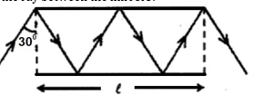
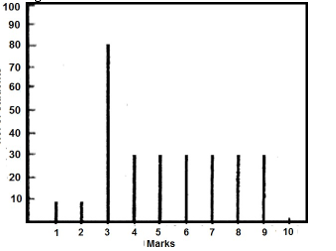
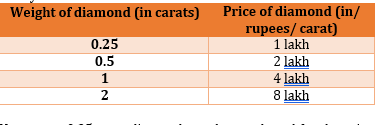
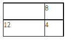
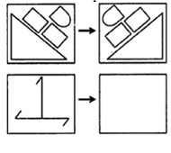
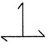
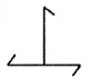
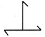
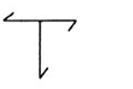

# CSIR NET Life Sciences - June 2018 - Part A

20 questions (general aptitude / reasoning). Global numbering Q1-Q20.

---

### Question 1

In a 100 m race A beats B by 10 m. B beats C by 5 m. By how many meters does A beat C?

1. 15.0 m
2. 10.5 m
3. 5.5 m
4. 14.5 m

**Answer: 4 (14.5 m)**

> **Explanation:** When A has run 100 m, B has run 90 m. When B runs 100 m, C runs 95 m, so when B runs 90 m C runs 90x0.95 = 85.5 m. A therefore beats C by 100 - 85.5 = 14.5 m.

---

### Question 2

Suppose (i) "A*B" means "A is the father of B", (ii) "A Δ B" means "A is the husband of B", (iii) "A ∇ B" means "A is the wife of B" and (iv) "A □ B", means "A is the sister of B".

Which of the following represents "C is the father-in-law of the sister of D"?

1. C ∇ E*F □
2. C*E ∇ F □ D
3. C Δ E*F □ D
4. C*E Δ F □ D

**Answer: 4 (C*E Δ F □ D)**

> **Explanation:** Sister of D is F (F □ D). Father-in-law of F is the father of F's husband. F's husband is E (E Δ F), and E's father is C (C*E). So C*E Δ F □ D reads: C is father of E, E is husband of F, F is sister of D - making C the father-in-law of the sister of D - option 4.

---

### Question 3

In a group of 11 persons each shakes hand with every other once and only once. What is the total number of such handshakes?

1. 110
2. 121
3. 55
4. 66

**Answer: 3 (55)**

> **Explanation:** Number of handshakes = C(11,2) = 11x10/2 = 55.

---

### Question 4

Path of a ray of light between two mirrors is shown in the diagram. If the length of each mirror is l, what is the total path length of the ray between the mirrors?

1. 3l/4
2. 4l/3
3. 3l/2
4. 2l

**Answer: 4 (2l)**

> **Explanation:** The ray reflects between two parallel mirrors of length l at 30 degrees; resolving the equal slanted segments along the mirror gives a total path length of 2l - option 4.

---

### Question 5

What is the value of (1+3+5+7+….. + 4033) + 7983 × 2017?

1. 20170000
2. 20172017
3. 20171720
4. 20172020

**Answer: 1 (20170000)**

> **Explanation:** 1+3+5+...+4033 is the sum of the first 2017 odd numbers = 2017^2. So the expression = 2017^2 + 7983x2017 = 2017(2017+7983) = 2017x10000 = 20170000.

---

### Question 6

What is the last digit of (2017)^2017?

1. 1
2. 3
3. 7
4. 9

**Answer: 3 (7)**

> **Explanation:** The last digit of 2017^n cycles 7,9,3,1 (period 4). 2017 mod 4 = 1, so the last digit equals that of 7^1 = 7.

---

### Question 7

Pick the correct statement:

1. The sky is blue because Sir C.V. Raman gave the correct explanation.
2. Copernicus believed that the Sun, and not the Earth, was at the centre of the Solar system .
3. The sky appears blue when seen from the Moon.
4. No solar eclipse is visible for an astronaut standing on the Moon

**Answer: DROPPED**

> **Explanation:** DROPPED by the official key (benefit of marks to all who attempted). Statement 2 (Copernicus placed the Sun at the centre) is the factually correct one.

---

### Question 8

A librarian is arranging a thirteen-volume encyclopaedia on the shelf from left to right in the following order of volume numbers: 8, 11, 5, 4, 9, 1, 7, 6, 10, 3, 12, 2. In this pattern, where should the volume 13 be placed?

1. Leftmost
2. Rightmost
3. Between 10 and 3
4. Between 9 and 1

**Answer: 3 (Between 10 and 3)**

> **Explanation:** The volumes are arranged in **alphabetical order of their spelled-out names** (eight, eleven, five, four, nine, one, seven, six, ten, three, twelve, two). Inserting "thirteen" alphabetically puts it after "ten" and before "three", i.e. between volumes 10 and 3 - option 3.

---

### Question 9

Nine-eleventh of the members of a parliamentary committee are men. Of the men, two-thirds are from the Rajya Sabha. Further, 7/11 of the total committee members are from the Rajya Sabha. What fraction of the total number are women from the Lok Sabha?

1. 1/11
2. 6/11
3. 2/11
4. 3/11

**Answer: 1 (1/11)**

> **Explanation:** Let total = 11. Men = 9, women = 2. Men in Rajya Sabha = (2/3)x9 = 6. Total Rajya Sabha = 7, so women in Rajya Sabha = 1, hence women in Lok Sabha = 2 - 1 = 1. Fraction = 1/11.

---

### Question 10

When a farmer was asked as to how many animals he had, he replied that all but two were cows, all but two were horses and all but two were pigs. How many animals did he have?

1. 3
2. 6
3. 8
4. 12

**Answer: 1 (3)**

> **Explanation:** 'All but two are cows, all but two horses, all but two pigs' is satisfied by exactly 3 animals (one of each).

---

### Question 11

The distribution of marks of students in a class is given by the following chart: If 3.30 marks is the passing score in a 10 mark question paper, which of the following is false?

1. Majority of the students have scored above the pass mark
2. Mode of the distribution is 3
3. Average marks of passing students is above 55%
4. Average marks of students who have failed is below 20%

**Answer: 4 (Average marks of students who have failed is below 20%)**

> **Explanation:** From the histogram the failed students (marks below 3.30) are those at 1, 2 and 3 (frequencies about 8, 8 and 80). Their average mark is (8x1 + 8x2 + 80x3)/96 = 264/96 = 2.75, i.e. 27.5% of 10 - above 20%, so the statement that the failed average is below 20% is FALSE - option 4.

---

### Question 12

Mohan lent Geeta as much money as she already had. She then spent Rs. 10. Next day, he again lent as much money as Geeta now had, and she spent Rs. 10 again. On the third day, Mohan again lent as much money as Geeta now had, and she again spent Rs. 10. If Geeta was left with no money. at the end of the third day, how much money did she have initially?

1. Rs.11.25
2. Rs.10
3. Rs. 7.75
4. Rs. 8.75

**Answer: 4 (Rs. 8.75)**

> **Explanation:** Working backwards: end 0; before the third spend/lend she had 5; before the second 7.5; initially 8.75. (Each reverse step: x -> (x+10)/2.)

---

### Question 13

In a sequence of 24 positive integers, the product of any two consecutive integers is 24. If the 17 th member of the sequence is 6, the 7 th member is

1. 24
2. 4
3. 6
4. 17

**Answer: 3 (6)**

> **Explanation:** Consecutive product 24 forces the sequence to alternate a, 24/a. Odd positions share one value; 17th = 6 so 7th (also odd position) = 6.

---

### Question 14

The prices of diamonds having a particular colour and clarity are tabulated below: How many 0.25 carat diamonds can be purchased for the price of a 2 carat diamond?

1. 8
2. 16
3. 32
4. 64

**Answer: 4 (64)**

> **Explanation:** The table gives price **per carat**. A 2-carat diamond costs 2 x 8 = 16 lakh in total. A 0.25-carat diamond costs 0.25 x 1 = 0.25 lakh in total. Number of 0.25-carat diamonds affordable = 16 / 0.25 = 64 - option 4.

---

### Question 15

The university needs to appoint a new Vice Chancellor which will be based on seniority. Ms. West is less senior to Mr. North but more senior to Ms. East. Mr. South is senior to Ms. West but junior to Mr. North. If the senior-most declines the assignment, then who will be the new Vice Chancellor of the University?

1. Mr. North
2. Ms. East
3. Ms. West
4. Mr. South

**Answer: 4 (Mr. South)**

> **Explanation:** Seniority order: North > South > West > East. The senior-most (North) declines, so the next in line, Mr South, is appointed.

---

### Question 16

Areas of the three rectangles inside the full rectangle are given in the diagram What is the area of the full rectangle?

1. 36
2. 48
3. 72
4. 96

**Answer: 2 (48)**

> **Explanation:** The three inner rectangles share sides with the outer rectangle; if two adjacent areas are 8 and 12 and the third is 4, the fourth panel = (8x12)/4 = 24, giving total area 8+12+4+24 = 48.

---

### Question 17

Which should be the correct pattern in the empty square?

1.
   
2.
   
3.
   
4.
   

**Answer: 3**

> **Explanation:** The figure in each row is combined by overlaying/cancelling line segments; the pattern completing the empty square is option 3.

---

### Question 18

How much gold and copper (in g), respectively, are required to make a 120 g bar of 22 carat gold?

1. 90 and 30
2. 100 and 20
3. 110 and 10
4. 120 and 0

**Answer: 3 (110 and 10)**

> **Explanation:** 22-carat gold is 22/24 pure. Gold = 120x22/24 = 110 g; copper = 120 - 110 = 10 g.

---

### Question 19

A water tank that is 40% empty holds 40 L more water than when it is 40% full. How much water does it hold when it is full?

1. 100 L
2. 75 L
3. 120 L
4. 200 L

**Answer: 4 (200 L)**

> **Explanation:** Let capacity = C. 40% empty holds 0.6C; 40% full holds 0.4C. 0.6C - 0.4C = 40, so 0.2C = 40 and C = 200 L.

---

### Question 20

If all the angles of a triangle are prime numbers, which of the following could be one such angle?

1. 89°
2. 79°
3. 59°
4. 29°

**Answer: 1 or 4 (89° / 29°)**

> **Explanation:** Three prime angles summing to 180 (even) require one angle = 2 and the other two primes summing to 178. Valid triples include (2,89,89) and (2,29,149), so both 89 degrees and 29 degrees are possible; the key accepts options 1 and 4.
