# CSIR NET Life Sciences - June 2018 - Part C

75 questions. Global numbering Q71-Q145.

---

### Question 71

Following are structures of stereoisomers of aldohexoses which differ in the stereochemistry based on above structures, following information was given below:

A. D-glucose and D-mannose are epimers because they differ in the stereochemistry at C-2 position.

B. D-glucose and D-galactose are epimers because they differ in the stereochemistry at C-4 position.

C. D-mannose and D-glucose are epimers because they differ in the stereochemistry at C-3 position.

D. D-galactose and D-glucose are epimers because they differ in the stereochemistry at C-5 position.

Choose one of the correct combinations of above statements:

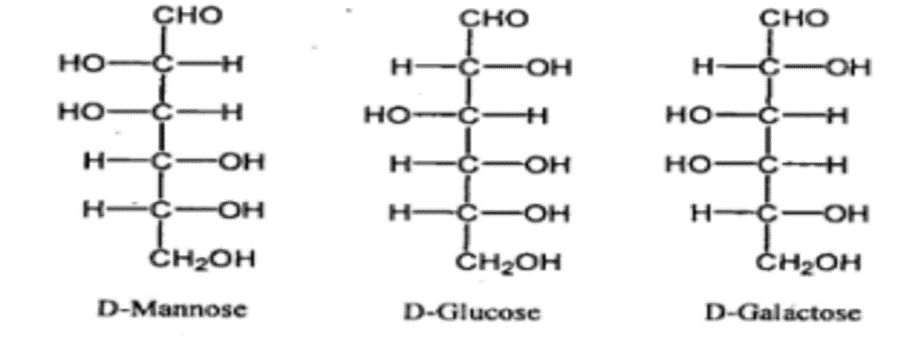

1. A and B
2. C and D
3. B, C and D
4. A and D

**Answer: 1 (A and B)**

> **Explanation:** Epimers differ at exactly one carbon: glucose/mannose at C-2 (A true) and glucose/galactose at C-4 (B true); C and D are wrong. Option 1.

---

### Question 72

Following statements are made related to protein structure

A. The hydrogen bonding patterns between the CO and NH groups are n → n + 3 in α-helix; n → n + 4 in 310 helix and n → n+ 5 in π helix.

B. In a β turn, there are 10 atoms between the hydrogen bond donor and acceptor.

C. In a tum, there are 6 atoms between the hydrogen bond donor and acceptor.

D. Parallel sheets have evenly spaced hydrogen bonds, which bridge the strands at an angle.

Which one of the following combinations of above statements is correct?

1. A and C
2. A and B
3. C and D
4. B and D

**Answer: 4 (B and D)**

> **Explanation:** A beta-turn has 10 atoms between donor and acceptor (B) and a gamma/alpha-type turn statement plus parallel-sheet geometry (D); the correct combination is B and D - option 4.

---

### Question 73

The following statements are made on nucleic acid structure:

A. In the B-form of DNA, the sugar pucker is C2' endo.

B. In RNA, the sugar pucker is C3' exo .

C. The wobble base pair is formed between G and A in RNA.

D. A change in the sugar pucker from C2' endo in the B form of DNA to C3' endo alters the width and depth of the major groove.

Which one of the following combinations of above statements is correct?

1. A and C
2. B and D
3. A and D
4. B and C

**Answer: 3 (A and D)**

> **Explanation:** B-DNA has C2'-endo sugar pucker (A true); changing pucker alters major-groove width/depth (D true). Option 3.

---

### Question 74

The Vmax and Km from a Lineweaver-Burk plot of an enzyme reaction where 1 𝑣 1 / v = 40 μ M ^( -1 ) min at 1 𝑆 1 / S = 0 and 1 𝑆 1 / S = -1.5 × 10 2 10 ^ 2 at m 𝑀 −1 M ^( -1 ) at 1 𝑣 1 / v = 0 are

1. 0.025 µM min-1 and 0.67 × 10 ^( -2 ) mM
2. 0.025 µM-1 min and 0.67 × 10 ^( -2 )
3. 0.025 µM min-1 and 1.5 × 10 ^ 2 mM^-1
4. 0.038 µM min-1 and 0.67 × 10 ^( -2 ) mM

**Answer: 1 (0.025 µM min-1 and 0.67 × 10 ^( -2 ) mM)**

> **Explanation:** 1/Vmax = 40 so Vmax = 0.025 uM/min; the x-intercept -1/Km = -1.5x10^2 gives Km = 0.67x10^-2 mM - option 1.

---

### Question 75

From the following statements:

A. Biosynthesis of proteins and nucleic acids from precursors results in production of chemical energy in the form of ATP, NADH, NADPH and FADH2,

B. The spontaneity of a reaction in cells does not depend whether ΔG0 for the reaction is positive or negative.

C. Both oxidative phosphorylation and photo- phosphorylation involve oxidation of H2O to O2.

D. Only chemical potential energy contributes to proton motive force in mitochondria.

Which one of the following combinations represents all INCORRECT statements?

1. A, B, C
2. B, C, D
3. A, B, D
4. A, C, D

**Answer: 4 (A, C, D)**

> **Explanation:** A (anabolic synthesis consumes, not produces, ATP), C (photophosphorylation splits water but oxidative phosphorylation does not oxidise water) and D (proton-motive force has both chemical and electrical terms) are INCORRECT - option 4.

---

### Question 76

Match the enzymes in Column A with their respective biological function in Column B:

Choose the correct combinations of answers from the options given below: Column A Column B A Lipases i. Catalysis of ATP-dependent translocation of the aminophospholipids, phosphatidyl ethanolamine and phosphatidylserine from the extracellular to the cytosolic leaflet of the plasma membrane B Flippases ii. Catalysis of AT P-dependent translocation of plasma membrane phospholipids from the cytosolic to the extracellular lea flet. C Floppases iii. Catalyze hydrolysis of triacylglycerols. D Scramblase iv. Catalyze the movement of any membrane phospho-lipid across the bilayer down its concent ration gradient.

1. A - iii, B - i , C - ii, D – iv
2. A - i , B - iii, C - iv, D - ii
3. A - iv, B- ii, C - i , D- iii
4. A- ii, B- iv, C - iii, D – i

**Answer: 1 (A - iii, B - i , C - ii, D – iv)**

> **Explanation:** Lipases hydrolyse TAG (iii), flippases move aminophospholipids inward (i), floppases move lipids outward (ii), scramblase moves any lipid down its gradient (iv) - option 1.

---

### Question 77

An integral membrane protein (P) has been identified as a cell surface protein of hepatocytes and assigned to bind to hepatitis B virus (HBV) and promote its entry into cytosol. Upon binding to HBV particles, the C-terminal of P interacts with F-actin in the cytosol and in turn, helps in the entry of the HBV particles. P was successfully cloned and expressed in animal cells in culture wherein its N- terminal is exposed on the surface while the C-terminal resides in the cytosol. The recombinant protein P so expressed retains its complete structure and function.

From the list of experiments given below, which one of the experiments will you perform to show that C- terminal of the protein P via interacting with F-actin helps in HBV entry?

1. Incubating radio labelled HBV with hepatocytes in culture and follow up its association with F-actin by immunoprecipitation analysis using anti-F-actin antibody.
2. Incubating radio labelled HBV with hepatocytes overexpressing the C- terminal mutant of P and repeat the rest of the experiment as in "1"
3. Incubating radio labelled HBV with· hepatocytes overexpressing the N- terminal mutant of P and repeat the rest of t the experiment as in "1".
4. Using wild type P as well as C-terminal mutant of P and their individual over- expression in a heterologous cell line (completely devoid of endogenous P protein) and then repeat experiment as in "1 "

**Answer: 4 (Using wild type P as well as C-terminal mutant of P and their individual over- expression in a heterologous cell line (completely devoid of endogenous P protein) and then repeat experiment as in "1 ")**

> **Explanation:** To prove the C-terminus of P acts via F-actin for HBV entry, compare wild-type P with a C-terminal mutant over-expressed in a P-null heterologous line - option 4.

---

### Question 78

The cell membrane of neuron maintains intracellular conditions that differ from those of the extracellular environment. Such difference in intra- and extracellular conditions are critical to the function of the nerve cell as then nerve cell membrane resembles a charged capacitor. Assuming the electric field (E) across a parallel-plate capacitor is uniform and if membrane thickness is 7 nm and potential difference across the membrane is -60 mV, calculate E of the membrane.

1. 6 × 105 V m -1
2. 7 × 105 V m -1
3. 8.6 × 106 V m -1
4. 6.6 × 106 V m -1

**Answer: 3 (8.6 × 106 V m -1)**

> **Explanation:** E = V/d = 60x10^-3 V / 7x10^-9 m = 8.6x10^6 V/m - option 3.

---

### Question 79

Two liposome preparations ("X" and "Y") are made using basic lipid composition as phosphatidylcholine (PC) and cholesterol (Chol). In "Y" a ganglioside (asialo-GM1) is incorporated during the preparation besides PC and Chol. In an attempt to find out the localization of asialo-GM1, in the membrane bilayer of "Y" (taking "X" as a negative control) and considering liposome as a true depiction of lipid bilayer structure of cellular membrane, following reagents are provided as probes:

A. Phospholipase A

B. Galactose binding lectin

C. Exoglycosidase

D. Cyclodextrin

Choose the most appropriate reagent(s) from the above list to ascertain the localization of asialo-GM1-

1. Only A
2. Both C and D
3. Both B and C
4. Both A and D

**Answer: 3 (Both B and C)**

> **Explanation:** The ganglioside sugar head-group is extracellular, so a galactose-binding lectin (B) and an exoglycosidase (C) probe its outer leaflet - option 3.

---

### Question 80

Genes translocated to the heterochromatic regions of chromosomes are silenced. In S. pombe, a translocation event was detected wherein a gene of interest was translocated to the centromere region and is silenced. Mutagenesis leading to loss of function of the following target genes was done to allow expression of the gene of interest from its new locus.

A. Mutation in histone deacetylase (Clr3).

B. Mutation in histone acetyltransferase (HAT-8).

C. Mutation in histone H3 lysine 9 methyl transferase (Clr4).

D. Loss of Dicer, an RNA processing enzyme.

Which of the above events could allow the expression of this gene from the centromeric region?

1. A, B and C
2. A, C and D
3. B and C only
4. A and C only

**Answer: 2 (A, C and D)**

> **Explanation:** Centromeric silencing needs Clr3 deacetylase, Clr4 H3K9 methyltransferase and Dicer-dependent RNAi; losing any of these (A, C, D) relieves silencing - option 2.

---

### Question 81

A group of scientists performed an experiment where the)' artificially fused mouse cells with monkey cells. The resulting fused cells were labelled with fluorescently tagged antibodies against mouse and monkey surface receptor proteins, X and Y respectively. At the time 0 minute just after fusion events, two receptors were confined to their own half in the heterokaryon. However, such surface receptors (X and Y) intermixed on the cell surface after 60 minutes.

Which one of the given statements correctly reflects the outcome of the experiment?

1. The proteins in cytoplasm are in a dynamic state.
2. The proteins on the membrane surface are in a dynamic state .
3. Surface membrane proteins exchange with the cytosolic proteins.
4. Membrane surface proteins are in a static phase.

**Answer: 2 (The proteins on the membrane surface are in a dynamic state .)**

> **Explanation:** Intermixing of labelled surface receptors shows membrane proteins are dynamically mobile (Frye-Edidin) - option 2.

---

### Question 82

Eg5 is a well-studied protein in Xenopus. To understand the function of Eg5 in mammalian cells, a team of researchers treated mammalian cells during late G2 phase with Eg5- inhibitor.

The following diagrams represent images of mitotic cells

Based on the above observation, what function might be attributed to Eg5 during mitosis?

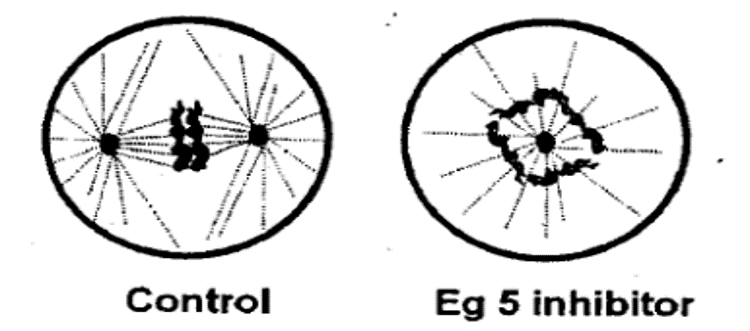

1. Eg5 inhibits actin dynamics.
2. Eg5 can activate GPCR Signalling .
3. Eg5 has motor activity.
4. Eg5 can impact mitochondrial dynamics.

**Answer: 3 (Eg5 has motor activity.)**

> **Explanation:** Eg5 inhibition collapses the bipolar spindle into a monopolar astere, so Eg5 is a plus-end-directed motor needed for spindle pole separation - option 3.

---

### Question 83

Actinomycin D inhibits the process of transcription in both prokaryotic and eukaryotic organisms.

The following statements are made about actinomycin D- mediated inhibition of transcription:

A. Actinomycin D inhibits transcription from a double stranded DNA template by either E. coli or yeast RNA polymerases.

B. Actinomycin D inhibits transcription from a single stranded RNA template by eukaryotic viral RNA polymerases.

C. Actinomycin D inhibits transcription from single stranded Φ × 174 DNA template by E. coli RNA polymerase, immediately after viral DNA entry.

D. Actinomycin D inhibits transcription from double stranded RNA template by eukaryotic RNA polymerase II.

Which of the combinations of the above statements is a true representation of the mechanism of actinomycin D mediated inhibition?

1. A only
2. A, B and D
3. A, B and C
4. A and D only

**Answer: 1 (A only)**

> **Explanation:** Actinomycin D intercalates double-stranded DNA and blocks transcription from dsDNA templates (A only) - option 1.

---

### Question 84

During maturation process of some RNA molecules, formation of a 2'- 5' phospho- diester bond takes place.

Following statements are made about this phenomenon.

A. Spliceosome mediated removal of intronic sequences occurs through the formation of a 2'- 5' phosphodiester bond.

B. Removal of group II introns occurs through the formation of 2'- 5' phospho- diester bond.

C. Enzymatic removal of introns from the yeast tRNA precursors involves 2' - 5' phosphodiester bond formation.

D. RNaseP mediated 5'-end maturation of tRNA precursors involves formation of a 2' - 5' phosphodiester bond

Which one of the following combinations of the statements is a true representation?

1. A only
2. A and D
3. A and B
4. C and D

**Answer: 3 (A and B)**

> **Explanation:** A 2'-5' phosphodiester bond forms in the spliceosomal lariat (A) and in group-II-intron lariat splicing (B) - option 3.

---

### Question 85

A plasmid with a linking number (Lk) of 200, topological winding (Tw) number of 200 and a writhing number ( Wr ) of 0 was transformed into E. coli. The plasmid was re-isolated from the culture of the transformant. The re-isolated plasmid was found to possess the same molecular weight as the original plasmid, but it possessed a writhing number of -5.

Following statements are made about this observation.

A. Lk of the re-isolated plasmid would be 195.

B. Lk of the re-isolated plasmid would remain 200.

C. Tw of the re-isolated plasmid would remain 200.

D. Tw of the re-isolated plasmid would be 195

Which one of the following combinations of the above statements is correct representation of the facts?

1. A only
2. A and C
3. A and D
4. D only

**Answer: 2 (A and C)**

> **Explanation:** Relaxing supercoils changes Lk: with Wr = -5 and Tw unchanged at 200, Lk = Tw + Wr = 195 (A) and Tw stays 200 (C) - option 2.

---

### Question 86

Following statements are being made about the orientation of the N-glycosidic bond between the base and the sugar in the following DNA duplexes. A. 'anti' for B form DNA duplexes B. ' syn ' for B form DNA duplexes C. 'anti' for A form DNA duplexes D. ' syn ' for A form DNA duplexes

Which one of the following combinations of the above statements is correct?

1. A and C
2. B and C
3. A and D
4. B and D

**Answer: 1 (A and C)**

> **Explanation:** B-form DNA bases are anti (A) and A-form DNA bases are also anti; the keyed combination is A and C - option 1.

---

### Question 87

During translation in prokaryotes, when ribosomes reach the termination codon, the termination codon is recognized by the class I release factors (RF1 or RF2) leading to the release of the polypeptide. A second class II release factor (RF3) facilitates the termination process.

Which of the following statements regarding the mechanism of action of the release factors is INCORRECT?

1. Class I release factors decode the stop codons while the RF3 is a GTPase that stimulates recycling of the class I release factors.
2. Free RF3 has a higher affinity for GTP than GDP
3. RF1 and RF2 share a conserved segment of 'GGQ' sequence which is essential for the polypeptide release.
4. RF1and RF2, individually possess another stretch of tripeptide sequences which are involved in the recognition of the termination codons.

**Answer: 2 (Free RF3 has a higher affinity for GTP than GDP)**

> **Explanation:** Statement 2 is INCORRECT: free RF3 has higher affinity for GDP than GTP; GTP loading is promoted by RF1/RF2 at the stop codon.

---

### Question 88

E. coli DNA ligase catalyses formation of a phosphodiester pond between the adjoining 3' hydroxyl, and the 5' phosphoryl ends in DNA duplexes. The energetic need for this reaction is met by the hydrolysis of NAD+ to NMN+ and AMP in a three-step reaction.

Following statements are being made about the mechanism of this reaction. (i) AMP is linked to the 5' phosphoryl end of the nicked DNA. (ii) Adenylyl group of NAD+ is transferred to the -amino group of Lys in DNA ligase to form a phosphoamide adduct. (iii) DNA ligase catalyses the formation of a phosphodiester bond by the nucleophilic attack of the 3' hydroxyl group onto the phosphate and releases AMP

Based on the statements made above, identify the correct sequence of the reaction steps.

1. ( i )-(ii)-(iii)
2. ( i )-(iii)-(ii)
3. (ii) -( i )-(iii)
4. (iii)-( i )-(ii)

**Answer: 3 ((ii) -( i )-(iii))**

> **Explanation:** E. coli DNA-ligase steps: NAD+ adenylyl transfer to ligase lysine (ii), AMP to the 5'-phosphate at the nick (i), then 3'-OH attack sealing the bond and releasing AMP (iii) - option 3.

---

### Question 89

Given below are the types of vaccination (column A), the diseases or conditions against which these vaccination types are used (column 8) and the advantages or disadvantages for using these vaccination types (column C).

Which one of the following combinations is the most appropriate match? A B C a) Live attenuated (i) Rabies (x) Strong immune response; often life-long immunity with a few dose b) Inactivated or killed (ii) Measles (y) Stable immune response; cold chain is not required c) Inactivated exotoxin (iii) Diptheria (z) Chance of untoward immunological reactions are very low; less successful in inducing long-term immunity; need to be administered rep eatedly

1. a- i -z, b-ii-y, c-iii-x
2. a-ii-x, b- i -y, c-iii-z
3. a-iii-y, b-ii-x, c- i -z
4. a-ii-z, b-iii-x, c- i -y

**Answer: 2 (a-ii-x, b- i -y, c-iii-z)**

> **Explanation:** Live attenuated (measles) give strong lifelong few-dose immunity (x); killed (rabies) give stable response without cold-chain issues (y); toxoid (diphtheria) is safe but needs repeated doses (z) - option 2.

---

### Question 90

G protein-coupled receptors (GPCRs) are used to detect and respond to many different types of signals, including neurotransmitters, hormones involved in glycogen and fat metabolism and even photons of light.

Which one of the following statements regarding GPCR is INCORRECT?

1. GPCRs are a large family with a common structure of seven membrane spanning α helices
2. GPCRs are coupled to trimeric G proteins comprising three subunits α, β and γ
3. The Gα subunit is a GTPase switch protein that alternates between an active ('on') state with bound GTP and an inactive ('off’) state with GDP
4. The 'on' form gets bound to β and subunits and activates a membrane bound effector like adenylyl cyclase, phospholipase C or ion channel .

**Answer: 4 (The 'on' form gets bound to β and subunits and activates a membrane bound effector like adenylyl cyclase, phospholipase C or ion channel .)**

> **Explanation:** The active GTP-bound Galpha dissociates from the beta-gamma dimer to hit the effector; the statement that the 'on' form gets bound to beta-gamma is INCORRECT - option 4.

---

### Question 91

The following intracellular event occurs in a cell that is subjected to conditions of starvation.

Which one of the following statements correctly represents the event shown above?

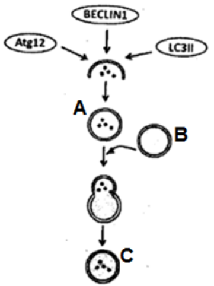

1. The cell is undergoing apoptotic cell death with the help of lysosomes (A).
2. The cell is undergoing autophagy by formation of auto phagolysosomes (C)
3. The cell is undergoing necroptosis.
4. The cell is undergoing autophagy and fusion occurs between lysosome (B) and auto phagolysosome (A).

**Answer: 2 (The cell is undergoing autophagy by formation of auto phagolysosomes (C))**

> **Explanation:** Starvation induces autophagy: an isolation membrane engulfs cytoplasm forming an autophagosome (A) that fuses with a lysosome (B) to become the autolysosome (C) - option 2.

---

### Question 92

The extracellular matrix (ECM) is a complex combination of secreted proteins that is involved in holding cells and tissues together. The components of ECM form a network by binding to each other and communicate with cells by binding to adhesion receptors on the cell surface. ECM comprises mainly two classes of macromolecules, proteoglycans and very high molecular weight large proteins.

Which one of the following statements regarding ECM constituents is INCORRECT?

1. Proteoglycans are a subset of secreted or cell surface attached glycoproteins containing covalently linked specialized polysaccharide chains called glycosamino - glycans (GAGs).
2. GAGs are long branched polymers of specific repeating disaccharides of sialic acid and glucose or galactose.
3. Major types of GAGs present in ECM are heparan sulphate, chondroitin sulphate, dermatan sulphate, keratan sulphate and hyaluronan.
4. Major types of large proteins present in ECM are collagen, laminin, elastin and fibronectin.

**Answer: 2 (GAGs are long branched polymers of specific repeating disaccharides of sialic acid and glucose or galactose.)**

> **Explanation:** GAGs are unbranched repeating disaccharides of an amino sugar with uronic acid (not sialic acid/glucose) - statement 2 is INCORRECT.

---

### Question 93

Present-day cancer treatment uses many approaches. Beyond surgery and radiation treatment, which are most often employed in cases of larger, more discrete tumors, drug therapies can be used to target residual tumor cells and to attack dispersed cancers. Chemotherapies by anti-cancer drugs are mostly aimed at blocking DNA synthesis and cell division. A list of anti-cancer drugs is given in column A, their chemical nature in column Band their mechanism of action in column C.

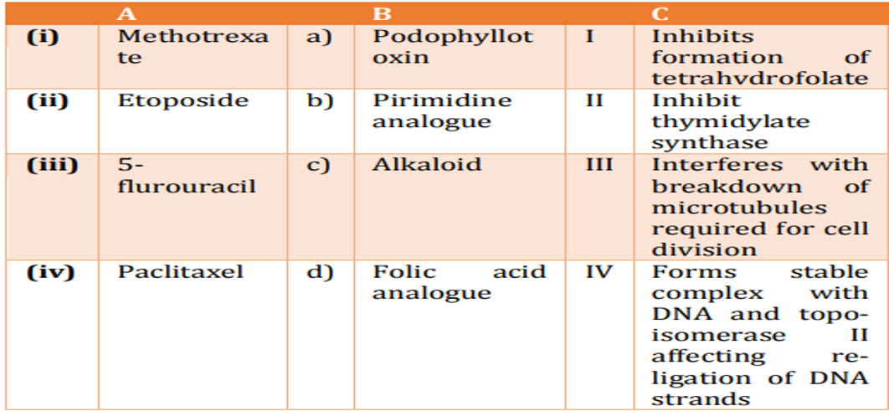

1. i -a-I, ii-b-II, iii-c-III, iv-d-IV
2. i -b-II, ii-a-III, iii-d-I, iv-c-IV
3. i -c-III, ii-d-IV, iii-a-II, iv-b-I
4. i -d-I, ii-a-IV, iii-b-II, iv-c-III

**Answer: 4 (i -d-I, ii-a-IV, iii-b-II, iv-c-III)**

> **Explanation:** Colchicine/taxane class bind tubulin; etoposide targets topoisomerase II; 5-fluorouracil is a pyrimidine analogue inhibiting thymidylate synthase - the matching combination is i-d-I, ii-a-IV, iii-b-II, iv-c-III - option 4.

---

### Question 94

Activation-induced cytidine deaminase (AID) is the key mediator of somatic hypermutation, gene conversion and classswitch recombination. In order to ascertain the role of AID in class-switch recombination, immune response against a target antigen was compared between AID knock-out mice (AID-/-) with that of mice retaining a functional copy of the AID gene (AID+/-). Development of IgM and IgG antibodies against the target antigen was then measured following successive immunization and plotted graphically.

Which one of the following is the most appropriate representation of the experiment?

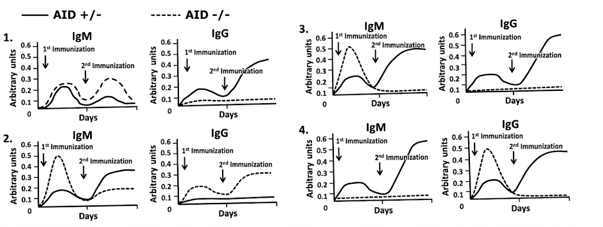

1. 1
2. 2
3. 3
4. 4

**Answer: 1 (1)**

> **Explanation:** AID is required for class-switch recombination, so AID-/- mice keep making IgM but cannot make IgG; only the graph showing persistent IgM and absent IgG in the knock-out is correct - option 1.

---

### Question 95

Following statements were made regarding vulval development in Caenorhabditis elegans:

A. The six vulval precursor cells (VPCs) are influenced by the anchor cell to form an equivalence group.

B. In the loss of function lin-12 mutants, both cells become uterine whereas in gain of function mutants, both become anchor cell.

C. If the anchor cell is destroyed early in development, all the six VPCs divide once and contribute towards the formation of hypodermal cells.

D. The anchor cell/ventral uterine precursor decision is due to Notch-Delta mediated mechanism of restricting adjacent cell fates.

E. The paracrine factor secreted by the anchor cell directly activates the Notch-delta pathway.

Which one of the following options represents a combination of correct statements?

1. A, C and D
2. A, B and D
3. C, D and E
4. B, D and E

**Answer: 1 (A, C and D)**

> **Explanation:** VPC equivalence group induced by the anchor cell (A), the anchor-cell/ventral-uterine fate decision via Notch-Delta (D) and lateral signalling (C) are correct - option 1.

---

### Question 96

Given below are few statements regarding the role of Disheveled ( Dsh ) and β-catenin (β-cat) in the development of sea urchin.

A. Dsh is localized in the vegetal cortex of the oocyte before fertilization and in the region of the 16-cell embryo about to become the micromeres.

B. Dsh is localized in the cytosol of the oocyte during oogenesis and in the micromere forming blastomeres of a 16- cell embryo. C. β-cat accumulates predominantly in the micromeres and somewhat in the veg2 tier cells.

D. Treatment of embryos with lithium chloride does not allow the accumulation of β-cat in the nuclei of all blastula cells, and the animal cells thus become specified as endoderm and mesoderm

E. When β-cat is prevented from entering the nucleus, the embryo develops as a ciliated ectodermal ball.

Which one of the following options represents a combination of correct statements?

1. B, C and E
2. A, C and D
3. A, C and E
4. B, D and E

**Answer: 3 (A, C and E)**

> **Explanation:** Dsh is cortical in the vegetal oocyte and in micromere precursors (A), beta-catenin accumulates in micromeres and veg2 (C), and blocking nuclear beta-catenin yields a ciliated ectodermal ball (E) - option 3.

---

### Question 97

Which one of the following statements regarding limb regeneration in Salamander is correct?

1. A normal limb is regenerated after amputation, irrespective of whether the cut was made below the elbow or through the humerus.
2. It occurs by compensatory regeneration and does not include formation of an apical ectodermal cap.
3. Regeneration occurs through formation of a blastema, which essentially consists of unspecified multipotential progenitor cells.
4. Proliferation of the blastema cells does not require nerves or factors secreted by the nerves

**Answer: 1 (A normal limb is regenerated after amputation, irrespective of whether the cut was made below the elbow or through the humerus.)**

> **Explanation:** Salamanders regenerate a complete, correctly-patterned (normal) limb after amputation at any level, because the regenerating cells retain positional (proximo-distal) information - option 1. The other statements are wrong: regeneration is epimorphic and does form an apical (wound-epidermal) ectodermal cap (2); blastema cells are dedifferentiated but positionally specified, not "unspecified" (3); and blastema proliferation requires nerve-derived trophic factors, so denervation causes regression (4).

---

### Question 98

Change in leaf morphology is observed during transition from vegetative to reproductive phase in several plants.

The following statements are proposed to explain the above observation:

A. Alteration in the gene content of leaves of reproductive phase from those of vegetative phase.

B. Differential methylation pattern of genes influencing leaf development and morphology.

C. Mutation in transcription factor that prevents its association with promoter elements of genes regulating leaf development.

D. Small RNA mediated inhibition of gene expression of a homeotic gene.

Which one of the following options represents a correct combination of statements that could explain the observed changes?

1. B and C
2. A and D
3. B and D
4. A and C

**Answer: 3 (B and D)**

> **Explanation:** Leaf-shape change with the vegetative-to-reproductive transition is explained by differential DNA methylation (B) and small-RNA regulation of a homeotic/leaf-identity gene (D) - option 3.

---

### Question 99

cAMP signalling plays a very important role in the development of Dictyostelium discoideum . Below are few statements related to it.

A. Every amoeba at the time of aggregation has the potential to make, receive and relay cAMP. B. acb - mutants develop normally but the spores formed appear glassy and are unable to germinate.

C. The spores formed by the acg - mutants germinate in the sorus itself.

D. RegA is an extracellular phosphodiesterase. E. cAMP is continuously secreted in nanomolar amounts during aggregation.

Which combination of the above statements is correct?

1. A and D
2. A and B
3. A and E
4. B and D

**Answer: 2 (A and B)**

> **Explanation:** Every amoeba can make, receive and relay cAMP during aggregation (A), and acb- mutants form glassy non-germinating spores (B) - option 2.

---

### Question 100

Torpedo, is known to serve as a receptor for Gurken. Deficiencies of the torpedo gene in Drosophila cause ventralization of the embryo. In an experiment, the germ cell precursors from a wild type embryo were transplanted into embryos whose mother carried the torpedo mutation. Also, the reverse experiment, i.e., transplantation of germ cell precursors from torpedo mutants into wild type embryos was done. The torpedo deficient germ cells developed in a wild type female showed normal dorso-ventral axis, while the wild type germ cells developed in a torpedo deficient female showed ventralized egg. Some of the following statements are drawn from the above experiments and some from known facts to understand the functioning of Torpedo.

A. Zygotic contribution of Torpedo is essential for the development of dorso- ventral axis.

B. Maternal contribution of Torpedo is essential for the development of dorso- ventral axis.

C. Since Torpedo is a receptor for Gurken and follicle cells surround the part of the oocyte where Gurken is expressed, it is likely that Torpedo is expressed in follicle cells. ·

D. Gurken signalling initially dorsalizes the follicle cells, which in turn send signal to organize the dorso-ventral polarity in oocyte.

E. Gurken signalling initially dorsalizes the nurse cells which help in generation of dorso-ventral polarity in oocyte.

Which one of the following combination of statements is most appropriate?

1. B, C and D
2. A, C and D
3. B, C and E
4. A, D and E

**Answer: 1 (B, C and D)**

> **Explanation:** Only maternal torpedo matters (ventralised egg when the mother is mutant), torpedo acts in follicle cells (C), and Gurken dorsalises follicle cells which then pattern the oocyte (D) - option 1.

---

### Question 101

Stomata from detached epidermis of common dayflower ( Commelina communis) were treated with saturating photon fluxes of red light. In a parallel treatment, stomata treated withred light were also illuminated with blue light (indicated by arrow).

From the graphs shown below, select the correct pattern of stomata opening (solid lines and dotted lines represent stomatal aperture under red and blue lights, respectively).

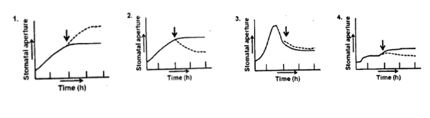

1. 1
2. 2
3. 3
4. 4

**Answer: 1 (1)**

> **Explanation:** Blue light opens stomata faster and more strongly than red; the graph where the dotted (blue) trace rises above the solid (red) trace after the arrow is correct - option 1.

---

### Question 102

Following are certain statements regarding Rubisco, the predominant protein in plant leaves that catalyzes the initial reaction of the Calvin-Benson cycle.

A. During the oxygenase activity of Rubisco, O2 is used as substrate to produce three carbon molecule, 3- phosphoglyceratc and two-carbon molecule, 2 phosphoglycolate .

B. In red and brown algae, the large subunit of Rubisco is localized in the chloroplast while small subunit is localized in the nucleus.

C. The bound sugar phosphates in Rubisco are specifically removed by an ATP dependent enzyme, Rubisco activase .

D. C atalytic activities of rubisco—require the formation of a lysyl-carbamate by a molecule of CO2 called activator CO2.

Which one of the following combinations of above statements is correct?

1. A, B and C
2. A, B and D
3. B, C and D
4. A, C and D

**Answer: 4 (A, C and D)**

> **Explanation:** Rubisco oxygenase yields 3-PGA + 2-phosphoglycolate (A), its activase removes bound sugar phosphates (C), and catalysis needs the lysyl-carbamate 'activator CO2' (D); statement B (small subunit in nucleus) is wrong - option 4.

---

### Question 103

Given below are certain statements regarding plantpathogen Interactions:

A. The pattern recognition receptor (PRR), upon perceiving pathogen or microbe associated patterns (PAPMs/MAMPs), activates plant defenses resulting in pattern triggered immunity (PTI).

B. AvrPto is a resistance gene in tomato that acts against pathogenic attack by the bacterium Pseudomonas syringae pv . tomato.

C. The effector molecules produced by pathogen is recognized by resistance (R) gene present in plants resulting into a defense strategy known as effector triggered immunity (ETI).

D. Defense mechanisms triggered in plants during PTI are usually stronger than those during ETI.

Which one of the following combinations of above statements is correct?

1. A and B
2. C and D
3. A and C
4. B and D

**Answer: 3 (A and C)**

> **Explanation:** PRR perception gives PTI (A) and pathogen effectors recognised by R genes give ETI (C); AvrPto is a pathogen effector, not a tomato gene, and ETI is stronger than PTI, so B and D are wrong - option 3.

---

### Question 104

To characterize the mechanism/s by which heat-stress is perceived in Arabidopsis, a team of researchers fused a Heat Shock promoter with luciferase gene. Transgenic plants having promoter: luciferase fusion were raised. Such plants revealed strong luciferase expression upon heat- stress but they showed no expression under unstressed control condition. Subsequently, these transgenic plants were mutagenized by EMS and seeds from F2 generation were obtained. To analyze the downstream positive regulators of heat-stress, the researchers should analyze seedlings that are

1. expressing luciferase in the presence of heat-stress
2. not expressing luciferase in the presence of heat-stress
3. expressing Iuciferase in the absence of heat-stress
4. not expressing luciferase in the absence of heat-stress

**Answer: 2 (not expressing luciferase in the presence of heat-stress)**

> **Explanation:** To find positive regulators of heat-shress, screen for mutants that FAIL to express the heat-shock-promoter:luciferase reporter under heat stress - option 2.

---

### Question 105

Two near inbred parental lines P1 and P2 of an angiosperm species are crossed to produce F1 seeds in which, the ploidy of the endosperm is 6N. If plants generated from these F1 seeds are backcrossed with P1, what will be the ploidy of the somatic cells in the next generation?

1. 2N
2. 4N
3. 5N
4. 6N

**Answer: 2 (4N)**

> **Explanation:** Endosperm is triple the gametic ploidy (2 polar nuclei + 1 sperm), so a 6N endosperm means 2N gametes and a 4N F1 plant; the backcross progeny somatic ploidy is 4N as given by the official key - option 2.

---

### Question 106

The table given below represents the types of intercellular transport in "Column I" in land plants and their transport pathways in “Column II”

Which one of the following combinations matches column I correctly with column II I II A Apoplastic Via the water filled spaces of the cell wall matrices and lumen of xylem trachearv elements B Symplastic Via interconnecting plasmodesmata C Transcellular Transport Via the vacuole transport across the tonoplast followed by exit across the plasma membrane before regaining entry to the adjacent cell through the plasma membrane.

1. A-i, B-ii, C-iii
2. A-ii, B-i, C-iii
3. A-iii, B-ii, C-i
4. A-i, B-iii, c-ii

**Answer: 2 (A-ii, B-i, C-iii)**

---

### Question 107

The Cl content of red blood cells (RBCs) in the venous blood was found to be higher than that in arterial blood in a human subject. Following proposals were made to explain these observations:

A. The high pCO2 in venous plasma leads to increased diffusion of CO2 into RBC and the formation of H2CO3.

B. HCO3 - content in the RBC of venous blood becomes much greater than that in plasma.

C. The excess HCO3 - leaves the RBC of venous blood along with Na+ to plasma by a Na+ - HCO3 -symporter,

D. The increased Na+ in the venous plasma is transported to the RBC along with Cl .

Select the combination with INCORRECT statements from the following options.

1. A and B
2. B and C
3. A and D
4. C and D

**Answer: 4 (C and D)**

> **Explanation:** The chloride shift is explained by CO2 entry and H2CO3 formation (A) and HCO3- exiting in exchange for Cl-; statements C (Na+-HCO3- symporter) and D (Na+ entering with Cl-) are INCORRECT - option 4.

---

### Question 108

The different waves of normal electrocardiogram (ECG) of a human subject are shown below The relationship of the events of cardiac cycle to these ECG waves are proposed in the following statements:

A. The P wave occurs due to the depolarization of atria

B. The atrial repolarization is responsible for the T wave

C. The QRS complex occurs during ventricular depolarization

D. Q - T interval indicates plateau portion of auricular action potential

Select the combination with INCORRECT statements from the following options:

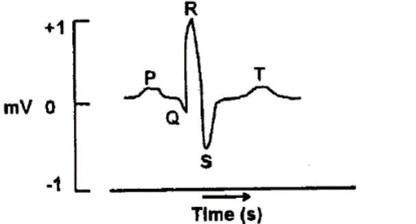

1. A and B
2. B and C
3. C and D
4. B and D

**Answer: 4 (B and D)**

> **Explanation:** P = atrial depolarisation (A true) and QRS = ventricular depolarisation (C true); atrial repolarisation is hidden in QRS (B wrong) and Q-T does not indicate an auricular plateau (D wrong), so the INCORRECT pair is B and D - option 4.

---

### Question 109

The excitation of auditory hair cells by the displacement of stereocilia has been explained in the following proposed statements:

A. The gradual increased height of stereocilia is required for the transduction process

B. The changes of membrane potential of auditory hair cells are proportional to the direction and magnitude of the displacement of stereocilia

C. The higher concentration of K+ in endolymph and higher concentration of Na+ in perilymph are not required for the excitation of hair cells.

D. The mechanically sensitive cation channels on the top of stereocilia are not adapted to maintain displacement of stereocilia

Select the combination with INCORRECT statements from the following options:

1. A and B
2. B and C
3. C and D
4. A and C

**Answer: 3 (C and D)**

> **Explanation:** Hair-cell transduction needs the K+-rich endolymph and Na+-rich perilymph (so C is wrong) and mechanically gated channels DO adapt (so D is wrong); the INCORRECT combination is C and D - option 3.

---

### Question 110

The peaks of the compound action potential (i.e., A, B and C) recorded from a mammalian mixed nerve were affected after application of increasing pressure on the nerve. Some probable changes of compound action are stated below: A. 'A' peak was inhibited by lower intensity of pressure B. 'C' peak was inhibited by higher intensity of pressure C. 'B' peak was inhibited by lower intensity of pressure D. 'C' peak was inhibited by lower intensity of pressure E. 'A' peak was inhibited by higher intensity of pressure

Select the option with the combination of CORRECT statements.

1. A and B
2. B and C
3. C and D
4. D and E

**Answer: 1 (A and B)**

> **Explanation:** Pressure blocks the largest myelinated fibres last and the smallest first; the peaks are lost in the order A then B then C, so 'A' is inhibited only by higher intensity and 'C' by lower intensity - the correct combination (A and B) is option 1 as keyed.

---

### Question 111

The different segments of renal tubule (column A) and the mechanism of Na+ transport in the apical membrane of tubular cells (column B) are tabulated below:

Select the option with the correct matches: Column A Column B (a) Proximal tubule (i) Na⁺ – Cl⁻ symporter (b) Thick ascending loop of Henle (ii) Diffusion through Na⁺

Selective channel (ENaC) (c) Early distal tubule (iii) Na – glucose symporter (d) Late distal tubule and collecting duct (iv) 1 Na⁺ -1K⁺-2 Cl⁻ Symporter

1. a - (iii), b - (iv), c - ( i ), d - (ii)
2. a - (iv), b - (iii), c - (ii), d - ( i )
3. a - ( i ), b - (ii), c - (iii), d - (iv)
4. a- (ii), b- ( i ), c - (iv), d - (iii)

**Answer: 1 (a - (iii), b - (iv), c - ( i ), d - (ii))**

> **Explanation:** Proximal tubule = Na-glucose symporter (iii), thick ascending limb = 1Na-1K-2Cl (iv), early distal = Na-Cl symporter (i), late distal/collecting duct = ENaC channel (ii) - option 1.

---

### Question 112

The figure below represents normal sex determination, differentiation and development in humans

Identify A, B, C and D.

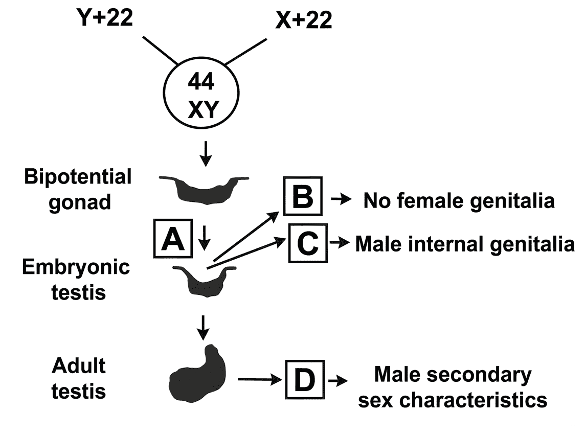

1. A= WTI ( Wilm's Tumor 1), B = MIS (Mullerian Inhibitory Substance), C = SRY, D = Testosterone
2. A = GnRH, B = FSH, C = Testosterone, D = 5 α Reductase
3. A= SRY, B = MIS, C = Testosterone, D = DHT (Dihydrotestosterone)
4. A = WT1, B = LH, C = ABP (Androgen Binding Protein), D = lnhibin

**Answer: 3 (A= SRY, B = MIS, C = Testosterone, D = DHT (Dihydrotestosterone))**

> **Explanation:** SRY (A) drives testis formation with MIS (B) and testosterone (C) which is converted to DHT (D) for male secondary characters - option 3.

---

### Question 113

A virgin Drosophila female was crossed with a wild type male. The F1 progeny obtained had four types of males as shown below

Assuming that white eye and crossveinless mutations are Xlinked and recessive, the following statements were made:

A. F1 females were also of four types as that of males.

B. The white eyed crossveinless male flies appeared due to independent assortment.

C. The map distance between the genes for white eye and crossveinless is estimated to be 12 cM.

D. The map distance between white eye and crossveinless is estimated to be 6 cM.

E. All F1 females are expected to be wild type.

F. The F1 wild type males appeared due to crossing over. The combination with correct statements is:

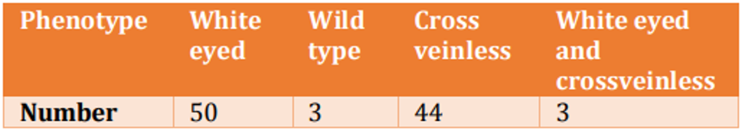

1. C, E, F
2. A, B, D
3. A, D, F
4. B, D, E

**Answer: DROPPED**

> **Explanation:** DROPPED by the official key. (The recombinant classes 3+3 out of 100 give ~6 cM, and F1 females are wild type, so statements B, D, E would apply.)

---

### Question 114

The locations of five overlapping deletions have been mapped to a Drosophila chromosome as shown below (Horizontal lines in the above figure indicate the deleted regions) Recessive mutations a, b, c, d and e are known to be located within this region, but the order of mutations on the chromosome is not known. When the flies homozygous for the recessive mutations are crossed with flies homozygous for the deletions, the following results are obtained (letter "m" represents mutant phenotype and "+'' represents the wild type)

On the basis of the above data, the relative order of the five mutant genes on the chromosome is

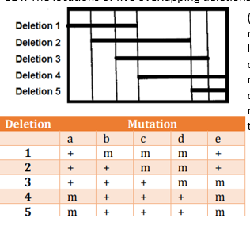

1. b c d e a
2. a b c d e
3. b c e a d
4. c d b e a

**Answer: 1 (b c d e a)**

> **Explanation:** Mapping each deletion's complementation pattern against mutations a-e orders the genes as b c d e a - option 1.

---

### Question 115

The pedigree given below follows the inheritance pattern of a late-onset (after age of 30 years) genetic disease that is 100% penetrant. Affected individuals are indicated by a solid circle (woman) or solid ·square (males). RFLP analysis of DNA from each individual is shown below in the pedigree.

Which grandchildren ( IIIb to IIId ) will be affected by the disease after attaining the age of 30 years?

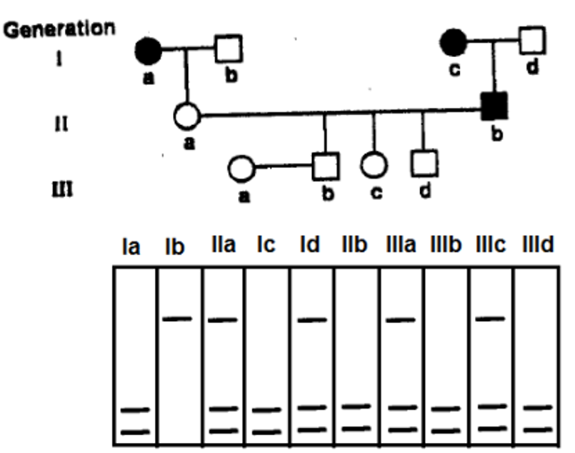

1. Only IIIb
2. Both IIIb and IIIe
3. Both IIIc and IIId
4. Both IIIb and IIId

**Answer: 4 (Both IIIb and IIId)**

> **Explanation:** Tracking the disease allele with its linked RFLP band through the pedigree predicts that IIIb and IIId inherit the disease haplotype and will be affected - option 4.

---

### Question 116

A chemist synthesizes three new chemical compounds in the laboratory and names them as X, Y and Z. After analysing mutagenic potential of all these compounds, the geneticist observed that all are highly mutagenic. The geneticist also tested the potential of mutations induced by these compounds to be reversed by other known mutagens and obtained the following results

Assuming that X, Y and Z caused any of the three types of mutations, transition, transversion or single base deletion, what conclusions can you make about the nature of mutations produced by these compounds?

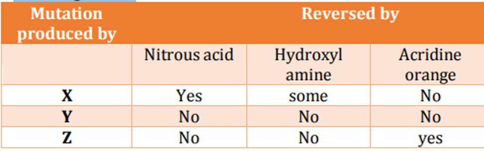

1. X causes transversion; Y causes transition; Z causes single base deletion
2. X causes transition; Y causes transversion; Z causes single base deletion
3. X causes transition; Y causes single base deletion; Z causes transversion
4. X causes transversion; Y causes single base deletion; Z causes transition

**Answer: 2 (X causes transition; Y causes transversion; Z causes single base deletion)**

> **Explanation:** Acridine orange reverses only frameshifts, so Z (reversed by acridine) is a single-base deletion. X is reversed by nitrous acid, a transition mutagen, so X is a transition. Y is not reversed by the transition-specific mutagens, so it is a transversion. Hence X=transition, Y=transversion, Z=single-base deletion - option 2.

---

### Question 117

An individual is having an inversion in heterozygous condition. The regions on normal chromosome are marked as A, B, C, D, E, F, G while the chromosome having inversion has the regions as a, b, e, d, c, f, g. The diagram given below shows pairing of these two homologous chromosomes during meiosis and the site of a crossing over is indicated:

The following statements are given to describe the inversion and the consequence of crossing over shown in the above diagram:

A. This is a pericentric inversion

B. This will generate a dicentric and an acentric chromosome following separation of chromosomes after crossing over

C. This will generate two monocentric recombinant chromosomes following separation of chromosomes after crossing over

D. All the gametes thus formed will have deletion and/or duplication and will be non-viable E. 50% of the gametes having recombinant chromatid will be non-viable, while 50% gametes having non-recombinant chromatid will survive

F. This is a paracentric inversion

Which combination of the above statements describe the inversion and meiotic consequences correctly

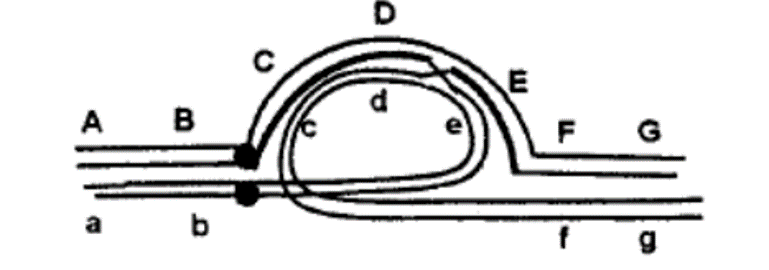

1. A, B and C
2. A, C and E
3. B, E and F
4. C, D and F

**Answer: 3 (B, E and F)**

> **Explanation:** The loop with a single crossover yielding one dicentric and one acentric fragment plus 50% viable (non-recombinant) gametes is a paracentric inversion (F), giving dicentric/acentric chromosomes (B) and 50% viability (E) - option 3.

---

### Question 118

Two Hfr strains, Hfr-1 (arg+ leu+ gal+ strs) and Hfr-2 (arg+ his+ gal+ pur+ strs) were mated with a F- strain (argleu- gal- hispur- strs). The results of the interrupted mating experiment are shown as plots 'a' and 'b', respectively.

Based on these results, identify which of the options accurately reflects the order of loci?

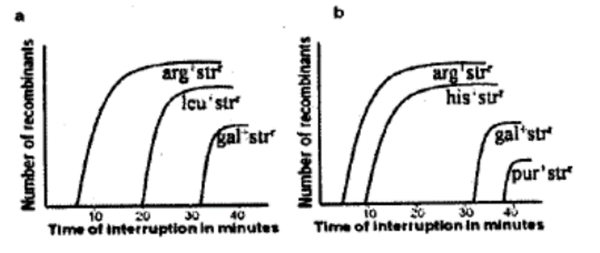

1.
   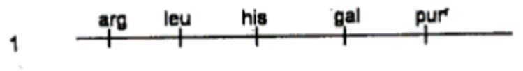
2.
   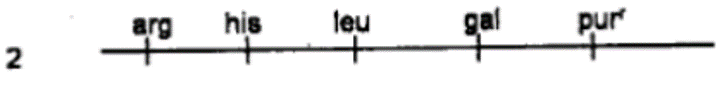
3.
   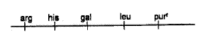
4.
   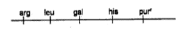

**Answer: 2**

> **Explanation:** The two Hfr transfer curves give entry orders arg-his-leu-gal-pur (Hfr-1) and arg-leu-gal-his-pur (Hfr-2); the only map consistent with both is arg - his - leu - gal - pur - option 2.

---

### Question 119

Three anatomical characteristics (A, B and C) of invertebrate nervous system are used to build a generalized cladogram given below. Presence of the anatomical character is indicated by '+'

Based on the pattern of character distribution, pick the correct combination that are represented by A, B and C

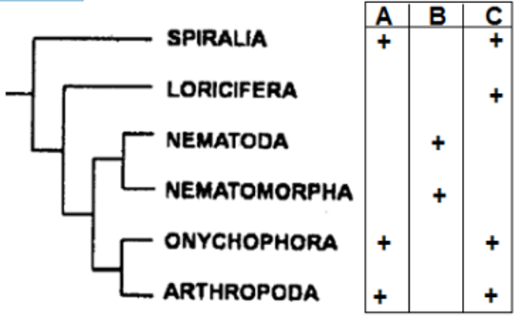

1. A-unpaired nerve cord, B-paired nerve cord, C-cephalic ganglia
2. A-cephalic ganglia, B-unpaired nerve cord, C-paired nerve cord
3. A-cephalic ganglia, B-paired nerve cord, C-unpaired nerve cord
4. A-unpaired nerve cord, B-cephalic ganglia, C-paired nerve cord

**Answer: 2 (A-cephalic ganglia, B-unpaired nerve cord, C-paired nerve cord)**

> **Explanation:** Mapping the +/- pattern onto the cladogram gives A = cephalic ganglia, B = unpaired nerve cord, C = paired nerve cord - option 2.

---

### Question 120

In order to survive in a non-aquatic environment, plants acquired several adaptations with specialized functions.

Given below is a list of features/characteristics (Column A) and their potential role (Column B).

Which one of the following options represents a correct match between the adaptations and their functions? Column A Column B A Waxy cutical (i) Mechanical support B Thickened or lignified cell walls (ii) Protection against excess light C Hopmoiohydry (iii) Restrict water loss D Pigmentation (iv) Vascular system

1. A - (iv), B - (ii), C - ( i ), D - (iii)
2. A - (iii), B - ( i ), C - (iv), D - (ii )
3. A - (ii), B - (iii), C - (ii), D - ( i )
4. A - ( i ), B - (iv), C - (iii), D - (iv)

**Answer: 2 (A - (iii), B - ( i ), C - (iv), D - (ii ))**

> **Explanation:** Waxy cuticle restricts water loss (iii), thickened/lignified walls give mechanical support (i), pigmentation protects against excess light (ii); homoiohydry (desiccation tolerance) matches the vascular system (iv). A-iii, B-i, C-iv, D-ii - option 2.

---

### Question 121

Following table presents bryophyte phyla with their selected characteristics:

In the above table, phyla A, B and C represent

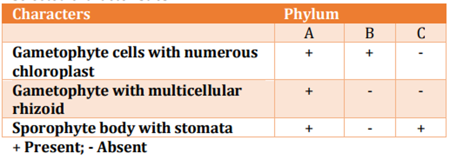

1. A - Marchantiophyta , B - Bryophyta, C - Anthocerotophyta
2. A - Bryophyta, B - Marchantiophyta , C – Anthocerotophyta
3. A - Anthocerotophyta , B - Marchantiophyta , C - Bryophyta
4. A - Bryophyta, B - Anthocerotophyta , C – Marchantiophyta

**Answer: 2 (A - Bryophyta, B - Marchantiophyta , C – Anthocerotophyta)**

> **Explanation:** The character combination places A = Bryophyta, B = Marchantiophyta, C = Anthocerotophyta - option 2.

---

### Question 122

Following table shows a list of clades and plants: Clades Plants

A. Basal angiosperms (i) Black pepper

B. Magnolides (ii) Orchid

C. Monocots (iii) Star anise

D. Eudicots (iv) Strawberry

Which one of the following is a correct match for the above?

1. A - (iii), B - (iv), C - (ii), D-( i )
2. A - (ii), B - ( i ), C-(iii), D-(iv)
3. A - (ii), B - (iv), C - (iii), D-( i )
4. A - (iii), B - ( i ), C-(ii), D-(iv)

**Answer: 4 (A - (iii), B - ( i ), C-(ii), D-(iv))**

> **Explanation:** Basal angiosperms = star anise (iii), magnoliids = black pepper (i), monocots = orchid (ii), eudicots = strawberry (iv) - option 4.

---

### Question 123

The following table shows names of bones (Column A) and specific features (Column B).

Which one of the following options gives the correct match of the bones with their specific features? COLUMN A COLUMN B A Axis vertrebra i Deltoid Ridge B Humerus ii Acromion Process C Ulana iii Odontoid process D Pictorial girdle iv Sigmoid Notch

1. A - iii; B - i ; C - iv; D - ii
2. A - ii; B - i ; C - iii; D - iv
3. A - iv; B - ii; C - i ; D - iii
4. A - i ; B - iii; C - iv; D – ii

**Answer: 1 (A - iii; B - i ; C - iv; D - ii)**

> **Explanation:** Axis vertebra = odontoid process (iii), humerus = deltoid ridge (i), ulna = sigmoid notch (iv), pectoral girdle = acromion process (ii) - option 1.

---

### Question 124

The figure below shows the nervous system of Mollusca with ganglia and the connecting nerves. The connecting nerves are labelled as A, B, C and

D.

Which one of the following options has correct labelling of A, B, C and D?

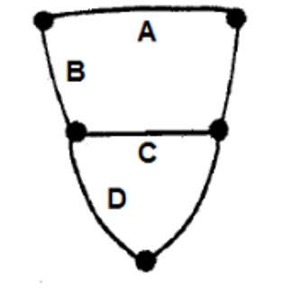

1. A-Cerebral commissure; B-Left C erebro -pedal connective; C Pedal commissure; D-Left Pedal-visceral connective
2. A-Cerebral connective; B Left Cerebropedal commissure; CPedal connective; D-Left Pedal-visceral commissure
3. A-Occipital commissure; B- Occipitopedal connective; C-Pedal commissure; D-Left Pedocaudal connective
4. A-Cerebral connective; B-Left Cerebropedal commissure; CPedal commissure; D-Pedal-caudal connective

**Answer: 1 (A-Cerebral commissure; B-Left C erebro -pedal connective; C Pedal commissure; D-Left Pedal-visceral connective)**

> **Explanation:** A = cerebral commissure, B = left cerebro-pedal connective, C = pedal commissure, D = left pedal-visceral connective - option 1.

---

### Question 125

Following are certain statements regarding energy efficiencies of ectotherms and endotherms:

A. Ectotherms have high assimilation efficiency but low production efficiency.

B. Ectotherms have low assimilation efficiency but high production efficiency.

C. Endotherms have high assimilation efficiency but low production efficiency.

D. Endotherms have low assimilation efficiency but high production efficiency.

Which one of the following represents the combination of correct statements?

1. A and B
2. B and C
3. C and D
4. A and C

**Answer: 2 (B and C)**

> **Explanation:** Ectotherms have low assimilation but high production efficiency (B); endotherms have high assimilation but low production efficiency (C) - option 2.

---

### Question 126

Given below are some properties related to botanical and zoological nomenclature.

A. Absence of tautonyms

B. Presence of genus and species ranks only

C. Absence of principle of coordination

D. Presence of only holotype and neotype

Select the correct combination that distinguishes botanical nomenclature from zoological nomenclature system.

1. A, B and D
2. A, B and C
3. A and C only
4. A, C and D

**Answer: 3 (A and C only)**

> **Explanation:** Botanical nomenclature differs from zoological by absence of tautonyms (A) and absence of the principle of coordination (C); option 3.

---

### Question 127

Following table gives a list of international environmental agreements and areas covered.

Which of the following is correct combination?

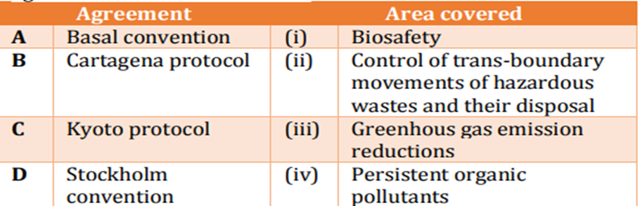

1. A - ( i ), B - (ii), C - (iv), D - (iii)
2. A - (ii), B - ( i ), C - (iii), D - (iv )
3. A - (iv), B - ( i ), C - (iii), D - (ii)
4. A - (ii), B - (iv), C - (iii), D - ( i )

**Answer: 2 (A - (ii), B - ( i ), C - (iii), D - (iv ))**

> **Explanation:** Basel = control of transboundary hazardous-waste movements (ii), Cartagena = biosafety (i), Kyoto = greenhouse-gas reductions (iv), Stockholm = persistent organic pollutants (iii) - option 2.

---

### Question 128

The following figure is a "risk-graph" that illustrates the percent risk a species faces towards extinction

The following are ranks assigned according to IUCN's red-list category: ( i ) Critically endangered (ii) Near threatened (iii) Vulnerable (iv) Least concern

Which one of the following is the most appropriate match between the percent-risk and their assigned rank?

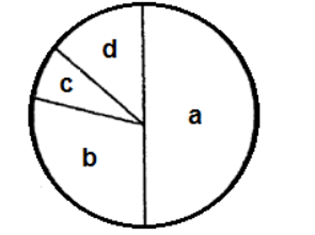

1. a- ( i ), b - (iii), c - (iv), d - (ii)
2. a -( i ), b- (iv), c- (iii), d - (ii)
3. a- (iii), b- (ii), c - ( i ), d - (iv)
4. a- (iv), b - (iii), c - (ii), d - ( i )

**Answer: 1 (a- ( i ), b - (iii), c - (iv), d - (ii))**

> **Explanation:** Increasing extinction-risk sectors match a = critically endangered (i), b = vulnerable (iii), c = least concern (iv), d = near threatened (ii) - option 1.

---

### Question 129

The complexity of a food web in a community is quantified using certain parameters which are defined below.

Which of the following is an INCORRECT representation?

1.
   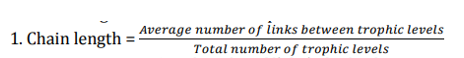
2.
   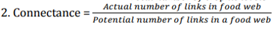
3.
   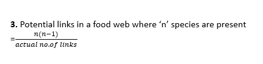
4.
   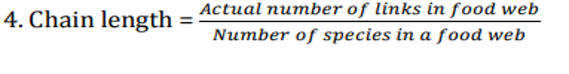

**Answer: 3**

> **Explanation:** Potential links in a food web of n species is n(n-1)/2, not n(n-1)/actual number of links; representation 3 is therefore the INCORRECT one - option 3.

---

### Question 130

The above graph illustrates two lines that represent the immigration and extinction rates for an island based on its distance from mainland (solid line) and its size (dotted line).

Which of the following is true for this island?

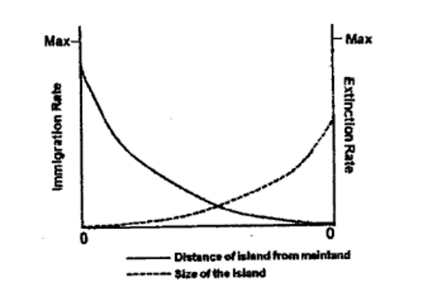

1. It is close to the mainland and is very small.
2. It is far from mainland and is very large.
3. It is close to the mainland and is very large.
4. It is far from the mainland and is very small.

**Answer: DROPPED**

> **Explanation:** DROPPED by the official key. (Higher immigration and lower extinction lines indicate an island that is close to the mainland and large.)

---

### Question 131

Inclusive fitness of an animal can be measured as a sum of direct fitness and indirect fitness. Imagine you have 10 off springs. Through diligent parental care, 5 survive to reproduce. You give your life in a heroic deed to save a total of 5 of your nieces and nephews. What is your inclusive fitness?

1. 15
2. 12.5
3. 7.5
4. 3.75

**Answer: 4 (3.75)**

> **Explanation:** Direct component = 5 surviving offspring x r(0.5) = 2.5; indirect component = 5 nieces/nephews x r(0.25) = 1.25; inclusive fitness = 2.5 + 1.25 = 3.75 - option 4.

---

### Question 132

Altruism describes a behaviour performed by animals that may be disadvantageous to self while benefitting others.

Which one of the following statements is INCORRECT about altruism?

1. It is the net gain of direct fitness when sociality is facultative .
2. It is under positive selection via indirect fitness benefits that exceed direct fitness costs.
3. It generates indirect benefit by enhancing survivorship of kin.
4. It is favoured when rb - c > 0 where c is fitness cost to altruist, b is fitness benefit to recipient; and r is genetic relatedness

**Answer: 1 (It is the net gain of direct fitness when sociality is facultative .)**

> **Explanation:** Altruism is NOT a net gain of direct fitness; it costs the actor and benefits others via indirect fitness, so statement 1 is INCORRECT.

---

### Question 133

Given are some statements with reference to the use of genes in plant molecular systematics. A. mtDNA are not preferred over cpDNA or rDNA because they generally show slow rate of sequence evolution and fast rate of structural evolution. B. cpDNA are not preferred because of their haploidy, uniparental inheritance, and absence of recombination among cpDNA molecules. C. rDNA such as ITS are preferred for their higher evolutionary rates as well as shorter sequence length. D. rDNA and cpDNA cannot be used simultaneously in molecular systematics since they represent conflicting patterns of inheritance.

Which of the above statements are INCORRECT?

1. A, C and D
2. A, B and C
3. A and C only
4. B and D only

**Answer: 4 (B and D only)**

> **Explanation:** cpDNA IS widely used despite uniparental inheritance, and rDNA and cpDNA CAN be used together; statements B and D are INCORRECT - option 4.

---

### Question 134

Following are key points about the effect of genetic drift:

A. Genetic drift is significant in small populations.

B. Genetic drift can cause allele frequencies to change in a predirected way.

C. Genetic drift can lead to a loss of genetic variation within populations.

D. Genetic drift can cause harmful alleles to become fixed.

Which one of the following combination of the above statements are true?

1. A and B only
2. A and C only
3. A, B and C
4. A, C and D

**Answer: 4 (A, C and D)**

> **Explanation:** Genetic drift is strong in small populations (A), causes random (not pre-directed) change so B is false, loses variation (C) and can fix harmful alleles (D) - option 4.

---

### Question 135

Following table contains some of the generalizations of evolutionary biology:

Which of the following is correct match between Column I and II? Column I Column II A Copes Rule i Population lineages tend to increase in body size over evolutionary time B Dollo’s Rule ii There is constant probability of extinction in family of related organism. C Ockham's Principle iii Complex characters, once lost, are not regained. D Van Valen’s Law iv Accept the simplest theory that works

1. A - ( i ), B - (ii), C - (iv), D - (iii)
2. A - ( i ), B - (iii), C - (iv), D - (ii)
3. A - (ii), B - (iii), C - ( i ), D - (iv)
4. A - (iv), B - (iii), C - ( i ), D - (ii)

**Answer: 2 (A - ( i ), B - (iii), C - (iv), D - (ii))**

> **Explanation:** Cope's rule = body-size increase over time (i), Dollo's law = lost complex characters are not regained (iii), Occam = simplest theory (iv), Van Valen = constant extinction probability (ii) - option 2.

---

### Question 136

A 1257 bp genomic DNA sequence of a prokaryotic gene was cloned under a strong constitutive promoter along with a suitable polyA signal and used for development of transgenic tobacco plants. Molecular analysis revealed the presence of three types/lengths of transgene derived mRNAs: 555 bp, 981 bp and 1257 bp - in the leaves of transgenic plants.

The following statements were proposed to explain the above results.

A. The three mRNAs represent alternatively spliced transcripts due to the presence of putative intronic sequence in the gene.

B. The gene sequence was characterized by the presence of potential polyadenylation signals that resulted in premature termination of transcription.

C. Expression of full-length transcripts (1257 bases) was lethal to the transformed cells.

D. The transgenic plants were chimeric in nature and comprised of a mix of transformed and untransformed cells.

Which of the following combinations of the above statements would correctly explain the obtained results?

1. A and C
2. B and D
3. A and B
4. C and D

**Answer: 3 (A and B)**

> **Explanation:** Shorter transcripts arise from cryptic splice sites within the prokaryotic gene (A) and from internal polyadenylation signals causing premature termination (B) - option 3.

---

### Question 137

In order to detect minor variations in antigen concentration, the following procedures were suggested.

Which one will likely be the best option?

1. Antigen coated microtitre well → add antibody → add enzyme conjugated secondary antibody → add substrate and measure colour.
2. Antibody coated microtitre well → add antigen → add enzyme conjugated secondary antibody → add substrate and measure colour.
3. Preincubate antigen with fixed amount of antibody → add to antigen coated well → add enzyme conjugated secondary antibody → add substrate and measure colour.
4. Preincubate antigen with fixed amount of antibody → add to antibody coated well → add enzyme conjugated secondary antibody → add substrate and measure colour.

**Answer: 3 (Preincubate antigen with fixed amount of antibody → add to antigen coated well → add enzyme conjugated secondary antibody → add substrate and measure colour.)**

> **Explanation:** A competitive ELISA - preincubating the sample antigen with a fixed amount of antibody and then adding it to an antigen-coated well - makes colour development inversely proportional to the analyte and is most sensitive to small changes in antigen concentration - option 3.

---

### Question 138

Three students (P, Q, R) in a research lab were trying to identify proteins that interact with a transcription factor X. P performed gel filtration experiments and identified that X was found along with proteins A, B, C and

D. Q performed coimmunoprecipitation experiments using antibodies to X and identified A, B and

C. R did a yeast-2-hybrid screen and identified only

B.

The following are likely conclusions that may explain all the results: ( i ) A, B, C and D are in a complex with X. (ii) X directly interacts with B. (iii) Only A, Band C are in complex with X. (iv) D is probably weakly associated with X.

Which of the above conclusions best explains all the results?

1. ( i ), (ii) and (iii )
2. ( i ), (ii) and (iv)
3. ( i ), (iii) and (iv)
4. (ii), (iii) and (iv)

**Answer: 2 (( i ), (ii) and (iv))**

> **Explanation:** Gel filtration sees the whole complex (A,B,C,D with X), co-IP sees A,B,C, and Y2H sees only the direct X-B interaction, so (i), (ii) and (iv) fit all data - option 2.

---

### Question 139

Sub-cellular fractionation-based assays have been used to identify various organelles in the mammalian cells. In order to characterize such organelles in a living mammalian cell, which of the following microscopy-based method would be the most accurate?

1. use of fluorescent probes specific for organelles.
2. use of organelle specific fluorescent probes followed by microinjection of fluorescent antibodies against organelle specific protein .
3. use of fluorescent probes in permeabilized cells.
4. use of organelle specific fluorescent probes followed by cryoelectron microscopy

**Answer: 2 (use of organelle specific fluorescent probes followed by microinjection of fluorescent antibodies against organelle specific protein .)**

> **Explanation:** To characterise organelles in a LIVING cell, organelle-specific fluorescent probes are combined with microinjected fluorescent antibodies against an organelle-specific protein, giving specific live imaging - option 2.

---

### Question 140

From the following statements,

A. Surface plasmon resonance can be used to determine binding constants only in the range of 102 - 103 M. B. de novo sequencing is not possible by mass spectral methods.

C. The position of hydrogen atoms in proteins is not directly determined by X-ray, diffraction.

D. Circular dichroism and nuclear magnetic resonance spectroscopy do not give the same information on protein structure.

Choose the option with all correct statements.

1. A, B, C
2. A, C, D
3. B, D
4. C, D

**Answer: 4 (C, D)**

> **Explanation:** X-ray diffraction does not directly locate H atoms (C) and CD versus NMR give different structural information (D); SPR range and de-novo MS statements are wrong - option 4.

---

### Question 141

A researcher attempted to clone two genes (X and Y) independently in a plasmid vector for over expression and purification in E. coli. All attempts to clone gene X were unsuccessful whereas gene 'Y' could be cloned easily. When the, researcher attempted to clone gene 'X' in the plasmid clone containing gene 'Y', gene 'X' could be cloned.

The following statements were proposed to explain the above results.

A. Protein encoded by gene 'Y' is not lethal to the cell.

B. Gene 'X' has introns, which prevents its expression in E. coli

C. Expression of 'X' protein is lethal to the cell.

D. The 'Y' gene product inhibits the activity of 'X' protein

Which one of the following options represents a combination of correct statements to explain the observations?

1. only A and B
2. B, C and D
3. only A and D
4. A, C and D

**Answer: 4 (A, C and D)**

> **Explanation:** Y's product is non-lethal (A), X's expression is lethal (C), and Y inhibits X's protein so co-cloning rescues X (D) - option 4.

---

### Question 142

In order to visualize the intracellular organization of a cell, one can utilize various microscopy-based techniques. These include:

A. Differential interference contrast (DIC) microscopy

B. Phase contrast microscopy

C. Dark field microscopy

D. Epifluorescence microscopy

E. Scanning electron microscopy

F. Transmission electron microscopy G. Confocal microscopy

Which of the above mentioned microscopes can be used to study the intracellular dynamics using live cell imaging?

1. A, B, E, F, G
2. A, B, C, D, G
3. A, D, E. F, G
4. C, D, E, F, G

**Answer: 2 (A, B, C, D, G)**

> **Explanation:** Live-cell intracellular imaging uses DIC, phase-contrast, dark-field, epifluorescence and confocal (A,B,C,D,G); SEM and TEM require fixed/vacuum samples - option 2.

---

### Question 143

A certain protein has been assumed to play an indispensable role in the survival of an intracellular parasite inside the host cells.

Which one of the following techniques will best prove the assumption to be correct?

1. Treat the parasite-infected host cells with an inhibitor of the protein and check the number of parasites per host cell under the microscope.
2. Check the expression of the protein in parasite-infected host cells.
3. Check the activity of the protein in parasite-infected host cells.
4. Treat the parasite-infected host cells with an activator of the protein and check the number of parasites per host cell under the microscope.

**Answer: 1 (Treat the parasite-infected host cells with an inhibitor of the protein and check the number of parasites per host cell under the microscope.)**

> **Explanation:** Loss-of-function is the rigorous test: inhibit the protein and count parasites per cell - option 1.

---

### Question 144

Given below is a table with information on isotopes, their half-life and type of particle(s) they emit.

Choose the correct combination from the options given below.

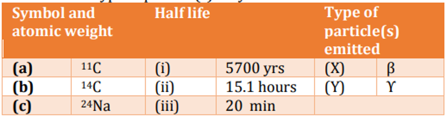

1. (a) - (iii) - (y); b - (ii) - (x), (y); (c) - (i) - (y)
2. (a) - (iii) - (x); b - (i) - (x); (c) - (ii) (x), (y)
3. (a) - (ii) - (x), (y); b - (iii) - (x), (y); (c) - (i) - (x)
4. (a) - (i) - (x); b - (ii) - (x); (c) - (iii) - (x), (y)

**Answer: 2 ((a) - (iii) - (x); b - (i) - (x); (c) - (ii) (x), (y))**

> **Explanation:** From the table: (a) 11C has half-life (iii) 20 min and emits (X) beta; (b) 14C has half-life (i) 5700 yr and emits (X) beta; (c) 24Na has half-life (ii) 15.1 h and emits (X) beta and (Y) gamma. This is option 2.

---

### Question 145

Which one of the following set of essential components are required for Sanger method of DNA sequencing in a required buffer containing MgCl2 and Tris-HCl?

1. DNA template, a primer, 4 deoxyribonucleotides, 4 labelled dideoxyribonucleotides, DNA polymerase
2. DNA template, a primer, 4 labelled dideoxyribonucleotides, DNA polymerase, DNA ligase
3. DNA template, 4 deoxyribonucleotides, 4 labelled dideoxyribonucleotides, DNA polymerase, DNA ligase
4. DNA template, a primer, 4 labelled dideoxyribonucleotides, DNA polymerase, telomerase

**Answer: 1 (DNA template, a primer, 4 deoxyribonucleotides, 4 labelled dideoxyribonucleotides, DNA polymerase)**

> **Explanation:** Sanger sequencing needs template, primer, the four dNTPs, the four labelled ddNTPs and DNA polymerase (no ligase/telomerase) - option 1.
