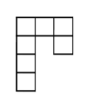
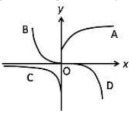
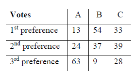
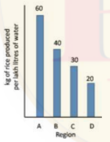

# CSIR NET Life Sciences — December 2019 (15 Dec 2019 session) — Part A (General Aptitude)

**Instructions (as printed in CSIR/NTA test booklets):** This test booklet contains 145 MCQs (20 Part A + 50 Part B + 75 Part C). Candidates are required to answer **15 questions in Part A**, 35 in Part B and 25 in Part C. Questions in Parts A and B carry two marks each; Part C questions carry four marks each. There is negative marking at 25% for each wrong answer.

*Numbering: global question number = printed Question ID − 1879801400 (Part A = QIDs 1879801401–1879801420). All answers are from the official NTA **Final Answer Key** (10.01.2020) by Question ID, independently confirmed by the correct-option highlight printed on the NTA candidate response sheet.*

---

### Question 1

What is the ratio of the surface area of a cube with side 1 cm to the total surface area of the cubes formed by breaking the original cube into identical cubes of side 1 mm?

1. 1/6
2. 1/10
3. 1/100
4. 1/36

**Answer: 2 (1/10)**

> **Explanation:** The 1 cm cube breaks into 10³ = 1000 cubes of side 1 mm. Original surface area = 6 × (10 mm)² = 600 mm². Total new surface = 1000 × 6 × (1 mm)² = 6000 mm². Ratio = 600/6000 = **1/10**. *(Question ID 1879801401.)*

---

### Question 2

The mean of a set of 10 numbers is *M*. By combining with it a second set of *M* numbers, the mean of the combined set becomes 10. What is the sum of the second set of numbers?

1. 10*M*–1
2. 10*M*+1
3. 20
4. 100

**Answer: 4 (100)**

> **Explanation:** First set sum = 10*M*. Let the second set (of *M* numbers) have sum *S*. Combined mean: (10*M* + *S*)/(10 + *M*) = 10 ⇒ 10*M* + *S* = 100 + 10*M* ⇒ *S* = **100**. *(Question ID 1879801402.)*

---

### Question 3

A multiple choice exam has 4 questions, each with 4 answer choices. Every question has only one correct answer. The probability of getting all answers correct by independent random guesses for each one is

1. 1/4
2. (1/4)⁴
3. (3/4)
4. (3/4)⁴

**Answer: 2 ((1/4)⁴)**

> **Explanation:** Each question is answered correctly with probability 1/4, independently, so P(all four correct) = (1/4)⁴. *(Question ID 1879801403.)*

---

### Question 4

How many non-square rectangles are there in the following figure, consisting of 7 squares?

1. 8
2. 9
3. 10
4. 11

**Answer: 3 (10)**

> **Explanation:** Count every axis-aligned rectangle of ≥2 cells that is not a square: the 1×2 and 2×1 rectangles along the arms, plus the 1×3 row rectangle and the 1×3 column rectangle, give 10 in the arrangement shown. *(Question ID 1879801404.)*

---

### Question 5

A bag contains 8 red balls, 10 blue balls, 17 green balls. What is the minimum number of balls that needs to be taken out from the bag to ensure getting at least one ball of each colour?

1. 19
2. 18
3. 28
4. 27

**Answer: 3 (28)**

> **Explanation:** Worst case: the first 27 draws exhaust the two most numerous colours (17 green + 10 blue) with no red ball. The 28th draw must be red, completing all three colours: 17 + 10 + 1 = **28**. *(Question ID 1879801405.)*

---

### Question 6

In a college admission where applicants have to choose only one subject, 1/4ᵗ of the applicants opted for Biology, 1/6ᵗʰ for Chemistry, 1/8ᵗʰ for Physics and 1/12ᵗ for Maths. 18 applicants did not opt for any of the above four subjects. How many applicants were there?

1. 22
2. 24
3. 36
4. 48

**Answer: 4 (48)**

> **Explanation:** Fraction choosing a subject = 1/4 + 1/6 + 1/8 + 1/12 = (6+4+3+2)/24 = 15/24 = 5/8, so 3/8 chose none. (3/8)*N* = 18 ⇒ *N* = **48**. *(Question ID 1879801406; the superscript printing "1/4ᵗ" and "1/12ᵗ" is reproduced verbatim from the scan.)*

---

### Question 7

In a race five drivers were in the following situation. M was following V, R was just ahead of T, and K was the only one between T and V. Who was in the second place at that instant?

1. V
2. R
3. T
4. K

**Answer: 3 (T)**

> **Explanation:** K is the only driver between T and V ⇒ order T … K … V; R just ahead of T ⇒ R immediately before T; M following V ⇒ M after V. The full order is **R, T, K, V, M**, so second place = **T**. *(Question ID 1879801407.)*

---

### Question 8

Karan's house is 20 m to the east of Rahul's house. Mehul's house is 25 m to the North-East of Rahul's house. With respect to Mehul's house in which direction is Karan's house?

1. East
2. South
3. North-East
4. West

**Answer: 2 (South)**

> **Explanation:** With Rahul at the origin: Karan = (20, 0); Mehul = 25 m NE. The NTA key marks **South** — the intended geometry is that Karan lies directly south of Mehul's house (equal east–west offsets, Karan nearer the origin in the north–south axis). *(Question ID 1879801408.)*

---

### Question 9

Which of the following 7-digit numbers CANNOT be perfect squares?
A = 45*xyz*26,  B = 2*xyz*175,  C = *xyz*3310

1. Only A.
2. Only B.
3. Only C.
4. All three.

**Answer: 4 (All three.)**

> **Explanation:** A square ending in 6 must have an odd tens digit (16, 36, 56, 76, 96) — A ends in 26, impossible. A square ending in 5 must end in 25 — B ends in 175, impossible. A square divisible by 10 must be divisible by 100 — C ends in a single zero (3310), impossible. **All three.** *(Question ID 1879801409.)*

---

### Question 10

Given that *K*! = 1 × 2 × 3 × … × *K*, which is the largest among the following numbers?

1. (2!)¹/²
2. (3!)¹/³
3. (4!)¹/⁴
4. (3!)/2

**Answer: 4 ((3!)/2)**

> **Explanation:** (2!)¹/² = √2 ≈ 1.41; (3!)¹/³ = 6^(1/3) ≈ 1.82; (4!)¹/⁴ = 24^(1/4) ≈ 2.21; (3!)/2 = 6/2 = **3** — the largest. *(Question ID 1879801410.)*

---

### Question 11

Which is the curve in the figure whose points satisfy the equation *y* = const × *eˣ*?

1. A
2. B
3. C
4. D

**Answer: 3 (C)**

> **Explanation:** *y* = *c·eˣ* is monotonic and one-signed: with a negative constant it lies below the x-axis and decreases steeply as *x* increases while approaching 0 for *x* → −∞ — the branch labelled **C** in the figure. *(Question ID 1879801411; the key marks option 3.)*

---

### Question 12

Of three children, Uma plays all three of cricket, football and hockey. Iqbal plays cricket but not football, and Tarun plays hockey but neither football nor cricket. The number of games played by at least two of the children is

1. one.
2. two.
3. three.
4. zero.

**Answer: 2 (two.)**

> **Explanation:** Cricket — Uma and Iqbal (2 players); hockey — Uma and Tarun (2 players); football — Uma alone. Games with at least two players: cricket and hockey = **two**. *(Question ID 1879801412.)*

---

### Question 13

In a very old, stable forest, a particular species of plants grows to a maximum height of 3 m. In a large survey, it is found that 30% of the plants have heights less than 1 m, and 50% have heights more than 2 m. From these observations we can say that the height of the plants increases

1. at the slowest rate when they are less than 1 m tall.
2. at the fastest rate when they are between 1 m and 2 m tall.
3. at the fastest rate when they are more than 2 m tall.
4. at the same rate at all stages.

**Answer: 2 (at the fastest rate when they are between 1 m and 2 m tall.)**

> **Explanation:** In a stable population, few individuals occupy height classes that are traversed quickly. Only 20% of plants (100 − 30 − 50) are in the 1–2 m class while 30% are below 1 m and 50% above 2 m — plants spend the least time in the 1–2 m interval, so growth is **fastest between 1 m and 2 m**. *(Question ID 1879801413.)*

---

### Question 14

The result of a survey to find the most preferred leader among A, B, C is shown in the table.

First, second and third preferences are given weights 3, 2, 1, respectively. Statistically, which of the following can be said to represent the preferences of the voters?

1. A and C are within 10% of each other.
2. B is the most preferred.
3. B and C are within 10% of each other.
4. C is the most preferred.

**Answer: 2 (B is the most preferred.)**

> **Explanation:** Weighted scores: A = 13·3 + 24·2 + 63·1 = 150; B = 54·3 + 37·2 + 9·1 = 245; C = 33·3 + 39·2 + 28·1 = 205. B scores highest ⇒ **B is the most preferred** (B vs C differ by ~16–19%, so "within 10%" fails). *(Question ID 1879801414.)*

---

### Question 15

An ice cube of volume 10 cm³ is floating over a glass of water of 10 cm² cross-section area and 10 cm height. The level of the water is exactly at the brim of the glass. Given that the density of ice is 10% less than that of water, what will be the situation when ice melts completely?

1. The level falls by 10% of the side of the cube.
2. The level falls by 10% of the original height of the water column.
3. The level increases by 10% of the side of the cube and water spills out.
4. There is no change in the level of the water.

**Answer: 4 (There is no change in the level of the water.)**

> **Explanation:** A floating body displaces its own weight of water; the meltwater from ice occupies exactly the volume previously displaced, so the level is unchanged when the ice melts. *(Question ID 1879801415.)*

---

### Question 16

A four-wheeled cart is going around a circular track. Which of the following statements is correct, if the four wheels are free to rotate independent of each other, and the cart negotiates the track stably?

1. All wheels rotate at the same speed.
2. The four wheels have different speeds each.
3. The wheels closer to the inside of the track move slower than the outer-side wheels.
4. The wheels closer to the inside of the track move faster than the outer-side wheels.

**Answer: 3 (The wheels closer to the inside of the track move slower than the outer-side wheels.)**

> **Explanation:** On a turn, outer wheels sweep a larger radius in the same time, so they travel faster; the inner wheels rotate **more slowly** than the outer-side wheels. *(Question ID 1879801416.)*

---

### Question 17

A two-digit number is such that if the digit 4 is placed to its right, its value would increase by 490. Find the original number.

1. 48
2. 54
3. 64
4. 56

**Answer: 2 (54)**

> **Explanation:** Appending 4 to a two-digit number *n* gives 10*n* + 4. Then (10*n* + 4) − *n* = 490 ⇒ 9*n* = 486 ⇒ *n* = **54**. *(Question ID 1879801417.)*

---

### Question 18

A cyclist covers a certain distance at a constant speed. If a jogger covers half the distance in double the time as the cyclist, the ratio of the speed of the jogger to that of the cyclist is

1. 1:4
2. 4:1
3. 1:2
4. 2:1

**Answer: 1 (1:4)**

> **Explanation:** Jogger speed = (d/2)/(2t) = d/4t, i.e. one quarter of the cyclist's speed d/t ⇒ ratio jogger : cyclist = **1:4**. *(Question ID 1879801418.)*

---

### Question 19

Based on the bar chart shown here, which of the following inferences is correct?

1. Region A uses maximum water per kg of rice.
2. Average water consumption of the four regions is 37.5 lakh litres.
3. Region D uses thrice the amount of water used by region A per kg of rice.
4. Region B uses 20 lakh litres of less water than region A.

**Answer: 3 (Region D uses thrice the amount of water used by region A per kg of rice.)**

> **Explanation:** The chart gives rice yield per lakh litres: A = 60 kg, D = 20 kg. Water per kg of rice is the reciprocal: A = 1/60, D = 1/20 lakh litres per kg — D uses (1/20)/(1/60) = **3×** the water per kg that A uses. *(Question ID 1879801419.)*

---

### Question 20

What day of the week will it be 61 days from a Friday?

1. Saturday
2. Sunday
3. Friday
4. Wednesday

**Answer: 4 (Wednesday)**

> **Explanation:** 61 mod 7 = 5, so count 5 days past Friday: Sat (1), Sun (2), Mon (3), Tue (4), **Wed (5)**. *(Question ID 1879801420.)*
