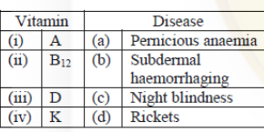

# CSIR NET Life Sciences — December 2019 (15 Dec 2019 session) — Part B

**Instructions:** Part B contains 50 questions (global Q21–Q70); candidates were required to attempt **35** of them. Each question carries two marks; negative marking 25% per wrong answer.

*Numbering: global question number = printed Question ID − 1879801400 (Part B = QIDs 1879801421–1879801470). All answers are from the official NTA **Final Answer Key** (10.01.2020) by Question ID, independently confirmed by the correct-option highlight printed on the NTA candidate response sheet.*

---

### Question 21

Which one of the following graphs best describes the dependence of free energy change (ΔG) of ATP hydrolysis on Mg²⁺ concentration?

![Four graphs of −ΔG (kcal mol⁻¹) versus [Mg²⁺] (M) on a log axis: (1) sigmoid decreasing, (2) sigmoid increasing, (3) straight line decreasing, (4) straight line increasing](images/B/fig21.png)

1. (1)
2. (2)
3. (3)
4. (4)

**Answer: 1 ((1))**

> **Explanation:** Mg²⁺ binds both ATP and ADP/Pi; at very low [Mg²⁺] −ΔG of hydrolysis is high, and as Mg²⁺ rises the free-energy change falls steeply and then saturates once binding sites are occupied — the decreasing sigmoid, graph **(1)**. *(Question ID 1879801421.)*

---

### Question 22

Which one of the following statements is true regarding amino acids?

1. Proline has high propensity to form α-helix in globular proteins
2. Both isoleucine and threonine can exist as diastereomers
3. Side chain pKa of aspartic acid is more than the side chain pKa of glutamic acid
4. The Ψ dihedral angle of proline is more restricted than the Φ dihedral angle

**Answer: 2 (Both isoleucine and threonine can exist as diastereomers)**

> **Explanation:** Ile and Thr each have two stereocentres, so they occur as diastereomeric pairs (e.g. L-isoleucine and L-allo-isoleucine). Proline is a helix breaker; Asp's side-chain pKa is *lower* than Glu's; it is proline's Φ angle that is severely restricted. *(Question ID 1879801422.)*

---

### Question 23

Match the following vitamins with the corresponding pathological conditions arising from their deficiencies.

1. i – c; ii – a; iii – d; iv – b
2. i – c; ii – b; iii – d; iv – a
3. i – c; ii – a; iii – b; iv – d
4. i – d; ii – a; iii – b; iv – d

**Answer: 1 (i – c; ii – a; iii – d; iv – b)**

> **Explanation:** Vitamin A → night blindness; B₁₂ → pernicious anaemia; D → rickets; K → haemorrhaging (clotting-factor deficiency). *(Question ID 1879801423.)*

---

### Question 24

The interaction energy between two opposite charges separated by 3Å in vacuum is -500 kJmol⁻¹. The interaction energy between these two charges in water will be closest to

1. -1500 kJmol⁻¹
2. -166 kJmol⁻¹
3. -55 kJmol⁻¹
4. -6 kJmol⁻¹

**Answer: 4 (-6 kJmol⁻¹)**

> **Explanation:** Coulombic energy scales as 1/ε; water's dielectric constant is ≈ 80, so −500/80 ≈ **−6 kJmol⁻¹**. *(Question ID 1879801424.)*

---

### Question 25

For bacterial growth, a single cell elongates in size before it divides into two, in a process called binary fission. During cell growth,

1. new peptidoglycan synthesis is required along with the hydrolysis of bonds linking the old peptidoglycan chains.
2. new peptidoglycan synthesis is required but no hydrolysis of the old peptidoglycan occurs.
3. the old peptidoglycan is completely degraded and replaced with the newly synthesized longer polymer.
4. newly synthesized peptidoglycan is utilized to deposit a new layer of the peptidoglycan in the cell wall.

**Answer: 1 (new peptidoglycan synthesis is required along with the hydrolysis of bonds linking the old peptidoglycan chains.)**

> **Explanation:** Sacculus expansion requires controlled cleavage of existing peptidoglycan cross-links by autolysins at the same time as new strands are synthesised and inserted. *(Question ID 1879801425.)*

---

### Question 26

Phosphoenol pyruvate:sugar phosphotransferase system (PTS) transports a variety of sugars into bacteria. In *E. coli*, PTS consists of EI, EII (EIIA, EIIB, and EIIC), and Hpr. During this process the sugar molecule is phosphorylated by direct transfer of phosphate group from

1. EI-P
2. EIIA-P
3. EIIB-P
4. Hpr-P

**Answer: 3 (EIIB-P)**

> **Explanation:** The phosphoryl relay runs PEP → EI → HPr → EIIA → EIIB; **EIIB-P** is the immediate phosphate donor to the sugar transiting through EIIC. *(Question ID 1879801426.)*

---

### Question 27

During the exponential phase of growth, if *N₀*, *Nₜ* and *n* define the initial population number, population number at time *t*, and the number of generations in time *t*, respectively, then

1. *Nₜ* = *N₀* × 2*n*
2. *N₀* = *Nₜ* / 2
3. *Nₜ* / *N₀* = 2ⁿ
4. *N₀* / *Nₜ* = 2ⁿ

**Answer: 3 (*Nₜ* / *N₀* = 2ⁿ)**

> **Explanation:** Binary fission over *n* generations gives *Nₜ* = *N₀*·2ⁿ, hence *Nₜ*/*N₀* = **2ⁿ**. *(Question ID 1879801427.)*

---

### Question 28

In a form of stress response, bacteria synthesize a group of proteins called stress proteins (or heat shock proteins) such as DnaK, DnaJ, GroEL, GroES, and GrpE. DnaK is an ATP binding protein, which attaches to the newly synthesized polypeptide in conjunction with DnaJ. Which one of the following statements correctly states a step in the subsequent process of protein folding?

1. The affinity of DnaK to the polypeptide increases upon hydrolysis of the ATP to ADP.
2. DnaJ is an exchange factor that replaces ADP with ATP in DnaK
3. ATP hydrolysis is required for the phosphorylation of DnaJ
4. ATP hydrolysis is required for the phosphorylation of GrpE

**Answer: 1 (The affinity of DnaK to the polypeptide increases upon hydrolysis of the ATP to ADP.)**

> **Explanation:** DnaJ delivers substrate and stimulates DnaK's ATPase; the ADP-bound state of DnaK holds the polypeptide with high affinity, and GrpE (not DnaJ) is the nucleotide-exchange factor. No phosphorylation of DnaJ/GrpE is involved. *(Question ID 1879801428.)*

---

### Question 29

Which one of the following statements related to transcription and processing of mRNA is **INCORRECT**?

1. During prokaryotic transcription, DNA binding properties of RNA polymerase are altered by sigma factor
2. In eukaryotic transcription, synthesis of rRNA, mRNA and some small RNAs occurs by RNA polymerases I, II and III, respectively
3. Splicing observed in tRNA involves successive/sequential cleavage and ligation reactions while pre-mRNA splicing proceeds through lariat formation
4. mRNAs with premature stop codons are degraded by Nonsense-Mediated Decay (NMD) and mRNAs without an in-frame stop codon get accumulated and translated in the cytoplasm.

**Answer: 4 (…mRNAs without an in-frame stop codon get accumulated and translated in the cytoplasm.)**

> **Explanation:** Non-stop mRNAs (lacking an in-frame stop codon) are also degraded (non-stop decay at the translating ribosome), not accumulated and translated — so statement 4 is the incorrect one. Statements 1–3 are standard facts. *(Question ID 1879801429.)*

---

### Question 30

Which one of the following regulatory proteins can act as a positive and negative regulator on binding to the same DNA elements?

1. Lac repressor (LacI)
2. Lambda (cI) repressor
3. Ara C protein (AraC)
4. Trp repressor (TrpR)

**Answer: 2 (Lambda (cI) repressor)**

> **Explanation:** λ cI bound at the right-operator region represses P_R/P_L (negative) while, at lower occupancy, activating transcription from P_RM (positive) on the same overlapping operator DNA. *(Question ID 1879801430.)*

---

### Question 31

Readers of histone modifications include:

1. SUN domain proteins
2. BAG domain proteins
3. PAS domain proteins
4. TUDOR domain proteins

**Answer: 4 (TUDOR domain proteins)**

> **Explanation:** TUDOR domains (like chromo, MBT, PHD domains) "read" methyl-lysine marks on histone tails; SUN (nuclear-envelope/LINC), BAG (co-chaperone) and PAS (ligand sensing) domains do not. *(Question ID 1879801431.)*

---

### Question 32

The amino acid side chains of the four histones in the nucleosome are subjected to remarkable variety of post-translation modifications such as phosphorylation, acetylation and methylation. Which one of the following post-translational marks on histone tails is usually associated with transcriptional repression?

1. Acetylation of H3K9
2. Methylation of H3K9
3. Acetylation of H4K5
4. Phosphorylation of H3S10

**Answer: 2 (Methylation of H3K9)**

> **Explanation:** H3K9 methylation is the hallmark repression/heterochromatin mark (bound by HP1); histone acetylations and H3S10 phosphorylation correlate with active transcription. *(Question ID 1879801432.)*

---

### Question 33

Which one of the following is **not** a G-protein coupled receptor?

1. Epinephrine receptor
2. Transferrin receptor
3. Glucagon receptor
4. Thyroid stimulating hormone receptor

**Answer: 2 (Transferrin receptor)**

> **Explanation:** The transferrin receptor is a clathrin-mediated iron-uptake receptor, not a GPCR; adrenergic, glucagon and TSH receptors are all GPCRs. *(Question ID 1879801433.)*

---

### Question 34

Two strains of mice which are genetically identical except for a single genetic locus or region are said to be:

1. Syngenic
2. Allogenic
3. Congenic
4. Heterogenic

**Answer: 3 (Congenic)**

> **Explanation:** Congenic strains differ only at one defined locus/region, produced by repeated backcrossing with marker-assisted selection. *(Question ID 1879801434.)*

---

### Question 35

Which one of the following lipid-soluble hormones can interact with a cell surface receptor?

1. Progesterone
2. Estradiol
3. Thyroxine
4. Prostaglandin

**Answer: 4 (Prostaglandin)**

> **Explanation:** Prostaglandins are lipid-soluble eicosanoids that signal through G-protein-coupled **cell-surface** receptors; steroids and thyroid hormone act mainly via intracellular/nuclear receptors. *(Question ID 1879801435.)*

---

### Question 36

In what respect does the genome of slow-acting retroviruses differ from those of transducing viruses?

1. They cannot activate nearby cellular proto-oncogenes after integration into the genome of the host cell
2. They lack an oncogene
3. They exclude mouse mammary tumor viruses
4. They have acquired mutations during acquisition of an oncogene

**Answer: 2 (They lack an oncogene)**

> **Explanation:** Slow/chronic retroviruses carry no captured oncogene (they act by insertional activation, e.g. MMTV); transducing (acute) retroviruses carry a viral oncogene. *(Question ID 1879801436.)*

---

### Question 37

Centrolecithal eggs show

1. superficial cleavage
2. displaced radial cleavage
3. bilateral cleavage
4. discoidal cleavage

**Answer: 1 (superficial cleavage)**

> **Explanation:** In centrolecithal (insect) eggs the central yolk confines divisions to the peripheral cytoplasm — superficial cleavage. *(Question ID 1879801437.)*

---

### Question 38

The cells of inner cell mass of a blastocyst stage mammalian embryo are

1. totipotent
2. pluripotent
3. multipotent
4. unipotent

**Answer: 2 (pluripotent)**

> **Explanation:** ICM cells form all embryonic tissues of the three germ layers but not the extra-embryonic trophoblast — pluripotent. *(Question ID 1879801438.)*

---

### Question 39

Some statements regarding the process of autophagy are given below:
A. Autophagy occurs when cells contain aggregated proteins
B. Autophagosomes fuse with any organelles
C. Autophagosome is a single membrane structure
D. Autophagosomes fuse with lysosomes to form autophagolysosomes

Which one of the following combination of the above statements is correct?

1. A and B
2. B and C
3. C and D
4. D and A

**Answer: 4 (D and A)**

> **Explanation:** A and D are correct. Autophagosomes are **double**-membraned (C wrong) and fuse specifically with lysosomes, not "any organelles" (B wrong). *(Question ID 1879801439.)*

---

### Question 40

Which of the following factors is known to be involved in postponing programmed cell death in cereal aleurone until endosperm mobilization is complete?

1. Gibberellic acid
2. Abscisic acid
3. Acidic pH of the vacuoles
4. cGMP mediated signal transduction pathway

**Answer: 2 (Abscisic acid)**

> **Explanation:** The official NTA key marks **Abscisic acid** (ABA is known to delay PCD in the aleurone layer; GA later promotes it during germination). *(Question ID 1879801440.)*

---

### Question 41

Which one of the following reactions takes place during the reduction phase of the Calvin-Benson cycle?

1. Ribulose 1,5-bisphosphate to 3-phosphoglycerate
2. 1,3-bisphosphoglycerate to glyceraldehyde-3-phosphate
3. Dihydroxyacetone phosphate to fructose 1,6-bisphosphate
4. Ribulose 5-phosphate to ribulose 1,5-bisphosphate

**Answer: 2 (1,3-bisphosphoglycerate to glyceraldehyde-3-phosphate)**

> **Explanation:** The reduction phase is the NADPH-dependent conversion of 1,3-bisphosphoglycerate to G3P by G3P dehydrogenase. Option 1 is carboxylation; option 4 is regeneration. *(Question ID 1879801441.)*

---

### Question 42

Which one of the following parts of root is involved in perceiving gravity?

1. Quiescent center
2. Endodermis
3. Root cap
4. Elongation zone

**Answer: 3 (Root cap)**

> **Explanation:** Amyloplast statoliths in the root-cap columella sediment in response to gravity and initiate gravitropic signalling. *(Question ID 1879801442.)*

---

### Question 43

While screening an EMS-mutagenized population of a plant, a researcher identified a mutant with reduced gibberellic acid sensitivity. Which one of the following proteins is most likely to be defective in this mutant?

1. Sucrose non-fermenting related kinase 2 (SnRK2)
2. Constitutive triple response 1 (CTR1)
3. Phytochrome interacting factor (PIF)
4. Coronatine-insensitive 1 (COI1)

**Answer: 3 (Phytochrome interacting factor (PIF))**

> **Explanation:** GA relieves DELLA-mediated repression of growth-promoting transcription factors including PIFs; loss of a GA-response mediator (PIF) phenocopies reduced GA sensitivity. SnRK2 (ABA/osmotic), CTR1 (ethylene) and COI1 (jasmonate) belong to other pathways. *(Question ID 1879801443.)*

---

### Question 44

Vascular wilts are wide spread and destructive plant diseases. The symptoms of this disease are primarily caused by the clogging of

1. xylem vessels
2. phloem vessels
3. stomata
4. hydathodes

**Answer: 1 (xylem vessels)**

> **Explanation:** Vascular-wilt pathogens (*Fusarium*, *Verticillium*) colonise and block the water-conducting xylem vessels, producing wilting. *(Question ID 1879801444.)*

---

### Question 45

Which one of the following is **NOT** true in the process of acclimatization to high altitude?

1. Respiratory alkalosis
2. Increased 2, 3-DPG in RBC
3. Rise in pH of cerebrospinal fluid
4. Increased cytochrome oxidase in tissues

**Answer: 3 (Rise in pH of cerebrospinal fluid)**

> **Explanation:** Hyperventilation causes respiratory alkalosis, 2,3-DPG rises, and tissue cytochrome oxidase increases; the initial rise in CSF pH is corrected during acclimatisation (bicarbonate is actively removed from CSF), so a sustained CSF pH rise is NOT part of acclimatisation. *(Question ID 1879801445.)*

---

### Question 46

The sodium-independent iodide/chloride transporter is named as

1. megalin
2. pendrin
3. transthyretin
4. prestin

**Answer: 2 (pendrin)**

> **Explanation:** Pendrin (SLC26A4) is the Na⁺-independent Cl⁻/I⁻(⁻) transporter of thyroid, inner ear and kidney; mutations cause Pendred syndrome. *(Question ID 1879801446.)*

---

### Question 47

Which one of the following synaptic vesicle proteins is involved in tethering of the vesicle to the cytoskeletal system in the nerve terminus?

1. Synaptotagmin
2. Synapsin
3. Synaptophysin
4. Synaptobrevin

**Answer: 2 (Synapsin)**

> **Explanation:** Synapsin tethers reserve-pool vesicles to the actin cytoskeleton; CaMK/phosphorylation releases them for mobilisation. *(Question ID 1879801447.)*

---

### Question 48

Which one of the following hormones is responsible for mobilizing calcium from the bone and increasing urinary excretion of phosphate?

1. Calcitonin
2. Angiotensin II
3. Parathormone
4. Vasopressin

**Answer: 3 (Parathormone)**

> **Explanation:** PTH mobilises Ca²⁺ from bone and is phosphaturic (reduces renal phosphate reabsorption), raising blood Ca²⁺. *(Question ID 1879801448.)*

---

### Question 49

In summer squash, white colour fruit (*W*) is dominant over yellow colour (*w*) and disc-shaped phenotype (*D*) is dominant over sphere-shaped phenotype (*d*). Determine the genotype of the parents if the cross between white, sphere crossed with white, sphere gives ¾ white, sphere and ¼ yellow, sphere.

1. *WWDD* × *wwdd*
2. *Wwdd* × *Wwdd*
3. *WwDd* × *wwdd*
4. *wwDD* × *WWdd*

**Answer: 2 (*Wwdd* × *Wwdd*)**

> **Explanation:** All progeny sphere ⇒ both parents *dd*; 3 white : 1 yellow ⇒ both parents *Ww*. Hence *Wwdd* × *Wwdd*. *(Question ID 1879801449.)*

---

### Question 50

What is the probability of getting a sum of 9 from simultaneously throwing two dice?

1. 1/6
2. 1/8
3. 1/9
4. 1/12

**Answer: 3 (1/9)**

> **Explanation:** Four of the 36 equally likely outcomes sum to 9: (3,6), (4,5), (5,4), (6,3) → 4/36 = **1/9**. *(Question ID 1879801450.)*

---

### Question 51

In context of DNA methylation, which one of the following statements is **FALSE**?

1. Generally, methylation occurs at the 3rd carbon position of cytosine and converts it to 3-methylcytosine
2. Maintenance methyltransferase acts constitutively on hemimethylated sites and converts them to fully methylated sites
3. During mammalian gametogenesis, the genomic methylation patterns are erased in primordial germ cells
4. Replication converts a fully methylated site to hemimethylated site

**Answer: 1 (Generally, methylation occurs at the 3rd carbon position of cytosine and converts it to 3-methylcytosine)**

> **Explanation:** DNA methylation occurs at the **5th** carbon of cytosine (5-methylcytosine), not the 3rd — statement 1 is false. Statements 2–4 correctly describe maintenance methylation, epigenetic reprogramming in primordial germ cells, and the hemimethylated product of replication. *(Question ID 1879801451.)*

---

### Question 52

Interacting genes which are involved in producing continuous variation in phenotypes in a population are known as/constitute

1. codominant genes
2. pseudogenes
3. alleles
4. QTLs

**Answer: 4 (QTLs)**

> **Explanation:** Quantitative trait loci (QTLs) are the interacting loci underlying continuously distributed quantitative variation. *(Question ID 1879801452.)*

---

### Question 53

Which one of the following plants has this combination of key plant traits: sporophyte dominant in the lifecycle, vascular tissue, lack of seeds?

1. Mosses
2. Ferns
3. Cycads
4. Monocots

**Answer: 2 (Ferns)**

> **Explanation:** Ferns are seedless vascular plants with a dominant sporophyte. Mosses lack vascular tissue; cycads and monocots bear seeds. *(Question ID 1879801453.)*

---

### Question 54

Which one of the following plants has a bisporic, 8-nucleate, bipolar embryo sac development?

1. *Oenothera*
2. *Penaea*
3. *Plumbago*
4. *Allium*

**Answer: 4 (Allium)**

> **Explanation:** The *Allium* type is the classic bisporic (meiotic second division succeeds), 8-nucleate, bipolar embryo sac. *Oenothera* is nuclear bisporic but unipolar; *Penaea* and *Plumbago* types are tetrasporic. *(Question ID 1879801454.)*

---

### Question 55

Which one of the following show complete metamorphosis in all three orders?

1. Coleopterans, Dipterans and Hymenopterans
2. Coleopterans, Hymenopterans and Orthopterans
3. Dipterans, Lepidopterans and Hemipterans
4. Hymenopterans, Lepidopterans and Orthopterans

**Answer: 1 (Coleopterans, Dipterans and Hymenopterans)**

> **Explanation:** Holometabolous (complete metamorphosis) orders include Coleoptera, Diptera, Hymenoptera and Lepidoptera; Orthoptera (hemimetabolous) and Hemiptera (paurometabolous) exclude options 2–4. *(Question ID 1879801455.)*

---

### Question 56

Cnidarians are

1. triploblastic animals with bilateral symmetry.
2. diploblastic animals with medusa as one of the basic body forms.
3. monoblastic organisms with tube feet.
4. asymmetric organisms with tentacles containing poison glands.

**Answer: 2 (diploblastic animals with medusa as one of the basic body forms.)**

> **Explanation:** Cnidarians are diploblastic with two basic body forms — polyp and **medusa**. *(Question ID 1879801456.)*

---

### Question 57

In a lake, reducing the population of a fish which feeds on plankton was followed by a decline in the rate of primary productivity. This is consistent with which one of the following hypotheses regarding the regulation of primary productivity?

1. Bottom-up control
2. Eutrophication
3. Top-down control
4. Trophic pyramid

**Answer: 3 (Top-down control)**

> **Explanation:** Removing a plankton-feeding fish alters the grazing chain from the top (fish → zooplankton → phytoplankton), cascading down to primary productivity — the signature of **top-down** control. *(Question ID 1879801457.)*

---

### Question 58

Which one of the following was recently reported to be the first mammal to have become extinct as a result of climate change?

1. Bramble Cay melomys – *Melomys rubicola*
2. Gangetic river dolphin – *Platanista gangetica*
3. Malaga giant rat – *Hypogeomys antimena*
4. Tapanuli orangutan – *Pongo tapanuliensis*

**Answer: 1 (Bramble Cay melomys – *Melomys rubicola*)**

> **Explanation:** The Bramble Cay melomys, a small rodent of a coral-cay in the Torres Strait, was formally declared extinct in 2016 with sea-level rise/extreme weather (climate change) cited as the principal cause — the first mammal extinction attributed to anthropogenic climate change. *(Question ID 1879801458.)*

---

### Question 59

The ratio of variance in male mating success (Vm) to variance in female mating success (Vf) is strongly male biased (Vm>Vf) in species P, strongly female biased (Vf>Vm) in species Q and similar in species R (Vm=Vf). All else being equal, which one of the following matches between species and mating systems is most likely?

1. P-monogamy; Q-polyandry; R-polygyny
2. P- polyandry; Q- polygyny; R- monogamy
3. P- polygyny; Q-polyandry; R- monogamy
4. P-monogamy; Q- polygyny; R- polyandry

**Answer: 3 (P- polygyny; Q-polyandry; R- monogamy)**

> **Explanation:** In polygyny a few males monopolise many females ⇒ variance in male mating success greatly exceeds female (P). In polyandry the reverse holds (Q). In monogamy both sexes have equal variance (R). *(Question ID 1879801459.)*

---

### Question 60

An interaction where the actor and the recipient both suffer a cost is referred to as

1. Altruism
2. Cooperation
3. Mutualism
4. Spite

**Answer: 4 (Spite)**

> **Explanation:** In classical behavioural ecology sign conventions: spite = actor (−) and recipient (−); altruism = (+ cost to actor, benefit to recipient); cooperation/mutualism = (+,+). *(Question ID 1879801460.)*

---

### Question 61

The frequency of homozygotes in a diploid population is 0.68. Assuming that the population is in Hardy-Weinberg equilibrium, the frequencies of the two alleles are

1. 0.1 and 0.9
2. 0.2 and 0.8
3. 0.4 and 0.6
4. 0.5 and 0.5

**Answer: 2 (0.2 and 0.8)**

> **Explanation:** Homozygote frequency p² + q² = 0.68 with p + q = 1 ⇒ (p+q)² − 2pq = 0.68 ⇒ 2pq = 0.32. Solving p, q = 0.8 and 0.2. *(Question ID 1879801461.)*

---

### Question 62

Which one of the following statements **CANNOT** be included while defining the fermentation process?

1. Alcohol is formed from sugar residues
2. Requires an electron transport system.
3. Utilizes an organic compound as the final electron acceptor
4. Produces lactic acid in oxygen deprived muscle

**Answer: 2 (Requires an electron transport system.)**

> **Explanation:** Fermentation is defined by substrate-level phosphorylation with an **organic** terminal electron acceptor and no involvement of an electron transport chain; alcoholic fermentation and lactic-acid (oxygen-deprived muscle) fermentation are both genuine examples. *(Question ID 1879801462.)*

---

### Question 63

Which one of the following does **NOT** use RNA-sequencing?

1. Mapping transcription initiation sites
2. Long non-coding RNA profiling
3. Alternative polyadenylation profiling
4. Mammalian epigenome sequencing

**Answer: 4 (Mammalian epigenome sequencing)**

> **Explanation:** TSS mapping (CAGE/5'-seq), lncRNA profiling and APA profiling are all RNA-based (RNA-seq) assays; epigenome sequencing (e.g. ChIP-seq, WGBS) interrogates DNA/protein-DNA interactions, not the transcriptome. *(Question ID 1879801463.)*

---

### Question 64

*Agrobacterium tumefaciens* is frequently used as a vector to create transgenic plants. Under laboratory conditions *Agrobacterium* – mediated plant transformation does not require

1. host plant genes
2. bacterial type IV secretion system
3. *vir* genes
4. opine catabolism genes

**Answer: 4 (opine catabolism genes)**

> **Explanation:** T-DNA transfer needs the Vir machinery (vir genes), a type IV secretion system, and host (plant) genes/signals (e.g. acetosyringone-responsive pathways); the Ti plasmid's opine catabolism genes are relevant to bacterial nutrition in nature, not to the laboratory transformation event. *(Question ID 1879801464.)*

---

### Question 65

The T-DNA region of the Ti plasmid of *Agrobacterium tumefaciens* harbours two genes: X and Y. Mutation of gene 'X' produces a rooty tumour while mutation of gene 'Y' produces shoots in the tumor. Based on the above information, which one of the following statements is correct?

1. Gene 'X' encodes auxins and gene 'Y' encodes cytokinins
2. Gene 'X' encodes cytokinins and gene 'Y' encodes auxins
3. Gene 'X' and gene 'Y' both encode auxins
4. Gene 'X' encodes opines while gene 'Y' encodes cytokinins

**Answer: 2 (Gene 'X' encodes cytokinins and gene 'Y' encodes auxins)**

> **Explanation:** Loss of X giving a rooty tumour ⇒ X normally makes cytokinin (its loss tips the balance to auxin → roots); loss of Y giving shoots ⇒ Y normally makes auxin (its loss tips the balance to cytokinin → shoots). Hence gene X encodes cytokinins and gene Y encodes auxins. *(Question ID 1879801465; NTA Final Answer Key option 2.)*

---

### Question 66

In electron microscopy, to detect specific macromolecule or structure such as spindle pole body (SPB), the frequently used procedure is to couple secondary antibody with

1. Alexa 568
2. Cy5
3. Gold particle
4. Osmium tetraoxide

**Answer: 3 (Gold particle)**

> **Explanation:** Immunoelectron microscopy uses gold-conjugated secondary antibodies (protein A-gold or gold-labelled IgG) as the electron-dense detection reagent; fluorophores (Alexa 568, Cy5) are for light microscopy. *(Question ID 1879801466.)*

---

### Question 67

A researcher samples *n* individuals randomly from a population of blackbuck and identifies their sex. The number of females in the sample follows

1. an exponential distribution
2. a binomial distribution
3. a Poisson distribution
4. a normal distribution

**Answer: 2 (a binomial distribution)**

> **Explanation:** Counting "successes" (females) in *n* independent two-outcome draws is exactly a binomial random variable. *(Question ID 1879801467.)*

---

### Question 68

If you inject a mouse with radioactive material of current activity of 256 Bq, what will be the activity after completion of 6 half-lives?

1. 4 Bq
2. 8 Bq
3. 16 Bq
4. 24 Bq

**Answer: 1 (4 Bq)**

> **Explanation:** Activity after 6 half-lives = 256 × (1/2)⁶ = 256/64 = **4 Bq**. *(Question ID 1879801468.)*

---

### Question 69

Which one of the following statements related to molecular cloning procedures is **INCORRECT**?

1. 5' overhangs of restricted DNA fragments can be blunt-ended by Klenow polymerase but not by DNaseI.
2. A DNA fragment obtained as an XhoI fragment (C↓TCGAG) may be ligated at the SalI site (G↓TCGAC) in a vector.
3. To prevent self-ligation of a vector digested with KpnI (GGTAC↓C), alkaline phosphatase enzyme is used to remove 3'-PO₄ groups from the ends of fragments.
4. α-complementation/blue-white screening may produce blue coloured recombinant colonies (containing cloned fragments) in case of translational fusion with the β-galactosidase gene.

**Answer: 3 (…alkaline phosphatase enzyme is used to remove 3'-PO₄ groups…)**

> **Explanation:** Alkaline phosphatase removes the **5'**-phosphate groups (not 3'-PO₄) to block self-ligation — statement 3 is incorrect as printed. XhoI/SalI share the compatible TCGA overhang; Klenow fills 5' overhangs; blue recombinants can arise from in-frame α-complementation. *(Question ID 1879801469.)*

---

### Question 70

In a neuron, proteins and membranes are primarily synthesized in the cell body. These materials must be transported down the axon to the synaptic region using microtubules in an anterograde fashion. Such axonal transport is directed by

1. Dynein
2. Kinesin I
3. Dynein and Kinesin I
4. Myosin

**Answer: 2 (Kinesin I)**

> **Explanation:** Anterograde (soma → synapse) microtubule-based transport is powered by **kinesin I**; dynein drives retrograde transport; myosin moves on actin. *(Question ID 1879801470.)*
