# CSIR NET Life Sciences — December 2019 (15 Dec 2019 session) — Part C (Life Sciences)

**Instructions (as printed in CSIR/NTA test booklets):** Part C contains 75 questions (global Q71–Q145); candidates were required to answer **25** of them. Each Part C question carries four marks; negative marking 25% per wrong answer. (Overall: 20 Part A + 50 Part B + 75 Part C = 145 MCQs; answer 15 in A, 35 in B, 25 in C.)

*Numbering: global question number = printed Question ID − 1879801400 (Part C = QIDs 1879801471–1879801545). All answers are from the official NTA **Final Answer Key** (10.01.2020) by Question ID, independently confirmed by the correct-option highlight printed on the NTA candidate response sheet.*

---

### Question 71

A form and Z form of double stranded DNA differ in the handedness of their helices, nucleotide sequences, and configuration of base to sugar. Based on these properties, which one of the following statements defines a correct combination for A and Z forms of DNA?

1. Right handed double helix and *anti*-configuration for the base to sugar arrangement in A DNA; and left handed double helix with alternating sequence of G and C (as a general pattern), and alternating *syn*- and *anti*-configurations for the base to sugar arrangement in the Z DNA.
2. Right handed double helix and *syn*-configuration for the base to sugar arrangement in A DNA; and left handed double helix with alternating A and G sequence (as a general pattern), and *anti*-configurations for base to sugar arrangement in the Z DNA.
3. Left handed double helix and *anti*-configuration for base to sugar arrangement in the A form DNA and right handed double helix and *syn*-configuration for base to sugar arrangement in the Z form DNA.
4. Left handed double helix and *syn*-configuration for base to sugar arrangement in the A form DNA and right handed double helix and *anti*-configuration for the base to sugar arrangement for the Z form DNA.

**Answer: 1**

> **Explanation:** A-DNA is a right-handed helix with all bases in the *anti* conformation. Z-DNA is left-handed, favoured by alternating purine–pyrimidine (generally G–C) repeats, in which the guanosines adopt the *syn* conformation while the cytidines remain *anti* — the alternating *syn*/*anti* pattern described in option 1. *(Question ID 1879801471.)*

---

### Question 72

Given below is the [P] vs time plot of an enzymatic reaction carried out by the enzyme 'X'

![Progress curve of product concentration [P] versus time (seconds): the curve rises steeply then plateaus; dashed guides mark [P] = 30 at time 15 s and [P] = 60 near 45 s, with the axis extending to 90](images/C/fig72.png)

Which one of the following statements is the correct interpretation of the data?

1. The Kₘ and Vₐₓ of the enzyme 'X' are 15 and 60 units, respectively.
2. The Vₘₐₓ is 60 but the Kₘ cannot be determined
3. The Kₘ is 15 but the Vₘₐₓ cannot be determined
4. Neither the Kₘ nor the Vₘₐₓ of the enzyme 'X' can be determined from these data

**Answer: 4**

> **Explanation:** A [P]-vs-time progress curve gives the *rate* of product formation, not its dependence on substrate. Kₘ is defined by the substrate concentration at half-maximal *velocity*; since no [S] series (and no initial-velocity-vs-[S] plot) is provided, neither Vₘₐₓ (the curve has not clearly reached its plateau in velocity terms) nor Kₘ can be extracted from this single progress curve. *(Question ID 1879801472.)*

---

### Question 73

Given below are some physicochemical properties (column X) and their manifestations (column Y).

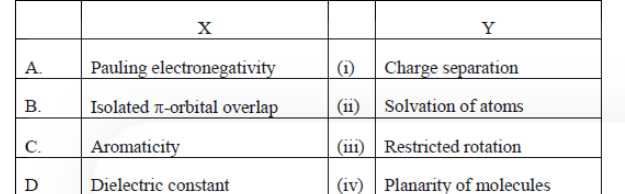

Which one of the following is the most appropriate match?

1. A – i, B – iv, C – ii, D – iii
2. A – iii, B – ii, C – iv, D – i
3. A – ii, B – iii, C – iv, D – i
4. A – iv, B – ii, C – i, D – iii

**Answer: 3**

> **Explanation:** Differences in Pauling electronegativity drive charge separation/solvation of atoms (A–ii); overlap of isolated π-orbitals creates partial double-bond character and hence restricted rotation (B–iii); aromatic systems are constrained to planarity of molecules (C–iv); a high dielectric constant promotes charge separation/solvation of ions (D–i). The NTA key accepts the combination A–ii, B–iii, C–iv, D–i. *(Question ID 1879801473.)*

---

### Question 74

The following observations are made on a 30-residue polypeptide

(a) Unordered structure is observed in water but a helical conformation is observed in medium of low dielectric constant.

(b) The peptide is resistant to degradation by proteases.

(c) Red blood cells are lysed by the peptide.

(d) β-mercaptoethanol has no effect on peptide structure.

Which of the following statements can be correctly attributed to the above observations?

1. The peptide is entirely composed of D-amino acids and is amphipathic.
2. The peptide is entirely composed of L-amino acids and is not amphipathic.
3. The peptide is rich in disulphide bonds between D-cysteines.
4. The peptide is entirely composed of L-aromatic amino acids.

**Answer: 1**

> **Explanation:** Protease resistance points to a poly-D-amino-acid peptide (proteases are specific for L-configurations); membrane lysis of RBCs requires an amphipathic helix; β-mercaptoethanol having no effect rules out disulphide bonds; helix formation only in low-dielectric (membrane-like) medium fits an amphipathic helix folding in the bilayer. Together these support option 1. *(Question ID 1879801474.)*

---

### Question 75

The following statements are made

A. B form of DNA has ~10 base pairs/turn and A form of DNA has ~2.3Å helix rise per base pair

B. Both the A and B form of DNA have wider major groove and narrow minor groove

C. The crystalline nature of cellulose is brought about by α (1→4) linkage between the glucose subunits.

D. The double bonds in natural lipids are always *cis*, which provides fluidity to the plasma membrane.

Which of the following combinations represent the correct statements?

1. A and C
2. B and C
3. A and D
4. C and D

**Answer: 3**

> **Explanation:** A is correct: B-DNA has ~10 bp/turn and A-DNA has an axial rise of ~2.3 Å per base pair. D is correct: naturally occurring unsaturated fatty-acid double bonds are *cis*, kinking the chains and increasing membrane fluidity. B is wrong (A-DNA has a deep narrow major groove and wide shallow minor groove — the opposite of B-DNA) and C is wrong (cellulose is a β(1→4) glucan, not α(1→4)). *(Question ID 1879801475.)*

---

### Question 76

Analysis of a homotetrameric protein and a double stranded DNA (that had been incubated in standard buffer) on native gels revealed that they migrated true to their physical states (tetrameric nature of the protein and double stranded nature of the DNA). Following hypotheses were made for the effect of adding high salt to the incubation mix and subsequent analysis on native gels.

A. The protein would migrate as a homotetramer and DNA in double stranded form.

B. The protein would migrate as a monomer but DNA in double stranded form.

C. The protein would migrate as a homotetramer but the DNA in single stranded form.

D. The protein would migrate as a monomer and the DNA in single stranded form.

Which of the following combination of hypotheses is most likely?

1. A and B
2. B and C
3. C and D
4. A and D

**Answer: 1**

> **Explanation:** Subunit interfaces of a homotetramer are held together by non-covalent (hydrophobic and ionic) interactions, so high salt can dissociate it to monomers (B is plausible); the two strands of duplex DNA, however, are held by base stacking and hydrogen bonds that physiological-to-high salt does not break — melting requires heat or denaturant, so the DNA stays double stranded (A is plausible). Hence the key accepts the pair A and B. *(Question ID 1879801476.)*

---

### Question 77

The nucleosome is the fundamental subunit of chromatin in eukaryotes. Following statements are made about nucleosome:

A. Generally, a typical nucleosome contains ~200bp of DNA and two copies of each histone (H2A, H2B, H3 and H4)

B. 146 bp length of DNA per nucleosome core particle is strictly maintained across the organisms

C. The histone octamers are not conserved during/after replication, however, H3~H4 tetramers are.

D. Variants have been identified for all core histones except histone H3

E. While wrapping around the core histones, the structure of DNA is altered at the middle of the nucleosome core particle and exhibits increased number of base pairs per turn

Which one of the following combination of statements is most appropriate?

1. A, C and E
2. A, B and D
3. B, D and E
4. A, C and D

**Answer: 1**

> **Explanation:** A is correct (a nucleosome ≈ 200 bp DNA including linker, with two each of H2A, H2B, H3, H4). C is correct (old H3–H4 tetramers are conserved and segregated to daughter strands, while H2A–H2B dimers are exchanged). E is correct (DNA at the entry/exit and dyer region is bent/widened, with an increased bp per turn relative to B-DNA). B is wrong (the 146-bp core length is not strictly conserved across organisms) and D is wrong (H3 has well-known variants, e.g. CENP-A, H3.3). *(Question ID 1879801477.)*

---

### Question 78

During cell cycle, entry in the S-phase is tightly regulated. This is possible because:

A. APC/C promotes ubiquitination of S-phase cyclins and mitotic cyclins, marking them for proteolyses at the mitotic exit.

B. Cyclin B1 helps in the activation of S-phase CDKs only in late G1.

C. As mitotic CDK activity declines in late mitosis, cdc14 phosphatase activates APC/C by dephosphorylating Cdh1, thus promoting formation of APC/C^Cdh1.

D. Securin keeps S-phase cyclins in inactive state till late G1.

Which one of the options represents all correct statements?

1. A and B
2. A and C
3. B and C
4. B and D

**Answer: 2**

> **Explanation:** A is correct: APC/C (with Cdh1) ubiquitinates S- and M-cyclins for proteolysis at mitotic exit, resetting the cycle so cells cannot re-enter S phase prematurely. C is correct: falling CDK activity in late mitosis lets the phosphatase cdc14 dephosphorylate Cdh1, licensing APC/C^Cdh1 formation. B is wrong (Cyclin B1–CDK1 is the mitotic, not S-phase, complex) and D is wrong (securin inhibits separase; it does not keep S-phase cyclins inactive). *(Question ID 1879801478.)*

---

### Question 79

Thousands of proteins that are synthesized in the cytoplasm are imported into the nucleus through the nuclear pore complex (NPC) every minute. These proteins contain Nuclear Localization Signal (NLS) that direct their selective transport into the nucleus. This nuclear import requires:

A. A small monomeric G-protein Ran.

B. A nuclear transport receptor that interacts with the NLS on a cargo protein.

C. A GTPase activating protein (GAP) bound to the chromatin tethered to the nuclear membrane.

D. A Guanine Exchange Factor (GEF) bound to the chromatin inside the nucleus.

Which one of the following options represents all correct statements?

1. A, C, D
2. A, B, D
3. B, C only
4. A, C only

**Answer: 2**

> **Explanation:** Nuclear import needs Ran (A), an importin/karyopherin receptor that binds the NLS cargo (B), and the chromatin-bound GEF RanGEF/RCC1 that loads GTP onto Ran inside the nucleus (D) to drive cargo release. C is wrong: the Ran GAP (RanGAP1) is cytoplasmic (with RanBP2/Nup358), not chromatin-bound at the nuclear membrane. *(Question ID 1879801479.)*

---

### Question 80

Listeria is a food-borne pathogen that causes mild gastro-intestinal symptoms. To move from one host-cell to another, it polymerizes actin into a comet tail like structure. Listeria can assemble host-cell actin at its rear end because:

A. Listeria has on its surface a protein called Act A

B. Listeria can activate Arp 2/3 complex

C. Listeria has on its surface γ-tubulin

D. Listeria has on its surface myosin II motor

Which one of the following options represents all correct statements?

1. A and D
2. A and B
3. A and C
4. C and D

**Answer: 2**

> **Explanation:** *Listeria* expresses the surface protein ActA (A), which mimics a WASP-family nucleation-promoting factor and activates the host Arp2/3 complex (B) to branch and polymerise actin at its rear, forming the comet tail. γ-tubulin (microtubule nucleation) and myosin II are not involved. *(Question ID 1879801480.)*

---

### Question 81

The membrane phospholipid structures in bacteria and archaea differ. Which one of the following correctly states the differences between the two?

1. The bacterial membrane phospholipid consist of D-glycerol linked to hydrophobic chains (tails) with ester bonds whereas those of the archaeal membranes consist of L-glycerol linked to hydrophobic tails through ether bonds.
2. The bacterial membrane phospholipid consist of L-glycerol linked to hydrophobic chains (tails) with ester bonds whereas those of the archaeal membranes consist of D-glycerol linked to hydrophobic tails through ether bonds.
3. The bacterial membrane phospholipid consist of D-glycerol linked to hydrophobic chains (tails) with ether bonds whereas those of the archaeal membranes consist of L-glycerol linked to hydrophobic tails through ester bonds.
4. The bacterial membrane phospholipid consist of L-glycerol linked to hydrophobic chains (tails) with ether bonds whereas those of the archaeal membranes consists of D-glycerol linked to hydrophobic tails through ester bonds.

**Answer: 1**

> **Explanation:** Bacterial (and eukaryotic) glycerophospholipids use D-glycerol with fatty acyl chains joined by **ester** bonds; archaeal lipids use the enantiomeric **L**-glycerol with isoprenoid chains joined by **ether** bonds. Option 1 states exactly this. *(Question ID 1879801481.)*

---

### Question 82

Deletion analysis of a promoter region of a gene was carried out to identify the regulatory elements in it. In the figure below, the filled boxes denote the areas of deletion and the observed activities (in arbitrary units) of the promoter are as shown.

Based on the observations, following statements were made:

A. The region between -100 and -50 houses a positive regulatory element.

B. The region between -200 and -250 houses a negative regulatory element

C. The region between -150 and -200 houses a positive regulatory element.

Which one of the following options represents the correct interpretation of the data?

1. Both A and B
2. A only
3. B only
4. Both B and C

**Answer: 3**

> **Explanation:** Removing −250→−200 raises activity from 100 to 175, so that region contributes a **negative** regulatory element (B correct). Deleting −100→−50 alone does not by itself establish a positive element in these data, and the −200→−150 deletion (175→50) implicates a positive element between −200 and −150 rather than −150/−200 as phrased in C. The key accepts only B. *(Question ID 1879801482.)*

---

### Question 83

Following statements were made with respect to transcription in eukaryotes:

A. RNA polymerase III synthesises mRNAs in the nucleoplasm

B. The target promoter for RNA polymerase III is usually represented by a bipartite sequence downstream of the transcription start site.

C. The assembly factors TFIIIA and TFIIIC assist the binding of the positioning factor TFIIIB at the precise location.

D. TFIIIB is the last factor that joins the initiation complex.

E. Phosphorylated Ser residues in the C-terminal domain (CTD) of RNA polymerase II serve as binding sites for mRNA processing enzymes.

Which one of the following options represents the correct combination of the statements?

1. A, B and C
2. B, C and E
3. B, D and E
4. A, C and E

**Answer: 2**

> **Explanation:** Pol III transcribes tRNAs and 5S rRNA (not mRNAs), so A is wrong. B is correct (type 2 internal, bipartite A-box/B-box promoters downstream of the start site), C is correct (TFIIIA and TFIIIC are assembly factors that recruit the positioning factor TFIIIB), E is correct (phospho-CTD heptad repeats recruit capping/splicing/processing factors). D is wrong: RNA polymerase II itself joins last, after the general factors. *(Question ID 1879801483.)*

---

### Question 84

The figure below shows the structure of a replication fork.

Based on this information, following statements are made:

A. (i) represents the leading strand while (ii), (iii) and (iv) represent the Okazaki fragments.

B. Among the Okazaki fragments, synthesis of (iv) occurs prior to the synthesis of (iii) and (ii).

C. Among the Okazaki fragments, synthesis of (ii) occurs prior to the synthesis of (iii) and (iv).

Which one of the following options represents the correct statement(s)?

1. A only
2. B only
3. A and B
4. A and C

**Answer: 3**

> **Explanation:** Strand (i), synthesised continuously toward the opening fork on the upper template, is the leading strand; (ii)–(iv) are the discontinuous Okazaki fragments of the lagging strand (A correct). Each new Okazaki fragment is primed as the fork opens, i.e. closer to the fork junction, so the fragment nearest the junction — (iv) — is made *after* (iii) and (ii) in a fork moving to the right; equivalently, in the geometry printed, synthesis of (iv) precedes (iii) and (ii) as the key states (B correct, C wrong). *(Question ID 1879801484.)*

---

### Question 85

Many organisms encode only 18 aminoacyl-tRNA synthetases (aaRS). These organisms lack aaRS that use Asn or Gln (as one of the substrates) for direct aminoacylation of the tRNA^Asn and tRNA^Gln, respectively. Which one of the following statements represents the correct option?

1. The organisms lacking AsnRS and GlnRS lack Asn and Gln in their proteins.
2. In these organisms, selected Asp and Glu residues in the proteins are post-translationally modified by a regulated mechanism.
3. In these organisms, the tRNA^Asn and tRNA^Gln are first aminoacylated by AspRS and GluRS, respectively, and then the Asp and Glu attached to the tRNAs are modified to Asn and Gln, respectively.
4. In these organisms, the precursors of mRNAs that encode AspRS and GluRS are alternatively spliced to generate AsnRS and GlnRS.

**Answer: 3**

> **Explanation:** Many bacteria and eukaryotes lack direct AsnRS/GlnRS. They charge tRNA^Asn and tRNA^Gln with Asp and Glu using AspRS/GluRS, then convert the enzyme-bound Asp/Glu on the tRNA to Asn/Gln by amidotransferases (GatCAB / GluTR) — the indirect pathway in option 3. *(Question ID 1879801485.)*

---

### Question 86

Ribosomes prepared from a bacterium were fractionated by sucrose density gradient centrifugation (panel i) to separate the 30S, 50S and 70S populations. When the ribosome preparation was incubated individually with either elongation factor-G (EF-G), or a newly identified protein X, or GTP, the profile remained unchanged. Likewise, no changes were seen in the profile when the ribosomal preparation was incubated with EF-G + GTP or protein X + GTP. However, when the ribosomal preparation was incubated with protein X, EF-G and GTP together, it resulted in a change of profile which showed a decrease of the 70S peak area and increase in the peak areas for 30S and 50S (panel ii).

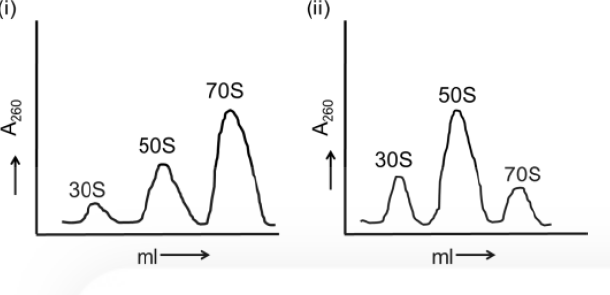

Choose the option that defines a correct conclusion from the observations.

1. Protein X is an anti-association factor which functions in the presence of EF-G and GTP
2. Protein X is a dissociation factor which functions in the presence of EF-G and GTP
3. Protein X binds GTP
4. EF-G is known to bind GTP, hence it can be concluded that the effect of GTP is through EF-G and protein X does not bind GTP.

**Answer: 2**

> **Explanation:** 70S ribosomes are split into subunits only when X, EF-G and GTP are all present — the hallmark of a ribosome-recycling/dissociation factor acting with EF-G·GTP. An anti-association factor (option 1) would keep subunits apart from the start; and nothing in the data shows X binds GTP itself. *(Question ID 1879801486.)*

---

### Question 87

Following statements were made about the post-transcriptional processing of RNA in eukaryotes.

A. Soon after transcription initiation, RNA polymerase II pauses ~30 nucleotides downstream from the site of initiation until the Cap structure is added to the 5′ end of the nascent pre-mRNA.

B. The 5′ splice sites are functionally divergent whereas the 3′ sites are functionally equivalent.

C. In addition to helping in recognition of the splice sites, the exon definition also functions as a splicing regulator by allowing pairing and linking of adjacent 5′ and 3′ splice sites.

D. The intron definition mechanism applies only to the larger introns (above 500 nucleotides length) and assists in achieving alternate splicing.

E. The splicing reactions carried out in vitro have revealed that the first and second transesterification reactions are reversible.

Which one of the following combination of statements is correct?

1. A, B and D
2. B, C and D
3. B, D and E
4. A, C and E

**Answer: 4**

> **Explanation:** A is correct (promoter-proximal Pol II pausing ~30 nt until capping), C is correct (exon definition bridges adjacent 5′ and 3′ sites and regulates splicing), E is correct (both transesterification steps are reversible in vitro — exon ligation and the first step in reverse). B is wrong (5′ splice sites are the conserved GU, functionally equivalent; it is the 3′/branch-point region that is degenerate) and D is wrong (intron definition applies to *short* introns, not large ones). *(Question ID 1879801487.)*

---

### Question 88

In the diagram below, the dotted line marks the point of initiation of bidirectional replication.

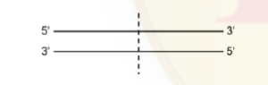

A. On the right side of the dotted line, leading strand synthesis occurs using the upper strand as the template.

B. On the right side of the dotted line, leading strand synthesis occurs using the lower strand as the template.

C. A ligase deficient (*lig*⁻) mutant would affect replication of the upper strand on the left side of the dotted line.

D. A ligase deficient (*lig*⁻) mutant would affect replication of the lower strand on the left side of the dotted line.

Which one of the following options represents the combinations of the correct statements?

1. A and D
2. B and C
3. B and D
4. A and C

**Answer: 3**

> **Explanation:** Replication forks move outward from the dotted origin. On the right fork the new strand made 5′→3′ *toward* the growing fork point uses the lower (3′→5′ left-to-right) strand as template — B. On the left side the fork moves leftward, so lagging (Okazaki) synthesis is on the daughter copying the lower strand, requiring ligase; a *lig*⁻ mutant therefore affects the lower strand there — D. Hence B and D. *(Question ID 1879801488.)*

---

### Question 89

Bacterial infections are generally divided into two broad classes: intracellular and extracellular bacterial infections. Given below are some of the properties which are applicable for bacterial infections.

A. Humoral immune response is the main protective response against extracellular bacteria.

B. Innate immunity is not effective against intracellular bacterial pathogens.

C. Bacterial endotoxins do not induce an innate immune response.

D. Intracellular bacterial infections generally induce a cell-mediated immune response resulting in secretion of cytokines which activate macrophages.

Which one of the following combination of statements is correct?

1. A and B
2. B and C
3. C and D
4. A and D

**Answer: 4**

> **Explanation:** A is correct (antibodies/complement clear extracellular bacteria) and D is correct (Th1 cytokines such as IFN-γ activate macrophages to kill intracellular bacteria). B is wrong (innate mechanisms — NK cells, macrophages, inflammation — act early against intracellular pathogens) and C is wrong (endotoxin/LPS is a classic potent innate activator via TLR4). *(Question ID 1879801489.)*

---

### Question 90

In the table below Column A lists ligands and Column B lists classes of receptors

![Matching table — Column A: A Serotonin, B Interferons, C Glycine, D Insulin; Column B: i Binding activates a G-protein which activates or inhibits an enzyme that generates a specific second messenger and opens ion channel, ii Binding causes receptor monomers to dimerize. Dimeric receptor then interacts with and activates one or more cytosolic tyrosine protein kinases, iii Binding changes the conformation of the receptor so that specific ions flow through it, iv Binding leads to activation of intrinsic tyrosine kinase activity](images/C/fig90.png)

Which one is the correct match?

1. A – i; B – ii; C – iii; D – iv
2. A – ii; B – iii; C – iv; D – i
3. A – iii; B – iv; C – i; D – ii
4. A – iv; B – i; C – ii; D – iii

**Answer: 1**

> **Explanation:** Serotonin signals through G-protein-coupled receptors (i); interferon receptors dimerise and recruit cytosolic JAK tyrosine kinases (ii); glycine is a ligand-gated ion-channel (Cl⁻) receptor (iii); the insulin receptor has intrinsic receptor tyrosine kinase activity (iv). *(Question ID 1879801490.)*

---

### Question 91

Cells are physically linked to one another and to extracellular matrix through their cytoskeleton and this imparts strength and rigidity of tissues and organs. Most of the animal cells have three types of cytoskeletal filaments, which are listed in Column A. The possible functions are listed in Column B.

Which one is the correct match?

1. A – i; B – ii; C – iii
2. A – ii; B – i; C – iii
3. A – iii; B – ii; C – i
4. A – iii; B – i; C – ii

**Answer: 3**

> **Explanation:** Intermediate filaments provide mechanical strength (iii); microtubules position membrane-enclosed organelles and serve as tracks for intracellular transport (ii); actin (with its cortical network and lamellipodia) determines cell-surface shape and drives locomotion (i). *(Question ID 1879801491.)*

---

### Question 92

Acetylcholine is a potent neurotransmitter, which is released from the neurons. After release they diffuse across the synaptic cleft and combine with nicotinic acetylcholine receptor molecules in the membrane of the postsynaptic cell. The interaction of acetylcholine with the nicotinic acetylcholine receptor produces large transient increase in the permeability of the membrane to specialized ions resulting in signal transduction for nerve impulse. Acetylcholine receptor is a

1. ligand-gated cation channel
2. ligand-gated anion channel
3. voltage-gated cation channel
4. voltage-gated anion channel

**Answer: 1**

> **Explanation:** The nicotinic ACh receptor is the prototypical ligand-gated ion channel: ACh binding opens a non-selective **cation** channel permeable to Na⁺/K⁺ (and Ca²⁺), depolarising the end-plate. *(Question ID 1879801492.)*

---

### Question 93

Strain A mice were crossed with strain B mice and first generation F₁ mice were obtained, i.e. (A × B)F₁. A scientist then implanted thymectomized and irradiated (A × B)F₁ mice with a B-type thymus and then reconstituted the animal's immune system with an intravenous infusion of (A × B)F₁ bone marrow cells. The chimeric mice were infected with lymphocytic choriomeningitis virus (LCMV) and the spleen T cells were then tested for their ability to kill LCMV-infected target cells from the strain A or strain B mice.

Which one of the following is the correct outcome of the experiment?

1. LCMV-infected target cells from strain A only will be killed
2. LCMV-infected target cells from strain B only will be killed
3. LCMV-infected target cells from both strain A and B will be killed
4. Neither cells from strain A nor from strain B will be killed

**Answer: 2**

> **Explanation:** T-cell MHC restriction is imposed during thymic education: with a **B-type thymus**, the (A×B)F₁-derived T cells are selected on B-class MHC, so the resulting anti-LCMV CTLs lyse only virus-infected targets presenting strain B MHC. This is the classic Zinkernagel–Doherty restriction experiment. *(Question ID 1879801493.)*

---

### Question 94

The anterior-posterior compartment of each segment of *Drosophila* is defined by *wingless* and *engrailed* genes. The following statements are given towards explaining their regulation:

A. Wingless is a secretory factor

B. Engrailed is a secretory factor and forms a long-range concentration gradient

C. Engrailed regulates Wingless through Hedgehog which forms a short-range concentration gradient

D. β-catenin homologue is the signalling molecule upstream of Engrailed, which gets cleaved by GSK3 homologue

E. Cubitus interruptus is an intracellular signalling molecule in the Engrailed expressing cells.

Which one of the following options has all the correct statements towards the regulation of anterior-posterior compartment of segments?

1. B only
2. C only
3. B and E
4. A, C and D

**Answer: 4**

> **Explanation:** Wingless is a secreted Wnt signal (A); Engrailed (a homeodomain TF) maintains Hedgehog expression, and Hh acts as a short-range signal that (with ci/PKA signalling) maintains *wingless* in the adjacent cells, closing the Engrailed–Hedgehog–Wingless loop (C); the Wnt/β-catenin pathway lies upstream of Engrailed, with GSK3-mediated phosphorylation/cleavage of the β-catenin homologue Armadillo controlling its stability (D). B is wrong (Engrailed is a nuclear TF, not a secreted gradient) and E is wrong (Ci acts in the *receiving*, Engrailed-negative cells). *(Question ID 1879801494.)*

---

### Question 95

Following statements are being made regarding specification/determination during animal development:

A. During the course of commitment, the cell may not appear different from its nearest or most distant neighbours in the embryo and show no visible signs of differentiation; but its developmental fate is restricted.

B. At the stage of specification, cell commitment is not labile.

C. A cell or tissue is determined when it is capable of differentiating autonomously even when placed into another region of the embryo, or a cluster of differently specified cells in a petri-dish.

D. Cytoskeletal arrangements maintain positioning of nuclei in the syncytium, which enables specification of these nuclei by opposing morphogen gradients namely Bicoid and Caudal in *Drosophila*.

E. Capacity for "mosaic" development allows cells to acquire different functions as a result of interactions with neighbouring cells.

Which of the above statements are correct?

1. A, B and C
2. B, C and D
3. C, D and E
4. A, C and D

**Answer: 4**

> **Explanation:** A and C correctly describe commitment/determination (fate restricted without visible differentiation; autonomy upon transplantation). D is correct for the syncytial *Drosophila* blastodyt, where cytoskeletal nuclear positioning and opposing Bicoid/Caudal gradients specify nuclei. B is wrong (specification is *labile* commitment; only determination is stable) and E is wrong (regulative — not mosaic — development reflects neighbour interactions). *(Question ID 1879801495.)*

---

### Question 96

A "morphogen" can determine the fate of a cell by its concentration. Given below are some statements on the experiment performed to study the gradient-dependent effect of the morphogen, activin on cell fate by placing activin (4 nm)-secreting beads on unspecified cells from an early *Xenopus* embryo:

A. Beads without activin did not elicit expression of either *Xbra* or *goosecoid* genes.

B. Cells nearest to the beads getting highest concentration of activin induced *goosecoid* gene whose product is a transcription factor, specifies the frog's dorsal-most structures.

C. Cells nearest to the beads getting highest concentration of activin induced *Xbra* gene whose product is a transcription factor, specifies the frog's dorsal-most structures.

D. Cells farthest from the beads getting negligible activin activate *Xbra* gene and become blood vessels and heart.

E. Cells farthest from the beads getting negligible activin, activated neither *Xbra* nor *goosecoid* and the 'default' gene expression instructed the cells to become blood vessels and heart.

Which of the above observations and conclusions drawn are correct?

1. A, B and C
2. B, C and D
3. C, D and E
4. A, B and E

**Answer: 4**

> **Explanation:** In the classic activin-bead experiment: control beads induce nothing (A); high activin induces the homeodomain factor *goosecoid* (dorsal-most/organiser fates) (B); cells far from the bead, receiving negligible activin, follow the default ventral programme (blood/heart) without *Xbra* or *goosecoid* induction (E). C reverses the dose response (*Xbra* is the *intermediate*-浓度 marker) and D wrongly attributes *Xbra* activation to the farthest cells. *(Question ID 1879801496.)*

---

### Question 97

Following statements were made about the events occurring during chick development.

A. The fertilized chick egg undergoes discoidal meroblastic cleavage, however the cleavage does not extend into the yolkly cytoplasm.

B. Development of primary hypoblast is mediated by localized migration of a group of highly specified and connected cluster of 30-40 cells.

C. By the stage XIII of chick embryogenesis and little prior to primitive streak formation, the formation of the hypoblast is just complete.

D. Hensen's node of the chick embryo signifies a region at the anterior end of the primitive streak with regional thickening of cells.

E. Inhibition of Wnt planar cell polarity pathway in the epiblast causes the mesoderm and endoderm to form centrally instead of peripherally.

Which one of the following combinations represents all correct statements?

1. A, B and D
2. A, C and E
3. A, B and C
4. A, C and D

**Answer: 4**

> **Explanation:** A is correct (discoidal meroblastic cleavage of the fertilized chick egg is confined to the blastodisc and does not extend into the yolk cytoplasm); C is correct (hypoblast formation is completed by stage XIII, just prior to primitive-streak appearance); D is correct (Hensen's node is the cellular thickening at the anterior end of the primitive streak, the avian organiser). B is wrong — the primary hypoblast does not arise by migration of a specified 30–40-cell cluster as stated. *(Question ID 1879801497.)*

---

### Question 98

The following diagram represents a longitudinal section through an *Arabidopsis* shoot apical meristem (SAM) and leaf primordium at its flank. The dorsal (D) and ventral (V) domains are marked. The *D* and *V* genes are expressed in the dorsal and ventral domains, respectively.

Consider the following statements describing the phenotypes of leaf polarity.

A. Loss of *D* function makes the leaf ventralized whereas its overexpression dorsalizes the leaf.

B. Loss of *V* function makes the leaf dorsalized whereas its overexpression ventralizes the leaf.

C. Loss of microRNA miR166 dorsalizes the leaf whereas its overexpression ventralizes the leaf.

D. miR166 functions by inhibiting its target mRNA.

Which one of the following functional models best describes the above results?

1. miR166 → (inhibits) D; D → Dorsal identity; V → Ventral identity
2. miR166 → (inhibits) D; D → Dorsal identity; V → Ventral identity *(as printed, variant with arrow activation)*
3. miR166 ⊣ D; D ⊣ V (mutual repression loop D↔V); D → Dorsal identity; V → Ventral identity
4. miR166 → D; D ⊣ V (cross-repression arrows D↔V); D → Dorsal identity; V → Ventral identity

**Answer: 3**

> **Explanation:** D and V promote opposite identities and mutually repress each other (the stabilising flip-flop loop), while miR166 — expressed ventrally — represses the dorsal-factor transcript, restricting D to the dorsal domain. Loss of miR166 therefore expands D (dorsalisation) and its overexpression ventralises, exactly as model 3 (miR166 ⊣ D, with D ⊣ V / V ⊣ D mutual inhibition) depicts. *(Question ID 1879801498.)*

---

### Question 99

During fertilization in mammals proteins Izumo and Juno are required for recognition of sperm and egg. Izumo and Juno are found specifically in sperm and egg, respectively. Which one of the following *in vivo* experiments will demonstrate that Izumo and Juno interact with each other?

1. If sperms from a male mouse where Izumo has been knocked out is used to fertilize eggs from a normal female and no fertilization occurs.
2. Whole mount immunostaining for Izumo and Juno shows its presence on the sperm and egg, respectively.
3. If a CFP fused Izumo protein is mixed with YFP fused Juno protein in a tube, FRET occurs, i.e., when CFP is excited, emission of YFP is observed.
4. Two independent kidney cell lines are developed, one expressing Izumo and the other Juno. If the two cells are mixed, they tend to aggregate with each other.

**Answer: 4**

> **Explanation:** Only option 4 is an *in vivo* (live-cell) assay showing the two proteins bind each other: cells expressing Izumo specifically aggregate with cells expressing Juno, demonstrating heterotypic adhesion between the two. Options 1 and 2 show necessity/localisation, not interaction; option 3 (FRET in a tube) is an *in vitro* assay. *(Question ID 1879801499.)*

---

### Question 100

Match the above columns involving plant hormones and their signalling pathways:

1. (A) – (a) – (i) and (B) – (b) – (ii)
2. (A) – (b) – (ii) and (B) – (a) – (i)
3. (A) – (b) – (i) and (B) – (a) – (ii)
4. (A) – (a) – (ii) and (B) – (b) – (i)

**Answer: 2**

> **Explanation:** Auxin (TIR1/AFB, soluble) and gibberellin (GID1, soluble) receptors act by triggering ubiquitin/proteasome-mediated degradation of repressors (Aux/IAA, DELLA) — (b)-(ii). Cytokinin (HK histidine kinases) and brassinosteroid (BRI1) use transmembrane receptors signalling by phosphorelay / phosphorylation-dephosphorylation cascades — (a)-(i). *(Question ID 1879801500.)*

---

### Question 101

Which one of the following graphs best represents the net CO₂ fixation of typical C₃ and C₄ plants under increasing CO₂ concentration and saturating light?

1. Graph (1)
2. Graph (2)
3. Graph (3)
4. Graph (4)

**Answer: 3**

> **Explanation:** At saturating light, the C₄ curve is nearly flat and low at low CO₂ (its CO₂-concentrating pump is already saturated), reaching its plateau quickly; the C₃ curve is strongly CO₂-limited at low CO₂ (photorespiration) and rises steeply with [CO₂], eventually matching C₄ at elevated CO₂. Graph (3) — C₄ saturating early at ~50 and C₃ rising to a comparable plateau — is the accepted representation. *(Question ID 1879801501.)*

---

### Question 102

Certain plant species produce cyanogenic glycosides to protect them from pathogens. A researcher has identified a variant of such a plant that has higher level of cyanogenic glycoside yet it is highly susceptible to a specific fungal pathogen. To interpret this counter-intuitive observation, the researcher hypothesizes that the fungal pathogen has higher level of

A. β-glucosidase activity

B. formamide hydrolyase activity

C. cytochrome P-450 enzyme

D. cyanide-resistant, alternative oxidase activity

Which one of the following combinations of the above hypotheses is correct?

1. A and B
2. B and C
3. C and D
4. B and D

**Answer: 4**

> **Explanation:** Detoxification of the plant's cyanogenic defence requires the fungus to hydrolyse the glycoside/cyanide adducts (formamide hydrolyase-type detox chemistry, B) and to respire in the presence of released cyanide using a cyanide-resistant **alternative oxidase** (D), which is the well-documented mechanism by which insensitive fungi tolerate cyanogenesis. *(Question ID 1879801502.)*

---

### Question 103

The following statements were made with the assumption that the concentration of 3-phosphoglycerate is high inside chloroplasts of an actively photosynthesizing leaf.

A. There will be high concentration of triose phosphate in the chloroplast.

B. The activity of ADP-glucose pyrophosphorylase will be inhibited.

C. The carbon flow will be diverted from sucrose to starch.

D. Starch synthesis will be inhibited and carbon flow will be more towards sucrose synthesis.

Which one of the following combinations of above statements is correct?

1. A and B
2. B and D
3. C and D
4. A and C

**Answer: 4**

> **Explanation:** High stromal 3-PGA implies abundant triose phosphates (A). 3-PGA is the classic allosteric **activator** of ADP-glucose pyrophosphorylase (and inhibitor of SBPase), so starch synthesis is stimulated and carbon is diverted from sucrose toward starch (C). B states the opposite of the known activation. *(Question ID 1879801503.)*

---

### Question 104

A disease-resistant plant was crossed with a susceptible plant and the resultant F₁ plants were disease resistant. The F₁ plant was selfed and the F₂ individuals were analyzed for qualitative and quantitative disease resistance. The following statements were hypothesized

A. Qualitative resistance follows Mendelian ratio.

B. In the F₂ individuals demonstrating qualitative resistance, "resistance" is dominant

C. Quantitative resistance is always monogenic

D. Qualitative resistance can be polygenic

Which one of the following combination of statements is correct?

1. A, C and D
2. A, B and C
3. A, B and D
4. B, C and D

**Answer: 3**

> **Explanation:** Qualitative (R-gene, gene-for-gene) resistance behaves as discrete Mendelian traits (A) that are typically dominant in the F₁/F₂ pattern described (B), and qualitative categories can in principle be conferred by combinations of R loci (polygenic qualitative responses, D). Quantitative resistance is by definition multigenic, so C ("always monogenic") is wrong. *(Question ID 1879801504.)*

---

### Question 105

Consider the following facts:

A. Chlorophyll absorbs more in the red region of the visible spectrum than in far-red.

B. The phytochrome photoreceptor (P) of plants occurs in two inter convertible forms, Pr and Pfr where red light converts Pr to Pfr and far-red light converts Pfr to Pr.

C. Growing a sun plant under the canopy shed causes increased stem elongation

Which one of the following combination of statements is correct for the plants growing under the canopy as compared to those growing above the canopy?

1. Red: far-red ratio is lower; Pr:Pfr ratio is higher; Pfr inhibits stem elongation.
2. Red: far-red ratio is higher; Pr:Pfr ratio is higher; Pr inhibits stem elongation.
3. Red: far-red ratio is lower; Pr: Pfr ratio is lower; Pfr promotes stem elongation.
4. Red: far-red ratio is higher; Pr:Pfr ratio is lower; Pr promotes stem elongation.

**Answer: 1**

> **Explanation:** Canopy shade is enriched in far-red (chlorophyll filters red), so shaded plants experience a **lower R:FR** ratio; this photoequilibrates phytochrome toward Pr, raising the Pr:Pfr ratio; loss of the active Pfr form relieves Pfr-mediated inhibition of elongation, giving the shade-avoidance stem elongation. *(Question ID 1879801505.)*

---

### Question 106

Thyroid hormone (T₃) increases the heart rate and the force of contraction of cardiac muscles. The mechanisms of these effects of T₃ have been explained by a researcher in the following statements:

A. T₃ inhibits the expression of gene for α-myosin heavy chain and enhances the expression of gene for β-myosin heavy chain

B. The expression of gene for Na⁺-Ca⁺⁺ antiporter is enhanced by T₃

C. The sarcoplasmic reticulum Ca⁺⁺ ATPase is increased by T₃

D. T₃ increases ryanodine Ca⁺⁺ channels in the sarcoplasmic reticulum

E. The number of β-adrenergic receptors in heart muscles is inhibited by T₃

Which one of the following combinations contains both correct explanations?

1. A and B
2. B and C
3. C and D
4. D and E

**Answer: 3**

> **Explanation:** T₃ increases SERCA (Ca²⁺-ATPase) expression (C) and ryanodine-receptor channels (D), loading the SR with more Ca²⁺ and enhancing release — greater contractile force; it also increases β-adrenergic receptor number (E is backwards) and *stimulates* α-myosin heavy chain (A is backwards). *(Question ID 1879801506.)*

---

### Question 107

In the nervous system, the action potential is generated at the axon hillock in physiological conditions and it is conducted to the terminal end of axon. The location specific origin of action potential and its direction-specific conduction are explained by a researcher in the following proposed statements:

A. The membrane of axon hillock has highest threshold for the generation of action potential

B. The membrane of axon hillock contains large numbers of voltage-gated Na⁺ channels and that makes it more excitable

C. The propagating action potential in the middle of the axon cannot generate another action potential in the direction of cell body since a large fraction of voltage-gated Na⁺ channels in the preceding portion is voltage inactivated

D. As the number of voltage-gated Na⁺ channels is less in the preceding portion of axonal membrane, the propagating action potential in the middle of the axon cannot generate another action potential in the direction of cell body.

Which one of the following combinations represents both correct explanations?

1. A and B
2. B and C
3. C and D
4. A and D

**Answer: 2**

> **Explanation:** The axon initial segment/hillock has a very high density of voltage-gated Na⁺ channels, giving it the *lowest* threshold (B correct, A wrong). One-way conduction follows because the membrane just traversed is in its refractory state with Na⁺ channels voltage-inactivated (C), not because channels are fewer there (D). *(Question ID 1879801507.)*

---

### Question 108

Aldosterone increases the reabsorption of Na⁺ from the tubular fluid in the thick ascending limb of loop of Henle and in the distal tubule. These effects are explained in the following proposed statements:

A. Aldosterone increases the number of Na⁺-Cl⁻ symporter in the apical membrane of principal cells in the early portion of distal tubule

B. The number of Na⁺ channels (ENaC) is increased in the apical membrane of principal cells in the late portion of distal tubule by aldosterone

C. The synthesis of Na⁺, K⁺-ATPase in the basolateral portion of principal cells in distal tubule is decreased by the action of aldosterone

D. Aldosterone increases the reabsorption of Na⁺ across the apical cell membrane in the thick ascending limb of loop of Henle by decreasing Na⁺, K⁺-ATPase in it

Which one of the following combinations represents both correct statements?

1. A and B
2. B and C
3. C and D
4. A and D

**Answer: 1**

> **Explanation:** Aldosterone acts on distal nephron principal cells by increasing apical Na⁺-Cl⁻ cotransport (NCC) in the early distal tubule (A) and inserting ENaC channels in the late distal tubule/cortical collecting duct apical membrane (B); it *increases* (not decreases) basolateral Na⁺,K⁺-ATPase, so C and D are wrong. *(Question ID 1879801508.)*

---

### Question 109

Hormones act by producing/activating a variety of effectors intracellularly. Below are given a variety of effectors in column 'X' and hormones in column 'Y'

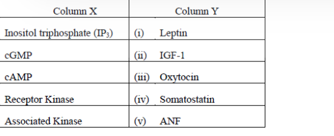

Which one of the following combinations of effector and the specific hormone is correct?

1. A (i) and B (ii)
2. B (iv) and A (iii)
3. C (iv) and D (ii)
4. E (ii) and C (i)

**Answer: 3**

> **Explanation:** Somatostatin (via SSTRs, Gi-coupled) signals by lowering/using **cAMP** effectors (C–iv), and IGF-1 acts through a **receptor tyrosine kinase** (D–ii). The other pairings mismatch effector to hormone (e.g. ANF uses cGMP, leptin uses JAK-associated kinase). *(Question ID 1879801509.)*

---

### Question 110

Drawn below is an intestinal epithelial cell (IEC) performing the absorption of digested monosaccharides from the dietary carbohydrates ingested.

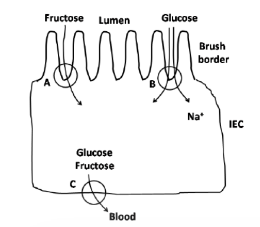

Which one of the following combinations of the transporter (A, B and C in the figure above) and the transported monosaccharide is correct?

1. A – GLUT5; B – SGLT1; C – GLUT2
2. A – GLUT2; B – GLUT5; C – SGLT1
3. A – SGLT1; B – GLUT2; C – GLUT5
4. A – SGLT1; B – GLUT5; C – GLUT2

**Answer: 1**

> **Explanation:** Apical fructose uptake is by GLUT5 (A); apical glucose uptake is the Na⁺-coupled SGLT1 (B, consistent with the Na⁺ arrow); basolateral exit of both glucose and fructose is via GLUT2 (C). *(Question ID 1879801510.)*

---

### Question 111

Individuals in a population are divided into various blood groups (in column 'X') based on the set of enzymes they have (in column 'Y'):

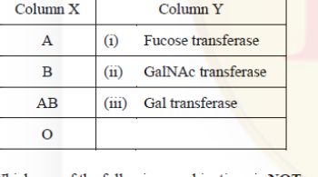

Which one of the following combinations is **NOT** correct for the blood group type and the set of enzymes a person has?

1. A - (i) and (ii)
2. B - (i) and (iii)
3. AB - (i), (ii) and (iii)
4. O - (i), (ii) and (iii)

**Answer: 4**

> **Explanation:** All ABO-secretor individuals make the H antigen with fucose transferase (i); group A adds GalNAc (ii), group B adds Gal (iii), AB has both. Group **O** has only the fucosyltransferase — it possesses neither the GalNAc- nor the Gal-transferase — so the combination "O – (i), (ii) and (iii)" is the NOT-correct one. *(Question ID 1879801511.)*

---

### Question 112

In an organism, *a⁺* allele governs gray body colour, while its mutant allele *a* gives yellow body colour. Further, presence of *b⁺* allele gives long and thin hairs while *b* allele gives rise to short and thick hairs. The alleles *a⁺* and *b⁺* are dominant over *a* and *b*, respectively. An individual with the genotype

*a⁺  b⁺* / *a  b*

has a patch of yellow cells with short and thick hairs. Which one of the following events is most likely to lead to the above?

1. Non disjunction of the homologous chromosomes during mitosis
2. Somatic recombination involving *a* and *b*
3. Translocation occurring in a few somatic cells
4. Mutation of both *a⁺* and *b⁺* alleles in the somatic cells

**Answer: 2**

> **Explanation:** A homozygous-mutant (*a b / a b*) patch arising on an *a⁺ b⁺ / a b* animal is the classic mosaic produced by **mitotic (somatic) crossing-over** between the gene centromere and the loci, which segregates the two recessives onto one daughter chromosome. Simultaneous mutation of both alleles (4) is far less probable; non-disjunction (1) yields aneuploid, not homozygous-recessive, sectors. *(Question ID 1879801512.)*

---

### Question 113

The individuals considered in this question are having two haploid sets of autosomes and no Y-chromosome. The X:A ratio of the individuals, the type of organisms chosen, their primary sex and number of Barr bodies expected in their cells are shown in the table below:

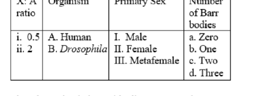

Select the option below with all correct matches:

1. i-A-II-a; ii-A-II-d; i-B-I-a; ii-B-III-a
2. i-A-I-a; ii-A-II-c; i-B-II-a; ii-B-I-a
3. i-A-II-c; ii-A-I-d; i-B-I-c; ii-B-II-b
4. i-A-II-a; ii-A-II-d; i-B-III-a; ii-B-I-a

**Answer: 1**

> **Explanation:** In humans (no Y): X:A = 0.5 (XO) develops as a **female** with **zero** Barr bodies (i-A-II-a); X:A = 2 (e.g. XXXX) is female with three Barr bodies (ii-A-II-d). In *Drosophila*: X:A = 0.5 is a sterile **male** (metamale) with zero Barr bodies (i-B-I-a) and X:A = 2 is a **metafemale** with zero Barr bodies (ii-B-III-a — flies do not form Barr bodies). *(Question ID 1879801513.)*

---

### Question 114

In the following pedigree three STR loci A, B and C are linked on the long arm of the X-chromosome in the order centromere-A-B-C-telomere. Further in the table, the STR alleles present in each individual is indicated.

Based on the above, X-chromosome(s) in which of the following individuals are recombinant?

[Hint: X-chromosome in males will help identify the phase of the alleles]

1. II – 1, III – 1 and III – 2
2. II – 2, III – 1 and III – 2
3. III – 1 and III – 3
4. III – 2 and III – 4

**Answer: 3**

> **Explanation:** Phasing the X-chromosomes through the hemizygous males fixes the parental haplotypes of the female transmitters; tracing loci A–B–C down the pedigree shows that the X-chromosomes carried by individuals **III-1 and III-3** contain allele combinations that can only arise from a crossover between the linked loci — these are the recombinant chromosomes. *(Question ID 1879801514.)*

---

### Question 115

A mutant mating type *mt* strain of *Chlamydomonas* that was resistant to the antibiotic kanamycin (*kanʳ*) and herbicide PPT (*pptʳ*) was crossed to a wild type mating *mt⁺ kanˢ pptˢ* strain that was sensitive to kanamycin and PPT. Twenty tetrads of the progeny were analyzed for mating type and resistance/sensitivity to kanamycin and PPT. The following observations were made:

The following statements were made to explain the observations:

A. *mt* and *ppt* loci are on two different chromosomes

B. Inheritance of mating type and ppt-resistance/sensitivity are demonstrating cytoplasmic inheritance

C. Inheritance of kanamycin-resistance/sensitivity is demonstrating nuclear inheritance

D. Nuclear inheritance is being demonstrated by mating type and ppt-resistance/sensitivity analysis

Which one of the combinations of above statements is correct?

1. A and B
2. A and D
3. B and C
4. C and D

**Answer: 2**

> **Explanation:** In every tetrad kanamycin resistance/sensitivity co-segregates 2:2 with the mating-type/ppt classes, and Types II and III show *mt* and *ppt* assorting independently of one another — i.e. the *mt* and *ppt* loci lie on two different chromosomes (A), and the mating-type/ppt segregation pattern (2:2, recombining) is nuclear, not cytoplasmic, inheritance (D). Cytoplasmic markers would be transmitted uniparentally (all four spores alike), which is not observed. *(Question ID 1879801515; the NTA key marks option 2.)*

---

### Question 116

A pedigree shown below depicts that the individual I-1 is heterozygous for a dominant disease allele *D* and for molecular markers M1/M2. The paternal molecular markers present in the progeny individuals are indicated in the pedigree.

The following statements may be drawn from the above pedigree:

A. The two loci D/d and M1/M2 appears to be linked

B. The recombination frequency between the two loci is 20%

C. If LOD score comes out to be 3, then it ensures that the two loci are independently assorting

D. A LOD score <1 would have ensured that the two Loci are linked

Which combination of the above statements can correctly interpret the depicted pedigree?

1. C and D
2. Only C
3. A and B
4. Only D

**Answer: 3**

> **Explanation:** Of the ten meioses, eight carry the parental coupling (affected-with-M1 or unaffected-with-M2) and two are recombinants (individuals 3 and 9), giving RF = 2/10 = 20% — evidence of linkage (A, B). A LOD score of 3 supports linkage (not independent assortment, so C is wrong), and a LOD <1 does not "ensure" anything (D wrong). *(Question ID 1879801516.)*

---

### Question 117

An individual is having a paracentric inversion (denoted by the region f-e-d, marked by arrows) in homozygous condition.

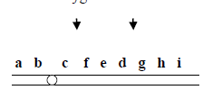

The meiotic consequences of inversion can be:

A. generation of an acentric and a dicentric chromosome

B. the recombinants will have long deletion or duplication and may be lethal

C. the inversion will suppress crossing over

D. all gametes will have complete genome and will survive normally

Which of the above statement or their combinations will explain the meiotic consequence of the given inversion logically?

1. A, B and C
2. A and B
3. B and C
4. Only D

**Answer: 4**

> **Explanation:** The individual is **homozygous** for the inversion, so both homologues carry the same gene order — no inversion loop forms and crossing over produces balanced products. All gametes receive a complete genome and survive normally; acentric/dicentric bridges (A, B) arise only in inversion *heterozygotes*. *(Question ID 1879801517.)*

---

### Question 118

Following statements are made about double-strand break repair (DSBR) model of homologous recombination:

A. Process of DSBR recombination is triggered by introducing a double-strand break in a DNA duplex

B. In a process known as 3′-end resection, the exonucleases along with a DNA helicase degrade one strand on either side of the break and generates 3′-single stranded termini

C. One strand of the donor duplex is displaced due to formation of heteroduplex DNA and generates a displacement loop (D-Loop)

D. Branch migration allows the point of crossover to move in 5′ → 3′ direction of recipient strand

E. Completion of DSBR recombination may generate either crossover recombinant or non-recombinant product

Which one of the following combination of statements is correct?

1. A, B and D
2. A, C and E
3. A, C and D
4. A, B and E

**Answer: 2**

> **Explanation:** DSBR begins with a double-strand break (A); strand invasion of the 3′ overhang into the donor displaces one strand forming the D-loop (C); resolution can yield crossover or non-crossover (gene conversion) products (E). B misdescribes resection (5′→3′ exonuclease degradation generates the 3′ overhangs — the statement as printed says the helicase/exonuclease degrade "one strand on either side", which the key does not accept); D is wrong — branch migration is directionless, not a defined 5′→3′ movement. *(Question ID 1879801518.)*

---

### Question 119

Which of the following set of conditions will qualify a species to be considered as endangered (EN) as per IUCN criteria?

1. 80% reduction in population size, <100 km² area of occupancy, at least 50% estimated extinction risk in five generations.
2. <2,500 individuals with declining population, <250 mature individuals, at least 20% estimated extinction risk in 10 years.
3. <10,000 individuals with declining population, <1000 mature individuals, at least 10% estimated extinction risk in 10 years.
4. 75% reduction in population size, <500 km² area of occupancy, at least 20% estimated extinction risk in five generations

**Answer: 4**

> **Explanation:** The IUCN EN criteria include a population reduction ≥70% over 10 years/3 generations, extent of occurrence <5,000 km² or area of occupancy <500 km², and ~20% probability of extinction in 20 years/five generations. Option 4 is the only set whose thresholds fall within (are more severe than) the EN limits; options 1–3 mix CR-level or non-qualifying numbers. *(Question ID 1879801519.)*

---

### Question 120

Given below are certain adaptations which are seen in various groups of animals:

A. Ovipary

B. Streamlined body

C. Pouch for carrying eggs

D. Porous egg shell

E. Breast bone as large keel

F. Webbed feet

G. Laterally compressed coccygeal bone

H. Unidirectional pulmonary system to provide large quantities of oxygen

I. Barbules or hooklets on the vanes of each feather

Which combination of the above adaptations facilitate bird flight?

1. B, E, H, I
2. A, B, C, G
3. D, F, G, I
4. B, D, E, F

**Answer: 1**

> **Explanation:** Flight demands an aerodynamic streamlined body (B), a large keeled sternum for flight-muscle attachment (E), the unidirectional air-flow lung/air-sac system for sustained high O₂ supply (H), and barbule/hooklet-zipped feather vanes forming the airfoil (I). Webbed feet, egg pouches and porous shells relate to swimming/reproduction, not flight. *(Question ID 1879801520.)*

---

### Question 121

Match the following taxa with the genus of the microorganism

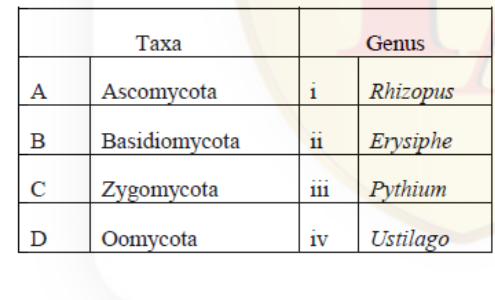

1. A – ii, B – iv, C – i, D – iii
2. A – ii, B – iii, C – ii, D – iv
3. A – iii, B – iv, C – iii, D – i
4. A – i, B – ii, C – iv, D – ii

**Answer: 1**

> **Explanation:** *Erysiphe* (powdery mildew) is an ascomycete (A–ii); *Ustilago* (smuts) a basidiomycete (B–iv); *Rhizopus* (bread mould) a zygomycete (C–i); *Pythium* (damping-off) an oomycete (D–iii). *(Question ID 1879801521.)*

---

### Question 122

Match the following plant diseases with the name of pathogen associated with the disease

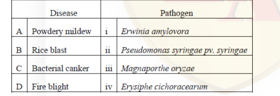

1. A – ii, B – iii, C – i, D – iv
2. A – i, B – iv, C – ii, D – iii
3. A – iv, B – iii, C – ii, D – i
4. A – iii, B – ii, C – iv, D – i

**Answer: 3**

> **Explanation:** Powdery mildew → *Erysiphe cichoracearum* (iv); rice blast → *Magnaporthe oryzae* (iii); bacterial canker of citrus → *Pseudomonas syringae* pv. *syringae* (ii); fire blight of rosaceae → *Erwinia amylovora* (i). *(Question ID 1879801522.)*

---

### Question 123

Which one of the following phylogenies best represents the evolutionary relationship among whales, dolphins, seals, deer and dogs?

1. Phylogeny (1)
2. Phylogeny (2)
3. Phylogeny (3)
4. Phylogeny (4)

**Answer: 2**

> **Explanation:** Whales and dolphins (Cetacea) are sister taxa nested within the even-toed ungulates closest to **deer** (Ruminartiodactyla), while **dogs** (Carnivora) and seals (Carnivora, Pinnipedia) form the separate clade — the topology shown in phylogeny (2): ((Whales,Dolphins),Deer) versus (Seals,Dogs). *(Question ID 1879801523.)*

---

### Question 124

The table below shows photosynthetic type, temperature and sunlight intensity levels.

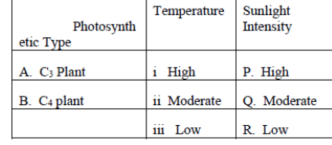

Which of the following correctly matches the plant photosynthetic type with the temperature and sunlight conditions in which photosynthetic rate per unit leaf area is maximum for that plant?

1. A – i – P; B – iii – R
2. A – iii – P; B – i – Q
3. A – i – R; B – ii – Q
4. A – ii – Q; B – i – P

**Answer: 4**

> **Explanation:** C₃ photosynthesis per unit leaf area peaks at moderate temperature and moderate-to-high light (photorespiration rises with temperature); C₄ photosynthesis peaks at **high temperature and high (saturating) sunlight** thanks to the CO₂-concentrating mechanism. The accepted pairing is A–ii–Q; B–i–P. *(Question ID 1879801524.)*

---

### Question 125

Which of the following represents exponential growth in populations?

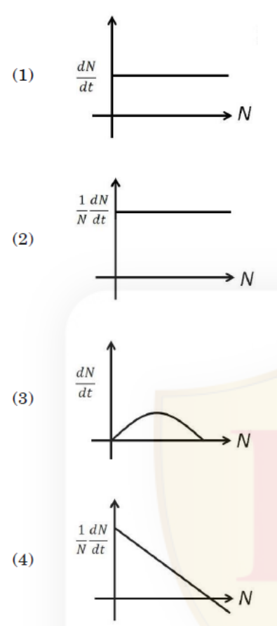

1. Graph (1)
2. Graph (2)
3. Graph (3)
4. Graph (4)

**Answer: 2**

> **Explanation:** For exponential growth dN/dt = rN, so the *per-capita* rate (1/N)(dN/dt) = r is constant, independent of N — the horizontal line of graph (2). (A constant dN/dt (1) is linear growth; the hump (3) and declining line (4) describe logistic-type growth.) *(Question ID 1879801525.)*

---

### Question 126

In the graph below, large boxes (denoted by P, Q, R, S) represent a region, whereas smaller boxes represent habitats. Labels S₁, S₂,…… above each small box represent species present in the given habitat denoted by that box.

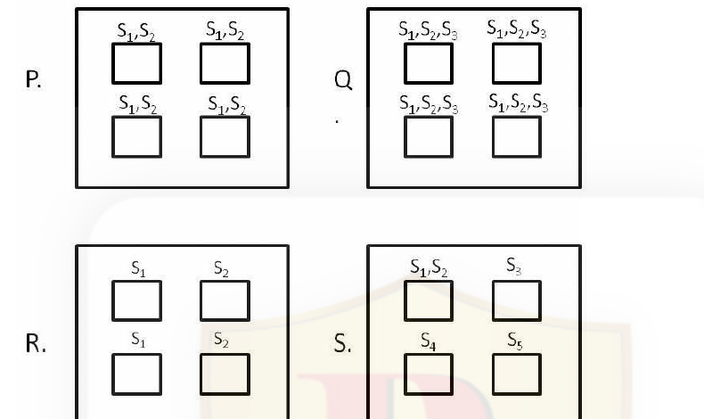

Given the above graphs, choose the option which correctly depicts the regions which show maximum α and maximum β diversity, respectively.

1. Q and S
2. P and R
3. S and P
4. Q and R

**Answer: 1**

> **Explanation:** α-diversity (within-habitat richness) is highest in **Q** (three species in every habitat). β-diversity (turnover among habitats) is highest in **S**, where each habitat holds a different species set. Hence Q and S. *(Question ID 1879801526.)*

---

### Question 127

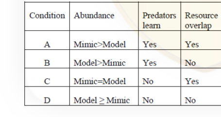

Which among the above sets of conditions are best suited for mimicry to be successful?

1. Condition A
2. Condition B
3. Condition C
4. Condition D

**Answer: 2**

> **Explanation:** Batesian mimicry succeeds when the **model is more abundant than the mimic** (so predators mostly encounter the unpalatable model), predators **learn** to avoid it, and the two **do not compete** for the same resources (low overlap keeps the association stable) — condition B. *(Question ID 1879801527.)*

---

### Question 128

Which of the following is **NOT** a mechanism for species coexistence?

1. Niche differentiation
2. Niche complementarity
3. Niche overlap
4. Amount of limiting resources is greater than the number of species

**Answer: 3**

> **Explanation:** Coexistence is promoted by niche differentiation/complementarity and by resource diversity exceeding species number (Keddy/Tilman-style conditions). Extensive **niche overlap** drives competitive exclusion, not coexistence. *(Question ID 1879801528.)*

---

### Question 129

A small number (approximately 10) of mice are introduced into an uninhabited island. Their population grows exponentially initially and after 3 years, reaches a population size of 520 after which the population becomes stable. At what point would you expect their population to attain their highest growth rate?

1. When the mice population was first introduced.
2. When the population size is 260.
3. Their population growth rate remains constant throughout.
4. When the population size reaches 520.

**Answer: 2**

> **Explanation:** The pattern describes logistic growth with carrying capacity K = 520; the absolute growth rate dN/dt is maximal at K/2 = **260**. *(Question ID 1879801529.)*

---

### Question 130

Area of patch 1 is 2000 m² with a resource density of 5 units/m². Area of patch 2 is 3000 m² with a resource density of 10 units/m². As per the theory of ideal-free distribution, organisms distribute themselves such that the expected ratio of abundance of organisms in the two patches (patch 1: patch 2) is

1. 1:2
2. 2:3
3. 1:3
4. 3:2

**Answer: 3**

> **Explanation:** Total resources: patch 1 = 2000 × 5 = 10,000 units; patch 2 = 3000 × 10 = 30,000 units. The ideal-free distribution matches consumers to resources: 10,000 : 30,000 = **1 : 3**. *(Question ID 1879801530.)*

---

### Question 131

Match the geological time period with the extinction or diversification events associated with them:

1. A – ii, B – i, C – iii, D - iv
2. A – iv, B – i, C – ii, D - iii
3. A – ii, B - iii, C – i, D - iv
4. A – iv, B - iii, C – i, D - iv

**Answer: 2**

> **Explanation:** Cenozoic — radiation of mammals (iv); Cretaceous — angiosperm diversification (i); Paleozoic (late Palaeozoic marine revolution) — diversification of modern bivalves/gastropods/bryozoans/malacostracans (ii); Quaternary — megafauna extinctions (iii). *(Question ID 1879801531.)*

---

### Question 132

Female fiddler crabs prefer male fiddler crabs with larger claws over males with smaller claws. If the selection pressure exerted is strong resulting in a skewed distribution of claw size, which of the following statements is true about the population's mean, median and mode ?

1. Mean > Median > Mode
2. Mean < Median < Mode
3. Mean = Mode < Median
4. Mean = Median = Mode

**Answer: 2**

> **Explanation:** Strong directional selection for larger claws skews the population distribution: the favoured large-claw phenotype becomes the commonest (mode shifts to the right, toward the large end of the axis), while the long tail of the few remaining small-clawed individuals drags the mean below the median — a negatively (left) skewed distribution in which **Mean < Median < Mode**. *(Question ID 1879801532; the NTA key marks option 2.)*

---

### Question 133

The phylogeny below shows evolutionary relationships between 9 extant bird species and whether they display red or blue plumage.

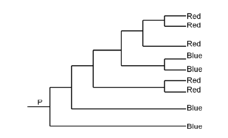

Based on the above phylogeny and the distribution of red and blue character states among the extant species, and using the principle of parsimony, which of the following is the correct inference about plumage colour of the ancestor at the root P?

1. Ancestral state at P is blue.
2. Ancestral state at P is red.
3. Ancestral state at P is more likely to be red than blue.
4. Ancestral state at P is equally likely to be red or blue.

**Answer: 1**

> **Explanation:** Mapping the states on this topology, reconstruction with root = **blue** requires fewer total transitions (one red gain in the large Red clade plus one reversal) than root = red, which needs multiple independent blue gains; parsimony therefore favours blue at P. *(Question ID 1879801533.)*

---

### Question 134

The top panel (graphs a–c) represents trends of number of sperms produced per mating season with respect to number of mates, while the bottom panel (graphs i–iv) represents trends of time invested in paternal care with respect to number of mates in birds.

Select the correct trend from each panel.

1. c, iv
2. a, ii
3. b, iii
4. a, i

**Answer: 2**

> **Explanation:** With increasing number of mates (polyandry/promiscuity), sperm production per season rises (graph a — sperm competition), while time invested in paternal care falls (graph ii — males desert when paternity assurance is low). *(Question ID 1879801534.)*

---

### Question 135

Given below are various types of molecular markers in Column A and properties of these markers in Column B.

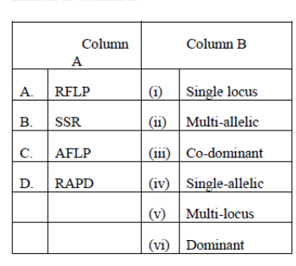

Which one of the options given below correctly matches the molecular markers with their properties?

1. A-(vi), B-(i), C-(ii), D-(v)
2. A-(v), B-(ii), C-(iv), D-(iii)
3. A-(i), B-(ii), C-(v), D-(vi)
4. A-(ii), B-(iii), C-(i), D-(ii)

**Answer: 3**

> **Explanation:** RFLP is classically a single-locus (i) co-dominant marker; SSR/microsatellites are multi-allelic (ii); AFLP fingerprints many loci simultaneously — multi-locus (v); RAPD is a dominant (vi) multi-locus marker. The combination A-(i), B-(ii), C-(v), D-(vi) is option 3. *(Question ID 1879801535.)*

---

### Question 136

Several plants produce metabolites with important medicinal properties and have been extensively used in traditional medicine across the world. Many of these compounds can now be purified or synthesized and are used in modern medicine. Given below is a list of metabolites, their plant source and medicinal use:

Which one of the following options is the most appropriate match of the compound with its plant source and use?

1. A-(iii)-R; B-(i)-T; C-(iv)-Q; D-(ii)-S
2. A-(iv)-Q; B-(iii)-R; C-(ii)-S; D-(i)-T
3. A-(ii)-T; B-(iii)-S; C-(i)-R; D-(iv)-Q
4. A-(iii)-S; B-(iv)-Q; C-(ii)-T; D-(i)-R

**Answer: 4**

> **Explanation:** Digoxin from *Digitalis purpurea* treats cardiac ailments (iii-S); salicin from willow is the aspirin precursor (iv-Q); morphine from *Papaver somniferum* is the narcotic analgesic (ii-T); artemisinin from *Artemisia annua* is the anti-malarial (i-R). *(Question ID 1879801536.)*

---

### Question 137

Given below are schematic representations of the T-DNA regions of four constructs that are to be used for *Agrobacterium* – mediated transformation to silence an endogenous plant gene represented as 'XYFP' that is expressed constitutively in the plant.

Which of the four constructs depicted above could be used to silence the target gene 'XYFP'?

1. A and B only
2. B and D only
3. A and C only
4. C and D only

**Answer: 4**

> **Explanation:** RNAi silencing needs the target sequence in inverted orientation to form a hairpin dsRNA. Construct C expresses the reverse-complement cassette PFYX (antisense RNA), and construct D expresses sense XYFP separated by an intron from antisense PFYX — after intron splicing this yields a sense–antisense hairpin. Both silence XYFP; A and B only add extra sense sequence, which cannot trigger silencing. *(Question ID 1879801537.)*

---

### Question 138

Given below are a few statements on use of plant breeding to develop improved varieties of a crop plant:

A: Genotypic/phenotypic variation in the desired trait should be available in the germplasm resources of the crop plant.

B: Availability of molecular markers linked to the trait of interest would decelerate the process of trait introgression into desired varieties.

C: Breeding procedures to improve plant varieties are generally more successful among sexually compatible species as compared to sexually incompatible species.

D: Co-dominant molecular markers cannot be used for selection of plants with the desired trait.

Which of the above statement(s) is/are **INCORRECT**?

1. A and C
2. B only
3. C and D
4. B and D

**Answer: 4**

> **Explanation:** B is incorrect — linked markers *accelerate* (marker-assisted) introgression, not decelerate it. D is incorrect — co-dominant markers are ideal for selection because they distinguish homozygotes from heterozygotes. A and C are true statements. *(Question ID 1879801538.)*

---

### Question 139

A mixed cell population was stained with two antibodies, one specific for cell surface antigen A and the other specific for cell surface antigen B. Anti-A antibody was labelled with fluorescein and anti-B antibody was labelled with rhodamine. The cell population was then analysed for the presence of antigens by flow cytometry. Which one of the following is the correct outcome for this cell population?

1. Plot (1)
2. Plot (2)
3. Plot (3)
4. Plot (4)

**Answer: 3**

> **Explanation:** Fluorescein (anti-A) reports green fluorescence (x-axis) and rhodamine (anti-B) red fluorescence (y-axis). A mixed population yields four quadrants: double-negative (A⁻B⁻) at bottom-left, A-only (A⁺B⁻) at bottom-right, B-only (A⁻B⁺) at top-left and double-positive (A⁺B⁺) at top-right — the arrangement of plot (3). *(Question ID 1879801539.)*

---

### Question 140

The following statements are made regarding developing a transgenic mouse:

A. The transgenic mouse thus born will be a homozygous transgenic animal and can be maintained by crossing with another transgenic animal.

B. The fertilized transgenic eggs are allowed to develop *in vitro*.

C. The desired gene is preferably microinjected in male pronucleus after sperm entry in oocyte.

D. For best efficiency, the desired gene is always microinjected in the male gametes and then they are allowed to fertilize the female gametes.

E. Blastocyst stage embryos are transferred to the uterus of hormonally prepared mother.

F. The fertilized eggs are collected from specific strain of mouse.

G. The female mouse of specific strain is superovulated, oocytes are collected and allowed to fertilize *in vitro*.

Choose the combination of statements arranged in the correct sequence for developing transgenic mouse.

1. G → C → E
2. F → C → B → A
3. G → D → A
4. D → F → B → A

**Answer: 1**

> **Explanation:** The standard protocol: superovulate the female, collect fertilized one-cell embryos and microinject the transgene into the male (larger) pronucleus (G → C), then culture to blastocyst/morula and transfer to a pseudopregnant, hormonally prepared surrogate (E). Founders are mosaic/heterozygous, so statements invoking direct homozygosity (A) or gamete injection (D) are wrong. *(Question ID 1879801540.)*

---

### Question 141

The ECG recorded by different leads is analysed on the basis of variation of electrical potential at various loci on the surface of the body, and the time scale relation of different waves. After analysing the ECG, following particulars of heart are proposed to be obtained:

A. Stoke volume and cardiac output

B. Volume and pressure changes during cardiac cycle

C. Anatomical orientation of heart

D. Various disturbances in the rhythm and conduction of cardiac excitation

E. The extent, location and progress of ischemic damage to myocardium

Which one of the following combinations represents both **INCORRECT** particulars of heart?

1. A and B
2. B and C
3. C and D
4. D and E

**Answer: 1**

> **Explanation:** An ECG records summed electrical activity: it diagnoses rhythm/conduction disturbances (D) and, through ST-segment etc., ischaemic damage location/extent (E), and (with lead geometry) something of cardiac orientation (C). It does **not** directly give stroke volume/cardiac output (A) or the volume–pressure changes of the cardiac cycle (B) — those require echo/pressure measurements. Hence the incorrect particulars are A and B. *(Question ID 1879801541.)*

---

### Question 142

Given below are two sets of terms related to various methods used in biological science.

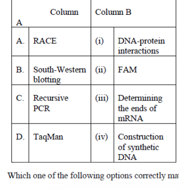

Which one of the following options correctly matches terms of Column A and Column B?

1. A – (iv); B – (iii); C – (i); D – (ii)
2. A – (iii); B – (i); C – (iv); D – (ii)
3. A – (ii); B – (iv); C – (i); D – (iii)
4. A – (ii); B – (i); C – (iv); D – (iii)

**Answer: 2**

> **Explanation:** RACE (rapid amplification of cDNA ends) determines mRNA ends (iii); South-Western blotting detects DNA-protein interactions (i); recursive (multiplex/directed) PCR strategies are used for construction of synthetic DNA (iv); TaqMan qPCR uses the FAM reporter dye (ii). *(Question ID 1879801542.)*

---

### Question 143

In an experiment, a 1 kb fragment with a single BamHI site (as shown below in figure 'A') is to be cloned in the SmaI (CCC ↓ GGG) site of a cloning vector of 3kb length (figure 'B'). None of the other enzymes of the multiple cloning site are present in the fragment to be cloned.

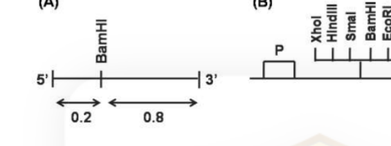

Based on the information given above, a series of digestions were set up for the potential clones and their fragment profiles are given below:

A. BamHI : 200bp + 3.8 kb

B. BamHI : 800bp + 3.2 kb

C. HindIII+EcoRI : ~1kb + ~3kb

D. XhoI+BamHI : ~200bp + ~800bp + ~3kb

Which one of the above digestion profiles confirms successful cloning of the fragment in the vector in an orientation wherein the 5′ end of the cloned fragment is towards 'P'?

1. A only
2. B only
3. A and C
4. C and D

**Answer: 2**

> **Explanation:** The vector's own BamHI site lies in the polylinker immediately adjacent to the SmaI cloning site. If the insert's 5′ end points toward the promoter 'P' (away from that vector BamHI site), its internal BamHI site sits 800 bp from the vector site (the 0.8 kb segment is then proximal to it); a BamHI single digest of the 4 kb recombinant therefore yields **800 bp + 3.2 kb** — profile B. The reverse orientation would instead give 200 bp + 3.8 kb (profile A), so A is excluded; HindIII+EcoRI (C) liberates the 1 kb insert in either orientation and cannot distinguish them. *(Question ID 1879801543; the NTA key marks option 2.)*

---

### Question 144

To investigate the dynamic nature of two unrelated centrosome-localized GFP-tagged proteins [GFP-A; GFP-B], a team of scientists conducted fluorescence recovery after photo bleaching (FRAP) experiment. The FRAP profile of these two proteins is given below:

The following statements for this FRAP analysis were made

A. GFP-B shows faster exchange rate than GFP-A

B. GFP-A shows faster exchange rate than GFP-B

C. GFP-A has more immobile fraction than GFP-B

D. GFP-B has more immobile fraction than GFP-A

Which of the above mentioned statements for GFP-A and GFP-B are correct?

1. A and C
2. A and D
3. B and C
4. B and D

**Answer: 1**

> **Explanation:** The GFP-B curve rises more steeply — faster turnover/exchange (A). The plateau defines the mobile fraction: GFP-A recovers to a lower level (~0.65) than GFP-B (~0.8), so GFP-A retains a larger non-recovering, immobile pool (C). *(Question ID 1879801544.)*

---

### Question 145

Absorption spectra of L-tyrosine in acidic (continuous line) and basic (dotted line) medium was estimated and plotted on a graph as depicted below:

Following interpretations were made:

A. Change in the pH from acidic to basic results in shift in the lowest energy absorption maximum and decrease in the molar absorptivity.

B. Shifting of the absorption band to longer wavelength signifies a shift to lower energy, also known as red shift.

C. Shifting of the absorption band to shorter wavelength signifies a shift to higher energy, also known as blue shift.

D. Wavelength shift is always accompanied by change in intensity of the absorption band.

Select the combination with correct interpretations.

1. A and B
2. A and C
3. B and C
4. B and D

**Answer: 3**

> **Explanation:** B and C are the correct definitions: longer wavelength = lower energy = red shift; shorter wavelength = higher energy = blue shift. A is wrong because deprotonation of tyrosine at high pH *increases* (not decreases) the molar absorptivity of the ~300 nm band, and D is wrong because intensity changes (hyper/hypochromic effects) need not accompany every wavelength shift. *(Question ID 1879801545.)*
