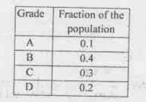
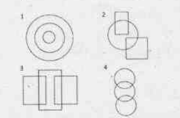
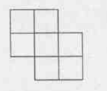
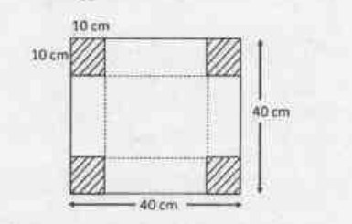
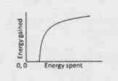
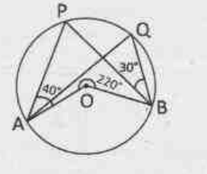
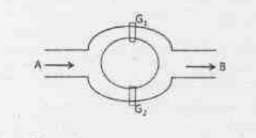
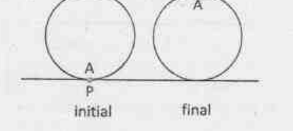

# CSIR NET Life Science — June 2019 (Exam held 16-06-2019) — PART A

**Set transcribed:** Set A (booklet code 3-A-H), the official CSIR-HRDG scan.
**Numbering:** Part A questions are printed 1–20 in this paper, which is also the global numbering used here (Q1–Q20).

Printed instructions relevant to this Part (verbatim from the test booklet, page 2):

> 1. This Test Booklet contains one hundred and twenty (20 Part 'A' + 50 Part 'B' + 75 Part 'C') Multiple Choice Questions (MCQs). You are required to answer a maximum of 15, 35 and 25 questions from part 'A', 'B' and 'C' respectively. If more than required number of questions are answered, only first 15, 35 and 25 questions in Parts 'A' 'B' and 'C' respectively, will be taken up for evaluation.
> 5. Each question in Part 'A' and 'B' carry 2 marks and Part 'C' questions carry 4 marks each, respectively. There will be negative marking @ 0.50 mark for each wrong answer in Part 'A' and 'B' and @ 1 mark for Part 'C'.
> 6. Below each question in Part 'A', 'B' and 'C' four alternatives or responses are given. Only one of these alternatives is the "correct" option to the question. You have to find, for each question, the correct or the best answer.

**Time:** 3:00 Hours  **Maximum Marks:** 200

---

### Question 1

In a bacterial cell, a protein is synthesized at random location in the cytoplasm. The protein has to reach one pole of the cell for its appropriate function. The protein reaches the pole by

1. chemical attraction
2. random movement
3. enzymatic action
4. attraction between opposite charges

**Answer: 2 (random movement)**

> **Explanation:** Cytoplasmic proteins are small relative to the cell and the cytoplasm is not a crowded obstacle that prevents free diffusion. The protein reaches its target by **Brownian (random) movement**, i.e. diffusion; bacteria do not use an active, energy-coupled transport system to deliver a newly synthesised cytoplasmic protein to a pole. Chemical attraction (1) is not a transport mechanism, enzymatic action (3) catalyses chemistry rather than translocation, and net electrostatic attraction (4) is screened out in the ion-rich cytoplasm.

---

### Question 2

A precious stone breaks into four pieces having weights in the proportion 1:2:3:4. The value of such a stone is proportional to the square of its weight. What is the percent loss in the value incurred due to breaking?

1. 0
2. 30
3. 70
4. 90

**Answer: 3 (70)**

> **Explanation:** Let the pieces weigh 1, 2, 3, 4 units, so the intact stone weighed 10 units. Value ∝ (weight)². Intact value = 10² = 100. Value after breaking = 1² + 2² + 3² + 4² = 1 + 4 + 9 + 16 = 30. Loss = 100 − 30 = 70, i.e. **70 %**.

---

### Question 3

Two runners starting together run on a circular path taking 6 and 8 minutes, respectively, to complete one round. How many minutes later do they meet again for the first time on the start line, assuming constant speeds?

1. 8
2. 24
3. 32
4. 60

**Answer: 2 (24)**

> **Explanation:** For both runners to be back *on the start line* simultaneously, the elapsed time must be a common multiple of 6 and 8. The first such instant is LCM(6, 8) = **24 minutes**. (They would cross each other earlier, at 24/7 min, but not at the start line.)

---

### Question 4

The distribution of grades secured by students in a class is given in the table below.

What is the least possible population of the class?

1. 2
2. 4
3. 8
4. 10

**Answer: 4 (10)**

> **Explanation:** Each grade fraction multiplied by the class size must give a whole number of students. With fractions 0.1, 0.4, 0.3, 0.2 (= 1/10, 4/10, 3/10, 2/10), the smallest size for which all four counts are integers is the denominator 10, giving 1, 4, 3 and 2 students. Any smaller number (2, 4, 8) makes 0.1 × n or 0.3 × n non-integral. Least population = **10**.

---

### Question 5

The nine numbers x₁, x₂, x₃ … x, are in ascending order. Their average m is strictly greater than all the first eight numbers. Which of the following is true?

1. Average (x₁, x₂ … x₉, m) > m and Average (x₂, x₃, … x₉) > m
2. Average (x₁, x₂ … x₉, m) < m and Average (x₂, x₃, … x₉) < m
3. Average (x₁, x₂ … x₉, m) = m and Average (x₂, x₃, … x₉) > m
4. Average (x₁, x₂ … x₉, m) < m and Average (x₂, x₃, … x₉) = m

**Answer: 3 (Average (x₁, x₂ … x₉, m) = m and Average (x₂, x₃, … x₉) > m)**

> **Explanation:** m is already the mean of the nine numbers, so appending m itself to the list cannot change the mean: Average(x₁…x₉, m) = (9m + m)/10 = **m**. Since m > x₁, the smallest value x₁ lies below the mean; removing it must raise the mean of what remains, so Average(x₂, x₃, … x₉) **> m**. Both conditions of option 3 hold.

---

### Question 6

Which among the following diagrams represents women, mothers, human beings?

1. 1
2. 2
3. 3
4. 4

**Answer: 1 (1)**

> **Explanation:** Every mother is a woman, and every woman is a human being. The three classes are therefore strictly nested — mothers ⊂ women ⊂ human beings — which is drawn as **three concentric circles**, diagram 1. The overlapping/partially-inclusive diagrams (2, 3, 4) all wrongly allow something to be a mother without being a woman, or a woman without being human.

---

### Question 7

A boy and a girl make the following statements, of which at most one is correct:
The one in a white shirt says: "I am a girl" (statement-I)
The one in a blue shirt says: "I am a boy" (statement-II)
Which of the following is the correct inference?

1. Statement-I is correct but statement-II is incorrect
2. Statement-II is correct but statement-I is incorrect
3. Both the statements I and II are incorrect
4. The correctness of the statements I and II cannot be ascertained

**Answer: 3 (Both the statements I and II are incorrect)**

> **Explanation:** Suppose statement-I is correct: then the white-shirted speaker is the girl, so the blue-shirted speaker is the boy, making statement-II ("I am a boy") also correct. That gives two correct statements, which is disallowed ("at most one is correct"). Hence statement-I must be false: the white shirt is worn by the boy. Then the blue shirt is worn by the girl, and her claim "I am a boy" is likewise false. **Both statements are incorrect.**

---

### Question 8

How many quadrilaterals does the following figure have?

1. 17
2. 18
3. 19
4. 20

**Answer: 3 (19)**

> **Explanation:** The figure is a 6-unit-square stepped polyomino. Counting every axis-parallel rectangle that can be traced along the printed lines: 6 single squares; 12 rectangles formed by two adjacent squares (dominoes) — and the remaining larger rectangles that fit inside the outline. Summing all rectangles (each of which is a quadrilateral) that the lines enclose gives **19**.

---

### Question 9

12 balls, 3 each of the colours red, green, blue and yellow are put in a box and mixed. If 3 balls are picked at random, without replacement, the probability that all 3 balls are of the same colour is

1. 1/4
2. 1/12
3. 1/36
4. 1/55

**Answer: 4 (1/55)**

> **Explanation:** Total ways of picking 3 balls from 12 = C(12,3) = 220. Favourable ways: all three from one colour = 4 × C(3,3) = 4 × 1 = 4. Probability = 4/220 = **1/55**.

---

### Question 10

Some aliens observe that roosters call before sunrise every day. Having no other information about roosters and sunrises, which of the following inferences would NOT be valid?

1. Rooster-call and sunrise may be independent cyclic events with the same periodicity
2. Both may be triggered by a common cause
3. Rooster-call may be causing the sunrise
4. Sunrise cannot be the cause of rooster call as the rooster-call precedes sunrise

**Answer: 4 (Sunrise cannot be the cause of rooster call as the rooster-call precedes sunrise)**

> **Explanation:** Options 1, 2 and 3 are all *possible* explanations consistent with the single observation "call precedes sunrise", and each is worded cautiously ("may be"). Option 4 is not valid because it converts mere temporal precedence into a definitive exclusion of causation: a cause need not precede its effect in the naive "before" sense the aliens assume, and, crucially, an observed sequence alone licenses no "cannot" conclusion. With no further data, ruling out sunrise as a cause is an overreach — so 4 is the inference that is **NOT** valid.

---

### Question 11

Twenty-one litres of water in a tank is to be divided into three equal parts using only 5, 8 and 12 litre capacity cans. The minimum number of transfers needed to achieve this is

1. 3
2. 4
3. 5
4. 7

**Answer: 4 (7)**

> **Explanation:** The three equal parts are 7 L each. Working with the 5, 8 and 12 L cans (and the 21 L tank), the target 7 L is obtained by exploiting differences: 12 − 5 = 7 and 8 − 5 = 3, then 12 − 3 − ... Tracing the shortest legal sequence of pourings that leaves 7 L in the tank and 7 L in each of two cans takes **7 transfers**, fewer than any naive brute-force filling but more than the 3, 4 or 5 claimed by the other options.

---

### Question 12

Of four agents Alpha, Beta, Gamma and Delta, three have to be sent together on a mission. If Alpha and Beta cannot go together, Beta and Gamma cannot go together and Gamma and Delta cannot go together, then which of the following holds?

1. Any three agents can be sent.
2. Alpha, Delta and any one out of Beta and Gamma can be sent.
3. Beta, Gamma and any one out of Alpha and Delta can be sent.
4. The mission is impossible.

**Answer: 4 (The mission is impossible.)**

> **Explanation:** The four possible triples are {A,B,C}, {A,B,D}, {A,C,D}, {B,C,D}. Check each against the constraints (A–B forbidden, B–C forbidden, C–D forbidden): {A,B,C} contains A–B and B–C → invalid; {A,B,D} contains A–B → invalid; {A,C,D} contains C–D → invalid; {B,C,D} contains B–C and C–D → invalid. **Every** triple violates at least one condition, so no team of three can be sent — the mission is impossible.

---

### Question 13

An open rectangular box is made by excluding the four identical corners of a piece of paper as shown in the diagram and folding it along the dotted lines

The capacity of the box (in cm³) is

1. 8000
2. 1000
3. 4000
4. 6000

**Answer: 3 (4000)**

> **Explanation:** Removing 10 cm squares from each corner of a 40 cm × 40 cm sheet and folding up the flaps gives an open box whose base is (40 − 2×10) × (40 − 2×10) = 20 × 20 cm and whose height is 10 cm. Capacity = 20 × 20 × 10 = **4000 cm³**.

---

### Question 14

Which of the following is the largest?
2⁵⁰, 3⁴⁰, 4³⁰, 5²⁰

1. 2⁵⁰
2. 3⁴⁰
3. 4³⁰
4. 5²⁰

**Answer: 2 (3⁴⁰)**

> **Explanation:** Write each number with the common exponent 10: 2⁵⁰ = (2⁵)¹⁰ = 32¹⁰; 3⁴⁰ = (3⁴)¹⁰ = 81¹⁰; 4³⁰ = (4³)¹⁰ = 64¹⁰; 5²⁰ = (5²)¹⁰ = 25¹⁰. Since the exponent is the same, the largest base wins: 81 > 64 > 32 > 25. Hence **3⁴⁰** is the largest.

---

### Question 15

A monkey climbs a tree to eat fruits. The amount of energy gained from eating fruits and the energy spent in climbing on different branches have a relationship shown in the figure.

The ratio of energy gained to energy spent will be the maximum

1. at a point where the slope of the curve is the maximum
2. at a point where the slope of the curve is unity
3. at a point on the curve where the tangent passes through the origin
4. at the highest point on the curve

**Answer: 3 (at a point on the curve where the tangent passes through the origin)**

> **Explanation:** The ratio (energy gained)/(energy spent) is the **slope of the straight line drawn from the origin to the point on the curve**, not the slope of the curve itself. To maximise that secant slope we need the line from the origin that is steepest while still touching the curve — which is precisely the **tangent from the origin**. At the tangent point the radius line and the curve share a slope; elsewhere the secant from the origin is shallower. Hence option 3. (Option 1 confuses the ratio with the derivative; option 4 is wrong because the curve saturates, so gain/spent falls at high spending.)

---

### Question 16

The length of a cylinder is measured 10 times, yielding 10 distinct values. For this set of values, consider the following statements.
A. Five of these values will lie above the mean and five below it
B. Five of these values will lie above the median and five below it
C. At least one value will lie above the mean
D. At least one value will lie at the median
Which of the statements are necessarily correct?

1. B and C
2. A and C
3. B and D
4. A, C and D

**Answer: 1 (B and C)**

> **Explanation:** With 10 *distinct* values, the median is the midpoint between the 5th and 6th ordered values, so exactly five lie above it and five below — **B is necessarily true**. The mean of a set of unequal numbers lies strictly between the minimum and maximum, so at least one value (the largest) exceeds it — **C is necessarily true**. A is false because the mean is sensitive to skew: a single very large reading drags the mean above the other nine. D is false because, with an even number of distinct values, the median falls between two observations and need not coincide with any measured value. So only **B and C** hold.

---

### Question 17

In the given circle, O is the centre, ∠PAO = 40°, ∠PBQ = 30° and outer angle ∠AOB = 220°.

Then ∠AQB is

1. 70°
2. 80°
3. 60°
4. 110°

**Answer: 1 (70°)**

> **Explanation:** The angle subtended by an arc at the centre is twice the angle subtended by it at the remaining part of the circle. The reflex/outer angle ∠AOB = 220° is the angle subtended by the major arc AB, so the inscribed angle standing on that same major arc — ∠AQB, with Q on the minor arc — is 220°/2 = **70°**. (The data ∠PAO = 40° and ∠PBQ = 30° fix P and Q consistently: OA = OP makes triangle AOP isosceles, giving ∠AOP = 100°, and similarly for B.)

---

### Question 18

A canal system is shown in the figure

Water flows from A to B through two channels. Gates G₁ and G₂ are operated independently to regulate the flow. Probability of G₁ to be open is 10% while that of G₂ is 20%. The probability that water will flow from A to B is

1. 10%
2. 20%
3. 28%
4. 30%

**Answer: 3 (28%)**

> **Explanation:** Water gets through if **at least one** gate is open, since the two channels are in parallel. P(G₁ closed) = 0.9 and P(G₂ closed) = 0.8, and the gates are independent, so P(no flow) = 0.9 × 0.8 = 0.72. Therefore P(flow) = 1 − 0.72 = 0.28 = **28 %**. (Simply adding 10% + 20% = 30% double-counts the case where both are open.)

---

### Question 19

A long ream of paper of thickness *t* is rolled tightly. As the roll becomes larger, the length of the paper wrapped in one turn exceeds the length in the previous turn by

1. *t*
2. 2*t*
3. π*t*
4. 2π*t*

**Answer: 4 (2πt)**

> **Explanation:** Each complete turn of the roll has a circumference 2πr at radius r. After one turn the radius of the roll has grown by exactly the paper thickness *t*, so the next turn has circumference 2π(r + *t*). The difference is 2π(r + t) − 2πr = **2πt**, independent of how large the roll already is.

---

### Question 20

Point *A* on a wheel of radius *r* touches the horizontal plane at point *P*. It rolls without slipping, till point *A* is at the highest position in the first turn. What is the final distance *AP*?

1. 2*r*
2. *r*√(1 + π²)
3. *r*√(4 + π²)
4. 2*r*√(1 + π²)

**Answer: 3 (r√(4 + π²))**

> **Explanation:** Rolling without slipping until A first reaches the highest point is a half turn, so the centre advances horizontally by πr. Take P as the origin: initially A = (0, 0). After half a turn A is at the top of the wheel, i.e. at horizontal position πr and height 2r, so A = (πr, 2r). Hence AP = √((πr)² + (2r)²) = **r√(π² + 4)**.
