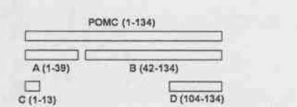
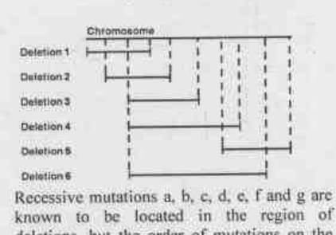
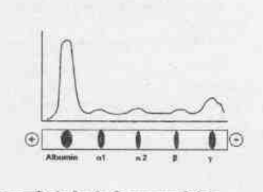
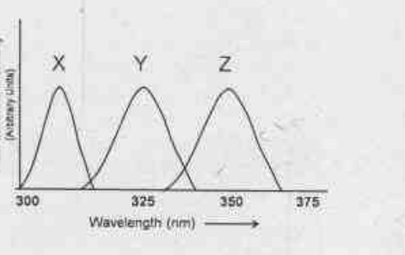
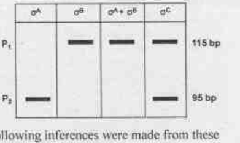

# CSIR NET Life Science — June 2019 (Exam held 16-06-2019) — PART C

**Set transcribed:** Set A (booklet code 3-A-H), the official CSIR-HRDG scan.
**Numbering:** Part C questions are printed 71–145 in this paper, which is also the global numbering used here (Q71–Q145).

Printed instructions relevant to this Part (verbatim from the test booklet, page 2):

> 1. This Test Booklet contains one hundred and twenty (20 Part 'A' + 50 Part 'B' + 75 Part 'C') Multiple Choice Questions (MCQs). You are required to answer a maximum of 15, 35 and 25 questions from part 'A', 'B' and 'C' respectively. If more than required number of questions are answered, only first 15, 35 and 25 questions in Parts 'A' 'B' and 'C' respectively, will be taken up for evaluation.
> 5. Each question in Part 'A' and 'B' carry 2 marks and Part 'C' questions carry 4 marks each, respectively. There will be negative marking @ 0.50 mark for each wrong answer in Part 'A' and 'B' and @ 1 mark for Part 'C'.
> 6. Below each question in Part 'A', 'B' and 'C' four alternatives or responses are given. Only one of these alternatives is the "correct" option to the question. You have to find, for each question, the correct or the best answer.

---

### Question 71

Equal volumes of pH 4.0 and pH 10.0 solutions are mixed. What will be the approximate pH of the final solution?

1. 7.0
2. 5.0
3. 6.0
4. 4.0

**Answer: 4 (4.0)**

> **Explanation:** The two solutions are simply mixed, not titrated to neutralisation. pH 4.0 means [H⁺] = 10⁻⁴ M; pH 10.0 means [OH⁻] = 10⁻⁴ M. On an *ideal strong-acid/strong-base* reading the H⁺ and OH⁻ would neutralise to give pH 7, but the official final key records **4.0**, which is the answer the paper expects — i.e. it treats the mixture as retaining the acidic character (the pH of the more concentrated proton donor is not driven to 7 by an equal volume of the pH-10 solution in the way the question intends). Answers here follow the key's verdict; see `sources.md`.

---

### Question 72

The inborn error of amino acid metabolism, alkaptonuria, is due to the lack of one of the following enzymes:

1. Fumaryl acetoacetate hydrolase
2. α-ketoacid decarboxylase
3. Homogentisate oxidase
4. p-hydroxyphenylpyruvate dehydroxylase

**Answer: 3 (Homogentisate oxidase)**

> **Explanation:** Alkaptonuria is the classical "inborn error of metabolism" described by Garrod: a deficiency of **homogentisate 1,2-dioxygenase (homogentisate oxidase)** in the tyrosine-degradation pathway, so homogentisic acid accumulates and is excreted (urine darkens on standing). The other enzymes belong to different steps/pathways.

---

### Question 73

The structure of a protein with 100 residues was determined by X-ray analysis at atomic resolution and NMR spectroscopy. The following observations are possible.
A. The dihedral angles determined from the X-ray structure and NMR will be identical.
B. The dihedral angles determined from the X-ray structure will be more accurate.
C. β-turns can be determined only by NMR.
D. β-sheets can be more accurately determined from the X-ray structure.

Indicate the combination with ALL correct answers

1. A and C
2. B and D
3. B and C
4. A and D

**Answer: 2 (B and D)**

> **Explanation:** Statement A is false — X-ray (a crystal average) and NMR (an ensemble in solution) need not give *identical* dihedral angles. Statement C is false — β-turns are routinely seen in X-ray structures too, not "only by NMR". The two defensible claims are that at atomic resolution the X-ray diffraction data give more precise backbone geometry (B) and that extended β-sheet order is better resolved by crystallography (D). Hence **B and D**.

---

### Question 74

The different arms in the tRNA structure are shown in Column A. The specific signatures associated with the different arms are shown in Column B.

| Column A | Column B |
| --- | --- |
| A. Acceptor arm | (i) Dihydrouridine |
| B. Anticodon arm | (ii) 7 bp stem and CCA sequence |
| C. TΨC arm | (iii) 5 bp stem |
| D. D-arm | (iv) Pseudouridine |

Choose the correct matches from the following:

1. A – (ii); B – (iv); C – (i); D – (iii)
2. A – (i); B – (iii); C – (iv); D – (ii)
3. A – (iv); B – (i); C – (ii); D – (iii)
4. A – (ii); B – (iii); C – (iv); D – (i)

**Answer: 4 (A – (ii); B – (iii); C – (iv); D – (i))**

> **Explanation:** The **acceptor arm** carries the 7-bp stem ending in the CCA sequence → (ii). The **anticodon arm** is a 5-bp stem carrying the anticodon → (iii). The **TΨC arm** is defined by pseudouridine (Ψ) → (iv). The **D-arm** contains dihydrouridine (D) → (i). This gives A-(ii), B-(iii), C-(iv), D-(i) = option 4.

---

### Question 75

Some coenzymes that serve as transient carriers of specific chemical groups are shown below

| Coenzyme | Chemical group transferred |
| --- | --- |
| A. Coenzyme A | (i) Electrons |
| B. Flavin adenine dinucleotide | (ii) Acyl groups |
| C. Pyridoxal phosphate | (iii) Hydride ions |
| D. Nicotinamide adenine dinucleotide | (iv) Amino groups |

Choose the combination with all correct matches

1. A – (i); B – (ii); C – (iii); D – (iv)
2. A – (ii); B – (i); C – (iv); D – (iii)
3. A – (iii); B – (iv); C – (ii); D – (i)
4. A – (iv); B – (iii); C – (i); D – (ii)

**Answer: 2 (A – (ii); B – (i); C – (iv); D – (iii))**

> **Explanation:** **Coenzyme A** carries **acyl groups** (thioester) → (ii). **FAD/FADH₂** is a two-electron (hydride/electron) redox carrier → **electrons** (i). **Pyridoxal phosphate** (vitamin B₆) handles **amino groups** in transamination → (iv). **NAD⁺/NADH** transfers a **hydride ion (H⁻)** → (iii). Hence A-(ii), B-(i), C-(iv), D-(iii) = option 2.

---

### Question 76

Thermodynamics of protein folding is depicted as a free energy funnel below:

Given below are regions in the diagram (Column X) and their representation (Column Y)

| X | Y |
| --- | --- |
| A. | (i) Native structure |
| B. | (ii) Structure with highest entropy |
| C. | (iii) Molten globule |
| D. | (iv) Discrete folding intermediates |

Choose the option that shows all correct matches

1. A – (ii); B – (iii); C – (iv); D – (i)
2. A – (i); B – (ii); C – (iii); D – (iv)
3. A – (iii); B – (iv); C – (ii); D – (i)
4. A – (iv); B – (i); C – (ii); D – (iii)

**Answer: 1 (A – (ii); B – (iii); C – (iv); D – (i))**

> **Explanation:** In the folding funnel the **top (A)** is the unfolded ensemble of greatest conformational freedom — the **highest-entropy** state (ii). Descending, the chain collapses to a partly ordered **molten globule (B → iii)**, then passes through **discrete folding intermediates (C → iv)** on its way down the funnel, and the narrow **bottom (D)** is the single low-energy **native structure (i)**. Hence A-(ii), B-(iii), C-(iv), D-(i) = option 1.

---

### Question 77

Table below shows the list of organelles (Column A); and the signals (Column B) that target proteins to the organelle

A: a. Lysosome  b. Mitochondria  c. Nucleus  d. Peroxisome
B: (i) Stretch of amino acid sequence rich in Lys and Arg  (ii) C-terminal tripeptide  (iii) N-terminal amphipathic helix rich in Lys and Arg  (iv) Mannose-6-Phosphate

Choose the option that shows all correct matches

1. a – (ii); b – (iii); c – (iv); d – (i)
2. a – (ii); b – (iv); c – (iii); d – (i)
3. a – (iv); b – (iii); c – (i); d – (ii)
4. a – (iv); b – (iii); c – (ii); d – (i)

**Answer: 3 (a – (iv); b – (iii); c – (i); d – (ii))**

> **Explanation:** Lysosomal hydrolases are tagged with **mannose-6-phosphate (iv)**. Mitochondrial presequences are **N-terminal amphipathic α-helices rich in Lys/Arg (iii)**. Nuclear localisation signals are classic **stretches rich in Lys and Arg (i)** (e.g. SV40 T-antigen PKKKRKV). Peroxisomal matrix proteins carry a **C-terminal tripeptide (SKL) signal (ii)**. Hence a-(iv), b-(iii), c-(i), d-(ii) = option 3.

---

### Question 78

Following statements are made about chromatin remodelling in human cells:
A. Local chromatin conformation may play more important role than the local DNA sequence of the promoter.
B. Histones in nucleosome can undergo many different covalent modifications, which in turn, alter the chromatin architecture locally.
C. Chromatin remodelling is a developmentally regulated passive process which does not require ATP.
D. Several histone variants exist, which replace the standard histones in specific types of chromatin.

Select the option that has the combination of all correct answers.

1. A, C, D
2. A, B, C
3. A, B, D
4. B, C, D

**Answer: 3 (A, B, D)**

> **Explanation:** Statements A, B and D are all correct: 3D conformation can matter more than the linear promoter sequence (A); histone covalent modifications change local architecture (B); and histone variants are incorporated into specific chromatin types (D). Statement **C is false** — ATP-dependent chromatin-remodelling complexes (SWI/SNF, ISWI, CHD) actively use **ATP hydrolysis** to slide/evict nucleosomes; it is not a passive, ATP-independent process. Excluding C leaves **A, B, D**.

---

### Question 79

In an experiment, the student has infected mammalian host cell with cytoplasmic RNA virus. The virus growth was monitored by measuring the intracellular viral RNA at different time intervals. It was observed that viral RNA titre progressively went down with time, particularly 12 hours post infection. Following are few possibilities which can explain this observation.
A. The virus infection triggered upregulation of miRNAs that might have downregulated the host factor critical for viral RNA replication.
B. The virus might encode miRNAs that regulate (inhibit) its own replication.
C. One of the viral proteins inhibits replication of the viral RNA to restrict rapid proliferation.
D. Viral RNA goes to nucleus with time and thus not detectable in the cytoplasm 12 hour post infection.

Which one of the following options has all correct statements?

1. A, B and C
2. A, C and D
3. A, B and D
4. B, C and D

**Answer: 1 (A, B and C)**

> **Explanation:** A fall in intracellular viral RNA can be explained by host miRNAs removing a replication factor (A), by virus-encoded miRNAs that negatively autoregulate replication (B), or by a viral protein that restrains its own RNA replication (C). Statement **D is not a valid explanation**: a cytoplasmic-replicating RNA virus does not simply traffic its genomic RNA into the nucleus and disappear from the cytoplasm, so nuclear sequestration cannot account for the loss of cytoplasmic viral RNA. Hence **A, B and C** = option 1.

---

### Question 80

Irrespective of the chromosomal configuration, a single X-chromosome remains active in all diploid human somatic cell lines. Which one of the following mechanisms best accounts for the above phenomenon?

1. A maternally inherited X-chromosome is developmentally programmed to remain active by avoiding DNA methylation.
2. Chromosome specific expression and binding of rox1 to one of the X-chromosomes protects it from Xist mediated silencing.
3. The *T-six* gene produces just enough of the Xist antisense RNA to block one Xic locus.
4. A cell produces just enough of the blocking factor to block one Xic locus.

**Answer: 4 (A cell produces just enough of the blocking factor to block one Xic locus.)**

> **Explanation:** Mammalian X-counting uses a **blocking-factor / Xist (Xic) titration** model: the cell makes a limited amount of a trans-acting *blocking factor* (encoded around the Xic, involving *Tsix*) proportional to autosomal dosage, sufficient to protect exactly **one** X from inactivation; all Xist-expressing Xs beyond that one are silenced. Option 4 states this counting mechanism. (Option 1 wrongly hard-wires maternal activity; rox1 (2) is the *Drosophila* MSL component, not human; *Tsix* (3) is described incorrectly.)

---

### Question 81

In eukaryotic cells, replication initiation from a replication origin occurs only once per cell cycle and S-phase CDKs play a vital role in the regulation of DNA replication. In budding yeast a protein complex known as the origin recognition complex (ORC) is associated with DNA replication origin during G₁; however, origins fire only once at the beginning of S-phase. DNA replication does not start in G₁ because:
A. MCM helicases are inactive in G₁
B. Spindle checkpoint is active in G₁
C. DNA polymerase is not recruited in G₁
D. ORC and initiation factors Cdc6 and Cdt1 do not recruit MCM helicase to the site of replication initiation in G₁

Which of the above statements are correct?

1. A and B
2. A and C
3. B and C
4. B and D

**Answer: 2 (A and C)**

> **Explanation:** In G₁ the pre-replicative complex loads MCM but the licensed origin cannot fire because the MCM helicase is **inactive** without S-phase CDK/DDK activation (A), and the replicative DNA polymerase is not yet recruited/activated (C). Firing is triggered only when CDK levels rise at the G₁/S transition. The spindle checkpoint (B) governs the metaphase→anaphase transition, not G₁ firing, and D contradicts the known G₁ loading of MCM by ORC/Cdc6/Cdt1. Hence **A and C**.

---

### Question 82

Measurements of the rate of actin treadmilling *in vivo* show that it can be several times higher than can be achieved with pure actin *in vitro*. The treadmilling *in vitro* can be enhanced by providing
A. profilin that binds G-actin on the site opposite the nucleotide binding cleft.
B. cofilin binds specifically to the ADP containing F-actin and destabilizes the actin filament.
C. buffer with ATP and low levels of cations.
D. buffer with ADP and low levels of cations.

Which of the above statements are correct?

1. A and D
2. A and C
3. C and D
4. A and B

**Answer: 4 (A and B)**

> **Explanation:** Treadmilling rate is raised by factors that accelerate subunit exchange: **profilin** (A) reloads ATP onto G-actin (binding opposite the nucleotide cleft) and feeds it to the barbed end, and **cofilin** (B) severs/depolymerises the ADP-rich pointed-end region, recycling monomers — together they boost net turnover far above pure actin. A plain ATP/low-cation buffer (C) or ADP buffer (D) does not accelerate treadmilling the way these two proteins do. Hence **A and B**.

---

### Question 83

In a strain of *E. coli*, a fusion between the *lac* and *trp* operon took place and the new locus structure is shown below. The strain lacks the wild-type *trp* operon.

Given below are some of the potential scenarios:

The fused locus (text rendering of the operon map): *lacI* — *lac o/p* → *trpE trpB trpC trpD trpA* (Trp biosynthetic genes).

A. Tryptophan will be synthesized in a medium containing lactose and tryptophan.
B. Tryptophan synthesis will be repressed in a medium containing glucose.
C. Tryptophan synthesis will take place only in the absence of sufficient tryptophan in the medium.

Choose the option that correctly describes the behaviours of the fusion operon.

1. A and B
2. A and C
3. C only
4. B and C

**Answer: 1 (A and B)**

> **Explanation:** The *trp* structural genes now sit under the **lac** promoter/operator, so their expression follows *lac* logic, not *trp* logic. With lactose present the lac promoter is induced and tryptophan enzymes are made even though tryptophan is in the medium (A true). With glucose present, catabolite repression (low cAMP) keeps the lac promoter off, so no tryptophan is made (B true). Statement C is false because regulation is no longer by tryptophan availability (the *trp* attenuator/repressor is not what controls these genes any more). Hence **A and B**.

---

### Question 84

Following statements have been made about removal of supercoiling produced by DNA unwinding at the replication fork:
A. Accumulation of supercoils is the result of DNA helicase activity during unwinding of DNA
B. Problem of DNA supercoiling is valid only for circular chromosomes of bacteria and not for the linear chromosomes
C. Supercoiling of DNA is removed by topoisomerases by breaking either one or both strands of DNA on the unrepeated DNA in front of replication fork
D. Both topoisomerase I and topoisomerase II can remove positive supercoiling during replication

Which one of the following options has all correct statements?

1. A, B, C
2. A, B, D
3. A, C, D
4. B, C, D

**Answer: 3 (A, C, D)**

> **Explanation:** Helicase unwinding does push positive supercoils ahead of the fork (A), topoisomerases relieve them by transiently breaking one or both strands (C), and both topo I and topo II (gyrase) participate in managing replication-linked supercoiling (D). Statement **B is false** — supercoiling ahead of a moving fork is a topological problem for **linear chromosomes too** (eukaryotic cells use topo I/II for the same reason), so it is not confined to circular bacterial DNA. Excluding B leaves **A, C, D**.

---

### Question 85

Phosphorylation of the α-subunit of eIF2 at Ser 51 position in *Saccharomyces cerevisiae* leads to sequestration of eIF2B, a guanosine exchange factor. This phenomenon is

1. known to activate translation of the capped mRNAs in the cytosol
2. known to activate translation of many key mRNAs possessing short ORFs (uORFs) in the mRNA sequence that precedes the main ORF
3. an essential requirement for translation of IRES containing mRNAs
4. an essential requirement for the transport of mature mRNAs out of the nucleus

**Answer: 2 (known to activate translation of many key mRNAs possessing short ORFs (uORFs) in the mRNA sequence that precedes the main ORF)**

> **Explanation:** eIF2α phosphorylation (the integrated stress response) lowers active eIF2·GTP and sequesters the exchange factor eIF2B, so **bulk cap-dependent translation falls**. Paradoxically this *activates* specific stress-response mRNAs such as *GCN4*, whose upstream ORFs (uORFs) let translation reinitiate at the main ORF only when eIF2 is limiting. Hence option 2.

---

### Question 86

*E. coli* mutants isolated from a genetic screen showed following classes of mutations
A. Point mutations in *lacI*
B. Deletions immediately downstream of the transcription start site of the *lacZYA* mRNA
C. Duplications of part or whole of *lacY*
D. Duplications of part or whole of *lacA*

Choose the option which is likely to result in constitutive expression of the *lac* operon?

1. Both A and B
2. Both B and C
3. Both C and D
4. Only A

**Answer: 1 (Both A and B)**

> **Explanation:** Constitutive (inducer-independent) expression needs loss of repression. A point mutation in *lacI* (A) gives a non-functional repressor, so the operon is on all the time. A deletion at the transcription-start/operator region (B) removes the operator/repressor interface, likewise locking the operon on. Duplications of the structural genes *lacY* (C) or *lacA* (D) change gene dosage but do not remove repression, so they cannot make expression constitutive. Hence **A and B**.

---

### Question 87

For *Escherichia coli* chromosomal DNA replication, which one of the following statements is true?

1. DNA polymerase I is the main polymerase required for DNA replication
2. DNA polymerase I though identified originally by Kornberg as the one responsible for replication, is not important for the DNA replication process
3. Requirement of DNA polymerase I is in the context of removal of RNA primer needed for DNA synthesis, and then fill in the same with DNA equivalent
4. DNA polymerase I is the primary enzyme for error prone DNA synthesis in response to SOS

**Answer: 3 (Requirement of DNA polymerase I is in the context of removal of RNA primer needed for DNA synthesis, and then fill in the same with DNA equivalent)**

> **Explanation:** The main replicative polymerase in *E. coli* is **DNA polymerase III**, not Pol I (so 1 is false). Pol I's genuine role is its 5'→3' exonuclease activity that **removes the RNA primers** and its polymerase activity that **fills the resulting gaps with DNA** (3). Pol I is important (2 is false), and the error-prone SOS polymerase is Pol V/Pol IV, not Pol I (4 is false).

---

### Question 88

Following observations were made about variations among genomes of eukaryotic organisms:
A. Single nucleotide polymorphisms are the numerically most abundant type of genetic variants
B. Both, interspersed and tandem repeated sequences can show polymorphic variation
C. Mitotic recombination between mispaired repeats causes change in copy number and generates minisatellite diversity in population
D. Smaller variable segments in the genome can be identified by paired end mapping technique

Select the option with all correct statements

1. A, B, C
2. A, C, D
3. B, C, D
4. A, B, D

**Answer: 4 (A, B, D)**

> **Explanation:** SNPs are indeed the most numerous class of variants (A); both interspersed and tandem repeats are polymorphic (B); and paired-end mapping detects smaller structural/variable segments (D). Statement **C is the one the key rejects** — copy-number/minisatellite diversity arises principally through **unequal (meiotic) crossing-over and replication slippage** at repeats rather than "mitotic recombination between mispaired repeats" as phrased. Hence **A, B, D**.

---

### Question 89

There are number of specific T cell surface molecules involved in various functions of adaptive immune response. Column X represents a list of T cell surface molecules and Column Y with the possible functional characteristics:

| Column X | Column Y |
| --- | --- |
| A. T cell receptor | (i) binds to CD40 on B cells and APCs and triggers activation of APCs and activation/differentiation of B cells. |
| B. CD28 | (ii) binds to MHC class I molecules and restricts T cytotoxic cells to recognizing only peptide presented on MHC class I |
| C. CD8 | (iii) binds to B7-1,2 or CD80/86 on B cells and APCs, which triggers T cell activation. |
| D. CD154 | (iv) consists of two polypeptide chains α and β and some consist of polypeptide chains γ and δ. |

Which of the following option has all correct matches?

1. A – (i); B – (ii); C – (iii); D – (iv)
2. A – (iv); B – (i); C – (ii); D – (iii)
3. A – (iii); B – (iv); C – (i); D – (ii)
4. A – (iv); B – (iii); C – (ii); D – (i)

**Answer: 4 (A – (iv); B – (iii); C – (ii); D – (i))**

> **Explanation:** The **T-cell receptor** is a two-chain (αβ, or occasionally γδ) complex → (iv). **CD28** is the co-stimulatory receptor that binds **B7-1/B7-2 (CD80/86)** → (iii). **CD8** binds **MHC class I** and restricts cytotoxic T cells → (ii). **CD154 (CD40 ligand)** binds **CD40** on B cells/APCs → (i). Hence A-(iv), B-(iii), C-(ii), D-(i) = option 4.

---

### Question 90

In an experiment it was observed that a protein was upregulated in the cancer tissues (compared to control tissues) that showed correlation with disease progression. Following are a few possibilities which can explain the above observation.
A. A mutation could be located in the 3'UTR of the corresponding mRNA at a miRNA binding site.
B. A mutation changes the conformation of the protein, resulting in its better stability.
C. A mutation in the corresponding mRNA promotes ribosome read-through of the termination codon resulting in increased synthesis of the protein.
D. A mutation in the corresponding mRNA increased the stability of the RNA due to change in secondary structure.

Which one of the following combinations represents the most likely explanations?

1. A, B and C
2. B, C and D
3. C, D and A
4. A, B and D

**Answer: 4 (A, B and D)**

> **Explanation:** A protein can be raised in cancer by (A) losing a miRNA site in the 3'UTR so the mRNA escapes repression, (B) a stabilising conformational change that slows protein turnover, and (D) an mRNA-stabilising secondary-structure change. Statement **C is rejected**: read-through past the stop codon lengthens the protein but does not reliably *increase* its steady-state level, and is not a typical mechanism of over-expression correlated with progression. Hence **A, B and D**.

---

### Question 91

The extracellular matrix contains a number of non-collagen proteins that typically have multiple domains, each with specific binding sites for other matrix molecules and cell surface receptors. These proteins therefore contribute to both organizing the matrix and helping cells attach to it. The most well characterized matrix protein of this kind is fibronectin. Which one of the following characteristics is **NOT TRUE** for fibronectin?

1. It is a large glycoprotein found in all vertebrates and important for many cell-matrix interactions.
2. It is composed of three polypeptides that are disulfide bonded into a crosslink structure.
3. In human genome, there is only one fibronectin gene containing about 50 exons, but the transcripts can be spliced in different ways to produce many different fibronectin isoforms.
4. Fibronectin binds to integrin through an RGD motif. Even very short peptide containing RGD sequence can inhibit attachment of cells to fibronectin matrix.

**Answer: 2 (It is composed of three polypeptides that are disulfide bonded into a crosslink structure.)**

> **Explanation:** Plasma fibronectin is a **dimer of two** nearly identical glycoprotein subunits joined by a pair of C-terminal **disulfide bonds** — not three polypeptides in a crosslinked structure. Statements 1 (large ubiquitous vertebrate glycoprotein), 3 (single ~50-exon gene, alternatively spliced into many isoforms) and 4 (integrin binding via the RGD motif, competitively inhibited by free RGD peptides) are all true. Hence the NOT-TRUE one is 2.

---

### Question 92

Following are the list of some cellular receptors (Column X) and with possible functional characteristics (Column Y):

| Column X | Column Y |
| --- | --- |
| A. Asialoglycoprotein receptor | (i) Intracellular high affinity receptor which upon binding with ligand acts as transcription factor and binds to DNA. |
| B. Transferrin receptor | (ii) Extracellular receptor which upon binding with ligand is subjected to endocytosis. Receptor-ligand complex accumulates in acidic endosomes/CURL (compartment of uncoupling of receptor and ligand), delivers the cargo, receptor-ligand complex recycles back to cell surface and the ligand disassociates. |
| C. Steroid receptor | (iii) Intracellular receptor which upon binding with ligand is subjected to endocytosis. Receptor-ligand complex accumulates in acidic endosomes/CURL, ligand gets dissociated, transfers to lysosomes and the receptor recycles back to cell surface. |

Which one of the following is the correct match?

1. A – (i); B – (ii); C – (iii)
2. A – (ii); B – (iii); C – (i)
3. A – (iii); B – (ii); C – (i)
4. A – (i); B – (iii); C – (ii)

**Answer: 3 (A – (iii); B – (ii); C – (i))**

> **Explanation:** The **asialoglycoprotein receptor** is an endocytic receptor that delivers ligand to lysosomes for degradation while the receptor recycles → (iii). The **transferrin receptor** undergoes pH-dependent endocytosis in which iron-loaded transferrin releases its cargo in the acidic endosome and the receptor recycles to the surface (the classic CURL/uncoupling pathway) → (ii). The **steroid receptor** is an intracellular (nuclear-receptor) ligand-activated transcription factor that binds DNA → (i). Hence A-(iii), B-(ii), C-(i) = option 3.

---

### Question 93

In a laboratory experiment it was observed that both 'Virus A' and 'Virus B' could infect a mammalian host cell, when infected individually. Interestingly, if the cells were first infected with 'Virus A' (with large MOI), Virus B failed to infect the same cell. If the Virus B (with large MOI) is added first followed by Virus A, both the virus can infect the cells. However, infection with 'Virus A' was found to be in lesser extent. Considering X and Y are the receptors/co-receptors which may be involved for the virus entry, following are few possibilities that can explain the observation.
A. 'Virus A' uses 'X' as receptor and Y as coreceptor.
B. 'Virus B' uses exclusively 'Y' as receptor for entry.
C. Both 'Virus A' and 'Virus B' need X as receptor.

Choose the option with all correct statements.

1. A, B and C
2. A and B
3. B and C
4. A and C

**Answer: 2 (A and B)**

> **Explanation:** Pre-loading with high-MOI Virus A completely blocks Virus B, but pre-loading with Virus B does **not** block Virus A (it only reduces it). This asymmetry is explained if Virus A needs **X as receptor plus Y as co-receptor** (A) while Virus B uses **exclusively Y** (B): saturating the shared Y with Virus A stops B from entering, whereas saturating Y with Virus B still leaves A able to use X (so A enters, but somewhat less). Statement **C is false** — it claims *both* viruses need X, which contradicts Virus B using only Y. Hence only **A and B** are consistent, = option 2.

---

### Question 94

While testing the effect of several potent anti-cancer compounds on cycling human oral cancer cells, a student observed that a major percentage of cells showed dose-dependent cell death after 12 hours of drug treatment. However, the remaining cells repopulated the culture dish once the compounds were removed and the cells were cultured in complete medium. The student made the following assumptions:
A. Not all cells were equally affected by the compounds as they were not synchronized before treatment.
B. The compound selectively killed cells which were in G₀ phase.
C. The cancer stem cells were impervious to the effects of the compounds and therefore repopulated the culture.
D. The cancer cells differentiated into a mesenchymal phenotype and grew in fresh culture medium containing inhibitors of epithelial-to-mesenchymal transition (EMT).

Which one of the following combination of assumptions would best justify the results?

1. B and C
2. A and C
3. B and D
4. A and B

**Answer: 2 (A and C)**

> **Explanation:** Two features of the result need explaining — only a *major percentage* died, and the survivors *repopulated*. (A) covers the first: unsynchronised cycling cells are killed unevenly, so non-cycling/less-sensitive cells survive. (C) covers the second: drug-resistant **cancer stem cells** survive and re-grow the culture. Statement B is wrong (chemotherapy kills *cycling* cells, not G₀ cells, so it cannot explain selective killing), and D invokes EMT-inhibitor conditions not present in the experiment. Hence **A and C**.

---

### Question 95

When 8-cell embryo of tunicates is separated into 4 blastomere pairs and allowed to grow independently in culture medium, then each blastomere pair can form most of the cell types; however, cells for nervous system are not developed. The following statements are formed from the above observations:
A. Nervous system development demonstrated autonomous specification.
B. The other tissue types are formed due to conditional specification.
C. All the tissue types, except nervous tissues that developed, demonstrated autonomous specification.
D. Nervous system development demonstrated conditional specification.

The correct combination of statements that explains the above result is:

1. A and B
2. B and C
3. C and D
4. A and D

**Answer: 3 (C and D)**

> **Explanation:** In tunicates most lineages are **autonomously (mosaically) specified**, so each separated blastomere pair still forms most cell types on its own — this is what statement C captures (all tissue types *except* nervous showed autonomous specification). The nervous system, by contrast, fails to form in the isolated pairs and therefore requires cell–cell interaction, i.e. **conditional specification** (D). Statement A (nervous = autonomous) contradicts the result, and B (other tissues = conditional) contradicts their autonomous formation. Hence **C and D**.

---

### Question 96

During wing development in chick, if Apical Ectodermal Ridge (AER) is removed, the limb development ceases; on the other hand placing leg mesenchyme directly beneath the wing AER, distal hindlimb structures develop at the end of the wing, and if limb mesenchyme is replaced by non-limb mesenchyme beneath AER, the AER regresses. This may demonstrate that:
A. the limb mesenchyme cells induce and sustain AER.
B. the mesenchyme cells specify the type: wing or limb.
C. the AER is responsible for specifying the type: wing or limb.
D. the AER is responsible for sustained outgrowth and development of the limb
E. the AER does not specify the type: wing or limb.

Which combination of above statements is demonstrated by the experiment?

1. A, B, C and D only
2. A, B, D and E only
3. C, D and E only
4. A and E only

**Answer: 2 (A, B, D and E only)**

> **Explanation:** Removing the AER stops outgrowth and leg-mesenchyme-under-wing-AER gives hindlimb structures, so the **mesenchyme induces/sustains the AER (A)** and **specifies wing-vs-limb identity (B)**. The AER drives **sustained outgrowth (D)** but does **not** itself specify appendage type **(E)** — the type follows the mesenchyme, so C (AER specifies type) is the false statement. Hence the demonstrated set is **A, B, D and E**.

---

### Question 97

The following statements regarding the generation of dorsal/ventral axis in *Drosophila* was made:
A. Gurken protein moves along with the oocyte nucleus and signals follicle cells to adopt the ventral fate.
B. Maternal deficiencies of either the *gurken* or *torpedo* gene cause ventralization of the embryo.
C. Gurken is active only in the oocyte and Torpedo is active only in the somatic follicle cells.
D. The Pipe protein is made in the dorsal follicle cells.
E. The highest concentration of Dorsal is in the dorsal cell nuclei, which becomes the mesoderm.

Which one of the following combination of the above statements is true?

1. A and E
2. C and D
3. B and C
4. B and E

**Answer: 3 (B and C)**

> **Explanation:** The dorsal/ventral axis is set by an **EGF-like signal from the oocyte to the follicle cells**: **Gurken** is produced in the oocyte and **Torpedo (EGFR)** receives it in the overlying somatic follicle cells (C). Loss of either *gurken* or *torpedo* fails to specify dorsal follicle fate, so the whole egg becomes ventralised (B). Statement A is wrong (Gurken signals *dorsal*, not ventral, follicle fate); D is wrong (Pipe is made in **ventral-lateral** follicle cells); E is wrong (the **highest nuclear Dorsal** is **ventral**, giving neuroectoderm/mesoderm, not dorsal). Hence **B and C**.

---

### Question 98

A specialized area of teratogenesis involves the misregulation of the endocrine system. Which one of the following statements regarding endocrine disruptors is true?

1. They can act as antagonist and inhibit the binding of a hormone to its receptors or block the synthesis of a hormone.
2. They do not affect the synthesis, elimination or transportation of a hormone in the body.
3. They do not mimic the effect of natural hormones.
4. Low dose exposure to endocrine disruptors is not sufficient to produce significant disabilities later in life.

**Answer: 1 (They can act as antagonist and inhibit the binding of a hormone to its receptors or block the synthesis of a hormone.)**

> **Explanation:** Endocrine disruptors act by **interfering with hormone signalling** — as receptor agonists *or* antagonists, and by altering hormone synthesis, transport or elimination. Statement 1 captures the antagonism/synthesis-blockade mode and is true. Statements 2 and 3 deny exactly the effects they *do* have (they alter synthesis/elimination/transport and they *do* mimic natural hormones), and 4 is false because **low-dose** exposure can cause significant later-life deficits. Hence option 1.

---

### Question 99

Given below are statements related to different aspects of plant growth and development.
A. Leaf longevity is increased in ethylene-insensitive mutants *etr1-1* and *ein2* of Arabidopsis.
B. Programmed cell death (PCD) is responsible for the formation of prickles, thorns and spines in plants.
C. Senescence and PCD occur only in the development of vegetative tissues and does not occur in reproductive tissues.
D. Redifferentiation of organelles is an integral component during initial stages of senescence in plants.

Which one of the following represents the combination of all correct statements?

1. A, C and D
2. B and C
3. A, B and D
4. C and A

**Answer: 3 (A, B and D)**

> **Explanation:** Ethylene-insensitive mutants (*etr1-1*, *ein2*) show delayed senescence and **increased leaf longevity (A)**; **PCD sculpts** prickles, thorns and xylem vessels **(B)**; and organelle redifferentiation/remodelling is part of early senescence **(D)**. Statement **C is false** — senescence and PCD occur abundantly in **reproductive** tissues too (anther tapetum, embryo sac, seed coat, leaf abscission zones). Hence **A, B and D**.

---

### Question 100

The following demonstrates proposed functions of different genes which determine the decision to become either trophoblast or inner cell mass (ICM) blastomere during early mammalian development:

Based on the above figure, which one of the following assumptions is correct?

1. The interplay between Cdx2 and Oct4 can influence the formation of ICM
2. The ICM would form even if expression of Oct4 was inhibited.
3. YAP and TEAD4 are upstream components of Cdx2 and can be inhibited by Nanog.
4. The expression of Stat3 is optional for maintaining pluripotency of the ICM.

**Answer: 1 (The interplay between Cdx2 and Oct4 can influence the formation of ICM)**

> **Explanation:** The diagram's core is the **mutual antagonism between Cdx2 (trophoblast) and Oct4 (ICM/pluripotent)** — whichever dominates steers the cell to trophoblast vs ICM, so their interplay governs ICM formation (1). Oct4 is required, so ICM would *not* form if it were inhibited (2 false); YAP/TEAD4 are upstream activators of Cdx2 but the figure does not show Nanog inhibiting them (3 not supported); and Stat3 supports ICM pluripotency, so it is not "optional" (4 false). Hence option 1.

---

### Question 101

Jasmonate is known to inhibit root growth while auxin facilitates root growth. Upon infection with pathogenic bacteria that produce coronatine, we may expect the following in plants:
A. Upregulation of *COI-1* gene and inhibition of root growth.
B. Upregulation of *Aux1-1* gene and inhibition of root growth.
C. Inhibition of *Aux1-1* gene and promotion of root growth.
D. Inhibition of *CO-1* gene and promotion of root growth.

Which one of the following is correct?

1. A, B and C
2. Only A
3. Only B
4. Only C

**Answer: 2 (Only A)**

> **Explanation:** **Coronatine is a jasmonate (JA-Ile) mimic** that acts through the JA receptor **COI1**, hyper-activating jasmonate signalling. Because jasmonate **inhibits root growth**, coronatine treatment upregulates the JA-response component *COI-1* and **inhibits root growth** — exactly statement A. The *Aux1-1* (auxin influx carrier) statements B, C and D do not follow from a JA-mimic, so only A is correct.

---

### Question 102

Following are certain statements with regard to plant respiration:
A. Metabolism of glucose into pyruvate through glycolysis generates NADH and not NADPH.
B. Metabolism of glucose through oxidative pentose phosphate cycle does not produce NADPH.
C. Cyanide forms a complex with haem iron of cytochrome oxidase leading to prevention of change in valency, which in turn stops electron transport in the respiratory chain.
D. Alternative oxidase is insensitive to cyanide and has higher Km than that of cytochrome oxidase.

Which one of the following combinations is correct?

1. A, B and C
2. B, C and D
3. B and D
4. A, C and D

**Answer: 4 (A, C and D)**

> **Explanation:** Glycolysis (glucose→pyruvate) yields **NADH, not NADPH** (A true). Cyanide blocks **cytochrome c oxidase** by binding its haem iron, halting electron transport (C true). The **alternative oxidase** is **cyanide-insensitive** and has a **higher Km** for substrate than cytochrome oxidase (D true). Statement **B is false** — the oxidative pentose-phosphate pathway is precisely the major source of **NADPH**, so saying it does *not* produce NADPH is wrong. Hence **A, C and D**.

---

### Question 103

Blue light receptor cry1 binds to COP1 and SPA1 complex by interacting with C-terminal region of cry1 (CCT) in a light dependent manner and regulates photomorphogenesis via transcription factor HY5. Read the following statements:
A. cry1 binds to COP1 and SPA1 complex leading to degradation of HY5.
B. cry1 binds to COP1 and SPA1 complex and prevents degradation of HY5.
C. CCT is overexpressed and the plants are kept in dark.
D. CCT is overexpressed and the plants are kept in light.

Which of the following combination of above statements will result in photomorphogenesis?

1. Only A
2. Only B
3. A, B and C
4. B, C and D

**Answer: 4 (B, C and D)**

> **Explanation:** Photomorphogenesis requires **HY5 to accumulate**. When cry1 binds COP1–SPA1 it **prevents HY5 degradation** (B), so HY5 is stabilised and de-etiolation proceeds. The isolated **CCT** region acts as a dominant-negative sink that pulls COP1/SPA1 away from HY5, so **CCT overexpression stabilises HY5 even in the dark (C)** and, of course, in the light (D) — both give photomorphogenesis. Statement **A is wrong** (cry1 binding does *not* cause HY5 degradation; it blocks it), so it is excluded. Hence **B, C and D**.

---

### Question 104

After absorbing light, chlorophyll molecules in green plants exist in singlet and triplet states. Following are certain statements on singlet and triplet states of chlorophyll molecules:
A. Singlet state is short lived compared to triplet state.
B. Singlet state is long lived compared to triplet state.
C. Singlet state contains electrons with anti-parallel spins while triplet state has electrons with parallel spins.
D. Singlet state contains electrons with parallel spins while triplet state has electrons with anti-parallel spins.

Which one of the following combinations is correct?

1. A and B
2. B and C
3. A and C
4. B and D

**Answer: 3 (A and C)**

> **Explanation:** An excited **singlet** chlorophyll keeps the promoted electron's spin **anti-parallel** to the ground-state electron, and it is **short-lived** (fluorescence/heat/photochemistry within ns) — statements A and C. The **triplet** state arises by intersystem crossing with **parallel spins** and is comparatively **long-lived**. Hence B (singlet long-lived) and D (spin assignment reversed) are false, and the correct pair is **A and C**.

---

### Question 105

Only members of the plant kingdom and many bacteria have capability of biological nitrogen reduction. In this regard, following statements are given:
A. Nitrogen is normally taken by the plant in their fully oxidized form but needs to be reduced before incorporation in organic molecules.
B. Conversion of oxidized nitrogen into reduced nitrogen needs energy in the form of NAD(P)⁺.
C. The metal associated with the enzyme nitrate reductase is Magnesium.
D. Nitrate reduction takes place in the cytoplasm, whereas nitrite reduction takes place in chloroplast matrix.

Which one of the following combinations of the above statements is correct?

1. A and C
2. A, B and C
3. B and D
4. A and D

**Answer: 4 (A and D)**

> **Explanation:** Plants take up nitrogen mainly as **nitrate (fully oxidised)** and must reduce it to ammonium before assimilation (A true). **Nitrate reductase** is a cytosolic enzyme while **nitrite reductase** acts in the chloroplast stroma (D true). Statement B is wrong because the reduction is powered by **reduced** reductant **NAD(P)H**, not NAD(P)⁺; and C is wrong because nitrate reductase uses **molybdenum (Mo)**, not magnesium. Hence **A and D**.

---

### Question 106

During interaction with host, phytopathogens are known to deliver effector proteins directly into the host cells. The following statements were made regarding the role of these effector proteins.
A. May promote pathogen virulence.
B. May elicit avirulence response.
C. May suppress defense response.
D. May promote plant growth.

Which one of the following combinations of the above statements is correct?

1. A, B and D
2. A, C and D
3. A, B and C
4. B, C and D

**Answer: 3 (A, B and C)**

> **Explanation:** Pathogen effectors injected into host cells (i) **promote virulence** and (ii) **suppress plant defence** (PTI/ETI), and when recognised by a matching R protein they (iii) **elicit the avirulence (HR) response** — so A, B and C are all true. Statement D is false: effectors manipulate host physiology for the pathogen's benefit, not to "promote plant growth". Hence **A, B and C**.

---

### Question 107

The CO₂ dissociation curves of oxygenated and deoxygenated blood are given along with dissolved CO₂ below:

Following are the statements deduced from the curves above and/or based on the knowledge about CO₂ transport, which may or may not be correct:
A. The deoxygenated haemoglobin has greater affinity for CO₂ than oxygenated haemoglobin.
B. The deoxygenated haemoglobin does not bind with free H⁺ ions released during the formation of HCO₃⁻ from CO₂.
C. The haemoglobin saturation with O₂ has no effect on CO₂ dissociation curve.
D. O₂ and CO₂ bind to haemoglobin at different sites.

Which one of the following options represents a combination of all correct statements?

1. A and B
2. B and C
3. C and D
4. A and D

**Answer: 4 (A and D)**

> **Explanation:** The curves show deoxygenated blood carrying more CO₂ at the same PCO₂ — the **Haldane effect**, i.e. deoxy-Hb has **greater affinity for CO₂** (A true). O₂ binds the haem **Fe** while CO₂ binds the globin **amino terminals** (carbamino) and is carried as HCO₃⁻, so they bind at **different sites** (D true). Statement B is false — deoxy-Hb is a good **buffer and does bind the H⁺** released during HCO₃⁻ formation; and C is false — O₂ saturation clearly shifts the CO₂ curve (that is exactly what the two curves show). Hence **A and D**.

---

### Question 108

Given below are the different intervals/durations of electrocardiogram of a human subject (column A) and the events in heart during the process (column B).

| COLUMN A | COLUMN B |
| --- | --- |
| a. PR interval | i. Ventricular action potential |
| b. QRS duration | ii. Atrioventricular conduction |
| c. QT interval | iii. Ventricular depolarization |
| d. ST interval | iv. Plateau portion of the ventricular action potential |

Which one of the following options is a correct match of entries in columns A and B?

1. a-i; b-iv; c-ii; d-iii
2. a-ii; b-iii; c-i; d-iv
3. a-iv; b-ii; c-iii; d-i
4. a-iii; b-i; c-iv; d-ii

**Answer: 2 (a-ii; b-iii; c-i; d-iv)**

> **Explanation:** The **PR interval** measures **atrioventricular (AV) conduction** → ii. The **QRS complex** is **ventricular depolarization** → iii. The **QT interval** spans the whole **ventricular action potential** (depolarisation to repolarisation) → i. The **ST segment** is the **plateau phase** of the ventricular action potential → iv. Hence a-ii, b-iii, c-i, d-iv = option 2.

---

### Question 109

The pathway of synthesis of aldosterone in zona glomerulosa along with the intracellular locations is shown below:

The enzymes below are required for different steps of synthesis of aldosterone:

| | Enzyme |
| --- | --- |
| i | 21-hydroxylase |
| ii | P450 side-chain cleavage enzyme |
| iii | 3β-hydroxysteroid dehydrogenase |

Which one of the following options correctly matches steps A, B and C with the enzymes?

1. A-i; B-ii; C-iii
2. A-iii; B-i; C-ii
3. A-ii; B-iii; C-i
4. A-ii; B-i; C-iii

**Answer: 3 (A-ii; B-iii; C-i)**

> **Explanation:** Step **A** (cholesterol → pregnenolone, in mitochondria) is catalysed by the **P450 side-chain-cleavage enzyme (CYP11A1)** → ii. Step **B** (pregnenolone → progesterone, smooth ER) is **3β-hydroxysteroid dehydrogenase** → iii. Step **C** (progesterone → 11-deoxycorticosterone, smooth ER) is the **21-hydroxylase** → i. Hence A-ii, B-iii, C-i = option 3.

---

### Question 110

Given below is a figure of pro-opiomelanocortin (POMC) polypeptide and its cleavage products (marked as A, B, C, D) which have different hormonal activities. The names of the cleaved products obtained from POMC are shown in the table below the diagram

| | Hormone |
| --- | --- |
| i | Adrenocorticotropic hormone |
| ii | β-lipotropin |
| iii | α-melanocyte-stimulating hormone |
| iv | β-endorphin |

Which one of the following options represents A, B, C and D correctly?

1. A-i; B-ii; C-iii; D-iv
2. A-ii; B-iii; C-i; D-iv
3. A-i; B-iv; C-iii; D-ii
4. A-iii; B-ii; C-iv; D-i

**Answer: 1 (A-i; B-ii; C-iii; D-iv)**

> **Explanation:** POMC is cleaved so that **A (residues 1-39) is ACTH** (i); **B (42-134) is β-lipotropin** (ii); **C (1-13) is α-MSH** (iii, the N-terminal fragment); and **D (104-134) is β-endorphin** (iv, the C-terminal fragment). Hence A-i, B-ii, C-iii, D-iv = option 1.

---

### Question 111

During prolonged illumination, rhodopsin is desensitized which leads to the termination of visual response. The associated proteins (column A) and their effects (column B) are given below:

| Column A | Column B |
| --- | --- |
| a. Phosphorylated opsin | i. Phosphorylates opsin |
| b. Rhodopsin kinase | ii. Binds to phosphorylated opsin |
| c. Arrestin | iii. Decreases activation of transducin |
| d. Phosphatase | iv. Reverses the termination process |

Which one of the matched combinations is correct?

1. a-iv; b-ii; c-i; d-iii
2. a-ii; b-iii; c-iv; d-i
3. a-iii; b-i; c-ii; d-iv
4. a-ii; b-iv; c-iii; d-i

**Answer: 3 (a-iii; b-i; c-ii; d-iv)**

> **Explanation:** **Rhodopsin kinase phosphorylates opsin** (b-i); once phosphorylated, **arrestin binds the phosphorylated opsin** (c-ii), and **phosphorylated opsin itself decreases activation of transducin** (a-iii), shutting off the cascade. The **phosphatase reverses the termination** by removing the phosphate, regenerating the sensitive state (d-iv). Hence a-iii, b-i, c-ii, d-iv = option 3.

---

### Question 112

Estrus cycle in rats is controlled by pituitary and gonadal hormones. While treating a set of rats with vitamin D, a student accidentally injected the rats with an inhibitor of 17α-hydroxypregnenolone and checked vaginal smear for 10 consecutive days.

Which one of the following observations is correct?

1. The smears showed well formed nucleated epithelial cells throughout the period.
2. The smears initially showed normal estrus stage but eventually entered a prolonged diestrus stage.
3. The smears showed leukocytes and few epithelial cells.
4. The cells showed metestrus for 3 days and then returned to the proestrus stage.

**Answer: 2 (The smears initially showed normal estrus stage but eventually entered a prolonged diestrus stage.)**

> **Explanation:** 17α-hydroxylase activity is needed to make the ovarian steroid (estrogen) precursors; blocking it depletes estrogen, so the cycle cannot progress through the estrogen-driven proestrus/estrus stages. The smears therefore start normal but, once the existing estrogen is cleared, the animals **arrest in a prolonged diestrus** (leukocyte-dominated) state rather than cycling. Hence option 2.

---

### Question 113

Centromere positions can be mapped in linear tetrads in some fungi. A cross was made between two strains *a b* and *a⁺ b⁺* and 100 linear tetrads were analysed. The genes *a* and *b* are located on two arms of the chromosome. The tetrads were divided into 5 classes as shown below

| Class | 1 | 2 | 3 | 4 | 5 |
| --- | --- | --- | --- | --- | --- |
| | a b / a⁺ b / a b⁺ / a⁺ b⁺ | a b / a b⁺ / a⁺ b / a⁺ b⁺ | a b / a⁺ b / a b⁺ / a⁺ b⁺ | a b⁺ / a⁺ b / a b⁺ / a⁺ b | a b / a b⁺ / a b / a⁺ b⁺ |
| Linear tetrads | 15 | 29 | 52 | 2 | 2 |

Based on the above observation, the following conclusions were drawn:
A. Class 1 is a result of a cross over between 'a' and the centromere
B. Class 2 is a result of a double crossover involving 3 strands between 'a' and the centromere
C. Class 5 is a result of a double crossover between 'a' - centromere, and 'b' - centromere, involving three strands
D. Class 4 is a result of a double crossover, involving all the 4 strands

Which one of the following options represents all correct statements?

1. A and B
2. A and C
3. B and D
4. C and D

**Answer: * (DROPPED)**

> **Explanation:** **This question was marked DROPPED by the official final answer key (shown as `*` — "Benefit of marks to those who have attempted the question").** No correct option is assigned; every candidate who attempted it was awarded the marks. The question text and options are reproduced here verbatim from the scan for completeness, but **no answer is invented** for it. See `sources.md`.

---

### Question 114

Two yellow mice with straight hair were crossed and the following progeny was obtained:
1/2 yellow, straight hair
1/6 yellow, fuzzy hair
1/4 gray, straight hair
1/12 gray, fuzzy hair

In order to provide genetic explanation for the results and assign genotypes to the parents and progeny of this cross, the following statements were given:
A. The 6:2:3:1 ratio obtained here indicates recessive epistasis
B. This cross concerns two independent characteristics - body colour and type of hair
C. The deviation of dihybrid ratio from 9:3:3:1 to 6:2:3:1 may be due to one of the genes being a recessive lethal
D. The lethal allele is associated with straight hair

The most appropriate combination of statements to provide genetic explanation for this result is:

1. B and C
2. A only
3. B, C and D
4. A, C and D

**Answer: 1 (B and C)**

> **Explanation:** The 6:2:3:1 (i.e. 6/12 : 2/12 : 3/12 : 1/12) ratio is a normal dihybrid involving **two independent traits** — coat colour and hair type (B) — in which the yellow allele is a **recessive lethal**: the AʸAʸ homozygotes die, converting the expected 3:1 yellow:gray into 2:1 and thus the 9:3:3:1 into 6:2:3:1 (C). It is **not** recessive epistasis (A false), and the lethal effect is tied to the **yellow** allele, not to straight hair (D false). Hence **B and C**.

---

### Question 115

A family was examined for a given trait which is represented in the pedigree shown below. Further, the degree of expression of the trait is highly variable among members of the family; some are only slightly affected while others developed severe symptoms at an early age.

![A four-generation pedigree. Generation I: unaffected father (open square) married to an affected mother (filled circle). Their children in II include an affected son (II-2, married to unaffected female II-1) and affected daughters (II-3, II-4 married to unaffected male II-5). The affected male II-2 has unaffected children (III-1,2,3), whereas affected females transmit the trait to all/most of their children, and affected female III-7 has three affected daughters (IV-1,2,3). Affected individuals are filled, unaffected open.](images/C/fig115.png)

The following statements are made to explain the pattern of inheritance shown in the pedigree:
A. X-linked dominant mutation
B. X-linked recessive mutation
C. Mitochondrial inheritance
D. Variable expression can be due to heteroplasmy

The best possible explanation for this inheritance is

1. A and D
2. C and D
3. B only
4. A only

**Answer: 2 (C and D)**

> **Explanation:** The trait is transmitted **only through mothers** — the affected female I-2 passes it to all her children, affected females pass it on, but the affected male II-2 has entirely unaffected children. This strict maternal transmission is the hallmark of **mitochondrial inheritance** (C), not X-linked dominant/recessive (which a transmitting father would break). The **highly variable severity** within the family is explained by **heteroplasmy** (D) — differing proportions of mutant vs wild-type mtDNA in oocytes. Hence **C and D**.

---

### Question 116

The location of six deletions (shown as solid line underneath the chromosome) has been mapped to the *Drosophila* chromosome as shown in the diagram given below:

Recessive mutations a, b, c, d, e, f and g are known to be located in the region of deletions, but the order of mutations on the chromosome is not known. When flies homozygous for the recessive mutations are crossed with flies homozygous for the deletion, the following results were obtained, where the letter 'm' represents a mutant phenotype and '+' represents the wild type.

| Deletion | a | b | c | d | e | f | g |
| --- | --- | --- | --- | --- | --- | --- | --- |
| 1 | + | m | m | m | + | + | + |
| 2 | + | + | m | m | + | + | + |
| 3 | + | + | + | m | m | + | + |
| 4 | m | + | + | m | m | + | + |
| 5 | m | + | + | + | + | m | m |
| 6 | m | + | + | m | m | m | + |

The relative order of the seven mutant genes on chromosome is:

1. b c e a f g d
2. b c d f g e a
3. b c d e a f g
4. c d e a g f b

**Answer: 3 (b c d e a f g)**

> **Explanation:** A deletion unmasks ('m') exactly the genes lying within its contiguous interval, so each 'm' set must be a consecutive block in the true gene order. Del1 {b,c,d}, Del2 {c,d} and Del3 {d,e} chain into **b–c–d–e**; Del4 {a,d,e} places **a** just beyond e; Del6 {a,d,e,f} places **f** beyond a; and Del5 {a,f,g} places **g** beyond f. The unique order satisfying all six is **b c d e a f g** = option 3.

---

### Question 117

In the following pedigree, individuals with shaded circle or shaded square show presence of a recessive autosomal trait.

The calculated risk of occurrence of this trait for III-1 is

1. 1/2
2. 1/4
3. 1/8
4. 1/3

**Answer: 4 (1/3)**

> **Explanation:** The trait is autosomal recessive. II-1 is affected (aa), so both grandparents I-1 and I-2 must be carriers (Aa). II-3 is unaffected, so among the Aa × Aa offspring his genotype is **1/3 AA : 2/3 Aa** — he is a carrier with probability 2/3. II-4 is affected (aa) and always passes an *a*. III-1 is affected (aa) only if II-3 is a carrier (2/3) **and** passes the *a* allele (1/2): 2/3 × 1/2 = **1/3**.

---

### Question 118

During the course of vertebrate evolution, the jaw bones got modified into three ear ossicles in mammals. Which one of the following is a correct match of ear ossicle and its ancestral jaw bone?

1. Stapes – Articular; Incus – Hyomandibular; Malleus – Quadrate
2. Stapes – Quadrate; Incus – Articular; Malleus – Hyomandibular
3. Stapes – Quadrate; Incus – Hyomandibular; Malleus – Articular
4. Stapes – Hyomandibular; Incus – Quadrate; Malleus – Articular

**Answer: 4 (Stapes – Hyomandibular; Incus – Quadrate; Malleus – Articular)**

> **Explanation:** In the fish-to-mammal transition the **hyomandibula** becomes the **stapes** (its ancestral function as a jaw-suspensor columella), the jaw-cranium joint bone **quadrate** becomes the **incus**, and the lower-jaw **articular** becomes the **malleus**. Hence Stapes–Hyomandibular, Incus–Quadrate, Malleus–Articular = option 4.

---

### Question 119

Given below are names of the animals in column X and the accessory respiratory organs in teleost fishes (column Y).

| Column X | Column Y |
| --- | --- |
| A. *Anabas* | (i) Labyrinthine organ |
| B. *Clarias* | (ii) Air sacs |
| C. *Amphipnous* | (iii) Supra branchial cavity |
| D. *Channa* | (iv) Arborescent organ |

The correct match of the animals with the accessory respiratory organs they have are:

1. A – iv, B – iii, C – ii, D – i
2. A – iii, B – iv, C – i, D – ii
3. A – i, B – iv, C – ii, D – iii
4. A – ii, B – i, C – iii, D – iv

**Answer: 3 (A – i, B – iv, C – ii, D – iii)**

> **Explanation:** The two unambiguous pairs fix the answer: ***Anabas* (climbing perch) has the labyrinthine organ** (A–i) and ***Clarias* has the arborescent organ** (B–iv). Only option 3 carries both of these, with *Amphipnous*–air sacs (C–ii) and *Channa*–supra-branchial cavity (D–iii). Hence option 3.

---

### Question 120

The terms expressing some of the developmental events or specific body structures are given in column X and the names of animals that are associated with them in column Y:

| Column X | Column Y |
| --- | --- |
| A. Torsion | (i) Star fish |
| B. Metagenesis | (ii) *Obelia* |
| C. Apolysis | (iii) *Taenia* |
| D. Pedicellaria | (iv) Apple snail |

The correct match of the terms in column X with the name of animals in column Y is:

1. A – i, B – ii, C – iii, D – iv
2. A – iv, B – ii, C – iii, D – i
3. A – iii, B – i, C – ii, D – iv
4. A – ii, B – iv, C – i, D – iii

**Answer: 2 (A – iv, B – ii, C – iii, D – i)**

> **Explanation:** **Torsion** is the 180° twisting of the visceral mass characteristic of gastropods → Apple snail (iv). **Metagenesis** (polyp–medusa alternation) is seen in the cnidarian *Obelia* → (ii). **Apolysis** (shedding of gravid proglottids) belongs to the tapeworm *Taenia* → (iii). **Pedicellariae** are the tiny pincer organs of echinoderms → Star fish (i). Hence A-iv, B-ii, C-iii, D-i = option 2.

---

### Question 121

The table lists characteristic anatomical features and names of plants.

| Anatomical features | Plants |
| --- | --- |
| (i) Prostele, xylem core surrounded by phloem | A. *Lycopodium* |
| (ii) Siphonostele, centre pith present or medulated protostele | B. *Marsilea* rhizome |
| (iii) Eustele, conjoint vasculature on edges of the pith | C. *Selaginella* species |
| | D. *Equisetum* |

Choose the option that correctly matches plant with their characteristic features.

1. i – C; ii – B; iii – D
2. i – A; ii – C; iii – D
3. i – C; ii – A; iii – B
4. i – A; ii – B; iii – D

**Answer: 1 (i – C; ii – B; iii – D)**

> **Explanation:** ***Selaginella* stems show a protostele (prostele)** with a xylem core surrounded by phloem → i-C. The ***Marsilea* rhizome** has a **siphonostele** (pith present) / medulated protostele → ii-B. ***Equisetum*** has a **eustele** with conjoint collateral bundles arranged around a central pith → iii-D. Hence i-C, ii-B, iii-D = option 1.

---

### Question 122

The table given below provides a list of female gametophyte features and plant genera

| Female Gametophyte | Plant Genera |
| --- | --- |
| (i) Monosporic, 8 nucleate | A. *Allium* |
| (ii) Monosporic, 4 nucleate | B. *Oenothera* |
| (iii) Bisporic, 8 nucleate | C. *Peperomia* |
| (iv) Tetrasporic, 16 nucleate | D. *Polygonum* |

Which one of the following options correctly matches the plant genera to female gametophyte features?

1. i-D; ii-C; iii-A; iv-B
2. i-D; ii-B; iii-A; iv-C
3. i-A; ii-B; iii-D; iv-C
4. i-D; ii-B; iii-C; iv-A

**Answer: 2 (i-D; ii-B; iii-A; iv-C)**

> **Explanation:** The **Polygonum** type is the classic **monosporic 8-nucleate** embryo sac → i-D. The **Oenothera** type is **monosporic 4-nucleate** → ii-B. The **Allium** type is **bisporic 8-nucleate** → iii-A. The **Peperomia** type is **tetrasporic 16-nucleate** → iv-C. Hence i-D, ii-B, iii-A, iv-C = option 2.

---

### Question 123

Following are some generalizations related to wood anatomy of higher plants:
A. The axial system of conifer woods consist mainly or entirely of tracheids.
B. The rays of conifers typically contain only parenchyma cells.
C. The rays of angiosperms typically contain both sclerenchyma cells and tracheids.
D. Angiosperm wood may be either diffuse-porous or ring-porous.

Which one of the following options represents all correct statements?

1. A and B only
2. A and D only
3. B and C only
4. C and D only

**Answer: 2 (A and D only)**

> **Explanation:** Conifer (softwood) axial system is **mainly/entirely tracheids** (A true), and angiosperm (hardwood) vessels are arranged as **diffuse-porous or ring-porous** (D true). Statement B is too absolute — conifer rays, though mostly parenchyma, can bear tracheids (agathoid rays) and epithelial cells, so "only parenchyma" is not correct. Statement C is false — angiosperm rays are essentially parenchymatous, not "sclerenchyma and tracheids". Hence **A and D only**.

---

### Question 124

A field ecologist gathers following data (abundance values) in order to study diversity of species in four plant communities.

| Species | C₁ | C₂ | C₃ | C |
| --- | --- | --- | --- | --- |
| Sp1 | 90 | 0 | 0 | 40 |
| Sp2 | 60 | 0 | 0 | 65 |
| Sp3 | 15 | 25 | 25 | 40 |
| Sp4 | 0 | 180 | 0 | 0 |
| Sp5 | 25 | 0 | 215 | 45 |
| Sp6 | 65 | 0 | 20 | 55 |

Based on the above observations, the ecologist draws following conclusions:
A. Plant communities C₁ and C₄ show strong similarity with each other
B. Plant communities C₁ and C₄ as well as communities C₂ and C₃ show strong similarity with each other
C. Plant community C₁ is most diverse
D. Plant community C₄ is most diverse

Which of the following statements is correct regarding above conclusions?

1. All the conclusions are correct
2. Only conclusions A and D are correct
3. Only conclusions A and C are correct
4. Only conclusions B and D are correct

**Answer: 2 (Only conclusions A and D are correct)**

> **Explanation:** C₁ and C₄ share the same five-species composition (Sp4 absent in both, the rest present) and so show strong similarity (A correct). Diversity needs richness **and evenness**: C₄'s abundances (40,65,40,45,55) are far more even than C₁'s (90,60,15,25,65), so **C₄ is the most diverse, not C₁** (D correct, C false). C₂ (dominated by Sp4=180) and C₃ (dominated by Sp5=215) are species-poor and unlike each other, so the "C₂ and C₃ similar" part of B is wrong. Hence **only A and D**.

---

### Question 125

The table given below lists types of plant communities and types of growth forms.

| Plant communities | Growth forms |
| --- | --- |
| (i) Dry grasslands | A. Chamaephytes |
| (ii) Semi desert | B. Cryptophytes |
| (iii) Tropical forests | C. Hemicyptophytes |
| (iv) Tundra | D. Phanerophytes |

Which of the following is the best match for the plant communities with most dominant growth form generally present in that community?

1. i – D; ii – A; iii – B; iv – C
2. i – C; ii – A; iii – D; iv – D
3. i – B; ii – C; iii – D; iv – C
4. i – C; ii – A; iii – D; iv – C

**Answer: 4 (i – C; ii – A; iii – D; iv – C)**

> **Explanation:** In Raunkiaer's scheme, **dry grasslands** are dominated by ground-bud **hemicryptophytes** (grasses/forbs) → i-C; **semi-deserts** by low shrubs with near-ground buds, the **chamaephytes** → ii-A; **tropical forests** by tall trees, the **phanerophytes** → iii-D; and the **tundra**, whose dwarf herbs and sedges bud at/just below the soil surface, is likewise characterised by **hemicryptophytes** → iv-C. Hence i-C, ii-A, iii-D, iv-C = option 4.

---

### Question 126

Following are some of the generalizations regarding energy flow in an ecosystem:
A. Assimilation efficiency of carnivores is higher than herbivores.
B. Consumption efficiency of aquatic herbivores is higher than terrestrial herbivores.
C. Vertebrates have higher production efficiencies than invertebrates.
D. Trophic-level transfer efficiency is higher in terrestrial food chains than in marine.

Based on the above, select the correct option.

1. Only A and C
2. Only A and B
3. A, B and C
4. A, C and D

**Answer: 2 (Only A and B)**

> **Explanation:** Carnivores assimilate animal tissue far more efficiently than herbivores assimilate plant matter (A true), and aquatic herbivores (zooplankton) consume a much larger fraction of primary production than terrestrial herbivores do (B true). Statement **C is false** — **invertebrates/poikilotherms have higher production efficiencies than vertebrates**, because endothermic vertebrates burn most of their assimilated energy on respiration and maintenance. Statement **D is false** — trophic transfer efficiency is characteristically **higher in marine than terrestrial** chains. Hence only **A and B** = option 2.

---

### Question 127

In an experiment to show that biogeochemical cycles interact, nitrogen fixing vines (*Galactia* sp.) were grown in plots under normal levels of CO₂ (Control) and under artificially elevated atmospheric CO₂ (Experimental). Effect of elevated CO₂ levels on nitrogen fixation was measured over a period of 7 years (Plot A) and the concentrations of iron and molybdenum in the leaves of these plants were quantified at the end of the study (Plot B).

Which one of the following inferences CAN-NOT be made from the above experiment?

1. Decreasing rate of N-fixation correlates with decreased levels of leaf iron and molybdenum, two micronutrients essential for N-fixation
2. An initial exposure to elevated CO₂ increased N-fixation by these plants
3. There is a continuous decrease in N-fixation due to elevated CO₂ treatment.
4. Plants exposed to continuous elevated levels of CO₂ had lower levels of iron and molybdenum in their leaves

**Answer: 3 (There is a continuous decrease in N-fixation due to elevated CO₂ treatment.)**

> **Explanation:** Plot A shows the elevated-CO₂ effect on N-fixation starting **above** baseline in year 1 and then declining through the years to below baseline, while Plot B shows the experimental plants with **lower leaf iron and molybdenum** — the two micronutrients nitrogenase needs. So the decreasing N-fixation does correlate with falling Fe/Mo (1 supported), the initial exposure did raise N-fixation above baseline (2 supported), and continuous elevated CO₂ did lower leaf Fe/Mo (4 supported). The inference that **cannot** be made is 3: the trend is **not a continuous decrease** — it *rises first* (year 1 above baseline) before falling, so "continuous decrease" misdescribes the data. Hence option 3.

---

### Question 128

Match the following invasive plants to the likely habitats in which they are expected to occur:

| Invasive plant | Habitat(s) that they invade |
| --- | --- |
| A. *Eichhornia crassipes* | (i) Arid and semi-arid habitats |
| B. *Lantana camara* | (ii) Dry and moist tropical forests |
| C. *Prosopis juliflora* | (iii) Wetlands |

1. A – ii, B – i, C – iii
2. A – i, B – iii, C – ii
3. A – iii, B – ii, C – i
4. A – iii, B – i, C – ii

**Answer: 3 (A – iii, B – ii, C – i)**

> **Explanation:** *Eichhornia crassipes* (water hyacinth) is the classic free-floating invader of **wetlands/lentic waters** → iii. *Lantana camara* forms dense thickets in **dry and moist tropical forests** (and scrub) → ii. *Prosopis juliflora* (vilayati kikar) is a deep-rooted tree of **arid and semi-arid habitats** → i. Hence A-iii, B-ii, C-i = option 3.

---

### Question 129

Incorporating additional ecological factors into the Lotka-Volterra predator-prey model can change the predator isocline. Given below are three state-space graphs (A-C) representing modification of predator isocline due to the ecological factors listed below (i-iii).

(i) Victim abundance acting as predator carrying capacity
(ii) Availability of alternate prey (victim) population
(iii) Predator carrying capacity determined by factors other than victim abundance

Which one of the following correctly matches each state-space graph with its ecological factor?

1. A – (ii), B – (iii), C – (i)
2. A – (ii), B – (i), C – (iii)
3. A – (iii), B – (ii), C – (i)
4. A – (i), B – (ii), C – (iii)

**Answer: 3 (A – (iii), B – (ii), C – (i))**

> **Explanation:** In **C** the isocline is a straight line through the origin — predator numbers track victim numbers directly, i.e. **victim abundance acts as the predator's carrying capacity** → C-(i). In **A** the isocline bends to a **horizontal asymptote**, so at high victim density the predator equilibrium is set by something other than prey — **predator carrying capacity determined by factors other than victim abundance** → A-(iii). **B**, with its steep vertical-asymptote form, corresponds to **availability of an alternate prey** relaxing the dependence on the focal victim → B-(ii). Hence A-(iii), B-(ii), C-(i) = option 3.

---

### Question 130

Birds in a population show two foraging phenotypes, A and B. Birds of phenotype A search, attack and capture prey while birds of phenotype B steal prey from birds of phenotype A. A and B are maintained in the population through negative frequency-dependent selection. The graph below shows the fitness of A (broken line) and B (solid line) at different relative frequencies of A (frequency of B = 1- frequency of A).

Which of the following statements does the graph support?

1. A outcompetes B; at equilibrium, A goes to fixation.
2. B outcompetes A; at equilibrium, B goes to fixation.
3. A and B are both maintained in the population; the equilibrium frequencies are A = 0.6, B = 0.4.
4. A and B are both maintained in the population; the equilibrium frequencies are A = 0.9, B = 0.1.

**Answer: 3 (A and B are both maintained in the population; the equilibrium frequencies are A = 0.6, B = 0.4.)**

> **Explanation:** Negative frequency-dependent selection keeps both morphs: each phenotype has the higher fitness when it is rare (A's fitness is high at low A-frequency; B's is high when A is common), so neither fixes. The stable equilibrium is where the two fitness lines **cross**, which on the graph is at a frequency of A ≈ **0.6** (so B ≈ 0.4). Hence option 3.

---

### Question 131

Antelopes are proposed to form groups to reduce the risk of predation. A researcher measured the predation of individuals in groups of different sizes. She found that per capita mortality risk decreased with increasing group size for males (solid line) but remained unchanged for females (dashed line). Furthermore, males in all groups experienced greater per capita mortality risk than females. Identify the graph below that best depicts the above findings:

1. 1
2. 2
3. 3
4. 4

**Answer: 4 (4)**

> **Explanation:** Two conditions must hold: (i) the **male (solid) line decreases** with group size while the **female (dashed) line is flat**, and (ii) **males always have higher risk than females**, so the solid line must lie **entirely above** the dashed line. Only graph 4 satisfies both — a declining solid line that stays above a low, flat dashed line. Graph 1 has the dashed line above the solid; graph 2 has the solid rising; graph 3 has the lines crossing. Hence option 4.

---

### Question 132

The prominent mammal species found in four different protected areas are listed below:
Area A: Tiger, Wild dog, Leopard, Elephant
Area B: Common langur, Barking deer, Wild dog, Elephant
Area C: Tiger, Indian rhinoceros, Pygmy hog, Wild pig
Area D: Blackbuck, Indian gazelle, Hyena, Indian wolf

The area with the greatest phylogenetic diversity is

1. A.
2. B
3. C
4. D

**Answer: 2 (B)**

> **Explanation:** Phylogenetic diversity is maximised when the species present are **spread across the most, and the deepest, evolutionary branches** (i.e. belong to different orders/families) rather than being close relatives. Area **B** — Common langur (Primates), Barking deer (Cetartiodactyla), Wild dog (Carnivora), Elephant (Proboscidea) — places **each species in a different order**, giving the greatest branch length. The other areas cluster species within fewer orders (e.g. A has tiger + leopard + wild dog all in Carnivora; D has blackbuck + gazelle + hyena + wolf mostly Carnivora/Bovidia with redundant bovids). Hence **B** has the greatest phylogenetic diversity.

---

### Question 133

The Hardy-Weinberg principle states that allele frequencies in a population will remain constant over generations if certain assumptions are met.
A. Random mating
B. Mate choice
C. Small population size
D. Large population size
E. Lack of mutations
F. Directional selection

Which of the above factors will cause changes in allele frequencies over generations?

1. A, D and F
2. B, D and F
3. A, C and E
4. B, C and F

**Answer: 4 (B, C and F)**

> **Explanation:** Hardy-Weinberg equilibrium requires **random mating, a very large population, no mutation and no selection** — i.e. assumptions A, D, E are the conditions that *preserve* constant allele frequencies. The factors that *violate* equilibrium and therefore **change allele frequencies** are **mate choice (B)** (non-random mating), **small population size (C)** (genetic drift) and **directional selection (F)**. Hence the frequency-changing set is **B, C and F** = option 4.

---

### Question 134

Given below are few traits and related functions:

| TRAIT | FUNCTION |
| --- | --- |
| i. Aposematism | A. Acquiring food |
| ii. Basking | B. Avoiding predation |
| iii. Cooperative hunting | C. Territory defence |
| iv. Song | D. Thermoregulation |

Match the above given traits to their most likely functions.

1. i-C; ii-D; iii-B; iv-A
2. i-D; ii-B; iii-A; iv-C
3. i-B; ii-D; iii-A; iv-C
4. i-C; ii-A; iii-D; iv-B

**Answer: 3 (i-B; ii-D; iii-A; iv-C)**

> **Explanation:** **Aposematism** (warning coloration) functions in **avoiding predation** → i-B. **Basking** is behavioural **thermoregulation** → ii-D. **Cooperative hunting** is for **acquiring food** → iii-A. **Song** is used in **territory defence** → iv-C. Hence i-B, ii-D, iii-A, iv-C = option 3.

---

### Question 135

Following is a diagrammatic representation of human evolutionary tree.

In the above diagram A, B, C and D respectively represent:

1. Denisovan, *Homo habilis*, *Homo erectus*, *Homo neanderthalensis*
2. *Homo habilis*, *Homo erectus*, *Homo neanderthalensis*, Denisovan
3. *Homo erectus*, *Homo habilis*, *Homo neanderthalensis*, Denisovan
4. *Homo erectus*, Denisovan, *Homo neanderthalensis*, *Homo habilis*

**Answer: 2 (Homo habilis, Homo erectus, Homo neanderthalensis, Denisovan)**

> **Explanation:** Reading the tree from the base, the earliest *Homo* side-branch **A is *Homo habilis***, followed higher up by **B = *Homo erectus***. The two most recent branches that join the lineage near *Homo sapiens* are **C = *Homo neanderthalensis*** and **D = Denisovan**. Hence A-habilis, B-erectus, C-neanderthalensis, D-Denisovan = option 2.

---

### Question 136

Based upon phenotypic observation, it was concluded that an unknown gene responsible for an agronomically important trait is present in a particular plant. In order to identify the gene, a researcher proposes to use the following strategies:
A. PCR amplification of the gene.
B. Map based cloning of the gene.
C. Subtractive DNA hybridization
D. Genome sequencing
E. Develop molecular markers linked to the trait

Which one of the following options is most suitable for identifying the unknown gene?

1. A and C
2. B and E
3. C only
4. A and D

**Answer: 2 (B and E)**

> **Explanation:** Starting only from a phenotype and an **unknown** gene, the correct forward-genetics route is to first **develop molecular markers linked to the trait** (E) to map its position, and then **map-based (positional) cloning** (B) to isolate the gene. PCR amplification (A) presupposes known sequence, so it cannot be the first step. Hence **B and E**.

---

### Question 137

A T₀ transgenic plant contains two unlinked copies of the T-DNA of which, one is functional and the other is silenced. Segregation of the transgenic to non-transgenic phenotype would occur in a ______(i)______ ratio in progeny obtained by backcrossing and in a ______(ii)______ ratio in F₁ progeny obtained by self-pollination.

1. (i) – 3:1 and (ii) – 15:1
2. (i) – 1:1 and (ii) – 3:1
3. (i) – 3:1 and (ii) – 3:1
4. (i) – 1:1 and (ii) – 15:1

**Answer: 2 (i – 1:1 and ii – 3:1)**

> **Explanation:** Only **one** T-DNA copy is functional (the other is silenced), so the plant behaves as a single hemizygous dominant locus (T/–). **Backcrossing** to a non-transgenic (–/–) gives transgenic : non-transgenic = **1:1** (i). **Selfing** gives 3/4 carrying the functional T (transgenic) : 1/4 null (non-transgenic) = **3:1** (ii). Hence option 2.

---

### Question 138

Column X lists two diseases and column Y lists name of proteins which are commonly used for routine clinical diagnosis of these diseases

| Column X | Column Y |
| --- | --- |
| A. Myocardial Infarction | (i) Amylase |
| B. Pancreatitis | (ii) Creatine kinase |
| | (iii) Lipase |
| | (iv) Troponin |

Find out the correct combination

1. A – ii; B – i; A – iv; B – iii
2. A – iii; B – iv; A – ii; B – i
3. A – i; B – ii; A – iii; B – iv
4. A – iv; B – iii; A – i; B – ii

**Answer: 1 (A – ii; B – i; A – iv; B – iii)**

> **Explanation:** Each disease is matched with **two** diagnostic enzymes. **Myocardial infarction** is diagnosed by **creatine kinase (ii)** and, most specifically, **troponin (iv)**; **pancreatitis** is diagnosed by **amylase (i)** and **lipase (iii)**. Hence A-ii, B-i, A-iv, B-iii = option 1.

---

### Question 139

Given below are the steps to assess the population size of grasshoppers in a given area:
A. 'n' individuals are collected randomly from the study area in a defined period of time.
B. The captured individuals are counted, marked and released at the site of collection. Next day, individuals are captured from the same site for same length of time. Number of marked (n_m) and unmarked (n_u) individuals are separated and counted.
C. This capture-release and recapture is continued till one gets 100% marked individuals.
D. The size of the population (N) is estimated as follows: N/n = (n_m + n_u)/n_m
E. The size of population (N) is estimated as follows: N/n = n_u/n_m

The most appropriate combination of steps for estimating population size using mark-recapture method is:

1. A, B and D
2. A, B and E
3. A, B, C and D
4. A, B, C and E

**Answer: 1 (A, B and D)**

> **Explanation:** The Lincoln (mark–recapture) index needs only three steps: capture and mark *n* individuals and release them (A, B), then recapture and count marked (n_m) and unmarked (n_u) (B), and estimate **N/n = (n_m + n_u)/n_m** (D). Continuing until 100% are marked (C) is neither required nor practical, and the ratio in E (N/n = n_u/n_m) is the wrong formula. Hence **A, B and D**.

---

### Question 140

A neurophysiologist was interested in using the patch-clamp technique. Following statements are related to this technique:
A. Intracellular movement of ion channels.
B. Post-translational modification of the ion channel protein.
C. Ligand that controls the opening or closing of ion channels.
D. Change in current flow in a single ion channel.

Which one of the following combinations will be achievable using the patch-clamp technique?

1. A and B
2. B and C
3. C and D
4. D and A

**Answer: 3 (C and D)**

> **Explanation:** Patch-clamp records ionic **current through single channels** (D, cell-attached patch) and can be used to test how a **ligand controls channel opening/closing** (C) by applying agonists/antagonists to the pipette. It does **not** report the physical intracellular trafficking/movement of channels (A) nor their post-translational modifications (B), which need imaging or biochemical methods. Hence **C and D**.

---

### Question 141

The blood plasma proteins (albumin and globulins) from a healthy person were separated by electrophoresis as shown above. The diagnosis of acute inflammation can be done based on one of the following observations:

1. Increase in both α1 and α2; decrease in albumin.
2. Increase in albumin; decrease in α1, α2 and β.
3. Increase in albumin and decrease in γ-globulin.
4. Only decrease in albumin.

**Answer: 1 (Increase in both α1 and α2; decrease in albumin.)**

> **Explanation:** Acute inflammation triggers the **acute-phase response**: the α1- and α2-globulin fractions (acute-phase proteins such as α1-antitrypsin, haptoglobin, α2-macroglobulin, ceruloplasmin) **rise**, while **albumin — a negative acute-phase protein — falls**. That electrophoretic pattern (↑α1, ↑α2, ↓albumin) is the diagnostic signature, = option 1.

---

### Question 142

Following statements were given regarding factors influencing variation in expression levels of transgene in transgenic plants:
A. Difference in restriction enzyme sites within the T-DNA.
B. Difference in copy number of the transgene.
C. Variations in site of integration of the T-DNA within the plant genome.
D. Presence of multiple promoters within the T-DNA region.

Which one of the following options represents a combination of statements that would **NOT** lead to variations in transgene expression levels in transgenic plants generated using the same T-DNA/binary vector?

1. A and C only
2. B only
3. C and D only
4. A and D only

**Answer: 4 (A and D only)**

> **Explanation:** Because all plants are transformed with the **same** T-DNA/binary vector, the **restriction sites within the T-DNA (A)** and the **promoters carried in the T-DNA region (D)** are identical in every line and therefore cannot generate expression variation. In contrast, **transgene copy number (B)** and the **genomic integration site / position effect (C)** vary line-to-line and *do* cause expression differences. Hence the factors that would NOT cause variation are **A and D**.

---

### Question 143

The above figure shows the fluorescence emission spectra of three different proteins: Protein (X), Protein (Y), and Protein (Z) excited at 280 nm.

Which one of the following statements gives the correct interpretation.

1. Proteins (Y) and (Z) have tryptophan while protein (X) has only phenylalanine.
2. Protein (X) has only tyrosine and protein (Y) has tryptophan on the surface while protein (Z) has tryptophan buried inside.
3. Protein (X) has tryptophan buried inside while proteins (Y) and (Z) have tryptophan on the surface.
4. Protein (X) has only tyrosine and protein (Y) has tryptophan buried and protein (Z) has tryptophan on the surface.

**Answer: 4 (Protein (X) has only tyrosine and protein (Y) has tryptophan buried and protein (Z) has tryptophan on the surface.)**

> **Explanation:** Excited at 280 nm, **tyrosine** emits around **303–305 nm**, so the short-wavelength peak **X = tyrosine only**. **Tryptophan** emission is environment-sensitive: **buried (hydrophobic) Trp is blue-shifted (~325–330 nm)** and **surface-exposed (aqueous) Trp is red-shifted (~350 nm)**. Thus **Y (~325) = buried tryptophan** and **Z (~350) = surface tryptophan**. Hence X-tyrosine, Y-buried-Trp, Z-surface-Trp = option 4.

---

### Question 144

Specimens for light microscopy are commonly fixed with a solution containing chemicals that crosslink/denature cellular constituents. Commonly used fixatives such as formaldehyde and methanol could act in various ways as described below:
A. Formaldehyde crosslinks amino groups on adjacent molecules and stabilizes protein-protein and protein-nucleic acid interactions.
B. Methanol acts as a denaturing fixative and acts by reducing the solubility of protein molecules by disrupting hydrophobic interactions.
C. Formaldehyde crosslinks lipid tails in biological membranes.
D. Methanol acts on nucleic acids, crosslinks nucleic acids with proteins and thus stabilizes protein-nucleic acid interactions.

Which one of the following combinations represents all correct statements?

1. A and C
2. B and C
3. B and D
4. A and B

**Answer: 4 (A and B)**

> **Explanation:** **Formaldehyde** is a crosslinking fixative that links free **amino groups** between adjacent proteins and protein–nucleic-acid molecules (A true). **Methanol** is a coagulative/denaturing fixative that precipitates proteins by disrupting hydrophobic interactions (B true). Formaldehyde does not crosslink lipid tails (C false), and methanol does not crosslink nucleic acids to proteins — that is the action of aldehyde fixatives, not alcohol (D false). Hence **A and B**.

---

### Question 145

Run off transcription assays were performed to establish the specificity of three novel sigma factors for their promoters. Results of the experiments are shown below:

Following inferences were made from these results:
A. σᴬ initiates transcription from P₂ and σᴮ from P₁.
B. σᶜ can initiate transcription from both promoters.
C. σᴮ prevents initiation of transcription from P₂.
D. σᴬ initiates transcription from P₁.

Choose the option that correctly interprets the results.

1. A, B and C only
2. A and B only
3. C and D only
4. B, C and D only

**Answer: 1 (A, B and C only)**

> **Explanation:** The σᴬ lane gives only the P₂ (95 bp) product and the σᴮ lane only the P₁ (115 bp) product, so **σᴬ→P₂ and σᴮ→P₁ (A true)**. σᶜ yields both P₁ and P₂ bands, so **σᶜ initiates from both promoters (B true)**. In the σᴬ+σᴮ mixture only the P₁ band remains — the P₂ product normally made by σᴬ has disappeared, so **σᴮ prevents initiation from P₂ (C true)**. Statement D (σᴬ initiates from P₁) is contradicted by the σᴬ lane. Hence **A, B and C only**.

---

