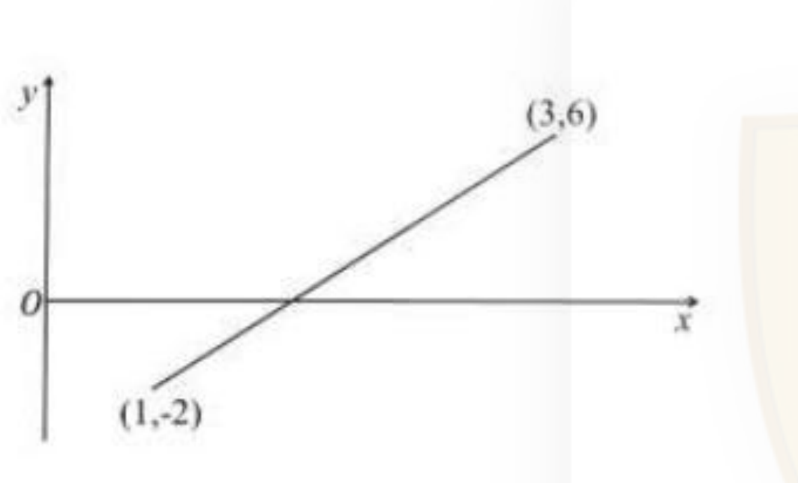
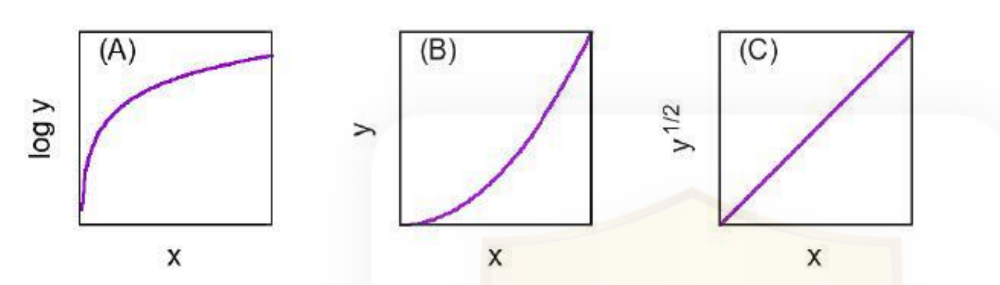
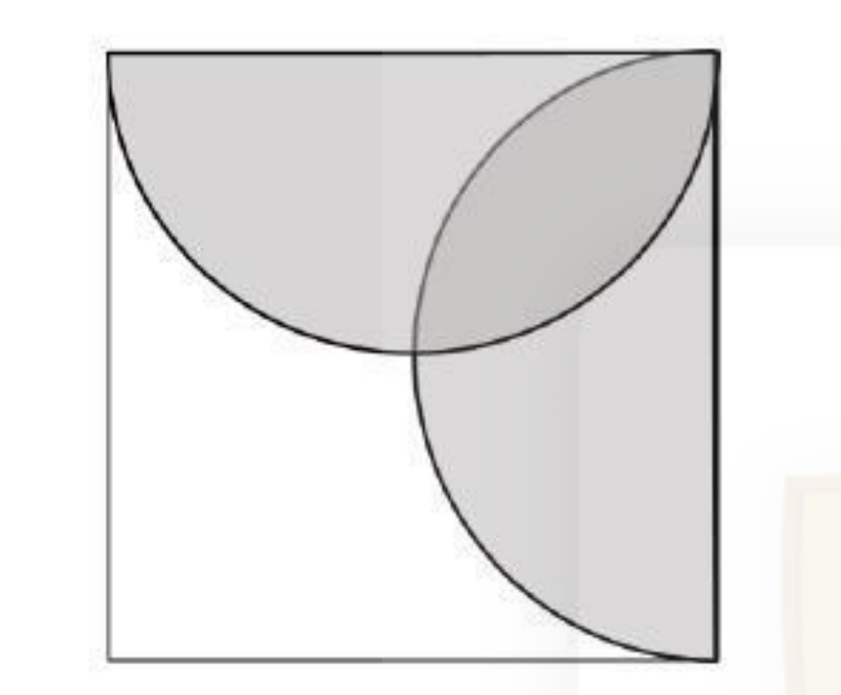
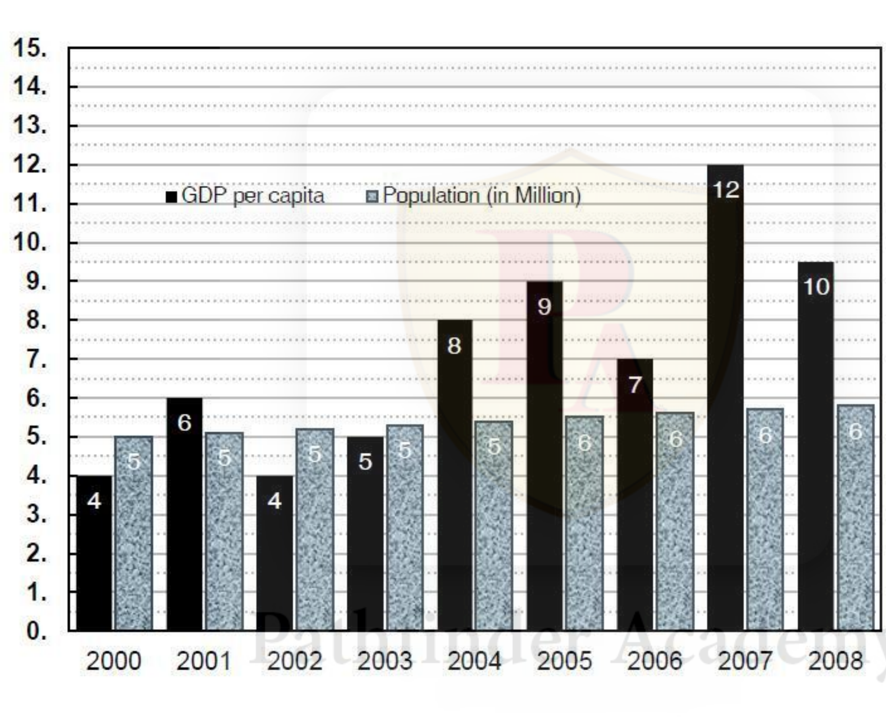
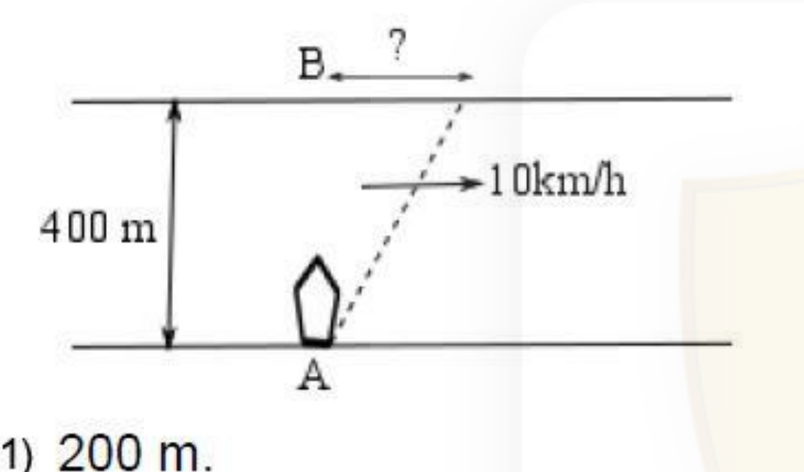

# CSIR NET Life Science — June 2020 session (conducted 21 November 2020, Shift 1)
# Part A (General Aptitude) — Questions 1–20

*Attempt any 15 questions. 2 marks each.*

---

### Question 1

Suppose a² + b² =4(a +3b-10), where a and b are two real numbers. Then which of the following is true?

1. a > b
2. a < b
3. a = b
4. From the above equation nothing can be said about the relationship between a and b.

**Answer: 2 (a < b)**

> **Explanation:** Rearranging, a² − 4a + b² − 12b + 40 = 0, i.e. (a − 2)² + (b − 6)² = 0. A sum of two squares is zero only when each is zero, so a = 2 and b = 6. Hence a < b.

---

### Question 2

If the day after tomorrow is NOT Friday then which of the following day CANNOT be the day before the day before yesterday?

1. Sunday
2. Monday
3. Tuesday
4. Wednesday

**Answer: 1 (Sunday)**

> **Explanation:** Let today be T. "The day after tomorrow" is T + 2, which is not Friday, so T is not Wednesday. "The day before the day before yesterday" is T − 3. If T were Wednesday, T − 3 would be Sunday; since T cannot be Wednesday, T − 3 cannot be **Sunday**.

---

### Question 3

Which of the following words can be formed using only the letters of the word "FLOCCINAUCINIHILIPILIFICATION"? When forming a word you can use a letter at most as many times as it appears in the above word.

1. PHILIPPINES
2. CHINCHILLA
3. CINCINNATI
4. NATIONALITY

**Answer: 3 (CINCINNATI)**

> **Explanation:** Counting the source word FLOCCINAUCINIHILIPILIFICATION: N appears 3 times, C 3 times, I 8 times, A 2 times, T 1 time, so CINCINNATI (C2 I3 N3 A1 T1) is formable. PHILIPPINES needs S (absent); CHINCHILLA needs H2 and L2 but only H1 is present; NATIONALITY needs O1 A2 T2 L1 I2 N2 — T appears only once, so it fails.

---

### Question 4

A box contains 10 red balls and 12 white balls. Two balls are drawn from the box at random, one by one without replacement. What is the probability that the second ball is red?

1. 1/2
2. 5/11
3. 3/10
4. 9/16

**Answer: 2 (5/11)**

> **Explanation:** By symmetry the marginal probability that the second draw is red equals the probability that the first draw is red: 10/(10+12) = 10/22 = 5/11. (Equivalently, (10/22)(9/21) + (12/22)(10/21) = 210/462 = 5/11.)

---

### Question 5

Three containers, namely cylinder, square prism and triangular prism, are given. Which one of the following conditions will ensure that they have identical volume?

1. Their base areas and heights are identical
2. Their base areas are identical
3. Their heights are identical
4. Their base areas and heights are different

**Answer: 1 (Their base areas and heights are identical)**

> **Explanation:** Every prism and a cylinder have volume = (base area) × (height). The shape of the base is irrelevant, so identical base areas together with identical heights guarantee identical volumes; neither condition alone is sufficient.

---

### Question 6

An apple is fully cut vertically through its centre 4 times such that successive cuts are spaced at 45⁰ in clockwise direction. How many pieces are made?

1. 4
2. 16
3. 8
4. 12

**Answer: 3 (8)**

> **Explanation:** Four straight cuts all passing through the same centre point, at successive angles of 45°, give 8 sectors of 45° each (0°, 45°, 90°, 135° — the four lines divide the disc into 2×4 = 8 wedges).

---

### Question 7

Bottles are to be packed in boxes. If 4 bottles are packed in a box then 3 boxes are left unused, but if 3 bottles are packed in a box then 3 bottles are left unpacked. The total number of bottles is

1. 36
2. 52
3. 40
4. 48

**Answer: 4 (48)**

> **Explanation:** With b boxes and n bottles: n = 4(b − 3) and n = 3b + 3. So 4b − 12 = 3b + 3, giving b = 15 and n = 4 × 12 = 48 (check: 3 × 15 + 3 = 48).

---

### Question 8

A tower is 50 m high. When the sun's altitude is 45⁰, the shadow of the tower is x m shorter compared to the case when the altitude is 30⁰. The value of x is

1. 50(√3 − 1)
2. 50(√3 + 1)
3. 50/(√3)
4. 50√3

**Answer: 1 (50(√3 − 1))**

> **Explanation:** Shadow length = height / tan(altitude). At 45° it is 50 m; at 30° it is 50/tan30° = 50√3 m. The difference is 50√3 − 50 = 50(√3 − 1) m.

---

### Question 9

The year BP, in the context of radiocarbon dating, is defined as

Years (BP) = 1950 – Years (AD)

An object from the Harappan site was dated to be 3050 BC. Its age in years (BP) is

1. −5000
2. −1100
3. +1100
4. +5000

**Answer: 4 (+5000)**

> **Explanation:** 3050 BC corresponds to Year −3050 AD. Therefore Years (BP) = 1950 − (−3050) = 5000.

---

### Question 10

Which of the following months in 2021 will have the same calendar (the same days and dates) as that in Sept 2020?

1. March
2. April
3. November
4. June

**Answer: 4 (June)**

> **Explanation:** A month matches if it has the same number of days and its 1st falls on the same weekday. 1 September 2020 was a Tuesday (30-day month). In 2021, 1 June was a Tuesday and June has 30 days; 1 March 2021 was a Monday, 1 April a Thursday and 1 November a Monday.

---

### Question 11

Find the value of x at which the given straight line crosses the x-axis.

1. 1.2
2. 1.5
3. 2.2
4. 1.7

**Answer: 2 (1.5)**

> **Explanation:** Slope = (6 − (−2))/(3 − 1) = 4, so y + 2 = 4(x − 1), i.e. y = 4x − 6. Setting y = 0 gives x = 6/4 = 1.5.

---

### Question 12

Five persons A, B, C, D and E form a queue. C and E are next to each other. A has one person ahead of him and has at least one person separating him from B. Which of the following statements is certainly true?

1. A and D are next to each other
2. A and E are next to each other
3. D and E are next to each other
4. B and C are next to each other

**Answer: 1 (A and D are next to each other)**

> **Explanation:** A has exactly one person ahead, so A is in position 2. B must not be adjacent to A, so B is in position 4 or 5. C and E must occupy two consecutive slots; the only consecutive pair left that avoids position 2 is (3,4) or (4,5). If B were in 4, C and E would need (1,2) or (5,·) — impossible — so B is in 5, C and E occupy 3 and 4, and position 1 is D. Thus D (position 1) and A (position 2) are certainly adjacent.

---

### Question 13

Which of the following graphs qualitatively show(s) the function y = x²?

1. B and C but not A
2. A and B but not C
3. Only B
4. A, B and C

**Answer: 4 (A, B and C)**

> **Explanation:** (B) is the parabola y = x² directly. (A): log y = 2 log x, which is monotonically increasing and concave down — the shape shown. (C): y^1/2 = x, an exact straight line through the origin. All three are consistent with y = x².

---

### Question 14

Four babies born in the month of April 2019 are randomly selected. The probability that at least two of them will have the same date of birth is,

1. 81.2%
2. 18.8%
3. 13.7%
4. 86.3%

**Answer: 2 (18.8%)**

> **Explanation:** April has 30 days. P(all four distinct) = 30·29·28·27 / 30⁴ = 657720/810000 = 0.812. Hence P(at least two share a date) = 1 − 0.812 = 0.188 = 18.8%.

---

### Question 15

A chord AB in a circle subtends an angle of 30⁰ at the circumference. Then the angle subtended at the circumference by a chord of twice the length of AB is

1. 45⁰
2. 60⁰
3. 90⁰
4. 120⁰

**Answer: 3 (90⁰)**

> **Explanation:** A chord subtending 30° at the circumference has length 2R sin 30° = R. Twice that length is 2R, i.e. a diameter, and a diameter subtends a right angle (90°) at any point on the circumference (Thales' theorem).

---

### Question 16

In a race, the winner beat the second placed by 10 m and the third placed by 100 m. The second placed beat the third placed by 91 m. Assuming that the speeds of the runners remained unchanged throughout the race, the length of the race track was

1. 1000 m
2. 900 m
3. 910 m
4. 909 m

**Answer: 3 (910 m)**

> **Explanation:** Let the track be L. When the winner finishes, second has run L−10 and third L−100, so v₂/v₃ = (L−10)/(L−100). When second finishes L, third has run L−91, so v₂/v₃ = L/(L−91). Equating: (L−10)(L−91) = L(L−100) → L² − 101L + 910 = L² − 100L → L = 910 m.

---

### Question 17

A square of side 2 units contains two half circles as shown in the figure.

The area of unshaded region inside the square is

1. 3 − π/2
2. 4 − π/2
3. 3 − π/4
4. 4 − π/4

**Answer: 1 (3 − π/2)**

> **Explanation:** The two semicircles (radius 1, area π/2 each) lie inside the square of area 4. Their union (the shaded region) has area 1 + π/2, so the unshaded area is 4 − (1 + π/2) = 3 − π/2.

---

### Question 18

The paired bar chart gives the Per Capita GDP and population of a country from year 2000 to 2008. Given that
Per Capita GDP = Total GDP/Population

The highest percentage decrease in the total GDP of the country over the previous year was in the year

1. 2002
2. 2003
3. 2006
4. 2008

**Answer: 1 (2002)**

> **Explanation:** Total GDP = per capita × population: 2000→20, 2001→30, 2002→20, 2003→25, 2004→40, 2005→54, 2006→42, 2007→72, 2008→60. The falls are 2002: (30→20) = −33.3%; 2006: (54→42) = −22.2%; 2008: (72→60) = −16.7%. The largest percentage decrease is in **2002**.

---

### Question 19

A 400 m wide river flows at 10 km/h. A man at point A wants to cross the river. In still water he can row a boat at a maximum speed of 20 km/h. Point B is exactly opposite A on the other bank. If he wants to cross the river in the least possible time then how far from B will he land on the other bank?

1. 200 m.
2. 100√3 m.
3. 0 m.
4. 50 m.

**Answer: 1 (200 m.)**

> **Explanation:** Minimum time is achieved by heading straight across (perpendicular to the bank), so crossing time = 0.4 km / 20 km/h = 0.02 h. During that time the current carries the boat downstream 10 × 0.02 = 0.2 km = 200 m from B.

---

### Question 20

In a cycle of spread of the infection, each person infects 3 more people. One third of the newly infected people take precaution and do not infect other people. No infected person dies or gets cured until the end of third cycle of the spread. Starting with one infected person, the number of people newly infected in the third cycle is

1. 12
2. 15
3. 27
4. 30

**Answer: 3 (27)**

> **Explanation:** Cycle 1: the initial case infects 3 (newly infected 3; one third, i.e. 1, stops spreading). Infectors now = 1 + 2 = 3. Cycle 2: 3 × 3 = 9 newly infected; 3 of them stop spreading, so infectors = 3 + 6 = 9. Cycle 3: 9 × 3 = **27** newly infected.
