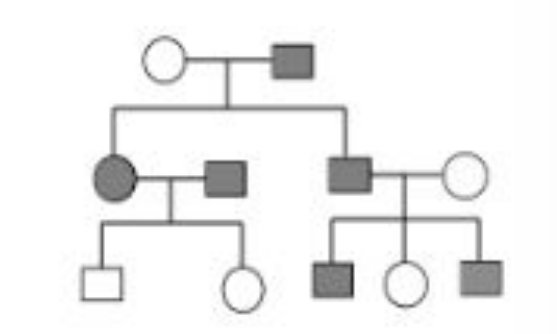
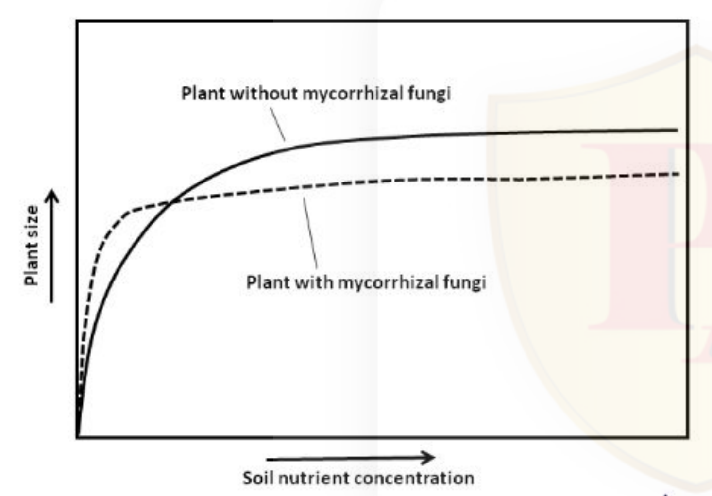
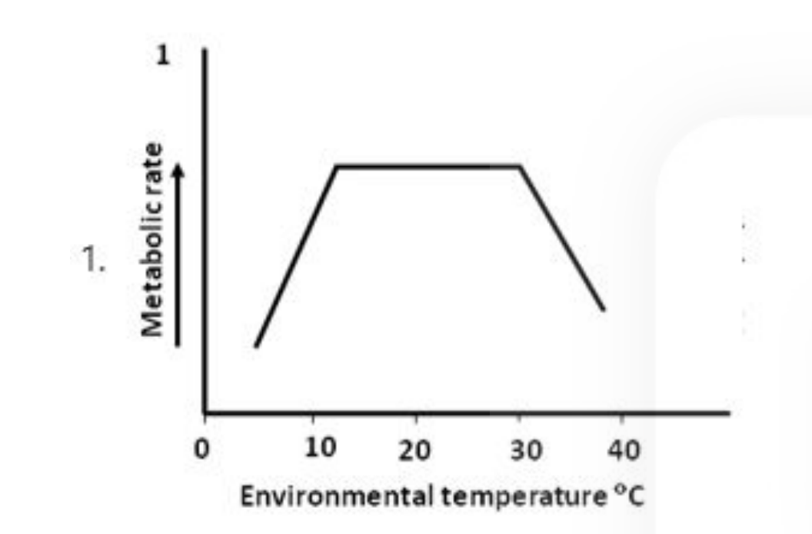
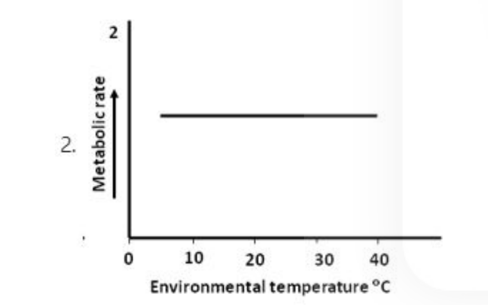
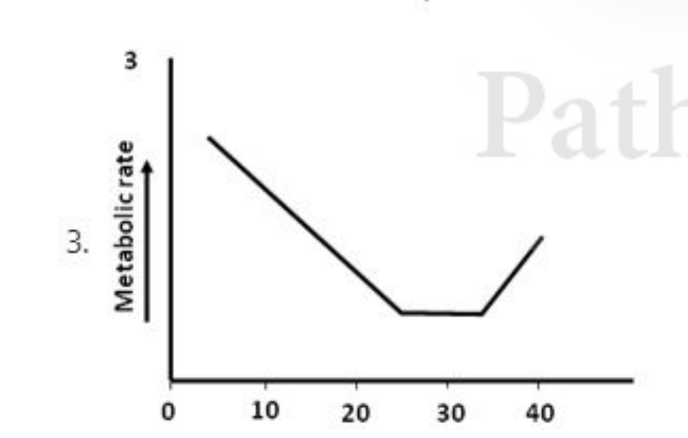
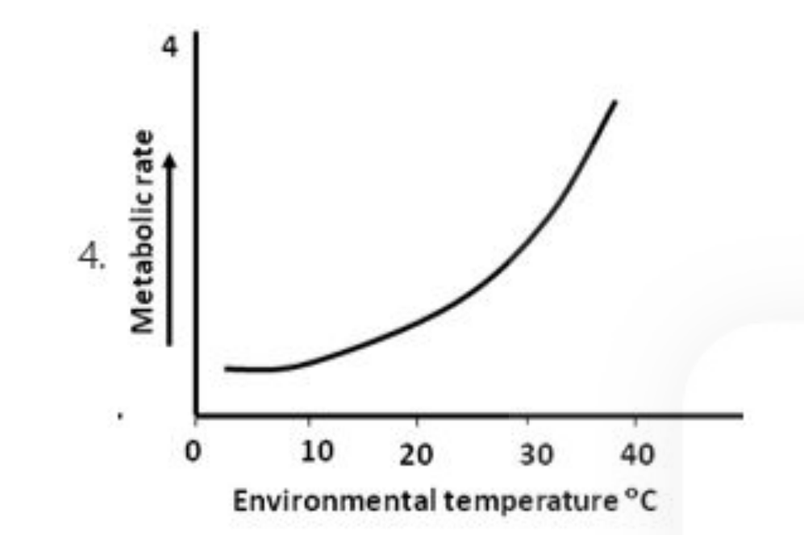

# CSIR NET Life Science — June 2020 session (conducted 21 November 2020, Shift 1)
# Part B (Life Sciences) — Questions 21–70

*Part B as printed in the paper: Number of Questions: 50; Number of Questions to be attempted: 35; Section Marks: 70. Each question carries 2 marks, with 0.5 negative marks (Correct Marks : 2 / Wrong Marks : 0.5). Question numbering below is the printed numbering Q.21–Q.70.*

*Answers are taken from the NTA **Final Answer Key** for the 21.11.2020 Shift 1 Life Sciences paper (Question IDs 8024371211–8024371260). See `sourcesB.md`. Q.70 is recorded as accepting **two** options, exactly as the key states; no Part B question in this range was dropped.*

### Question 21

Which one of the following options represent a series of the amino acids with the decreasing pka values of their side chain ?

1. Arg Lys Cys His
2. Lys Arg Cys His
3. Lys Arg His Cys
4. Arg Cys Lys His

**Answer: 1 (Arg Lys Cys His)**

> **Explanation:** Approximate side-chain pKa values are Arg ≈ 12.5, Lys ≈ 10.5, Cys ≈ 8.3 and His ≈ 6.0. Taken in that order the values fall monotonically (12.5 → 10.5 → 8.3 → 6.0), so only the series Arg, Lys, Cys, His is a correctly *decreasing* one; the other options place Lys or His ahead of a higher-pKa residue.

---

### Question 22

The mechanism of oxygen transport by hemocyanin (containing Cu) is described by Cu1+· Cu1+ + O2 ⇌ Cu2+· O22-· Cu2+ Which one of the following techniques can be used to monitor the change in the oxidation state of copper?

1. Mass spectrometry
2. Circular dichrosim
3. Absorption spectroscopy
4. Fluorescence spectroscopy

**Answer: 3 (Absorption spectroscopy)**

> **Explanation:** Oxygenation converts Cu(I) to Cu(II), and the two oxidation states have different ligand-to-metal / d-d absorption bands in the visible–UV region, so UV-Vis absorption spectroscopy directly reports the oxidation state (the oxy-form of hemocyanin has its characteristic ~340 nm band). Mass spectrometry measures mass, not oxidation state; circular dichroism reports secondary structure; Cu(I)/Cu(II) are not conveniently followed by fluorescence here.

---

### Question 23

A stoichiometric mixture of a and B anomers of D-glucose in water exhibits

1. net optical rotation proportional to the sum of the optical activities of each anomer
2. no optical activity as the sign of optical rotation are opposite and they cancel each other
3. no optical activity as the a and {3 anomers in the linear forms that are optically inactive
4. no optical activity as they form a racemic mixtire

**Answer: 1 (net optical rotation proportional to the sum of the optical activities of each anomer)**

> **Explanation:** α- and β-D-glucopyranose are both D-sugars and both dextrorotatory ([α]D ≈ +112° and +19°); they are diastereomers, not enantiomers. Optical rotation of a mixture of chiral, non-interconverting-under-measurement species is additive, so a 1:1 mixture still rotates plane-polarised light. Cancellation to zero requires a racemic (enantiomer) pair, which this is not — hence options 2–4 are wrong.

---

### Question 24

The rate constat for conversion of a substrate into the product is 10-4 s-1 while the reverse rate constant is 10-6 s-1. An enzyme enhance the rate of this reaction by 100-fold. The equilibrium constant for this enzyme-catalyzed reaction is

1. 100
2. 10000
3. 10
4. 1000

**Answer: 1 (100)**

> **Explanation:** Keq = k_forward / k_reverse = 10⁻⁴ / 10⁻⁶ = 100. A catalyst accelerates the forward and reverse rates by the same factor, so it changes only the time to reach equilibrium, not the equilibrium constant; the 100-fold rate enhancement leaves Keq at 100.

---

### Question 25

Which one of the following is NOT involved in the formation of lipid rafts?

1. Sphingomyelin
2. Cholesterol
3. Glycolipid
4. Phosphatidylserine

**Answer: 4 (Phosphatidylserine)**

> **Explanation:** Lipid rafts are ordered membrane microdomains built around sphingolipids (sphingomyelin, glycosphingolipids) with cholesterol filling the spaces between their long saturated acyl chains. Phosphatidylserine is a glycerophospholipid of the inner leaflet with unsaturated chains and is not a raft-forming component (its main distinction is as the "eat me" signal for scramblase exposure in apoptosis).

---

### Question 26

Which one of the following statements about human LINEs (long interspersed nuclear elements) is FALSE?

1. LINEs are located primarily in euchromatic regions
2. LINEs cannot encode all the product needed for their retrotransposition, and are dependent on SINEs for some somponents
3. Of the three human LINE families, LINE-1 is the only family to have actively transposing members.
4. Active LINE-1 elements possess an internal promoter located within the 5' untranslated region.

**Answer: 2 (LINEs cannot encode all the product needed for their retrotransposition, and are dependent on SINEs for some somponents)**

> **Explanation:** The dependence runs the other way: autonomous LINE-1 elements encode the ORF1p RNA-binding protein and ORF2p endonuclease/reverse transcriptase and transpose on their own, and it is the non-autonomous SINEs (e.g. Alu) that *hijack the LINE-1 machinery* for their retrotransposition. Options 1, 3 and 4 are true statements — LINEs are euchromatin-enriched, L1 is the only active human LINE family, and the L1 promoter is internal, within its 5′ UTR.

---

### Question 27

Myosin molecules that assemble into bipolar filaments in the muscle are

1. Myosin I
2. Myosin II
3. Myosin III
4. Myosin VI

**Answer: 2 (Myosin II)**

> **Explanation:** Conventional myosin (myosin II) has a long coiled-coil heavy-chain tail that drives assembly into the bipolar (two-headed, bare-zone) thick filaments of muscle. Monomeric/unconventional classes do not form these filaments: myosin I is monomeric with a short tail, myosin VI is a minus-end-directed monomer, and myosin III is a sensory, kinase-containing myosin found in photoreceptors.

---

### Question 28

Which of the following statements about R banding chromosomes is FALSE?

1. The heat treatment preferentially denature the GC rich DNA to produce R-banding pattern.
2. This is essentially the reserve of the G-banding pattern.
3. The R bands are Q (quinacrine) negative
4. The DNA of R bands generally replicate early during the S-phase of cell cycle

**Answer: 1 (The heat treatment preferentially denature the GC rich DNA to produce R-banding pattern.)**

> **Explanation:** R-banding is obtained by heat (or salt) treatment that denatures the **AT-rich** DNA, so the GC-rich regions retain the stain and appear light — the inverse of G-banding, where trypsin digest favours AT-rich staining. Statements 2, 3 and 4 are correct: the pattern is complementary to G-banding, R bands do not fluoresce with quinacrine (which is AT/Q-band specific), and R bands are GC-rich, gene-rich and replicate early in S phase.

---

### Question 29

Which one of the snRNAs given below base pairs with 5 splice site of pre mRNA?

1. U1
2. U2
3. U4
4. U5

**Answer: 1 (U1)**

> **Explanation:** U1 snRNA base-pairs directly with the 5′ splice-site consensus (GUAGUA) to define the exon–intron boundary, while U2 pairs with the branch-point adenosine. U4 and U5 act later in the catalytic core (U4 sequesters U6, U5 contacts exon/intron nucleotides at the splice site junction), so the pairing with the 5′ splice site itself is U1's.

---

### Question 30

Which one of the following RNAs possesses the peptidyltransferase activity ?

1. tRNA
2. 5S rRNA
3. 16S rRNA
4. 23S rRNA

**Answer: 4 (23S rRNA)**

> **Explanation:** Peptidyl transferase is a ribozyme activity located in the large subunit: 23S rRNA of the bacterial 50S subunit (28S in eukaryotic 60S) forms the active site and catalyses peptide-bond formation, with no protein participating in catalysis. 16S rRNA functions in decoding/small subunit, 5S rRNA is a structural ribosomal RNA, and tRNA is the substrate carrying the amino acid.

---

### Question 31

Which one of the following statements about GAL gene expression is FALSE?

1. GAL4 is a positive regulator of GAL genes
2. The UAS region that regulates the GAL gene expression harborsshort, phased AT repeats every 10 base pairs
3. GAL80 is a positive regulator of GAL4
4. GAL80 is negatively regulated by GAL3

**Answer: 3 (GAL80 is a positive regulator of GAL4)**

> **Explanation:** GAL80 is a **negative** regulator: it binds the activation domain of GAL4 and represses transcription of the GAL genes in the absence of galactose. When galactose is present, GAL3 (with ATP) binds GAL80 and draws it out of the nucleus, relieving repression. GAL4 is a positive regulator binding the UAS_G, and the UAS is wrapped in short, phased nucleosomes with ~10-bp AT repeats, so options 1, 2 and 4 are true.

---

### Question 32

UV-induced DNA damage causes advancing replication forks to stall. To avoid a collapse of these stalled replication forks the cell uses:

1. non-homologous end joining
2. lesion bypass
3. mismatch repair
4. base excision repair

**Answer: 2 (lesion bypass)**

> **Explanation:** UV photoproducts block the replicative polymerase, stalling the fork. Forks are protected and completed by damage/tolerance-bypass pathways — repriming and translesion (polymerase η/ζ) synthesis, i.e. lesion bypass, together with sister-chromatid-based template switching. Non-homologous end joining acts on double-strand breaks (it cannot rescue a stalled fork and would create the collapse it is meant to prevent), mismatch repair fixes base–base mispairs, and base excision repair acts on small unmodified bases, not on blocking UV lesions ahead of an advancing fork.

---

### Question 33

Which one of the following amino acids is characteristics of and is conserved in response regulator of plant two component systems?

1. Aspartic acid
2. Glutamic acid
3. Tyrosine
4. Histidine

**Answer: 1 (Aspartic acid)**

> **Explanation:** In two-component systems the sensor histidine kinase autophosphorylates on a His residue, but the phosphoryl group is transferred to a conserved **aspartate** in the receiver (response-regulator) domain — the aspartyl-phosphate is the activated form that drives the output response. So the residue characteristic of and conserved in the *response regulator* is Asp; His belongs to the kinase. (Note: the plant endogenous cytokinin receptor is a hybrid His-Asp protein, but the conserved phospho-acceptor of response regulators is aspartate.)

---

### Question 34

Which one of the following signaling molecules is NOT a protein or a peptide?

1. Transforming growth factor a (TGF-a)
2. Erythropoietin
3. Granulocyte colony stimulating factor
4. Epinephrine

**Answer: 4 (Epinephrine)**

> **Explanation:** Epinephrine (adrenaline) is a catecholamine derived from tyrosine — a small molecule, not a protein or peptide. TGF-α is a peptide growth factor, erythropoietin is a glycoprotein hormone, and granulocyte colony-stimulating factor (G-CSF) is a protein cytokine.

---

### Question 35

Which one of the following is NOT an extracellular matrix protein?

1. Keratin
2. Laminin
3. Collagen
4. Vitronecti n

**Answer: 1 (Keratin)**

> **Explanation:** Keratin is an **intracellular** intermediate-filament protein of epithelial cells, so it is not part of the extracellular matrix. Laminin is a basement-membrane network glycoprotein, collagen is the dominant ECM structural protein, and vitronectin is an ECM/plasma adhesion glycoprotein that binds integrins.

---

### Question 36

If you require to generateanergy in T cells, which of the following conditions will you use?

1. Stimulate naive T cells with antibodies that bind both T cell receptor and CD28
2. Stimulate naive T cells with antibodies that bind only the T cell receptor
3. Stimulate naive T cells with antibodies that bind both T cell receptor and CD28 in presence of IL-4
4. Permit naive T cell interactions with activated macrophages in presence of IL-4

**Answer: 2 (Stimulate naive T cells with antibodies that bind only the T cell receptor)**

> **Explanation:** Anergy is the functional inactivation produced when a T cell receives signal 1 (TCR engagement) without the co-stimulatory signal 2 (CD28–B7). Antibodies that engage only the TCR therefore deliver an unco-stimulated signal and induce anergy, whereas simultaneous CD28 cross-linking (options 1 and 3) provides co-stimulation and gives activation. Option 4 is likewise activating, since activated macrophages express B7.

---

### Question 37

In echinoderms sperm direction is provided by

1. Calcineuric
2. Bindin
3. Resact
4. EBR1

**Answer: 3 (Resact)**

> **Explanation:** Resact is the small sulfated tripeptide released from egg jelly of *Arbacia* that acts as a chemotactic factor, directing (and activating) sperm toward the egg. Bindin is the acrosomal protein that mediates *species-specific attachment* of the sperm to the egg surface, EBR1 is the egg bindin receptor, and calcineurin is a phosphatase, not an attractant.

---

### Question 38

If an early cleavage stage wild type Drosophila embryo is injected with bicoid mRNA at the posterior pole then

1. head structures develop at posterior pole, while the same is inhibited at anterior pole
2. head structures form at both poles
3. head structures are not formed at posterior pole due to presence of posterior morphogens
4. duplication of usual posterior structures occurs

**Answer: 2 (head structures form at both poles)**

> **Explanation:** bicoid mRNA is the anterior morphogen; translating it at the posterior pole creates a second Bicoid protein source and therefore a second anterior organising centre. The result is the classic bicoid experiment phenotype: mirror-image anterior (head) structures develop at the posterior end as well, giving a two-headed ("cephalocephalic") embryo. Posterior structures are suppressed rather than duplicated, so option 4 is wrong, and option 1 wrongly claims the anterior pole is inhibited.

---

### Question 39

If the blastomeres of a 4 celled sea urchin embryo are isolated each blastomere can form a pluteus larvae. This is example of

1. Autonomous specification
2. Conditional specification
3. Determination
4. Mosaic development

**Answer: 2 (Conditional specification)**

> **Explanation:** Sea urchin development is regulative: the fate of each blastomere depends on interactions with its neighbours, so isolated blastomeres adjust to each other's absence and each produces a complete (if smaller) pluteus larva — the hallmark of conditional (regulative) specification. Autonomous specification and mosaic development are the opposite case, in which isolated cells yield only the structures they were intrinsically assigned (as in tunicates), and determination refers to irreversible commitment, which these totipotent blastomeres have not yet undergone.

---

### Question 40

Which one of the following plant homeotic genes does NOT encode MADSdomain transcription factor involved in floral organ specification?

1. AP2
2. AP1
3. AP3/P1
4. AG

**Answer: 1 (AP2)**

> **Explanation:** APETALA2 is an AP2/ERF-family transcription factor carrying AP2 DNA-binding repeats, not a MADS-box gene. The other three are the classic MADS-domain floral homeotic genes: AP1 (A-class), AP3/PISTILLATA (B-class, both MADS), and AGAMOUS (C-class), which together with the E-class SEPALLATA genes form the quartet model of organ identity.

---

### Question 41

Which of the following is a plant secondary metabolite?

1. Kaurenoic acid
2. Abietic acid
3. Proline
4. Pyruvate

**Answer: 2 (Abietic acid)**

> **Explanation:** Abietic acid is a resin-acid diterpenoid of conifer oleoresin — a classical terpenoid secondary metabolite with no central role in growth or core metabolism. Proline (an amino acid) and pyruvate (a glycolytic end-product) are primary metabolites. Kaurenoic acid is an ent-kaurene-derived intermediate on the gibberellin (hormone) biosynthetic pathway, i.e. part of primary/developmental metabolism, which is why the key treats it as the non-secondary option here.

---

### Question 42

Which one of the following metabolites formed during Calvin-Benson cycle in chloroplast is involved in starch biosynthesis and can also be transported to cytosol?

1. Triose phosphate
2. Glyceraldehyde=3 phosphate
3. Fructose-6-phosphate
4. Ribulose 1,5-bisphosphate

**Answer: 1 (Triose phosphate)**

> **Explanation:** The triose phosphates (DHAP/G3P, exported as such) are the Calvin-cycle products that feed both fates: in the chloroplast they are withdrawn to make ADP-glucose and starch, and they are exported across the inner envelope membrane by the triose-phosphate/phosphate antiporter to the cytosol for sucrose synthesis. Fructose-6-phosphate is formed *from* triose phosphate (aldolase) and RuBP is the CO2 acceptor regenerated in the cycle rather than the exported product.

---

### Question 43

Which one of the following essential plant mineral nutrients complexes with manitol, mannan, polymannuronic acid, and other constituents of cell wall?

1. Silicon
2. Chlorine
3. Manganese
4. Boron

**Answer: 4 (Boron)**

> **Explanation:** Boron functions as boric acid, which forms stable cis-diol esters with polyols such as mannitol, and with mannans and polymannuronic (pectic) acids of the cell wall; the resulting borate diester cross-links contribute to wall structure and to membrane/cell-wall integrity — which is why boron deficiency causes malformed, thickened walls and "boron-resistant" mutants with altered mannitol metabolism. Silicon is deposited as phytolith silica, chlorine is the osmotic/anion companion of K+ and evolves in photolysis, and manganese is the water-splitting cluster metal.

---

### Question 44

Which one of the following plant proteins is targeted by HC-toxin produced by the maize fungal pathogen Cachliobolus carbonum?

1. H+ ATPase
2. Histone deacetylase
3. ACC oxidase
4. MTA nucleosidase

**Answer: 2 (Histone deacetylase)**

> **Explanation:** HC-toxin is a cyclic tetrapeptide that is metabolised in plant cells to an inhibitor of histone deacetylase (HDAC/RPD3-like enzymes). HDAC blockade keeps defense-gene chromatin hyperacetylated and changes host gene expression, and resistance in maize maps to the HC-toxin detoxifying enzyme HC-toxin reductase. ACC oxidase is the ethylene-forming enzyme, MTA nucleosidase is a cytokinin-degradation enzyme, and the plasma-membrane H+-ATPase is targeted by other toxins (e.g. fusicoccin), not HC-toxin.

---

### Question 45

Which one of the following causes constriction of blood vessels?

1. Carbon monoxide
2. Nitric oxide
3. Endothelin - 1
4. Atrial natriuretic peptide

**Answer: 3 (Endothelin - 1)**

> **Explanation:** Endothelin-1, released by vascular endothelium, acts on ET_A receptors on smooth muscle and is the most potent endogenous vasoconstrictor known. Nitric oxide and carbon monoxide are both vasodilators acting through cGMP (CO mimics NO here), and atrial natriuretic peptide also relaxes vascular smooth muscle while promoting natriuresis.

---

### Question 46

Which one is NOT the function of P-cells in the collecting ducts?

1. Na+ reabsorption
2. K+ secretion
3. H20 reabsorption
4. H+ secretion

**Answer: 4 (H+ secretion)**

> **Explanation:** Principal cells of the collecting duct reabsorb Na+ through ENaC (generating the lumen-negative potential), secrete K+ through ROMK, and reabsorb water when ADH inserts aquaporin-2 — all three are P-cell functions. Acid secretion (H+-ATPase / H+,K+-ATPase in the apical membrane) belongs to the type A intercalated cell, a different cell type in the same duct.

---

### Question 47

Which one of the following is NOT produced by a-amylase digestion of ingested amylopectins?

1. Glucose
2. Maltose
3. Maltotriose
4. a-limit dextrins

**Answer: 1 (Glucose)**

> **Explanation:** α-Amylase is an endo-amylase that hydrolyses internal α-1,4 bonds, yielding the disaccharide maltose, the trisaccharide maltotriose and, because it cannot pass the α-1,6 branch points, branched α-limit dextrins. It is an exo-free glucosidase — free glucose appears only later, when brush-border maltase-glucoamylase and sucrase-isomaltase act on those products.

---

### Question 48

What kind of inheritance is indicative in the pedigree chart shown below?

1. Y - linked
2. X-linked dominant
3. X-linked recessive
4. Autosomal dominant

**Answer: 4 (Autosomal dominant)**

> **Explanation:** The keyed answer is autosomal dominant, which corresponds to the standard diagnostic pattern: the trait occurs in every generation, every affected individual has an affected parent, both sexes are affected and both transmit the trait to sons and daughters. On that reading the alternatives are excluded — Y-linked (females could not be affected), X-linked dominant (every daughter of an affected father would be affected), and X-linked recessive (affected females would be rare and mostly the daughters of affected males). *The pedigree image is a crop of the scanned page; if the source figure is hard to read, rely on the criteria above rather than on my description of individual symbols.*

---

### Question 49

Which one of the following is correct statement about the difference between a F+ cell and Hfr cell?

1. In F+ cell F factor is an integral part of bacterial chromosome, while in Hfr cell F factor is present as an episome.
2. F+ and Hfr are synonymous.
3. In F+ cell a bacteriophage carries F factor, while in Hfr cell F factor is an integral part of bacterial chromosome.
4. In F+ cell F factor is in the form of an episome while in Hfr cell, F factor is integrated into the bacterial chromosome

**Answer: 4 (In F+ cell F factor is in the form of an episome while in Hfr cell, F factor is integrated into the bacterial chromosome)**

> **Explanation:** In an F+ donor the F (fertility) plasmid exists autonomously as a circular episome, so only F DNA — and not chromosomal genes — is transferred efficiently. In an Hfr ("high frequency of recombination") strain the same element has inserted by IS-mediated recombination into the chromosome, so conjugation drags chromosomal genes into the recipient in an ordered, polarised fashion. Option 1 reverses the two states, option 2 denies the difference, and the F factor is a plasmid, not a bacteriophage (option 3).

---

### Question 50

Mutation is essential for genetic variation. Which one of the following events can lead to variation amongst the gametes produced by males of Drosophila melanogaster?[Crossing over does not occur in D.melanogaster males]

1. Segregation
2. Imprinting
3. Recombination
4. Independent Assortment.

**Answer: 4 (Independent Assortment.)**

> **Explanation:** Male *Drosophila* show no meiotic crossing-over, so option 3 is excluded by the bracketed condition. Variation among their gametes nevertheless arises because the four homologous chromosome pairs orient independently at metaphase I, so each gamete receives a random mix of maternal and paternal chromosomes (2⁴ = 16 combinations). Segregation alone only separates alleles of one locus, genomic imprinting is an epigenetic parent-of-origin effect not a source of gametic variety here.

---

### Question 51

Cytoplasmic male sterility (CMS) in plants is caused by mutation in the mitochondrial genome. CMS can be restored by a nuclear gene, restorer of fertility (Rf), which is a dominant character. If a male sterile pea plant is pollinated by a fertile male pea plant with Rf in heterozygous condition, the progeny obtained will have

1. all male sterile progeny
2. all fertile progeny
3. 50% of the progeny fertile and 50% male sterile
4. 75% of the progeny fertile and 25% male sterile

**Answer: 3 (50% of the progeny fertile and 50% male sterile)**

> **Explanation:** CMS is maternally (cytoplasmically) inherited, so every progeny of a male-sterile seed parent inherits the sterility cytoplasm. Fertility is restored only in individuals carrying the dominant nuclear restorer allele Rf. The cross is therefore cms × (Rf/rf): half the progeny are Rf/rf (restored, fertile) and half are rf/rf (no restorer, male sterile) — a 1:1 fertile : sterile ratio. A 3:1 ratio (option 4) would require heterozygotes on both parents.

---

### Question 52

Which among the following states has the highest forest cover in terms of percentage of geographical area?

1. Chattisgarh
2. Uttarakhand
3. Madhya Pradesh
4. Odisha

**Answer: 2 (Uttarakhand)**

> **Explanation:** Measured as a percentage of the state's geographical area — not absolute area — Uttarakhand leads the four by a wide margin (about 65–70% forest cover in the India State of Forest Report), because it is largely mountainous and forested. Chattisgarh and Odisha are near 30%, and while Madhya Pradesh has the largest *total* forest area among these states, it covers only about a third of its geographical area. The percentage criterion is the trap in this question.

---

### Question 53

Which of the following phytopathogens has predominantly necrotrophic mode of colonization?

1. Phytophthora infestans
2. Erwinia spp.
3. Erysiphe pisi
4. Puccinia graminis

**Answer: 2 (Erwinia spp.)**

> **Explanation:** Erwinia species are bacterial soft-rot pathogens: they macerate and kill host tissue with cell-wall-degrading pectinases and grow through the dead tissue — the necrotrophic strategy. *Erysiphe pisi* (powdery mildew) and *Puccinia graminis* (rust) are biotrophs that feed on living cells, and *Phytophthora infestans* is the classic hemibiotroph (biotrophic establishment followed by necrotrophic destruction), so the predominantly necrotrophic one listed is Erwinia.

---

### Question 54

Which one of the following approaches is INCORRECT in classifying organisms from kingdom Animalia?

1. Spicules were used as a primary criterion for the classification of phylum Porifera
2. Protostomes were classified into two major lineages: Lophotrochozoans and Ecdysozoans
3. Hemichordates were placed in same superclass as Echinoderms because both have ciliated larvae
4. Ambulacrians included Echinoderms and Hemichordates

**Answer: 3 (Hemichordates were placed in same superclass as Echinoderms because both have ciliated larvae)**

> **Explanation:** The traditional grouping of hemichordates with echinoderms (as Ambulacraria/coelomate "superclass") rests on shared deuterostome characters — enterocoely, a water-vascular-like system and the tornopleula-like larval body plan — not on the mere presence of ciliated larvae, which are widespread among lophotrochozoans (trochophore) too and cannot justify a deuterostome grouping. The other statements are standard: sponge classes are built on spicule composition, and molecular systematics splits protostomes into Lophotrochozoa and Ecdysozoa.

---

### Question 55

In a population showing exponential growth, per capita growth rate will:

1. decrease as population size increases
2. increase as population size increases
3. remain constant as population size increases
4. increase initially and then saturate at large population sizes

**Answer: 3 (remain constant as population size increases)**

> **Explanation:** For exponential growth dN/dt = rN, so the *per capita* rate (1/N)(dN/dt) = r is independent of N: as the population grows, total growth accelerates but each individual's contribution stays the same. Declining per capita growth with N (options 1 and 4) is the definition of density-dependent, logistic growth.

---

### Question 56

Mycorrhizal fungi are associated with a large variety of plant species. The diagram below shows the cost -benefit curves from individual plants with or without mycorrhizal fungi associated with the roots across a soil nutrient concentration gradient.

Which one of the following options best describesthe association between the plant and mycorrhiza when soil nutrient concentrations are high?

1. Parasitism
2. Mutualism
3. Competition
4. Commensalism

**Answer: 1 (Parasitism)**

> **Explanation:** The cost–benefit curves in the figure are the classic mycorrhizal trade-off: at low soil nutrient concentration the fungus raises plant growth well above the non-mycorrhizal line (net benefit = mutualism), while at high soil nutrient concentration the plant can obtain nutrients by its own roots, so the benefit of colonisation falls to zero even though the plant continues to pay carbon to the fungus — the host's net balance becomes negative. An interaction in which one partner gains while the other is harmed is, by definition, parasitic. Competition is incorrect because it describes two organisms exploiting the same limited resource, and commensalism is incorrect because it requires a net effect of zero on the host, which the curve contradicts.

---

### Question 57

Which one of the following represents the largest outflux of nitrogen from the atmospheric reservoir?

1. Biological nitrogen fixation
2. Nitrogen fixation due to lightning
3. Fixation on account of fossil fuel burning
4. Fixation by Haber's process for fertilizer production

**Answer: 1 (Biological nitrogen fixation)**

> **Explanation:** Of the routes by which atmospheric N2 leaves the atmosphere as fixed nitrogen, microbial/diazotrophic biological fixation is the largest globally (on the order of 100–200 Tg N yr⁻¹), exceeding industrial Haber–Bosch fixation (~100–120 Tg), combustion-derived fixation and lightning (~5–10 Tg). This is the standard textbook ordering of the nitrogen cycle fluxes.

---

### Question 58

Identify the plot that depicts the change in metabolic rate of an endotherm with respect to change in environmental temperature .

1. 1
2. 2
3. 3
4. 4

**Answer: 3 (3)**

> **Explanation:** An endotherm in a temperature chamber shows a characteristic metabolic response to ambient temperature: metabolic rate is at its minimum and essentially flat across the thermoneutral zone, rises steeply below the lower critical temperature as thermogenesis increases, and rises again above the upper critical limit. The panel numbered **3** in the printed set is the one carrying that pattern, per the NTA key. The four candidate graphs are reproduced as cropped images above; identify the curve from the images themselves — I could not inspect the rendered figures in this run, so no shape is described for any individual panel here.

---

### Question 59

The following statements describe the outcomes of genetic drift: A. Genetic drift can eliminate alleles. B. Genetic drift can be associated with population bottleneck. C. Genetic drift is not observed in populations that increase in size, once they grow through a bottleneck. D. Genetic drift can be associated with founder effect. Which one of the following combinations represents all correct statements?

1. A, Band C
2. B, C and D
3. A, Band D
4. A, C and D

**Answer: 3 (A, Band D)**

> **Explanation:** Drift is allele-frequency change by sampling error, which is strongest in small populations: it can fix or eliminate alleles (A), and it is precisely the process operating during bottlenecks (B) and founder events (D). Statement C is false — after a bottleneck, a population that grows still carries the drifted frequencies produced during it, and drift continues to act at all times (only its strength is a function of effective size), so "not observed" is wrong. Hence the set of correct statements is A, B and D.

---

### Question 60

Examples of antibiotic resistance highlight important features of natural selection. Which of the following statements is NOT true?

1. Evolution by natural selection is progressive, it makes individuals 'better'.
2. Natural selection acts on individuals but it is populations that change with time.
3. Natural selection does not cause genetic changes in individuals
4. Natural selection acts on phenotype

**Answer: 1 (Evolution by natural selection is progressive, it makes individuals 'better'.)**

> **Explanation:** Natural selection has no direction of "progress": it favours whatever variant has higher fitness in a particular environment at a particular time, and resistant bacteria illustrate this by paying fitness costs in antibiotic-free environments (reversion when selection is removed). The other statements are the standard, correct description — selection is imposed on the phenotype of individuals, individuals do not evolve genetically, and the population's allele frequencies change across generations.

---

### Question 61

Which one of the following genomes is most appropriate to determine hybrids in plants and animals?

1. Nuclear
2. Mitochondrial
3. Chloroplast
4. Mitochondria and chloroplast

**Answer: 1 (Nuclear)**

> **Explanation:** Hybridity is a property of the combined parental genomes, so only nuclear markers (isozymes, microsatellites, SNPs, allozymes) can reveal the mixture of alleles, heterozygosity, and additive/intermediate genotypes that define a hybrid. Organellar genomes are useful for the *direction* of the cross because they are usually uniparentally inherited — mitochondrial DNA tracks the maternal line and chloroplast DNA the maternal line in most plants — and in animals a purely mitochondrial survey cannot detect a hybrid at all if its mtDNA simply matches one species.

---

### Question 62

The common cuckoo, a parasitic bird, lays eggs in the nests of other bird species. Soon after the cuckoo egg hatches, the chick shoves the nest owners' eggs out of the nest. This is an example of:

1. habituation
2. imprinting
3. innate behaviour
4. operant conditioning

**Answer: 3 (innate behaviour)**

> **Explanation:** Egg-shoving by a newly hatched, eyeless cuckoo chick is performed correctly with no practice, no teaching and no sensory experience to learn from — a fixed action pattern under genetic control, i.e. innate behaviour (Tinbergen's classic study of it as a stereotyped, motivation-dependent motor pattern). Habituation and imprinting both require prior experience during a sensitive/learning period, and operant conditioning requires reinforcement of a learned response, none of which applies to this first-day behaviour.

---

### Question 63

Which one of the following approaches/markers would be typically used for discovering polymorphism between two closely related accessions of a crop plant?

1. AFLP
2. GBS
3. SSR
4. RAPD

**Answer: 2 (GBS)**

> **Explanation:** Genotyping-by-sequencing (GBS, restriction-site-associated RRL digestion with barcoded next-generation sequencing) discovers polymorphism de novo, without prior sequence knowledge, by directly reading thousands of SNPs — which is what "discovering" polymorphism between two *closely related* accessions requires, since their few differences are invisible to the marker systems of the other options. AFLP, RAPD and SSR are dominant/length-based or pre-developed marker systems: they score many fragments but detect mainly presence/absence of restriction sites or repeat-length variation, so they poorly resolve near-identical accessions and cannot reveal new sequence-level polymorphisms.

---

### Question 64

Given below are a few approaches/techniques used in the analysis of plants: A. Phenotype linked to the marker gene. B. PCR using primers specific to the host genome. C. Southern hybridization D. PCR using transgene-specific primers. Which one of the following combination of approaches/ techniques can be used to differentiate between transgenic and nontransgenic plants of a particular variety if the site of insertion is unknown?

1. B and C only
2. A and D only
3. A, C and D
4. A, B and C

**Answer: 3 (A, C and D)**

> **Explanation:** When the insertion site is unknown one can still identify transformants by (A) scoring the selectable/visual marker phenotype, (C) Southern hybridisation with a transgene probe, which detects the transgene regardless of where it integrated (and also reports copy number), and (D) PCR with primers internal to the transgene, which is site-independent. Host-genome-specific PCR (B) is the method that fails here: transgene-flanking ("site-specific") PCR needs to know the integration junctions, and ordinary host-locus primers amplify identically in transgenic and non-transgenic tissue, so it cannot discriminate.

---

### Question 65

In the context of plant breeding and genetic engineering, which one of the following statements is correct?

1. To achieve high expression level of a heterologous gene in a transgenic plant a promoter of bacterial origin is often used.
2. F1 progeny derived by crosses between inbred lines with low genetic diversity is more likely to show heterosis.
3. In Agrobacterium mediated plant transformation, always a single copy of the transgene is inserted in the host genome.
4. Qualitative traits are typically characterized by discontinuous phenotypic variation while quantitative traits often generate continuous phenotypic variation

**Answer: 4 (Qualitative traits are typically characterized by discontinuous phenotypic variation while quantitative traits often generate continuous phenotypic variation)**

> **Explanation:** The statement is the standard definition: qualitative (monogenic) traits segregate in discrete categories while quantitative traits are continuous and polygenic/environmentally influenced. The others fail as written — high-level expression in plants uses plant promoters (CaMV 35S, ubiquitin/actin promoters), not bacterial ones; heterosis requires genetically *diverse* inbred parents, not low diversity; and *Agrobacterium* transformation yields variable transgene copy number (often multiple or rearranged inserts), never "always a single copy".

---

### Question 66

The total number of cells in 1 ml of a bacterial culture was estimated to be 2.7 x 106. The culture was diluted 27-fold and 100 μI seeded per well of a 96-well plate.What is the final cell number per well?

1. 1 X 105
2. 2.7 X 104
3. 2.7 X 105
4. 1 X 104

**Answer: 4 (1 X 104)**

> **Explanation:** After a 27-fold dilution the concentration is 2.7 × 10⁶ / 27 = 1.0 × 10⁵ cells mL⁻¹. Seeding 100 µL = 0.1 mL per well therefore deposits 1.0 × 10⁵ × 0.1 = 1.0 × 10⁴ cells per well. (Option 3, 2.7 × 10⁵, is the result of forgetting the dilution; option 1, 1 × 10⁵, of forgetting the plated volume.)

---

### Question 67

In a cloning experiment, a DNA molecule isolated as a Pst I fragment was inserted into the Pst I site of a cloning vector that is 3kb in length. Digestion of the CONFIRMED clones with Pst resulted in the appearance of a single band corresponding to 3kb in an agarose gel. Based on this information, what is the probable size of the cloned fragment?

1. 6 kb
2. 1.5 kb
3. 3 kb
4. 4.5 kb

**Answer: 3 (3 kb)**

> **Explanation:** Pst I reconstitutes its site at the junctions when a Pst I fragment is ligated into a Pst I site, so digesting the recombinant plasmid with Pst I releases the vector and the insert as separate fragments. Observing a *single* 3 kb band with the vector itself being 3 kb means the insert co-migrates at 3 kb (the recombinant being ~6 kb total), i.e. the cloned fragment is 3 kb. If the insert were of any other size a second band would have appeared.

---

### Question 68

Which one ofthe following statements is TRUE?

1. Nick translation cannot be used for radiolabeling DNA fragments for use in Southern hybridization
2. RACE can be used to obtain sequence information of the ends of a eDNA
3. In a 2-D gel electrophoresis for separating proteins, analytes are first separated on the basis of their size and then on the basis of their pl.
4. AFLP markers are typically used to screen heterozygotes from homozygotes

**Answer: 2 (RACE can be used to obtain sequence information of the ends of a eDNA)**

> **Explanation:** Rapid Amplification of cDNA Ends is precisely the method for obtaining the sequence of the 5′ and 3′ termini of a transcript, so it "gives sequence information of the ends" and is true. The others are each false as written: nick translation (DNase I creating nicks, then polymerase/exchange labelling) *is* a standard way to radiolabel probes for Southern blots; 2-D electrophoresis separates first by isoelectric point (IEF) and *then* by size, not the reverse; and AFLP is a dominant fingerprinting marker that is typically used for diversity/mapping, not for distinguishing heterozygotes from homozygotes.

---

### Question 69

Which one of the following proteins produces a dark blue/purple color in the presence of 5- bromo-4-chloro-3-indolyl phosphate and nitroblue tetrazolium?

1. Polynucleotide kinase
2. Alkaline phosphatase
3. beta -glucuronidase
4. beta-galactosidase

**Answer: 2 (Alkaline phosphatase)**

> **Explanation:** BCIP and NBT are the soluble substrates of the alkaline-phosphatase chromogenic system: AP hydrolyses the phosphate from BCIP, releasing an indoxyl that reduces NBT to an insoluble formazan of dark blue/purple — the basis of AP colour development in blot detection and of blue-white screening where AP activity is the reporter. β-Galactosidase uses X-gal (a galactoside substrate, no NBT), β-glucuronidase uses GUS/MUG, and polynucleotide kinase transfers γ-phosphate onto nucleic acids without producing this chromogen.

---

### Question 70

Which one of the following sets of terms is matched correctly?

1. Fluorescence microscopy: Use of dyes that absorb and emit light of the same wavelength
2. Confocal microscopy: Use of pinpoint illumination and detection apertures
3. Confocal microscopy: Use of pinpoint illumination and detection apertures
4. Gas Chromatography: Used for analysis of non-volatilized carbohydrate molecules

**Answer: 2 or 3 (Confocal microscopy: Use of pinpoint illumination and detection apertures)**

> **Explanation:** The NTA final answer key lists **both** option IDs 8024375038 and 8024375039 as correct for Question ID 8024371260 — because the printed paper carries the same correct sentence twice (options 2 and 3 are identical in this shift's typesetting). Confocal microscopy is indeed defined by point illumination plus a pinhole detection aperture that rejects out-of-focus light. Option 1 is wrong because fluorophores emit at a *longer* wavelength than they absorb (Stokes shift), and option 4 is wrong because gas chromatography requires *volatile* (or derivatised-volatile) analytes, so non-volatilised carbohydrates cannot be analysed by it.
