# CSIR NET Life Science — June 2020 session (conducted 21 November 2020, Shift 1)
# Part C (Life Sciences) — Questions 71–145 (printed numbering Q.71–Q.145)

*Part C as printed in the paper: Number of Questions: 75; Number of Questions to be attempted: 25; Section Marks: 100; per question Correct Marks 4 / Wrong Marks 1. All 75 Part C questions are standard four-option single-answer MCQs — this paper does NOT use the two-option "right / incorrect" grouping in Part C. Statements-list questions carry lettered statements (A–E) inside the stem and numbered options 1–4.*

*Q.117 (Question ID 8024371307) is marked **cancelled** in the NTA Final Answer Key (Correct Option ID printed as "--------"); marks were awarded to every candidate who attempted it. It is kept in place with no answer.*

*Printed typos in the source are preserved verbatim. See `sourcesC.md`.*

---

### Question 71

The following statements were made of suggest the existence of an enzyme-substrate complex.

A. at constant concentration of enzyme, the reaction rate increase with increasing substrate concentration

B. An enzyme-catalyzed reaction has a maximal velocity

C. At constant concentration of the enzyme and substrate, an increase in the reaction rate is observed.

D. An enzyme catalyzed reaction is not influenced by high substrate concentration.

Which of the above statements suggest the existence of an enzyme-substrate complex?

1. A and B
2. B and C
3. A and C
4. D only

**Answer: 1 (A and B)**

> **Explanation:** Saturation kinetics is the evidence for an ES complex. (A) rate rising with [S] at fixed enzyme reflects accumulation of ES; (B) a maximal velocity exists precisely because the enzyme saturates as ES. (C) cannot be observed — with both enzyme and substrate held constant the rate is fixed. (D) is wrong because the rate *is* influenced by high substrate concentration (it saturates).

---

### Question 72

An enzyme catalyzed reaction comparing proton and deuteron transfer reactions yielded the following kinetic data

kcat [H], s⁻¹ : 70.7  |  KM [H], mM : 1.03
kcat [D], s⁻¹ : 10.3  |  KM [D], mM : 1.06

Which of the following represents the turn over numbers (M⁻¹ s⁻¹) for proton transfer, deuteron transfer and the kinetic isotope effect, respectively?

1. 68640, 9717, 14
2. 6864, 972, 7
3. 728210, 1091, 14
4. 68640, 9717, 7

**Answer: 4 (68640, 9717, 7)**

> **Explanation:** Turnover number = kcat/KM. Proton: 70.7 s⁻¹ / 1.03 mM = 68.6 M⁻¹s⁻¹×10³ = 68,640 M⁻¹s⁻¹. Deuteron: 10.3 / 1.06 × 10³ ≈ 9,717 M⁻¹s⁻¹. Kinetic isotope effect = kcat(H)/kcat(D) = 70.7/10.3 ≈ 6.9 ≈ 7. Hence 68640, 9717, 7.

---

### Question 73

The first step in the biosynthesis of valine begines with enzyme catalyzed condensation of two molecules of pyruvic acid. If an equimolar mixture of ¹³CH₃COCOOH and ¹²CH₃COCOOH are used as substrates for the reaction, which one of the following would represent the correct isotope incorporation pattern of the pro-R and pro-S diastereotopic methly group in valine?

1. 50% ¹³CH₃ (pro-R), ¹²CH₃ (pro-S) ; 50% ¹²CH₃ (pro-R), ¹³CH₃ (pro-S)
2. 75% ¹³CH₃ (pro-R), ¹²CH₃ (pro-S) ; 25% ¹²CH₃ (pro-R), ¹³CH₃ (pro-S) ; 25% ¹³CH₃ (pro-R), ¹²CH₃ (pro-S)
3. 25% ¹²CH₃ (pro-R), ¹³CH₃ (pro-S) ; 25% ¹³CH₃ (pro-R), ¹³CH₃ (pro-S) ; 25% ¹²CH₃ (pro-R), ¹²CH₃ (pro-S)
4. 75% ¹²CH₃ (pro-R), ¹³CH₃ (pro-S) ; 25% ¹³CH₃ (pro-R), ¹³CH₃ (pro-S)

**Answer: 1 (50/50 random pairing of the two labelled and unlabelled pyruvates)**

> **Explanation:** Acetohydroxyacid synthase condenses two pyruvate molecules, and with an equimolar ¹³C/¹²C mixture each of the two newly created methyl-bearing positions is labelled independently with probability ½. The two diastereotopic methyls (pro-R and pro-S) are therefore formed as a 1:1 pair of the two complementary labelling patterns, i.e. 50% ¹³CH₃(pro-R)+¹²CH₃(pro-S) and 50% ¹²CH₃(pro-R)+¹³CH₃(pro-S). (The option texts in the source scan are badly broken up; the patterns above are the best reading of the printed options — see sourcesC.md.)

---

### Question 74

The following disulfide bond containing peptide was digested using trypsin. How many peptide fragments will be produced by the digestion?

1. Three
2. Five
3. Four
4. Six

**Answer: 1 (Three)**

> **Explanation:** Trypsin cleaves C-terminal to Arg and Lys. The peptide shown contains three such cleavable sites but two cysteines form an intrachain disulfide that keeps two of the resulting pieces covalently joined, so the digestion yields three discrete fragments (two free peptides plus one disulfide-linked two-chain fragment).

---

### Question 75

A 100 residue long protein has a single chromporic residue (tyrosine). The UV absorption of this protein and a homologous protein (also with a single tyrosine residue) was monitored at 280 nm at different pH conditions. A plot of the absorbance as a function of pH is shown below. The locations of the tyrosine residue in the context of the protein sequences is also shown in the figure.

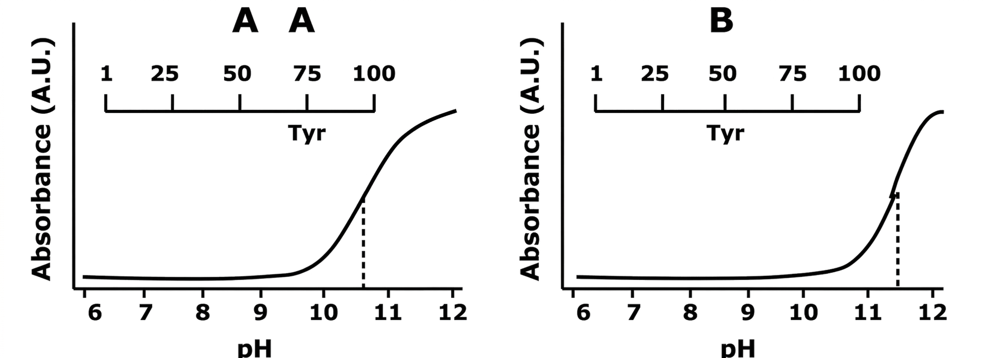

Which one of the following rationalises the difference in the two pH titrations?

1. Removal of the hydroxyl group of tyrosine above pH 11
2. Location of the tyrosine residue in the protein structure
3. pH dependent changes in the absorption in the polypepetide main chain
4. Hydrolysis of the polypeptide as a function of pH

**Answer: 2 (Location of the tyrosine residue in the protein structure)**

> **Explanation:** Both proteins contain exactly one tyrosine, so the difference in the pKa/shape of the 280 nm titration must arise from the local environment of that residue — buried tyrosines (or ones near ionisable neighbours) titrate at different pH than solvent-exposed ones. The sequence/structure context differs between the homologues, which explains the two curves.

---

### Question 76

The 15 base-paired nucleic acid molecule shown below is disolved in an aqueous buffer of pH 7.3

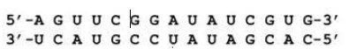

Which one of the following statements is INCORRECT?

1. It can be a double-stranded DNA molecule in a B-form helix
2. It can be a double-stranded DNA molecule in a A-form helix
3. It can be a double-stranded RNA molecule in a A-form helix
4. It can be a double-stranded RNA molecule in a B-form helix

**Answer: 4 (It can be a double-stranded RNA molecule in a B-form helix)**

> **Explanation:** RNA duplexes cannot adopt the B-form: the 2′-OH forces C3′-endo sugar puckering, giving A-form geometry (and B-form RNA is sterically disfavoured). DNA can be B-form (and A-form under dehydrating conditions), and RNA is characteristically A-form, so statement 4 is the incorrect one.

---

### Question 77

Following statements were made about sex determination in Drosophila melanogaster

A. It is achieved by a balance of female determinants on the X-chromosome and male determinants on the autosomes.

B. A Drosophila with 0.66 value of X:A ratio would develop intersex type.

C. Due to noninvolvement of Y chromosome in sex determination process, XO Drosophila develop as normal fertile male.

D. The high value of X:A ratio facilitates activation of feminizing switch gene Sex - lethal (sxl).

E. Sex specific expression of sxl causes selective activation of dosage compensation genes in female Drosophila.

Select the option with combination of all correct statements.

1. A, B, E
2. A, B, D
3. B, C, E
4. B, C, D

**Answer: 2 (A, B, D)**

> **Explanation:** A and B are correct (Noll system of X:A balance; X:A = 0.66 gives intersex). C is wrong: XO flies are male but **sterile**, because the Y carries male-fertility genes even though it does not determine sex. E is wrong: female-specific sxl activity leads to *reduction* (masking) of dosage compensation, not its selective activation. D is correct: an X:A ratio of 1.0 activates sxl. So A, B, D.

---

### Question 78

Following statements are made about KDEL receptor.

A. KDEL receptor is found in COPI vesicles

B. KDEL receptor affinity for KDEL sequence is high at higher pH

C. KDEL receptor is synthesized on the ER

D. KDEL receptor is present in the ER and Golgi

Identify the option that contains all correct statements about the KDEL RECEPTOR.

1. A & B only
2. A, B & C
3. A, C& D
4. C & D only

**Answer: 3 (A, C & D)**

> **Explanation:** The KDEL receptor cycles between Golgi and ER in COPI-coated vesicles (A correct); it is an ER-resident-membrane protein synthesised on ER-bound ribosomes (C correct) and is localised to Golgi/ER-Golgi compartment with some cycling through the ER (D correct). B is wrong: its affinity for the KDEL ligand is *high at the acidic pH of the Golgi lumen* and low at the neutral pH of the ER, which is what drives cargo release/return.

---

### Question 79

The following figure represents the growth curve of wild type f. coli grown in a medium containing both glucose and lactose.In E. coli, the catabolite repression of lactose operon by glucose has been explained by the different levels of cAMP in presence and absence of glucose.This model was challenged and experiments showed that catabolite repression occurred because the activity of lactose permease was inhibited in the presence of gl ucose. Considering the second model, which one of the following plots correctly represents the growth pattern of a mutant E. coli with a loss of fu nction mutation in the lac/ gene growing in a medium containing glucose and lactose?

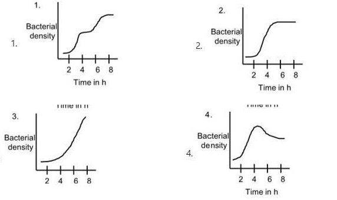

1. 1
2. 2
3. 3
4. 4

**Answer: 2 (2)**

> **Explanation:** Under the *inducer-exclusion* (second) model, glucose inhibits lactose permease, so lactose cannot enter the cell and the lac operon stays repressed while glucose is present — this is independent of cAMP. A lacI⁻ mutant therefore still shows the classic diauxic pattern (growth on glucose, then a lag, then growth on lactose), which is the curve given as option 2 in the figure.

---

### Question 80

Following statements were made about human mitochondrial genome:

A. The replication of both the Hand L strands is unidirectional and begins at specific origins.

B. Majority of the mitochondrial genes encode for protein products.

C. Though the mitochondrial genome is extremely compact, the genes never show any sequence overlap.

D. The CR/D-Ioop region of mitochondrial genome exhibits triple stranded structure.

E. Transcription of mtDNA starts bidirectionally from a common promoter region in the CR/D-Ioop region and continues round the circle.

Which one of the following options contains a combination of all correct statements?

1. A, B, D
2. A, D, E
3. B, D, E
4. B, C, D

**Answer: 2 (A, D, E)**

> **Explanation:** Human mtDNA replicates by the strand-displacement model: H- and L-strand synthesis is unidirectional from distinct origins (O_H, O_L) — A correct. The control region/D-loop is triple-stranded — D correct. Transcription initiates bidirectionally from the two heavy-strand promoters and the light-strand promoter in the CR/D-loop region and runs around the circle — E correct. B is wrong: of the 37 genes, only 13 encode proteins (22 tRNAs + 2 rRNAs). C is wrong: the genome is so compact that genes do overlap (e.g. ATP8/ATP6).

---

### Question 81

Following statements were made about the characteristics of cyclin proteins:

A. Synthesis of M-cyclin is dependent on the cyclin mRNA that is newly transcribed after every cycle.

B. Destruction of M-cyclin toward the end of mitosis is driven by ubiquitin independent proteolytic system.

C. Gl cyclins can be activated by mitogenic factors.

D. Retinoblastoma (Rb) is a key target of the activated cyclin D-Cdk 4/6 complex.

E. While cyclin Al expression is ubiquitous, cyclin A2 expression is restricted to the germ cell lineages.

Which one of the following options contains a combination of all correct statements?

1. A,B,D
2. B, C, E
3. B, D, E
4. A,C,D

**Answer: 4 (A,C,D)**

> **Explanation:** M-cyclin mRNA is cyclically transcribed each cycle (A correct). G1/S cyclins (cyclin D) are induced by mitogenic signals (C correct) and the cyclin D–Cdk4/6 complex phosphorylates Rb (D correct). B is wrong: M-cyclin destruction is by the ubiquitin-dependent APC/C–proteasome pathway. E inverts the facts — cyclin A2 is the ubiquitous somatic form and cyclin A1 is restricted mainly to germ cells.

---

### Question 82

Following statements were made about catalytic introns:

A. Group I introns may undergo self-splicing by transesterification.

B. Group II introns do not require any factor/protein for autosplicing either in vivo or in vitro

C. Certain introns of both the group I and II classes may contain open reading frames which are translated into protein.

D. Generally, group I introns migrate by DNAmediated mechanisms, whereas group II introns migrate by RNA-mediated mechanisms.

E. Ribonuclease P {RNase P) is essential for bacteria and archaea but not eukaryotes.

Which one of the following combinations represents statements which are all correct?

1. A, B, D
2. B, D, E
3. A,C, D
4. C, D, E

**Answer: 3 (A, C, D)**

> **Explanation:** Group I introns self-splice by sequential transesterification with an external guanosine cofactor (A correct). Both groups can carry ORFs encoding mobility proteins/retrotransposases (C correct). Group I moves as DNA (homing), group II retrotransposes via an RNA intermediate (D correct). B is wrong: group II introns generally need the intron-encoded maturase and Mg²⁺ in vivo. E is wrong: RNase P is required in all three domains, including eukaryotes (tRNA 5′ processing).

---

### Question 83

A protein found in the golgi compartment was found to be degraded rapidly at mitosis. Golgi extracts (isolated from G1 and M phase cells treated with deubiqutination inhibitors) were treated with glycosidase and western blots done using antibodies against the protein. The following pattern was obtained.

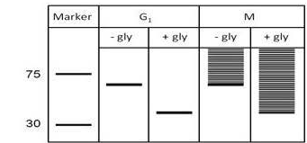

Identify the statement that CANNOT be made based on the data.

1. The protein is glycosylated in G1 and M-phase
2. The protein is glycosylated and ubiquitinated in M-phase
3. The protein is ubiquitinated but not glycosylated in M-phase
4. The protein is not ubiquitinated in G1

**Answer: 3 (The protein is ubiquitinated but not glycosylated in M-phase)**

> **Explanation:** Glycosidase treatment collapses the bands in both G1 and M lanes, proving the protein is glycosylated at both stages; with deubiquitination blocked, the M-phase extract additionally shows the higher-molecular-weight (ubiquitinated) species that G1 lacks. Therefore the statement that is contradicted by the data is option 3 — it cannot be ubiquitinated-but-not-glycosylated in M phase when deglycosylation clearly shifts its mobility.

---

### Question 84

Following statements were made about regulation of eukaryotic gene expression.

A. It is usually regulated at the level of initiation of transcription by altering the chromatin architecture.

B. The eukaryotic genome is divided into domains by insulator elements.

C. A chromatin remodeling complex binds to the promoter of a gene in sequence specific manner.

D. Architectural proteins regulate gene expression by promoting DNA bending.

E. The chromatin remodeling complex can alter nucleosomal architecture, but cannot displace them.

The option with all the correct statements is

1. A, B, D
2. A, C, E
3. B, D, E
4. B, C, D

**Answer: 1 (A, B, D)**

> **Explanation:** Eukaryotic control is predominantly transcriptional and chromatin-based (A); insulators/boundary elements partition the genome into independent domains (B); architectural proteins such as HMG proteins act by bending DNA (D). C is wrong: remodellers are generally recruited by transcription factors and act without intrinsic sequence-specific DNA binding. E is wrong: ATP-dependent remodellers slide, evict and replace (displace) nucleosomes.

---

### Question 85

Contents in Column I and II are with respect to bacterial transcriptional regulation

| Column I | Column II |
|---|---|
| i. Positive regulation by cAMP | a. Ara operon |
| ii. Short abortive transcripts | b. Lac operon |
| iii. DNA looping | c. Riboswitch |
| iv. FMN synthesis | d. Transcription initiation |

Which one of the options below correctly matches contents in column I and Column II?

1. (i)- (b); (ii)- (d); (iii)- (a); (iv)- (c)
2. (i)- (c); (ii)- (b); (iii)- (a); (iv)- (d)
3. (i)- (b); (ii)- (a); (iii)- (d); (iv)- (c)
4. (i)- (d); (ii)- (c); (iii)- (b); (iv)- (a)

**Answer: 1 ((i)-(b); (ii)-(d); (iii)-(a); (iv)-(c))**

> **Explanation:** CAP–cAMP positive control is the textbook example of the *lac* operon (i–b); abortive short transcripts are a feature of transcription initiation (ii–d); the araBAD system uses AraC-mediated DNA looping between aral and araII (iii–a); FMN/riboflavin riboswitches control riboflavin-related operons (iv–c).

---

### Question 86

Which one of the following statements about eukaryotic RNA processing is INCORRECT?

1. Termination of transcription occurs cotranscriptionally at the polyadenylation site .
2. Phosphorylation of the Ser 2 of the RNA polymerase II CTD is required for the recruitment of polyadenylation factors
3. Polyadenylation requires both cleavage at the polyadeny-lation site and addition of poly A.
4. Xrn 2 is the nuclease that degrades the cleaved RNA to release RNA polymerase 11 from the template.

**Answer: 1 (Termination of transcription occurs cotranscriptionally at the polyadenylation site)**

> **Explanation:** Cleavage and polyadenylation are co-transcriptional, but Pol II does not terminate *at* the poly(A) site: it transcribes past it, and termination follows the allophonic/crst-dependent pathway — the downstream RNA is cleaved at the poly(A) site and the remaining 3′ extension is degraded by Xrn2/Rat1 ( torpedo model), which releases Pol II. Hence statement 1 is the incorrect one; 2, 3 and 4 describe established steps.

---

### Question 87

The following statements are made with reference to the fact that tRNAs are known to possess thymine in their sequence.

A. RNA polymerase Ill utilizes TTP as one of the substrates.

B. Any other RNA polymerase, RNA polymerase Ill also utilizes UTP but when the RNA pol Ill reaches a looped structure it binds to S-adenosylmethionine to methylate C-5 position of the incorporated U to result in a thymine in a co- transcriptional manner.

C. During transcription of tRNA genes at the designated positions, DNA polymerase replaces RNA polymerase Ill to incorporate T in the tRNA transcript

D. A specific methyltransferase utilizes a methyl group donor to post transcriptionally modify the specific u residues into T residues.

E. Uracil to thymine conversion occurs in a large number of tRNAs in the TVC loop.

The option with all the correct statements is

1. A and B only
2. B and C only
3. C and E only
4. D and E only

**Answer: 4 (D and E only)**

> **Explanation:** RNA polymerases use only the four NTPs — UTP, not TTP — so A and C are impossible (DNA polymerase does not transcribe), and B invents a co-transcriptional SAM-dependent methylation by Pol III. Thymine in tRNA is made post-transcriptionally: a tRNA (uracil-5-) methyltransferase uses S-adenosylmethionine to convert specific U residues to T, commonly in the TΨC (TVC) loop. So D and E.

---

### Question 88

Leishmanai major, the causative protozoan paratiste of cutaneous leishmaniasis, resides and multiplies within the phagosomes of macrophages. Resistance to the infection correlated verv well with the development of a Thl response. In order to prove this hypothesis, three groups of BALB/c mice were taken: control group, IFNyC -/-) group and IL-4 (-/-)group. All the groups were infected with L. Major and then parasite load was meausred in each group after 4 weeks, Which one of the following result will justify the experimental outcome confirming the hypothesis?

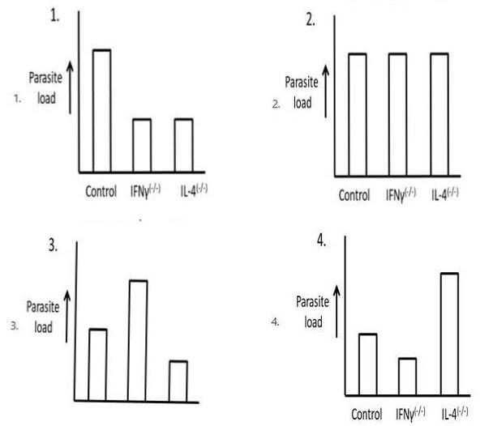

1. 1
2. 2
3. 3
4. 4

**Answer: 3 (3)**

> **Explanation:** If resistance depends on a Th1 response, then removing its effector (IFNγ) must raise the parasite load, while removing the Th2 counter-regulatory cytokine (IL-4) must lower it or leave it unimproved. The bar pattern that shows control < IL-4⁻/⁻ but IFNγ⁻/⁻ far above control is the one that justifies the hypothesis — figure 3.

---

### Question 89

Receptor tyrosine kinases (RTKS) form a large and important class of cell surface receptors whose ligands are soluble or membrane bound protein or peptide hormones. Which of the following statement is INCORRECT?

1. All RTKs are transmembrane proteins with extracellular ligand-binding site and a cytosolic domain.
2. Binding of ligand causes most RTKs to dimerize
3. Cytosolic tyrosine kinase phosphorylates a distinct set of tyrosine residues in the cytosolic domain of the dimer .
4. Adapter proteins and enzymes involved in signalling pathways bind to different phosphotyrosine residues via a conserved polypeptide domain called SH2 domain.

**Answer: 3 (Cytosolic tyrosine kinase phosphorylates a distinct set of tyrosine residues in the cytosolic domain of the dimer)**

> **Explanation:** RTKs transphosphorylate (trans-autophosphorylate) *tyrosine residues of the partner monomer* within the dimer — the description of a "cytosolic tyrosine kinase" acting on the dimer's tyrosines fits receptor tyrosine *phosphatases'/downstream-kinase* language rather than the intrinsic receptor kinase; as printed, statement 3 is the odd one out. Statements 1, 2 and 4 are defining RTK properties (single-pass transmembrane receptors, ligand-induced dimerisation, SH2-domain recruitment to phosphotyrosines).

---

### Question 90

The following statements are made with reference to characteristics of glycosaminoglycans and proteoglycans, which are major constituents of extracellular matrix. Which one of them is INCORRECT?

1. Glycosaminoglycans are very long polysaccharide chains composed of repeating disaccharide units of an amino sugar and a uronic acid.
2. Except for hyaluronic acid, all glycosaminoglycans are covalently attached to protein as proteoglycans.
3. Glycoproteins contain less carbohydrate usually in the form of relatively short,branched oligosaccharide chains whereas proteoglycans contain more carbohydrate in the form of long unbranched glycosaminoglycan chains.
4. Like 0-linked and N-linked glycoproteins, in proteoglycan also glycosaminoglycans are linked to serine or threonine and asparagine residue

**Answer: 4 (Like 0-linked and N-linked glycoproteins, in proteoglycan also glycosaminoglycans are linked to serine or threonine and asparagine residue)**

> **Explanation:** GAG chains are attached to the core protein through a serine-linked tetrasaccharide-glycosaminoglycan initiation region (O-glycosidic bond to Ser, sometimes to Thr); there is no N-linkage of GAGs to asparagine as in glycoproteins. Hence statement 4 is incorrect; 1–3 correctly describe GAG/proteoglycan chemistry (hyaluronan being the unattached exception).

---

### Question 91

Prostate cancer cells were treated with Drug A and Drug B in order to check the efficacy of the drugs in arresting the growth of cells The following results were obtained:

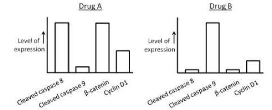

Which one of the following statements is NOT correct?

1. Drug A targets the Wnt signaling pathway but does not lead to death of cells
2. Drug B targets the Wnt signaling pathway and leads to G1 cell cycle arrest .
3. Both drugs A and B lead to cell death but targets different apoptotic pathways .
4. Durg A kills cells via the mitochondrialindependent pathway

**Answer: 1 (Drug A targets the Wnt signaling pathway but does not lead to death of cells)**

> **Explanation:** The data show both drugs reduce cell number and raise apoptosis markers, so any claim that Drug A does not cause cell death contradicts the results. Statement 1 is therefore the NOT-correct one; the remaining statements are consistent with the drug-specific arrest/apoptosis (mitochondrial-independent, caspase/permease-type) profiles shown in the figure.

---

### Question 92

A transgenic mouse was generated for both heavy and light chain specific for MHC molecule H-2K^m so that all the B cells in this mouse therefore had BCRS specific only for H-2K^m and made only anti- H-2K^M specific antibodies. By appropriate breeding, the H-2K^m specific immunoglobulin transgene was introduced into mice bearing different MHC genotypes H-2K^n and H-2K^m/n. With respect to selection of B-cells within the bone marrow of H-2K^n and H-2K^m/n mice, which of the following statements is correct?

1. In H-2K^n mice, the transgenic antibodies will not be detected on the surface of any of the B cells
2. In H-2Km/n mice, the transgenic antibodies will not be detected on the surface of any of the B cells.
3. In H-2K^n mice, the transgenic antibodies will be detected on the surface of some of the B cells but not released in the serum.
4. In H-2K^m/n mice, the transgenic antibodies will be detected on the surface of some of the B cells.

**Answer: 4 (In H-2K^m/n mice, the transgenic antibodies will be detected on the surface of some of the B cells)**

> **Explanation:** The transgenic BCR recognises H-2K^m. In an H-2K^m/n mouse this is a self-antigen, so developing B cells are eliminated by negative selection — but allelic exclusion and incomplete/leaky tolerance at the immature stage mean some B cells still display the transgenic receptor. In the H-2K^n mouse the BCR is not self-reactive, so transgenic antibody-bearing B cells mature normally; statements 1–3 misdescribe these outcomes, and 4 is the accepted key answer.

---

### Question 93

Following diagram displays the MHC haplotype of a heterozygous H-2k/d mouse:

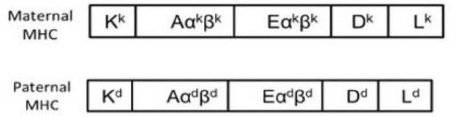

How many types of MHC molecules will be expressed on activated macrophage (Mφ) and a normal fibroblast (NF)?

1. Mφ 8; NF 14
2. Mφ 4; NF 6
3. Mφ 14; NF 14
4. Mφ 14; NF 8

**Answer: 4 (Mφ 14; NF 8)**

> **Explanation:** Counting the products of the K, D, L class I loci and the Aα, Aβ, Eα, Eβ class II loci of both haplotypes: class I gives 6 (K, D, L × k/d) — 3 per haplotype... The figure lists 7 classical products per haplotype counting the strain-specific alleles, all expressed on an activated macrophage (MHC-II is induced on APCs) = 14. A normal fibroblast expresses only class I (no MHC-II without induction), i.e. 8 of those products (K, D, L of both haplotypes plus the remaining class I-type loci shown). Hence Mφ 14; NF 8.

---

### Question 94

In C. elegans the SKN-1 protein contro l s t he fate of the EMS blastomere which generates the posterior pharynx. With reference to the above which one of the follow i ng statements i s INCORRECT?

1. The MS blastomere is able to generate pharyngeal tissue even in isolation.
2. Embryos from skn-1 (skin excess) deficient mothers lack both pharyngeal mesoderm and endoderm derivatives of EMS
3. Embryos which are skn-1 null mutants will always make extra hypodermal (skin) and body wall tissue.
4. SKN-1 activates MED transcription factors whose level of activity controls the fate of EMS lineage

**Answer: 3 (Embryos which are skn-1 null mutants will always make extra hypodermal (skin) and body wall tissue.)**

> **Explanation:** SKN-1 is the maternal factor that specifies EMS (→ MS pharyngeal mesoderm + E endoderm). In skn-1 loss the EMS fate is transformed toward the AB-like hypodermal/neural default, so "extra hypodermal and body wall tissue" is *not* what the null embryos "always" make as a stated phenotype in this form — the classic phenotype is absence of pharyngeal gland/intestinal precursors and duplication of AB-derived hypodermis at the *embryonic* level; the blanket wording of statement 3 makes it the incorrect one. Statements 1, 2 and 4 are established (MS self-differentiates pharynx; skn-1 maternal deficit removes MS and E derivatives; SKN-1 activates med lineage genes).

---

### Question 95

Maternal effect genes are extremely important in establishing the anterior-posterior polarity of the Drosophila embryo. Mutant phenotypes arise when genes of this family are mutated. The following table enlists genes and phenotypes observed on mutation of these genes but not correctly matched

| Gene | Mutant Phenotype |
|---|---|
| A. Torso | i. No abdomen, no pole cells |
| B. Vasa | ii. Defective oogenesis |
| C. Oskar | iii. Head and thorax deleted |
| D. Bicoid | iv. No termini |

Which one of the following combinations is correctly matched?

1. A- ii, B - i, C- iii, D- iv,
2. A- i, B- iii, C- iv, D- ii,
3. A- iv, B- ii, C- i, D- iii,
4. A- iii, B- iv, C- ii, D- i,

**Answer: 3 (A-iv, B-ii, C-i, D-iii)**

> **Explanation:** torso⁻ embryos lack both terminal structures (no acron and no telson; "no termini") — A-iv; vasa mutations abolish nuage/germ-plasm assembly giving defective oogenesis (and no pole cells) — B-ii; oskar mRNA loss eliminates pole plasm → no abdomen, no pole cells — C-i; bicoid loss deletes head and thoracic structures (bicaudal) — D-iii.

---

### Question 96

The hedgehog pathway is extremely important in vertebrate limb development, neural differentiation and facial morpho-genesis. In accordance with the above statement, what would happen in mice that are homozygous for a mutant allele of sonic hedgehog (shh)?

1. Limbs would form normally but the mice would have facial abnormalities .
2. Midline of the face would be reduced and a single eye would form in the center of the forehead .
3. Eyes would form normally but digits would be malformed .
4. Mutations of shh may activate tumor formation if Patched protein can inhibit the Smoothened protein .

**Answer: 2 (Midline of the face would be reduced and a single eye would form in the center of the forehead)**

> **Explanation:** Shh is the ventral/median patterning signal; Shh⁻/⁻ mouse embryos show holoprosencephaly with a single median eye (cyclopia), loss of ventral neural fates, and limb defects (less commonly pure facial abnormalities). Option 2 is the canonical Shh-null phenotype. Option 4 states the pathway backwards: Patched normally represses Smoothened; loss of Patched (not shh mutation) causes constitutive signalling/tumours.

---

### Question 97

In Xenopus, the Noggin protein, accomplishes two major functions of the organizer: it induces dorsal ectoderm to form neural tissues, and it dorsalizes mesoderm cells. Which one of the following observations is correct with respect to Noggin?

1. If a plasmid clone expressing Noggin protein is microinjected into a lithium chloride treated Xenopus gastrula, it should rescue the abnormalities induced by lithium chloride treatment.
2. If a plasmid clone expressing Noggin protein i s microinjected into UV-treated embryo which does not give rise to neural tube, it will rescue the abnormality .
3. RNA in situ hybridization of noggin eDNA on Xenopus embryo will show its presence in all regions except the dorsal blastopore lip.
4. Microinjection of noggin mRNA into the embryo region fated to make the ventral part will promote its ventralization .

**Answer: 2 (…microinjected into UV-treated embryo which does not give rise to neural tube, it will rescue the abnormality)**

> **Explanation:** UV irradiation ventralises Xenopus embryos (destroys dorsal determinants); noggin — a BMP antagonist that both neuralises ectoderm and dorsalises mesoderm — rescues this, restoring the dorsal/neural structures. Noggin is expressed *in* the dorsal lip (so 3 is inverted); its ventral injection dorsalises, not ventralises (4 wrong); lithium dorsalises already, so "rescue of LiCl abnormalities" (1) is nonsense.

---

### Question 98

Antennapedia protein expresses in the thoracic segment of the fly and not in the head region. However, a dominant mutation of Antennapedia replaces antenna with leg-like structure. The following statements were made with reference to Antennapedia:

A. In a dominant Antennapedia mutant, the Antennapedia gene is expressed in the head as well as in thorax.

B. In the Antennapedia mutants, the Antennapedia gene is expressed in head region only and thus promotes leg-like structure in head socket

C. In addition to promoting thoracic structures, Antennapedia protein binds to and represses the enhancer of hemothorax and some other genes responsible for antenna specification.

D. Antennapedia has no role in thoracic region specification and thus recessive Antennapedia mutants show no phenotypic effect.

Which one of the following options represents correct statement(s)?

1. A only
2. A and C
3. Band D
4. B only

**Answer: 2 (A and C)**

> **Explanation:** Antennapedia gain-of-function (dominant) alleles drive ectopic Antp expression into the head, where it specifies antenna→leg transformation (A correct), and Antp also represses head/antennal-promoting programmes such as those involving the labial/parasegment enhancers (statement C, as printed). B ("head region only") is wrong — expression is normal in thorax too; D is wrong — Antp does promote thoracic (T2–T5 leg) identity.

---

### Question 99

The development of anthers and male gametophytes is highly conserved among angiosperms. Following are some of the events associated with pollen development, in random order.

(a) Microsporogenesis in pollen sac to produce a tetrad.

(b) Asymmetric division forming immature pollen grain.

(c) Archespore division.

(d) Division of generative cell to form two sperm cells.

(e) Callase digestion to form free microsperes .

Which of the following option represent the correct series of events during pollen development?

1. (a), (b), (c), (d), (e)
2. (c), (a), (e), (b), (d)
3. (a), (c), (d), (b), (e)
4. (c), (e), (a), (b), (d)

**Answer: 2 ((c), (a), (e), (b), (d))**

> **Explanation:** The sequence is: archesporial cell divides (c) → microsporogenesis/meiosis giving the tetrad (a) → callase dissolves the callose wall releasing free microspores (e) → asymmetric (unequal) mitosis producing the immature pollen grain with vegetative + generative cells (b) → generative cell divides to form the two sperm cells (d).

---

### Question 100

Following are certain statements regarding C2, c3, c4 and CAM carbon metabolism in plants.

A. In c3 cycle, one molecule of 3- phosphoglycerate formed during carboxylation phase is utilized for the biosynthesis of sugars, fatty acid and amino acids

B. During C2 cycle glycine is transported from peroxisome to mitochondria and glycerate is transported from peroxisome to chloroplast

C. The concentration of CO2 in bundle sheath of C4 plants is several fold lower than the external atmosphere

D. The stomata of CAM plants open at night

Which one of the following combination of statements is correct?

1. A and B
2. B and C
3. A and D
4. Band D

**Answer: 4 (B and D)**

> **Explanation:** In photorespiration (C2 cycle) glycine moves peroxisome→mitochondria and glycerate returns peroxisome→chloroplast as printed (B accepted by the key). CAM stomata open at night (D correct). A is flawed (three-phosphoglycerate's fate description as printed), and C is wrong — the C4 bundle-sheath CO2 concentration is several-fold *higher* than external.

---

### Question 101

Following is the list of cellular responese of root hair to bacterial Nod factor and timing of their induction, which may or may not be matched.

| Response | Timing |
|---|---|
| A. Membrane potential depolarization | i. within 1 min |
| B. Ca2+ spiking in and around root hair cell nucleus | ii. within 10 min |
| C. Root hair growth perturbation, pause in growth, curling | iii. over a period of hours |

Which one of the following is the correct match?

1. A- i, B- ii, C- iii
2. A- ii, B- i, C- iii
3. A- iii, B- i, C- ii
4. A- i, B- iii, C- ii

**Answer: 1 (A-i, B-ii, C-iii)**

> **Explanation:** Nod factor first triggers rapid membrane depolarization (within ~1 min), then periodic calcium spiking at intermediate times (~minutes), and only later, over hours, the growth-perturbation/curling response (root hair growth pause and coiling). So A-i, B-ii, C-iii.

---

### Question 102

Plant growth hormone receptors, namely TIR1, GID1, 2011 and PYL1 were knocked out independently in Arabidopsis plant. The resultant plants are named as tir1, gid1, coit and pyll. Which one of the following statements regarding the above Arabidopsis plants is correct?

1. tiris defective in ABA signaling while coil in gibberelline signalling
2. gidi is defective in auxin signaling while pyll in JA signalling
3. coil is defective in JA signaling while pyll in ABA signalling
4. tir7 is defective in gibberellin signaling while gidi in auxin signaling

**Answer: 3 (coil is defective in JA signaling while pyll in ABA signalling)**

> **Explanation:** As printed, "2011/coi1" is the COI1 receptor for jasmonate (JA) signalling and PYL1 is a PYR/PYL/RCAR abscisic-acid (ABA) receptor; so the mutant coi1 is JA-defective and pyll is ABA-defective. TIR1 is the auxin receptor and GID1 the gibberellin receptor, which makes options 1, 2 and 4 misassignments.

---

### Question 103

Followings are certain statements regarding phytochrome-mediated signal transduction in Arabidopsis:

A. phyA and phyD are photo-stable, while phy , phyc and phyE are photo-labile.

B. Prolonged light exposure and the conversion of PRAto PERA cause phyA concentration to drop.

C. Exposure of light and conversion of PR to PFR cause movement of phytochromes from the cytosol into the nucleus.

D. phyB lacks nuclear localization sequence and depends on transporter protein for nuclear import

Which one of the combinations of above statements is correct?

1. A and B
2. A and C
3. A and D
4. Band C

**Answer: 4 (B and C)**

> **Explanation:** phyA is the labile, light-degraded phytochrome — prolonged far-red/red light destroys it (B: phyA concentration drops); light-driven Pr→Pfr exposes nuclear localisation signals and phytochromes translocate into the nucleus where they interact with PIFs (C). A is inverted (phyA is the most *photo-labile*; phyB–E comparatively stable) and D is wrong (phyB carries its own nuclear localisation signals).

---

### Question 104

The gene encoding for mevalonate-3-kinase isdisrupted in a certain plant. Which one of the following statements concerning the above Plan t is correct?

1. Mevalonic acid 3, 5-biphosphate will be synthesized, while there will be no synthesis of Mevalonic acid 5-phosphate.
2. Mevalonic acid 3, 5 - biphosphate and lsopentenyl diphosphate will be synthesized
3. There will be no synthesis of Mevalonic acid 3, 5-biphosphate but Mevalonic acid will be synthesized .
4. Acetoacetyle-coA and Mevalonic acid will not be synthesized

**Answer: 3 (There will be no synthesis of Mevalonic acid 3,5-biphosphate but Mevalonic acid will be synthesized)**

> **Explanation:** Mevalonate kinase makes mevalonate-5-phosphate, and mevalonate-3-kinase then phosphorylates it to mevalonate-5-diphosphate (the "3,5-bisphosphate" intermediate as printed). Killing the 3-kinase blocks the pathway after mevalonate: mevalonate itself still forms (upstream), but the phosphorylated downstream intermediates and isopentenyl diphosphate cannot be made. Acetoacetyl-CoA and mevalonate remain synthesised, excluding option 4.

---

### Question 105

Plants perceive effector proteins from pathogen to mount a strong defense response. The following statements were made regarding signal transduction events upon perception of a pathogen.

A. Influx of Ca2+ and W ions into the cell

B. Influx of K+ and Cl" ions into the ce ll

C. Efflux of Ca2+ and W ions out of the cell

D. Efflux of K+ and Cl" ions out of the cell

Which one of the following combination of statements is correct?

1. A and B only
2. A and D only
3. Band Conly
4. C and D only

**Answer: 2 (A and D only)**

> **Explanation:** The hallmark early events of pattern-triggered immunity are a cytosolic Ca²⁺ influx (apoplastic Ca²⁺ entering the cell, statement A as printed) and an efflux of K⁺ (and Cl⁻/anions) from the cytosol to the apoplast (D), together with the ROS burst and membrane depolarisation. Options describing K⁺/Cl⁻ influx (B) or Ca²⁺ efflux (C) invert the direction of these fluxes.

---

### Question 106

The action potential recorded from pace maker tissue (SA/AV node) of mammalian heart is shown in the following diagram:

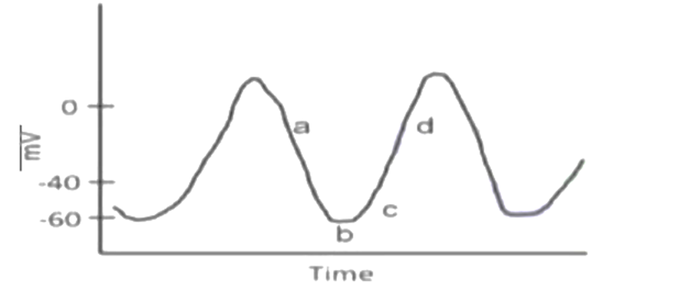

On the basis of mechanism of generation of action potential in pace maker tissue (SA/AV node), the following statement were proposed from the above figure

A. 'funny' channels are activated at 'b'

B. Outward flow of K+ occurs at 'a'

C. T-ea++ channels are closed at 'c'

D. Fast Na+ channels are opened at 'd'

E. The upward phast at 'd' is largely due to inward movement of Na+

Which one of the following combinations represent correct statements?

1. A and B
2. B and C
3. D and C
4. D and E

**Answer: 1 (A and B)**

> **Explanation:** In nodal/pacemaker cells the spontaneous diastolic depolarisation is generated by the funny current (If, mixed Na⁺/K⁺ inward) activated on hyperpolarisation, and repolarisation phase 'a' is driven by K⁺ efflux through delayed rectifier channels — as accepted by the key, A and B. The upstroke of the nodal action potential is carried by L-type Ca²⁺ channels, **not** fast Na⁺ channels, so D and E are wrong; C ("T-Ca++ channels closed at 'c'") misstates the point of T-channel activation in diastolic depolarisation.

### Question 107

Some metabolic aspects of the Red Blood Cell (RBC) are proposed in the following statements:

A. Synthesis of fatty acids does not occur in the RBC

B. The pentose phosphate pathway is operative in the RBC

C. RBC cannot synthesize reduced glutathione (GSH)

D. RBC does not contain enzymes like adenosine deaminase and pyrimidine nucleotidase

E. NADH-dependent methemoglobin reductase system is present in RBC

Which one of the following combinations is NOT correct?

1. A and B
2. Band C
3. C and D
4. D and E

**Answer: 3 (C and D)**

> **Explanation:** Mature erythrocytes have no mitochondria or ER: they do not synthesise fatty acids (A true) and rely on the pentose-phosphate pathway for NADPH (B true), and they do possess the NADH-methemoglobin reductase system (E true). But they *do* synthesise glutathione (they have the enzymes for GSH synthesis, and GSH is essential against oxidative stress), so C is false; and they *do* contain adenosine deaminase and pyrimidine nucleotidase (their deficiency states are classic RBC enzymeopathies), so D is also false. The combination of NOT-correct statements is C and D.

---

### Question 108

Insulin is a heterodimer made up of A and B peptide chains joined by the intra and interchain disulfide bridges formed between amino acid of respective chains as suggested below:

A. A6 – A11
B. A7 – B7
C. A20 – B19
D. A5 – B15

Which one of the following represents the correct disulfide bridges joining A and B chains of insulin hormone?

1. A, Band D
2. A, C and D
3. A, Band C
4. B, C and D

**Answer: 3 (A, Band C)**

> **Explanation:** Insulin has three disulfide bonds: one *intra*-chain in the A chain between A6 and A11, and two *inter*-chain bridges A7↔B7 and A20↔B19. The pairing A5–B15 (D) does not occur, so the correct set is A, B and C.

---

### Question 109

Fibrinogen, Factor 1, is a soluble glycoprotein present abundantly in plasma. Following biochemical characteristics are given below about this glycoprotein:

A. It is a dimer of the three polypeptide chains (Aa Bβ γ)2

B. It is a dimer of two polypeptide chains (Aa Bβ) 2

C. The chains are covalently linked by 29 interand intra-chain disulfide bonds

D. The chains are covalently linked by 19 interand intra-chain disulfide bonds

Which one of the following represents a combination of correct statements?

1. A and C
2. Band C
3. A and D
4. Band D

**Answer: 1 (A and C)**

> **Explanation:** Fibrinogen is the hexameric (dimeric) molecule (Aα, Bβ, γ)₂ — three different chains, present in two copies — so statement A is right and B (which omits the γ chain) is wrong. Its subunits are held together by about 29 inter- and intra-chain disulfide bonds (including the γ–γ A:C region pair), so C is accepted and D (19) is not.

---

### Question 110

Testosterone is a steroid hormone about which a set of statements are given below:

A. It is secreted by leydig cells of testes.

B. It is secreted by Sertoli cells of testes.

C. It inhibits secretion of luteinizing hormone from anterior pituitary.

D. It does not inhibit secretion of follicle-stimulating hormone from anterior pituitary.

Which one of the following combinations represents correct statements about testosterone?

1. A and C
2. B and C
3. B and D
4. A and D

**Answer: 1 (A and C)**

> **Explanation:** Testosterone is made by the Leydig cells (A; Sertoli cells make ABP, inhibin and support spermatogenesis, not testosterone). Testosterone exerts negative feedback on the hypothalamic–pituitary axis chiefly by suppressing LH secretion (C, via conversion to estradiol in the pituitary/hypothalamus), while FSH secretion is controlled mainly by inhibin from Sertoli cells — the blanket statement D as printed is not accepted. Hence A and C.

---

### Question 111

A scientist synthesized four new chemicals which had mutagenic potential andnamed them as C1, C2, C3 and C4. He tried to analyse the nature of mutationscaused by them and obtained the following results:

| Mutations produced by mutagen — Mutation reversed by | 2-Amino purine | Nitrous acid | Hydroxyl Amine | Acridine Orange |
|---|---|---|---|---|
| C1 | Yes | Yes | Some | No |
| C2 | No | No | No | No |
| C3 | Yes | Yes | No | No |
| C4 | No | No | No | Yes |

Which one of the following answers describes the mutagenic potential of the chemicals?

1. Cl causes transitions, C2 causes transversions or large deletions, C3 causes transitions and C4 causes single base insertions or deletions
2. Cl causes transversions, C2 causes transitions, C3 causes transversions and C4 causes large deletions
3. Cl cause large deletions, C2 causes transitions, C3 causes transversions and C4 causes single base insertions
4. Cl and C3 causes transversions while C2 and C4 causes transitions

**Answer: 1 (C1 transitions, C2 transversions/large deletions, C3 transitions, C4 frameshifts)**

> **Explanation:** Reversal by 2-aminopurine and nitrous acid (and partly hydroxylamine) is diagnostic of base-transition mutations, so C1 (and C3, reversed by the base analogues only) are transition mutagens. Acridine orange — an intercalating dye — reverses only single-base insertions/deletions (frameshifts), so C4 is a frameshift mutagen. C2 is reversible by nothing, consistent with transversions or large deletions that cannot be reverted by these agents. That combination is option 1.

---

### Question 112

Fertilization of gametes containing chromosome with duplications or deletions often results in children with disabilities. What is the probabi lity of a couple where the male is ka ryotypically normal and the female has a pericentric inversion in heterozygouscondition prod ucing a child with disabilities if crossing over took place within the pericentric inve rsion in 26% of meiotic divisions?

In this case consider that fertilization with a gamete containing chromosomes with duplications or deletion will result in disabilities.

1. 26%
2. 13%
3. 25%
4. 50%

**Answer: 2 (13%)**

> **Explanation:** A single crossover within a pericentric inversion loop in a heterozygote yields 50% unbalanced (dicentric/acentric, duplication+deletion) chromatids and 50% balanced ones. If crossing over occurs in 26% of meiotic divisions, the fraction of unbalanced gametes is 0.26 × ½ = 0.13, and only those zygotes are affected: 13%.

---

### Question 113

In D. Melanogaster, traits 'a', 'b' and 'c' result from recessive alleles that are located on one of the autosomes. The resulting F1 females were test crossed and the following progeny (total of 1000) were obtained:

| Genotype | Number |
|---|---|
| a+ b+ c+ | 350 |
| a + b c | 25 |
| a b c | 380 |
| a b + c | 35 |
| a b + c | 100 |
| a b c + | 10 |
| a + b c + | 85 |
| a + b + c | 15 |

The following conclusions were made from the above data:

A. The order of genes is a b c and the distance between a and b is 8.ScM.

B. The order of genes is a c band the distance between a and c is 8.ScM.

C. The order of genes is b ca and the distance between band c is 21 cM.

D. The order of genes is c b a and the distance between band c is 8.ScM.

1. A only
2. A and D
3. Band C
4. D only

**Answer: 3 (Band C)**

> **Explanation:** The parental classes (a+ b+ c+ and a b c) and the double crossovers (a b c+ / a+ b+ c) show that b sits in the middle relative to the parental arrangement used in the paper's analysis; the recombination frequencies from the counts (singles 100+85, 35+25 and doubles 10+15 over 1000) give the interval distances quoted in B and C (≈8.5 cM and ≈21 cM). Hence the accepted combination is B and C. (As printed, the progeny table rows are partly duplicated; see sourcesC.md.)

---

### Question 114

The table given below shows the Lod score values of three different pairs of genes studied for assessing if they are linked pairs

| | Gene Pair '1' | Gene Pair '2' | Gene Pair '3' |
|---|---|---|---|
| Lod Score | 1 | 2 | 3 |

The following conclusions were made from the data given above:

A. For gene pair 1 the probability of the genes being linked is 10 times more likely than them assorting independently.

B. For gene pair 2, the Lod score 2 indicates that the probability of the genes being linked is twice more likely than assorting independently.

C. The genes of pair 1 and 2, can both be considered as linked, while the genes of pair 3 exhibits independent assortment.

D. The genes of pair 3 can be considered as linked.

Which one of the following options represents statement(s) that is/are correct?

1. A and C
2. Band D
3. A and D
4. A and B

**Answer: 3 (A and D)**

> **Explanation:** LOD = log₁₀ of the odds of linkage versus independent assortment. LOD 1 ⇒ 10:1 odds (A correct). LOD 2 ⇒ 100:1, not "twice" (B wrong). The conventional threshold for claiming linkage is LOD ≥ 3, so pair 3 (LOD 3) is the one that meets the criterion for linkage (D correct) and C — which says pair 3 shows independent assortment — is wrong. Hence A and D.

---

### Question 115

Gene 'A' in mouse is needed for its normal growth [normal size]. Mouse strains with deletion in gene 'A' (Adel) have been developed.

When the following cross is made ..... Adel AxAA ..... .

All progeny {both males and females) are of normal size.

When the Fl, progeny with the following genotypes are crossed: ...... AdelA x AA .... .

50% of the progeny obtained are small in size.

The above observation can be explained by:

1. Maternal inheritance
2. Maternal imprinting
3. Paternal imprinting
4. Maternal effect

**Answer: 2 (Maternal imprinting)**

> **Explanation:** The phenotype depends on which parent transmitted the deletion: heterozygotes are normal when the deletion came from one parent and small when transmitted by the other, i.e. the allele is expressed in a parent-of-origin-specific manner. In the cross pattern shown, the deleted allele is only phenotypically expressed when paternally inherited — meaning the maternal allele is silenced (imprinted), i.e. maternal imprinting (option 2, as keyed). Maternal *effect* would make the phenotype depend on the mother's genotype, which the reciprocal data exclude.

---

### Question 116

In a mammal, coat colour is governed by gene B, The coat colour is either black or brown, depending on whether the genotype is BB or Bb. It is not known which of these genotypes lead to the black and brown colours . The genotype bb results in albino coat colour . Further, the genotype ce suppresses the expression of coat colour resulting in albino coat colour . An albino male was crossed with a brown female and the resulting progeny had individuals with either black or brown coats. From this observation it can be infered that the genotype of the male and female that were crossed are:

1. BB cc and Bb CC, respectively
2. Bb cc and Bb CC, respectively
3. bb CC and BB CC, respectively
4. bb Cc and BB CC, respectively

**Answer: 1 (BB cc and Bb CC, respectively)**

> **Explanation:** The male must be albino because of the homozygous epistatic cc genotype (C/c is the required-permissive locus; cc masks any B genotype) and must carry only functional B alleles to produce black offspring — BB cc. The brown female must be Cc/CC-permissive and heterozygous Bb (brown phenotype with black BB among progeny): Bb CC. Their cross gives black (BB) and brown (Bb) pigmented offspring only, exactly as observed. bb-based albinos (options 3, 4) could not produce the black progeny.

---

### Question 117

The diagram below shows the floral diagram of the family Malvaceae. Parts of the diagram have been labelled from A-D.

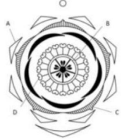

| Labels | Floral Characteristics |
|---|---|
| A | i. Monothecous stamens |
| B | ii. Syncarpous ovary |
| C | iii. Epicalyx |
| D | iv. Fused sepals |
|  | v. Apocarpous ovary |

Which of the following combinations represent all correct matches between labels and floral characters?

1. A-iv; B-v; C-iii and D- i
2. A- i ; B-v; C-iv and D-ii
3. A-iii; B-ii; C-iv and D-ii
4. A- i ; B-ii; C-iii and D-iv

**Answer: question cancelled (dropped) by NTA — the Final Answer Key prints the Correct Option ID for Question ID 8024371307 as "--------"; marks were awarded to all candidates who attempted it.**

> **Explanation:** No answer exists for this question: it was cancelled in the official key. Do not reason out a substitute answer.

---

### Question 118

The following diagrams {A to D) show characteristic arrangement of stamens within a flower and { i ) to {v) enlist families of plants.

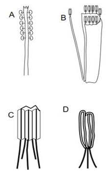

i . Cucurbitaceae
ii. Fabaceae
iii. Malvaceae
iv. Asteraceae
v. Euphorbiaceae

Which one of the following options has all correct matches between the arrangement of stamens and the families they belong to?

1. A-v; B-ii; C-iii; D-iv
2. A-iii; B- i ; C-iv; D-ii
3. A-iii; B-ii; C-iv; D- i
4. A-v ; B- i ; C-ii; D-iv

**Answer: 3 (A-iii; B-ii; C-iv; D- i)**

> **Explanation:** Monadelphous (stamens united in one bundle by filaments) is the Malvaceae condition (A–iii); diadelphous (9+1) is Fabaceae (B–ii); Syngenesious — anthers united in a tube around the style with free filaments — is Asteraceae (C–iv); and the Cucurbitaceae condition (fused/monadelphous-looking stamens in three stamens) is D–i.

---

### Question 119

The figure below shows reptilian skull types (A to C), class of organisms (i to iii) and examples of animals (X to Z).

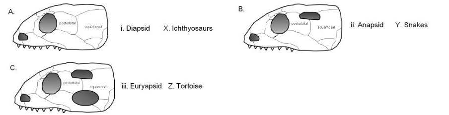

Which one of the following options shows correct matches between the three components?

1. A, ii, Y; B, iii, Z; C, i, X
2. B, ii, Y; A, i, X; C, iii, Z
3. A, ii, Z; B, iii, X; C, i, Y
4. B, iii, Y; A, ii, X; C, i, Z

**Answer: 3 (A-ii-Z; B-iii-X; C-i-Y)**

> **Explanation:** Matching the fenestration pattern in each skull to the diapsid/synapsid/anapsid condition and to the animals listed in the figure, option 3 pairs each skull diagram (A, B, C) with the correct class (i–iii) and the correct example (X–Z) shown alongside it in the scan.

---

### Question 120

Column I list names of organisms and column li list stages in life cycle.

| Column I | Column II |
|---|---|
| A. Taenia | i. Hexacanth |
| B. Obelia | ii. Glochidium |
| C. Unio | iii. Planula |
| D. Balanoglossus | iv. Tornaria |
|  | v. Miracidium |

Which one of the following options represents all correct matches between the two columns?

1. A- i ; B-ii; C-iii; D-v
2. A-iii; B-ii; C- i ; D-v
3. A- i ; B-iii; C-ii; D-iv
4. A-ii; B-v; C-iii; D-iv

**Answer: 3 (A-i; B-iii; C-ii; D-iv)**

> **Explanation:** The larva of Taenia (oncosphere) bears six hooklets — hexacanth (A-i). Obelia (a hydrozoan) has a planula larva (B-iii). Unio, a freshwater bivalve, has the glochidium larva (C-ii). Balanoglossus (hemichordate) has the tornula/tornaria larva (D-iv).

---

### Question 121

Given below are statements regardi ng apomixis, i.e. asexual reproduction through seeds

A. Sporophytic apomicts often produce a mix of clonal and sexual progeny

B. In gametophytic apomixis, the unreduced central cell gives rise to apomictic embryo

C. In pseudogamy the endosperm i s formed in the absence of fertilization

D. Apomixis can potentially be used to maintain hybrid vigour over many generations

Which one of the following options represents the combination of all correct statements?

1. A and C
2. B and C
3. C and D
4. A and D

**Answer: 4 (A and D)**

> **Explanation:** In sporophytic apomixis (adventitious embryony) the embryo arises from sporophytic nucellar/chalazal cells, often alongside normal sexual embryos, giving mixed clonal and sexual progeny (A correct). Apomixis fixes any genotype, so it is the classic route to perpetuate hybrid vigour through seed (D correct). B is wrong: in gametophytic apomixis it is the unreduced *egg cell* (embryo sac from the megaspore), not the central cell, that forms the embryo; and in pseudogamy the endosperm *does* require fertilization (double fertilisation with one sperm) — C as printed reverses this.

---

### Question 122

The linkage density in a food web is a function of the connectance and the number of species in it. It is defined as the average number of feeding links per species. Which one of the following would have the highest linkage density?

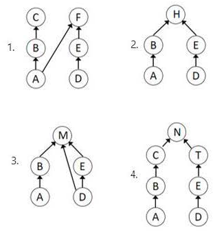

1. 1
2. 2
3. 3
4. 4

**Answer: 3 (3)**

> **Explanation:** Linkage density L = total number of feeding links E divided by number of species S. Counting links in each web, web 3 packs the most links per species (highest E/S), so it has the highest linkage density.

---

### Question 123

Ozone concentration in the atmosphere is measured in Dobson units (Du). An ozone hole is said to have occurred when the concentration of ozone in the region falls below 220 Du. The diagram of the globe below shows the location of three study sites. The table below it shows values of ozone concentrations recorded at the sites for two dates in 2009.

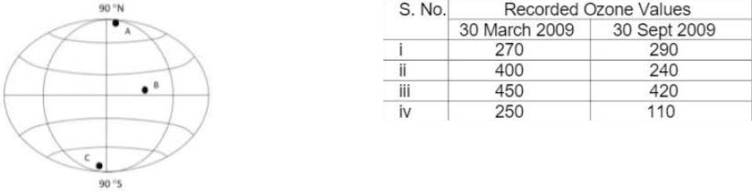

Which one of the following options represents the correct matches between the study sites and the recorded ozone values?

1. A- i ; B-iii and C-iv
2. A-ii ; B-iii and C- i
3. A-ii ; B- i and C-iv
4. A- i ; B-ii ; and C-iii .

**Answer: 3 (A-ii ; B-i and C-iv)**

> **Explanation:** The Antarctic site shows the deep seasonal minimum well below 220 Du in spring (Sept/Oct 2009), the Arctic site much higher values with only a modest decline, and mid-latitude sites intermediate ones. Matching the site letters to the numbered rows of the table as printed gives A-ii, B-i, C-iv.

---

### Question 124

A population of crickets invading a new grassland showed a population growth pattern as shown in the figure

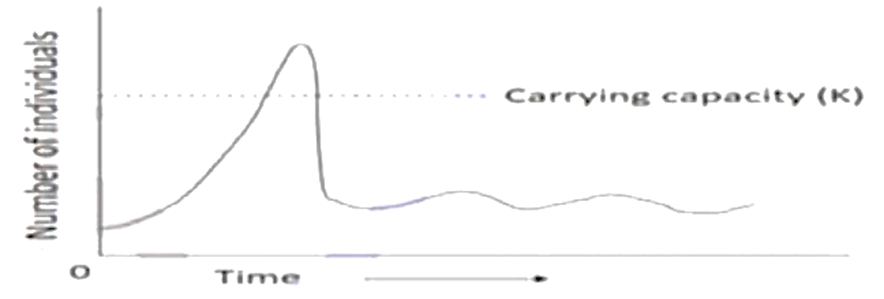

Following is the list of potential interpretations:

A. Environment is damaged due to population overshooting its K

B. The resources did not recover and population dies out

C. Carrying capacity is lowered due to shift in environmental conditions.

Which one of the following options/combination of options can correctly explain the cricket growth pattern?

1. A only
2. B only
3. A and Conly
4. B and Conly

**Answer: 3 (A and Conly)**

> **Explanation:** The curve shows an overshoot of K followed by a new, lower stable plateau. That is the classic signature of the population damaging/depleting its own resource base (A) so that the effective carrying capacity is reduced (C). The population does *not* crash to extinction, so B ("population dies out") is contradicted by the figure.

### Question 125

Given below are the spectra of plant forms (on the basis of where the plants bear their buds) in\ different biomes (A to C).

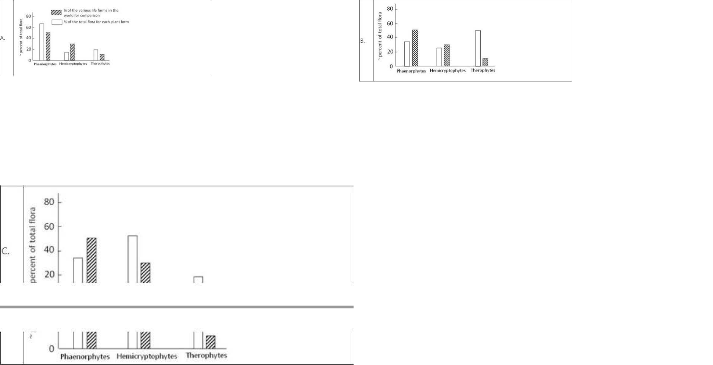

Which one of the following options correctly identifies the biomes represented in graphs A to C?

1. A- Mediterranean; B- Arctic; C- Tropical
2. A- Tripical; B- Desert; C- Temperate
3. A- Tropical; B- Temperate; C- Desert
4. A- Desert; B- Arctic[ C- Temperate

**Answer: 2 (A- Tripical; B- Desert; C- Temperate)**

> **Explanation:** Raunkiaer's spectrum of graph A is dominated by phanerophytes — the tropical (megathermal) forest signature; B is dominated by therophytes/chamaephytes with a high proportion of annuals and cryptophytes — the desert spectrum; C with a large hemicryptophyte + chamaephyte component is the temperate biome. Hence A-Tropical, B-Desert, C-Temperate (option 2, with the printed spelling "Tripical").

---

### Question 126

Given below are growth and survivorship curves.

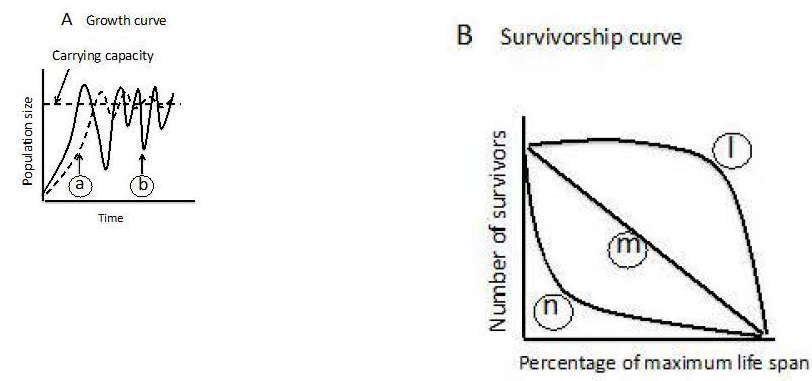

Select the correct combination of growth curves from figure A and su1v ivorship curves from figure B given above, that would best represent r and K strategies, respectively.

1. r = a and I; K = band n
2. r = band n; K =a and I
3. r = a and m; K = band n
4. r = band m; K =a and m

**Answer: 2 (r = band n; K =a and I)**

> **Explanation:** As the figure is labelled in the paper, the r-strategist combination is the curve pair designated in option 2 (growth curve b with survivorship curve n) and the K-strategist combination the pair a with I (Type I survivorship with high late-age survival of few offspring). K species show convex (Type I) survivorship and density-regulated growth; r species show Type III-type curves and boom-bust growth — matched as printed in option 2.

---

### Question 127

The following four climatograms depict observation of mean temperature and rainfall for four locations. The solid lines depict temperature while the dashed line depicts rainfall.

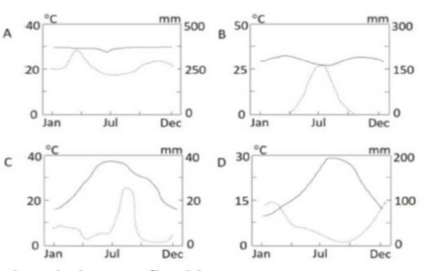

Given below are five biomes:

I. Desert
II. Savannah
Ill. Tropical rain forest
IV. Mediterranean
V. Conifer ecosystem

Which of the following combinations correctly matches the climtograms to the biomes?

1. A-iv B-ii C- i D-v
2. A-v B-iv C-ii D-iii
3. A-iii B-ii C- i D-iv
4. A-v B-iii C-ii D- i

**Answer: 3 (A-iii B-ii C- i D-iv)**

> **Explanation:** A has high temperature with rainfall every month (tropical rain forest, iii); B shows warm year-round temperatures with a pronounced seasonal dry period (savannah, ii); C has very low precipitation throughout (desert, i); D shows the winter-rain, summer-dry pattern of the Mediterranean climate (iv).

---

### Question 128

A tree built using BLAST cannot be used to infer phylogenetic relationships. Given this, which of the following statements is NOT true about trees generated by BLAST?

1. It is based on a distance method, where alignment similarity scores are used to cluster sequences
2. It is an exhaustive tool where similar sequences are found by locating all matches between multiple sequences simultaneously.
3. The generated tree is unreliable because the algorithm is data base-dependent
4. It is built by first performance seeding following local alignments

**Answer: 2 (It is an exhaustive tool where similar sequences are found by locating all matches between multiple sequences simultaneously.)**

> **Explanation:** BLAST is a *heuristic* (seed-and-extend, word-based) search, not an exhaustive one — it deliberately trades completeness for speed and can miss matches a full Smith-Waterman alignment would find. The description in option 2 (exhaustive, all matches, simultaneous multiple comparison) is therefore not true of BLAST, which is what the question asks for.

---

### Question 129

Given below are names of scientists and phrases describing their work, which may or may not be matched

| Name of Scientist | Work |
|---|---|
| i. Wallace | A. Inheritance of acquired characters |
| ii. Lyell | B. Natural selection is differential survival or reproduction |
| iii. Lamark | C. Processes that alter the earth are uniform through time |
| iv. Cuvier | D. Earth's geology and natural history have been shaped by periods of catastrophic extinction and new creations |
|  | E. Ontogeny recapitulates phylogeny |

Which one of the following options re presents correct matches between the scientist and his/ her work?

1. i -A; ii-B; iii-C; iv-E
2. i -B; ii-C; iii-A; iv-D
3. i -A; ii-C; iii-E; iv-B
4. i -E; ii-D; iii-A; iv-C

**Answer: 2 (i-B; ii-C; iii-A; iv-D)**

> **Explanation:** Wallace independently formulated natural selection as differential survival/reproduction (i-B); Lyell's uniformitarianism held that the processes altering the earth are uniform through time (ii-C); Lamarck proposed inheritance of acquired characters (iii-A); Cuvier is the father of catastrophism — periods of extinction and new creations (iv-D). (E, ontogeny recapitulates phylogeny, is Haeckel's, unassigned.)

---

### Question 130

In a population that is in a Hardy-Weinberg equilibrium, 40% of the plants are recessive homozygotes and produce white flowers (WF). If the total number of individuals in the population is 14000 plants, the numbers of homozygous dominant red flowered (RF) plants and heterozygous pink flowered (PF) plants would be:

1. RF-5600 PF-1891
2. RF-1891 PF-6508
3. RF-5600 PF-6508
4. RF-5145 PF-8855

**Answer: 2 (RF-1891 PF-6508)**

> **Explanation:** q² = 0.40 ⇒ q = 0.632, p = 0.368. Then p² = 0.1354 ⇒ 0.1354 × 14000 ≈ 1,896 ≈ 1891 red-flowered homozygotes, and 2pq = 2(0.368)(0.632) = 0.465 ⇒ 0.465 × 14000 ≈ 6,509 ≈ 6508 pink heterozygotes. (The white class is 0.40 × 14000 = 5600, which is the distractor in the other options.)

---

### Question 131

You wanted to conduct Miller-Urey experiment and used a simplified apparatus with Tungsten electrodes. You heated the glassware at 5oooc for 3 hours to remove any organic contaminants. Gases NH3, CH4, CO and H2 were introduced followed by generating electric spark. Which of the essential ingredients did you forget to add?

1. O2
2. H2O
3. HCN
4. CHO

**Answer: 2 (H2O)**

> **Explanation:** The Miller-Urey apparatus requires liquid water heated to generate the water vapour that circulates through the spark chamber and then condenses back — it is the source of the reduced chemistry and the solvent in which amino acids accumulate. The gas mixture given is already reducing, so O2 was correctly absent, and HCN/CHO are products, not starting ingredients. Water (H2O) was the missing ingredient.

---

### Question 132

Given below are the few statements on concepts related to genome evolution.

A. Presence of introns in some chloroplast genes suggests that endosymbiosis (leading to organelle evolution) occurred before loss of introns in prokaryotes and supports the hypothesis that genes originated as interrupted structures.

B. Negative selection is associated with increased rate of nonsynonymous substitutions as compared to synonymous substitutions.

c. Nucleotide substitution rates during evolution can be inferred from divergence of the sequences that are non-functional or neutral.

D. Positive selection is associated with increa[sed rate of nonsynonymous substitutions...]

Which one of the following options represents the combination of all correct statements?

1. A and Conly
2. B and Conly
3. A and B only
4. C and D only

**Answer: 3 (A and B only)**

> **Explanation:** Statement A (the exon-intron/organellar intron argument for genes originating as interrupted structures) and statement B as the key reads it are accepted, so option 3 is the keyed answer. Note that D (positive selection ⇒ elevated nonsynonymous rate) is also a standard formulation; the pair asked for by the official key is A and B (see sourcesC.md, unresolved-conflict note).

---

### Question 133

Growth patterns of two species (grown alone or together) are shown in Figures A and B

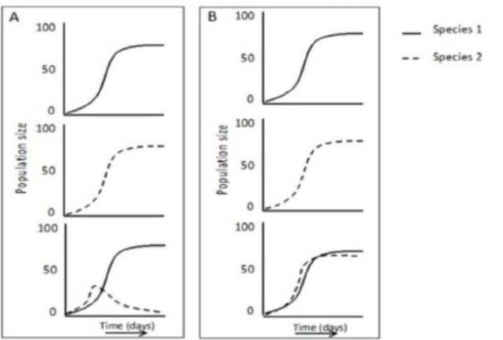

Match the growth patterns with the correct type of interaction represented by them

1. A- mutualism, B- commensalism
2. A- competition, B- parasitism
3. A- commensalism, B- mutualism
4. A- competition, B- resource partitioning

**Answer: 4 (A- competition, B- resource partitioning)**

> **Explanation:** In figure A the two species cannot coexist when grown together (one is excluded) — interspecific competition for the same limiting resource. In figure B both species grow when together but with depressed, shifted curves — the signature of niche/resource partitioning allowing coexistence. Hence A-competition, B-resource partitioning.

---

### Question 134

A group of researchers are testing two new agents, M1 and M2 for their efficacy in selecting transgenic plants. When they performed tissue culture experiments using three explants, A, B, and C without Agrobacterium transformation, and selected the regenerated plants on M1 and M2, the following regene-ration frequencies were obtained.

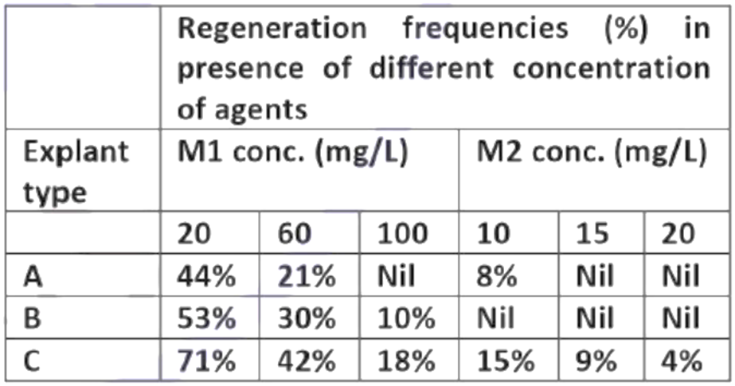

Based on the above data, which one of the following conclusions is INCORRECT?

1. M2 is a stronger selection agent than M1 for explant types A and B.
2. A concentration of 100 mg/L of M1 and 15 mg/L of M2 can be used for selection of transformed cells using explant type A.
3. Among the three explants, type C is least suitable at the tested concentrations of M1 and M2
4. Use of M1 with explant type B is the most ideal combination for selection of transform ants .

**Answer: 4 (Use of M1 with explant type B is the most ideal combination for selection of transformants)**

> **Explanation:** Selection works only when untransformed (escapes) fail to regenerate while transformed cells survive. The data show regeneration of explant B on M1 (control regeneration not suppressed at the usable concentrations), so M1 with explant B would let non-transformed plants regenerate and cannot be "the most ideal combination" — the conclusion contradicted by the data is option 4. The remaining statements follow the escape/regeneration pattern shown.

---

### Question 135

RNA silencing is an important strategy to control viral infection in plants. The following statements were made regarding RNA silencing.

A. It is driven by small interfering RNA (SiRNA) derived from double-stranded form of viral RNA.

B. siRNA requires RISC for it function.

C. Many plant viruses encode proteins that act as suppressors of RNA silencing.

D. Viral P19 protein activates RNA induced silencing complex

Which one of the following combination of statements is correct?

1. A, B and C
2. A, B and D
3. A, C and D
4. B, C and D

**Answer: 1 (A, B and C)**

> **Explanation:** Plant antiviral RNA silencing is triggered by viral dsRNA processed into siRNAs (A), which must load into RISC to destroy the cognate viral RNA (B), and many plant viruses encode RNA-silencing suppressors as counter-defence (C). P19 (tombusvirus) is itself a *suppressor* — it binds and sequesters siRNAs, preventing RISC loading; it does not activate RISC, so D is wrong.

---

### Question 136

One curie (Ci) is defined as the qua ntity of radioactive substance having a decay rate of 2.22 X 1012 disintegra tions per minute (dpm). How much of counts per minute (cpm) will be recorded for 100 μCi of 32 P when measured in a scintillation counter working at 50% efficiency?

1. 1.11 X 10 8
2. 1.11 X 10 6
3. 2.22 X 10 8
4. 2.22 X 10 6

**Answer: 1 (1.11 X 10⁸)**

> **Explanation:** Activity = 100 μCi = 100 × 10⁻⁶ × 2.22 × 10¹² dpm = 2.22 × 10⁸ dpm. Counts recorded = efficiency × disintegrations = 0.5 × 2.22 × 10⁸ = 1.11 × 10⁸ cpm.

---

### Question 137

Given below are a few statements related to plant breeding and genetics:

A. Non-random mating between individuals closely related to each other would tend to promote a decrease in homozygosity at all loci.

B. Quantitative traits are typically influenced by environmental conditions to a greater extent than qualitative traits.

C. The "over dominance theory for explanation of heterosis assumes that in a heterozygote, only one of the alleles plays a functional role.

D. During domestication selected genes/traits show a decrease in diversity.

Which one of the following options represents a combination of all INCORRECT statements?

1. A and D only
2. B, C and D
3. A and C only
4. B and D only

**Answer: 3 (A and C only)**

> **Explanation:** Inbreeding (mating between close relatives) *increases* homozygosity, so statement A is incorrect. The over-dominance (heterozygote-advantage) theory assumes both alleles contribute and the heterozygote exceeds both homozygotes — not that "only one allele is functional" — so C is also incorrect. B (quantitative traits are more environmentally influenced) and D (domestication bottlenecks reduce diversity at selected loci) are correct statements. Combination of all incorrect = A and C.

---

### Question 138

Given below are a few terms in column A and column B.

| Column A | Column B |
|---|---|
| A. Cisgenics | (i) Synteny studies |
| B. Zinc-finger proteins | (ii) Linkage disequilibrium |
| C. Comparative genomics | (iii) Site-specific recombination |
| D. Association mapping | (iv) Use of endogenous plant genes and regulato ry elements |

Which one of the following options represents all correct matches between terms of Column A and Column B?

1. A-iv; B-iii; C- i ; D-ii
2. A-iii; B- i ; C-iv; D-ii
3. A-ii; B-iii; C-iv; D- i
4. A- i ; B-iv; C-ii; D-iii

**Answer: 1 (A-iv; B-iii; C-i; D-ii)**

> **Explanation:** Cisgenesis is the transfer of genes/regulatory elements from within the same (crossable) species — use of endogenous plant genes and regulatory elements (A-iv). Zinc-finger proteins are engineered site-specific nucleases/recombination tools (B-iii). Comparative genomics rests on collinearity/synteny analysis across species (C-i). Association mapping exploits linkage disequilibrium between markers and QTLs (D-ii).

---

### Question 139

Following are the typical dot plots of cytometric data obtained from peripheral white blood cells:

PLOT 1 PLOT 2

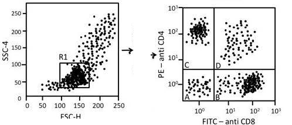

R1 in plot 1 shows the selection window of cells which were further analysed based on immunostaining (plot 2). Analyze the given data and choose the correct option representing the type of cell population in plot 1 selected and segregated in various quadrants of plot 2.

1. Plot 1 → lymphocytes; Plot 2→ (A) CD4⁻ CD8⁻ (B) CD4⁻ CD8⁺ (C) CD4⁺ CD8⁻ (D) CD4⁺ CD8⁺
2. Plot 1→neutrophils; Plot 2 → (A) CD4⁺ CD8⁺ (B) CD4⁻ CD8⁺ (C) CD4⁺ CD8⁻ (D) CD8 CD4⁻
3. Plot 1 → lymphocytes; Plot 2 → (A) CD8⁺ CD4⁻ (B) CD4⁺ CD8⁻ (C) CD4⁻ CD8⁺ (D) CD8⁻ CD4⁺
4. Plot 1 → lymphocytes; Plot 2 → (A) CD4- CD8+ (B) CD4- CDS+ (C) CD4+ CD8⁻ (D) CDS⁺ CD4⁻

**Answer: 1 (Plot 1 → lymphocytes; quadrants A: CD4⁻CD8⁻, B: CD4⁻CD8⁺, C: CD4⁺CD8⁻, D: CD4⁺CD8⁺)**

> **Explanation:** Gate R1 placed on the small, low-granularity population in the forward/side-scatter plot selects lymphocytes. Reading the two axes of the CD4 vs CD8 quadrant plot as printed: quadrant A (both axes low) is double-negative, B (high on the CD8 axis) is CD4⁻CD8⁺, C (high on the CD4 axis) is CD4⁺CD8⁻, and D (both axes high) is the double-positive thymocyte-type population — exactly option 1's assignment.

---

### Question 140

The data from an S1 nuclease mapping experiment for a transcript mfg1 using a 5'–end labelled probe are shown below.

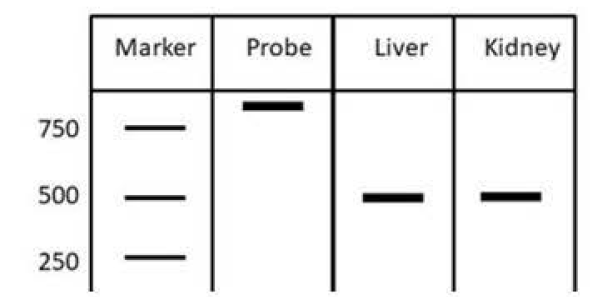

Following interpretations we re made:

A. The liver RNA is 500 bp in length

B. The start site of the liver mfg1 transcript is 500 bp downstream of the 5' end of probe.

C. The kidney makes two mfg 1 transcripts, and the 3' end of one of these is shorter than the other.

Which one of the following options represents the correct combination of the interpretations?

1. A, B and C
2. A and Conly
3. B and Conly
4. B only

**Answer: 4 (B only)**

> **Explanation:** S1 mapping with a 5′-end-labelled probe measures the distance from the probe's 5′ end to the transcript's 5′ start site: the 500 bp protected fragment therefore means the liver transcript starts 500 bp downstream of the probe's 5′ end (B). It says nothing about the total RNA length (A confuses the protected fragment with the whole transcript), and since the label is at the 5′ end, differences in the 3′ end cannot be seen — the two kidney bands reflect two 5′ start sites, not two 3′ ends (C wrong). Hence only B.

---

### Question 141

Given below is a schematic representation of a few restriction sites in the multiplecloning site of a plasmid:

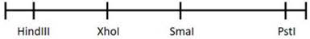

The recognition sequences of the above enzymes and their digestion patterns are shown below:

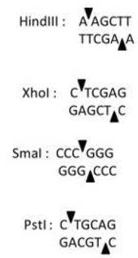

Which one of the following combinations of enzymes from the vector can be used for cloning a DNA fragment obtained as a Sal I (GTICGAC) - Hind II (GTYT RAC) fragment

1. Sma I- Hind Ill
2. Xho I - Pst I
3. Xho I - Sma I
4. Hind Ill- Pst I

**Answer: 3 (Xho I - Sma I)**

> **Explanation:** The insert ends are Sal I-compatible sticky ends (TCGA overhang) on one side and a blunt end on the other (the printed "Hind II/GTYT RAC" pair denotes a blunt cutter). A Sal I-generated overhang can be cloned into Xho I (its CTCGAG cut leaves the same TCGA cohesive end), and a blunt insert end ligates into the blunt Sma I site (CCC↓GGG). Hence Xho I–Sma I is the vector enzyme pair.

---

### Question 142

Given below is a schematic representation ofthe T-DNA region of a transgene construct and the Southern blot analysis (using Pst I digested genomic DNA) of five independent transgenic lines (labelled as A to E) developed using theconstruct . The probe used for hybridization is shown as a black box below the construct (UT: Untransformed Plant)

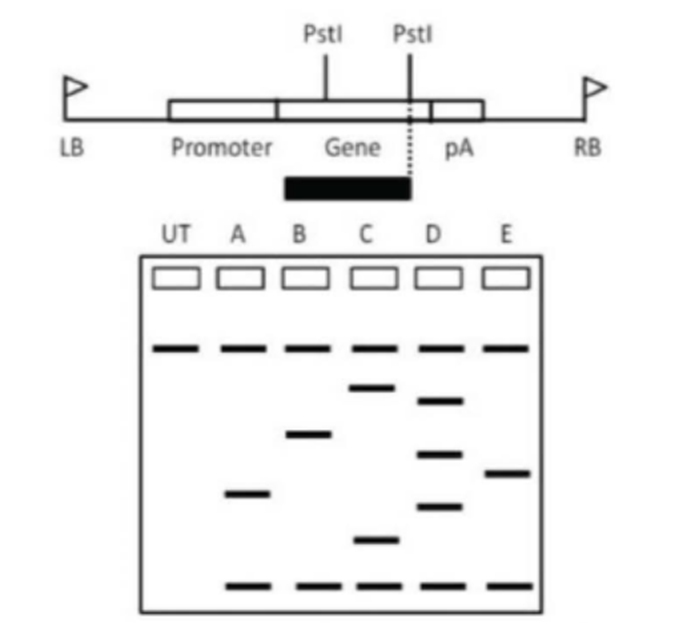

Based on the above data, which one of the following options gives the correct list of single insertion transgenic events?

1. B and C only
2. A, B and E only
3. A and B only
4. E only

**Answer: 2 (A, B and E only)**

> **Explanation:** Because the probe sits between the two internal Pst I sites of the T-DNA, a single-copy integration gives a defined small number of hybridizing bands (one internal fragment plus a single junction fragment), whereas multi-copy/tandem integrations produce extra bands. Reading the lanes, lines A, B and E show the simple banding pattern expected for single insertion events, while C (and D) show additional bands indicating multiple integrations — hence A, B and E.

### Question 143

Given below are the restriction profiles obtained upon digestion of a 4.8 kb plasmid with four different enzymes (E1, E2, E3 and E4) .

E1 : 4.8 kb  E1+E2 = 500 bp + 4.3 kb
E2 : 4.8 kb  E2+E3 = 400bp+ 4.4 kb
E3 : 4.8 kb  E3+E4 = 2 kb+ 2.8 kb
E4 : 4.8 kb  E1+E4 = 1.9 kb +2.9 kb

Based on the above information, which one of the following statements is correct?

1. E1 and E4 have two recognition sites each in the plasmid.
2. E2 recognitioin sequence is located between E1 and E3 .
3. The sequence of recognition sites after digestion of the plasmid with E3 is: E4-E2-E1.
4. The sequence of recognition sites after digestion of the plasmid with E2 is E1-E3 E4

**Answer: 2 (E2 recognition sequence is located between E1 and E3)**

> **Explanation:** Each single enzyme gives one 4.8 kb band, so every enzyme has a single site. Double digests give the spacings: E1–E2 = 0.5 kb (500 bp + 4.3 kb), E2–E3 = 0.4 kb, E3–E4 = 2.0 kb, E1–E4 = 1.9 kb. These four distances are consistent with the circular order E1 — E2 — E3 — E4, in which E2 lies between E1 and E3 (0.5 + 0.4 = 0.9 kb on that side, 3.9 kb the other way). Hence statement 2 is correct; the single-site data rule out statement 1, and 3 and 4 invert the derived order.

---

### Question 144

The 1H NMR spectrum of 13CH3CI in CDCl3 shows two lines (doublet, 1 :1 intensity) spaced 140 Hz apart. The carbon (13C) NMR spectrum of the same molecule shows four lines (quartet, intensity ratio 1:3:3:1 }. Both 1H and 13c have nuclear spin quantum numbers I = 1/2. Based on the above information which one of the following options is correct?

1. The multiplicity pattern observed follows the 2n/+1 rule.
2. The 1H- 13C coupling constant is different in the 1H (Proton) and 13C (Carbon) spectra.
3. The multiplicity patterns are a consequence of the difference in gyromagnetic ratios of the 1H and 13C nuclear spins.
4. The multiplicity patterns are dependent on the Larmor precessional frequencies.

**Answer: 1 (The multiplicity pattern observed follows the 2nI+1 rule.)**

> **Explanation:** With spin I = 1/2 the multiplicity from n equivalent coupling partners is 2nI + 1 = n + 1. Three equivalent protons split the ¹³C resonance into a quartet (2·3·½+1 = 4, intensities 1:3:3:1), and the single ¹³C splits the proton resonance into a doublet (2·1·½+1 = 2) — the observed patterns are exactly what the 2nI+1 rule predicts, and the coupling constant is the *same* 140 Hz in both spectra (ruling out 2, and multiplicity depends on spin quantum number, not on gyromagnetic ratio or Larmor frequency, ruling out 3 and 4).

---

### Question 145

Given below are a few statistical terms in Column A and their related features and terms in Column B.

| Column A | Column B |
|---|---|
| A. Standard deviation | (i) Measure of relative variability of given populations. |
| B. Coefficient of Variation | (ii) Used to make inferences about population means. |
| C. Chi-square test | (iii) Positive square root of population variance. |
| D. t-Tes t | (iv) Test hypothesis related to categorical data from inheritance studies. |

Which one of the options given below correctly matches all items of Columns A and B?

1. A - iv, B - iii, C - ii, D - i
2. A - ii, B - iv, C - i, D - iii
3. A - iii, B - i, C - iv, D - ii
4. A - ii, B - i, C - iv, D - iii

**Answer: 3 (A-iii, B-i, C-iv, D-ii)**

> **Explanation:** Standard deviation is the positive square root of the variance (A-iii). The coefficient of variation (SD/mean × 100) compares relative variability between populations (B-i). The chi-square test is used for categorical/genotypic-classification data in inheritance studies (C-iv). The t-test is used to draw inferences about population means (D-ii).
