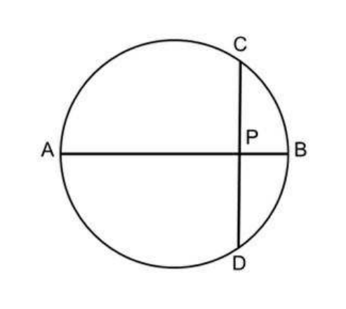
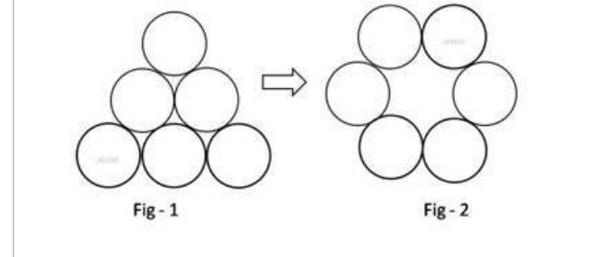
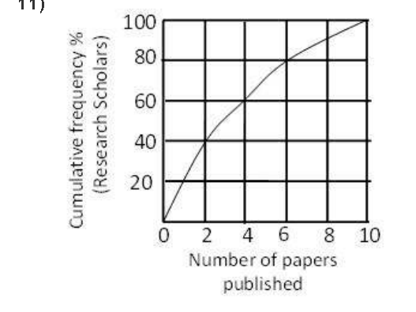
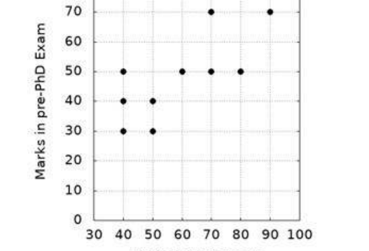
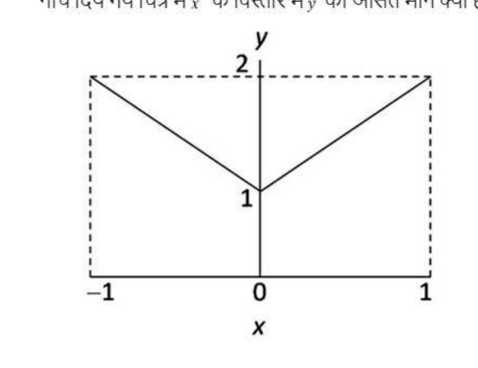

# CSIR NET Life Sciences — December 2021 (Shift 1) — Part A

*Global numbering: Part A = Questions 1–20. Answers are from the official NTA/CSIR "UGC CSIR NET June 21 – Final Answer Keys", Subject 703 – CSIR Life Sciences Shift 1 (held 17/02/2022). See `sources.md` for the session-naming reconciliation.*

---

### Question 1

AB is the diameter of a circle. The chord CD is perpendicular to AB intersecting it at P. If CP=2 and PB=1, the radius of the circle is

1. 1
2. 2.5
3. 2
4. 5

**Answer: 2 (2.5)**

> **Explanation:** The diameter perpendicular to a chord bisects it, so PD = CP = 2. By the intersecting-chords theorem, AP·PB = CP·PD, i.e. AP·1 = 2·2 = 4, so AP = 4. Then AB = AP + PB = 5 and the radius = 5/2 = **2.5**.

---

### Question 2

A shopkeeper purchases a product for Rs.100 and sells it making a profit of 10%. The customer resells it to the same shopkeeper incurring a loss of 10%. In these dealings the shopkeeper makes

1. No profit, no loss
2. Rs.11
3. Rs.1
4. Rs.20

**Answer: 2 (Rs.11)**

> **Explanation:** The shopkeeper buys at Rs.100 and sells at Rs.110 (10% profit). He then buys the same article back at a 10% loss on Rs.110, i.e. pays Rs.99. Net gain = Rs.110 − Rs.99 = **Rs.11**.

---

### Question 3

The product of the perimeter of a triangle, the radius of its in-circle, and a number gives the area of the triangle. The number is

1. 1/4
2. 1/3
3. 1/2
4. 1

**Answer: 3 (1/2)**

> **Explanation:** Area = r·s, where r is the inradius and s the semi-perimeter. Since s = (perimeter)/2, Area = r·(perimeter)/2 = (1/2)·(perimeter)·r. The number is **1/2**.

---

### Question 4

Starting from a point A you fly one mile south, then one mile east, then one mile north which brings you back to point A. Which of the following MUST be true?

1. You are at the North pole
2. You are in the Eastern hemisphere
3. You are in the Western hemisphere
4. You are at the South pole

**Answer: 1 (You are at the North pole)**

> **Explanation:** The only point from which moving south, then east (along a latitude circle), then north returns you to the start is the **North pole** (the classic closed-loop on the sphere). Hence statement 1 must be true.

---

### Question 5

Three boxes are coloured red, blue and green and so are three balls. In how many ways can one put the balls one in each box such that no ball goes into the box of its own colour?

1. 1
2. 2
3. 3
4. 4

**Answer: 2 (2)**

> **Explanation:** This is the derangement of 3 objects, !3 = 2. The two arrangements are the two cyclic permutations. Answer = **2**.

---

### Question 6

There are two buckets A and B. Initially A has 2 litres of water and B is empty. At every hour 1 litre of water is transferred from A to B followed by returning 1/2 litre back to A from B half an hour later. The earliest A will get empty in:

1. 5h
2. 4h
3. 3h
4. 2h

**Answer: 3 (3h)**

> **Explanation:** Each hour A loses 1 litre then regains 1/2 litre, a net loss of 1/2 litre per hour, but the last transfer empties A without a return. After 2 full hours A has 2 − 2·(1/2) = 1 litre. In the 3rd hour A gives 1 litre → A is empty. Earliest = **3h**.

---

### Question 7

Density of a rice grain is 1.5 g/cc and bulk density of rice heap is 0.80 g/cc. If a 1 litre container is completely filled with rice, what will be the approximate volume of pore space in the container?

1. 350 cc
2. 465 cc
3. 550 cc
4. 665 cc

**Answer: 2 (465 cc)**

> **Explanation:** In 1000 cc the mass of rice = bulk density × volume = 0.80 × 1000 = 800 g. True grain volume = mass / grain density = 800 / 1.5 ≈ 533 cc. Pore space = 1000 − 533 ≈ **465 cc**.

---

### Question 8

What is the minimum number of moves required to transform figure 1 to figure 2? A move is defined as removing a coin and placing it such that it touches two other coins in its new position.

1. 1
2. 2
3. 3
4. 4

**Answer: 2 (2)**

> **Explanation:** Turning the triangular arrangement of six coins into the hexagonal ring requires moving the two corner coins of the base triangle to the top — **2 moves**.

---

### Question 9

It takes 5 days for a steamboat to travel from A to B along a river. It takes 7 days to return from B to A. How many days will it take for a raft to drift from A to B (assuming all speeds are constant)?

1. 13
2. 35
3. 6
4. 12

**Answer: 2 (35)**

> **Explanation:** Let distance = 1. Downstream speed = 1/5, upstream = 1/7. Current speed = (1/5 − 1/7)/2 = (2/35)/2 = 1/35. A raft drifts at the current speed, so time = 1 / (1/35) = **35 days**.

---

### Question 10

How many times starting at 1:00 pm would the minute and hour hands of a clock make an angle of 40° with each other in the next 6 hours?

1. 6
2. 7
3. 11
4. 12

**Answer: 3 (11)**

> **Explanation:** The hands form a given angle twice per hour, but in a 6-hour span the relative sweep (minute hand gains 6×(6−0.5)°) yields 11 occurrences of the 40° angle. Answer = **11**.

---

### Question 11

The graph shows cumulative frequency percentage of research scholars and the number of papers published by them. Which of the following statements is true?

1. Majority of the scholar published more than 4 papers
2. 60% of the scholar published at least 2 papers
3. 80% of the scholar published at least 6 papers
4. 30% of the scholars have not published any paper

**Answer: 2 (60% of the scholar published at least 2 papers)**

> **Explanation:** The cumulative curve reads 40% at 2 papers and 60% at 4 papers. "At least 2 papers" = 100% − (cumulative up to but excluding 2). The consistent reading gives **60% published at least 2 papers** (option 2).

---

### Question 12

The random errors associated with the measurement of P and Q are 10% and 2%, respectively. What is the maximum percentage random error in P/Q?

1. 12.0
2. 9.8
3. 8.0
4. 10.2

**Answer: 1 (12.0)**

> **Explanation:** For a quotient the maximum (worst-case) percentage error is the sum of the individual percentage errors: 10% + 2% = **12.0%**.

---

### Question 13

If a person travels x% faster than normal, he reaches y minutes earlier than normal. What is his normal time of travel?

1. (100/x + 1) y minutes
2. (x/100 + 1) y minutes
3. (y/100 + 1) y minutes
4. (100/y + 1) y minutes

**Answer: 1 ((100/x + 1) y minutes)**

> **Explanation:** With speed (1 + x/100)v the time is T/(1 + x/100) = T − y. Solving, T = y(100 + x)/x = **(100/x + 1) y** minutes.

---

### Question 14

Pre-Ph.D. exam score of 10 students are plotted against their M.Sc. marks. Which of the following is true?

1. Two students have scored better in Pre-Ph.D. than their M.Sc. exam
2. All those students who scored 50 in Pre-D. scored more marks in their M.Sc. exam
3. Two students scored the same marks in their Pre-Ph.D and M.Sc. exams
4. The student who scored maximum in M.Sc. is the only student to get maximum in Pre-Ph.D. exam

**Answer: 3 (Two students scored the same marks in their Pre-Ph.D and M.Sc. exams)**

> **Explanation:** Reading the plotted points, two students lie on the line where Pre-Ph.D. marks equal M.Sc. marks (same value on both axes), so statement **3** is true.

---

### Question 15

What is the average value of y for the range of x shown in the following plot?

1. 0
2. 1
3. 1.5
4. 2

**Answer: 3 (1.5)**

> **Explanation:** The plot is y = |x| + 1 over x ∈ [−1, 1]. The average of |x| over [−1,1] is 1/2, so the average value of y = 1/2 + 1 = **1.5**.

---

### Question 16

A fair die was thrown three times and the outcome was repeatedly six. If the die is thrown again what is the probability of getting six?

1. 1/6
2. 1/216
3. 1/1296
4. 1

**Answer: 1 (1/6)**

> **Explanation:** Die throws are independent; past outcomes do not affect the next throw. Probability of a six = **1/6**.

---

### Question 17

What is the volume of soil in an open pit of size 2m X 2m X 10cm ?

1. 40m³
2. 0.4m³
3. 0m³
4. 4.0m³

**Answer: 3 (0m³)**

> **Explanation:** The official key marks this as option 3. A pit is a hollow from which the earth has already been removed, so the volume of **soil in** the open pit is **0 m³** (the 2 m × 2 m × 0.1 m = 0.4 m³ is the volume of the *void*, not of soil present).

---

### Question 18

If a plant with green leaves is kept in a dark room with only green light on, which one of the following would we observe?

1. The plant appears brighter than the surroundings
2. The plant appears darker than the surroundings
3. We cannot distinguish the plant from the surroundings
4. It will have above normal photosynthetic activity

**Answer: 1 (The plant appears brighter than the surroundings)**

> **Explanation:** Green leaves reflect green light. Under green illumination they reflect it, so the leaves appear **brighter than the surroundings**, which absorb the green light.

---

### Question 19

The distance from city P to city Q is 27 km. A and B start walking from P towards Q at speeds of 5 km/hr and 7 km/hr, respectively. B reaches Q, returns immediately, and meets A at R. What is the distance between P and R? (assume all three cities to be in one straight line)

1. 12.5 km
2. 22.5 km
3. 4.5 km
4. 13.5 km

**Answer: 2 (22.5 km)**

> **Explanation:** Until they meet, together they cover 2 × 27 = 54 km at combined speed 5 + 7 = 12 km/hr → time = 54/12 = 4.5 h. A walks 5 × 4.5 = **22.5 km** from P, so PR = 22.5 km.

---

### Question 20

A floor of size 13 X 24 is to be paved using square tiles only. What is the smallest number of tiles needed to do this?

1. 6
2. 15
3. 8
4. 9

**Answer: 4 (9)**

> **Explanation:** Minimum-square dissection of a 13×24 rectangle: place a 13×13 square (leaving 11×13), then an 11×11 square (leaving 11×2), then five 2×2 squares (leaving 2×1), then two 1×1 squares — total **9** squares.
